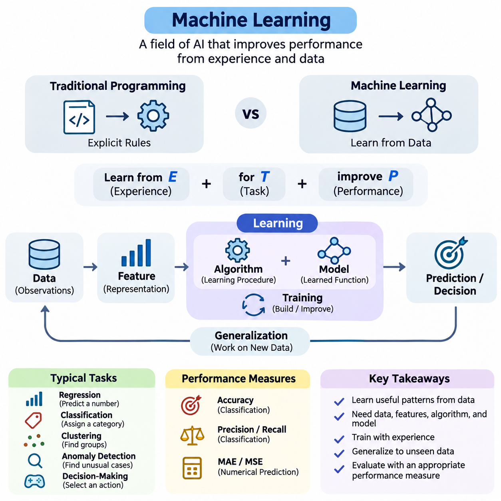
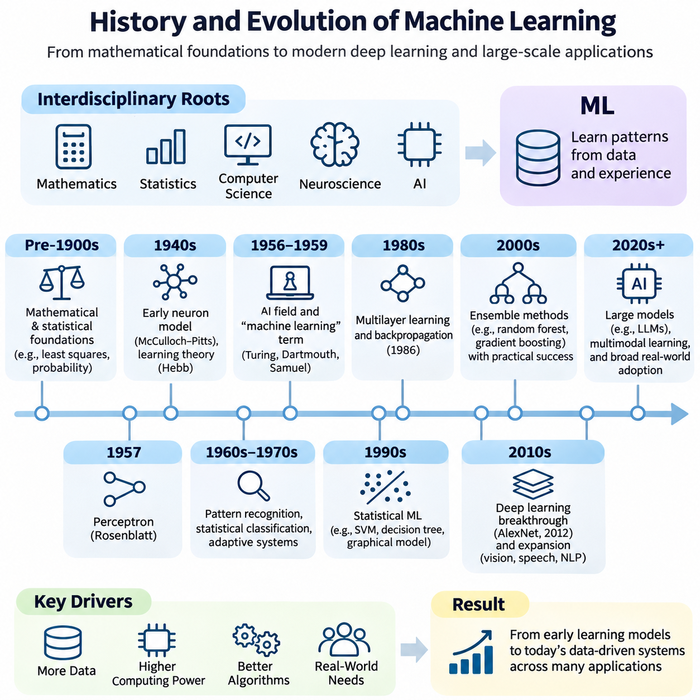
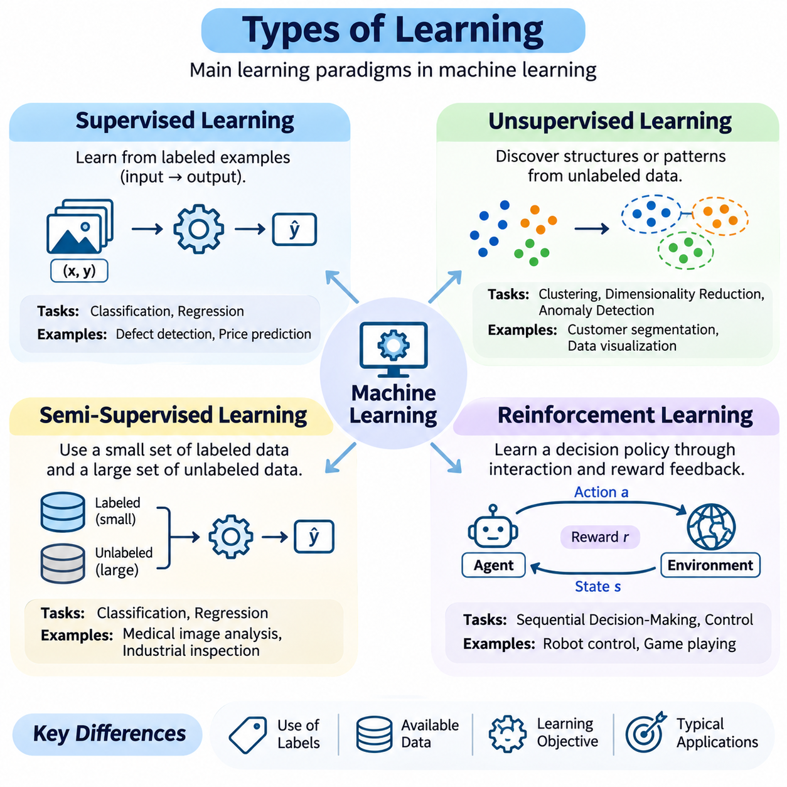
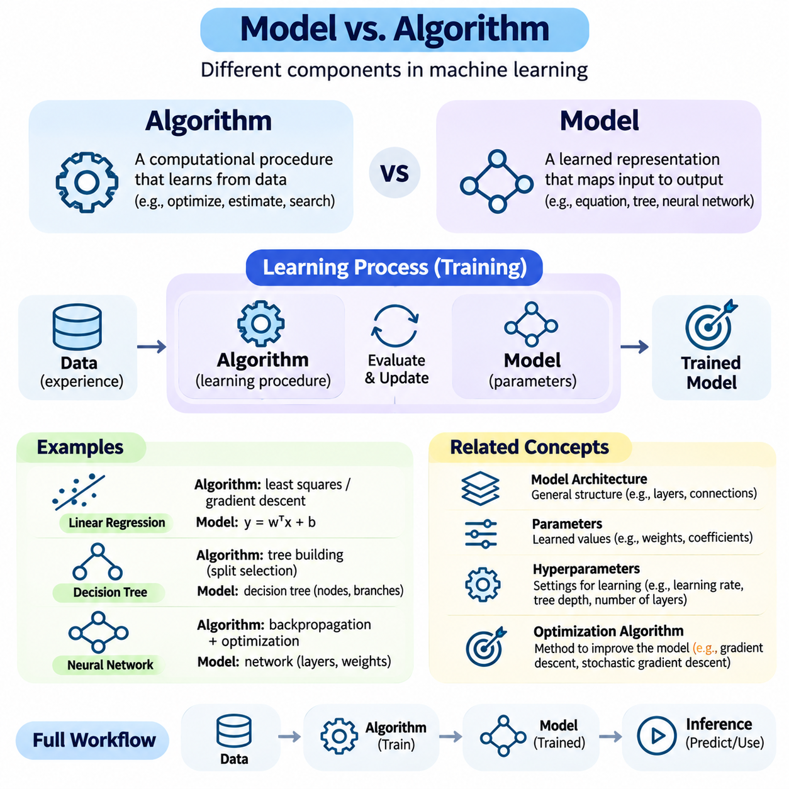
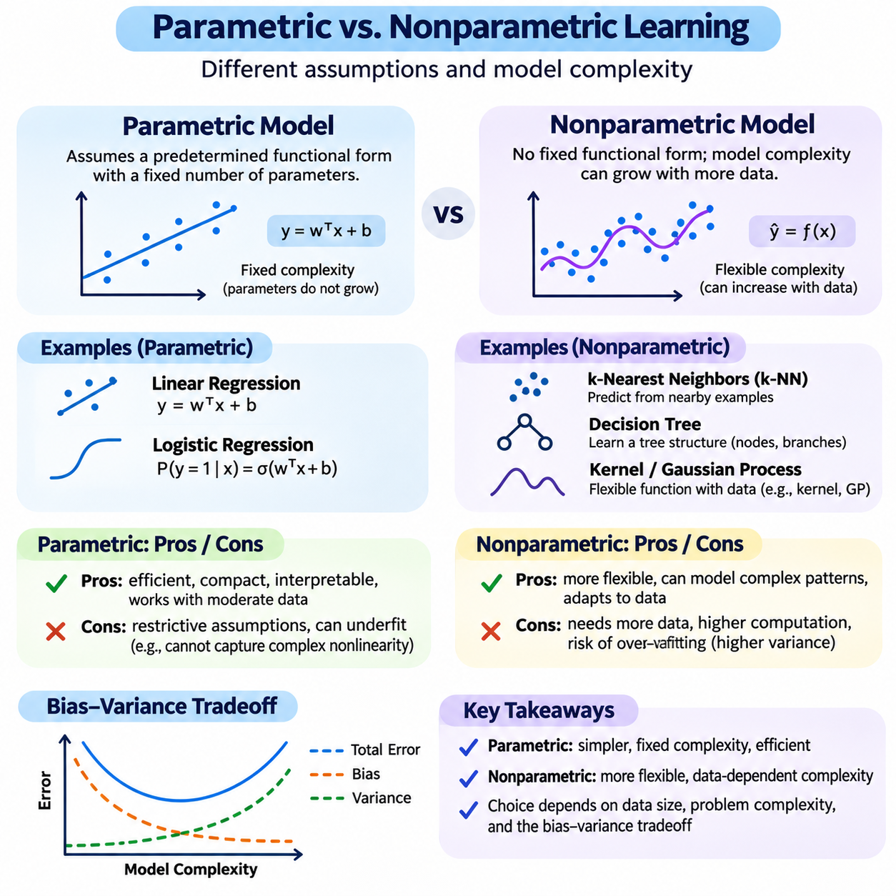
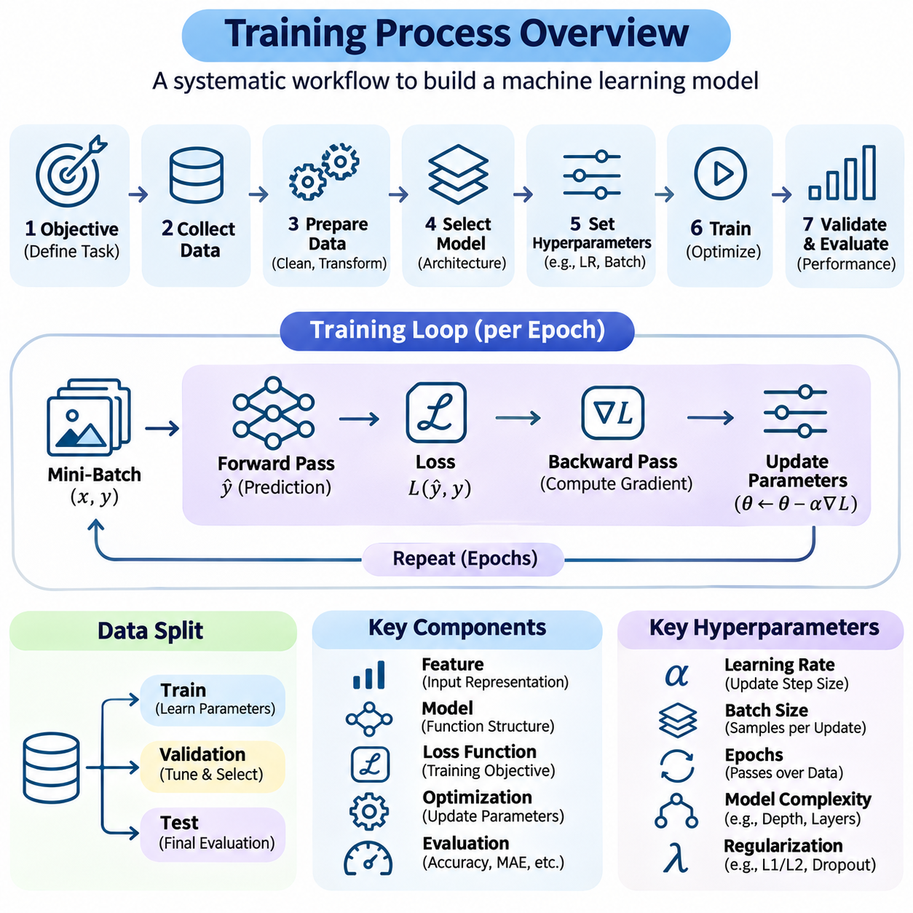
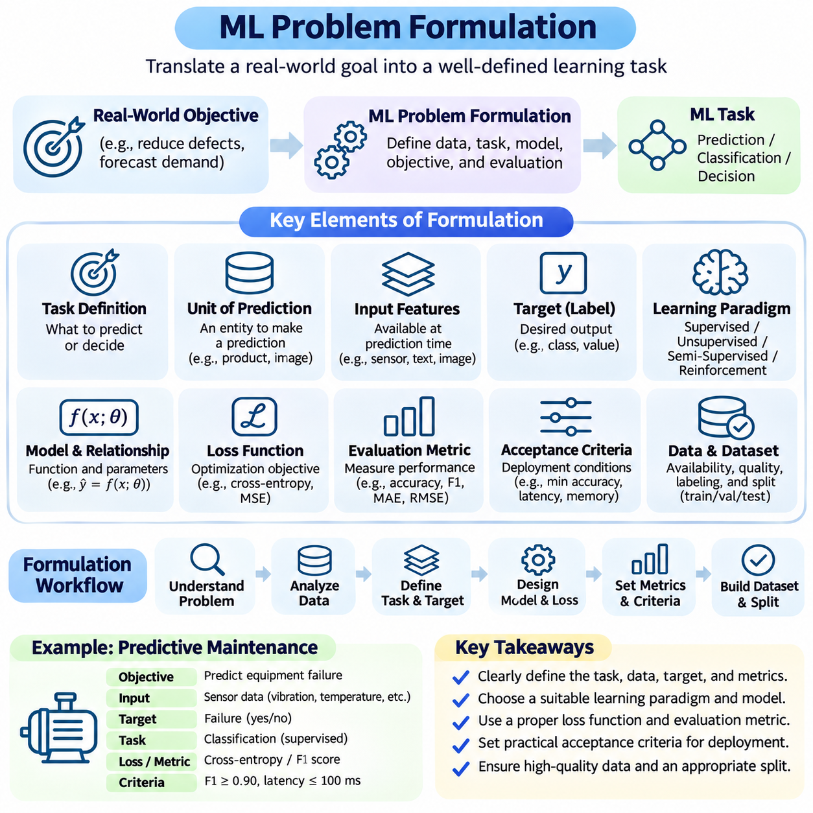
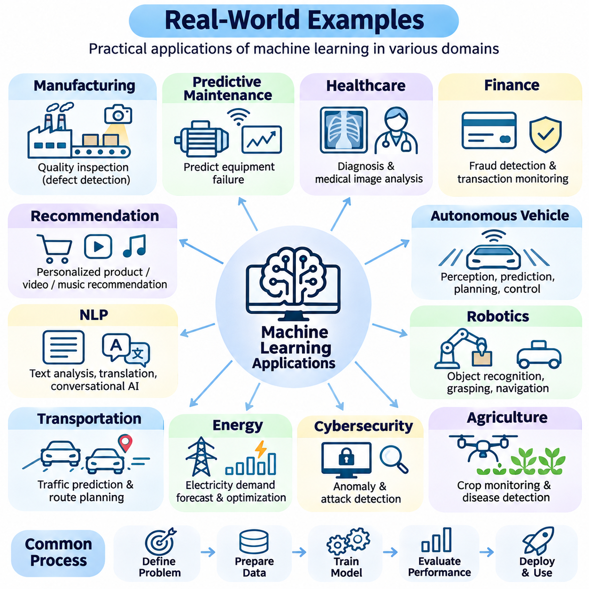

**Volume 07. Machine Learning Fundamentals**

# 01. What is Machine Learning

## 01.00 Definition of ML

{width="7.268055555555556in" height="7.268055555555556in"}

Machine learning is a field of artificial intelligence that enables computational systems to improve their performance through experience and data rather than relying exclusively on explicitly programmed instructions. Instead of defining every possible decision rule, developers design learning procedures that identify useful patterns, relationships, and structures within observations. The resulting systems can make predictions, recognize patterns, or support decisions when presented with new information.

The central principle of machine learning is that knowledge relevant to a task can be acquired from examples or interactions. A traditional program follows instructions written directly by a programmer, while a machine learning system adjusts its internal representation according to observed evidence. This distinction does not eliminate programming. Developers still specify objectives, algorithms, data processing procedures, and operational constraints that determine how learning occurs.

A widely accepted conceptual definition describes machine learning through three components: experience, task, and performance. A system learns from experience E with respect to a task T and performance measure P when its performance on T, as measured by P, improves through E. This formulation emphasizes that learning must produce measurable improvement rather than simply storing additional information. It also establishes a practical foundation for evaluating whether a system has learned successfully.

Experience can take several forms depending on the learning problem. It may consist of labeled examples, unlabeled observations, interactions with an environment, or feedback generated by previous decisions. In image recognition, experience may include photographs associated with object categories. In robotic control, experience may involve sensor readings, executed actions, and observed outcomes. The available experience influences what relationships the system can discover.

A machine learning task defines the behavior that a system is expected to perform. Typical tasks include predicting numerical values, assigning categories, detecting unusual observations, estimating probabilities, and selecting actions. Each task requires an appropriate representation of inputs and outputs. For example, predicting electricity consumption involves estimating a continuous quantity, whereas identifying defective products involves determining whether an observation belongs to a particular category.

Performance measures provide quantitative evidence of how effectively a system accomplishes its task. Classification systems may be evaluated using accuracy, precision, or recall, while numerical prediction systems may use mean absolute error or mean squared error. The selected measure should reflect the actual objective of the application. A model that achieves high accuracy on a balanced benchmark may still perform poorly when deployed in an environment containing rare but important events.

The relationship between data and learning is fundamental. Data represents recorded observations of objects, events, processes, or interactions, while learning algorithms extract statistical relationships from those observations. The quality, diversity, and relevance of the data strongly influence the resulting model. Large datasets do not automatically guarantee successful learning, particularly when observations contain systematic errors, misleading correlations, or insufficient coverage of important operating conditions.

A feature is a measurable or encoded property used to describe an observation. Features may represent physical quantities, categorical attributes, image pixels, audio measurements, or numerical representations extracted from complex signals. In a housing price prediction problem, features might include floor area, building age, and location. The learning system examines how these properties relate to the desired output, although observed relationships do not necessarily establish causation.

A machine learning model is a mathematical or computational representation obtained through a learning procedure. It transforms input information into predictions, scores, representations, or actions according to its learned structure. A simple model may use a weighted combination of numerical features, while a complex model may contain millions of adjustable parameters. Model complexity alone does not determine quality; suitability depends on the task, available evidence, and operating requirements.

Learning algorithms determine how models are constructed or adjusted using available experience. Some algorithms estimate parameters by minimizing prediction errors, while others identify clusters, estimate distributions, or improve decisions through feedback. The algorithm is therefore distinct from the trained model. An algorithm specifies the learning procedure, whereas the resulting model contains the learned relationships that can subsequently be applied to new observations.

Training is the process through which a learning algorithm uses experience to construct or improve a model. During training, the system evaluates candidate predictions or behaviors and adjusts its representation according to an objective. In many predictive models, this involves minimizing a loss function that measures disagreement between predictions and reference values. Training may require repeated iterations, but the number of iterations does not independently indicate successful learning.

Generalization is one of the defining requirements of useful machine learning. A model should perform effectively on relevant observations that were not used to construct it. Memorizing training examples may produce excellent results on familiar data without providing reliable predictions elsewhere. Generalization therefore distinguishes the acquisition of reusable statistical relationships from simple reproduction of previously observed examples.

Machine learning differs from conventional rule-based programming in how decision logic is obtained. A rule-based system applies explicitly defined conditions, such as rejecting a transaction when its value exceeds a predetermined threshold. A machine learning system may estimate transaction risk using patterns learned from historical records. Both approaches can be useful, and practical systems frequently combine learned predictions with deterministic rules, safety constraints, and human supervision.

Machine learning also differs from artificial intelligence as a broader discipline. Artificial intelligence encompasses computational approaches to perception, reasoning, planning, knowledge representation, and intelligent behavior. Machine learning provides methods for acquiring useful representations or behaviors from experience. Deep learning is a subset of machine learning that uses multilayer neural networks, but machine learning also includes decision trees, linear models, probabilistic methods, and numerous other approaches.

Statistical learning provides an important theoretical perspective on machine learning. Observed data is treated as evidence about an underlying process, and models attempt to capture relationships that remain useful beyond the available sample. This introduces uncertainty because observations are incomplete and may contain noise. A prediction should therefore be understood as an estimate supported by available evidence rather than an automatically verified statement about reality.

Machine learning systems generally operate under assumptions about the relationship between training experience and future observations. If these assumptions become invalid, predictive performance may deteriorate. For example, a model trained on factory equipment operating under stable conditions may encounter unfamiliar behavior after mechanical modifications. Such changes illustrate why model reliability depends not only on the learning algorithm but also on the environment in which predictions are used.

The ability to learn from data does not imply that a machine learning system possesses human understanding or independent reasoning capabilities. A model may identify highly predictive statistical patterns without understanding their physical causes or broader meaning. It may also produce confident outputs when encountering unfamiliar situations. Consequently, effective machine learning requires careful interpretation of predictions, awareness of uncertainty, and recognition of the boundaries established by training experience.

Machine learning is particularly valuable when useful relationships are difficult to express through explicit rules. Visual inspection, speech recognition, demand forecasting, and complex sensor interpretation involve variations that may be impractical to describe manually. Learning algorithms can approximate these relationships from representative observations. Nevertheless, machine learning is not always necessary, especially when reliable deterministic solutions are simpler, cheaper, and easier to verify.

In practical applications, machine learning should be viewed as a component of a larger computational system rather than an isolated mathematical technique. Data acquisition, preprocessing, model construction, evaluation, deployment, and monitoring collectively determine operational effectiveness. A technically sophisticated model may provide little value when its inputs are unreliable or its predictions cannot be integrated into a useful decision process.

The fundamental purpose of machine learning is to transform experience into reusable computational capability. Successful learning requires a clearly defined task, relevant evidence, an appropriate learning procedure, and measurable performance on new situations. These principles establish the conceptual foundation for understanding different learning paradigms, model architectures, training methods, and evaluation strategies. They also provide a disciplined framework for designing machine learning systems that remain useful beyond their original training data.

## 01.01 History and Evolution

{width="7.268055555555556in" height="7.268055555555556in"}

The history of machine learning reflects a gradual transformation from manually programmed computation toward systems capable of discovering patterns through experience. Its development emerged from mathematics, statistics, computer science, neuroscience, and artificial intelligence. Rather than appearing as a single invention, machine learning evolved through successive advances in learning theory, computational algorithms, data availability, and hardware capabilities.

The mathematical foundations of machine learning developed long before electronic computers became available. Statistical methods such as least squares, introduced in the early nineteenth century, established techniques for estimating relationships from observations. Probability theory and statistical inference subsequently provided tools for reasoning under uncertainty. These developments created the theoretical basis for learning patterns from incomplete and noisy data.

During the 1940s, researchers began investigating whether biological principles of learning could inspire computational systems. In 1943, Warren McCulloch and Walter Pitts introduced a mathematical model of artificial neurons, demonstrating how simplified neural structures could represent logical operations. Donald Hebb later proposed a theory of learning based on changes in connections between neurons, influencing subsequent research into adaptive computational networks.

The emergence of artificial intelligence during the 1950s created an intellectual environment in which machine learning became a distinct research direction. Alan Turing explored the possibility of intelligent machines and proposed influential ideas about machine intelligence. In 1956, the Dartmouth workshop helped establish artificial intelligence as a research field. Researchers increasingly investigated whether computers could acquire useful behavior rather than execute only predetermined instructions.

Arthur Samuel made an important contribution through his research on computer programs that learned to play checkers. His work demonstrated that performance could improve through experience and evaluation rather than complete manual specification of playing strategies. In 1959, Samuel popularized the term machine learning, helping establish a recognizable identity for the field. His experiments illustrated the practical possibility of adaptive computational behavior.

In 1957, Frank Rosenblatt introduced the perceptron, an early learning model inspired by biological neurons. The perceptron adjusted numerical weights to classify input patterns and became an influential foundation for neural network research. Its ability to learn certain decision boundaries generated considerable interest. However, the limitations of single-layer perceptrons later revealed that more complex architectures were necessary for many classification problems.

During the 1960s and 1970s, machine learning research expanded into pattern recognition, statistical classification, and adaptive systems. Researchers developed methods for identifying structures in data and estimating relationships between observations. At the same time, limitations in computing power, training methods, and available datasets constrained practical applications. These difficulties contributed to periods of reduced enthusiasm and funding for certain artificial intelligence approaches.

The 1980s brought renewed interest in neural networks through advances in multilayer learning. The popularization of backpropagation in 1986 demonstrated an effective method for adjusting weights across multiple neural network layers. This development made it practical to train models capable of representing nonlinear relationships. Although computational resources remained limited, multilayer networks established important foundations for later deep learning systems.

Statistical machine learning gained increasing prominence during the 1990s. Researchers emphasized mathematical generalization, probabilistic modeling, and systematic evaluation rather than relying exclusively on biologically inspired architectures. Support vector machines, decision trees, ensemble methods, and graphical models became influential approaches. These techniques offered practical solutions to classification, regression, and structured prediction problems across many application domains.

The growth of digital information during the late 1990s and early 2000s transformed the scale of machine learning applications. Internet services, enterprise databases, and digital sensors generated increasingly large collections of observations. Improvements in storage and distributed computation made these datasets more accessible. Machine learning became important in search engines, recommendation systems, financial analysis, spam filtering, and automated information processing.

During the 2000s, ensemble learning and large-scale statistical methods achieved strong practical results. Random forests and gradient boosting demonstrated how combining multiple predictive models could improve accuracy and robustness. Feature engineering remained central because practitioners frequently designed representations manually before training. The effectiveness of these approaches established machine learning as a valuable engineering discipline beyond academic research.

Deep learning experienced a major resurgence during the late 2000s and early 2010s. Improvements in neural network training, graphics processing units, and large datasets enabled increasingly complex architectures. In 2012, AlexNet achieved a breakthrough result in the ImageNet image classification competition. This achievement demonstrated the practical advantages of deep convolutional neural networks and accelerated their adoption in computer vision.

The success of deep learning extended beyond image recognition into speech processing, natural language processing, and sequential prediction. Recurrent neural networks and long short-term memory architectures supported learning from temporal information. Representation learning reduced dependence on manually constructed features by allowing models to discover useful internal representations. These developments changed how researchers approached problems involving complex and high-dimensional data.

In 2017, the Transformer architecture introduced an influential approach based on attention mechanisms. Transformers enabled effective modeling of relationships across sequences and supported highly parallelizable training. Subsequent developments in large-scale pretraining demonstrated that models trained on extensive datasets could adapt to multiple downstream tasks. This accelerated progress in language understanding, generation, and increasingly multimodal machine learning.

The late 2010s and early 2020s witnessed the expansion of self-supervised learning and foundation models. Self-supervised methods allowed systems to construct training signals from the structure of available data, reducing dependence on manually labeled examples. Foundation models demonstrated the benefits of large-scale pretraining followed by adaptation. These approaches shifted attention toward reusable representations and models supporting diverse applications.

Machine learning also became increasingly connected to physical systems and autonomous decision-making. Advances in reinforcement learning, imitation learning, robotics, and sensor fusion enabled systems to learn from interactions and demonstrations. Applications expanded into industrial automation, autonomous vehicles, and intelligent machines. These environments introduced additional challenges involving real-time computation, safety, uncertainty, and changing physical conditions.

As machine learning systems entered production environments, attention expanded from predictive accuracy toward reliability, scalability, and lifecycle management. Data pipelines, experiment tracking, model monitoring, and automated deployment became essential engineering concerns. The emergence of machine learning operations reflected the recognition that training a successful model represents only one stage of delivering a dependable computational service.

The evolution of machine learning has also exposed persistent limitations. Models can inherit biases from training data, fail under distribution shifts, and produce unreliable outputs when encountering unfamiliar situations. Increasing model size does not automatically resolve these problems. Researchers therefore continue investigating interpretability, robustness, data efficiency, uncertainty estimation, and responsible deployment alongside improvements in predictive performance.

Modern machine learning combines statistical foundations, neural architectures, optimization techniques, and large-scale computational infrastructure. Classical methods remain valuable for structured datasets and applications requiring efficiency or interpretability, while deep learning supports complex perception and representation tasks. The field increasingly emphasizes selecting methods according to practical requirements rather than assuming that newer or larger models are universally superior.

The historical development of machine learning demonstrates that progress results from interactions among theory, algorithms, data, hardware, and application requirements. Each generation has introduced new capabilities while revealing additional limitations. Understanding this evolution provides essential context for evaluating current techniques and anticipating future developments. Machine learning continues to advance as both a scientific discipline and an engineering foundation for intelligent systems.

## 01.02 Types of Learning

{width="7.268055555555556in" height="7.268055555555556in"}

Machine learning can be categorized into several learning paradigms according to the information available during training and the way feedback is provided. The four fundamental paradigms are supervised learning, unsupervised learning, semi-supervised learning, and reinforcement learning. Each represents a different approach to acquiring useful knowledge from data or experience, and each is suited to particular problem structures and operational requirements.

Supervised learning uses training examples containing both input features and corresponding target outputs, commonly called labels. The learning algorithm identifies relationships between these inputs and outputs so that the resulting model can predict labels for previously unseen observations. This approach is particularly effective when reliable labeled datasets are available and the desired prediction task can be clearly defined.

A supervised learning dataset typically consists of pairs of observations and reference values. During training, the model generates predictions and compares them with the expected outputs through a loss function. An optimization procedure adjusts model parameters to reduce prediction errors. Successful training should produce a model that generalizes beyond its training examples rather than simply memorizing the observed relationships.

Classification and regression are the two major categories of supervised learning tasks. Classification assigns observations to discrete categories, such as identifying defective products or recognizing handwritten digits. Regression estimates continuous numerical quantities, such as electricity consumption, equipment temperature, or housing prices. Both approaches learn relationships between input variables and desired outputs, but their prediction structures differ.

Common supervised learning algorithms include linear regression, logistic regression, decision trees, support vector machines, random forests, and neural networks. Their suitability depends on dataset characteristics, computational resources, interpretability requirements, and expected prediction accuracy. Although supervised learning is widely used, collecting high-quality labels can require substantial human effort, specialized expertise, and financial resources.

Unsupervised learning operates on datasets that do not provide explicit target labels for each observation. Instead of learning a predetermined mapping between inputs and outputs, the algorithm attempts to discover meaningful structures, similarities, distributions, or relationships within the data. This paradigm is useful when large amounts of information are available but the underlying categories or organizational patterns are unknown.

Clustering is a representative unsupervised learning task that groups observations according to their similarities. Algorithms such as K-means and hierarchical clustering identify groups without requiring predefined category assignments. For example, customer records may be organized into segments based on purchasing behavior, while sensor measurements may reveal distinct equipment operating conditions. The resulting clusters require interpretation because mathematical similarity does not guarantee meaningful categories.

Dimensionality reduction is another important unsupervised learning technique. High-dimensional datasets often contain redundant, correlated, or noisy information that makes analysis difficult. Methods such as principal component analysis transform observations into lower-dimensional representations while preserving selected aspects of their structure. These representations can support visualization, data compression, noise reduction, and subsequent predictive modeling.

Unsupervised learning also supports density estimation, anomaly detection, and representation learning. Density estimation attempts to characterize the distribution of observed data, while anomaly detection identifies observations that differ substantially from expected patterns. Representation learning seeks useful internal descriptions of complex inputs. However, evaluating unsupervised learning can be challenging because a single objectively correct output may not exist.

Semi-supervised learning combines a relatively small collection of labeled examples with a larger collection of unlabeled observations. This approach addresses situations in which raw data is inexpensive to collect but accurate annotation is costly or time-consuming. By incorporating information from both sources, a learning system may achieve better predictive performance than a comparable model trained only on the available labeled examples.

A common semi-supervised learning strategy begins with a model trained on labeled observations. The model then generates predicted labels for selected unlabeled examples, allowing additional training data to be constructed. This procedure, known as pseudo-labeling, can expand the effective training set. However, incorrect predictions may introduce misleading training signals, making confidence estimation and data selection important considerations.

Other semi-supervised approaches use consistency regularization or graph-based relationships. Consistency regularization encourages a model to produce similar predictions when an input undergoes transformations that should preserve its meaning. Graph-based methods exploit relationships between nearby observations to propagate label information. These approaches depend on assumptions about data structure and may fail when labeled and unlabeled samples represent different distributions.

Semi-supervised learning is valuable in medical imaging, industrial inspection, speech recognition, and other domains where annotation requires specialized knowledge. For example, thousands of product images may be collected automatically while only a small subset receives expert defect labels. Unlabeled images can provide information about visual structure and variation. Nevertheless, additional unlabeled data does not guarantee improvement if its quality or relevance is insufficient.

Reinforcement learning differs from the preceding paradigms because learning occurs through interactions between an agent and an environment. The agent observes information about its current situation, selects an action, and receives feedback in the form of rewards or penalties. Its objective is to learn a policy that maximizes expected cumulative reward over time rather than predict a predefined label for each observation.

A reinforcement learning problem typically includes states, actions, rewards, and state transitions. A state describes relevant information about the environment, while an action represents a decision available to the agent. After executing an action, the environment changes and provides a reward signal. The agent uses accumulated experience to improve its decision-making policy, often considering how present actions influence future outcomes.

One defining challenge in reinforcement learning is the balance between exploration and exploitation. Exploration involves trying unfamiliar actions to discover potentially better strategies, while exploitation uses existing knowledge to select actions expected to produce favorable results. Excessive exploration can waste resources or introduce risks, whereas insufficient exploration may prevent the agent from discovering effective behaviors.

Reinforcement learning methods include value-based learning, policy-based learning, and actor-critic approaches. Value-based methods estimate the expected benefit of states or actions, while policy-based methods directly optimize action-selection behavior. Actor-critic architectures combine policy learning with value estimation. These methods support applications involving sequential decisions, although training can require extensive interaction and careful reward design.

Robotics provides a practical example of reinforcement learning. A mobile robot may learn navigation behavior by receiving rewards for reaching destinations and penalties for collisions or inefficient movement. Unlike supervised learning, where correct actions may be supplied directly, reinforcement learning evaluates actions through their consequences. Practical deployment must also address safety constraints, limited physical interaction, and differences between simulated and real environments.

The four learning paradigms differ primarily in the supervision signals available and the objectives they optimize. Supervised learning uses known target outputs, unsupervised learning discovers structure without explicit labels, semi-supervised learning combines labeled and unlabeled information, and reinforcement learning uses evaluative feedback from interaction. These distinctions are conceptual rather than absolute, and modern systems frequently combine multiple learning approaches.

Selecting an appropriate learning paradigm requires examining the problem definition, available data, feedback mechanisms, and operational constraints. Supervised learning is suitable for clearly labeled prediction tasks, while unsupervised learning supports exploratory analysis. Semi-supervised learning can reduce labeling requirements, and reinforcement learning addresses sequential decision-making. Understanding these paradigms establishes a foundation for designing effective machine learning systems and evaluating their practical limitations.

## 01.03 Model vs Algorithm

{width="7.268055555555556in" height="7.268055555555556in"}

Machine learning models and algorithms are closely related concepts, but they represent different components of the learning process. An algorithm defines a computational procedure for learning from data, while a model represents the mathematical or computational structure produced or configured through that procedure. Understanding this distinction is essential for explaining how machine learning systems are constructed, trained, evaluated, and deployed in practical applications.

A machine learning algorithm specifies the operations required to extract useful information from training experience. These operations may involve calculating errors, estimating statistical relationships, adjusting parameters, or searching for suitable representations. Algorithms establish how learning occurs rather than representing the final learned knowledge. Their behavior is determined by mathematical principles, procedural rules, and configuration settings selected during system development.

A machine learning model is a representation that transforms input observations into predictions, classifications, scores, or actions. Its structure may consist of mathematical equations, decision rules, probability distributions, or interconnected computational units. During training, the model acquires information through adjustments to its parameters or structure. Once trained, it can process new observations without repeating the complete learning procedure.

The distinction becomes clear through linear regression. A linear regression model represents a numerical relationship using input variables, coefficients, and an intercept. A learning algorithm estimates suitable coefficient values from training observations. Gradient descent or a least-squares solver may be used to determine these values. The resulting mathematical function is the trained model, whereas the procedure used to estimate its parameters is the learning algorithm.

Decision trees provide another useful example. A decision tree model consists of internal decision nodes, branches, and terminal predictions. A tree-building algorithm examines candidate feature splits and constructs a structure intended to separate observations effectively. Different algorithms may produce different trees from the same dataset. After construction, the resulting tree can classify new observations by following its learned decision paths.

Neural networks further illustrate the relationship between model architecture and learning algorithms. A neural network model contains layers, connections, activation functions, and adjustable weights. Training procedures commonly use backpropagation to calculate gradients and optimization algorithms to update parameters. The network architecture defines the computational structure, while the training algorithm determines how its weights change in response to observed data.

A model architecture should also be distinguished from a trained model instance. Architecture describes the general organization of computational components, including layers, connections, or mathematical relationships. A trained model includes particular parameter values or learned structures obtained from experience. Two models may share an identical architecture while producing different predictions because they were trained on different datasets or initialized differently.

Parameters are internal quantities that a learning procedure estimates from training data. In linear regression, parameters include coefficients and an intercept, while neural networks contain connection weights and biases. These values determine how the model transforms inputs into outputs. Learning typically involves modifying parameters to improve an objective, although some algorithms also modify the model structure or construct representations without conventional parameter optimization.

Hyperparameters differ from learned parameters because they configure the learning procedure or model design rather than being directly estimated through ordinary training. Examples include learning rate, maximum tree depth, regularization strength, and neural network layer count. Hyperparameters influence training behavior and model capacity. Their selection commonly involves validation experiments, automated search procedures, or prior knowledge about the application.

Optimization algorithms are important components of many machine learning training procedures. Gradient descent, stochastic gradient descent, and adaptive optimization methods update parameters to reduce a defined loss function. However, not every machine learning algorithm relies on gradient-based optimization. Some methods use analytical solutions, recursive partitioning, probabilistic estimation, or iterative clustering. The broader learning algorithm determines how these operations contribute to model construction.

The training process connects algorithms and models through repeated evaluation and adjustment. A dataset provides observations, the model generates outputs, and the learning procedure evaluates how well those outputs satisfy the objective. Based on the evaluation, the algorithm modifies parameters or structural elements. This process continues according to stopping conditions, convergence criteria, or computational limits established during training.

Inference is the stage in which a trained model processes new inputs to produce outputs. Unlike training, inference generally does not modify learned parameters. A classification model may assign a category to an image, while a regression model may estimate a numerical value from sensor measurements. The inference procedure executes the trained model, demonstrating why model deployment can be separated from the computationally expensive training process.

The same learning algorithm can sometimes be applied to different model structures, and the same model family may be trained using different algorithms. For example, gradient-based optimization can train many neural network architectures, while linear regression parameters can be estimated through several numerical methods. This flexibility demonstrates that algorithms and models are not interchangeable concepts, even though their design choices influence one another.

Model quality depends on more than the learning algorithm selected. Data quality, feature representation, architecture, optimization settings, and evaluation procedures collectively influence performance. A sophisticated algorithm cannot compensate automatically for misleading labels or missing information. Similarly, a complex model may perform worse than a simpler alternative when training data is limited or the underlying relationship does not require additional complexity.

Model capacity describes the range of relationships that a model family can represent. A low-capacity model may fail to capture important patterns, producing underfitting. A high-capacity model may fit training observations closely while failing to generalize, producing overfitting. Learning algorithms and regularization methods influence how model capacity is used, but the architecture and available training evidence also determine the resulting behavior.

Evaluation distinguishes successful model construction from merely completing an algorithm. A learning procedure may terminate normally while producing a model with poor predictive performance. Validation and testing therefore examine whether the trained model performs effectively on relevant unseen observations. Metrics such as accuracy, precision, recall, and prediction error provide evidence about model behavior rather than directly measuring the elegance or complexity of the training algorithm.

In practical software systems, algorithms and models also differ in their storage and execution requirements. Training code contains procedures for data processing, optimization, and parameter updates, while model artifacts contain learned parameters, structures, and necessary configuration information. A deployed application may load a trained model without including the original training pipeline. This separation supports efficient inference, reproducibility, and independent model version management.

Machine learning frameworks provide tools for implementing both models and algorithms. Libraries such as scikit-learn, PyTorch, and TensorFlow offer model components, training utilities, and optimization methods. Developers select architectures, configure learning procedures, and manage datasets through these frameworks. Although software interfaces may combine these operations into convenient commands, the conceptual distinction between learning procedures and learned representations remains important.

In industrial applications, the difference becomes especially relevant when updating deployed systems. A manufacturing inspection model may require retraining after camera conditions, product designs, or defect patterns change. The learning algorithm can remain unchanged while new training data produces an updated model. Alternatively, engineers may replace the algorithm or architecture when the existing approach cannot meet accuracy, latency, or computational requirements.

A complete machine learning system therefore involves several interacting elements: a problem definition, a dataset, a model representation, a learning algorithm, and an evaluation procedure. The algorithm determines how experience is converted into learned information, while the model stores or expresses the resulting computational capability. Recognizing their separate responsibilities provides a foundation for understanding training, optimization, generalization, deployment, and systematic machine learning engineering.

## 01.04 Parametric vs NonParametric

{width="7.268055555555556in" height="7.268055555555556in"}

Machine learning models can be categorized as parametric or nonparametric according to the assumptions they make about the structure of relationships in data. This distinction concerns how model complexity is specified and how learning capacity changes with additional observations. Understanding these approaches helps practitioners select suitable models based on data availability, computational constraints, interpretability, and expected generalization performance.

Parametric models assume that the relationship between inputs and outputs can be represented through a predetermined functional form with a fixed number of parameters. Training estimates the values of these parameters from observed data. Once the model structure is selected, its parameter count generally remains unchanged as the training dataset grows. This property often makes parametric models relatively compact and computationally efficient.

Linear regression is a representative parametric model. It assumes that the predicted output can be expressed as a weighted combination of input features and an intercept. Training determines the coefficients that best describe the observed relationships under a chosen objective. Although the coefficient values change during learning, the number of parameters remains fixed when the feature representation is unchanged.

Logistic regression provides another example of parametric learning. It uses a predetermined mathematical function to convert a weighted combination of features into a probability estimate. The model learns coefficients that support classification decisions while maintaining a fixed parameter structure. Its relatively simple formulation often makes it useful when interpretability, computational efficiency, and predictable deployment behavior are important.

Parametric models offer several practical advantages. Their fixed-dimensional representations generally support efficient storage, relatively fast inference, and straightforward deployment. Many parametric approaches can learn useful relationships from moderately sized datasets when their structural assumptions are appropriate. Their parameters may also support interpretation, although the meaning of individual coefficients depends on feature construction and relationships among variables.

The principal limitation of parametric learning is the possibility of restrictive model assumptions. If the selected functional form cannot represent important patterns in the data, additional training examples may not eliminate the resulting approximation error. For example, a simple linear model cannot directly capture a strongly nonlinear relationship without suitable feature transformations. This limitation can produce underfitting even when optimization is performed correctly.

Nonparametric models do not require a fixed finite-dimensional parameterization of the underlying relationship before learning. Their effective complexity can increase with the amount of training data, allowing them to represent increasingly detailed structures. The term nonparametric does not mean that these models contain no parameters or assumptions. Instead, it describes a broader form of flexibility in how model complexity is represented.

The k-nearest neighbors algorithm illustrates nonparametric learning. Rather than estimating a fixed set of global coefficients, it retains training examples and predicts outcomes using observations located near a new input. For classification, neighboring labels contribute to the predicted category, while regression uses neighboring numerical values. The method can adapt to irregular decision boundaries, but its prediction cost may increase with dataset size.

Decision trees are commonly treated as nonparametric models because their structures can grow as additional patterns are discovered. A tree recursively partitions the feature space into regions associated with predictions. Unlike a linear model with a fixed number of coefficients, the number of nodes and branches is determined through learning and configuration constraints. Maximum depth and minimum sample requirements can restrict this flexibility.

Kernel methods provide another perspective on nonparametric modeling. Kernel density estimation constructs a probability density estimate from contributions associated with observed samples. Kernel regression similarly uses relationships between observations to estimate outputs. Their flexibility depends on kernel selection, bandwidth, and available data. These methods can capture complex patterns without specifying a simple global functional relationship.

Gaussian processes are an important family of nonparametric probabilistic models. They define distributions over possible functions through a mean function and covariance kernel. Observed data updates predictions and associated uncertainty estimates. Gaussian processes are particularly useful when uncertainty quantification is important, although standard implementations can become computationally expensive as the number of training observations increases.

Nonparametric models can offer substantial flexibility when relationships are complex or difficult to describe mathematically in advance. Their ability to adapt model structure or prediction behavior to observed data may reduce restrictive approximation assumptions. However, greater flexibility does not automatically produce better predictions. These approaches can require more data, stronger regularization, and careful validation to avoid fitting irrelevant fluctuations.

The distinction between parametric and nonparametric learning is closely connected to the bias-variance tradeoff. Restrictive parametric models may exhibit higher bias because they cannot represent certain relationships, but their constrained structure can reduce estimation variability. Flexible nonparametric models may achieve lower approximation bias while becoming more sensitive to training samples. Actual behavior depends on model configuration, dataset characteristics, and regularization.

Training data availability is an important factor in selecting between these approaches. When only a limited number of labeled examples are available, a suitable parametric model may generalize more reliably because its assumptions constrain the solution space. With larger datasets, flexible nonparametric methods may capture relationships that simpler models miss. Nevertheless, increasing data volume also introduces computational and storage considerations.

Computational complexity differs significantly across model families. Many parametric models require substantial computation during training but offer inexpensive inference through compact mathematical operations. Instance-based nonparametric methods may perform little explicit training while requiring repeated comparisons during prediction. Other nonparametric approaches, including Gaussian processes, can incur significant training and memory costs. Complexity must therefore be evaluated for each algorithm rather than inferred solely from its category.

Interpretability also influences model selection. A linear parametric model can sometimes provide a direct description of how input features influence predictions, making it attractive for scientific analysis or regulated applications. Nonparametric models may reveal complex local relationships but can be harder to summarize through a small set of coefficients. However, interpretability is not determined exclusively by whether a model is parametric or nonparametric.

Modern neural networks introduce an important qualification to this classification. A conventional neural network with a fixed architecture is generally parametric because its number of trainable weights is predetermined. Nevertheless, sufficiently large networks can approximate highly complex functions and exhibit substantial flexibility. Consequently, parametric does not necessarily mean simple, linear, or low-capacity, and nonparametric does not automatically mean more expressive in every practical setting.

Regularization and hyperparameter selection influence both categories. Parametric models may use coefficient penalties, feature selection, or architectural constraints to control complexity. Nonparametric methods may restrict neighborhood size, tree depth, kernel bandwidth, or function smoothness. These choices determine how closely models fit training observations and how effectively they generalize. Appropriate validation is essential regardless of the modeling category.

In industrial machine learning, parametric models may be preferred when memory, latency, and deployment resources are tightly constrained. A compact regression model can estimate equipment behavior with minimal computation, while a flexible nonparametric method may better capture complex operating conditions when sufficient data and processing capacity are available. The preferred approach depends on measured performance under realistic operational conditions.

The parametric versus nonparametric distinction is therefore a conceptual framework rather than a universal ranking of model quality. Parametric approaches emphasize predetermined representations and fixed-dimensional parameters, while nonparametric approaches permit complexity to depend more directly on observed data. Effective model selection requires balancing assumptions, flexibility, computational cost, interpretability, and generalization. Understanding these tradeoffs supports reliable machine learning system design.

## 01.05 Training Process Overview

{width="7.268055555555556in" height="7.268055555555556in"}

The machine learning training process is a systematic procedure through which a model learns useful relationships from data. It transforms an initially untrained mathematical structure into a predictive system by repeatedly evaluating outputs and adjusting learned parameters. Although specific implementations differ across algorithms, most training workflows share fundamental stages involving problem definition, data preparation, model configuration, optimization, validation, and evaluation.

Training begins with a clearly defined learning objective. The objective specifies what the model should predict, classify, estimate, or optimize. In supervised learning, this typically involves mapping input features to target labels or numerical values. In other paradigms, the objective may involve discovering data structures or maximizing rewards. A precise objective determines the required data, model architecture, loss function, and evaluation criteria.

Data collection establishes the empirical foundation of the training process. Observations may originate from databases, sensors, images, documents, transactions, or interactions with simulated environments. The collected data should represent the conditions under which the model is expected to operate. Incomplete coverage, systematic bias, and inconsistent measurements can limit performance regardless of the sophistication of the selected learning algorithm.

Data preparation converts raw observations into representations suitable for model training. Typical operations include handling missing values, correcting inconsistent records, removing duplicates, encoding categorical variables, and scaling numerical features. For image or text applications, preprocessing may involve resizing, tokenization, or normalization. These transformations must be applied consistently during training and subsequent inference.

A dataset is commonly divided into training, validation, and test subsets. The training subset provides examples used to estimate model parameters, while the validation subset supports hyperparameter selection and development decisions. The test subset provides a final assessment on data not used for model selection. Appropriate splitting strategies must consider temporal ordering, related observations, and potential information leakage between subsets.

Feature selection and representation influence what information the model can learn. Features describe measurable properties of observations, such as temperature, velocity, pixel intensity, or word sequences. Effective representations preserve information relevant to the prediction objective while reducing unnecessary complexity. Poor feature design may prevent a model from identifying important relationships even when sufficient training examples are available.

Model selection determines the mathematical structure used to represent the desired relationship. A linear model may be appropriate for simple numerical dependencies, while decision trees or neural networks can represent more complex interactions. Selection should consider available data, interpretability, computational resources, and deployment requirements. Model architecture establishes the space of possible functions that the training procedure can explore.

Before optimization begins, trainable model parameters must be initialized. Neural networks commonly initialize weights using randomized procedures designed to support stable learning, while other algorithms may use deterministic initial values or analytical estimates. Initialization can influence convergence speed and final performance. Some optimization problems admit unique solutions, whereas others may converge to different results depending on their starting conditions.

The forward pass computes model outputs from input observations using the current parameter values. In a neural network, information passes through successive computational layers to generate predictions. Other model families evaluate their mathematical functions or decision structures. The forward pass provides the predictions required to measure how closely the model satisfies its learning objective.

A loss function quantifies disagreement between model predictions and desired outcomes. Classification problems commonly use cross-entropy loss, while regression problems may use mean squared error or mean absolute error. The loss function converts prediction quality into a numerical optimization objective. Its design is important because minimizing an unsuitable loss may produce behavior that does not align with practical application requirements.

Optimization updates model parameters to reduce the training objective. Gradient-based methods calculate derivatives indicating how parameter changes affect the loss. Gradient descent and its variants use this information to adjust weights iteratively. Other algorithms employ analytical estimation, coordinate optimization, or structural search. The optimization method determines how the model moves through its available parameter space during learning.

Training frequently processes observations in batches rather than evaluating the entire dataset simultaneously. A batch contains a subset of training examples used to compute an update or estimate the learning objective. An epoch generally represents one complete pass through the training dataset. Repeated epochs allow the model to refine its parameters, while batch size influences memory consumption, computational efficiency, and optimization behavior.

The learning rate controls the magnitude of parameter updates in many gradient-based algorithms. An excessively large learning rate may cause unstable training or prevent convergence, while an excessively small value may produce slow progress. Learning rate schedules adjust update magnitudes during training to improve optimization. Other hyperparameters, including batch size and regularization strength, also influence training stability and predictive performance.

Training progress is monitored through measurements such as loss, accuracy, and validation performance. A decreasing training loss generally indicates improved fitting to observed examples, but it does not guarantee successful generalization. Comparing training and validation results helps identify overfitting or underfitting. Monitoring may also reveal numerical instability, unexpected data problems, or optimization procedures that fail to converge.

Overfitting occurs when a model learns training-specific patterns that do not transfer effectively to unseen observations. Regularization techniques, data augmentation, early stopping, and appropriate model capacity can reduce this risk. Underfitting occurs when the model cannot adequately represent or learn relevant relationships. Addressing underfitting may require improved features, additional training, different optimization settings, or a more expressive model.

Validation supports decisions about model configuration without directly optimizing parameters on the test dataset. Developers may compare architectures, learning rates, regularization settings, and preprocessing strategies using validation results. Repeated experimentation can improve performance, but excessive adaptation to a single validation set can also introduce selection bias. Reliable evaluation therefore requires disciplined separation between model development and final testing.

Training completion is determined by stopping conditions such as convergence, a maximum number of epochs, computational limits, or early stopping criteria. The final training iteration does not necessarily produce the best model. Checkpointing preserves selected parameter states so that earlier configurations can be restored. Model checkpoints also support recovery from interruptions and comparison between different stages of optimization.

After training, the selected model is evaluated using an appropriate test dataset. Evaluation metrics should reflect the operational objective, including classification accuracy, precision, recall, regression error, or task-specific measures. Performance should also be examined across relevant subgroups and operating conditions. A single aggregate score may conceal weaknesses that become important when the model encounters unfamiliar or challenging inputs.

Reproducibility is an essential requirement for reliable machine learning training. Experiments should record dataset versions, preprocessing rules, model configurations, random seeds, hyperparameters, software dependencies, and evaluation results. These records allow developers to investigate unexpected behavior and compare experiments systematically. Reproducible training also supports auditing, collaboration, and controlled model updates.

The training process ultimately produces a model artifact containing learned parameters and the information required for inference. Deployment integrates this artifact into an application where new observations are processed without repeating the complete training procedure. Monitoring deployed performance can reveal data drift, changing operating conditions, or declining accuracy. Such feedback may trigger data collection, retraining, and further evaluation, making training part of a continuous machine learning lifecycle.

## 01.06 ML Problem Formulation [w/Code]

{width="7.268055555555556in" height="7.268055555555556in"}

Machine learning problem formulation is the process of translating a real-world objective into a clearly defined computational learning task. It establishes what a model should learn, which information it can use, and how success will be measured. Effective formulation connects business or scientific requirements with data, algorithms, and evaluation methods. Poorly formulated problems can produce technically accurate models that fail to solve the intended practical challenge.

The formulation process begins by identifying the underlying problem rather than immediately selecting a machine learning algorithm. A manufacturing company may want to reduce defective products, while a transportation system may seek to improve arrival-time estimates. These broad objectives must be converted into specific predictions or decisions. Understanding the intended outcome prevents unnecessary modeling complexity and clarifies whether machine learning is appropriate.

A well-defined machine learning task specifies the unit of prediction. This unit may represent an individual customer, a product image, a sensor measurement, a document, or a sequence of observations. Defining the unit determines how examples are constructed and how predictions will be interpreted. In industrial inspection, the prediction unit might be an entire product, a particular image region, or an individual detected defect.

The next step is identifying the input variables that will be available when predictions are made. Inputs may include numerical measurements, categorical attributes, images, text, or time-series signals. A critical requirement is that features must be accessible at the actual prediction time. Using information that becomes available only after the outcome occurs creates data leakage and can produce misleading evaluation results.

Target definition establishes what the learning system is expected to predict. In supervised learning, targets may be discrete categories, continuous numerical values, or structured outputs. A defect detection task might predict whether a product is acceptable, while a temperature forecasting task estimates future measurements. Targets should be operationally meaningful, consistently defined, and supported by reliable labeling procedures.

The choice of learning paradigm follows from the available information and desired behavior. Supervised learning is appropriate when input-output examples are available, while unsupervised learning supports the discovery of unknown structures. Semi-supervised learning can combine limited labels with abundant unlabeled observations. Reinforcement learning becomes relevant when an agent must learn sequential decisions through interactions and reward feedback.

Problem formulation also requires specifying the mathematical relationship between inputs and outputs. In supervised learning, a model can be represented conceptually as a function that maps an input vector to a predicted target. Its parameters are estimated from training observations. This representation clarifies the distinction between the data supplied to the model, the function being learned, and the output expected during inference.

Selecting an appropriate loss function translates the learning objective into a quantity that optimization can minimize. Classification commonly uses cross-entropy, while regression may use squared or absolute prediction errors. However, the mathematical loss does not necessarily represent the full operational cost of mistakes. A practical formulation should consider whether different error types have unequal consequences and whether additional constraints are necessary.

Evaluation metrics define how the quality of a trained model will be assessed. Classification tasks may use accuracy, precision, recall, or F1 score, while regression tasks may use mean absolute error or root mean squared error. Metric selection should reflect the intended application. In safety-sensitive inspection, missing a dangerous defect may be substantially more costly than incorrectly flagging an acceptable product.

A complete formulation distinguishes optimization objectives from acceptance criteria. An optimization objective guides parameter learning, whereas acceptance criteria establish whether the resulting system is suitable for deployment. These criteria may include minimum predictive performance, maximum inference latency, memory limits, and reliability requirements. A model can achieve a low training loss while still failing to satisfy operational acceptance conditions.

Data availability and quality influence whether a proposed learning problem is feasible. The formulation should identify relevant data sources, collection frequency, expected volume, labeling costs, and potential measurement errors. It should also examine whether observations adequately represent the intended operating environment. If important situations are absent from the dataset, the model may fail even when its training procedure is mathematically correct.

Dataset construction requires defining how observations and labels are associated. In time-series forecasting, the input may contain measurements from a historical window, while the target represents a future value. In image classification, the input is an image and the target is a category. In robotic perception, synchronized sensor measurements may be combined. Consistent example construction is necessary to avoid ambiguous supervision and unintended information leakage.

Training, validation, and test partitions should be designed according to the problem structure. Random splitting may be appropriate for independent observations, but temporal data often requires chronological separation. Related images from the same object or measurements from the same machine may need group-based splitting. The goal is to estimate performance under realistic conditions rather than reward memorization of closely related examples.

The formulation must also specify the expected deployment environment. A model running on a cloud server may have different computational resources from one deployed on an embedded processor or mobile robot. Requirements involving latency, energy consumption, memory, and network connectivity can influence the selected architecture. These constraints should be considered before training rather than treated as secondary deployment problems.

Uncertainty and changing conditions introduce additional formulation requirements. Predictions may need confidence estimates, rejection mechanisms, or fallback procedures when inputs differ from training data. A system operating across multiple factories, locations, or sensor configurations must account for distribution differences. Explicitly defining these conditions helps establish realistic expectations for generalization and operational reliability.

A practical machine learning problem should include a baseline for comparison. The baseline may be a simple statistical rule, an existing manual procedure, or a conventional predictive model. Comparing more complex approaches against this reference helps determine whether machine learning provides meaningful improvement. Without a baseline, additional model complexity may appear impressive without delivering measurable practical value.

Problem formulation is also influenced by interpretability, privacy, fairness, and safety requirements. Some applications require explanations of predictions, restrictions on sensitive information, or mechanisms for human review. These requirements can affect data selection, model design, and evaluation procedures. They should be treated as system-level constraints rather than optional considerations introduced after model development.

An example of complete formulation is predictive maintenance for industrial equipment. Historical sensor readings form the input observations, while a target may indicate whether a failure will occur within a specified future period. The prediction horizon, sensor availability, failure definition, and maintenance response must be established. Evaluation should consider false alarms, missed failures, and the time available for preventive action.

Machine learning problem formulation is therefore an iterative engineering activity rather than a single preliminary decision. Initial experiments may reveal ambiguous labels, insufficient data, unrealistic objectives, or unsuitable metrics. These findings should lead to revisions of the task definition and data strategy. A successful formulation connects measurable learning objectives with operational value, creating a reliable foundation for model development, evaluation, and deployment.

## 01.07 Real World Examples

{width="7.268055555555556in" height="7.268055555555556in"}

Real-world machine learning applications demonstrate how algorithms transform collected data into predictions, classifications, recommendations, and decisions. Although the underlying mathematical techniques vary, successful applications share a common process of defining a problem, preparing representative data, training models, and evaluating results. Examining practical examples helps explain how machine learning creates value while revealing the limitations of data-driven systems.

In manufacturing, machine learning supports automated visual quality inspection. Cameras capture product images as items move through production lines, and classification models identify acceptable or defective products. Object detection systems can locate scratches, cracks, missing components, or assembly errors. Performance depends on lighting consistency, image quality, representative defect examples, and the operational consequences of incorrect predictions.

Predictive maintenance uses historical equipment measurements to estimate potential failures before they occur. Sensors collect vibration, temperature, electrical current, pressure, and operating-cycle information. Machine learning models identify patterns associated with abnormal behavior or impending breakdowns. Accurate predictions can reduce unexpected downtime, but successful deployment requires reliable sensor data, meaningful failure labels, and appropriate maintenance response procedures.

Healthcare applications use machine learning to support diagnosis, risk estimation, and medical image analysis. Models may examine radiographic images, laboratory measurements, or patient histories to identify patterns associated with particular conditions. These systems can assist clinical decision-making, but their predictions require careful validation across patient populations. Privacy, uncertainty, interpretability, and professional oversight remain essential requirements.

Financial institutions apply machine learning to fraud detection and transaction monitoring. Models analyze transaction amounts, locations, timing, device information, and historical behavior to identify suspicious activity. Because fraudulent events are often rare, evaluation must consider class imbalance and the consequences of false alarms. Effective systems combine automated risk estimates with investigation procedures and continuous monitoring of changing fraud patterns.

Recommendation systems help users discover relevant products, videos, music, and information. They learn from interactions such as purchases, ratings, searches, and viewing behavior. Collaborative filtering identifies relationships among users and items, while content-based methods analyze item characteristics. Recommendation quality depends on relevance, diversity, feedback availability, and the ability to avoid reinforcing narrow or misleading patterns.

Natural language processing enables machine learning systems to analyze and generate human language. Common applications include sentiment classification, document categorization, information extraction, translation, and conversational assistance. Models learn statistical and contextual relationships from text data. Their reliability depends on language coverage, task definitions, evaluation quality, and safeguards against inaccurate or inappropriate outputs.

Transportation systems use machine learning for traffic prediction, route planning, and estimated arrival times. Historical travel records, road conditions, weather information, and real-time sensor measurements provide relevant inputs. Models estimate congestion or travel duration under changing conditions. Effective deployment requires adaptation to unusual events, geographic differences, and rapidly evolving traffic patterns that may not appear in historical datasets.

Autonomous vehicles combine machine learning with perception, prediction, planning, and control. Camera, radar, and LiDAR observations help identify surrounding objects and estimate their motion. Learned models may recognize lanes, pedestrians, vehicles, and potential hazards. However, safe operation requires more than prediction accuracy, including uncertainty handling, system redundancy, rigorous testing, and reliable behavior in unfamiliar situations.

Robotics applications demonstrate how machine learning connects perception with physical action. A robot may use visual observations to identify objects, estimate grasp positions, or navigate around obstacles. Supervised learning can support object recognition, while reinforcement learning may develop manipulation or locomotion policies. Successful transfer to physical robots requires consideration of sensor noise, actuator limits, environmental variation, and safety constraints.

Agricultural machine learning supports crop monitoring, disease detection, and resource management. Images from cameras, drones, or satellites can reveal vegetation patterns and potential plant stress. Models may estimate crop conditions or identify regions requiring inspection. Prediction quality depends on seasonal variation, geographic conditions, sensor resolution, and the availability of reliable field observations for validation.

Energy systems apply machine learning to electricity demand forecasting and equipment optimization. Historical consumption, temperature, calendar information, and operational measurements help predict future demand. Forecasting models can support scheduling and resource allocation. Their usefulness depends on prediction horizons, changing consumption behavior, and the costs associated with underestimating or overestimating energy requirements.

Cybersecurity applications use machine learning to detect suspicious network activity and unusual system behavior. Models examine connection patterns, authentication records, traffic characteristics, and historical incidents. Anomaly detection can identify deviations from expected behavior without requiring every attack type to be labeled. However, changing threats, adversarial manipulation, and high false-positive rates create significant operational challenges.

Education platforms use machine learning to estimate learning progress and personalize instructional content. Models may analyze exercise results, response times, and patterns of interaction to identify areas requiring additional practice. Recommendations can adapt to individual learning needs, but measured behavior does not always reflect actual understanding. Responsible applications require attention to fairness, privacy, transparency, and educational effectiveness.

Retail and logistics organizations apply machine learning to demand forecasting, inventory management, and delivery optimization. Sales histories, seasonal trends, promotions, and supply information provide inputs for predicting future requirements. Better forecasts can reduce shortages and unnecessary inventory. Nevertheless, unexpected disruptions and changing customer preferences require regular evaluation and adjustment of deployed models.

Scientific research uses machine learning to discover patterns in complex experimental and observational datasets. Applications include material property prediction, astronomical object classification, and analysis of biological measurements. Models can identify relationships that are difficult to express through simple equations. Scientific usefulness depends on reproducibility, uncertainty assessment, and independent verification rather than predictive performance alone.

Across these applications, machine learning tasks can be formulated as classification, regression, clustering, anomaly detection, or sequential decision-making. The appropriate formulation depends on the desired output and available supervision. A manufacturing defect problem may require classification, while estimating remaining equipment life involves regression. Choosing the correct task formulation is often as important as selecting the learning algorithm.

Real-world applications also illustrate the importance of deployment constraints. A cloud-based recommendation model may prioritize throughput and scalability, while a robotic perception system may require low latency and predictable execution on limited hardware. Memory, energy consumption, network availability, and reliability influence architecture selection. Practical success therefore requires evaluating both predictive quality and system-level performance.

A recurring challenge is the difference between training conditions and operational environments. Sensor replacements, seasonal changes, user behavior shifts, and new product designs can alter incoming data distributions. Models that perform well during development may gradually lose accuracy after deployment. Continuous monitoring, feedback collection, and controlled retraining help maintain performance as operating conditions evolve.

These examples demonstrate that machine learning is not a universal solution but a collection of methods suited to problems involving useful patterns in data. Effective applications require clear objectives, appropriate datasets, meaningful metrics, and careful integration into operational workflows. Understanding both successful use cases and practical limitations provides a foundation for designing reliable, efficient, and responsible machine learning systems.
