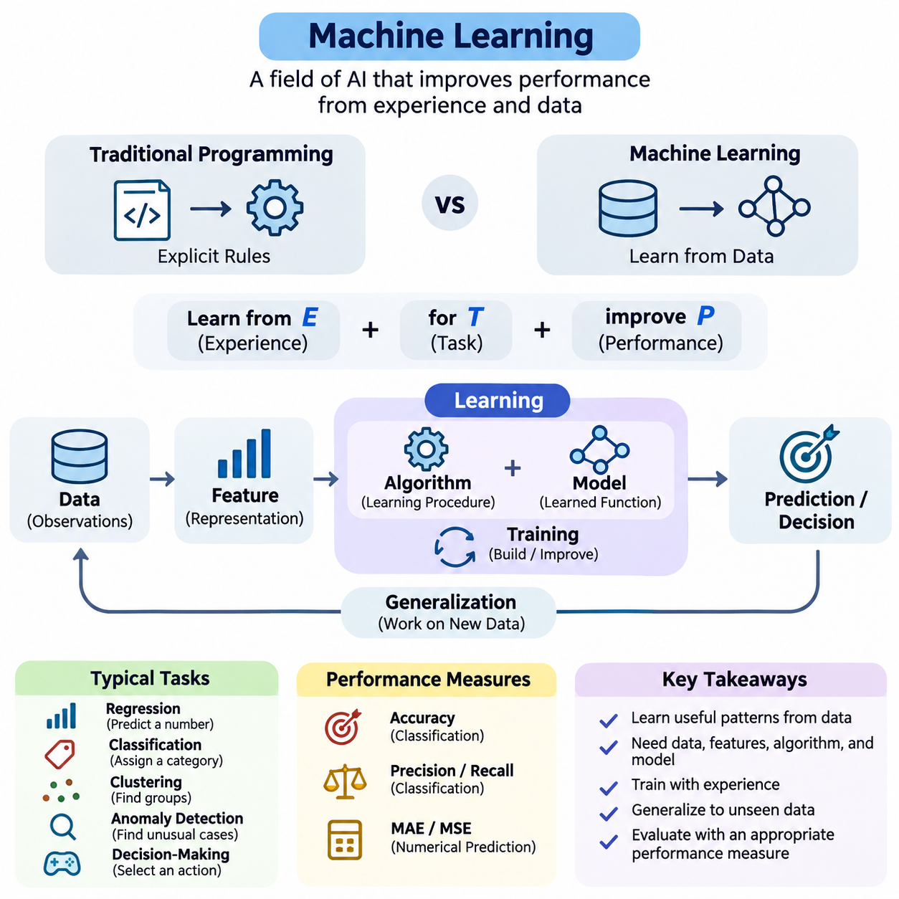
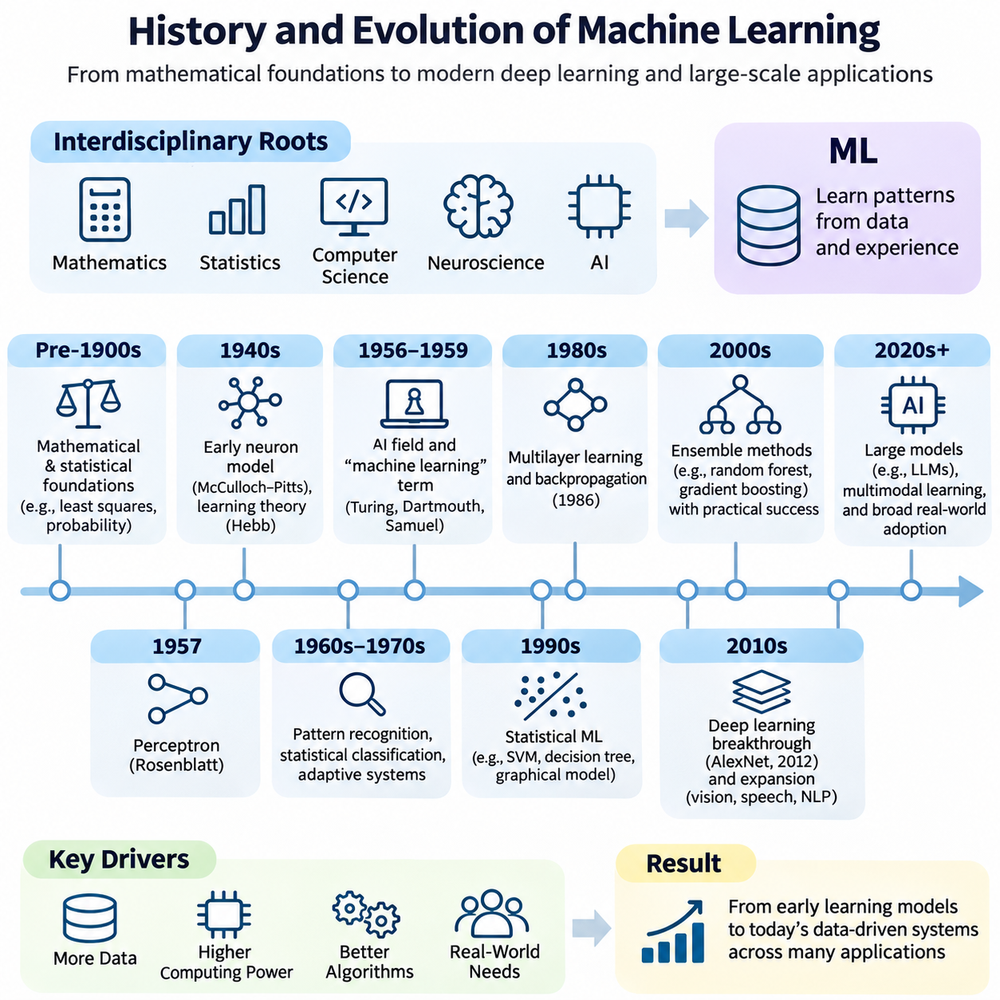
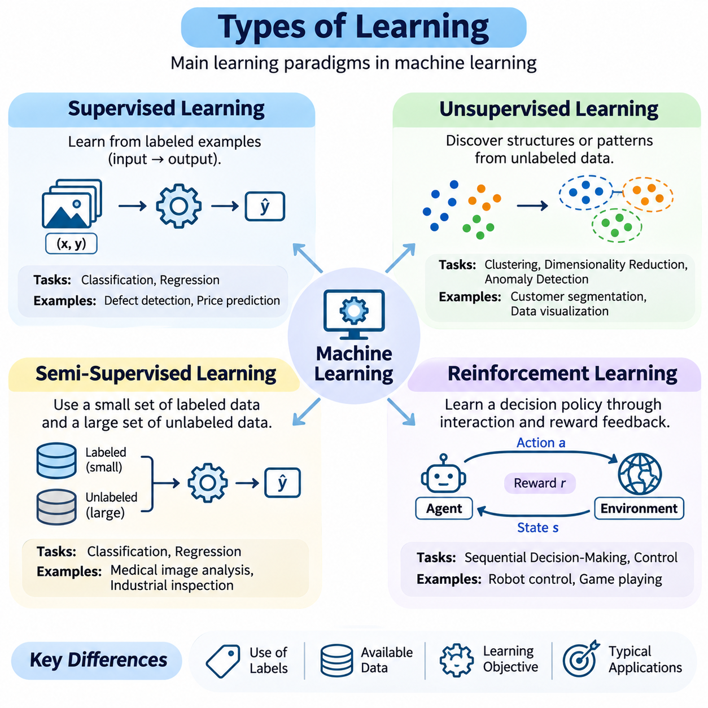
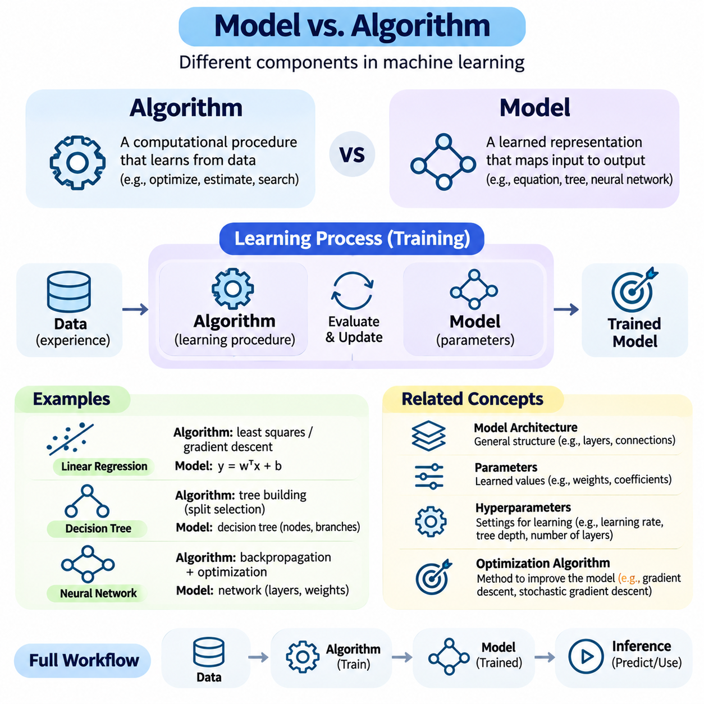
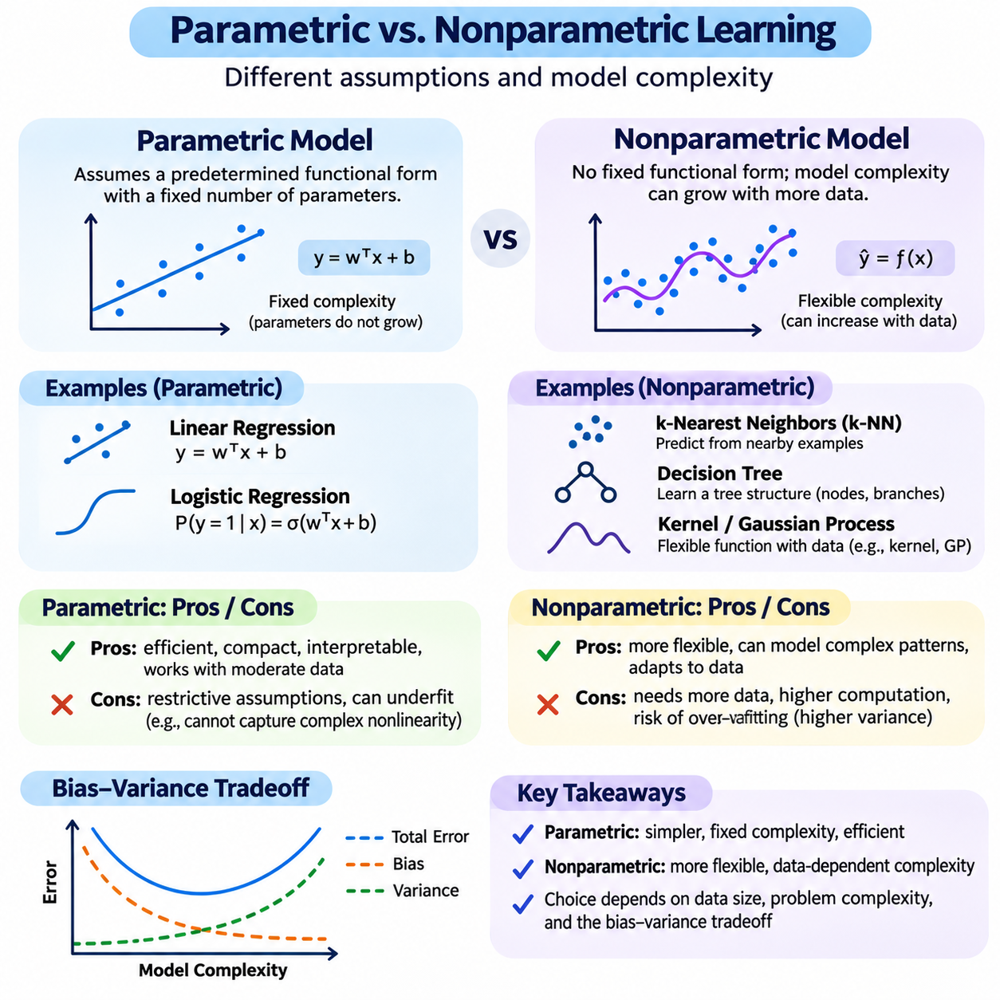
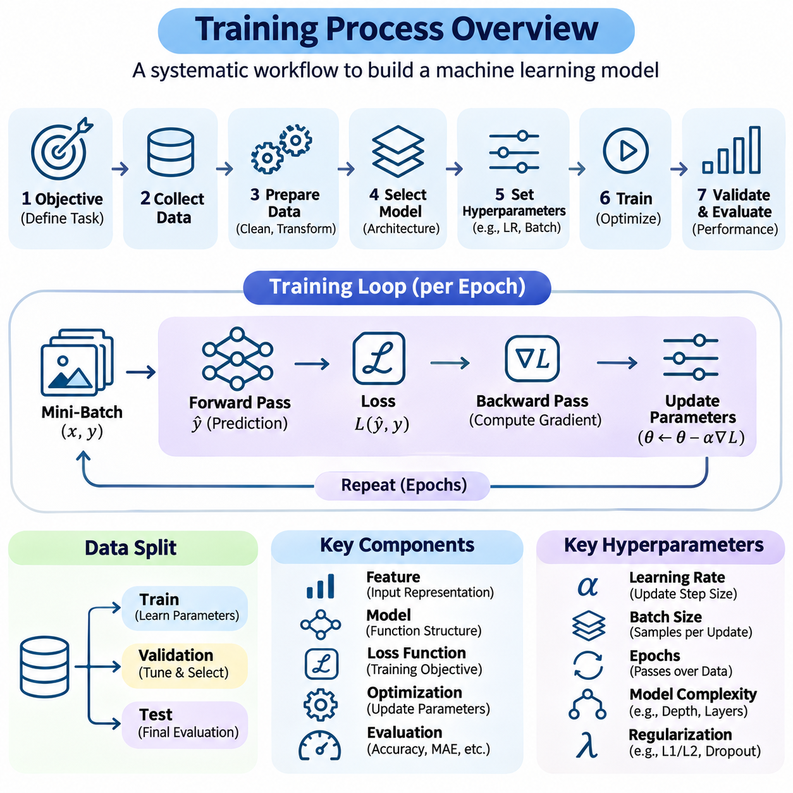
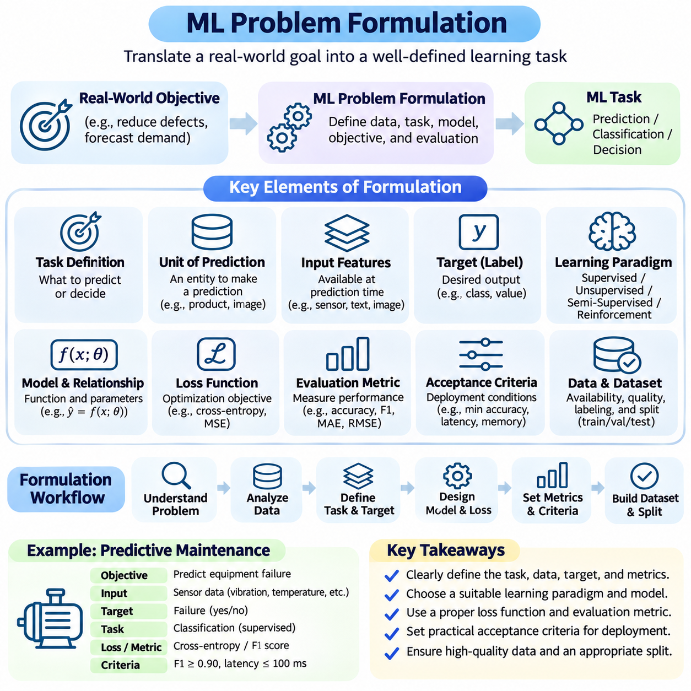
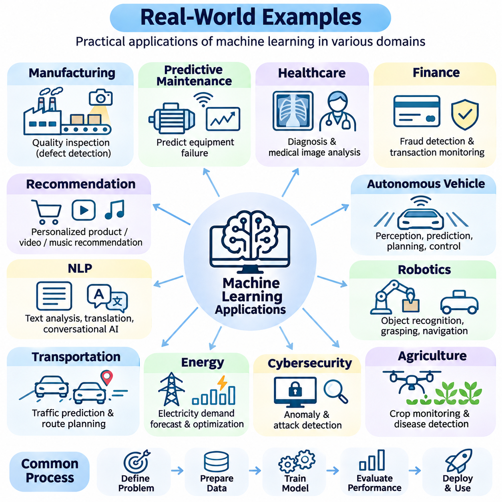

# 01. What is Machine Learning

## 01.00 Definition of ML

{width="7.268055555555556in" height="7.268055555555556in"}

기계학습(Machine Learning)은 명시적으로 프로그래밍된 명령에만 의존하지 않고 경험(Experience)과 데이터(Data)를 통해 컴퓨팅 시스템(Computational System)의 성능을 개선할 수 있도록 하는 인공지능(Artificial Intelligence)의 한 분야이다. 개발자가 가능한 모든 의사결정 규칙(Decision Rule)을 직접 정의하는 대신, 관측 데이터(Observation Data)에 포함된 유용한 패턴(Pattern), 관계(Relationship), 구조(Structure)를 식별하는 학습 절차(Learning Procedure)를 설계한다. 이를 통해 시스템은 새로운 정보에 대한 예측(Prediction), 패턴 인식(Pattern Recognition), 의사결정 지원(Decision Support)을 수행할 수 있다.

기계학습의 핵심 원리(Central Principle)는 특정 작업(Task)에 필요한 지식을 사례(Example)나 상호작용(Interaction)으로부터 획득할 수 있다는 것이다. 전통적인 프로그램(Traditional Program)은 프로그래머가 직접 작성한 명령을 따르지만, 기계학습 시스템(Machine Learning System)은 관측된 증거(Observed Evidence)에 따라 내부 표현(Internal Representation)을 조정한다. 이러한 차이가 프로그래밍 자체의 필요성을 없애는 것은 아니다. 개발자는 여전히 학습이 이루어지는 방식을 결정하는 목표(Objective), 알고리즘(Algorithm), 데이터 처리 절차(Data Processing Procedure), 운영 제약조건(Operational Constraint)을 정의해야 한다.

널리 받아들여지는 기계학습의 개념적 정의(Conceptual Definition)는 경험(Experience), 작업(Task), 성능(Performance)이라는 세 가지 구성요소를 중심으로 설명된다. 시스템이 경험 E를 통해 작업 T에 대한 성능을 개선하고, 그 개선 정도를 성능 측정 기준 P로 평가할 수 있다면 해당 시스템은 학습했다고 볼 수 있다. 이러한 정의는 단순히 정보를 추가로 저장하는 것이 아니라 측정 가능한 성능 향상(Measurable Performance Improvement)이 발생해야 한다는 점을 강조한다. 또한 시스템이 성공적으로 학습했는지를 평가하기 위한 실질적인 기초를 제공한다.

경험(Experience)은 학습 문제(Learning Problem)의 특성에 따라 다양한 형태로 제공될 수 있다. 여기에는 레이블이 지정된 사례(Labeled Example), 레이블이 없는 관측값(Unlabeled Observation), 환경과의 상호작용(Environment Interaction), 이전 의사결정에서 생성된 피드백(Feedback) 등이 포함된다. 이미지 인식(Image Recognition)에서는 객체 범주(Object Category)가 지정된 사진이 경험에 해당할 수 있다. 로봇 제어(Robotic Control)에서는 센서 측정값(Sensor Reading), 실행된 행동(Executed Action), 관측된 결과(Observed Outcome)가 경험을 구성할 수 있다. 이용 가능한 경험의 형태는 시스템이 발견할 수 있는 관계에 영향을 준다.

기계학습 작업(Machine Learning Task)은 시스템이 수행해야 하는 행동이나 기능을 정의한다. 대표적인 작업에는 수치 예측(Numerical Prediction), 범주 분류(Category Classification), 이상 관측값 탐지(Anomaly Detection), 확률 추정(Probability Estimation), 행동 선택(Action Selection) 등이 있다. 각 작업에는 적절한 입력(Input)과 출력(Output)의 표현 방식이 필요하다. 예를 들어 전력 소비량 예측(Electricity Consumption Prediction)은 연속적인 수치(Continuous Value)를 추정하는 문제이지만, 불량 제품 식별(Defective Product Identification)은 관측값이 특정 범주에 속하는지를 판단하는 문제이다.

성능 측정 기준(Performance Measure)은 시스템이 주어진 작업을 얼마나 효과적으로 수행하는지 정량적 증거(Quantitative Evidence)를 제공한다. 분류 시스템(Classification System)은 정확도(Accuracy), 정밀도(Precision), 재현율(Recall) 등을 사용하여 평가할 수 있으며, 수치 예측 시스템(Numerical Prediction System)은 평균절대오차(Mean Absolute Error)나 평균제곱오차(Mean Squared Error)를 사용할 수 있다. 선택된 측정 기준은 실제 응용 목적을 반영해야 한다. 균형 잡힌 벤치마크(Balanced Benchmark)에서 높은 정확도를 달성한 모델이라도 드물지만 중요한 사건이 발생하는 실제 환경에서는 낮은 성능을 보일 수 있다.

데이터(Data)와 학습(Learning)의 관계는 기계학습의 근본적인 요소이다. 데이터는 객체(Object), 사건(Event), 과정(Process), 상호작용(Interaction)에 대한 기록된 관측값을 나타내며, 학습 알고리즘(Learning Algorithm)은 이러한 관측값에서 통계적 관계(Statistical Relationship)를 추출한다. 데이터의 품질(Data Quality), 다양성(Diversity), 관련성(Relevance)은 결과 모델(Resulting Model)에 큰 영향을 미친다. 특히 관측값에 체계적 오류(Systematic Error), 잘못된 상관관계(Misleading Correlation), 중요한 운영 조건에 대한 불충분한 범위(Insufficient Coverage)가 포함되어 있다면 대규모 데이터셋(Large Dataset)만으로 성공적인 학습을 보장할 수 없다.

특징(Feature)은 관측값(Observation)을 설명하기 위해 사용하는 측정 가능하거나 부호화된 속성(Measurable or Encoded Property)이다. 특징은 물리량(Physical Quantity), 범주형 속성(Categorical Attribute), 이미지 픽셀(Image Pixel), 오디오 측정값(Audio Measurement), 복잡한 신호에서 추출한 수치 표현(Numerical Representation) 등을 나타낼 수 있다. 주택 가격 예측(Housing Price Prediction)에서는 면적(Floor Area), 건물 연식(Building Age), 위치(Location)가 특징에 해당한다. 학습 시스템은 이러한 속성이 원하는 출력과 어떤 관계를 가지는지 분석하지만, 관측된 관계가 반드시 인과관계(Causality)를 의미하는 것은 아니다.

기계학습 모델(Machine Learning Model)은 학습 절차(Learning Procedure)를 통해 얻어진 수학적 또는 계산적 표현(Mathematical or Computational Representation)이다. 모델은 학습된 구조(Learned Structure)에 따라 입력 정보를 예측값(Prediction), 점수(Score), 표현(Representation), 행동(Action) 등으로 변환한다. 단순한 모델(Simple Model)은 수치 특징의 가중 결합(Weighted Combination)을 사용할 수 있지만, 복잡한 모델(Complex Model)은 수백만 개의 조정 가능한 매개변수(Adjustable Parameter)를 포함할 수 있다. 모델의 복잡성(Model Complexity)만으로 품질을 결정할 수 없으며, 적합성은 작업, 이용 가능한 증거, 운영 요구사항에 따라 달라진다.

학습 알고리즘(Learning Algorithm)은 이용 가능한 경험을 활용하여 모델을 구성하거나 조정하는 방법을 결정한다. 일부 알고리즘은 예측 오차(Prediction Error)를 최소화하여 매개변수(Parameter)를 추정하고, 다른 알고리즘은 군집(Cluster)을 식별하거나 확률분포(Probability Distribution)를 추정하거나 피드백을 통해 의사결정을 개선한다. 따라서 알고리즘(Algorithm)과 학습된 모델(Trained Model)은 구별된다. 알고리즘은 학습 절차를 규정하는 반면, 결과 모델은 새로운 관측값에 적용할 수 있는 학습된 관계(Learned Relationship)를 포함한다.

훈련(Training)은 학습 알고리즘(Learning Algorithm)이 경험을 사용하여 모델을 구성하거나 개선하는 과정이다. 훈련 과정에서 시스템은 후보 예측(Candidate Prediction)이나 행동(Behavior)을 평가하고, 설정된 목적(Objective)에 따라 내부 표현(Internal Representation)을 조정한다. 많은 예측 모델(Predictive Model)에서는 예측값과 기준값(Reference Value)의 차이를 측정하는 손실함수(Loss Function)를 최소화하는 방식으로 학습이 이루어진다. 훈련에는 반복적인 갱신(Iterative Update)이 필요할 수 있지만, 반복 횟수만으로 성공적인 학습 여부를 판단할 수는 없다.

일반화(Generalization)는 유용한 기계학습을 정의하는 핵심 요구사항 중 하나이다. 모델은 학습에 사용되지 않은 관련 관측값(Unseen Relevant Observation)에 대해서도 효과적으로 작동해야 한다. 훈련 사례(Training Example)를 암기(Memorization)하는 모델은 익숙한 데이터에서는 우수한 결과를 보이지만 다른 상황에서는 신뢰할 수 없는 예측을 생성할 수 있다. 따라서 일반화는 이전에 관측한 사례를 단순히 재현하는 것과 재사용 가능한 통계적 관계(Reusable Statistical Relationship)를 획득하는 것을 구별하는 중요한 기준이다.

기계학습은 의사결정 논리(Decision Logic)를 얻는 방식에서 전통적인 규칙 기반 프로그래밍(Rule-Based Programming)과 차이가 있다. 규칙 기반 시스템(Rule-Based System)은 거래 금액이 사전에 정의된 임계값(Threshold)을 초과하면 거래를 거부하는 것과 같은 명시적인 조건을 적용한다. 반면 기계학습 시스템은 과거 거래 기록(Historical Transaction Record)에서 학습한 패턴을 활용하여 거래 위험(Transaction Risk)을 추정할 수 있다. 두 접근법 모두 유용하며, 실제 시스템에서는 학습된 예측(Learned Prediction)과 결정론적 규칙(Deterministic Rule), 안전 제약조건(Safety Constraint), 인간 감독(Human Supervision)을 결합하는 경우가 많다.

기계학습(Machine Learning)은 더 넓은 학문 분야인 인공지능(Artificial Intelligence)과도 구별된다. 인공지능은 지각(Perception), 추론(Reasoning), 계획(Planning), 지식 표현(Knowledge Representation), 지능적 행동(Intelligent Behavior)을 위한 계산적 접근법을 포함한다. 기계학습은 경험으로부터 유용한 표현이나 행동을 획득하는 방법을 제공한다. 딥러닝(Deep Learning)은 다층 신경망(Multilayer Neural Network)을 사용하는 기계학습의 하위 분야이지만, 기계학습에는 의사결정나무(Decision Tree), 선형 모델(Linear Model), 확률적 방법(Probabilistic Method) 등 다양한 접근법도 포함된다.

통계적 학습(Statistical Learning)은 기계학습을 이해하기 위한 중요한 이론적 관점(Theoretical Perspective)을 제공한다. 관측 데이터(Observed Data)는 기저 과정(Underlying Process)에 관한 증거로 취급되며, 모델은 이용 가능한 표본(Sample)을 넘어 유용하게 적용될 수 있는 관계를 포착하려고 한다. 그러나 관측값은 불완전하고 잡음(Noise)을 포함할 수 있으므로 불확실성(Uncertainty)이 발생한다. 따라서 예측은 현실에 대한 자동으로 검증된 사실이 아니라 이용 가능한 증거에 근거한 추정값(Estimate)으로 이해해야 한다.

기계학습 시스템은 일반적으로 훈련 경험(Training Experience)과 미래 관측값(Future Observation) 사이의 관계에 대한 가정(Assumption)을 기반으로 작동한다. 이러한 가정이 더 이상 유효하지 않으면 예측 성능(Predictive Performance)이 저하될 수 있다. 예를 들어 안정적인 조건에서 작동하는 공장 설비(Factory Equipment)의 데이터로 학습한 모델은 기계적 변경(Mechanical Modification) 이후 익숙하지 않은 동작을 접할 수 있다. 이러한 변화는 모델의 신뢰성(Model Reliability)이 학습 알고리즘뿐 아니라 예측이 사용되는 운영 환경(Operating Environment)에도 의존한다는 점을 보여준다.

데이터로부터 학습하는 능력이 기계학습 시스템에 인간 수준의 이해(Human Understanding)나 독립적인 추론 능력(Independent Reasoning Capability)이 존재한다는 것을 의미하지는 않는다. 모델은 물리적 원인(Physical Cause)이나 더 넓은 의미를 이해하지 못한 상태에서도 예측력이 높은 통계적 패턴(Statistical Pattern)을 식별할 수 있다. 또한 익숙하지 않은 상황에서도 높은 확신도(Confidence)를 가진 출력을 생성할 수 있다. 따라서 효과적인 기계학습에는 예측에 대한 신중한 해석(Careful Interpretation), 불확실성 인식(Uncertainty Awareness), 훈련 경험에 의해 형성된 한계에 대한 이해가 필요하다.

기계학습은 유용한 관계를 명시적인 규칙(Explicit Rule)으로 표현하기 어려울 때 특히 가치가 있다. 시각 검사(Visual Inspection), 음성 인식(Speech Recognition), 수요 예측(Demand Forecasting), 복잡한 센서 해석(Complex Sensor Interpretation)은 다양한 변동성을 포함하므로 모든 상황을 수작업으로 기술하기 어려울 수 있다. 학습 알고리즘은 대표성 있는 관측값(Representative Observation)으로부터 이러한 관계를 근사(Approximation)할 수 있다. 그러나 신뢰할 수 있는 결정론적 해결책(Deterministic Solution)이 더 단순하고 저렴하며 검증하기 쉬운 경우에는 기계학습이 반드시 필요한 것은 아니다.

실제 응용 환경에서 기계학습은 독립적인 수학적 기법(Isolated Mathematical Technique)이 아니라 더 큰 컴퓨팅 시스템(Computational System)의 구성요소로 이해해야 한다. 데이터 수집(Data Acquisition), 전처리(Preprocessing), 모델 구성(Model Construction), 평가(Evaluation), 배포(Deployment), 모니터링(Monitoring)은 운영 효과성(Operational Effectiveness)을 공동으로 결정한다. 기술적으로 정교한 모델(Sophisticated Model)이라도 입력 데이터가 신뢰할 수 없거나 예측 결과를 유용한 의사결정 과정(Decision-Making Process)에 통합할 수 없다면 실질적인 가치를 제공하기 어렵다.

기계학습의 근본적인 목적(Fundamental Purpose)은 경험을 재사용 가능한 계산 능력(Reusable Computational Capability)으로 변환하는 것이다. 성공적인 학습에는 명확하게 정의된 작업(Clearly Defined Task), 관련성 있는 증거(Relevant Evidence), 적절한 학습 절차(Appropriate Learning Procedure), 새로운 상황에서 측정 가능한 성능(Measurable Performance)이 필요하다. 이러한 원리는 다양한 학습 패러다임(Learning Paradigm), 모델 아키텍처(Model Architecture), 훈련 방법(Training Method), 평가 전략(Evaluation Strategy)을 이해하기 위한 개념적 기초를 제공하며, 최초 훈련 데이터(Original Training Data)를 넘어 지속적으로 유용하게 작동하는 기계학습 시스템을 설계하기 위한 체계적인 틀을 제공한다.

## 01.01 History and Evolution

{width="7.268055555555556in" height="7.268055555555556in"}

기계학습(Machine Learning)의 역사는 수작업으로 프로그래밍된 계산 방식에서 경험을 통해 패턴을 발견할 수 있는 시스템으로 점진적으로 전환되어 온 과정을 보여준다. 기계학습은 수학(Mathematics), 통계학(Statistics), 컴퓨터 과학(Computer Science), 신경과학(Neuroscience), 인공지능(Artificial Intelligence)의 발전을 기반으로 형성되었다. 기계학습은 단일한 발명으로 등장한 것이 아니라 학습 이론(Learning Theory), 계산 알고리즘(Computational Algorithm), 데이터 가용성(Data Availability), 하드웨어 성능(Hardware Capability)의 연속적인 발전을 통해 진화하였다.

기계학습의 수학적 기초(Mathematical Foundation)는 전자식 컴퓨터(Electronic Computer)가 등장하기 훨씬 이전부터 발전하였다. 19세기 초에 도입된 최소제곱법(Least Squares)과 같은 통계적 방법(Statistical Method)은 관측값으로부터 관계를 추정하는 기법을 확립하였다. 이후 확률론(Probability Theory)과 통계적 추론(Statistical Inference)은 불확실성(Uncertainty) 아래에서 추론하기 위한 도구를 제공하였다. 이러한 발전은 불완전하고 잡음(Noise)이 포함된 데이터로부터 패턴을 학습하기 위한 이론적 기반을 형성하였다.

1940년대에 연구자들은 생물학적 학습 원리(Biological Learning Principle)가 계산 시스템(Computational System)의 설계에 영감을 줄 수 있는지를 연구하기 시작하였다. 1943년 워런 매컬러(Warren McCulloch)와 월터 피츠(Walter Pitts)는 인공 뉴런(Artificial Neuron)의 수학적 모델(Mathematical Model)을 제안하여 단순화된 신경 구조(Neural Structure)가 논리 연산(Logical Operation)을 표현할 수 있음을 보여주었다. 이후 도널드 헵(Donald Hebb)은 뉴런 간 연결 변화에 기반한 학습 이론(Learning Theory)을 제안하였으며, 이는 적응형 계산 네트워크(Adaptive Computational Network)에 관한 후속 연구에 영향을 주었다.

1950년대 인공지능(Artificial Intelligence)의 등장은 기계학습이 독립적인 연구 방향(Research Direction)으로 발전할 수 있는 지적 환경(Intellectual Environment)을 조성하였다. 앨런 튜링(Alan Turing)은 지능형 기계(Intelligent Machine)의 가능성을 탐구하고 기계 지능(Machine Intelligence)에 관한 영향력 있는 개념을 제시하였다. 1956년 다트머스 워크숍(Dartmouth Workshop)은 인공지능이 하나의 연구 분야로 확립되는 데 중요한 역할을 하였다. 연구자들은 컴퓨터가 미리 정의된 명령만 실행하는 것이 아니라 유용한 행동을 스스로 획득할 수 있는지를 점차 적극적으로 탐구하였다.

아서 새뮤얼(Arthur Samuel)은 체커(Checkers) 게임을 학습하는 컴퓨터 프로그램 연구를 통해 중요한 기여를 하였다. 그의 연구는 게임 전략(Playing Strategy)을 모두 수작업으로 지정하지 않더라도 경험과 평가를 통해 성능을 개선할 수 있음을 보여주었다. 1959년 새뮤얼은 기계학습(Machine Learning)이라는 용어를 널리 알리면서 해당 분야가 독자적인 정체성을 형성하는 데 기여하였다. 그의 실험은 적응형 계산 행동(Adaptive Computational Behavior)이 실제로 가능하다는 것을 입증하는 중요한 사례가 되었다.

1957년 프랭크 로젠블랫(Frank Rosenblatt)은 생물학적 뉴런(Biological Neuron)에서 영감을 받은 초기 학습 모델인 퍼셉트론(Perceptron)을 제안하였다. 퍼셉트론은 입력 패턴(Input Pattern)을 분류하기 위해 수치 가중치(Numerical Weight)를 조정하였으며, 신경망(Neural Network) 연구의 중요한 기초가 되었다. 특정 결정 경계(Decision Boundary)를 학습할 수 있다는 능력은 상당한 관심을 불러일으켰다. 그러나 단층 퍼셉트론(Single-Layer Perceptron)의 한계가 밝혀지면서 많은 분류 문제를 해결하기 위해 더 복잡한 아키텍처(Architecture)가 필요하다는 사실이 드러났다.

1960년대와 1970년대에는 기계학습 연구가 패턴 인식(Pattern Recognition), 통계적 분류(Statistical Classification), 적응형 시스템(Adaptive System)으로 확장되었다. 연구자들은 데이터 내부의 구조를 식별하고 관측값 사이의 관계를 추정하는 방법을 개발하였다. 동시에 제한적인 계산 능력(Computing Power), 훈련 방법(Training Method), 이용 가능한 데이터셋(Dataset)은 실제 응용을 제약하였다. 이러한 어려움은 일부 인공지능 접근법에 대한 관심과 연구 자금(Funding)이 감소하는 시기로 이어졌다.

1980년대에는 다층 학습(Multilayer Learning)의 발전을 통해 신경망에 대한 관심이 다시 높아졌다. 1986년 역전파(Backpropagation)의 대중화는 여러 신경망 계층(Neural Network Layer)에 걸쳐 가중치(Weight)를 효과적으로 조정하는 방법을 보여주었다. 이러한 발전은 비선형 관계(Nonlinear Relationship)를 표현할 수 있는 모델을 실질적으로 훈련할 수 있게 하였다. 계산 자원(Computational Resource)은 여전히 제한적이었지만, 다층 신경망(Multilayer Neural Network)은 이후 딥러닝(Deep Learning) 시스템의 중요한 기초를 확립하였다.

1990년대에는 통계적 기계학습(Statistical Machine Learning)의 중요성이 점차 커졌다. 연구자들은 생물학적 영감을 받은 아키텍처(Biologically Inspired Architecture)에만 의존하기보다 수학적 일반화(Mathematical Generalization), 확률적 모델링(Probabilistic Modeling), 체계적인 평가(Systematic Evaluation)를 강조하였다. 서포트 벡터 머신(Support Vector Machine), 의사결정나무(Decision Tree), 앙상블 방법(Ensemble Method), 그래프 모델(Graphical Model)이 영향력 있는 접근법으로 발전하였다. 이러한 기법은 다양한 응용 분야에서 분류(Classification), 회귀(Regression), 구조적 예측(Structured Prediction) 문제에 실용적인 해결책을 제공하였다.

1990년대 후반과 2000년대 초반 디지털 정보(Digital Information)의 증가는 기계학습 응용의 규모를 크게 변화시켰다. 인터넷 서비스(Internet Service), 기업 데이터베이스(Enterprise Database), 디지털 센서(Digital Sensor)는 점점 더 방대한 관측 데이터(Observation Data)를 생성하였다. 저장 기술(Storage Technology)과 분산 컴퓨팅(Distributed Computing)의 발전은 이러한 데이터셋에 대한 접근성을 높였다. 기계학습은 검색 엔진(Search Engine), 추천 시스템(Recommendation System), 금융 분석(Financial Analysis), 스팸 필터링(Spam Filtering), 자동화된 정보 처리(Automated Information Processing)에서 중요한 역할을 담당하게 되었다.

2000년대에는 앙상블 학습(Ensemble Learning)과 대규모 통계적 방법(Large-Scale Statistical Method)이 뛰어난 실용적 성과를 달성하였다. 랜덤 포레스트(Random Forest)와 그래디언트 부스팅(Gradient Boosting)은 여러 예측 모델(Predictive Model)을 결합하여 정확도(Accuracy)와 강건성(Robustness)을 향상할 수 있음을 보여주었다. 당시에는 모델 훈련 전에 실무자가 표현(Representation)을 직접 설계하는 특징 공학(Feature Engineering)이 핵심적인 역할을 하였다. 이러한 접근법의 효과는 기계학습이 학술 연구를 넘어 가치 있는 공학 분야(Engineering Discipline)로 자리 잡는 데 기여하였다.

2000년대 후반과 2010년대 초반에는 딥러닝(Deep Learning)이 크게 부활하였다. 신경망 훈련(Neural Network Training), 그래픽 처리 장치(Graphics Processing Unit, GPU), 대규모 데이터셋(Large Dataset)의 발전으로 점점 더 복잡한 아키텍처를 활용할 수 있게 되었다. 2012년 알렉스넷(AlexNet)은 이미지넷(ImageNet) 이미지 분류 대회에서 획기적인 성과를 달성하였다. 이 성과는 심층 합성곱 신경망(Deep Convolutional Neural Network)의 실용적 장점을 보여주었으며, 컴퓨터 비전(Computer Vision) 분야에서 딥러닝의 도입을 가속하였다.

딥러닝의 성공은 이미지 인식(Image Recognition)을 넘어 음성 처리(Speech Processing), 자연어 처리(Natural Language Processing), 순차적 예측(Sequential Prediction)으로 확장되었다. 순환 신경망(Recurrent Neural Network)과 장단기 기억(Long Short-Term Memory, LSTM) 아키텍처는 시간적 정보(Temporal Information)로부터 학습하는 기능을 지원하였다. 표현 학습(Representation Learning)은 모델이 유용한 내부 표현(Internal Representation)을 직접 발견하도록 하여 수작업으로 구성된 특징(Manually Constructed Feature)에 대한 의존도를 줄였다. 이러한 발전은 복잡한 고차원 데이터(High-Dimensional Data)를 다루는 연구 방식에 변화를 가져왔다.

2017년 트랜스포머(Transformer) 아키텍처는 어텐션 메커니즘(Attention Mechanism)에 기반한 영향력 있는 접근법을 제시하였다. 트랜스포머는 시퀀스(Sequence) 전반에 걸친 관계를 효과적으로 모델링할 수 있게 하였으며, 높은 수준의 병렬화가 가능한 훈련(Parallelizable Training)을 지원하였다. 이후 대규모 사전학습(Large-Scale Pretraining)의 발전은 방대한 데이터셋으로 훈련한 모델이 여러 다운스트림 작업(Downstream Task)에 적응할 수 있음을 보여주었다. 이는 언어 이해(Language Understanding), 생성(Generation), 다중모달 기계학습(Multimodal Machine Learning)의 발전을 가속하였다.

2010년대 후반과 2020년대 초반에는 자기지도학습(Self-Supervised Learning)과 파운데이션 모델(Foundation Model)이 확장되었다. 자기지도학습은 이용 가능한 데이터의 구조에서 훈련 신호(Training Signal)를 생성하도록 하여 수작업으로 레이블이 지정된 사례(Manually Labeled Example)에 대한 의존도를 줄였다. 파운데이션 모델은 대규모 사전학습(Large-Scale Pretraining) 이후 적응(Adaptation)을 수행하는 접근법의 이점을 보여주었다. 이러한 방법은 다양한 응용을 지원하는 재사용 가능한 표현(Reusable Representation)과 모델에 대한 관심을 높였다.

기계학습은 물리적 시스템(Physical System) 및 자율적 의사결정(Autonomous Decision-Making)과도 점점 더 밀접하게 연결되었다. 강화학습(Reinforcement Learning), 모방학습(Imitation Learning), 로보틱스(Robotics), 센서 융합(Sensor Fusion)의 발전은 시스템이 상호작용과 시연(Demonstration)으로부터 학습할 수 있도록 하였다. 응용 분야는 산업 자동화(Industrial Automation), 자율주행차(Autonomous Vehicle), 지능형 기계(Intelligent Machine)로 확장되었다. 이러한 환경에서는 실시간 계산(Real-Time Computation), 안전성(Safety), 불확실성(Uncertainty), 변화하는 물리적 조건(Changing Physical Condition)과 관련된 추가적인 과제가 발생하였다.

기계학습 시스템이 실제 운영 환경(Production Environment)에 도입되면서 관심은 예측 정확도(Predictive Accuracy)를 넘어 신뢰성(Reliability), 확장성(Scalability), 수명주기 관리(Lifecycle Management)로 확대되었다. 데이터 파이프라인(Data Pipeline), 실험 추적(Experiment Tracking), 모델 모니터링(Model Monitoring), 자동화된 배포(Automated Deployment)는 필수적인 공학적 고려사항이 되었다. 기계학습 운영(Machine Learning Operations, MLOps)의 등장은 성공적인 모델 훈련이 신뢰할 수 있는 컴퓨팅 서비스(Computational Service)를 제공하기 위한 여러 단계 중 하나에 불과하다는 인식을 반영한다.

기계학습의 발전 과정에서는 지속적인 한계(Persistent Limitation)도 드러났다. 모델은 훈련 데이터(Training Data)에 포함된 편향(Bias)을 학습할 수 있으며, 분포 변화(Distribution Shift)가 발생하면 성능이 저하되거나 익숙하지 않은 상황에서 신뢰할 수 없는 출력을 생성할 수 있다. 모델 크기(Model Size)를 증가시키는 것만으로 이러한 문제가 자동으로 해결되지는 않는다. 따라서 연구자들은 예측 성능 향상과 함께 해석 가능성(Interpretability), 강건성(Robustness), 데이터 효율성(Data Efficiency), 불확실성 추정(Uncertainty Estimation), 책임 있는 배포(Responsible Deployment)를 지속적으로 연구하고 있다.

현대 기계학습(Modern Machine Learning)은 통계적 기초(Statistical Foundation), 신경망 아키텍처(Neural Architecture), 최적화 기법(Optimization Technique), 대규모 계산 인프라(Large-Scale Computational Infrastructure)를 결합한다. 전통적인 기법(Classical Method)은 구조화된 데이터셋(Structured Dataset)과 효율성(Efficiency) 또는 해석 가능성이 중요한 응용에서 여전히 가치가 있으며, 딥러닝은 복잡한 지각(Perception)과 표현 학습 작업(Representation Learning Task)을 지원한다. 이 분야에서는 최신 모델이나 더 큰 모델이 항상 우수하다고 가정하기보다 실제 요구사항(Practical Requirement)에 따라 적절한 방법을 선택하는 것이 점점 더 중요해지고 있다.

기계학습의 역사적 발전(Historical Development)은 이론(Theory), 알고리즘(Algorithm), 데이터(Data), 하드웨어(Hardware), 응용 요구사항(Application Requirement) 사이의 상호작용을 통해 진보가 이루어진다는 사실을 보여준다. 각 세대의 기술은 새로운 능력(Capability)을 도입하는 동시에 추가적인 한계(Limitation)를 드러냈다. 이러한 발전 과정을 이해하면 현재의 기법을 평가하고 미래의 발전 방향(Future Development)을 예측하는 데 필요한 중요한 맥락을 확보할 수 있다. 기계학습은 지능형 시스템(Intelligent System)을 위한 과학적 학문(Scientific Discipline)이자 공학적 기반(Engineering Foundation)으로서 지속적으로 발전하고 있다.

## 01.02 Types of Learning

{width="7.268055555555556in" height="7.268055555555556in"}

기계학습(Machine Learning)은 훈련(Training) 과정에서 이용할 수 있는 정보와 피드백(Feedback)이 제공되는 방식에 따라 여러 학습 패러다임(Learning Paradigm)으로 분류할 수 있다. 네 가지 기본적인 학습 패러다임은 지도학습(Supervised Learning), 비지도학습(Unsupervised Learning), 준지도학습(Semi-Supervised Learning), 강화학습(Reinforcement Learning)이다. 각각은 데이터(Data)나 경험(Experience)으로부터 유용한 지식을 획득하는 서로 다른 접근법을 나타내며, 특정 문제 구조(Problem Structure)와 운영 요구사항(Operational Requirement)에 적합하다.

지도학습(Supervised Learning)은 입력 특징(Input Feature)과 이에 대응하는 목표 출력(Target Output)을 함께 포함하는 훈련 사례(Training Example)를 사용하며, 이러한 목표 출력을 일반적으로 레이블(Label)이라고 한다. 학습 알고리즘(Learning Algorithm)은 입력과 출력 사이의 관계를 식별하여 결과 모델(Resulting Model)이 이전에 관측하지 않은 데이터에 대해서도 레이블을 예측할 수 있도록 한다. 이 접근법은 신뢰할 수 있는 레이블 데이터셋(Labeled Dataset)이 존재하고 원하는 예측 작업(Prediction Task)을 명확하게 정의할 수 있을 때 특히 효과적이다.

지도학습 데이터셋(Supervised Learning Dataset)은 일반적으로 관측값(Observation)과 기준값(Reference Value)의 쌍으로 구성된다. 훈련 과정에서 모델은 예측값(Prediction)을 생성하고 손실함수(Loss Function)를 통해 예상 출력(Expected Output)과 비교한다. 최적화 절차(Optimization Procedure)는 예측 오차(Prediction Error)를 줄이도록 모델 매개변수(Model Parameter)를 조정한다. 성공적인 훈련은 관측된 관계를 단순히 암기(Memorization)하는 것이 아니라 훈련 사례를 넘어 일반화(Generalization)할 수 있는 모델을 생성해야 한다.

분류(Classification)와 회귀(Regression)는 지도학습 작업의 두 가지 주요 범주이다. 분류는 불량 제품 식별(Defective Product Identification)이나 손글씨 숫자 인식(Handwritten Digit Recognition)처럼 관측값을 이산적인 범주(Discrete Category)에 할당한다. 회귀는 전력 소비량(Electricity Consumption), 장비 온도(Equipment Temperature), 주택 가격(Housing Price)과 같은 연속적인 수치(Continuous Numerical Quantity)를 추정한다. 두 접근법 모두 입력 변수(Input Variable)와 원하는 출력 사이의 관계를 학습하지만 예측 구조(Prediction Structure)는 서로 다르다.

대표적인 지도학습 알고리즘(Supervised Learning Algorithm)에는 선형 회귀(Linear Regression), 로지스틱 회귀(Logistic Regression), 의사결정나무(Decision Tree), 서포트 벡터 머신(Support Vector Machine), 랜덤 포레스트(Random Forest), 신경망(Neural Network)이 포함된다. 적합한 알고리즘은 데이터셋 특성(Dataset Characteristic), 계산 자원(Computational Resource), 해석 가능성 요구사항(Interpretability Requirement), 예상 예측 정확도(Expected Prediction Accuracy)에 따라 달라진다. 지도학습은 널리 사용되지만 고품질 레이블(High-Quality Label)을 수집하려면 상당한 인적 노력(Human Effort), 전문 지식(Specialized Expertise), 재정적 자원(Financial Resource)이 필요할 수 있다.

비지도학습(Unsupervised Learning)은 각 관측값에 대한 명시적인 목표 레이블(Explicit Target Label)이 제공되지 않는 데이터셋을 사용한다. 입력과 출력 사이에 미리 정의된 대응 관계(Predefined Mapping)를 학습하는 대신, 알고리즘은 데이터 내부의 의미 있는 구조(Meaningful Structure), 유사성(Similarity), 분포(Distribution), 관계(Relationship)를 발견하려고 한다. 이러한 학습 패러다임은 많은 양의 정보가 존재하지만 기저 범주(Underlying Category)나 조직적 패턴(Organizational Pattern)이 알려지지 않은 경우에 유용하다.

군집화(Clustering)는 관측값의 유사성에 따라 데이터를 그룹으로 구성하는 대표적인 비지도학습 작업이다. K-평균(K-Means)과 계층적 군집화(Hierarchical Clustering) 같은 알고리즘은 사전에 정의된 범주 할당(Category Assignment) 없이 그룹을 식별한다. 예를 들어 고객 기록(Customer Record)은 구매 행동(Purchasing Behavior)에 따라 여러 고객군으로 구분될 수 있으며, 센서 측정값(Sensor Measurement)은 서로 다른 장비 운영 조건(Equipment Operating Condition)을 나타낼 수 있다. 그러나 수학적 유사성(Mathematical Similarity)이 반드시 의미 있는 범주를 보장하지는 않으므로 결과 군집(Resulting Cluster)에 대한 해석이 필요하다.

차원 축소(Dimensionality Reduction)는 또 다른 중요한 비지도학습 기법이다. 고차원 데이터셋(High-Dimensional Dataset)은 중복 정보(Redundant Information), 상관된 정보(Correlated Information), 잡음(Noise)을 포함하는 경우가 많아 분석을 어렵게 만든다. 주성분 분석(Principal Component Analysis, PCA)과 같은 방법은 데이터 구조의 특정 측면을 보존하면서 관측값을 저차원 표현(Lower-Dimensional Representation)으로 변환한다. 이러한 표현은 시각화(Visualization), 데이터 압축(Data Compression), 잡음 감소(Noise Reduction), 후속 예측 모델링(Predictive Modeling)을 지원할 수 있다.

비지도학습은 밀도 추정(Density Estimation), 이상 탐지(Anomaly Detection), 표현 학습(Representation Learning)에도 활용된다. 밀도 추정은 관측 데이터의 분포(Data Distribution)를 특성화하려고 하며, 이상 탐지는 예상 패턴(Expected Pattern)과 상당히 다른 관측값을 식별한다. 표현 학습은 복잡한 입력에 대한 유용한 내부 표현(Internal Representation)을 찾는 것을 목표로 한다. 그러나 비지도학습에서는 객관적으로 올바른 단일 출력(Objectively Correct Output)이 존재하지 않을 수 있으므로 평가(Evaluation)가 어려울 수 있다.

준지도학습(Semi-Supervised Learning)은 상대적으로 적은 수의 레이블이 지정된 사례(Labeled Example)와 더 많은 수의 레이블이 없는 관측값(Unlabeled Observation)을 결합한다. 이 접근법은 원시 데이터(Raw Data)를 수집하는 비용은 낮지만 정확한 주석 작업(Annotation)에 많은 비용이나 시간이 필요한 상황을 해결하기 위해 사용된다. 두 데이터 원천(Data Source)의 정보를 함께 활용하면 이용 가능한 레이블 사례만으로 훈련한 유사한 모델보다 더 높은 예측 성능(Predictive Performance)을 달성할 수 있다.

일반적인 준지도학습 전략(Semi-Supervised Learning Strategy)은 레이블이 지정된 관측값으로 모델을 먼저 훈련하는 것에서 시작한다. 이후 모델은 선택된 비레이블 사례(Unlabeled Example)에 대한 예측 레이블(Predicted Label)을 생성하여 추가적인 훈련 데이터(Training Data)를 구성한다. 이러한 절차를 의사 레이블링(Pseudo-Labeling)이라고 하며, 실질적인 훈련 집합(Effective Training Set)을 확장할 수 있다. 그러나 잘못된 예측은 오해를 유발하는 훈련 신호(Misleading Training Signal)를 도입할 수 있으므로 신뢰도 추정(Confidence Estimation)과 데이터 선택(Data Selection)이 중요한 고려사항이 된다.

다른 준지도학습 접근법에는 일관성 정규화(Consistency Regularization)와 그래프 기반 관계(Graph-Based Relationship)를 활용하는 방법이 있다. 일관성 정규화는 입력에 의미를 보존해야 하는 변환(Meaning-Preserving Transformation)이 적용되더라도 모델이 유사한 예측을 생성하도록 유도한다. 그래프 기반 방법(Graph-Based Method)은 인접한 관측값 사이의 관계를 활용하여 레이블 정보(Label Information)를 전파한다. 이러한 접근법은 데이터 구조(Data Structure)에 관한 가정(Assumption)에 의존하며, 레이블 데이터와 비레이블 데이터가 서로 다른 분포(Distribution)를 나타내면 실패할 수 있다.

준지도학습은 의료 영상(Medical Imaging), 산업 검사(Industrial Inspection), 음성 인식(Speech Recognition) 등 주석 작업에 전문 지식이 필요한 분야에서 가치가 있다. 예를 들어 수천 장의 제품 이미지(Product Image)는 자동으로 수집할 수 있지만 일부 이미지에만 전문가가 결함 레이블(Defect Label)을 지정할 수 있다. 레이블이 없는 이미지는 시각적 구조(Visual Structure)와 변동성(Variation)에 관한 정보를 제공할 수 있다. 그러나 추가적인 비레이블 데이터의 품질이나 관련성이 충분하지 않다면 성능 향상이 보장되지는 않는다.

강화학습(Reinforcement Learning)은 에이전트(Agent)와 환경(Environment) 사이의 상호작용을 통해 학습이 이루어진다는 점에서 앞서 설명한 학습 패러다임과 구별된다. 에이전트는 현재 상황에 관한 정보를 관측하고 행동(Action)을 선택한 다음 보상(Reward)이나 벌점(Penalty) 형태의 피드백을 받는다. 강화학습의 목표는 각 관측값에 대해 미리 정의된 레이블을 예측하는 것이 아니라 시간에 따른 기대 누적 보상(Expected Cumulative Reward)을 최대화하는 정책(Policy)을 학습하는 것이다.

강화학습 문제(Reinforcement Learning Problem)는 일반적으로 상태(State), 행동(Action), 보상(Reward), 상태 전이(State Transition)로 구성된다. 상태는 환경에 관한 관련 정보를 설명하고, 행동은 에이전트가 선택할 수 있는 의사결정(Decision)을 나타낸다. 행동이 실행되면 환경이 변화하고 보상 신호(Reward Signal)가 제공된다. 에이전트는 축적된 경험(Accumulated Experience)을 활용하여 의사결정 정책(Decision-Making Policy)을 개선하며, 현재 행동이 미래 결과(Future Outcome)에 미치는 영향까지 고려하는 경우가 많다.

강화학습의 대표적인 과제 중 하나는 탐색(Exploration)과 활용(Exploitation) 사이의 균형을 유지하는 것이다. 탐색은 더 나은 전략을 발견하기 위해 익숙하지 않은 행동을 시도하는 과정이며, 활용은 기존 지식(Existing Knowledge)을 사용하여 유리한 결과가 예상되는 행동을 선택하는 과정이다. 과도한 탐색은 자원을 낭비하거나 위험을 초래할 수 있지만, 탐색이 부족하면 에이전트가 효과적인 행동 전략(Effective Behavioral Strategy)을 발견하지 못할 수 있다.

강화학습 방법에는 가치 기반 학습(Value-Based Learning), 정책 기반 학습(Policy-Based Learning), 액터-크리틱 접근법(Actor-Critic Approach)이 포함된다. 가치 기반 방법은 상태나 행동의 기대 이익(Expected Benefit)을 추정하고, 정책 기반 방법은 행동 선택 방식(Action-Selection Behavior)을 직접 최적화한다. 액터-크리틱 아키텍처(Actor-Critic Architecture)는 정책 학습(Policy Learning)과 가치 추정(Value Estimation)을 결합한다. 이러한 방법은 순차적 의사결정(Sequential Decision-Making)을 지원하지만, 훈련에는 광범위한 상호작용과 신중한 보상 설계(Reward Design)가 필요할 수 있다.

로보틱스(Robotics)는 강화학습의 실용적인 사례를 제공한다. 이동 로봇(Mobile Robot)은 목적지에 도달하면 보상을 받고 충돌이나 비효율적인 이동에 대해서는 벌점을 받는 방식으로 주행 행동(Navigation Behavior)을 학습할 수 있다. 올바른 행동이 직접 제공될 수 있는 지도학습과 달리 강화학습은 행동의 결과(Consequence)를 통해 행동을 평가한다. 실제 배포(Practical Deployment)에서는 안전 제약조건(Safety Constraint), 제한된 물리적 상호작용(Limited Physical Interaction), 시뮬레이션 환경(Simulated Environment)과 실제 환경(Real Environment) 사이의 차이도 고려해야 한다.

네 가지 학습 패러다임은 주로 이용 가능한 지도 신호(Supervision Signal)와 최적화하려는 목표(Objective)에 따라 구별된다. 지도학습은 알려진 목표 출력(Known Target Output)을 사용하고, 비지도학습은 명시적인 레이블 없이 구조를 발견하며, 준지도학습은 레이블 정보와 비레이블 정보를 결합하고, 강화학습은 상호작용에서 얻은 평가적 피드백(Evaluative Feedback)을 사용한다. 이러한 구분은 개념적인 것이며 절대적인 경계는 아니다. 현대의 기계학습 시스템은 여러 학습 접근법(Learning Approach)을 결합하는 경우가 많다.

적절한 학습 패러다임을 선택하려면 문제 정의(Problem Definition), 이용 가능한 데이터(Available Data), 피드백 메커니즘(Feedback Mechanism), 운영 제약조건(Operational Constraint)을 검토해야 한다. 지도학습은 레이블이 명확한 예측 작업에 적합하며, 비지도학습은 탐색적 분석(Exploratory Analysis)을 지원한다. 준지도학습은 레이블링 요구사항(Labeling Requirement)을 줄일 수 있고, 강화학습은 순차적 의사결정 문제를 다룬다. 이러한 패러다임을 이해하는 것은 효과적인 기계학습 시스템을 설계하고 실제 적용상의 한계(Practical Limitation)를 평가하기 위한 기초가 된다.

## 01.03 Model vs Algorithm

{width="7.268055555555556in" height="7.268055555555556in"}

기계학습 모델(Machine Learning Model)과 알고리즘(Algorithm)은 밀접하게 관련된 개념이지만 학습 과정(Learning Process)에서 서로 다른 구성요소를 나타낸다. 알고리즘은 데이터로부터 학습하기 위한 계산 절차(Computational Procedure)를 정의하는 반면, 모델은 이러한 절차를 통해 생성되거나 구성되는 수학적 또는 계산적 구조(Mathematical or Computational Structure)를 나타낸다. 이러한 차이를 이해하는 것은 실제 응용에서 기계학습 시스템(Machine Learning System)이 어떻게 구성되고, 훈련되고, 평가되고, 배포되는지를 설명하는 데 필수적이다.

기계학습 알고리즘(Machine Learning Algorithm)은 훈련 경험(Training Experience)으로부터 유용한 정보를 추출하는 데 필요한 연산(Operation)을 명시한다. 이러한 연산에는 오차 계산(Error Calculation), 통계적 관계 추정(Statistical Relationship Estimation), 매개변수 조정(Parameter Adjustment), 적절한 표현 탐색(Representation Search) 등이 포함될 수 있다. 알고리즘은 최종적으로 학습된 지식(Learned Knowledge) 자체를 나타내기보다 학습이 어떻게 이루어지는지를 규정한다. 알고리즘의 동작은 수학적 원리(Mathematical Principle), 절차적 규칙(Procedural Rule), 시스템 개발 과정에서 선택한 구성 설정(Configuration Setting)에 의해 결정된다.

기계학습 모델(Machine Learning Model)은 입력 관측값(Input Observation)을 예측값(Prediction), 분류 결과(Classification), 점수(Score), 행동(Action)으로 변환하는 표현(Representation)이다. 모델의 구조는 수학 방정식(Mathematical Equation), 의사결정 규칙(Decision Rule), 확률분포(Probability Distribution), 상호 연결된 계산 단위(Interconnected Computational Unit) 등으로 구성될 수 있다. 훈련 과정에서 모델은 매개변수(Parameter)나 구조(Structure)를 조정하여 정보를 획득한다. 훈련이 완료되면 전체 학습 절차를 반복하지 않고도 새로운 관측값을 처리할 수 있다.

이러한 차이는 선형 회귀(Linear Regression)를 통해 명확하게 이해할 수 있다. 선형 회귀 모델(Linear Regression Model)은 입력 변수(Input Variable), 계수(Coefficient), 절편(Intercept)을 사용하여 수치적 관계(Numerical Relationship)를 표현한다. 학습 알고리즘(Learning Algorithm)은 훈련 관측값(Training Observation)으로부터 적절한 계숫값을 추정한다. 이러한 값을 결정하기 위해 경사하강법(Gradient Descent)이나 최소제곱 해법(Least-Squares Solver)을 사용할 수 있다. 최종적으로 얻어진 수학적 함수(Mathematical Function)는 훈련된 모델(Trained Model)이며, 매개변수를 추정하는 데 사용된 절차가 학습 알고리즘이다.

의사결정나무(Decision Tree)는 또 다른 유용한 사례이다. 의사결정나무 모델(Decision Tree Model)은 내부 의사결정 노드(Internal Decision Node), 가지(Branch), 말단 예측값(Terminal Prediction)으로 구성된다. 트리 구축 알고리즘(Tree-Building Algorithm)은 후보 특징 분할(Candidate Feature Split)을 검토하고 관측값을 효과적으로 구분하도록 구조를 생성한다. 동일한 데이터셋(Dataset)을 사용하더라도 서로 다른 알고리즘은 다른 트리를 생성할 수 있다. 구축이 완료된 트리는 학습된 의사결정 경로(Learned Decision Path)를 따라 새로운 관측값을 분류할 수 있다.

신경망(Neural Network)은 모델 아키텍처(Model Architecture)와 학습 알고리즘(Learning Algorithm) 사이의 관계를 더욱 명확하게 보여준다. 신경망 모델은 계층(Layer), 연결(Connection), 활성화 함수(Activation Function), 조정 가능한 가중치(Adjustable Weight)를 포함한다. 훈련 절차(Training Procedure)는 일반적으로 역전파(Backpropagation)를 사용하여 기울기(Gradient)를 계산하고 최적화 알고리즘(Optimization Algorithm)을 사용하여 매개변수를 갱신한다. 신경망 아키텍처는 계산 구조(Computational Structure)를 정의하고, 훈련 알고리즘은 관측 데이터에 따라 가중치가 어떻게 변화하는지를 결정한다.

모델 아키텍처(Model Architecture)는 훈련된 모델 인스턴스(Trained Model Instance)와도 구별해야 한다. 아키텍처는 계층, 연결, 수학적 관계를 포함한 계산 구성요소(Computational Component)의 일반적인 조직 구조를 설명한다. 훈련된 모델은 경험을 통해 획득한 특정 매개변숫값(Parameter Value)이나 학습된 구조(Learned Structure)를 포함한다. 두 모델이 동일한 아키텍처를 공유하더라도 서로 다른 데이터셋으로 훈련되거나 초기화(Initialization) 방식이 다르면 서로 다른 예측 결과를 생성할 수 있다.

매개변수(Parameter)는 학습 절차가 훈련 데이터(Training Data)로부터 추정하는 내부 수량(Internal Quantity)이다. 선형 회귀에서 매개변수는 계수(Coefficient)와 절편(Intercept)을 포함하며, 신경망에서는 연결 가중치(Connection Weight)와 편향(Bias)을 포함한다. 이러한 값은 모델이 입력을 출력으로 변환하는 방식을 결정한다. 학습은 일반적으로 목적함수(Objective Function)를 개선하도록 매개변수를 수정하는 과정이지만, 일부 알고리즘은 모델 구조를 변경하거나 전통적인 매개변수 최적화(Parameter Optimization) 없이 표현을 구성하기도 한다.

하이퍼파라미터(Hyperparameter)는 일반적인 훈련 과정에서 직접 추정되는 값이 아니라 학습 절차나 모델 설계(Model Design)를 설정한다는 점에서 학습된 매개변수(Learned Parameter)와 다르다. 대표적인 예로 학습률(Learning Rate), 최대 트리 깊이(Maximum Tree Depth), 정규화 강도(Regularization Strength), 신경망 계층 수(Neural Network Layer Count)가 있다. 하이퍼파라미터는 훈련 동작(Training Behavior)과 모델 용량(Model Capacity)에 영향을 준다. 일반적으로 검증 실험(Validation Experiment), 자동 탐색 절차(Automated Search Procedure), 응용 분야에 관한 사전 지식(Prior Knowledge)을 통해 선택된다.

최적화 알고리즘(Optimization Algorithm)은 많은 기계학습 훈련 절차에서 중요한 구성요소이다. 경사하강법(Gradient Descent), 확률적 경사하강법(Stochastic Gradient Descent), 적응형 최적화 방법(Adaptive Optimization Method)은 정의된 손실함수(Loss Function)를 줄이도록 매개변수를 갱신한다. 그러나 모든 기계학습 알고리즘이 기울기 기반 최적화(Gradient-Based Optimization)에 의존하는 것은 아니다. 일부 방법은 해석적 해법(Analytical Solution), 재귀적 분할(Recursive Partitioning), 확률적 추정(Probabilistic Estimation), 반복적 군집화(Iterative Clustering)를 사용한다. 더 넓은 의미의 학습 알고리즘은 이러한 연산이 모델 구축(Model Construction)에 어떻게 기여하는지를 결정한다.

훈련 과정(Training Process)은 반복적인 평가(Evaluation)와 조정(Adjustment)을 통해 알고리즘과 모델을 연결한다. 데이터셋은 관측값(Observation)을 제공하고, 모델은 출력(Output)을 생성하며, 학습 절차는 출력이 목표(Objective)를 얼마나 잘 충족하는지 평가한다. 평가 결과에 따라 알고리즘은 매개변수나 구조적 요소(Structural Element)를 수정한다. 이러한 과정은 훈련 중 설정된 종료 조건(Stopping Condition), 수렴 기준(Convergence Criterion), 계산 한계(Computational Limit)에 따라 계속된다.

추론(Inference)은 훈련된 모델(Trained Model)이 새로운 입력을 처리하여 출력을 생성하는 단계이다. 훈련과 달리 추론은 일반적으로 학습된 매개변수(Learned Parameter)를 변경하지 않는다. 분류 모델(Classification Model)은 이미지에 범주(Category)를 할당할 수 있으며, 회귀 모델(Regression Model)은 센서 측정값(Sensor Measurement)으로부터 수치적 값을 추정할 수 있다. 추론 절차(Inference Procedure)는 훈련된 모델을 실행하므로, 모델 배포(Model Deployment)를 계산 비용이 높은 훈련 과정(Computationally Expensive Training Process)과 분리할 수 있음을 보여준다.

동일한 학습 알고리즘을 서로 다른 모델 구조(Model Structure)에 적용할 수 있으며, 동일한 모델 계열(Model Family)을 서로 다른 알고리즘으로 훈련할 수도 있다. 예를 들어 기울기 기반 최적화(Gradient-Based Optimization)는 다양한 신경망 아키텍처(Neural Network Architecture)를 훈련할 수 있으며, 선형 회귀 매개변수(Linear Regression Parameter)는 여러 수치적 방법(Numerical Method)을 통해 추정할 수 있다. 이러한 유연성(Flexibility)은 알고리즘과 모델이 서로 대체 가능한 개념이 아니라는 사실을 보여주지만, 두 요소의 설계 선택(Design Choice)은 서로 영향을 미친다.

모델 품질(Model Quality)은 선택한 학습 알고리즘만으로 결정되지 않는다. 데이터 품질(Data Quality), 특징 표현(Feature Representation), 아키텍처(Architecture), 최적화 설정(Optimization Setting), 평가 절차(Evaluation Procedure)가 종합적으로 성능에 영향을 미친다. 정교한 알고리즘(Sophisticated Algorithm)이라도 잘못된 레이블(Misleading Label)이나 누락된 정보(Missing Information)를 자동으로 보완할 수는 없다. 마찬가지로 훈련 데이터가 제한적이거나 기저 관계(Underlying Relationship)가 추가적인 복잡성을 요구하지 않는 경우에는 복잡한 모델이 단순한 대안보다 성능이 낮을 수 있다.

모델 용량(Model Capacity)은 특정 모델 계열이 표현할 수 있는 관계의 범위(Range of Relationships)를 설명한다. 용량이 낮은 모델(Low-Capacity Model)은 중요한 패턴을 충분히 포착하지 못하여 과소적합(Underfitting)이 발생할 수 있다. 반면 용량이 높은 모델(High-Capacity Model)은 훈련 관측값에 지나치게 밀접하게 적합되면서 일반화(Generalization)에 실패하여 과적합(Overfitting)이 발생할 수 있다. 학습 알고리즘과 정규화 방법(Regularization Method)은 모델 용량이 활용되는 방식에 영향을 주지만, 아키텍처와 이용 가능한 훈련 근거(Training Evidence) 역시 최종 동작을 결정한다.

평가(Evaluation)는 단순히 알고리즘 실행을 완료하는 것과 성공적인 모델 구축(Successful Model Construction)을 구별한다. 학습 절차가 정상적으로 종료되더라도 예측 성능(Predictive Performance)이 낮은 모델이 생성될 수 있다. 따라서 검증(Validation)과 테스트(Testing)는 훈련된 모델이 관련된 미관측 데이터(Unseen Observation)에 대해 효과적으로 동작하는지를 확인한다. 정확도(Accuracy), 정밀도(Precision), 재현율(Recall), 예측 오차(Prediction Error)와 같은 평가 지표(Evaluation Metric)는 훈련 알고리즘의 우아함이나 복잡성을 직접 측정하기보다 모델 동작(Model Behavior)에 관한 근거를 제공한다.

실제 소프트웨어 시스템(Software System)에서도 알고리즘과 모델은 저장(Storage) 및 실행 요구사항(Execution Requirement) 측면에서 차이가 있다. 훈련 코드(Training Code)는 데이터 처리(Data Processing), 최적화(Optimization), 매개변수 갱신(Parameter Update)을 위한 절차를 포함하지만, 모델 산출물(Model Artifact)은 학습된 매개변수, 구조, 필요한 구성 정보(Configuration Information)를 포함한다. 배포된 응용 프로그램(Deployed Application)은 원래의 훈련 파이프라인(Training Pipeline)을 포함하지 않고도 훈련된 모델을 불러올 수 있다. 이러한 분리는 효율적인 추론(Efficient Inference), 재현성(Reproducibility), 독립적인 모델 버전 관리(Model Version Management)를 지원한다.

기계학습 프레임워크(Machine Learning Framework)는 모델과 알고리즘을 모두 구현하기 위한 도구를 제공한다. 사이킷런(scikit-learn), 파이토치(PyTorch), 텐서플로(TensorFlow)와 같은 라이브러리는 모델 구성요소(Model Component), 훈련 유틸리티(Training Utility), 최적화 방법(Optimization Method)을 제공한다. 개발자는 이러한 프레임워크를 통해 아키텍처를 선택하고, 학습 절차를 구성하며, 데이터셋을 관리한다. 소프트웨어 인터페이스(Software Interface)가 이러한 작업을 편리한 명령으로 통합하더라도 학습 절차(Learning Procedure)와 학습된 표현(Learned Representation) 사이의 개념적 차이는 여전히 중요하다.

산업 응용(Industrial Application)에서는 배포된 시스템을 갱신할 때 이러한 차이가 특히 중요해진다. 제조 검사 모델(Manufacturing Inspection Model)은 카메라 조건(Camera Condition), 제품 설계(Product Design), 결함 패턴(Defect Pattern)이 변화하면 재훈련(Retraining)이 필요할 수 있다. 학습 알고리즘은 그대로 유지하면서 새로운 훈련 데이터를 사용하여 갱신된 모델(Updated Model)을 생성할 수 있다. 반대로 기존 접근법이 정확도(Accuracy), 지연시간(Latency), 계산 요구사항(Computational Requirement)을 충족하지 못하면 엔지니어는 알고리즘이나 아키텍처를 교체할 수 있다.

따라서 완전한 기계학습 시스템(Complete Machine Learning System)은 문제 정의(Problem Definition), 데이터셋(Dataset), 모델 표현(Model Representation), 학습 알고리즘(Learning Algorithm), 평가 절차(Evaluation Procedure)라는 여러 상호작용 요소로 구성된다. 알고리즘은 경험이 학습된 정보(Learned Information)로 변환되는 방식을 결정하며, 모델은 그 결과로 얻어진 계산 능력(Computational Capability)을 저장하거나 표현한다. 각 요소의 독립적인 역할(Separate Responsibility)을 이해하는 것은 훈련(Training), 최적화(Optimization), 일반화(Generalization), 배포(Deployment), 체계적인 기계학습 엔지니어링(Systematic Machine Learning Engineering)을 이해하기 위한 기초가 된다.

## 01.04 Parametric vs NonParametric

{width="7.268055555555556in" height="7.268055555555556in"}

기계학습 모델(Machine Learning Model)은 데이터 내부의 관계 구조(Relationship Structure)에 대해 설정하는 가정(Assumption)에 따라 모수적 모델(Parametric Model)과 비모수적 모델(Nonparametric Model)로 분류할 수 있다. 이러한 구분은 모델 복잡도(Model Complexity)가 어떻게 지정되고 추가 관측값(Additional Observation)에 따라 학습 능력(Learning Capacity)이 어떻게 변화하는지와 관련된다. 두 접근법을 이해하면 데이터 가용성(Data Availability), 계산 제약조건(Computational Constraint), 해석 가능성(Interpretability), 예상 일반화 성능(Expected Generalization Performance)에 따라 적절한 모델을 선택하는 데 도움이 된다.

모수적 모델(Parametric Model)은 입력과 출력 사이의 관계를 고정된 수의 매개변수(Fixed Number of Parameters)를 갖는 사전에 결정된 함수 형태(Predetermined Functional Form)로 표현할 수 있다고 가정한다. 훈련(Training)은 관측 데이터(Observed Data)로부터 이러한 매개변수의 값을 추정한다. 모델 구조(Model Structure)가 선택되면 훈련 데이터셋(Training Dataset)이 증가하더라도 일반적으로 매개변수의 수는 변하지 않는다. 이러한 특성으로 인해 모수적 모델은 상대적으로 간결하며 계산 효율성(Computational Efficiency)이 높은 경우가 많다.

선형 회귀(Linear Regression)는 대표적인 모수적 모델이다. 선형 회귀는 예측 출력(Predicted Output)을 입력 특징(Input Feature)의 가중 결합(Weighted Combination)과 절편(Intercept)으로 표현할 수 있다고 가정한다. 훈련 과정에서는 선택한 목적함수(Objective Function)에 따라 관측된 관계를 가장 잘 설명하는 계수(Coefficient)를 결정한다. 학습 과정에서 계숫값은 변화하지만 특징 표현(Feature Representation)이 변경되지 않는다면 매개변수의 수는 고정된 상태로 유지된다.

로지스틱 회귀(Logistic Regression)는 모수적 학습(Parametric Learning)의 또 다른 사례이다. 로지스틱 회귀는 사전에 정의된 수학적 함수(Mathematical Function)를 사용하여 특징의 가중 결합을 확률 추정값(Probability Estimate)으로 변환한다. 모델은 고정된 매개변수 구조(Fixed Parameter Structure)를 유지하면서 분류 결정(Classification Decision)을 지원하는 계수를 학습한다. 비교적 단순한 수학적 구성으로 인해 해석 가능성, 계산 효율성, 예측 가능한 배포 동작(Predictable Deployment Behavior)이 중요한 경우에 유용하다.

모수적 모델은 여러 실용적인 장점(Practical Advantage)을 제공한다. 고정 차원 표현(Fixed-Dimensional Representation)은 일반적으로 효율적인 저장(Storage), 상대적으로 빠른 추론(Fast Inference), 간단한 배포(Deployment)를 지원한다. 많은 모수적 접근법은 구조적 가정(Structural Assumption)이 적절한 경우 중간 규모의 데이터셋(Moderately Sized Dataset)에서도 유용한 관계를 학습할 수 있다. 매개변수는 해석을 지원할 수도 있지만 개별 계수의 의미는 특징 구성(Feature Construction)과 변수 간 관계(Relationship Among Variables)에 따라 달라진다.

모수적 학습의 주요 한계(Principal Limitation)는 제한적인 모델 가정(Restrictive Model Assumption)이 발생할 가능성이다. 선택한 함수 형태(Functional Form)가 데이터의 중요한 패턴을 표현하지 못한다면 추가적인 훈련 사례(Training Example)가 제공되더라도 근사 오차(Approximation Error)가 제거되지 않을 수 있다. 예를 들어 단순 선형 모델(Simple Linear Model)은 적절한 특징 변환(Feature Transformation) 없이 강한 비선형 관계(Strongly Nonlinear Relationship)를 직접 표현할 수 없다. 이러한 한계는 최적화(Optimization)가 올바르게 수행되더라도 과소적합(Underfitting)을 발생시킬 수 있다.

비모수적 모델(Nonparametric Model)은 학습 전에 기저 관계(Underlying Relationship)를 고정된 유한 차원의 매개변수화(Fixed Finite-Dimensional Parameterization)로 지정할 필요가 없다. 이러한 모델의 유효 복잡도(Effective Complexity)는 훈련 데이터의 양에 따라 증가할 수 있으며, 점점 더 세밀한 구조(Detailed Structure)를 표현할 수 있도록 한다. 비모수적(Nonparametric)이라는 용어가 모델에 매개변수나 가정이 전혀 없다는 의미는 아니다. 오히려 모델 복잡도가 표현되는 방식에서 더 폭넓은 유연성(Flexibility)을 갖는다는 의미이다.

K-최근접 이웃 알고리즘(K-Nearest Neighbors Algorithm, KNN)은 비모수적 학습을 보여주는 대표적인 사례이다. 이 방법은 고정된 전역 계수(Global Coefficient)를 추정하는 대신 훈련 사례를 보관하고 새로운 입력과 가까운 위치에 있는 관측값을 사용하여 결과를 예측한다. 분류에서는 이웃 관측값의 레이블(Neighboring Label)이 예측 범주(Predicted Category)에 기여하며, 회귀에서는 이웃의 수치적 값(Numerical Value)을 사용한다. 이 방법은 불규칙한 결정 경계(Irregular Decision Boundary)에 적응할 수 있지만 데이터셋 크기가 증가하면 예측 비용(Prediction Cost)도 증가할 수 있다.

의사결정나무(Decision Tree)는 추가적인 패턴이 발견됨에 따라 구조가 확장될 수 있기 때문에 일반적으로 비모수적 모델로 취급된다. 의사결정나무는 특징 공간(Feature Space)을 예측값과 연결된 여러 영역(Region)으로 재귀적으로 분할한다. 고정된 수의 계수를 갖는 선형 모델과 달리 노드(Node)와 가지(Branch)의 수는 학습 과정과 구성 제약조건(Configuration Constraint)에 의해 결정된다. 최대 깊이(Maximum Depth)와 최소 표본 요구사항(Minimum Sample Requirement)을 설정하면 이러한 유연성을 제한할 수 있다.

커널 방법(Kernel Method)은 비모수적 모델링(Nonparametric Modeling)에 대한 또 다른 관점을 제공한다. 커널 밀도 추정(Kernel Density Estimation)은 관측 표본(Observed Sample)과 연결된 기여도를 이용하여 확률밀도 추정값(Probability Density Estimate)을 구성한다. 커널 회귀(Kernel Regression) 역시 관측값 사이의 관계를 사용하여 출력을 추정한다. 이러한 방법의 유연성은 커널 선택(Kernel Selection), 대역폭(Bandwidth), 이용 가능한 데이터에 따라 달라진다. 이들은 단순한 전역 함수 관계(Global Functional Relationship)를 지정하지 않고도 복잡한 패턴을 포착할 수 있다.

가우시안 프로세스(Gaussian Process)는 비모수적 확률 모델(Nonparametric Probabilistic Model)의 중요한 계열이다. 가우시안 프로세스는 평균 함수(Mean Function)와 공분산 커널(Covariance Kernel)을 통해 가능한 함수들에 대한 분포(Distribution over Functions)를 정의한다. 관측 데이터는 예측값(Prediction)과 이에 관련된 불확실성 추정값(Uncertainty Estimate)을 갱신한다. 가우시안 프로세스는 불확실성 정량화(Uncertainty Quantification)가 중요한 경우 특히 유용하지만, 표준 구현(Standard Implementation)은 훈련 관측값의 수가 증가함에 따라 계산 비용이 크게 증가할 수 있다.

비모수적 모델은 데이터 관계가 복잡하거나 사전에 수학적으로 설명하기 어려운 경우 상당한 유연성을 제공할 수 있다. 관측 데이터에 맞춰 모델 구조나 예측 동작(Prediction Behavior)을 조정하는 능력은 제한적인 근사 가정(Restrictive Approximation Assumption)을 줄일 수 있다. 그러나 유연성이 높다고 해서 반드시 더 나은 예측이 생성되는 것은 아니다. 이러한 접근법은 무관한 변동(Irrelevant Fluctuation)에 과도하게 적합되는 것을 방지하기 위해 더 많은 데이터, 강한 정규화(Regularization), 신중한 검증(Validation)이 필요할 수 있다.

모수적 학습과 비모수적 학습의 구분은 편향-분산 절충(Bias-Variance Tradeoff)과 밀접하게 연결된다. 제한적인 모수적 모델은 특정 관계를 표현하지 못하기 때문에 높은 편향(Bias)을 보일 수 있지만, 제약된 구조(Constrained Structure)는 추정 변동성(Estimation Variability)을 줄일 수 있다. 유연한 비모수적 모델은 근사 편향(Approximation Bias)을 낮출 수 있지만 훈련 표본(Training Sample)에 더 민감해질 수 있다. 실제 동작은 모델 구성(Model Configuration), 데이터셋 특성(Dataset Characteristic), 정규화에 따라 달라진다.

훈련 데이터 가용성(Training Data Availability)은 두 접근법 중 하나를 선택할 때 중요한 요소이다. 레이블이 지정된 사례(Labeled Example)가 제한적으로 존재하는 경우 적절한 모수적 모델은 가정이 해 공간(Solution Space)을 제한하므로 더 안정적으로 일반화할 수 있다. 데이터셋이 커지면 유연한 비모수적 방법이 단순한 모델에서 놓치는 관계를 포착할 수 있다. 그러나 데이터 양이 증가하면 계산 비용(Computational Cost)과 저장 요구사항(Storage Requirement)도 함께 고려해야 한다.

계산 복잡도(Computational Complexity)는 모델 계열(Model Family)에 따라 크게 달라진다. 많은 모수적 모델은 훈련 과정에서 상당한 계산이 필요할 수 있지만 간결한 수학적 연산(Compact Mathematical Operation)을 통해 저비용 추론(Low-Cost Inference)을 제공한다. 사례 기반 비모수적 방법(Instance-Based Nonparametric Method)은 명시적인 훈련을 거의 수행하지 않는 대신 예측 과정에서 반복적인 비교(Repeated Comparison)가 필요할 수 있다. 가우시안 프로세스를 포함한 다른 비모수적 접근법은 상당한 훈련 비용과 메모리 비용(Memory Cost)을 발생시킬 수 있다. 따라서 계산 복잡도는 모델 범주만으로 판단하기보다 개별 알고리즘을 기준으로 평가해야 한다.

해석 가능성(Interpretability) 역시 모델 선택(Model Selection)에 영향을 미친다. 선형 모수적 모델(Linear Parametric Model)은 경우에 따라 입력 특징이 예측에 어떤 영향을 미치는지 직접 설명할 수 있어 과학적 분석(Scientific Analysis)이나 규제 대상 응용(Regulated Application)에 적합할 수 있다. 비모수적 모델은 복잡한 국소 관계(Local Relationship)를 드러낼 수 있지만 소수의 계수로 요약하기 어려울 수 있다. 그러나 해석 가능성은 모델이 모수적인지 비모수적인지에 의해서만 결정되는 것은 아니다.

현대 신경망(Modern Neural Network)은 이러한 분류에 중요한 보충 설명을 제공한다. 고정된 아키텍처(Fixed Architecture)를 갖는 일반적인 신경망은 훈련 가능한 가중치(Trainable Weight)의 수가 사전에 결정되므로 일반적으로 모수적 모델이다. 그러나 충분히 큰 신경망은 매우 복잡한 함수를 근사할 수 있으며 상당한 유연성을 나타낸다. 따라서 모수적이라는 표현이 반드시 단순하거나 선형적이거나 낮은 용량(Low Capacity)을 의미하지 않으며, 비모수적이라는 표현도 모든 실제 상황에서 더 높은 표현력(Expressiveness)을 보장하지 않는다.

정규화(Regularization)와 하이퍼파라미터 선택(Hyperparameter Selection)은 두 범주 모두에 영향을 미친다. 모수적 모델은 계수 페널티(Coefficient Penalty), 특징 선택(Feature Selection), 아키텍처 제약조건(Architectural Constraint)을 사용하여 복잡도를 제어할 수 있다. 비모수적 방법은 이웃 수(Neighborhood Size), 트리 깊이(Tree Depth), 커널 대역폭(Kernel Bandwidth), 함수 평활성(Function Smoothness)을 제한할 수 있다. 이러한 선택은 모델이 훈련 관측값에 얼마나 밀접하게 적합되는지와 얼마나 효과적으로 일반화하는지를 결정한다. 모델링 범주와 관계없이 적절한 검증은 필수적이다.

산업 기계학습(Industrial Machine Learning)에서는 메모리(Memory), 지연시간(Latency), 배포 자원(Deployment Resource)이 엄격하게 제한되는 경우 모수적 모델이 선호될 수 있다. 간결한 회귀 모델(Compact Regression Model)은 최소한의 계산으로 장비 동작(Equipment Behavior)을 추정할 수 있으며, 충분한 데이터와 처리 능력(Processing Capacity)이 확보된다면 유연한 비모수적 방법이 복잡한 운영 조건(Operating Condition)을 더 잘 포착할 수 있다. 적절한 접근법은 현실적인 운영 조건(Realistic Operational Condition)에서 측정한 성능에 따라 결정된다.

따라서 모수적 모델과 비모수적 모델의 구분은 모델 품질(Model Quality)에 대한 보편적인 순위가 아니라 개념적 프레임워크(Conceptual Framework)이다. 모수적 접근법은 사전에 결정된 표현(Predetermined Representation)과 고정 차원 매개변수(Fixed-Dimensional Parameter)를 강조하는 반면, 비모수적 접근법은 모델 복잡도가 관측 데이터에 더 직접적으로 의존하도록 허용한다. 효과적인 모델 선택(Effective Model Selection)을 위해서는 가정(Assumption), 유연성(Flexibility), 계산 비용(Computational Cost), 해석 가능성(Interpretability), 일반화(Generalization) 사이의 균형을 고려해야 한다. 이러한 절충 관계(Tradeoff)를 이해하는 것은 신뢰할 수 있는 기계학습 시스템 설계(Reliable Machine Learning System Design)를 지원한다.

## 01.05 Training Process Overview

{width="7.268055555555556in" height="7.268055555555556in"}

기계학습 훈련 과정(Machine Learning Training Process)은 모델(Model)이 데이터(Data)로부터 유용한 관계(Relationship)를 학습하는 체계적인 절차(Systematic Procedure)이다. 이 과정은 출력을 반복적으로 평가하고 학습 가능한 매개변수(Learned Parameter)를 조정함으로써 초기의 미훈련 수학적 구조(Untrained Mathematical Structure)를 예측 시스템(Predictive System)으로 변환한다. 구체적인 구현 방식은 알고리즘(Algorithm)에 따라 다르지만, 대부분의 훈련 워크플로(Training Workflow)는 문제 정의(Problem Definition), 데이터 준비(Data Preparation), 모델 구성(Model Configuration), 최적화(Optimization), 검증(Validation), 평가(Evaluation)라는 기본 단계를 공유한다.

훈련은 명확하게 정의된 학습 목표(Learning Objective)에서 시작된다. 학습 목표는 모델이 무엇을 예측(Prediction), 분류(Classification), 추정(Estimation), 최적화(Optimization)해야 하는지를 지정한다. 지도학습(Supervised Learning)에서는 일반적으로 입력 특징(Input Feature)을 목표 레이블(Target Label)이나 수치적 값(Numerical Value)에 대응시키는 작업이 포함된다. 다른 학습 패러다임(Learning Paradigm)에서는 데이터 구조(Data Structure)를 발견하거나 보상(Reward)을 최대화하는 것이 목표가 될 수 있다. 정확한 학습 목표는 필요한 데이터, 모델 아키텍처(Model Architecture), 손실함수(Loss Function), 평가 기준(Evaluation Criteria)을 결정한다.

데이터 수집(Data Collection)은 훈련 과정의 경험적 기반(Empirical Foundation)을 확립한다. 관측값(Observation)은 데이터베이스(Database), 센서(Sensor), 이미지(Image), 문서(Document), 거래 기록(Transaction), 시뮬레이션 환경(Simulated Environment)과의 상호작용(Interaction) 등에서 생성될 수 있다. 수집된 데이터는 모델이 실제로 작동할 것으로 예상되는 조건(Operating Condition)을 대표해야 한다. 불완전한 데이터 범위(Incomplete Coverage), 체계적 편향(Systematic Bias), 일관되지 않은 측정값(Inconsistent Measurement)은 선택한 학습 알고리즘(Learning Algorithm)이 아무리 정교하더라도 성능을 제한할 수 있다.

데이터 준비(Data Preparation)는 원시 관측값(Raw Observation)을 모델 훈련에 적합한 표현(Representation)으로 변환한다. 일반적인 작업에는 결측값 처리(Missing Value Handling), 일관되지 않은 기록 수정(Inconsistent Record Correction), 중복 데이터 제거(Duplicate Removal), 범주형 변수 인코딩(Categorical Variable Encoding), 수치 특징 스케일링(Numerical Feature Scaling)이 포함된다. 이미지나 텍스트 응용에서는 전처리(Preprocessing)에 크기 조정(Resizing), 토큰화(Tokenization), 정규화(Normalization)가 포함될 수 있다. 이러한 변환은 훈련과 이후의 추론(Inference) 과정에서 일관되게 적용되어야 한다.

데이터셋(Dataset)은 일반적으로 훈련 집합(Training Set), 검증 집합(Validation Set), 테스트 집합(Test Set)으로 분할된다. 훈련 집합은 모델 매개변수(Model Parameter)를 추정하는 데 사용되는 사례를 제공하고, 검증 집합은 하이퍼파라미터 선택(Hyperparameter Selection)과 개발 의사결정(Development Decision)을 지원한다. 테스트 집합은 모델 선택(Model Selection)에 사용되지 않은 데이터에 대한 최종 평가(Final Assessment)를 제공한다. 적절한 데이터 분할 전략(Data Splitting Strategy)은 시간적 순서(Temporal Ordering), 관련된 관측값(Related Observation), 집합 사이에서 발생할 수 있는 정보 누출(Information Leakage)을 고려해야 한다.

특징 선택(Feature Selection)과 특징 표현(Feature Representation)은 모델이 어떤 정보를 학습할 수 있는지에 영향을 미친다. 특징(Feature)은 온도(Temperature), 속도(Velocity), 픽셀 강도(Pixel Intensity), 단어 시퀀스(Word Sequence)와 같은 관측값의 측정 가능한 속성(Measurable Property)을 설명한다. 효과적인 표현은 예측 목표(Prediction Objective)와 관련된 정보를 보존하면서 불필요한 복잡성(Unnecessary Complexity)을 줄인다. 특징 설계(Feature Design)가 부적절하면 충분한 훈련 사례(Training Example)가 존재하더라도 모델이 중요한 관계를 식별하지 못할 수 있다.

모델 선택(Model Selection)은 원하는 관계를 표현하는 데 사용할 수학적 구조(Mathematical Structure)를 결정한다. 선형 모델(Linear Model)은 단순한 수치적 의존 관계(Numerical Dependency)에 적합할 수 있으며, 의사결정나무(Decision Tree)나 신경망(Neural Network)은 더 복잡한 상호작용(Complex Interaction)을 표현할 수 있다. 모델 선택에서는 이용 가능한 데이터, 해석 가능성(Interpretability), 계산 자원(Computational Resource), 배포 요구사항(Deployment Requirement)을 고려해야 한다. 모델 아키텍처는 훈련 절차가 탐색할 수 있는 가능한 함수들의 공간(Function Space)을 설정한다.

최적화(Optimization)가 시작되기 전에 훈련 가능한 모델 매개변수(Trainable Model Parameter)를 초기화(Initialization)해야 한다. 신경망은 일반적으로 안정적인 학습(Stable Learning)을 지원하도록 설계된 무작위 초기화 절차(Randomized Initialization Procedure)를 사용하며, 다른 알고리즘은 결정론적 초기값(Deterministic Initial Value)이나 해석적 추정값(Analytical Estimate)을 사용할 수 있다. 초기화는 수렴 속도(Convergence Speed)와 최종 성능(Final Performance)에 영향을 미칠 수 있다. 일부 최적화 문제(Optimization Problem)는 유일한 해(Unique Solution)를 갖지만, 다른 문제는 시작 조건(Starting Condition)에 따라 서로 다른 결과로 수렴할 수 있다.

순전파(Forward Pass)는 현재 매개변숫값(Current Parameter Value)을 사용하여 입력 관측값(Input Observation)으로부터 모델 출력(Model Output)을 계산한다. 신경망에서는 정보가 연속적인 계산 계층(Computational Layer)을 통과하면서 예측값(Prediction)을 생성한다. 다른 모델 계열(Model Family)은 자체적인 수학 함수(Mathematical Function)나 의사결정 구조(Decision Structure)를 평가한다. 순전파는 모델이 학습 목표(Learning Objective)를 얼마나 충족하는지 측정하는 데 필요한 예측값을 제공한다.

손실함수(Loss Function)는 모델 예측값(Model Prediction)과 원하는 결과(Desired Outcome) 사이의 불일치(Disagreement)를 정량화한다. 분류 문제(Classification Problem)에서는 교차 엔트로피 손실(Cross-Entropy Loss)을 일반적으로 사용하며, 회귀 문제(Regression Problem)에서는 평균제곱오차(Mean Squared Error, MSE)나 평균절대오차(Mean Absolute Error, MAE)를 사용할 수 있다. 손실함수는 예측 품질(Prediction Quality)을 수치적 최적화 목표(Numerical Optimization Objective)로 변환한다. 적절하지 않은 손실함수를 최소화하면 실제 응용 요구사항(Practical Application Requirement)과 일치하지 않는 동작이 발생할 수 있으므로 손실함수 설계(Loss Function Design)는 중요하다.

최적화(Optimization)는 훈련 목표(Training Objective)를 줄이기 위해 모델 매개변수(Model Parameter)를 갱신한다. 기울기 기반 방법(Gradient-Based Method)은 매개변수 변화(Parameter Change)가 손실(Loss)에 어떤 영향을 미치는지 나타내는 도함수(Derivative)를 계산한다. 경사하강법(Gradient Descent)과 그 변형 방법(Variant)은 이러한 정보를 사용하여 가중치(Weight)를 반복적으로 조정한다. 다른 알고리즘은 해석적 추정(Analytical Estimation), 좌표 최적화(Coordinate Optimization), 구조 탐색(Structural Search)을 사용한다. 최적화 방법(Optimization Method)은 학습 과정에서 모델이 이용 가능한 매개변수 공간(Parameter Space)을 어떻게 이동하는지 결정한다.

훈련은 전체 데이터셋을 동시에 평가하기보다 관측값을 배치(Batch) 단위로 처리하는 경우가 많다. 배치는 매개변수 갱신(Parameter Update)을 계산하거나 학습 목표(Learning Objective)를 추정하는 데 사용되는 훈련 사례의 부분집합(Subset)이다. 에포크(Epoch)는 일반적으로 전체 훈련 데이터셋을 한 번 완전히 통과하는 과정을 의미한다. 반복적인 에포크는 모델이 매개변수를 점진적으로 개선하도록 하며, 배치 크기(Batch Size)는 메모리 사용량(Memory Consumption), 계산 효율성(Computational Efficiency), 최적화 동작(Optimization Behavior)에 영향을 미친다.

학습률(Learning Rate)은 많은 기울기 기반 알고리즘(Gradient-Based Algorithm)에서 매개변수 갱신(Parameter Update)의 크기를 제어한다. 학습률이 지나치게 크면 훈련이 불안정해지거나 수렴(Convergence)에 실패할 수 있으며, 지나치게 작으면 학습 진행 속도가 느려질 수 있다. 학습률 스케줄(Learning Rate Schedule)은 훈련 중 갱신 크기를 조정하여 최적화를 개선한다. 배치 크기(Batch Size)와 정규화 강도(Regularization Strength)를 포함한 다른 하이퍼파라미터(Hyperparameter) 역시 훈련 안정성(Training Stability)과 예측 성능(Predictive Performance)에 영향을 미친다.

훈련 진행 상황(Training Progress)은 손실(Loss), 정확도(Accuracy), 검증 성능(Validation Performance)과 같은 측정값을 통해 모니터링(Monitoring)된다. 훈련 손실(Training Loss)이 감소한다는 것은 일반적으로 관측된 사례에 대한 적합도(Fitting)가 개선되고 있음을 의미하지만, 성공적인 일반화(Generalization)를 보장하지는 않는다. 훈련 결과와 검증 결과를 비교하면 과적합(Overfitting)이나 과소적합(Underfitting)을 식별하는 데 도움이 된다. 모니터링은 수치적 불안정성(Numerical Instability), 예상하지 못한 데이터 문제(Data Problem), 수렴하지 못하는 최적화 절차(Optimization Procedure)를 발견하는 데도 활용된다.

과적합(Overfitting)은 모델이 훈련 데이터에 특화된 패턴(Training-Specific Pattern)을 학습하여 미관측 데이터(Unseen Observation)에 효과적으로 적용하지 못할 때 발생한다. 정규화 기법(Regularization Technique), 데이터 증강(Data Augmentation), 조기 종료(Early Stopping), 적절한 모델 용량(Model Capacity)은 이러한 위험을 줄일 수 있다. 과소적합(Underfitting)은 모델이 관련된 관계를 충분히 표현하거나 학습하지 못할 때 발생한다. 과소적합을 해결하려면 특징 개선(Feature Improvement), 추가 훈련(Additional Training), 최적화 설정(Optimization Setting) 변경, 표현력이 더 높은 모델(More Expressive Model)이 필요할 수 있다.

검증(Validation)은 테스트 데이터셋(Test Dataset)에서 직접 매개변수를 최적화하지 않고 모델 구성(Model Configuration)에 관한 의사결정을 지원한다. 개발자는 검증 결과를 사용하여 아키텍처(Architecture), 학습률(Learning Rate), 정규화 설정(Regularization Setting), 전처리 전략(Preprocessing Strategy)을 비교할 수 있다. 반복적인 실험(Repeated Experiment)은 성능을 개선할 수 있지만 하나의 검증 집합(Validation Set)에 지나치게 적응하면 선택 편향(Selection Bias)이 발생할 수도 있다. 따라서 신뢰할 수 있는 평가(Reliable Evaluation)를 위해서는 모델 개발(Model Development)과 최종 테스트(Final Testing)를 엄격하게 분리해야 한다.

훈련 완료(Training Completion)는 수렴(Convergence), 최대 에포크 수(Maximum Number of Epochs), 계산 한계(Computational Limit), 조기 종료 기준(Early Stopping Criterion)과 같은 종료 조건(Stopping Condition)에 따라 결정된다. 마지막 훈련 반복(Final Training Iteration)이 반드시 가장 우수한 모델을 생성하는 것은 아니다. 체크포인트 저장(Checkpointing)은 선택된 매개변수 상태(Parameter State)를 보존하여 이전 구성을 복원할 수 있도록 한다. 모델 체크포인트(Model Checkpoint)는 훈련 중단(Training Interruption) 이후의 복구와 서로 다른 최적화 단계(Optimization Stage) 사이의 비교도 지원한다.

훈련 이후 선택된 모델(Selected Model)은 적절한 테스트 데이터셋(Test Dataset)을 사용하여 평가된다. 평가 지표(Evaluation Metric)는 분류 정확도(Classification Accuracy), 정밀도(Precision), 재현율(Recall), 회귀 오차(Regression Error), 작업별 측정값(Task-Specific Measure) 등 운영 목표(Operational Objective)를 반영해야 한다. 또한 관련 하위 집단(Subgroup)과 운영 조건(Operating Condition)에 따른 성능도 검토해야 한다. 단일 종합 점수(Aggregate Score)는 모델이 익숙하지 않거나 어려운 입력을 처리할 때 중요해지는 약점을 감출 수 있다.

재현성(Reproducibility)은 신뢰할 수 있는 기계학습 훈련(Reliable Machine Learning Training)을 위한 필수 요구사항이다. 실험(Experiment)에서는 데이터셋 버전(Dataset Version), 전처리 규칙(Preprocessing Rule), 모델 구성(Model Configuration), 난수 시드(Random Seed), 하이퍼파라미터(Hyperparameter), 소프트웨어 의존성(Software Dependency), 평가 결과(Evaluation Result)를 기록해야 한다. 이러한 기록은 개발자가 예상하지 못한 동작을 조사하고 실험을 체계적으로 비교할 수 있도록 한다. 재현 가능한 훈련(Reproducible Training)은 감사(Auditing), 협업(Collaboration), 통제된 모델 갱신(Controlled Model Update)도 지원한다.

훈련 과정은 최종적으로 학습된 매개변수(Learned Parameter)와 추론(Inference)에 필요한 정보를 포함하는 모델 산출물(Model Artifact)을 생성한다. 배포(Deployment)는 이러한 산출물을 응용 프로그램(Application)에 통합하여 전체 훈련 절차를 반복하지 않고 새로운 관측값을 처리하도록 한다. 배포된 모델의 성능을 모니터링하면 데이터 드리프트(Data Drift), 변화하는 운영 조건(Changing Operating Condition), 정확도 저하(Declining Accuracy)를 발견할 수 있다. 이러한 피드백은 데이터 수집(Data Collection), 재훈련(Retraining), 추가 평가(Further Evaluation)를 유발할 수 있으며, 훈련을 지속적인 기계학습 수명주기(Continuous Machine Learning Lifecycle)의 일부로 만든다.

## 01.06 ML Problem Formulation [w/Code]

{width="7.268055555555556in" height="7.268055555555556in"}

기계학습 문제 정식화(Machine Learning Problem Formulation)는 현실 세계의 목표(Real-World Objective)를 명확하게 정의된 계산적 학습 과제(Computational Learning Task)로 변환하는 과정이다. 이 과정은 모델(Model)이 무엇을 학습해야 하는지, 어떤 정보를 사용할 수 있는지, 성공 여부를 어떻게 측정할 것인지를 설정한다. 효과적인 문제 정식화는 비즈니스 요구사항(Business Requirement)이나 과학적 요구사항(Scientific Requirement)을 데이터(Data), 알고리즘(Algorithm), 평가 방법(Evaluation Method)과 연결한다. 문제를 부적절하게 정식화하면 기술적으로 정확한 모델을 개발하더라도 의도한 실제 문제를 해결하지 못할 수 있다.

문제 정식화 과정(Formulation Process)은 기계학습 알고리즘(Machine Learning Algorithm)을 즉시 선택하기보다 근본적인 문제(Underlying Problem)를 식별하는 것에서 시작된다. 제조 기업(Manufacturing Company)은 불량 제품(Defective Product)을 줄이고자 할 수 있으며, 교통 시스템(Transportation System)은 도착 시간 추정(Arrival-Time Estimation)을 개선하고자 할 수 있다. 이러한 광범위한 목표는 구체적인 예측(Prediction)이나 의사결정(Decision)으로 변환되어야 한다. 의도한 결과(Intended Outcome)를 이해하면 불필요한 모델링 복잡도(Modeling Complexity)를 방지하고 기계학습이 적절한 해결 방법인지 명확하게 판단할 수 있다.

잘 정의된 기계학습 과제(Well-Defined Machine Learning Task)는 예측 단위(Unit of Prediction)를 명시한다. 이 단위는 개별 고객(Individual Customer), 제품 이미지(Product Image), 센서 측정값(Sensor Measurement), 문서(Document), 관측값의 시퀀스(Sequence of Observations)를 나타낼 수 있다. 예측 단위를 정의하면 학습 사례(Example)를 어떻게 구성하고 예측 결과를 어떻게 해석할 것인지 결정할 수 있다. 산업 검사(Industrial Inspection)에서 예측 단위는 전체 제품(Entire Product), 특정 이미지 영역(Image Region), 개별적으로 탐지된 결함(Detected Defect)이 될 수 있다.

다음 단계는 예측이 수행되는 시점에 이용할 수 있는 입력 변수(Input Variable)를 식별하는 것이다. 입력에는 수치 측정값(Numerical Measurement), 범주형 속성(Categorical Attribute), 이미지(Image), 텍스트(Text), 시계열 신호(Time-Series Signal)가 포함될 수 있다. 중요한 요구사항은 실제 예측 시점(Actual Prediction Time)에 특징(Feature)을 사용할 수 있어야 한다는 점이다. 결과가 발생한 이후에만 이용할 수 있는 정보를 사용하면 데이터 누출(Data Leakage)이 발생하고 잘못된 평가 결과(Misleading Evaluation Result)가 생성될 수 있다.

목표 정의(Target Definition)는 학습 시스템(Learning System)이 무엇을 예측해야 하는지를 설정한다. 지도학습(Supervised Learning)에서 목표값(Target)은 이산적인 범주(Discrete Category), 연속적인 수치(Continuous Numerical Value), 구조화된 출력(Structured Output)이 될 수 있다. 결함 탐지 작업(Defect Detection Task)은 제품의 적합 여부를 예측할 수 있으며, 온도 예측 작업(Temperature Forecasting Task)은 미래의 측정값을 추정한다. 목표값은 운영상 의미(Operational Meaning)가 명확하고 일관되게 정의되어야 하며, 신뢰할 수 있는 레이블링 절차(Labeling Procedure)에 의해 뒷받침되어야 한다.

학습 패러다임(Learning Paradigm)의 선택은 이용 가능한 정보(Available Information)와 원하는 동작(Desired Behavior)에 따라 결정된다. 지도학습(Supervised Learning)은 입력과 출력의 쌍(Input-Output Example)이 존재할 때 적합하며, 비지도학습(Unsupervised Learning)은 알려지지 않은 구조(Unknown Structure)를 발견하는 데 활용된다. 준지도학습(Semi-Supervised Learning)은 제한된 레이블(Limited Label)과 풍부한 비레이블 관측값(Unlabeled Observation)을 결합할 수 있다. 강화학습(Reinforcement Learning)은 에이전트(Agent)가 상호작용(Interaction)과 보상 피드백(Reward Feedback)을 통해 순차적 의사결정(Sequential Decision)을 학습해야 하는 경우에 적합하다.

문제 정식화는 입력과 출력 사이의 수학적 관계(Mathematical Relationship)를 명시하는 과정도 필요하다. 지도학습에서는 모델을 입력 벡터(Input Vector)를 예측 목표값(Predicted Target)으로 변환하는 함수(Function)로 개념적으로 표현할 수 있다. 이 함수의 매개변수(Parameter)는 훈련 관측값(Training Observation)으로부터 추정된다. 이러한 표현은 모델에 제공되는 데이터, 학습되는 함수, 추론(Inference) 과정에서 기대되는 출력 사이의 차이를 명확하게 한다.

적절한 손실함수(Loss Function)를 선택하면 학습 목표(Learning Objective)를 최적화(Optimization)를 통해 최소화할 수 있는 수량으로 변환할 수 있다. 분류(Classification)에서는 일반적으로 교차 엔트로피(Cross-Entropy)를 사용하며, 회귀(Regression)에서는 제곱 예측 오차(Squared Prediction Error)나 절대 예측 오차(Absolute Prediction Error)를 사용할 수 있다. 그러나 수학적 손실(Mathematical Loss)이 반드시 실제 운영상의 오류 비용(Operational Cost of Mistakes) 전체를 나타내는 것은 아니다. 실용적인 문제 정식화에서는 오류 유형(Error Type)에 따라 결과의 심각성이 서로 다른지, 추가적인 제약조건(Constraint)이 필요한지를 고려해야 한다.

평가 지표(Evaluation Metric)는 훈련된 모델(Trained Model)의 품질을 어떻게 평가할 것인지 정의한다. 분류 작업(Classification Task)에서는 정확도(Accuracy), 정밀도(Precision), 재현율(Recall), F1 점수(F1 Score)를 사용할 수 있으며, 회귀 작업(Regression Task)에서는 평균절대오차(Mean Absolute Error, MAE)나 평균제곱근오차(Root Mean Squared Error, RMSE)를 사용할 수 있다. 평가 지표는 의도한 응용(Application)을 반영하여 선택해야 한다. 안전이 중요한 검사(Safety-Sensitive Inspection)에서는 위험한 결함을 놓치는 오류가 정상 제품을 잘못 불량으로 판정하는 오류보다 훨씬 큰 비용을 발생시킬 수 있다.

완전한 문제 정식화(Complete Problem Formulation)는 최적화 목표(Optimization Objective)와 수용 기준(Acceptance Criteria)을 구별한다. 최적화 목표는 매개변수 학습(Parameter Learning)을 안내하는 반면, 수용 기준은 결과 시스템이 배포(Deployment)에 적합한지 판단한다. 이러한 기준에는 최소 예측 성능(Minimum Predictive Performance), 최대 추론 지연시간(Maximum Inference Latency), 메모리 제한(Memory Limit), 신뢰성 요구사항(Reliability Requirement)이 포함될 수 있다. 모델이 낮은 훈련 손실(Training Loss)을 달성하더라도 운영상 수용 조건(Operational Acceptance Condition)을 충족하지 못할 수 있다.

데이터 가용성(Data Availability)과 데이터 품질(Data Quality)은 제안된 학습 문제(Learning Problem)의 실현 가능성(Feasibility)에 영향을 미친다. 문제 정식화에서는 관련 데이터 원천(Data Source), 수집 빈도(Collection Frequency), 예상 데이터 규모(Expected Data Volume), 레이블링 비용(Labeling Cost), 잠재적인 측정 오차(Measurement Error)를 식별해야 한다. 또한 관측값이 의도한 운영 환경(Operating Environment)을 충분히 대표하는지 검토해야 한다. 중요한 상황이 데이터셋(Dataset)에 포함되지 않았다면 훈련 절차(Training Procedure)가 수학적으로 올바르더라도 모델은 실패할 수 있다.

데이터셋 구성(Dataset Construction)에서는 관측값(Observation)과 레이블(Label)을 어떻게 연결할 것인지 정의해야 한다. 시계열 예측(Time-Series Forecasting)에서는 입력이 과거 구간(Historical Window)의 측정값을 포함하고 목표값은 미래의 값을 나타낼 수 있다. 이미지 분류(Image Classification)에서는 입력이 이미지이고 목표값은 범주(Category)이다. 로봇 지각(Robotic Perception)에서는 동기화된 센서 측정값(Synchronized Sensor Measurement)을 결합할 수 있다. 일관된 학습 사례 구성(Consistent Example Construction)은 모호한 지도 신호(Ambiguous Supervision)와 의도하지 않은 정보 누출(Unintended Information Leakage)을 방지하는 데 필요하다.

훈련 분할(Training Partition), 검증 분할(Validation Partition), 테스트 분할(Test Partition)은 문제 구조(Problem Structure)에 따라 설계되어야 한다. 무작위 분할(Random Splitting)은 독립적인 관측값(Independent Observation)에 적합할 수 있지만, 시간적 데이터(Temporal Data)는 일반적으로 시간 순서에 따른 분리(Chronological Separation)가 필요하다. 동일한 객체(Object)에서 얻은 관련 이미지나 동일한 기계(Machine)에서 수집한 측정값은 그룹 기반 분할(Group-Based Splitting)이 필요할 수 있다. 목표는 밀접하게 관련된 사례의 암기(Memorization)에 높은 점수를 부여하는 것이 아니라 현실적인 조건에서의 성능을 추정하는 것이다.

문제 정식화에서는 예상 배포 환경(Expected Deployment Environment)도 명시해야 한다. 클라우드 서버(Cloud Server)에서 실행되는 모델은 임베디드 프로세서(Embedded Processor)나 이동 로봇(Mobile Robot)에 배포되는 모델과 서로 다른 계산 자원(Computational Resource)을 사용할 수 있다. 지연시간(Latency), 에너지 소비(Energy Consumption), 메모리(Memory), 네트워크 연결성(Network Connectivity)에 관한 요구사항은 선택할 아키텍처(Architecture)에 영향을 미칠 수 있다. 이러한 제약조건은 훈련 이전부터 고려해야 하며, 부차적인 배포 문제(Secondary Deployment Problem)로 취급해서는 안 된다.

불확실성(Uncertainty)과 변화하는 조건(Changing Condition)은 추가적인 문제 정식화 요구사항을 발생시킨다. 입력이 훈련 데이터(Training Data)와 다른 경우 예측에는 신뢰도 추정값(Confidence Estimate), 거부 메커니즘(Rejection Mechanism), 대체 처리 절차(Fallback Procedure)가 필요할 수 있다. 여러 공장(Factory), 위치(Location), 센서 구성(Sensor Configuration)에서 작동하는 시스템은 분포 차이(Distribution Difference)를 고려해야 한다. 이러한 조건을 명시적으로 정의하면 일반화(Generalization)와 운영 신뢰성(Operational Reliability)에 대한 현실적인 기대치를 설정하는 데 도움이 된다.

실용적인 기계학습 문제(Practical Machine Learning Problem)에는 비교를 위한 기준 모델(Baseline)이 포함되어야 한다. 기준 모델은 단순한 통계적 규칙(Statistical Rule), 기존 수작업 절차(Manual Procedure), 전통적인 예측 모델(Conventional Predictive Model)이 될 수 있다. 더 복잡한 접근법을 이러한 기준과 비교하면 기계학습이 의미 있는 개선(Meaningful Improvement)을 제공하는지 판단할 수 있다. 기준 모델이 없다면 추가적인 모델 복잡도(Model Complexity)가 인상적으로 보이더라도 측정 가능한 실질적 가치(Measurable Practical Value)를 제공하지 못할 수 있다.

문제 정식화는 해석 가능성(Interpretability), 개인정보 보호(Privacy), 공정성(Fairness), 안전성(Safety) 요구사항의 영향도 받는다. 일부 응용에서는 예측 결과에 대한 설명(Explanation), 민감한 정보(Sensitive Information)의 사용 제한, 사람에 의한 검토 메커니즘(Human Review Mechanism)이 필요하다. 이러한 요구사항은 데이터 선택(Data Selection), 모델 설계(Model Design), 평가 절차(Evaluation Procedure)에 영향을 미칠 수 있다. 따라서 모델 개발 이후에 추가되는 선택적 고려사항(Optional Consideration)이 아니라 시스템 수준의 제약조건(System-Level Constraint)으로 취급해야 한다.

완전한 문제 정식화의 사례로 산업 장비(Industrial Equipment)의 예지보전(Predictive Maintenance)을 들 수 있다. 과거 센서 측정값(Historical Sensor Reading)은 입력 관측값(Input Observation)을 구성하고, 목표값(Target)은 지정된 미래 기간(Future Period) 안에 고장이 발생할 것인지를 나타낼 수 있다. 예측 기간(Prediction Horizon), 센서 가용성(Sensor Availability), 고장 정의(Failure Definition), 유지보수 대응(Maintenance Response)을 명확하게 설정해야 한다. 평가에서는 오경보(False Alarm), 고장 미탐지(Missed Failure), 예방 조치(Preventive Action)를 수행할 수 있는 시간을 고려해야 한다.

따라서 기계학습 문제 정식화(Machine Learning Problem Formulation)는 단일한 사전 결정(Preliminary Decision)이 아니라 반복적인 공학 활동(Iterative Engineering Activity)이다. 초기 실험(Initial Experiment)은 모호한 레이블(Ambiguous Label), 불충분한 데이터(Insufficient Data), 비현실적인 목표(Unrealistic Objective), 부적절한 평가 지표(Unsuitable Metric)를 드러낼 수 있다. 이러한 발견은 과제 정의(Task Definition)와 데이터 전략(Data Strategy)의 수정으로 이어져야 한다. 성공적인 문제 정식화는 측정 가능한 학습 목표(Measurable Learning Objective)를 운영 가치(Operational Value)와 연결하여 모델 개발(Model Development), 평가(Evaluation), 배포(Deployment)를 위한 신뢰할 수 있는 기반(Reliable Foundation)을 형성한다.

## 01.07 Real World Examples

{width="7.268055555555556in" height="7.268055555555556in"}

실제 기계학습 응용(Real-World Machine Learning Application)은 알고리즘(Algorithm)이 수집된 데이터(Collected Data)를 예측(Prediction), 분류(Classification), 추천(Recommendation), 의사결정(Decision)으로 변환하는 방식을 보여준다. 기반이 되는 수학적 기법(Mathematical Technique)은 다양하지만, 성공적인 응용은 문제 정의(Problem Definition), 대표성 있는 데이터 준비(Representative Data Preparation), 모델 훈련(Model Training), 결과 평가(Result Evaluation)라는 공통적인 과정을 따른다. 실제 사례를 살펴보면 기계학습이 어떻게 가치를 창출하는지 이해할 수 있으며, 동시에 데이터 기반 시스템(Data-Driven System)의 한계도 파악할 수 있다.

제조업(Manufacturing)에서 기계학습은 자동화된 시각적 품질 검사(Automated Visual Quality Inspection)를 지원한다. 카메라(Camera)는 제품이 생산라인(Production Line)을 따라 이동하는 동안 이미지를 수집하고, 분류 모델(Classification Model)은 정상 제품과 불량 제품을 식별한다. 객체 탐지 시스템(Object Detection System)은 긁힘(Scratch), 균열(Crack), 부품 누락(Missing Component), 조립 오류(Assembly Error)의 위치를 찾아낼 수 있다. 성능은 조명 일관성(Lighting Consistency), 이미지 품질(Image Quality), 대표성 있는 결함 사례(Representative Defect Example), 잘못된 예측의 운영상 영향(Operational Consequence)에 따라 달라진다.

예지보전(Predictive Maintenance)은 과거 장비 측정값(Historical Equipment Measurement)을 사용하여 고장이 발생하기 전에 잠재적인 고장(Potential Failure)을 추정한다. 센서(Sensor)는 진동(Vibration), 온도(Temperature), 전류(Electrical Current), 압력(Pressure), 작동 주기(Operating Cycle) 정보를 수집한다. 기계학습 모델(Machine Learning Model)은 비정상 동작(Abnormal Behavior)이나 임박한 고장(Impending Breakdown)과 관련된 패턴을 식별한다. 정확한 예측은 예기치 않은 가동 중단(Unexpected Downtime)을 줄일 수 있지만, 성공적인 배포(Deployment)를 위해서는 신뢰할 수 있는 센서 데이터(Sensor Data), 의미 있는 고장 레이블(Failure Label), 적절한 유지보수 대응 절차(Maintenance Response Procedure)가 필요하다.

의료 분야(Healthcare Application)에서는 기계학습을 진단(Diagnosis), 위험도 추정(Risk Estimation), 의료 영상 분석(Medical Image Analysis)을 지원하는 데 활용한다. 모델은 방사선 영상(Radiographic Image), 실험실 검사 측정값(Laboratory Measurement), 환자 병력(Patient History)을 분석하여 특정 질환(Condition)과 관련된 패턴을 식별할 수 있다. 이러한 시스템은 임상 의사결정(Clinical Decision-Making)을 지원하지만, 예측 결과는 다양한 환자 집단(Patient Population)에 걸쳐 신중하게 검증되어야 한다. 개인정보 보호(Privacy), 불확실성(Uncertainty), 해석 가능성(Interpretability), 전문가 감독(Professional Oversight)은 여전히 필수적인 요구사항이다.

금융기관(Financial Institution)은 사기 탐지(Fraud Detection)와 거래 모니터링(Transaction Monitoring)에 기계학습을 적용한다. 모델은 거래 금액(Transaction Amount), 위치(Location), 시간(Timing), 기기 정보(Device Information), 과거 행동(Historical Behavior)을 분석하여 의심스러운 활동(Suspicious Activity)을 식별한다. 사기 사건(Fraudulent Event)은 발생 빈도가 낮은 경우가 많으므로 평가에서는 클래스 불균형(Class Imbalance)과 오경보(False Alarm)의 영향을 고려해야 한다. 효과적인 시스템은 자동화된 위험도 추정(Automated Risk Estimate)을 조사 절차(Investigation Procedure) 및 변화하는 사기 패턴(Changing Fraud Pattern)에 대한 지속적인 모니터링(Continuous Monitoring)과 결합한다.

추천 시스템(Recommendation System)은 사용자가 관련성 높은 제품(Product), 동영상(Video), 음악(Music), 정보(Information)를 발견하도록 지원한다. 이러한 시스템은 구매(Purchase), 평점(Rating), 검색(Search), 시청 행동(Viewing Behavior)과 같은 상호작용(Interaction)으로부터 학습한다. 협업 필터링(Collaborative Filtering)은 사용자(User)와 항목(Item) 사이의 관계를 식별하고, 콘텐츠 기반 방법(Content-Based Method)은 항목의 특성(Item Characteristic)을 분석한다. 추천 품질(Recommendation Quality)은 관련성(Relevance), 다양성(Diversity), 피드백 가용성(Feedback Availability), 편협하거나 잘못된 패턴의 강화(Reinforcement)를 방지하는 능력에 따라 달라진다.

자연어 처리(Natural Language Processing, NLP)는 기계학습 시스템이 인간 언어(Human Language)를 분석하고 생성할 수 있도록 한다. 일반적인 응용에는 감성 분류(Sentiment Classification), 문서 분류(Document Categorization), 정보 추출(Information Extraction), 번역(Translation), 대화형 지원(Conversational Assistance)이 포함된다. 모델은 텍스트 데이터(Text Data)에서 통계적 관계(Statistical Relationship)와 문맥적 관계(Contextual Relationship)를 학습한다. 신뢰성(Reliability)은 언어 지원 범위(Language Coverage), 과제 정의(Task Definition), 평가 품질(Evaluation Quality), 부정확하거나 부적절한 출력(Inappropriate Output)을 방지하는 보호장치(Safeguard)에 따라 달라진다.

교통 시스템(Transportation System)은 교통량 예측(Traffic Prediction), 경로 계획(Route Planning), 예상 도착 시간(Estimated Arrival Time) 산정에 기계학습을 사용한다. 과거 이동 기록(Historical Travel Record), 도로 상태(Road Condition), 기상 정보(Weather Information), 실시간 센서 측정값(Real-Time Sensor Measurement)은 관련 입력 데이터를 제공한다. 모델은 변화하는 조건에서 교통 혼잡(Congestion)이나 이동 시간(Travel Duration)을 추정한다. 효과적인 배포를 위해서는 과거 데이터셋(Historical Dataset)에 나타나지 않을 수 있는 비정상적 사건(Unusual Event), 지리적 차이(Geographic Difference), 빠르게 변화하는 교통 패턴(Traffic Pattern)에 적응해야 한다.

자율주행차(Autonomous Vehicle)는 기계학습을 지각(Perception), 예측(Prediction), 계획(Planning), 제어(Control)와 결합한다. 카메라(Camera), 레이더(Radar), 라이다(LiDAR) 관측값은 주변 객체(Surrounding Object)를 식별하고 움직임(Motion)을 추정하는 데 도움이 된다. 학습된 모델(Learned Model)은 차선(Lane), 보행자(Pedestrian), 차량(Vehicle), 잠재적 위험(Potential Hazard)을 인식할 수 있다. 그러나 안전한 운행(Safe Operation)을 위해서는 예측 정확도(Prediction Accuracy)뿐 아니라 불확실성 처리(Uncertainty Handling), 시스템 이중화(System Redundancy), 엄격한 테스트(Rigorous Testing), 익숙하지 않은 상황에서의 신뢰할 수 있는 동작(Reliable Behavior)이 필요하다.

로봇공학 응용(Robotics Application)은 기계학습이 지각(Perception)과 물리적 행동(Physical Action)을 연결하는 방식을 보여준다. 로봇(Robot)은 시각적 관측값(Visual Observation)을 사용하여 객체(Object)를 식별하고, 파지 위치(Grasp Position)를 추정하거나, 장애물(Obstacle)을 피해 이동할 수 있다. 지도학습(Supervised Learning)은 객체 인식(Object Recognition)을 지원하고, 강화학습(Reinforcement Learning)은 조작 정책(Manipulation Policy)이나 이동 정책(Locomotion Policy)을 개발하는 데 활용될 수 있다. 실제 로봇으로의 성공적인 전이(Transfer)를 위해서는 센서 잡음(Sensor Noise), 구동기 한계(Actuator Limit), 환경 변화(Environmental Variation), 안전 제약조건(Safety Constraint)을 고려해야 한다.

농업 분야의 기계학습(Agricultural Machine Learning)은 작물 모니터링(Crop Monitoring), 질병 탐지(Disease Detection), 자원 관리(Resource Management)를 지원한다. 카메라(Camera), 드론(Drone), 위성(Satellite)에서 얻은 이미지는 식생 패턴(Vegetation Pattern)과 잠재적인 식물 스트레스(Plant Stress)를 드러낼 수 있다. 모델은 작물 상태(Crop Condition)를 추정하거나 추가 검사가 필요한 영역(Region)을 식별할 수 있다. 예측 품질(Prediction Quality)은 계절적 변화(Seasonal Variation), 지리적 조건(Geographic Condition), 센서 해상도(Sensor Resolution), 검증에 사용할 수 있는 신뢰할 수 있는 현장 관측값(Field Observation)의 가용성에 따라 달라진다.

에너지 시스템(Energy System)은 전력 수요 예측(Electricity Demand Forecasting)과 장비 최적화(Equipment Optimization)에 기계학습을 적용한다. 과거 소비량(Historical Consumption), 온도(Temperature), 달력 정보(Calendar Information), 운영 측정값(Operational Measurement)은 미래 수요(Future Demand)를 예측하는 데 도움이 된다. 예측 모델(Forecasting Model)은 일정 계획(Scheduling)과 자원 할당(Resource Allocation)을 지원할 수 있다. 유용성은 예측 기간(Prediction Horizon), 변화하는 소비 행동(Changing Consumption Behavior), 에너지 수요를 과소 추정(Underestimation)하거나 과대 추정(Overestimation)할 때 발생하는 비용에 따라 달라진다.

사이버보안 응용(Cybersecurity Application)은 의심스러운 네트워크 활동(Suspicious Network Activity)과 비정상적인 시스템 동작(Unusual System Behavior)을 탐지하기 위해 기계학습을 사용한다. 모델은 연결 패턴(Connection Pattern), 인증 기록(Authentication Record), 트래픽 특성(Traffic Characteristic), 과거 보안 사고(Historical Incident)를 분석한다. 이상 탐지(Anomaly Detection)는 모든 공격 유형(Attack Type)에 레이블이 지정되어 있지 않더라도 정상적인 동작(Expected Behavior)에서 벗어나는 편차(Deviation)를 식별할 수 있다. 그러나 변화하는 위협(Changing Threat), 적대적 조작(Adversarial Manipulation), 높은 오탐률(False-Positive Rate)은 상당한 운영상 과제(Operational Challenge)를 발생시킨다.

교육 플랫폼(Education Platform)은 학습 진도(Learning Progress)를 추정하고 교육 콘텐츠(Instructional Content)를 개인화(Personalization)하기 위해 기계학습을 사용한다. 모델은 연습 문제 결과(Exercise Result), 응답 시간(Response Time), 상호작용 패턴(Interaction Pattern)을 분석하여 추가 학습이 필요한 영역을 식별할 수 있다. 추천(Recommendation)은 개별 학습 요구(Individual Learning Need)에 맞게 조정될 수 있지만, 측정된 행동(Measured Behavior)이 항상 실제 이해도(Actual Understanding)를 반영하는 것은 아니다. 책임 있는 응용(Responsible Application)을 위해서는 공정성(Fairness), 개인정보 보호(Privacy), 투명성(Transparency), 교육 효과(Educational Effectiveness)를 고려해야 한다.

소매업(Retail)과 물류 조직(Logistics Organization)은 수요 예측(Demand Forecasting), 재고 관리(Inventory Management), 배송 최적화(Delivery Optimization)에 기계학습을 적용한다. 판매 이력(Sales History), 계절적 추세(Seasonal Trend), 판촉 활동(Promotion), 공급 정보(Supply Information)는 미래 요구량(Future Requirement)을 예측하기 위한 입력을 제공한다. 더 나은 예측은 재고 부족(Shortage)과 불필요한 재고(Unnecessary Inventory)를 줄일 수 있다. 그러나 예상하지 못한 공급 차질(Unexpected Disruption)과 변화하는 고객 선호도(Changing Customer Preference)에 대응하려면 배포된 모델(Deployed Model)을 정기적으로 평가하고 조정해야 한다.

과학 연구(Scientific Research)는 복잡한 실험 데이터셋(Experimental Dataset)과 관측 데이터셋(Observational Dataset)에서 패턴을 발견하기 위해 기계학습을 활용한다. 응용 사례에는 재료 물성 예측(Material Property Prediction), 천체 분류(Astronomical Object Classification), 생물학적 측정값 분석(Biological Measurement Analysis)이 포함된다. 모델은 단순한 방정식(Simple Equation)으로 표현하기 어려운 관계를 식별할 수 있다. 과학적 유용성(Scientific Usefulness)은 예측 성능(Predictive Performance)만이 아니라 재현성(Reproducibility), 불확실성 평가(Uncertainty Assessment), 독립적인 검증(Independent Verification)에 따라 결정된다.

이러한 응용 전반에서 기계학습 과제(Machine Learning Task)는 분류(Classification), 회귀(Regression), 군집화(Clustering), 이상 탐지(Anomaly Detection), 순차적 의사결정(Sequential Decision-Making)으로 정식화될 수 있다. 적절한 문제 정식화(Problem Formulation)는 원하는 출력(Desired Output)과 이용 가능한 지도 정보(Available Supervision)에 따라 달라진다. 제조업의 결함 문제(Manufacturing Defect Problem)는 분류가 필요할 수 있으며, 장비 잔여 수명(Remaining Equipment Life)을 추정하는 작업에는 회귀가 사용될 수 있다. 올바른 과제 정식화를 선택하는 것은 학습 알고리즘(Learning Algorithm)을 선택하는 것만큼 중요할 수 있다.

실제 응용 사례는 배포 제약조건(Deployment Constraint)의 중요성도 보여준다. 클라우드 기반 추천 모델(Cloud-Based Recommendation Model)은 처리량(Throughput)과 확장성(Scalability)을 우선할 수 있지만, 로봇 지각 시스템(Robotic Perception System)은 제한된 하드웨어(Limited Hardware)에서 낮은 지연시간(Low Latency)과 예측 가능한 실행(Predictable Execution)이 필요할 수 있다. 메모리(Memory), 에너지 소비(Energy Consumption), 네트워크 가용성(Network Availability), 신뢰성(Reliability)은 아키텍처 선택(Architecture Selection)에 영향을 미친다. 따라서 실제 성공을 위해서는 예측 품질(Predictive Quality)과 시스템 수준 성능(System-Level Performance)을 모두 평가해야 한다.

반복적으로 나타나는 과제는 훈련 조건(Training Condition)과 실제 운영 환경(Operational Environment) 사이의 차이이다. 센서 교체(Sensor Replacement), 계절 변화(Seasonal Change), 사용자 행동 변화(User Behavior Shift), 새로운 제품 설계(New Product Design)는 입력 데이터 분포(Incoming Data Distribution)를 변화시킬 수 있다. 개발 과정에서 우수한 성능을 보인 모델도 배포 이후 정확도(Accuracy)가 점진적으로 감소할 수 있다. 지속적인 모니터링(Continuous Monitoring), 피드백 수집(Feedback Collection), 통제된 재훈련(Controlled Retraining)은 운영 조건이 변화함에 따라 성능을 유지하는 데 도움이 된다.

이러한 사례는 기계학습이 모든 문제를 해결하는 보편적인 해결책(Universal Solution)이 아니라 데이터에 존재하는 유용한 패턴(Useful Pattern)을 활용할 수 있는 문제에 적합한 방법들의 집합(Collection of Methods)임을 보여준다. 효과적인 응용을 위해서는 명확한 목표(Clear Objective), 적절한 데이터셋(Appropriate Dataset), 의미 있는 평가 지표(Meaningful Metric), 운영 워크플로(Operational Workflow)와의 신중한 통합(Careful Integration)이 필요하다. 성공적인 활용 사례(Successful Use Case)와 실제적인 한계(Practical Limitation)를 함께 이해하면 신뢰할 수 있고(Reliable), 효율적이며(Efficient), 책임 있는(Responsible) 기계학습 시스템(Machine Learning System)을 설계하기 위한 기반을 마련할 수 있다.
