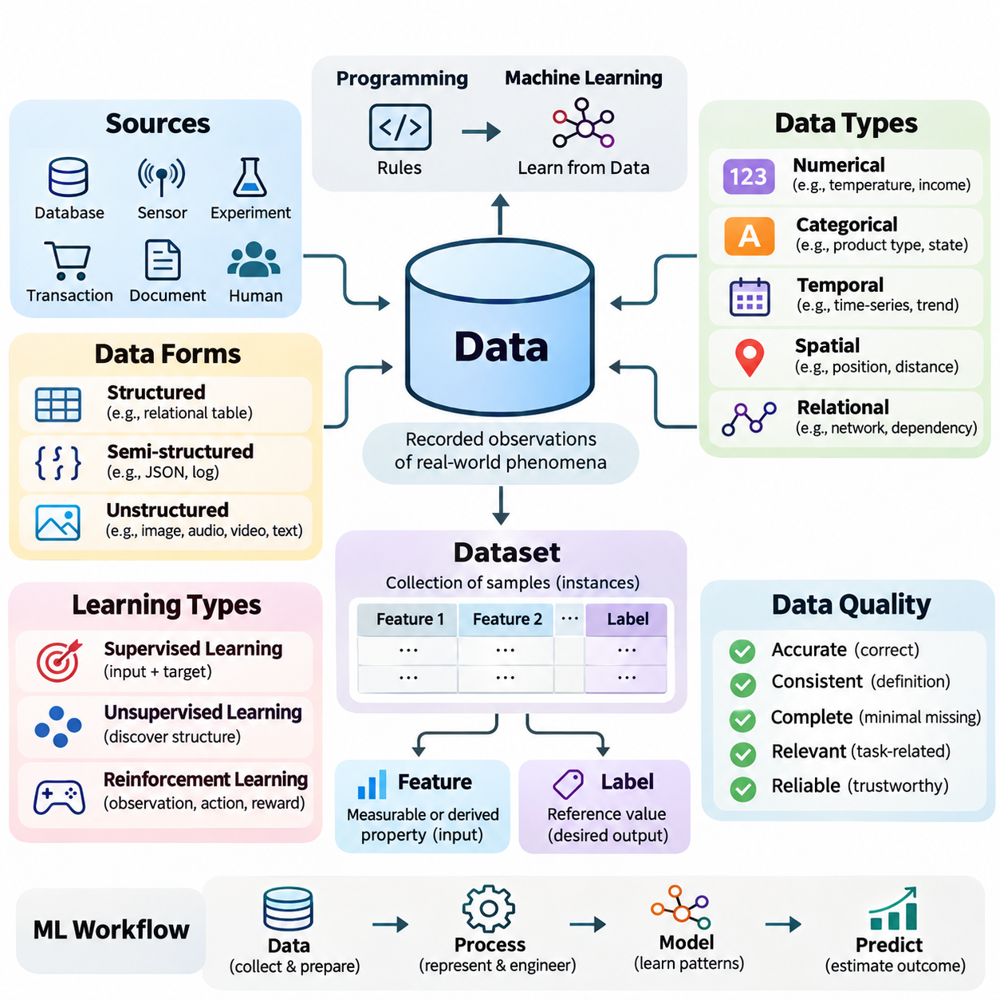
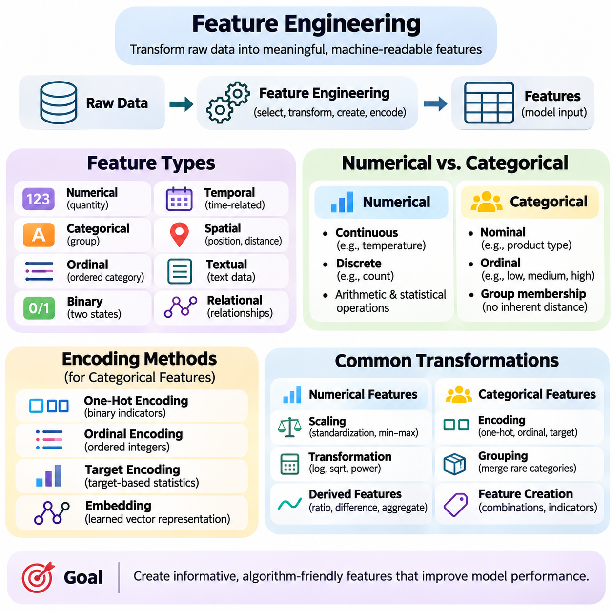
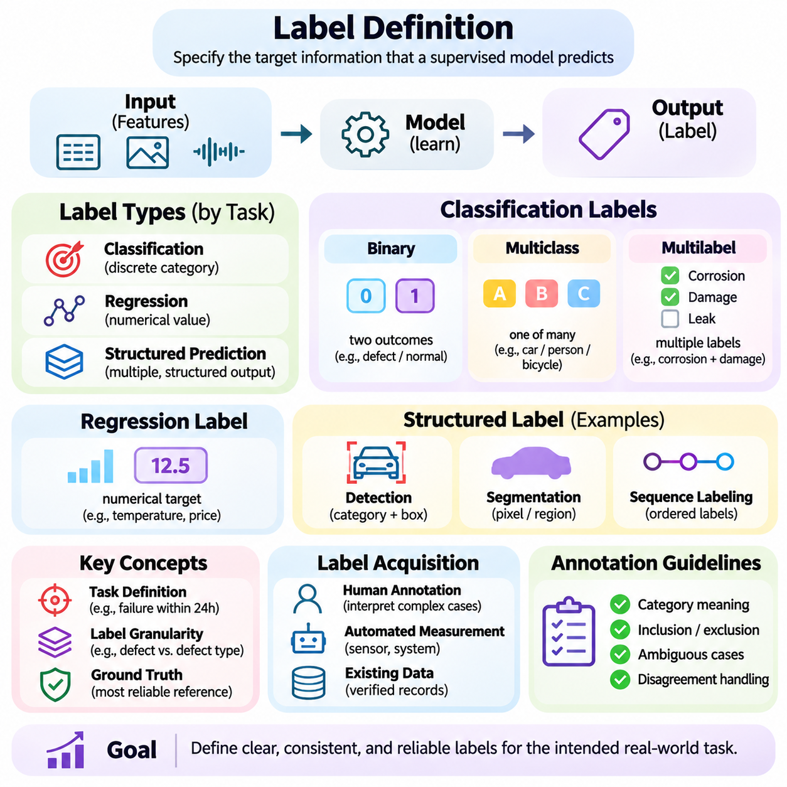
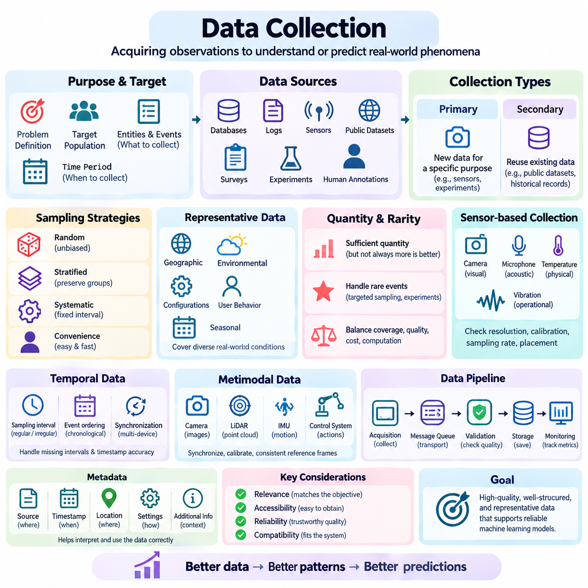
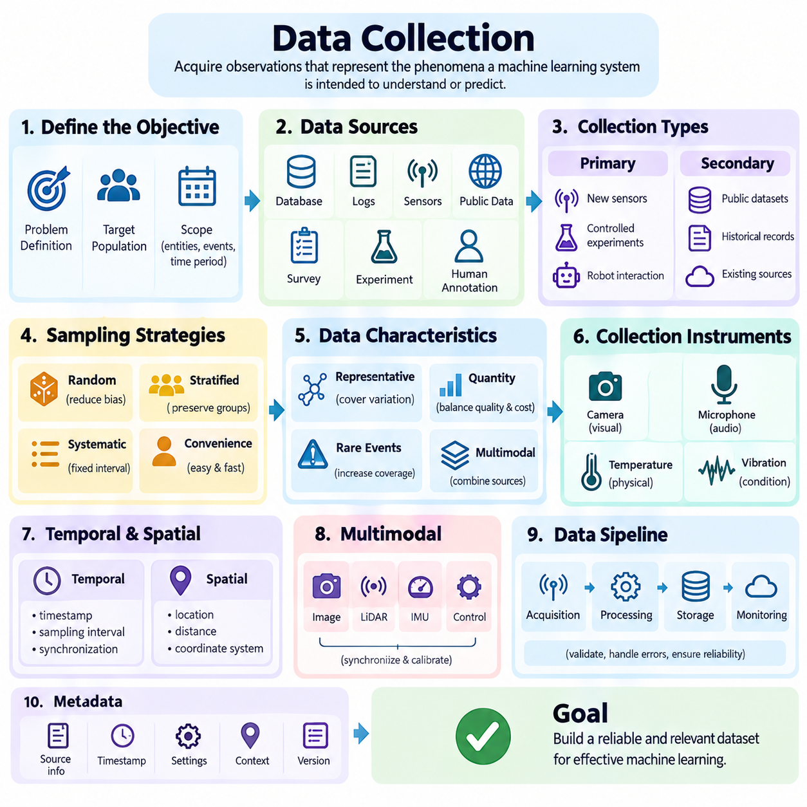
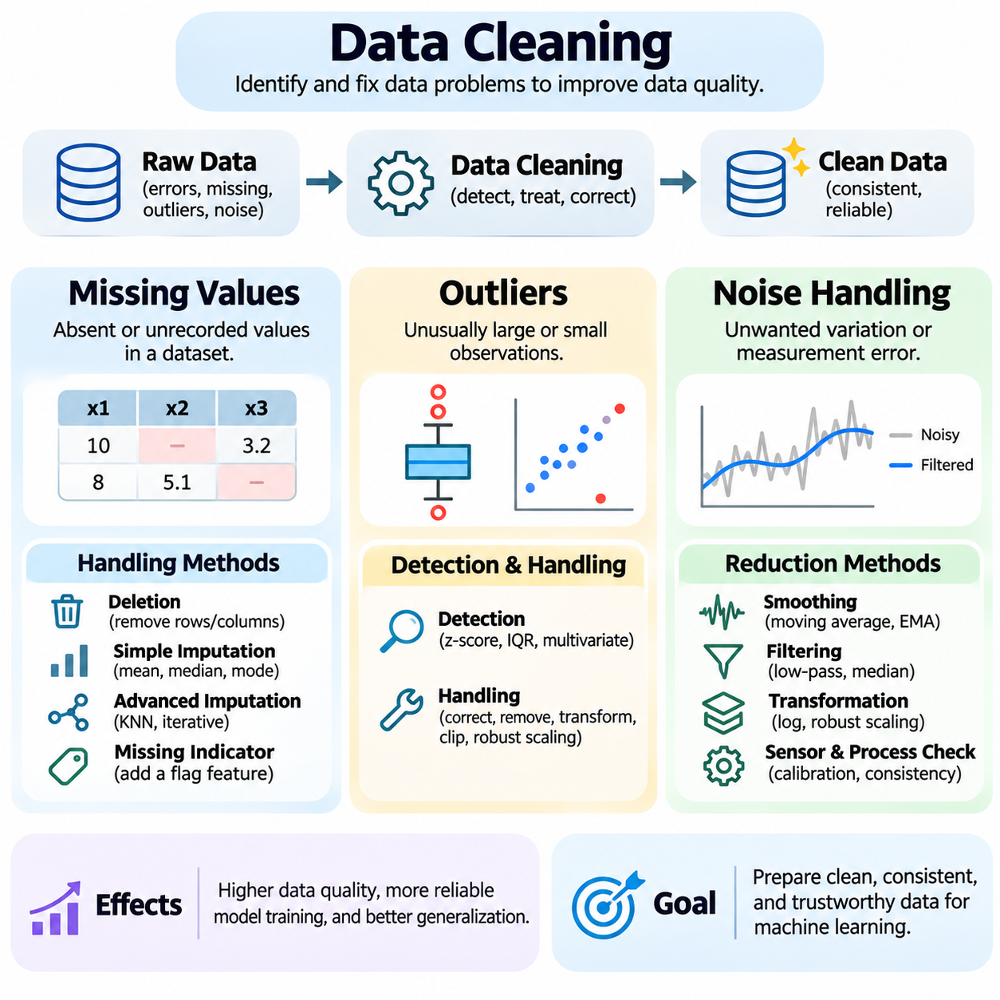
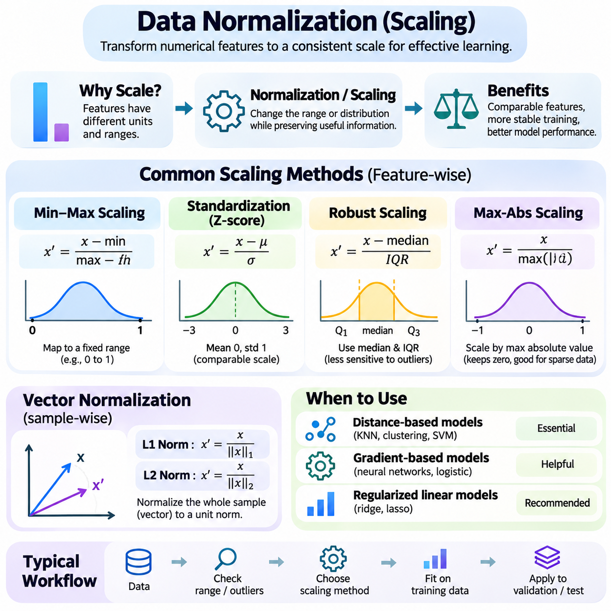
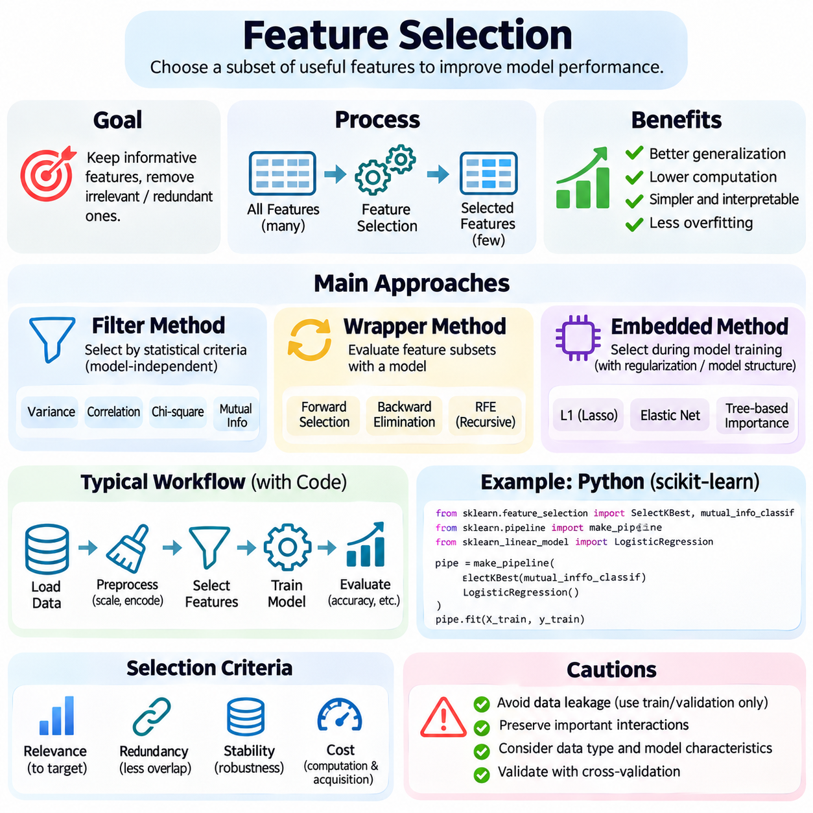
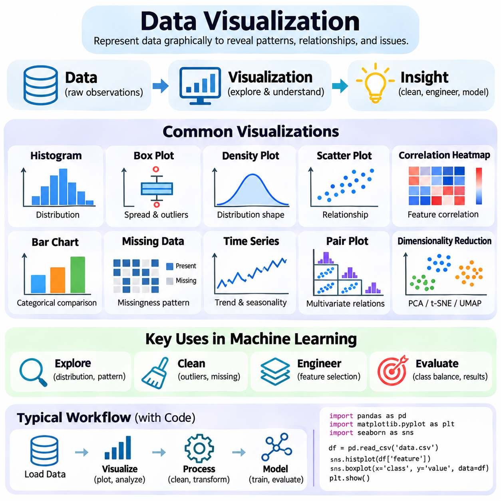
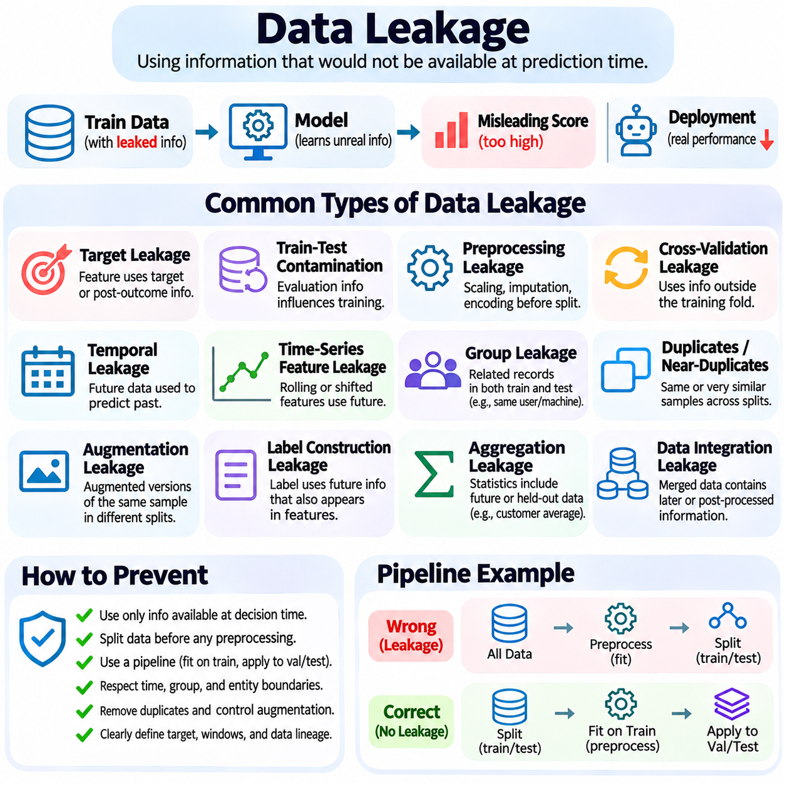

**Volume 07. Machine Learning Fundamentals**

# 02. Data Features and Labels

## 02.00 What is Data

{width="7.268055555555556in" height="7.268055555555556in"}

Data is the fundamental resource from which machine learning systems discover patterns, estimate relationships, and develop predictive capabilities. In conventional programming, developers explicitly define rules that transform inputs into outputs. Machine learning instead uses observed examples to construct models that approximate these relationships. The quality, relevance, and structure of available data therefore influence what a model can learn and how reliably it performs.

In machine learning, data refers to recorded observations, measurements, events, or representations of real-world phenomena. These observations may originate from databases, sensors, experiments, transactions, documents, or human interactions. Each observation provides information about a particular entity, event, or situation. When multiple observations are organized systematically, they form a dataset that can support statistical analysis, model training, and evaluation.

A dataset consists of individual samples, often called instances, examples, or records. In a customer database, one sample might represent a customer, while in an image classification dataset, one sample might represent an image. Samples are described through measurable or observable properties. Depending on the application, these properties may include numerical measurements, categorical attributes, textual descriptions, spatial coordinates, or temporal information.

Data becomes useful for machine learning when observations can be represented in a form that algorithms can process. A tabular dataset commonly organizes samples into rows and attributes into columns. Other applications require multidimensional arrays, sequences, graphs, or structured objects. The choice of representation depends on the underlying information and the learning objective. An appropriate representation preserves meaningful relationships while enabling efficient computation.

Structured data follows an explicit organizational schema, such as relational tables containing customer identifiers, transaction amounts, and timestamps. Semi-structured data uses flexible organizational conventions, including JSON documents and event logs. Unstructured data includes images, audio recordings, videos, and natural language documents. Although these categories differ in organization, each can provide valuable information when transformed into suitable computational representations.

Numerical data expresses measurable quantities such as temperature, distance, velocity, income, or production volume. Numerical variables may be continuous, representing measurements within a range, or discrete, representing countable quantities. Categorical data describes membership in groups, such as product types, machine states, or customer segments. Recognizing these distinctions is essential because different data types require different processing and interpretation methods.

Data may also possess temporal, spatial, or relational structure. Time-series observations preserve the order of measurements and may reveal trends, periodic behavior, or delayed dependencies. Spatial data describes positions, distances, and geometric relationships. Relational data captures connections between entities, such as interactions in social networks or dependencies in industrial systems. Ignoring these structures can eliminate information that is essential for accurate learning.

In supervised learning, datasets generally contain input observations and corresponding target values. Inputs describe the information available to the model, while targets represent the outcomes it should predict. For example, a housing dataset may contain property size, location, and age as inputs, with selling price as the target. This distinction establishes the predictive task and determines how training examples are interpreted during the learning process.

Unsupervised learning uses observations without requiring predefined target labels for every sample. The objective may involve discovering groups, identifying unusual observations, estimating probability distributions, or learning compact representations. Reinforcement learning introduces another organization of data through interactions between an agent and its environment. Observations, actions, rewards, and transitions collectively provide information about the consequences of decisions.

The relationship between raw data and meaningful information is central to machine learning. Raw measurements do not automatically express the concepts that a model must learn. A camera records pixel intensities rather than directly identifying objects, while an industrial sensor measures electrical signals rather than explicitly describing equipment health. Processing and interpretation connect these recorded values to the underlying phenomena relevant to a particular task.

A feature is a measurable or derived property used to describe an observation. Features may be collected directly, such as temperature or pressure, or calculated from existing measurements, such as average speed or transaction frequency. The usefulness of a feature depends on whether it contains information relevant to the learning objective. A large collection of features does not necessarily improve performance when many attributes are redundant, irrelevant, or unreliable.

Labels provide reference information about the desired outputs in supervised learning. A label may represent a category, a numerical value, or a more complex annotation. In defect detection, labels might distinguish acceptable products from defective ones. In regression, labels may contain measured energy consumption or expected delivery time. Label definitions must remain consistent because ambiguous or incorrect targets can introduce systematic errors into the learning process.

Data quality describes the extent to which observations accurately and consistently represent the intended phenomena. Important dimensions include completeness, correctness, consistency, timeliness, and relevance. Missing measurements, duplicated records, incorrect units, corrupted files, and inconsistent categories can distort the relationships learned by a model. Consequently, data quality assessment is an essential activity before training begins and throughout the operational lifecycle.

Measurement noise is another fundamental property of real-world data. Sensors may produce fluctuating readings, human annotations may contain subjective differences, and transactional systems may record delayed or incomplete events. Some variability reflects genuine differences in the underlying phenomenon, while other variability results from measurement limitations. Distinguishing meaningful variation from accidental noise helps determine whether preprocessing or improved collection is necessary.

A dataset should represent the population or operating conditions for which a model is intended. If training observations cover only a narrow range of situations, the resulting model may perform poorly when encountering unfamiliar conditions. For example, a visual inspection model trained under uniform lighting may struggle with shadows or reflections. Representative sampling therefore requires attention to environmental diversity, operational variability, and the expected deployment context.

The number of observations influences the statistical information available for learning, but dataset size alone does not determine usefulness. Thousands of nearly identical samples may contribute less information than a smaller collection covering diverse conditions. The relationship between quantity, diversity, accuracy, and task complexity is particularly important. Effective dataset design emphasizes informative coverage rather than treating the accumulation of records as an objective by itself.

Data distributions describe how values and combinations of values occur within a dataset. A distribution may reveal common observations, rare events, concentration around particular ranges, or relationships between variables. Machine learning algorithms implicitly or explicitly depend on these statistical characteristics. Understanding distributions helps practitioners recognize imbalance, unusual observations, and differences between training data and future operational inputs.

Sampling bias occurs when the process used to collect observations systematically favors certain groups, situations, or outcomes. A dataset collected exclusively during daytime may not adequately represent nighttime conditions. Similarly, customer behavior recorded from one geographic region may not generalize to another. These limitations can lead to misleading performance estimates and unequal reliability across different populations or operating environments.

Data provenance describes where observations originated and how they were collected, processed, and modified. Reliable provenance records may include source systems, collection timestamps, measurement procedures, annotation methods, and dataset versions. Such information supports reproducibility, auditing, and troubleshooting. Without provenance, it becomes difficult to determine whether unexpected model behavior results from algorithmic limitations or changes in the underlying data.

Data must also be interpreted within its operational and semantic context. A temperature value is incomplete without knowing its unit, measurement location, and recording time. A numerical identifier may appear mathematically meaningful even though its digits represent arbitrary categories. Metadata provides this contextual information and prevents incorrect assumptions about recorded values. Proper interpretation is therefore as important as the computational representation itself.

In practical machine learning systems, data frequently passes through several stages before becoming suitable for training. Collection produces raw observations, validation checks their integrity, cleaning addresses identified problems, and transformation converts them into usable representations. These stages may also involve normalization, encoding, feature extraction, and annotation. Each operation should preserve information relevant to the task while avoiding unintended distortion.

The distinction between training data and evaluation data is essential for understanding model reliability. Training observations influence model parameters, while separate evaluation observations estimate performance on examples not used for fitting. If information from evaluation data improperly influences training decisions, performance estimates may become overly optimistic. Maintaining appropriate separation helps determine whether the model has learned transferable relationships rather than memorizing particular examples.

Data is not necessarily static after a machine learning system enters production. Customer preferences, equipment conditions, environmental characteristics, and operational procedures may change over time. These changes can alter input distributions or the relationships between inputs and outcomes. Continuous data monitoring helps identify such shifts and provides evidence for deciding whether models, preprocessing procedures, or collection strategies require updates.

Data governance addresses the responsible management of information throughout its lifecycle. Relevant considerations include privacy, security, access permissions, retention policies, licensing, and regulatory obligations. Sensitive information should be collected and processed only when justified by legitimate requirements. Clear governance procedures help organizations maintain accountability while supporting reliable experimentation, collaboration, and deployment of machine learning applications.

In robotics and physical AI, data connects computational models with physical environments. Cameras, LiDAR sensors, inertial measurement units, encoders, and force sensors generate observations describing surroundings and system behavior. These measurements may require synchronization, calibration, and coordinate transformations before they can be combined. Their reliability directly affects perception, localization, prediction, and decision-making in systems interacting with the physical world.

A fundamental principle of machine learning is that data defines the evidence available to an algorithm. Model architecture and optimization determine how that evidence is processed, but they cannot guarantee recovery of information absent from the observations. Reliable learning therefore begins with understanding what the data represents, how it was obtained, and which limitations it contains. This foundation supports the subsequent study of features, labels, collection, cleaning, and preprocessing.

## 02.01 Feature Engineering

{width="7.268055555555556in" height="7.268055555555556in"}

Feature engineering is the process of transforming raw data into meaningful representations that machine learning algorithms can use effectively. Although models learn relationships from observations, their performance depends strongly on how relevant information is represented. Feature engineering combines domain knowledge, statistical analysis, and computational techniques to construct inputs that reveal useful patterns while reducing unnecessary complexity and misleading variation.

A feature represents an observable or derived characteristic of a data sample. In a housing prediction system, features may include floor area, building age, location, and distance to public transportation. In industrial monitoring, features may describe temperature, vibration, pressure, or operating duration. Each feature contributes a particular perspective on the underlying phenomenon, and its usefulness depends on the prediction objective and available observations.

Feature engineering includes identifying useful attributes, transforming existing variables, creating derived measurements, and converting information into machine-readable formats. These operations are distinct from model training because they determine the representation supplied to the learning algorithm. Effective transformations can make important relationships easier to discover, improve computational stability, and reduce the amount of training data required for certain learning problems.

Feature types can be classified according to their mathematical properties, semantic meaning, and structural organization. Common categories include numerical, categorical, ordinal, binary, temporal, spatial, textual, and relational features. These categories are not always mutually exclusive because a feature may have several characteristics simultaneously. Understanding feature types helps practitioners select appropriate transformations and avoid introducing incorrect assumptions into the learning process.

Numerical features represent quantities expressed through numbers. Continuous numerical features describe measurements such as temperature, distance, mass, or velocity, while discrete numerical features describe countable quantities such as transaction frequency or the number of detected objects. Numerical values often support arithmetic operations, distance calculations, and statistical summaries. However, their meaning depends on measurement units, valid ranges, and the physical or operational context.

Categorical features represent membership in distinct groups rather than directly measurable quantities. Examples include product category, equipment type, payment method, and operating mode. Nominal categories have no inherent ordering, whereas ordinal categories possess meaningful rankings, such as low, medium, and high severity. Treating nominal categories as ordered numerical values may introduce artificial relationships that do not exist in the original information.

Binary features represent two possible states, commonly expressed as zero and one. Examples include whether a machine is active, whether a transaction is fraudulent, or whether a component passed inspection. Binary variables may represent categorical states or logical conditions derived from other measurements. Their simple representation makes them convenient for many algorithms, but the interpretation of each state must remain consistent across training and deployment.

Temporal features describe time-related properties of observations. Timestamps may be transformed into hour of day, day of week, elapsed duration, or time since the previous event. Sequential measurements can also produce rolling averages, moving differences, and lagged values. These transformations help models identify periodic patterns and historical dependencies, provided that feature construction uses only information available at the intended prediction time.

Spatial features describe positions, distances, orientations, and geometric relationships. Examples include geographic coordinates, distance to infrastructure, relative object positions, and movement directions. In robotics, spatial representations may use coordinate frames, angles, or relative transformations between sensors and objects. Appropriate spatial feature engineering must account for coordinate systems, units, and geometric constraints to prevent physically inconsistent interpretations.

Textual and multimedia features require representations that convert complex observations into numerical structures. Text may be represented through token counts, term frequencies, or learned embeddings. Images may contribute color statistics, geometric descriptors, or neural feature vectors. Audio recordings may provide spectral characteristics and temporal patterns. The appropriate representation depends on the learning task and whether handcrafted or automatically learned features are more suitable.

Numerical and categorical features differ fundamentally in how algorithms interpret their values. A numerical feature such as temperature expresses magnitude, allowing differences between values to carry meaning. A categorical feature such as machine type identifies a group without implying numerical distance. Encoding categories as arbitrary integers can therefore mislead models that interpret numerical magnitude or ordering as meaningful relationships.

Feature scaling transforms numerical variables to improve comparability or computational behavior. Standardization commonly centers values around their mean and scales them using their standard deviation. Min-max scaling maps observations into a specified interval based on reference minimum and maximum values. These transformations are particularly relevant for distance-based and gradient-based methods, although their benefits depend on the algorithm and the underlying data distribution.

Categorical encoding converts nonnumerical categories into representations that learning algorithms can process. The appropriate encoding method depends on category ordering, the number of distinct values, model architecture, and available training data. Encoding should preserve meaningful distinctions without introducing unsupported relationships. It must also provide a consistent mechanism for handling categories that appear during deployment but were absent from the training dataset.

Ordinal encoding assigns numerical codes to categories with meaningful ordering. For example, low, medium, and high risk may be represented using increasing integer values. This preserves their rank but may also imply numerical spacing that the original categories do not justify. Consequently, ordinal encoding is appropriate when ordering matters, while additional care is required when an algorithm interprets differences between encoded values as quantitative distances.

One-hot encoding represents each category using a separate binary indicator. A feature containing red, green, and blue categories can become three columns indicating category membership. This method avoids imposing artificial numerical ordering and works well with many conventional machine learning algorithms. However, high-cardinality features containing thousands of unique categories can produce large, sparse representations that increase memory consumption and computational requirements.

Dummy encoding is closely related to one-hot encoding but may omit one indicator column when an intercept and a complete set of category indicators would create exact linear dependence. This approach is commonly used in statistical regression models. The choice between full one-hot encoding and reduced dummy encoding depends on model assumptions, regularization, and implementation details rather than a universal requirement to remove a category.

Frequency encoding replaces categories with their occurrence counts or relative frequencies in the training dataset. This creates compact numerical representations, especially for high-cardinality categorical variables. However, different categories may receive identical values, and frequency does not necessarily reflect predictive relevance. Frequency statistics must be estimated from appropriate training observations to avoid incorporating information from evaluation data.

Target encoding replaces categorical values with statistics derived from their associated target labels, such as the average outcome for each category. This approach can capture useful predictive relationships while maintaining compact representations. However, directly calculating target statistics from the same observations used for model fitting can cause target leakage and overfitting. Cross-fitting, smoothing, and carefully separated validation procedures help reduce these risks.

Hash encoding maps categorical values into a fixed number of numerical positions using a deterministic hashing function. It can process large or evolving category vocabularies without maintaining a complete category dictionary. Its principal limitation is the possibility of collisions, where different categories share the same representation. Selecting the representation size involves balancing computational efficiency against information loss caused by collisions.

Feature engineering frequently combines multiple variables to construct more informative measurements. Ratios, differences, products, logarithmic transformations, and interaction terms can reveal relationships that individual attributes do not express directly. For example, energy consumption divided by production volume may describe operational efficiency more effectively than either measurement alone. Derived features must remain mathematically valid and consistent with domain constraints.

Missing values require special consideration during feature construction. A missing numerical measurement may be replaced using an appropriate imputation strategy, while a missing category may receive an explicit unknown indicator. In some applications, the fact that information is missing is itself predictive. Nevertheless, imputation and missingness indicators should reflect the data-generating process rather than conceal systematic collection problems.

Feature engineering must also consider outliers, measurement noise, and unusual distributions. Extreme numerical values may dominate scaling procedures or distort derived statistics. Robust transformations, clipping, or domain-specific validation may reduce these effects when justified. However, unusual observations should not automatically be discarded because they may represent important rare events, equipment failures, or legitimate operating conditions.

The effectiveness of engineered features depends on their relationship to the learning algorithm. Linear models may benefit substantially from interaction terms and nonlinear transformations, while tree-based models can often discover threshold relationships directly. Neural networks can learn hierarchical representations from raw or minimally processed inputs. Nevertheless, automatic representation learning does not eliminate the need for correct units, consistent encoding, and reliable data preparation.

A practical feature engineering pipeline should apply transformations consistently across training, validation, testing, and deployment. Statistical parameters, category mappings, and encoding dictionaries must be fitted using permitted training data and reused for subsequent observations. This prevents inconsistent representations and reduces data leakage. Versioned preprocessing procedures also improve reproducibility and simplify troubleshooting when model performance changes.

Feature engineering ultimately connects raw observations with the mathematical representations required for effective learning. Numerical and categorical features require different treatment, while encoding methods determine how category information enters computational models. Successful feature engineering preserves meaningful information, respects the prediction context, and produces consistent inputs. These principles establish the foundation for feature selection, model training, evaluation, and reliable deployment.

## 02.02 Label Definition

{width="7.268055555555556in" height="7.268055555555556in"}

Label definition is the process of specifying the target information that a supervised machine learning model is expected to predict. A label represents the desired outcome associated with an input observation and provides the reference used during training and evaluation. Clear label definitions establish what the model should learn, how predictions should be interpreted, and whether the resulting system addresses the intended real-world problem.

In supervised learning, each training example typically contains input features and a corresponding label. Features describe observable properties of an entity or event, while labels express the outcome of interest. For example, a medical dataset may contain patient measurements and a diagnosis label, while a manufacturing dataset may contain sensor readings and a defect category. The relationship between features and labels forms the basis of predictive learning.

Labels differ according to the type of machine learning task. Classification labels represent discrete categories, regression labels represent numerical quantities, and structured prediction labels describe more complex outputs. A classification model may predict whether a transaction is fraudulent, while a regression model estimates future energy consumption. The label format must match the prediction objective and the assumptions of the selected learning algorithm.

Binary classification uses labels representing two mutually exclusive outcomes, commonly encoded as zero and one. Examples include defective versus acceptable products, fraudulent versus legitimate transactions, and equipment failure versus normal operation. Although binary encoding is mathematically simple, the semantic meaning of each value must be explicitly documented. Inconsistent interpretations can reverse predictions and produce serious operational errors.

Multiclass classification assigns each observation to one category among several mutually exclusive alternatives. An image classification system might distinguish vehicles, pedestrians, bicycles, and background objects. Each category requires a clear definition so that annotators and algorithms interpret it consistently. Categories should be sufficiently distinct for the intended task, although real-world observations may contain ambiguity that requires additional labeling rules.

Multilabel classification allows a single observation to receive several labels simultaneously. An industrial image may contain both corrosion and surface damage, while a document may address multiple topics. Unlike multiclass classification, the presence of one label does not exclude another. Label definitions must specify whether categories can overlap and how partially visible or uncertain conditions should be represented.

Regression labels describe continuous or discrete numerical targets such as temperature, price, distance, production output, or remaining equipment lifetime. Their interpretation depends on measurement units, precision, and collection procedures. A target expressed in seconds differs fundamentally from one expressed in hours, even when both describe duration. Reliable regression therefore requires consistent units, calibrated measurements, and clearly defined target boundaries.

Structured labels represent outputs containing multiple related components. Object detection datasets may associate each object with a category and bounding box coordinates. Segmentation datasets assign categories to pixels or regions, while sequence labeling identifies entities or events across ordered observations. These tasks require annotation conventions that preserve spatial, temporal, or relational consistency between individual label elements.

The meaning of a label depends on the operational question being addressed. Predicting whether equipment will fail within twenty-four hours differs from predicting whether it is currently malfunctioning. Both tasks concern equipment reliability, but they require different target definitions and observation windows. Precise problem formulation prevents the model from learning an outcome that is statistically convenient but operationally irrelevant.

Label granularity determines the level of detail represented by the target. A manufacturing system may classify products simply as acceptable or defective, or distinguish scratches, cracks, deformation, and contamination. Fine-grained labels provide more specific information but often require greater annotation effort and clearer category boundaries. The appropriate granularity depends on decision requirements, data availability, and achievable annotation consistency.

Ground truth refers to reference information treated as the most reliable available description of an outcome. It may originate from direct measurements, verified records, expert judgments, or controlled experiments. However, ground truth is not necessarily perfect or free from uncertainty. Its reliability depends on measurement accuracy, annotation procedures, and the degree to which the recorded outcome reflects the intended concept.

Label acquisition may involve human annotation, automated measurement, existing databases, or combinations of these sources. Human annotators can interpret complex visual and semantic information, while automated systems may provide scalable measurements. Each method introduces different limitations, including subjective interpretation, sensor error, or incomplete records. Labeling procedures should therefore document their sources and expected uncertainty.

Annotation guidelines establish consistent rules for assigning labels to observations. They should define category meanings, inclusion criteria, exclusion criteria, ambiguous cases, and procedures for resolving disagreements. For example, an industrial inspection guideline may specify the minimum visible defect size required for a positive label. Clear instructions reduce variation between annotators and improve the reliability of the resulting dataset.

Inter-annotator agreement measures the extent to which different annotators assign consistent labels to the same observations. Agreement can be examined through direct comparison or statistical measures such as Cohen\'s kappa and Fleiss\' kappa. Low agreement may indicate unclear definitions, insufficient training, or genuinely ambiguous examples. Agreement analysis helps identify labeling problems before they propagate into model training.

Label noise occurs when recorded targets differ from the intended or correct outcomes. Errors may result from incorrect annotations, faulty sensors, inconsistent definitions, or outdated information. Random label noise can reduce learning efficiency, while systematic errors may introduce persistent predictive bias. Improving label quality often requires targeted review, better annotation instructions, and verification of difficult or frequently disputed examples.

Class imbalance occurs when some label categories appear much more frequently than others. A defect detection dataset may contain thousands of acceptable products but relatively few defective examples. This distribution can cause models to favor common outcomes while performing poorly on rare but important categories. Label definition and dataset design should therefore consider both category frequency and the operational consequences of different prediction errors.

Ambiguous labels arise when observations cannot be assigned confidently to a single outcome. A partially obscured object may be difficult to classify, while an early-stage equipment fault may not satisfy established failure criteria. Possible approaches include uncertainty annotations, expert review, or carefully defined unknown categories. Forcing uncertain observations into arbitrary classes can introduce misleading supervision and reduce model reliability.

Temporal consistency is essential when labels describe future events or changing conditions. In predictive maintenance, a failure label may depend on whether equipment fails within a specified prediction horizon. The observation window and target window must be separated appropriately to prevent future information from influencing current predictions. Incorrect temporal alignment can create data leakage and unrealistically optimistic evaluation results.

Label leakage occurs when information directly or indirectly revealing the target becomes available among the input features. For example, a dataset predicting customer cancellation should not use records created only after cancellation as ordinary prediction inputs. Even correctly defined labels can produce misleading results when feature availability is ignored. Reliable dataset construction must align labels with the information available at the intended decision time.

Label consistency must be maintained across dataset versions, collection environments, and annotation teams. Changes in category definitions or measurement procedures can alter the meaning of existing targets. Combining observations labeled under incompatible conventions may introduce hidden inconsistencies. Versioned label specifications and documented migration procedures help preserve comparability across experiments and production updates.

In robotics and physical AI, labels may describe objects, actions, contact states, trajectories, or environmental conditions. A manipulation dataset may identify grasp success, object position, or task completion, while a navigation dataset may annotate obstacles and traversable regions. These labels connect sensor observations with physical outcomes. Their definitions must account for spatial reference frames, timing, measurement uncertainty, and operational safety requirements.

Label quality should be evaluated independently from model performance whenever possible. High prediction accuracy does not necessarily indicate that the target definitions are meaningful or correct. A model may successfully reproduce systematic annotation mistakes while failing to represent the intended phenomenon. Label audits, expert review, disagreement analysis, and examination of difficult examples provide complementary evidence about dataset reliability.

Effective label definition connects a machine learning objective with measurable and interpretable outcomes. It requires clear semantics, appropriate granularity, reliable acquisition methods, consistent annotation procedures, and careful treatment of uncertainty. Well-defined labels improve training quality, evaluation validity, and operational trustworthiness. They also establish the foundation for subsequent data collection, cleaning, preprocessing, and model development.

## 02.03 Data Collection

{width="7.268055555555556in" height="7.268055555555556in"}

{width="7.268055555555556in" height="7.268055555555556in"}

Data collection is the process of acquiring observations that represent the phenomena a machine learning system is intended to understand or predict. It establishes the empirical foundation for model development by determining which examples, measurements, and outcomes become available for learning. Effective collection requires alignment between the learning objective, the operational environment, and the information needed to support reliable decisions.

A data collection strategy begins with a clear definition of the problem and the target population. Practitioners must identify which entities, events, conditions, and time periods should be represented. A manufacturing inspection system may require images of products under different lighting conditions, while a predictive maintenance system may require sensor measurements across normal operation and equipment degradation. These requirements determine the scope of collection.

Data sources may include databases, application logs, sensors, public datasets, surveys, experiments, and human-generated annotations. Each source provides different forms of information and introduces particular limitations. Transaction databases may offer structured historical records, while cameras and industrial sensors provide continuous observations. Selecting suitable sources requires evaluating relevance, accessibility, reliability, and compatibility with the intended machine learning task.

Primary data collection acquires new observations specifically for a defined research or operational purpose. Examples include installing sensors, conducting controlled experiments, and recording robot interactions. Secondary data collection reuses information originally gathered for other purposes, such as public benchmarks or historical business records. Primary collection offers greater control over measurement procedures, while secondary sources may reduce cost and preparation time.

Sampling determines which observations from a larger population become part of a dataset. Random sampling can reduce certain selection biases when an appropriate sampling frame is available. Stratified sampling divides the population into meaningful groups and samples from each group. Systematic and convenience sampling may be operationally efficient but can introduce limitations. The chosen strategy should reflect the target population and expected deployment conditions.

Representative data collection aims to capture the diversity of conditions that a deployed model will encounter. Relevant variation may involve geographic location, environmental conditions, equipment configurations, user behavior, or seasonal changes. A dataset concentrated in a narrow operating range may produce strong laboratory results but weak generalization. Coverage should therefore be evaluated against realistic operating scenarios rather than dataset size alone.

Data quantity influences the statistical evidence available for learning, but collecting more observations does not automatically improve model quality. Large collections containing redundant examples may contribute less information than smaller collections covering diverse situations. The required quantity depends on task complexity, model capacity, label variability, and the frequency of important events. Collection planning should balance coverage, quality, cost, and computational requirements.

Rare events present a significant challenge because they may occur infrequently during ordinary collection. Industrial failures, unusual traffic situations, and safety-critical interactions may be underrepresented despite their operational importance. Targeted sampling, controlled experiments, and carefully validated simulation can increase coverage. However, deliberately enriched datasets must preserve information about their sampling procedures to support meaningful evaluation.

Sensor-based collection converts physical phenomena into recorded measurements. Cameras capture visual information, microphones record acoustic signals, and temperature or vibration sensors measure operating conditions. Measurement quality depends on sensor resolution, calibration, sampling frequency, placement, and environmental interference. Incorrect configurations may introduce systematic errors that remain difficult to correct during later preprocessing stages.

Temporal data collection requires explicit attention to sampling intervals, event ordering, and timestamp accuracy. Time-series datasets may contain periodic measurements, irregular observations, or event-triggered records. Missing intervals and inconsistent clocks can distort temporal relationships. When multiple devices contribute data, synchronization procedures are essential for establishing which measurements describe the same physical event or operating state.

Multimodal data collection combines observations from different information sources, such as cameras, LiDAR, inertial sensors, and control systems. These modalities provide complementary descriptions of an environment but may differ in sampling rates, coordinate systems, and measurement uncertainty. Accurate integration requires synchronization, calibration, and consistent reference frames. Without these controls, apparently related observations may describe different moments or locations.

Data collection pipelines transport observations from their sources into storage and processing systems. A pipeline may include acquisition interfaces, message queues, validation services, databases, and archival storage. Reliable pipelines should preserve records, identify transmission failures, and handle temporary interruptions. Monitoring collection throughput, latency, and error rates helps distinguish genuine environmental changes from failures in the acquisition infrastructure.

Metadata provides the contextual information needed to interpret collected observations correctly. Useful metadata may include source identifiers, timestamps, sensor configurations, measurement units, collection locations, and dataset versions. In experimental settings, metadata may also describe environmental conditions and operating procedures. Recording this information improves traceability, reproducibility, and the ability to investigate unexpected model behavior.

Data validation should begin during acquisition rather than after the complete dataset has been assembled. Automated checks can identify missing fields, invalid ranges, inconsistent formats, duplicated records, and corrupted files. Sensor streams may also require checks for unexpected discontinuities or physically impossible measurements. Early validation reduces downstream correction costs and prevents unreliable observations from silently entering training datasets.

Label collection must be coordinated with the acquisition of input observations when supervised learning is required. Labels may come from expert annotations, verified outcomes, automated measurements, or subsequent events. The timing and reliability of these sources influence target validity. For predictive tasks, the collection procedure must distinguish information available at prediction time from outcomes observed afterward to prevent data leakage.

Human annotation introduces additional operational requirements because label quality depends on consistent interpretation. Annotation interfaces, written guidelines, reviewer training, and disagreement resolution procedures help establish reliable reference information. Difficult examples may require expert adjudication or uncertainty labels. Quality control should include periodic review rather than assuming that all manually assigned labels are equally accurate.

Experimental data collection enables controlled investigation of relationships between variables. Researchers may vary operating conditions, system parameters, or environmental factors while measuring resulting outcomes. Controlled experiments can improve coverage of specific conditions and support causal interpretation when appropriately designed. Nevertheless, experimental settings may differ from deployment environments, so their representativeness must be evaluated.

Simulation and synthetic data generation can supplement observations that are expensive, dangerous, or difficult to collect directly. Robotics simulators may generate trajectories, sensor images, and interaction outcomes across many configurations. Synthetic data can improve coverage but may contain unrealistic textures, dynamics, or noise patterns. The simulation-to-reality gap must therefore be assessed using independent observations from physical environments.

Ethical and legal considerations shape what information may be collected and how it may be used. Personal information, confidential records, and sensitive operational data require appropriate authorization and safeguards. Collection procedures should respect applicable privacy requirements, consent conditions, licensing restrictions, and retention policies. Data minimization encourages gathering information necessary for the intended purpose rather than accumulating unrelated records.

Data provenance records where observations originated and how they were acquired or modified. Provenance information may include acquisition software versions, device identifiers, annotation procedures, and processing history. Such records support reproducibility and help identify whether unexpected results originate from model behavior or changes in the data source. Version control also makes collection procedures easier to compare across experiments.

Dataset partitioning should be considered during collection planning, especially when observations are correlated. Repeated measurements from the same person, machine, or recording session may be highly similar. Randomly distributing related samples across training and testing sets can create misleading evaluation results. Group-based or time-based separation may be necessary to assess performance on genuinely independent entities or future conditions.

Continuous collection is often necessary after deployment because real-world environments evolve. Equipment ages, customer behavior changes, and environmental conditions shift over time. Monitoring newly acquired observations can reveal distribution changes, emerging failure modes, and gaps in the original dataset. Feedback from deployed systems can guide targeted collection, although new observations must still undergo validation before being used for retraining.

In robotics and physical AI, collection strategies must account for the interaction between perception, action, and physical consequences. Robot datasets may record camera frames, joint positions, actuator commands, forces, and task outcomes. Synchronizing these signals is essential for reconstructing behavior and learning control-related relationships. Safety procedures and operational boundaries must also govern experiments involving physical movement and contact.

Effective data collection is a systematic engineering activity rather than the simple accumulation of records. It combines problem definition, source selection, representative sampling, measurement control, validation, documentation, and responsible governance. High-quality collection establishes reliable evidence for feature engineering, label definition, preprocessing, and model evaluation. Its ultimate purpose is to produce data that faithfully represents the conditions under which a machine learning system must operate.

## 02.04 Data Cleaning

{width="7.268055555555556in" height="7.268055555555556in"}

Data cleaning is the process of identifying and correcting problems that reduce the reliability of machine learning datasets. Raw observations frequently contain missing values, outliers, measurement noise, inconsistent formats, and invalid records. These problems can distort statistical relationships and weaken model performance. Effective cleaning improves data consistency while preserving information relevant to the intended learning task.

Data cleaning begins with systematic inspection of dataset structure, variable types, value ranges, and completeness. Summary statistics and visual analysis can reveal unexpected distributions, duplicated records, and inconsistent categories. Validation rules should reflect domain requirements rather than arbitrary numerical assumptions. Understanding the origin of each problem is essential because different causes require different corrective actions.

Missing values occur when expected information is absent from an observation. They may result from sensor failures, incomplete forms, communication interruptions, or unavailable measurements. Missingness can affect numerical, categorical, and temporal variables differently. Before selecting a treatment method, practitioners should examine how frequently values are missing and whether missingness is associated with particular conditions or outcomes.

Missing data mechanisms are commonly described as missing completely at random, missing at random, and missing not at random. These categories describe how missingness relates to observed and unobserved information. Their distinction matters because different assumptions affect the validity of statistical estimates and imputation methods. The true mechanism is often difficult to establish from observed data alone.

Deletion is a straightforward approach to missing values when incomplete observations or variables can be removed without unacceptable information loss. Row deletion may be reasonable when missingness is limited and sufficiently random. Column deletion may be considered when a feature contains extensive missing information and little predictive value. However, careless deletion can reduce sample diversity and introduce selection bias.

Imputation replaces missing values with estimated or predefined substitutes. Numerical variables may use the mean, median, or a domain-specific constant, while categorical variables may use the most frequent category or an explicit unknown value. Median imputation is often less sensitive to extreme observations than mean imputation. Every replacement strategy introduces assumptions that should be evaluated against the data distribution.

Advanced imputation methods estimate missing values using relationships among multiple features. K-nearest neighbors imputation uses similar observations, while iterative imputation models incomplete variables using other available attributes. These methods may preserve relationships better than simple substitution but increase computational cost and modeling complexity. Their effectiveness depends on data quality and the plausibility of underlying assumptions.

Missingness indicators explicitly record whether a value was originally absent. Such indicators can be useful when missing measurements carry information about operational conditions or collection procedures. For example, a sensor reading may be missing more frequently during equipment malfunction. However, predictive missingness patterns can change after deployment, so their stability and operational meaning require careful evaluation.

Outliers are observations that differ substantially from the majority of recorded values. They may represent measurement errors, unusual but legitimate events, or previously unseen operating conditions. A sudden temperature spike could indicate sensor malfunction or a genuine equipment fault. Consequently, outlier detection should identify unusual observations without automatically assuming that every extreme value is incorrect.

Statistical outlier detection commonly uses standardized scores, interquartile ranges, and distributional assumptions. Z-scores measure deviation from the mean relative to standard deviation, while the interquartile range identifies values beyond selected quartile-based thresholds. These techniques are convenient but can perform poorly with skewed or multimodal distributions. Thresholds should be selected with attention to the application context.

Multivariate outliers may appear normal when individual features are examined separately but become unusual when relationships among variables are considered. For example, temperature and pressure may each fall within acceptable ranges while their combination indicates abnormal operation. Distance-based methods, isolation forests, and density-based techniques can help identify such observations. Their outputs require domain interpretation.

Outlier handling may involve correction, removal, transformation, clipping, or separate analysis. Clearly invalid measurements can sometimes be corrected using verified source records. Logarithmic transformations may reduce the influence of highly skewed positive values, while robust scaling limits sensitivity to extremes. Removing rare but valid observations can weaken a model\'s ability to recognize important abnormal conditions.

Noise refers to unwanted variation or errors that obscure meaningful information within collected data. Measurement noise may originate from electronic interference, sensor limitations, environmental disturbances, or inconsistent human annotation. Noise differs from legitimate variability because it does not reliably represent the phenomenon being modeled. Nevertheless, separating noise from meaningful variation is often difficult without contextual knowledge.

Random noise introduces unpredictable fluctuations, while systematic noise produces repeatable distortions associated with measurement conditions or equipment behavior. A camera may experience random pixel fluctuations, whereas a miscalibrated sensor may consistently report biased values. Random noise may sometimes be reduced through averaging, but systematic errors generally require calibration, correction, or changes to acquisition procedures.

Noise handling methods depend on the data modality and the characteristics of the underlying signal. Numerical measurements may benefit from smoothing, filtering, or robust statistical estimation. Time-series data may use moving averages or median filters, while image data may require spatial denoising. Excessive filtering can remove genuine peaks, boundaries, or short-duration events that are important for prediction.

Temporal noise handling must preserve event ordering and avoid introducing future information into historical predictions. A centered smoothing window may use observations that would not have been available at the intended prediction time. For real-time systems, causal filtering uses current and past measurements only. Filter design must also consider latency, signal distortion, and the importance of rapid changes.

Categorical noise includes inconsistent spelling, duplicated category names, incorrect codes, and conflicting labels. For example, several textual variations may refer to the same equipment type. Standardizing categories through controlled vocabularies and verified mapping rules improves consistency. However, categories that appear similar should not be merged without confirming that they represent the same underlying concept.

Label noise requires particular attention because supervised models learn directly from recorded targets. Incorrect classifications, inconsistent annotations, and uncertain outcomes can introduce misleading training signals. Quality improvement may involve expert review, repeated annotation, disagreement analysis, and targeted inspection of difficult examples. Label correction should preserve uncertainty rather than force ambiguous cases into unsupported categories.

Cleaning procedures must avoid data leakage between training, validation, and test datasets. Imputation statistics, outlier thresholds, and learned transformations should be estimated using the appropriate training partition. Applying parameters calculated from the entire dataset can expose information from evaluation observations. Reusable preprocessing pipelines help maintain consistent behavior across experiments and deployment.

Automated cleaning pipelines improve reproducibility by applying documented validation and transformation rules consistently. A pipeline may check data types, identify missing fields, standardize categories, detect anomalies, and generate quality reports. Each transformation should preserve traceability to the original records. Logging corrections and rejected observations makes it easier to investigate unexpected model behavior.

Data cleaning should be evaluated through both data quality measurements and downstream model performance. Useful indicators include missing-value rates, invalid-record counts, distribution changes, and the proportion of modified observations. Model evaluation can reveal whether cleaning improves generalization or removes valuable information. Comparisons should use consistent evaluation procedures and appropriately separated datasets.

In robotics and physical AI, cleaning must account for physical constraints and synchronized sensor measurements. Invalid coordinates, impossible velocities, dropped camera frames, and inconsistent timestamps can corrupt perception or control datasets. Cleaning one sensor stream independently may disrupt alignment with other modalities. Reliable procedures preserve temporal relationships, calibration information, and physically meaningful observations.

Effective data cleaning balances correction with information preservation. Missing-value treatment, outlier handling, and noise reduction should follow documented assumptions and domain requirements rather than universal rules. Excessive cleaning may eliminate rare events, meaningful variability, or evidence of system failures. A reliable dataset retains important information while reducing errors that would otherwise mislead machine learning models.

## 02.05 Data Normalization

{width="7.268055555555556in" height="7.268055555555556in"}

Data normalization is the process of transforming numerical features into consistent scales or representations that support effective machine learning. Real-world datasets often contain variables measured in different units and numerical ranges, such as temperature, distance, pressure, and income. Without appropriate scaling, features with large numerical magnitudes may dominate certain algorithms, even when their predictive importance is limited.

Feature scaling changes the numerical range or distribution of variables while preserving information relevant to the learning objective. Its primary purpose is to improve numerical stability, optimization behavior, and comparability among features. Scaling does not automatically improve every model because different algorithms respond differently to feature magnitude. The appropriate transformation depends on the model architecture and statistical properties of the data.

Normalization and standardization are related but distinct preprocessing concepts. Normalization often refers to transforming values into a bounded range or adjusting individual vectors to a specified norm. Standardization typically centers a feature around its mean and scales it according to its standard deviation. Terminology varies across libraries and applications, so the mathematical operation should always be specified explicitly.

Min-max scaling transforms a numerical feature using its observed minimum and maximum values. A common transformation maps the training range into the interval between zero and one. This preserves the relative ordering of observations and applies a linear transformation when the reference range is fixed. However, extreme values can compress most observations into a narrow interval, reducing their numerical separation.

Min-max scaling can also map features into alternative intervals, such as negative one to positive one. The transformation requires a lower and upper reference bound, which are generally estimated from training data. New observations outside the original training range may produce transformed values beyond the intended interval. Clipping can enforce fixed limits, but it also removes information about how far observations exceed those boundaries.

Standardization, often called Z-score scaling, subtracts the feature mean and divides the result by its standard deviation. The transformed training feature typically has a mean near zero and a standard deviation near one. This operation makes variables with different measurement units more comparable in numerical magnitude. It is frequently useful for linear models, support vector machines, and gradient-based optimization.

Standardization does not guarantee that a feature follows a normal distribution. A strongly skewed variable remains skewed after subtracting its mean and dividing by its standard deviation. Similarly, extreme observations can still produce large standardized values. The method changes location and scale rather than fundamentally reshaping the distribution, so additional transformations may be necessary for highly asymmetric data.

Robust scaling uses statistics that are less sensitive to extreme observations, commonly the median and interquartile range. Subtracting the median centers the feature around a typical value, while division by the interquartile range adjusts its scale. This approach can be useful when numerical variables contain substantial outliers. However, robust scaling does not eliminate outliers or guarantee that transformed values remain within fixed boundaries.

Max-absolute scaling divides each feature by its largest absolute value in the training data. It typically maps observed training values into a range between negative one and positive one without shifting zero. This property can be useful for sparse datasets because zero entries remain zero. Nevertheless, a single extreme observation can strongly influence the scaling factor, making the method sensitive to unusually large values.

Vector normalization operates on entire samples rather than scaling each feature independently. L1 normalization divides a vector by the sum of its absolute component values, while L2 normalization divides it by its Euclidean length. These transformations emphasize relative composition or direction instead of absolute magnitude. They are frequently used in text analysis, similarity calculations, and embedding-based retrieval systems.

The distinction between feature scaling and vector normalization is important because they preserve different information. Feature scaling modifies the distribution of each variable across observations, while vector normalization modifies relationships among components within individual observations. Applying both operations may be appropriate in some pipelines, but their order and purpose should be justified by the learning task.

Distance-based algorithms are particularly sensitive to differences in numerical scale. K-nearest neighbors and clustering methods often calculate distances between observations using feature values. If one variable spans thousands of units while another spans fractions, the larger-scale variable may dominate the distance calculation. Scaling helps ensure that distance measurements reflect intended feature contributions rather than arbitrary units.

Gradient-based learning methods can also benefit from feature scaling. When input variables have very different magnitudes, optimization may progress unevenly across parameter directions. Standardized inputs can improve the conditioning of certain optimization problems and support more stable parameter updates. However, the resulting benefit depends on model structure, learning rate, regularization, and the optimization algorithm.

Regularized linear models require particular attention to scaling because penalties on model coefficients interact with feature magnitude. Without comparable scales, coefficients associated with different variables may experience unequal effective regularization. Standardization can make penalty behavior more consistent across features. The transformation should be incorporated into the training pipeline so that coefficient interpretation remains connected to the original units.

Tree-based models generally depend less on feature scaling because decision trees split observations according to threshold comparisons. A monotonic linear rescaling typically preserves the ordering of feature values and therefore does not substantially change available split relationships. Random forests and many gradient-boosted tree models often work well without standardization. Nevertheless, scaling may still matter in hybrid systems or preprocessing pipelines.

Skewed numerical features may benefit from nonlinear transformations before or alongside scaling. Logarithmic transformations can compress large positive values, while square-root transformations may reduce moderate positive skewness. Power transformations offer additional ways to modify distribution shape. These methods should respect valid input domains and be selected based on observed distributions and the intended interpretation of features.

Quantile transformations map observations according to their position within an estimated cumulative distribution. They can produce approximately uniform or normal-shaped marginal distributions, depending on the chosen output representation. Such transformations reduce the influence of extreme numerical magnitudes but alter distances between observations. Their effects on interpretability and predictive performance should be evaluated carefully.

Scaling parameters must be estimated exclusively from the appropriate training data to prevent data leakage. Means, standard deviations, minima, maxima, and quantile boundaries calculated using validation or test observations can introduce information unavailable during model development. After fitting a scaler on training data, the same parameters should be applied unchanged to validation, testing, and deployment inputs.

Cross-validation requires scaling to occur independently within each training fold. A scaler fitted before splitting the complete dataset may transfer information from validation folds into model training. Encapsulating scaling and model fitting within a reusable pipeline prevents this problem. Each fold then estimates preprocessing parameters from its training portion and evaluates predictions on observations that did not influence those estimates.

Missing values and outliers should be considered when designing the order of preprocessing operations. Many scaling methods cannot directly process missing observations, so imputation may be required first. Extreme values may distort estimated scaling parameters, making robust methods or carefully justified outlier handling appropriate. The correct sequence depends on the dataset, transformation assumptions, and the requirements of the selected algorithm.

Numerical scaling should not be applied indiscriminately to every encoded variable. Binary indicators already possess a meaningful zero-one representation, while ordinal codes may express rankings without meaningful numerical distances. One-hot encoded features often require different treatment from continuous measurements. Decisions about scaling should reflect feature semantics rather than relying only on numerical data types.

In robotics and physical AI, scaling helps integrate measurements expressed in different physical units. Joint angles, velocities, forces, distances, and sensor intensities may occupy substantially different numerical ranges. Consistent scaling can improve learning stability in perception and control models. However, physical constraints, calibration relationships, and safety-critical thresholds must remain interpretable after transformations.

Effective normalization and scaling establish consistent numerical representations without changing the intended meaning of observations. Min-max scaling, standardization, robust scaling, max-absolute scaling, and vector normalization address different computational needs. Their suitability depends on feature distributions, algorithm sensitivity, and operational requirements. Reliable implementation requires training-only parameter estimation, reproducible pipelines, and careful evaluation.

## 02.06 Feature Selection

{width="7.268055555555556in" height="7.268055555555556in"}

Feature selection is the process of identifying a subset of input variables that contributes useful information to a machine learning model. Real-world datasets may contain hundreds or thousands of features, including irrelevant, redundant, or noisy measurements. Selecting appropriate features can improve generalization, reduce computational cost, and simplify model interpretation. The objective is to preserve predictive information while eliminating unnecessary complexity.

Feature selection differs from feature extraction because it retains existing variables rather than constructing new representations. Feature extraction methods, such as principal component analysis, transform original measurements into derived components. Feature selection instead identifies which original attributes should remain available to the model. This distinction matters when interpretability, measurement cost, and physical meaning are important.

The need for feature selection increases when datasets contain many variables relative to the number of observations. High-dimensional data can produce unstable statistical estimates and increase the risk of overfitting. Some features may capture accidental correlations that disappear in new environments. Removing uninformative variables can improve model robustness, although excessive selection may discard useful interactions or complementary information.

Feature relevance describes how strongly a variable contributes to predicting the target outcome. A feature may be individually informative, informative only through interactions, or redundant because another variable contains similar information. Relevance therefore depends on the learning objective and model family. A variable that contributes little to a linear model may still be valuable to a nonlinear model capable of learning complex relationships.

Feature selection methods are commonly divided into filter, wrapper, and embedded approaches. Filter methods evaluate variables using statistical criteria independently of a specific predictive model. Wrapper methods compare subsets through repeated model training and evaluation. Embedded methods perform selection as part of model fitting. These approaches differ in computational requirements, susceptibility to overfitting, and ability to capture feature interactions.

Filter methods provide an efficient starting point for high-dimensional datasets. Variance thresholds can remove variables that remain nearly constant across observations. Correlation analysis can identify strongly related numerical features, while statistical association tests can estimate relationships with the target. However, low variance does not necessarily imply low predictive value, and correlation alone cannot establish whether a feature is useful.

Univariate feature selection evaluates each variable separately using an appropriate statistical score. Classification tasks may use chi-square tests, analysis of variance, or mutual information, depending on feature characteristics. Regression tasks may use correlation-based scores or mutual information estimates. The selected method must respect assumptions about data types, distributions, and relationships between features and targets.

Mutual information measures statistical dependence between a feature and the target variable. Unlike ordinary linear correlation, it can identify certain nonlinear associations. However, estimating mutual information from finite datasets introduces uncertainty, especially with continuous or high-dimensional variables. Its usefulness depends on sample size, estimation procedures, and the ability to distinguish genuine relationships from random fluctuations.

Redundancy analysis examines whether multiple features provide substantially overlapping information. Highly correlated measurements may increase complexity without improving predictions. Removing redundant variables can simplify models and reduce acquisition requirements. Nevertheless, correlated features are not always interchangeable, and their combined contribution may depend on noise levels, operating conditions, and interactions with other variables.

Wrapper methods select features by repeatedly training a predictive model on candidate subsets. Forward selection begins with a limited set and adds variables that improve validation performance. Backward elimination starts with a larger set and removes variables according to an evaluation criterion. These methods directly reflect model behavior but can become computationally expensive when the number of candidate features is large.

Recursive feature elimination repeatedly fits a model, ranks features using an importance measure, and removes the least important candidates. The procedure continues until a specified number of features remains or another stopping condition is reached. Its effectiveness depends on the estimator and ranking method. Cross-validation can help determine the appropriate subset size, but repeated evaluation increases computational requirements.

Embedded selection integrates feature selection into model optimization. L1 regularization encourages some coefficients in linear models to become exactly zero, effectively excluding associated variables. Elastic Net combines L1 and L2 penalties to balance sparsity and coefficient stability. The selected features depend on regularization strength, feature scaling, and correlations among predictors, so results require careful interpretation.

Tree-based models can provide feature importance estimates based on their internal structure or predictive contribution. Impurity-based importance is computationally convenient but may favor certain feature types. Permutation importance measures how predictive performance changes when feature values are shuffled. Correlated variables can complicate both approaches because importance may be distributed across features or hidden by redundancy.

Feature selection must be separated from final model evaluation to avoid data leakage. Statistical scores, correlation filters, and model-based rankings should be estimated using training data rather than the complete dataset. Performing selection before cross-validation can expose information from validation folds. A reliable pipeline fits selection procedures independently within each training fold and evaluates the resulting model on held-out observations.

Nested cross-validation is useful when feature selection choices and model hyperparameters are optimized together. The inner validation process determines candidate subsets and parameter settings, while the outer evaluation estimates generalization performance. This separation reduces optimistic bias caused by repeatedly selecting configurations using the same evaluation data. Final testing should use observations that did not influence selection decisions.

Practical feature selection code should implement a reproducible sequence of data preparation, selection, model fitting, and evaluation. In Python, scikit-learn provides tools such as VarianceThreshold, SelectKBest, RFE, and SelectFromModel. These components can be combined with preprocessing transformers and estimators through Pipeline. Encapsulation ensures that learned selection rules are applied consistently during training and inference.

A typical implementation begins by separating input features from target labels and creating appropriate training and testing partitions. Missing-value treatment, categorical encoding, and numerical scaling are configured within the training pipeline. A feature selector then evaluates candidate variables using the selected criterion. The estimator is trained on the retained features, and performance is measured using task-appropriate evaluation metrics.

Feature selection code should expose important configuration parameters rather than embedding unexplained constants. Parameters may include the number of selected features, statistical scoring functions, regularization strengths, and cross-validation settings. Random seeds should be controlled when stochastic procedures are involved. Recording software versions, selected feature names, and evaluation results improves reproducibility and experimental comparison.

Selection stability measures whether similar feature subsets are obtained when training observations or random conditions change. Highly unstable selections may indicate insufficient data, strongly correlated predictors, or weak differences in feature relevance. Repeated cross-validation and resampling can reveal such instability. Stable selection is desirable for interpretation, although predictive performance remains an essential evaluation criterion.

Feature importance should not automatically be interpreted as causal importance. A variable may predict an outcome because it is correlated with another factor rather than directly influencing the result. Removing a predictive feature may also change the behavior of other variables within a fitted model. Domain knowledge and causal reasoning are therefore necessary when selected features inform scientific explanations or operational decisions.

In robotics and physical AI, feature selection can reduce sensor processing demands and improve real-time inference efficiency. Candidate variables may include camera-derived measurements, joint positions, velocities, forces, and environmental indicators. Selection should consider predictive contribution alongside acquisition latency, computational cost, and sensor reliability. Removing a safety-relevant signal solely because of low average importance may be inappropriate.

Feature selection must also account for changes between training and deployment environments. Variables that appear highly predictive in historical data may depend on temporary operating conditions or collection artifacts. Evaluating selected features across different time periods, locations, devices, or operating scenarios helps assess robustness. Monitoring feature availability and predictive stability after deployment supports reliable long-term operation.

Effective feature selection balances predictive accuracy, computational efficiency, interpretability, and operational reliability. Filter methods offer efficient screening, wrapper methods evaluate model-dependent subsets, and embedded methods integrate selection with learning. Reproducible code and leakage-resistant validation are essential for trustworthy results. The ultimate goal is a compact feature set that retains meaningful information and generalizes to unseen observations.

## 02.07 Data Visualization [w/Code]

{width="7.268055555555556in" height="7.268055555555556in"}

Data visualization is the process of representing information through graphical structures that reveal patterns, relationships, and anomalies within datasets. In machine learning, visualization supports exploratory data analysis, preprocessing, feature engineering, and model evaluation. Effective visual representations transform complex numerical observations into interpretable evidence, helping practitioners understand data characteristics before selecting algorithms or training models.

Exploratory data analysis uses visualization to investigate distributions, relationships, missing values, and unexpected observations. Rather than assuming that collected data satisfies predefined statistical properties, practitioners examine its actual structure. Visual inspection can reveal skewness, multimodal distributions, unusual clusters, and inconsistent measurements. These findings guide subsequent cleaning, transformation, and feature selection decisions.

Histograms summarize the distribution of numerical variables by grouping observations into intervals and displaying their frequencies. They help identify central tendencies, dispersion, skewness, and potential multimodality. The number and width of histogram bins influence how patterns appear. Excessively wide bins may conceal important structures, while excessively narrow bins may emphasize random fluctuations rather than meaningful distributional characteristics.

Box plots provide compact summaries of numerical distributions using the median, quartiles, and whiskers. They are useful for comparing feature distributions across categories or experimental conditions. Observations beyond selected whisker boundaries may be displayed as potential outliers. However, such points are not necessarily erroneous, and box plots do not fully represent distribution shape or distinguish multiple underlying populations.

Density plots estimate the probability density of continuous variables and provide smooth representations of observed distributions. Kernel density estimation is commonly used to investigate peaks, asymmetry, and overlap between groups. The bandwidth parameter controls smoothing and strongly influences the displayed shape. Density estimates should be interpreted cautiously when datasets are small, bounded, or contain highly discrete measurements.

Scatter plots display relationships between two numerical variables by representing observations as points in a coordinate system. They can reveal linear associations, nonlinear patterns, clusters, and unusual observations. Adding color or marker distinctions can represent categories or additional attributes. However, overlapping points may obscure dense regions, making transparency, sampling, or aggregation useful for large datasets.

Correlation heatmaps summarize pairwise relationships among numerical features using a matrix of correlation coefficients. They help identify redundant variables and groups of strongly associated measurements. Pearson correlation describes linear relationships, while rank-based measures can capture certain monotonic associations. Correlation does not establish causation, and nonlinear dependencies may remain invisible in ordinary correlation matrices.

Categorical data visualization commonly uses bar charts to compare frequencies or aggregated measurements across groups. Category ordering, labeling, and consistent measurement scales influence interpretation. Stacked charts can show composition, although comparing internal segments may be difficult. When categories are numerous, grouping rare values or selecting relevant subsets can improve readability without concealing important differences.

Missing-data visualization helps identify whether incomplete observations occur randomly or follow recognizable patterns. Missingness matrices and heatmaps can show which features are frequently absent and whether missing values occur together. Temporal displays may reveal interruptions associated with collection systems or operating conditions. Such patterns can guide imputation strategies, but visual evidence alone cannot establish the missing-data mechanism.

Time-series visualization displays measurements in chronological order to reveal trends, seasonality, abrupt changes, and recurring patterns. Line plots are useful for regularly sampled observations, while event markers can identify operational transitions. Irregular sampling and missing intervals should remain visible when they affect interpretation. Smoothing may clarify long-term behavior but can conceal short-duration events or introduce temporal distortion.

Multivariate visualization examines relationships involving more than two variables. Pair plots combine multiple scatter plots and distribution summaries to expose interactions among selected features. Parallel coordinate plots display observations across several numerical dimensions. These techniques become difficult to interpret as dimensionality increases, so thoughtful feature selection and grouping are necessary to maintain clarity.

Dimensionality reduction methods support visualization of datasets containing many features. Principal component analysis projects observations onto directions that capture substantial variance, while t-SNE and UMAP emphasize selected neighborhood relationships. These projections can reveal apparent clusters or structural differences. However, projected distances and cluster shapes may not faithfully preserve all relationships in the original feature space.

Class distribution visualization is important for supervised classification because unequal label frequencies can affect training and evaluation. Frequency plots reveal whether some classes dominate the dataset while others contain few observations. Class imbalance may require adjusted evaluation metrics, sampling strategies, or additional data collection. Visualization should distinguish genuine population frequencies from distributions modified by deliberate sampling.

Regression analysis benefits from visual comparisons between observed target values and model predictions. Prediction scatter plots can reveal systematic deviations, nonlinear errors, and poorly modeled ranges. Residual plots display prediction errors against fitted values or relevant features. Patterns in residuals may indicate missing relationships, unequal error variance, or model misspecification, although visual findings require further investigation.

Classification model evaluation often uses confusion matrices to display relationships between actual and predicted classes. These matrices reveal which categories are frequently confused and whether errors are concentrated in particular groups. Precision-recall and receiver operating characteristic curves summarize classification behavior across decision thresholds. Their interpretation should account for class prevalence, operating costs, and the intended deployment conditions.

Visualization also supports monitoring of model training behavior. Learning curves display training and validation performance across epochs or dataset sizes. Large performance gaps may indicate overfitting, while consistently poor results may suggest underfitting or optimization problems. Loss trajectories can reveal unstable updates or stalled convergence. Such patterns provide diagnostic evidence but do not uniquely determine their underlying causes.

Feature importance visualization helps communicate which input variables influence model predictions according to a selected importance method. Bar charts may summarize permutation importance, model coefficients, or tree-based importance estimates. Different methods measure different aspects of predictive contribution. Visual rankings should therefore identify their calculation method and avoid presenting statistical association as direct causal influence.

Data visualization must account for scale, normalization, and transformation choices. Linear and logarithmic axes emphasize different aspects of numerical variation, while standardized features may obscure original measurement units. Truncated axes can exaggerate apparent differences, and inconsistent scales can undermine comparisons. Every transformation should be documented so viewers can interpret patterns without confusing display choices with underlying data properties.

Large datasets create visualization challenges because rendering every observation may produce clutter and excessive computational cost. Aggregation, density estimation, hexagonal binning, and representative sampling can improve readability. Interactive filtering may support detailed exploration of selected groups. However, sampling and aggregation can hide rare events, so analysts should verify that important anomalies remain detectable.

Reproducible visualization workflows connect data preparation, plotting configuration, and interpretation. Python libraries such as Matplotlib, Seaborn, and Plotly provide tools for statistical graphics and interactive exploration. Visualization code should specify input columns, transformations, axis labels, units, and relevant parameters. Version-controlled scripts and consistent plotting conventions help maintain comparability across experiments and dataset revisions.

In robotics and physical AI, visualization connects numerical measurements with physical behavior. Camera frames, LiDAR point clouds, trajectories, joint positions, and force measurements can be inspected to identify sensor errors or unexpected interactions. Spatial and temporal alignment is essential when comparing multiple sensor streams. Visual inspection can support debugging, but safety-critical conclusions require quantitative validation and physical consistency checks.

Responsible visualization avoids misleading representations and protects sensitive information. Color choices, annotations, uncertainty intervals, and accessible labeling influence how results are understood. Aggregated displays may reduce exposure of individual records, although privacy risks can remain. Analysts should distinguish observed evidence from interpretation and avoid implying certainty when data quality, sampling limitations, or measurement uncertainty remain unresolved.

Effective data visualization is an analytical process rather than a decorative addition to machine learning workflows. Distribution plots, relationship diagrams, temporal displays, and model diagnostics provide complementary perspectives on data behavior. No single visualization can establish complete data quality or model reliability. Combining appropriate graphical methods with statistical validation supports informed decisions throughout the machine learning lifecycle.

## 02.08 Data Leakage

{width="7.268055555555556in" height="7.268055555555556in"}

Data leakage occurs when information unavailable during real-world prediction influences model training, feature preparation, or evaluation. This information may originate from future outcomes, validation records, test datasets, or improperly constructed features. Leakage can produce deceptively high evaluation scores while reducing performance after deployment. Preventing leakage is essential for trustworthy machine learning experiments.

The central principle of leakage prevention is that every prediction must use only information legitimately available at its intended decision time. A model predicting equipment failure should not access measurements recorded after the failure occurs. Similarly, a credit risk model should not use repayment outcomes when estimating risk before lending. Data availability must therefore be defined according to the operational workflow.

Target leakage occurs when an input feature contains information directly or indirectly derived from the target variable. For example, predicting hospital readmission using a field recorded only after readmission would reveal the intended outcome. Such features may appear highly predictive during training but become unavailable in deployment. Detecting target leakage requires examining feature definitions, collection timing, and causal relationships.

Train-test contamination occurs when information from evaluation data influences the learning process. This may happen when preprocessing statistics are calculated from the complete dataset before splitting observations. Even transformations that do not use target labels can expose information about validation or test distributions. Reliable evaluation requires strict separation between model development data and independently held-out observations.

Preprocessing leakage commonly arises during normalization, imputation, encoding, and feature selection. Calculating means, standard deviations, missing-value replacements, or statistical feature rankings before data splitting allows evaluation information to influence training. These transformations should be fitted exclusively on the relevant training partition. The learned parameters can then be applied unchanged to validation and test data.

Cross-validation leakage occurs when preprocessing or model selection uses information outside the training fold being evaluated. A feature selector fitted before cross-validation may incorporate relationships from validation folds, producing optimistic results. Encapsulating preprocessing, feature selection, and model fitting within a pipeline helps preserve fold independence. Each validation fold must remain unseen during the corresponding training procedure.

Temporal leakage occurs when future observations influence predictions intended for earlier times. Randomly splitting chronological records can allow models to learn from future operating conditions before predicting past events. Time-aware validation instead respects chronological order and the availability of observations. Depending on the application, rolling-window evaluation or expanding-window training may better approximate deployment behavior.

Time-series feature engineering introduces additional leakage risks through rolling statistics, smoothing, and lag construction. A centered moving average may incorporate measurements recorded after the prediction timestamp. Incorrectly shifted variables can also reveal future outcomes. Causal feature construction must use only historical or currently available observations, with careful attention to timestamps, reporting delays, and forecast horizons.

Group leakage occurs when related observations appear in both training and evaluation datasets. Multiple measurements from the same patient, machine, user, or recording session may share distinctive characteristics. Random splitting can therefore reward memorization of group-specific patterns rather than generalization. Group-aware splitting evaluates performance on independent entities when that matches the intended deployment scenario.

Duplicate and near-duplicate records create another form of contamination. Identical images, overlapping video frames, repeated documents, or copied sensor sequences may appear in different partitions. Models can achieve inflated scores by recognizing previously encountered examples. Deduplication and similarity analysis should be performed carefully, while final partitioning must account for shared origins and correlated observations.

Data augmentation can introduce leakage when transformed versions of the same original observation are distributed across training and testing partitions. Cropped images, rotated samples, and augmented sensor sequences may preserve recognizable information from their sources. The original observations should generally be partitioned before augmentation. Derived examples must remain associated with the corresponding source partition.

Label construction can cause leakage when target definitions rely on information that is also included among predictors. In predictive maintenance, a failure indicator may be calculated from future sensor behavior. If those same future measurements enter the input features, the model receives evidence of the answer. Reliable dataset design separates prediction inputs, observation windows, outcome windows, and label generation procedures.

Aggregation leakage occurs when statistical summaries are calculated using observations outside the permitted information boundary. A customer-level average derived from an entire historical database may include transactions occurring after a prediction date. Similarly, global category statistics may incorporate held-out outcomes. Aggregations must respect both partition boundaries and the chronological availability of source records.

Data integration can introduce leakage when multiple databases contain fields updated at different times. A record may have an original event timestamp but include attributes added after subsequent processing or review. Joining tables without considering update histories can expose information unavailable at the original decision point. Point-in-time correct joins and reliable data lineage are essential for realistic historical evaluation.

Feature selection leakage is especially problematic because it can occur before model training begins. Ranking features against the target using the entire dataset allows test labels to influence which variables are retained. Even if the final estimator never directly accesses test labels, the selection process has already incorporated them. Feature selection must therefore occur within training-only pipelines and validation procedures.

Hyperparameter tuning can also compromise evaluation when test performance repeatedly guides configuration decisions. Selecting model architecture, regularization strength, or feature subsets based on test results effectively turns the test set into development data. Validation sets or nested cross-validation should guide optimization. A final test set should remain independent until the evaluation procedure has been established.

Leakage detection requires combining statistical inspection with detailed understanding of data generation. Suspiciously high accuracy, unusually strong feature importance, and abrupt performance declines after deployment may indicate contamination. However, these symptoms are not definitive proof. Investigators should inspect feature availability, source timestamps, duplicate records, preprocessing code, and partition construction.

Practical leakage prevention begins with explicit documentation of prediction time, available information, target definitions, and evaluation boundaries. Dataset partitions should be created before fitting transformations that learn from data. Reproducible pipelines can enforce separation across preprocessing and training stages. Automated checks should verify that no prohibited records, timestamps, or derived features cross established boundaries.

In Python, scikit-learn pipelines can combine imputers, scalers, feature selectors, and estimators while respecting cross-validation folds. GroupKFold and TimeSeriesSplit provide specialized evaluation strategies for grouped or chronological observations. These tools reduce implementation mistakes but do not automatically detect future-derived features or incorrect source timestamps. Correct experimental design remains essential.

Leakage prevention must also consider deployment-time feature availability. A variable may exist in historical records but arrive too late for real-time inference. Laboratory datasets may contain manually corrected values that operational systems cannot provide immediately. Evaluating realistic data latency, missingness, and update frequency helps prevent models from depending on information unavailable during actual decisions.

In robotics and physical AI, leakage may arise from overlapping trajectories, repeated environments, synchronized sensor streams, or future control outcomes. Randomly splitting individual frames from the same robot episode can produce highly correlated training and testing examples. Episode-level, environment-level, or robot-level separation may provide stronger evaluation. The appropriate boundary depends on the intended generalization objective.

Simulation-based datasets introduce additional risks when training and testing examples share identical scenes, object configurations, or procedural generation seeds. Models may memorize simulation-specific patterns instead of learning transferable behavior. Independent environments, randomized conditions, and physical-world validation can reveal these limitations. Evaluation should distinguish generalization within a simulator from performance in real deployment.

Effective leakage prevention is a fundamental requirement for reliable machine learning system design. Target leakage, preprocessing contamination, temporal leakage, and group overlap can all produce misleading performance estimates. Strong evaluation practices combine information boundaries, appropriate dataset splitting, reproducible preprocessing, and realistic deployment assumptions. The objective is to measure genuine predictive capability rather than accidental access to unavailable information.
