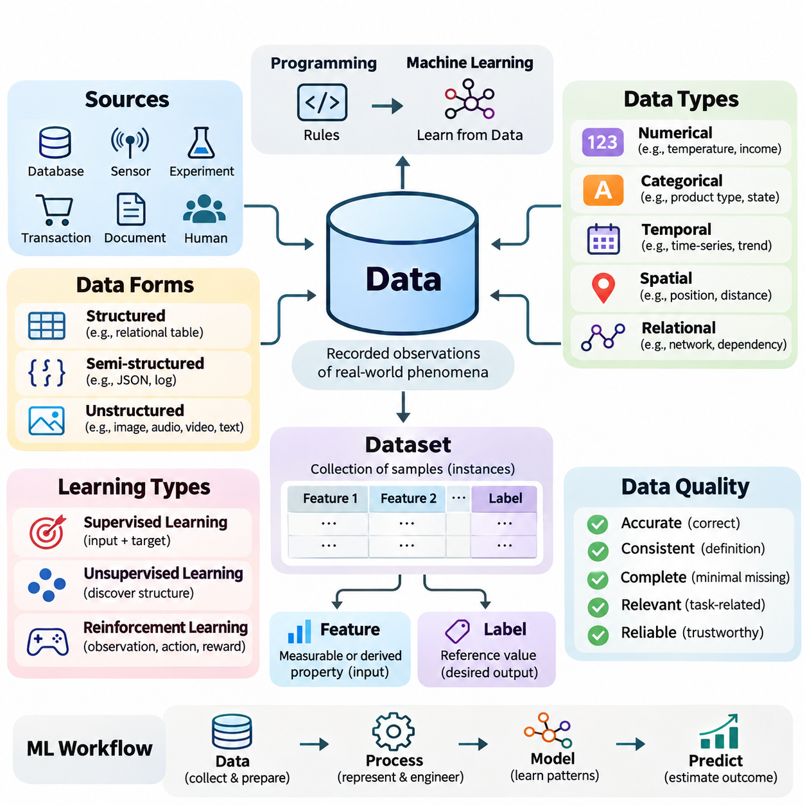
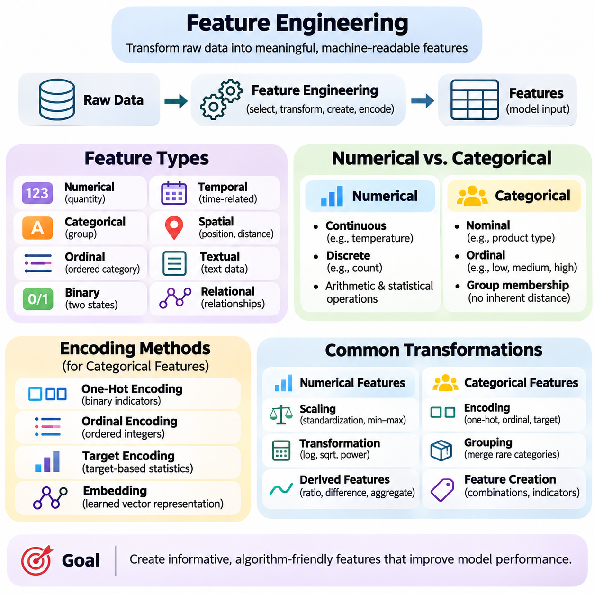
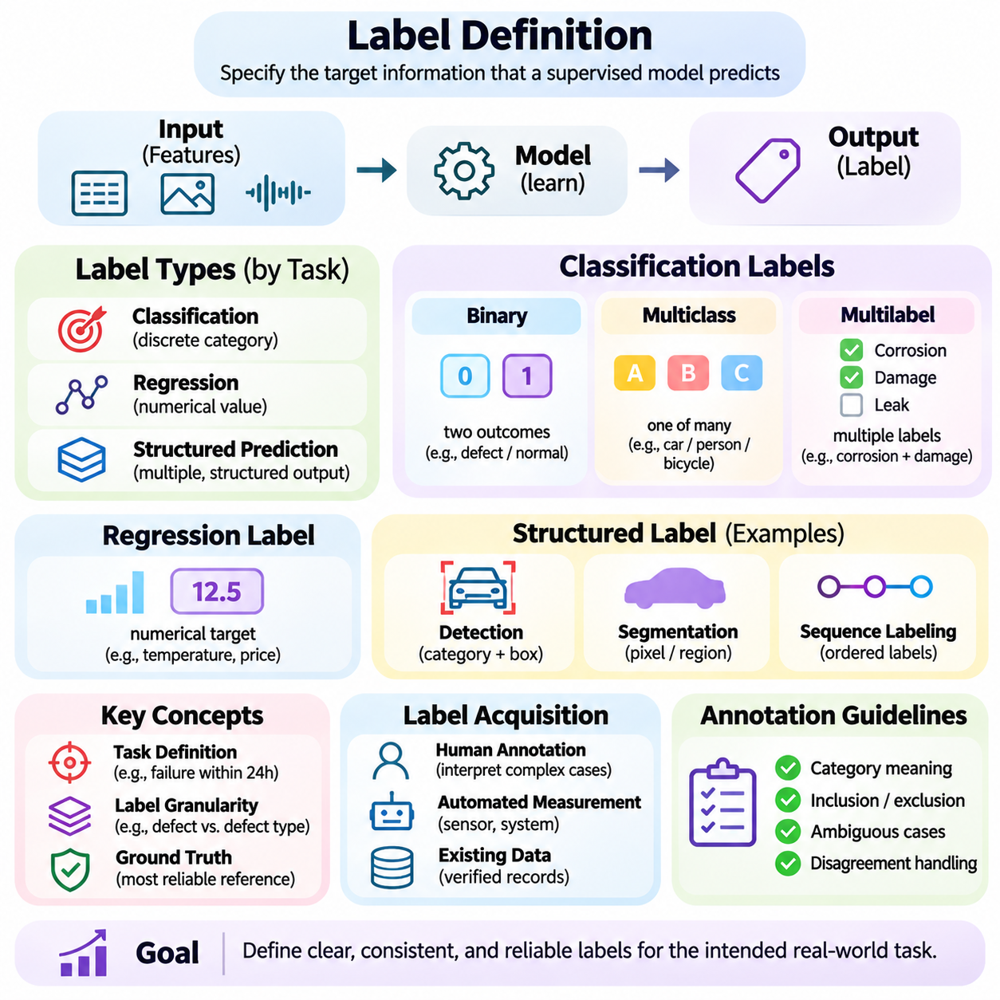
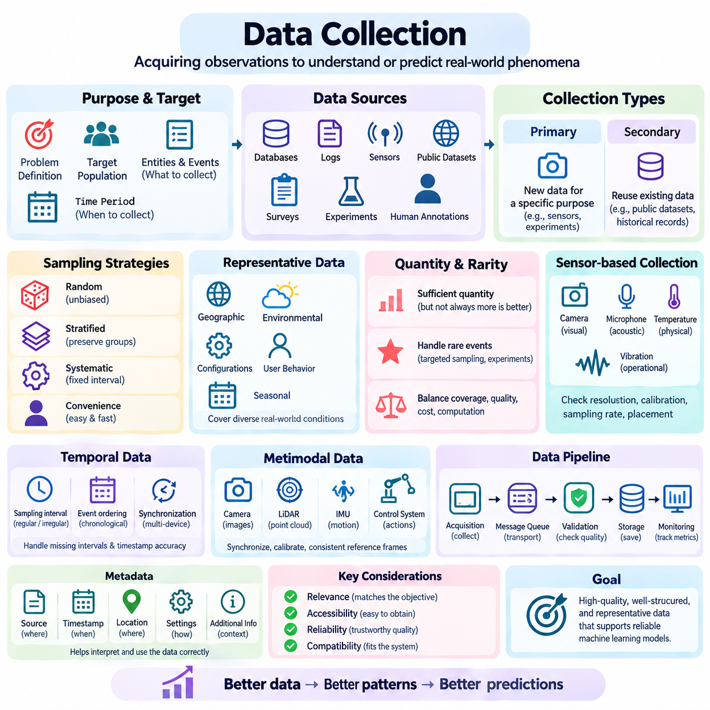
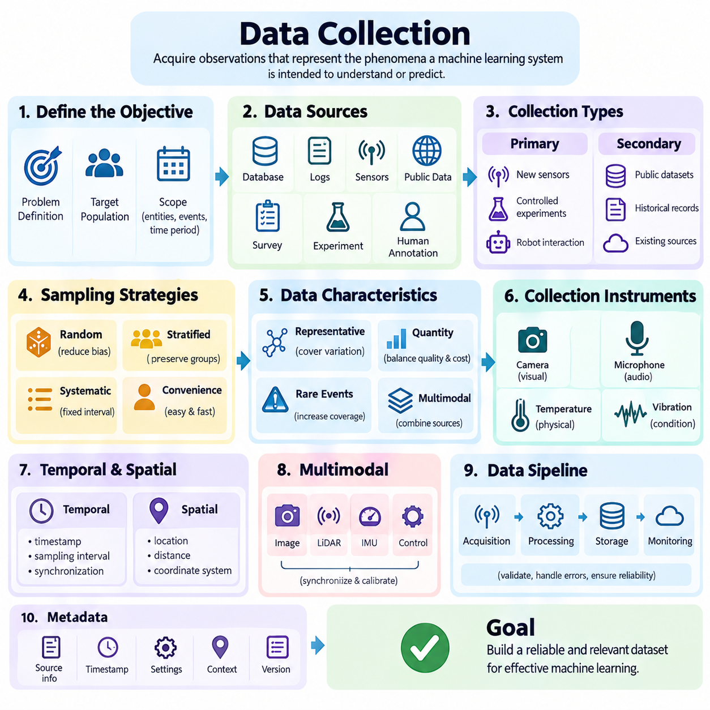
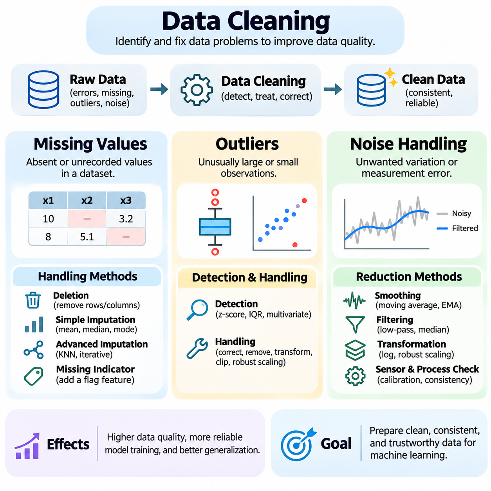
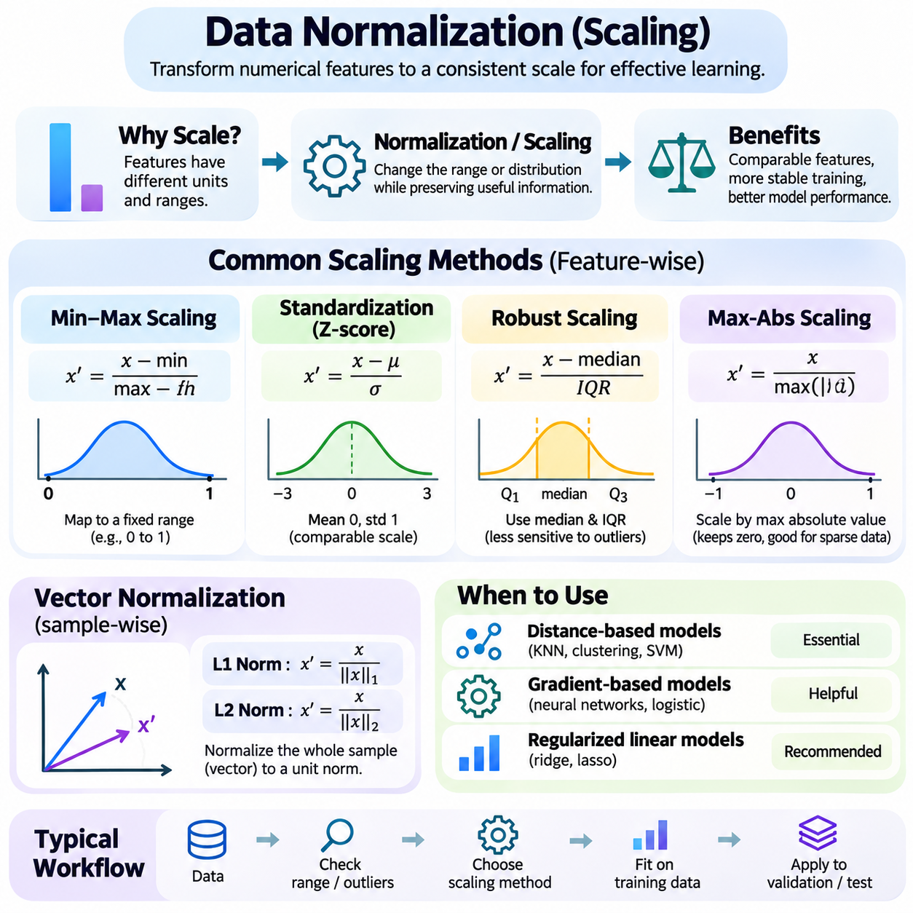
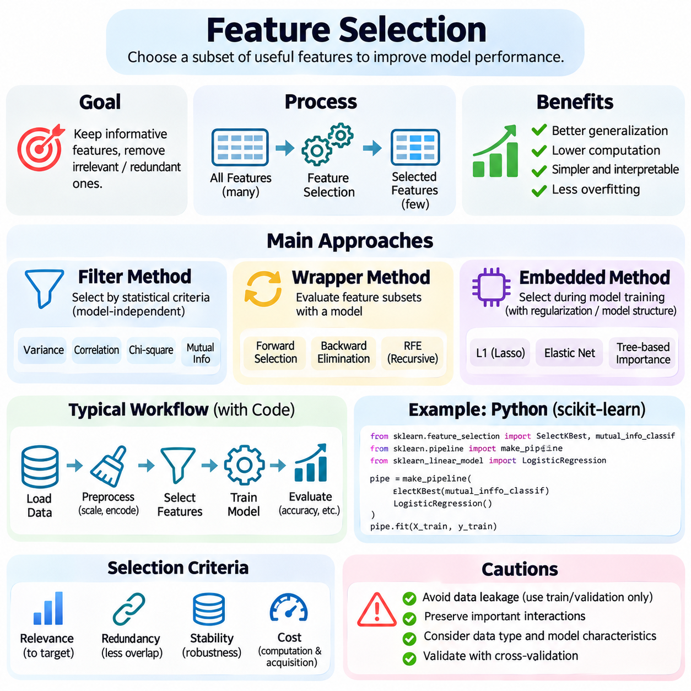
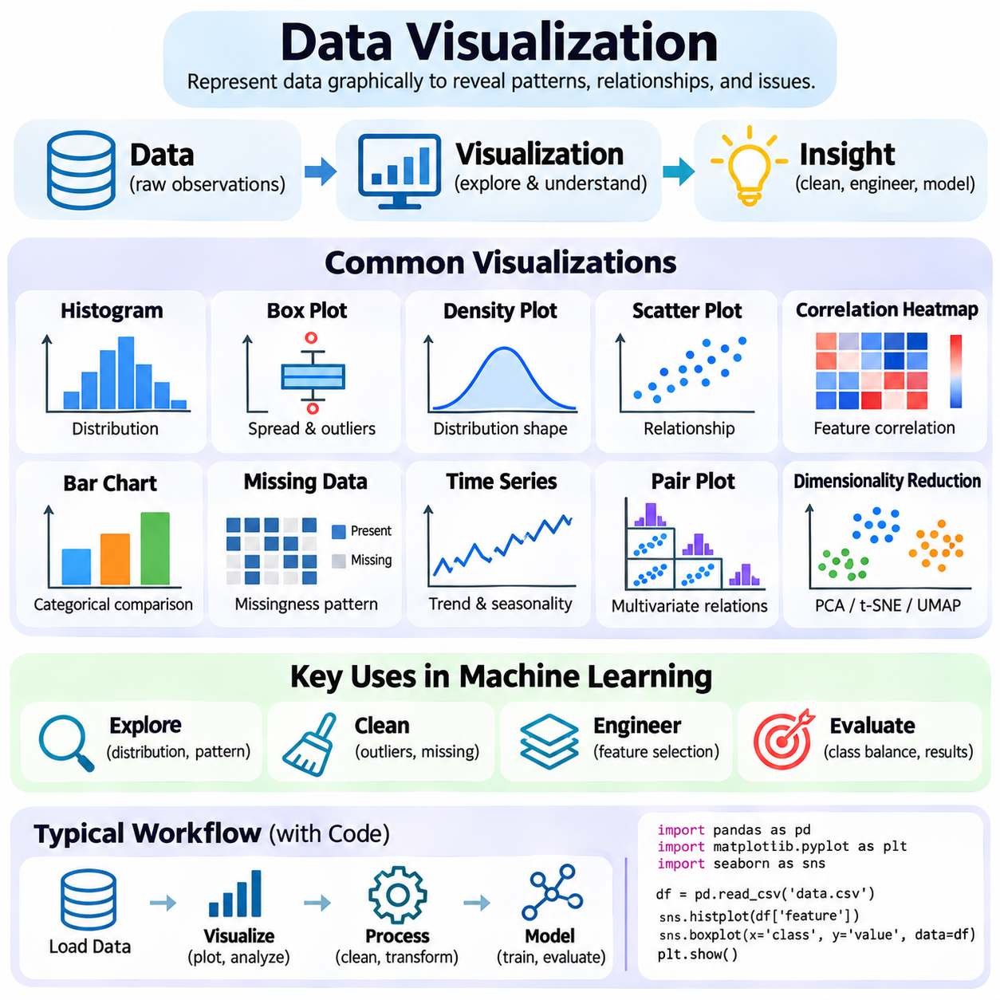
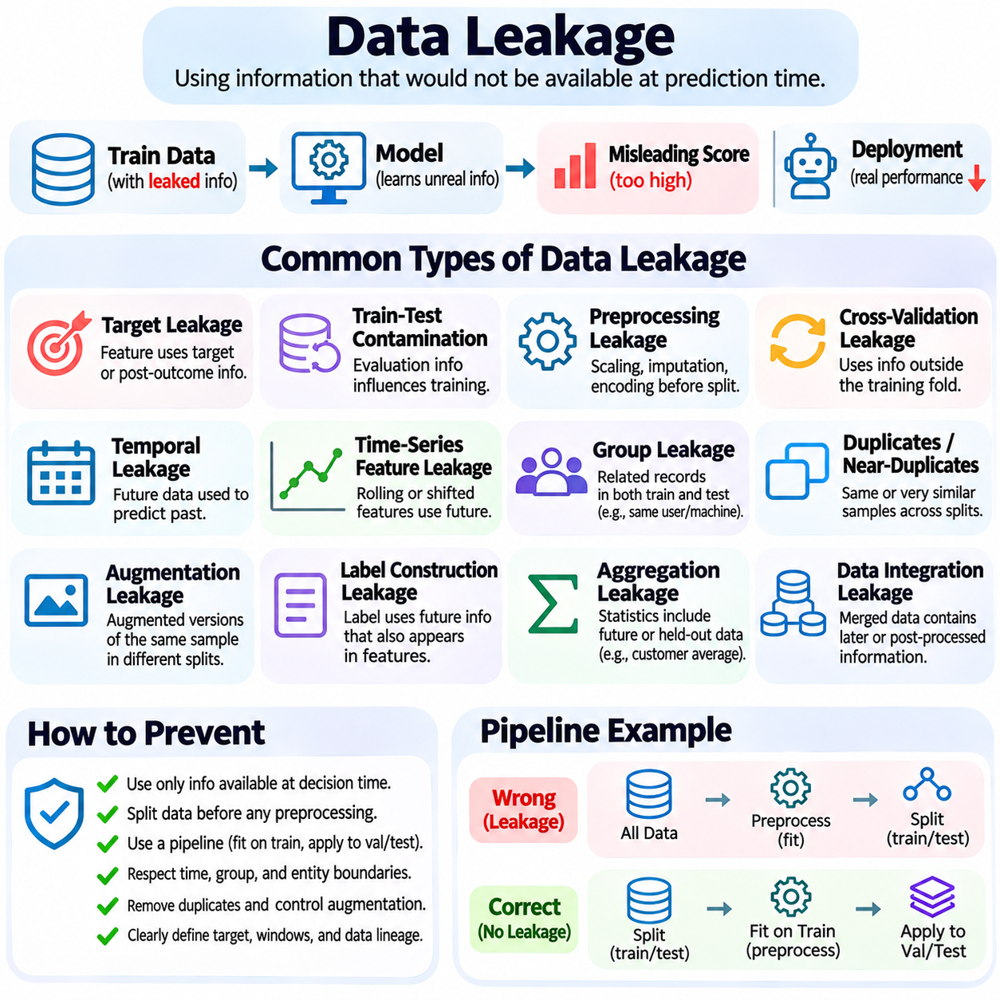

# 02. Data Features and Labels

## 02.00 What is Data

{width="7.268055555555556in" height="7.268055555555556in"}

데이터(Data)는 머신러닝(Machine Learning) 시스템이 패턴(Pattern)을 발견하고, 관계(Relationship)를 추정하며, 예측 능력(Predictive Capability)을 개발하는 데 사용하는 기본 자원이다. 전통적인 프로그래밍(Conventional Programming)에서는 개발자가 입력(Input)을 출력(Output)으로 변환하는 규칙을 명시적으로 정의한다. 반면 머신러닝은 관측된 사례(Observed Examples)를 활용하여 이러한 관계를 근사하는 모델(Model)을 구축한다. 따라서 데이터의 품질(Quality), 관련성(Relevance), 구조(Structure)는 모델이 학습할 수 있는 내용과 수행 결과의 신뢰성에 직접적인 영향을 미친다.

머신러닝에서 데이터(Data)는 현실 세계의 현상(Real-World Phenomena)을 기록한 관측값(Observations), 측정값(Measurements), 사건(Events) 또는 표현(Representations)을 의미한다. 이러한 관측값은 데이터베이스(Database), 센서(Sensor), 실험(Experiment), 거래(Transaction), 문서(Document), 인간 상호작용(Human Interaction) 등에서 생성될 수 있다. 각각의 관측값은 특정 개체(Entity), 사건 또는 상황에 관한 정보를 제공한다. 여러 관측값을 체계적으로 구성하면 통계 분석(Statistical Analysis), 모델 학습(Model Training), 평가(Evaluation)에 활용할 수 있는 데이터셋(Dataset)이 형성된다.

데이터셋(Dataset)은 인스턴스(Instance), 예제(Example), 레코드(Record)라고도 불리는 개별 샘플(Sample)로 구성된다. 고객 데이터베이스에서는 하나의 샘플이 한 명의 고객을 나타낼 수 있으며, 이미지 분류(Image Classification) 데이터셋에서는 하나의 이미지가 하나의 샘플에 해당할 수 있다. 샘플은 측정하거나 관측할 수 있는 속성(Attribute)을 통해 설명된다. 응용 분야에 따라 이러한 속성에는 수치 측정값(Numerical Measurement), 범주형 속성(Categorical Attribute), 텍스트 설명(Textual Description), 공간 좌표(Spatial Coordinate), 시간 정보(Temporal Information) 등이 포함된다.

데이터는 알고리즘(Algorithm)이 처리할 수 있는 형태로 표현될 때 머신러닝에 유용해진다. 테이블형 데이터셋(Tabular Dataset)은 일반적으로 행(Row)에 샘플을, 열(Column)에 속성을 배치한다. 다른 응용 분야에서는 다차원 배열(Multidimensional Array), 시퀀스(Sequence), 그래프(Graph), 구조화된 객체(Structured Object)가 필요할 수 있다. 표현 방식(Representation Method)은 기본 정보의 특성과 학습 목표(Learning Objective)에 따라 결정된다. 적절한 표현은 의미 있는 관계를 보존하면서 효율적인 계산(Computation)을 가능하게 한다.

정형 데이터(Structured Data)는 고객 식별자(Customer Identifier), 거래 금액(Transaction Amount), 타임스탬프(Timestamp)를 포함하는 관계형 테이블(Relational Table)처럼 명시적인 스키마(Schema)를 따른다. 반정형 데이터(Semi-Structured Data)는 JSON 문서나 이벤트 로그(Event Log)처럼 유연한 구성 규칙을 사용한다. 비정형 데이터(Unstructured Data)에는 이미지(Image), 오디오 녹음(Audio Recording), 비디오(Video), 자연어 문서(Natural Language Document)가 포함된다. 이러한 데이터 유형은 구성 방식이 서로 다르지만, 적절한 계산 표현으로 변환하면 모두 유용한 정보를 제공할 수 있다.

수치형 데이터(Numerical Data)는 온도(Temperature), 거리(Distance), 속도(Velocity), 소득(Income), 생산량(Production Volume)처럼 측정 가능한 양을 표현한다. 수치 변수(Numerical Variable)는 일정 범위 내 측정값을 나타내는 연속형(Continuous) 또는 셀 수 있는 수량을 나타내는 이산형(Discrete)으로 구분할 수 있다. 범주형 데이터(Categorical Data)는 제품 유형(Product Type), 기계 상태(Machine State), 고객 세그먼트(Customer Segment)처럼 특정 집단에 속하는 정보를 나타낸다. 이러한 차이를 이해하는 것은 데이터 유형에 따라 서로 다른 처리 및 해석 방법이 필요하기 때문에 중요하다.

데이터는 시간적 구조(Temporal Structure), 공간적 구조(Spatial Structure), 관계적 구조(Relational Structure)를 가질 수도 있다. 시계열 관측값(Time-Series Observation)은 측정 순서를 보존하며 추세(Trend), 주기적 행동(Periodic Behavior), 지연 의존성(Delayed Dependency)을 드러낼 수 있다. 공간 데이터(Spatial Data)는 위치(Position), 거리(Distance), 기하학적 관계(Geometric Relationship)를 설명한다. 관계형 데이터(Relational Data)는 소셜 네트워크(Social Network)의 상호작용이나 산업 시스템(Industrial System)의 의존성처럼 개체 사이의 연결을 표현한다. 이러한 구조를 무시하면 정확한 학습에 필요한 정보가 손실될 수 있다.

지도학습(Supervised Learning)에서 데이터셋은 일반적으로 입력 관측값(Input Observation)과 이에 대응하는 목표값(Target Value)을 포함한다. 입력은 모델에 제공되는 정보를 설명하며, 목표값은 모델이 예측해야 하는 결과를 나타낸다. 예를 들어 주택 데이터셋(Housing Dataset)은 주택 면적(Property Size), 위치(Location), 건축 연수(Age)를 입력으로 사용하고 판매 가격(Selling Price)을 목표값으로 사용할 수 있다. 이러한 구분은 예측 작업(Predictive Task)을 정의하고 학습 과정에서 학습 사례(Training Example)를 해석하는 방식을 결정한다.

비지도학습(Unsupervised Learning)은 각 샘플에 미리 정의된 목표 레이블(Target Label)이 없어도 관측값을 활용한다. 학습 목표에는 그룹(Group) 발견, 이상 관측값(Anomalous Observation) 식별, 확률분포(Probability Distribution) 추정, 압축 표현(Compact Representation) 학습 등이 포함될 수 있다. 강화학습(Reinforcement Learning)은 에이전트(Agent)와 환경(Environment) 사이의 상호작용을 통해 또 다른 데이터 구성 방식을 도입한다. 관측값(Observation), 행동(Action), 보상(Reward), 상태 전이(Transition)는 의사결정(Decision)의 결과에 관한 정보를 함께 제공한다.

원시 데이터(Raw Data)와 의미 있는 정보(Meaningful Information) 사이의 관계는 머신러닝의 핵심이다. 원시 측정값(Raw Measurement)이 모델이 학습해야 하는 개념을 자동으로 표현하는 것은 아니다. 카메라(Camera)는 객체(Object)를 직접 식별하는 대신 픽셀 강도(Pixel Intensity)를 기록하며, 산업용 센서(Industrial Sensor)는 장비 상태(Equipment Health)를 명시적으로 설명하는 대신 전기 신호(Electrical Signal)를 측정한다. 데이터 처리(Data Processing)와 해석(Interpretation)은 기록된 값과 특정 작업에 관련된 실제 현상을 연결한다.

특징(Feature)은 관측값을 설명하는 측정 가능하거나 파생된 속성(Derived Property)이다. 특징은 온도나 압력처럼 직접 수집할 수도 있고, 평균 속도(Average Speed)나 거래 빈도(Transaction Frequency)처럼 기존 측정값으로부터 계산할 수도 있다. 특징의 유용성은 학습 목표(Learning Objective)와 관련된 정보를 포함하는지에 따라 결정된다. 많은 특징을 수집하더라도 중복(Redundancy), 무관성(Irrelevance), 불확실성(Unreliability)이 높다면 반드시 성능이 향상되는 것은 아니다.

레이블(Label)은 지도학습에서 원하는 출력(Desired Output)에 관한 기준 정보(Reference Information)를 제공한다. 레이블은 범주(Category), 수치값(Numerical Value), 복잡한 주석(Annotation)을 나타낼 수 있다. 결함 탐지(Defect Detection)에서는 정상 제품(Acceptable Product)과 불량 제품(Defective Product)을 구분할 수 있다. 회귀(Regression)에서는 측정된 에너지 소비량(Energy Consumption)이나 예상 배송 시간(Expected Delivery Time)을 레이블로 사용할 수 있다. 모호하거나 잘못된 목표값은 학습 과정에 체계적 오류(Systematic Error)를 유발할 수 있으므로 레이블 정의(Label Definition)는 일관성을 유지해야 한다.

데이터 품질(Data Quality)은 관측값이 의도한 현상을 얼마나 정확하고 일관되게 표현하는지를 나타낸다. 중요한 품질 차원(Quality Dimension)에는 완전성(Completeness), 정확성(Correctness), 일관성(Consistency), 적시성(Timeliness), 관련성(Relevance)이 포함된다. 누락된 측정값(Missing Measurement), 중복 레코드(Duplicate Record), 잘못된 단위(Incorrect Unit), 손상된 파일(Corrupted File), 일관되지 않은 범주(Inconsistent Category)는 모델이 학습하는 관계를 왜곡할 수 있다. 따라서 데이터 품질 평가(Data Quality Assessment)는 학습 이전부터 운영 수명주기(Operational Lifecycle) 전반에 걸쳐 수행해야 하는 필수 활동이다.

측정 잡음(Measurement Noise)은 현실 세계 데이터의 또 다른 기본 특성이다. 센서는 변동하는 측정값(Fluctuating Reading)을 생성할 수 있으며, 사람이 작성한 주석(Human Annotation)에는 주관적 차이(Subjective Difference)가 포함될 수 있다. 거래 시스템(Transaction System)은 지연되거나 불완전한 사건을 기록할 수도 있다. 일부 변동성(Variability)은 실제 현상의 차이를 반영하지만, 다른 변동성은 측정 한계(Measurement Limitation)에서 발생한다. 의미 있는 변동과 우발적 잡음(Accidental Noise)을 구분하면 전처리(Preprocessing)나 수집 방법 개선의 필요성을 판단할 수 있다.

데이터셋(Dataset)은 모델이 사용될 대상 모집단(Target Population)이나 운영 조건(Operating Condition)을 대표해야 한다. 학습 관측값이 제한된 상황만 포함한다면 모델은 익숙하지 않은 조건에서 낮은 성능을 보일 수 있다. 예를 들어 일정한 조명(Uniform Lighting)에서 학습한 시각 검사 모델(Visual Inspection Model)은 그림자(Shadow)나 반사(Reflection)가 발생하는 환경에서 어려움을 겪을 수 있다. 따라서 대표성 있는 표본추출(Representative Sampling)은 환경 다양성(Environmental Diversity), 운영 변동성(Operational Variability), 예상 배포 환경(Deployment Context)을 고려해야 한다.

관측값의 수(Number of Observations)는 학습에 활용할 수 있는 통계적 정보(Statistical Information)에 영향을 주지만, 데이터셋 크기(Dataset Size)만으로 유용성이 결정되지는 않는다. 거의 동일한 샘플 수천 개보다 다양한 조건을 포함하는 소규모 데이터셋이 더 많은 정보를 제공할 수도 있다. 데이터 양(Quantity), 다양성(Diversity), 정확성(Accuracy), 작업 복잡도(Task Complexity) 사이의 관계는 특히 중요하다. 효과적인 데이터셋 설계(Dataset Design)는 단순한 레코드 축적보다 정보성 있는 범위(Informative Coverage)를 확보하는 데 중점을 둔다.

데이터 분포(Data Distribution)는 데이터셋 내부에서 값과 값의 조합이 어떻게 나타나는지를 설명한다. 분포는 일반적인 관측값(Common Observation), 희귀 사건(Rare Event), 특정 범위의 집중(Concentration), 변수 간 관계(Relationship Between Variables)를 드러낼 수 있다. 머신러닝 알고리즘은 이러한 통계적 특성(Statistical Characteristic)에 명시적 또는 암묵적으로 의존한다. 분포를 이해하면 불균형(Imbalance), 이상 관측값(Unusual Observation), 학습 데이터와 향후 운영 입력 사이의 차이를 인식하는 데 도움이 된다.

표본추출 편향(Sampling Bias)은 관측값을 수집하는 과정에서 특정 집단, 상황, 결과가 체계적으로 더 많이 선택될 때 발생한다. 주간에만 수집한 데이터셋은 야간 조건(Nighttime Condition)을 충분히 대표하지 못할 수 있다. 마찬가지로 특정 지역(Geographic Region)에서 기록된 고객 행동(Customer Behavior)이 다른 지역에 일반화(Generalization)되지 않을 수 있다. 이러한 한계는 오해를 유발하는 성능 추정(Performance Estimation)과 모집단 또는 운영 환경에 따른 불균등한 신뢰성(Unequal Reliability)으로 이어질 수 있다.

데이터 출처 이력(Data Provenance)은 관측값이 어디에서 생성되었으며 어떻게 수집, 처리, 수정되었는지를 설명한다. 신뢰할 수 있는 출처 기록(Provenance Record)에는 원천 시스템(Source System), 수집 타임스탬프(Collection Timestamp), 측정 절차(Measurement Procedure), 주석 방법(Annotation Method), 데이터셋 버전(Dataset Version)이 포함될 수 있다. 이러한 정보는 재현성(Reproducibility), 감사(Auditing), 문제 해결(Troubleshooting)을 지원한다. 출처 이력이 없다면 예상하지 못한 모델 동작이 알고리즘의 한계에서 발생했는지, 기초 데이터의 변화에서 발생했는지 판단하기 어려워진다.

데이터는 운영적 맥락(Operational Context)과 의미적 맥락(Semantic Context) 안에서 해석해야 한다. 온도값(Temperature Value)은 단위(Unit), 측정 위치(Measurement Location), 기록 시간(Recording Time)을 알지 못하면 불완전한 정보가 된다. 숫자 식별자(Numerical Identifier)는 실제로 임의의 범주(Arbitrary Category)를 나타내더라도 수학적으로 의미 있는 값처럼 보일 수 있다. 메타데이터(Metadata)는 이러한 맥락 정보를 제공하고 기록된 값에 대한 잘못된 가정을 방지한다. 따라서 올바른 해석은 계산 표현(Computational Representation)만큼 중요하다.

실제 머신러닝 시스템에서 데이터는 학습에 적합한 상태가 되기 전까지 여러 단계를 거친다. 데이터 수집(Data Collection)은 원시 관측값(Raw Observation)을 생성하고, 검증(Validation)은 무결성(Integrity)을 확인하며, 정제(Cleaning)는 확인된 문제를 해결한다. 변환(Transformation)은 데이터를 활용 가능한 표현으로 바꾼다. 이러한 단계에는 정규화(Normalization), 인코딩(Encoding), 특징 추출(Feature Extraction), 주석 작업(Annotation)이 포함될 수 있다. 각 작업은 의도하지 않은 왜곡을 방지하면서 학습 목표에 관련된 정보를 보존해야 한다.

학습 데이터(Training Data)와 평가 데이터(Evaluation Data)의 구분은 모델 신뢰성(Model Reliability)을 이해하는 데 필수적이다. 학습 관측값은 모델 매개변수(Model Parameter)에 영향을 주지만, 별도의 평가 관측값은 모델 적합(Fitting)에 사용되지 않은 사례에 대한 성능을 추정한다. 평가 데이터의 정보가 학습 결정에 부적절하게 영향을 주면 성능 추정이 지나치게 낙관적으로 나타날 수 있다. 적절한 데이터 분리(Data Separation)를 유지하면 모델이 특정 사례를 암기(Memorization)한 것이 아니라 전이 가능한 관계(Transferable Relationship)를 학습했는지 판단하는 데 도움이 된다.

머신러닝 시스템이 운영 환경(Production Environment)에 배포된 이후에도 데이터가 반드시 고정된 상태로 유지되는 것은 아니다. 고객 선호(Customer Preference), 장비 상태(Equipment Condition), 환경 특성(Environmental Characteristic), 운영 절차(Operational Procedure)는 시간이 지나면서 변화할 수 있다. 이러한 변화는 입력 분포(Input Distribution) 또는 입력과 결과 사이의 관계를 변경할 수 있다. 지속적인 데이터 모니터링(Data Monitoring)은 이러한 분포 변화(Distribution Shift)를 식별하고 모델, 전처리 절차, 수집 전략(Collection Strategy)의 업데이트 필요성을 판단하는 근거를 제공한다.

데이터 거버넌스(Data Governance)는 데이터의 전체 수명주기(Data Lifecycle)에 걸친 책임 있는 정보 관리를 다룬다. 주요 고려 사항에는 개인정보 보호(Privacy), 보안(Security), 접근 권한(Access Permission), 보존 정책(Retention Policy), 라이선스(Licensing), 규제 의무(Regulatory Obligation)가 포함된다. 민감 정보(Sensitive Information)는 정당한 요구사항에 의해 필요성이 인정되는 경우에만 수집하고 처리해야 한다. 명확한 거버넌스 절차(Governance Procedure)는 조직이 책임성(Accountability)을 유지하면서 신뢰할 수 있는 실험, 협업, 머신러닝 응용 시스템의 배포를 지원한다.

로보틱스(Robotics)와 피지컬 AI(Physical AI)에서 데이터는 계산 모델(Computational Model)과 물리적 환경(Physical Environment)을 연결한다. 카메라(Camera), 라이다(LiDAR), 관성 측정 장치(Inertial Measurement Unit), 엔코더(Encoder), 힘 센서(Force Sensor)는 주변 환경과 시스템 동작을 설명하는 관측값을 생성한다. 이러한 측정값을 결합하기 위해서는 시간 동기화(Synchronization), 보정(Calibration), 좌표 변환(Coordinate Transformation)이 필요할 수 있다. 측정값의 신뢰성은 물리적 환경과 상호작용하는 시스템의 인식(Perception), 위치 추정(Localization), 예측(Prediction), 의사결정(Decision-Making)에 직접적인 영향을 미친다.

머신러닝의 기본 원칙은 데이터(Data)가 알고리즘(Algorithm)에 제공되는 증거(Evidence)를 정의한다는 것이다. 모델 아키텍처(Model Architecture)와 최적화(Optimization)는 이러한 증거를 처리하는 방식을 결정하지만, 관측값에 존재하지 않는 정보를 반드시 복원할 수 있는 것은 아니다. 따라서 신뢰할 수 있는 학습(Reliable Learning)은 데이터가 무엇을 나타내는지, 어떻게 획득되었는지, 어떤 한계(Limitation)를 포함하는지 이해하는 것에서 시작된다. 이러한 기초는 이후 특징(Feature), 레이블(Label), 데이터 수집(Data Collection), 데이터 정제(Data Cleaning), 데이터 전처리(Data Preprocessing)를 학습하기 위한 기반을 제공한다.

## 02.01 Feature Engineering

{width="7.268055555555556in" height="7.268055555555556in"}

특징 공학(Feature Engineering)은 원시 데이터(Raw Data)를 머신러닝(Machine Learning) 알고리즘이 효과적으로 활용할 수 있는 의미 있는 표현(Meaningful Representation)으로 변환하는 과정이다. 모델(Model)은 관측값(Observation)으로부터 관계를 학습하지만, 성능(Performance)은 관련 정보가 어떻게 표현되는지에 크게 좌우된다. 특징 공학은 도메인 지식(Domain Knowledge), 통계 분석(Statistical Analysis), 계산 기법(Computational Technique)을 결합하여 유용한 패턴(Pattern)을 드러내고 불필요한 복잡성(Complexity)과 오해를 유발하는 변동성(Variation)을 줄이는 입력을 구성한다.

특징(Feature)은 데이터 샘플(Data Sample)의 관측 가능하거나 파생된 특성(Derived Characteristic)을 나타낸다. 주택 가격 예측 시스템(Housing Prediction System)에서는 바닥 면적(Floor Area), 건물 연식(Building Age), 위치(Location), 대중교통까지의 거리(Distance to Public Transportation) 등이 특징이 될 수 있다. 산업 모니터링(Industrial Monitoring)에서는 온도(Temperature), 진동(Vibration), 압력(Pressure), 가동 시간(Operating Duration) 등을 특징으로 사용할 수 있다. 각 특징은 기본 현상(Underlying Phenomenon)을 서로 다른 관점에서 설명하며, 유용성은 예측 목표(Prediction Objective)와 이용 가능한 관측값에 따라 결정된다.

특징 공학(Feature Engineering)에는 유용한 속성(Attribute)의 식별, 기존 변수(Variable)의 변환, 파생 측정값(Derived Measurement)의 생성, 정보를 기계가 읽을 수 있는 형식(Machine-Readable Format)으로 변환하는 작업이 포함된다. 이러한 작업은 학습 알고리즘(Learning Algorithm)에 제공할 표현을 결정한다는 점에서 모델 학습(Model Training)과 구별된다. 효과적인 변환(Transformation)은 중요한 관계를 더 쉽게 발견하도록 하고, 계산 안정성(Computational Stability)을 향상시키며, 특정 학습 문제에서 필요한 학습 데이터(Training Data)의 양을 줄일 수 있다.

특징 유형(Feature Type)은 수학적 특성(Mathematical Property), 의미적 특성(Semantic Meaning), 구조적 구성(Structural Organization)에 따라 분류할 수 있다. 일반적인 유형에는 수치형(Numerical), 범주형(Categorical), 순서형(Ordinal), 이진형(Binary), 시간형(Temporal), 공간형(Spatial), 텍스트형(Textual), 관계형(Relational) 특징이 포함된다. 하나의 특징이 여러 특성을 동시에 가질 수 있으므로 이러한 범주가 항상 상호 배타적(Mutually Exclusive)인 것은 아니다. 특징 유형을 이해하면 적절한 변환 방법을 선택하고 학습 과정에서 잘못된 가정이 도입되는 것을 방지할 수 있다.

수치형 특징(Numerical Feature)은 숫자로 표현되는 수량(Quantity)을 나타낸다. 연속형 수치 특징(Continuous Numerical Feature)은 온도, 거리, 질량(Mass), 속도(Velocity)와 같은 측정값을 설명하며, 이산형 수치 특징(Discrete Numerical Feature)은 거래 빈도(Transaction Frequency)나 탐지된 객체 수(Number of Detected Objects)처럼 셀 수 있는 수량을 나타낸다. 수치값은 일반적으로 산술 연산(Arithmetic Operation), 거리 계산(Distance Calculation), 통계 요약(Statistical Summary)에 활용할 수 있다. 그러나 의미는 측정 단위(Measurement Unit), 유효 범위(Valid Range), 물리적 또는 운영적 맥락(Operational Context)에 따라 달라진다.

범주형 특징(Categorical Feature)은 직접 측정할 수 있는 수량이 아니라 서로 구분되는 집단(Group)에 대한 소속 정보를 나타낸다. 예로는 제품 범주(Product Category), 장비 유형(Equipment Type), 결제 방식(Payment Method), 운영 모드(Operating Mode)가 있다. 명목형 범주(Nominal Category)는 고유한 순서가 없지만, 순서형 범주(Ordinal Category)는 낮음(Low), 중간(Medium), 높음(High)과 같은 의미 있는 순위(Ranking)를 가진다. 명목형 범주를 순서가 있는 수치값으로 처리하면 원래 정보에 존재하지 않는 인위적인 관계(Artificial Relationship)가 도입될 수 있다.

이진형 특징(Binary Feature)은 일반적으로 0과 1로 표현되는 두 가지 상태를 나타낸다. 예를 들어 기계의 작동 여부(Machine Active State), 거래의 사기 여부(Fraudulent Transaction), 부품의 검사 통과 여부(Inspection Result)가 있다. 이진 변수(Binary Variable)는 범주형 상태(Categorical State)를 표현하거나 다른 측정값으로부터 도출된 논리적 조건(Logical Condition)을 나타낼 수 있다. 단순한 표현 방식은 다양한 알고리즘에서 편리하지만, 각 상태의 해석은 학습과 배포(Deployment) 과정 전반에서 일관되게 유지되어야 한다.

시간형 특징(Temporal Feature)은 관측값의 시간 관련 속성(Time-Related Property)을 설명한다. 타임스탬프(Timestamp)는 하루 중 시간(Hour of Day), 요일(Day of Week), 경과 시간(Elapsed Duration), 이전 사건 이후의 시간(Time Since Previous Event) 등으로 변환할 수 있다. 순차 측정값(Sequential Measurement)에서는 이동 평균(Rolling Average), 이동 차분(Moving Difference), 지연값(Lagged Value)을 생성할 수도 있다. 이러한 변환은 주기적 패턴(Periodic Pattern)과 과거 의존성(Historical Dependency)을 식별하는 데 도움이 되지만, 특징 생성에는 의도한 예측 시점(Prediction Time)에 이용 가능한 정보만 사용해야 한다.

공간형 특징(Spatial Feature)은 위치(Position), 거리(Distance), 방향(Orientation), 기하학적 관계(Geometric Relationship)를 설명한다. 예로는 지리 좌표(Geographic Coordinate), 기반 시설까지의 거리(Distance to Infrastructure), 객체 간 상대 위치(Relative Object Position), 이동 방향(Movement Direction)이 있다. 로보틱스(Robotics)에서는 좌표계(Coordinate Frame), 각도(Angle), 센서와 객체 사이의 상대 변환(Relative Transformation)을 사용할 수 있다. 적절한 공간 특징 공학은 물리적으로 일관되지 않은 해석을 방지하기 위해 좌표계, 단위, 기하학적 제약(Geometric Constraint)을 고려해야 한다.

텍스트형 특징(Textual Feature)과 멀티미디어 특징(Multimedia Feature)은 복잡한 관측값을 수치 구조(Numerical Structure)로 변환하는 표현 방식이 필요하다. 텍스트(Text)는 토큰 수(Token Count), 용어 빈도(Term Frequency), 학습된 임베딩(Learned Embedding)으로 표현할 수 있다. 이미지(Image)에서는 색상 통계(Color Statistics), 기하학적 기술자(Geometric Descriptor), 신경망 특징 벡터(Neural Feature Vector)를 추출할 수 있다. 오디오 녹음(Audio Recording)에서는 스펙트럼 특성(Spectral Characteristic)과 시간적 패턴(Temporal Pattern)을 활용할 수 있다. 적절한 표현은 학습 작업과 수작업 특징(Handcrafted Feature) 또는 자동 학습 특징(Automatically Learned Feature)의 적합성에 따라 결정된다.

수치형 특징(Numerical Feature)과 범주형 특징(Categorical Feature)은 알고리즘이 값을 해석하는 방식에서 근본적인 차이가 있다. 온도와 같은 수치형 특징은 크기(Magnitude)를 나타내므로 값 사이의 차이(Difference)가 의미를 가진다. 반면 기계 유형(Machine Type)과 같은 범주형 특징은 수치적 거리(Numerical Distance)를 의미하지 않고 집단을 식별한다. 따라서 범주를 임의의 정수(Arbitrary Integer)로 인코딩(Encoding)하면 수치의 크기나 순서를 의미 있는 관계로 해석하는 모델에 잘못된 정보를 제공할 수 있다.

특징 스케일링(Feature Scaling)은 수치 변수(Numerical Variable)를 변환하여 비교 가능성(Comparability)이나 계산 동작(Computational Behavior)을 개선하는 방법이다. 표준화(Standardization)는 일반적으로 평균(Mean)을 기준으로 값을 중심화(Centering)하고 표준편차(Standard Deviation)를 사용하여 크기를 조정한다. 최소-최대 스케일링(Min-Max Scaling)은 기준 최솟값(Reference Minimum)과 최댓값(Reference Maximum)을 사용하여 관측값을 지정된 구간(Interval)으로 변환한다. 이러한 변환은 거리 기반 방법(Distance-Based Method)과 경사 기반 방법(Gradient-Based Method)에서 특히 중요하지만, 효과는 알고리즘과 데이터 분포(Data Distribution)에 따라 달라진다.

범주형 인코딩(Categorical Encoding)은 비수치 범주(Nonnumerical Category)를 학습 알고리즘이 처리할 수 있는 표현으로 변환한다. 적절한 인코딩 방법(Encoding Method)은 범주의 순서(Category Ordering), 고유값의 수(Number of Distinct Values), 모델 아키텍처(Model Architecture), 이용 가능한 학습 데이터에 따라 달라진다. 인코딩은 근거 없는 관계를 도입하지 않으면서 의미 있는 차이를 보존해야 한다. 또한 배포 과정에서 학습 데이터셋에 존재하지 않았던 새로운 범주(Unseen Category)를 일관되게 처리할 수 있어야 한다.

순서형 인코딩(Ordinal Encoding)은 의미 있는 순서를 가진 범주에 숫자 코드(Numerical Code)를 할당한다. 예를 들어 낮음(Low), 중간(Medium), 높음(High)의 위험 수준(Risk Level)을 증가하는 정수값(Increasing Integer Value)으로 표현할 수 있다. 이 방식은 순위(Rank)를 보존하지만 원래 범주가 보장하지 않는 수치적 간격(Numerical Spacing)을 암묵적으로 나타낼 수도 있다. 따라서 순서가 중요한 경우에 적합하지만, 알고리즘이 인코딩된 값의 차이를 정량적 거리(Quantitative Distance)로 해석할 때는 추가적인 주의가 필요하다.

원-핫 인코딩(One-Hot Encoding)은 각 범주를 별도의 이진 지시자(Binary Indicator)로 표현한다. 빨강(Red), 초록(Green), 파랑(Blue) 범주를 포함하는 특징은 각 범주에 대한 소속 여부를 나타내는 세 개의 열(Column)로 변환할 수 있다. 이 방법은 인위적인 수치 순서(Artificial Numerical Ordering)를 도입하지 않으며 다양한 전통적 머신러닝 알고리즘(Conventional Machine Learning Algorithm)과 잘 작동한다. 그러나 수천 개의 고유 범주를 포함하는 고카디널리티 특징(High-Cardinality Feature)은 크고 희소한 표현(Sparse Representation)을 생성하여 메모리 사용량(Memory Consumption)과 계산 요구량(Computational Requirement)을 증가시킬 수 있다.

더미 인코딩(Dummy Encoding)은 원-핫 인코딩(One-Hot Encoding)과 밀접하게 관련되지만, 절편(Intercept)과 모든 범주 지시자(Category Indicator)를 함께 사용할 때 발생할 수 있는 정확한 선형 종속성(Exact Linear Dependence)을 방지하기 위해 하나의 지시자 열을 생략할 수 있다. 이러한 접근 방식은 통계적 회귀 모델(Statistical Regression Model)에서 일반적으로 사용된다. 전체 원-핫 인코딩과 축소된 더미 인코딩(Reduced Dummy Encoding) 사이의 선택은 범주 하나를 반드시 제거해야 한다는 보편적 규칙이 아니라 모델 가정(Model Assumption), 정규화(Regularization), 구현 세부 사항(Implementation Detail)에 따라 결정된다.

빈도 인코딩(Frequency Encoding)은 범주를 학습 데이터셋(Training Dataset)에서의 출현 횟수(Occurrence Count) 또는 상대 빈도(Relative Frequency)로 대체한다. 이 방법은 특히 고카디널리티 범주형 변수(High-Cardinality Categorical Variable)에 대해 압축된 수치 표현(Compact Numerical Representation)을 생성한다. 그러나 서로 다른 범주가 동일한 값을 가질 수 있으며, 빈도가 반드시 예측 관련성(Predictive Relevance)을 반영하는 것은 아니다. 평가 데이터(Evaluation Data)의 정보가 포함되는 것을 방지하기 위해 빈도 통계(Frequency Statistics)는 적절한 학습 관측값에서 추정해야 한다.

타깃 인코딩(Target Encoding)은 범주형 값을 해당 목표 레이블(Target Label)로부터 계산한 통계값으로 대체하며, 예를 들어 각 범주의 평균 결과(Average Outcome)를 사용할 수 있다. 이 방법은 압축된 표현을 유지하면서 유용한 예측 관계(Predictive Relationship)를 포착할 수 있다. 그러나 모델 적합(Model Fitting)에 사용하는 동일한 관측값에서 목표 통계를 직접 계산하면 타깃 누수(Target Leakage)와 과적합(Overfitting)이 발생할 수 있다. 교차 적합(Cross-Fitting), 평활화(Smoothing), 신중하게 분리된 검증 절차(Validation Procedure)는 이러한 위험을 줄이는 데 도움이 된다.

해시 인코딩(Hash Encoding)은 결정적 해시 함수(Deterministic Hashing Function)를 사용하여 범주형 값을 고정된 수의 수치 위치(Numerical Position)에 매핑(Mapping)한다. 이 방법은 전체 범주 사전(Category Dictionary)을 유지하지 않고도 크거나 지속적으로 변화하는 범주 어휘(Category Vocabulary)를 처리할 수 있다. 주요 한계는 서로 다른 범주가 동일한 표현을 공유하는 해시 충돌(Hash Collision)이 발생할 수 있다는 점이다. 표현 크기(Representation Size)를 선택할 때는 계산 효율성(Computational Efficiency)과 충돌로 인한 정보 손실(Information Loss) 사이의 균형을 고려해야 한다.

특징 공학(Feature Engineering)은 여러 변수를 결합하여 더 많은 정보를 제공하는 측정값을 구성하는 경우가 많다. 비율(Ratio), 차이(Difference), 곱(Product), 로그 변환(Logarithmic Transformation), 상호작용 항(Interaction Term)은 개별 속성만으로는 직접 표현하기 어려운 관계를 드러낼 수 있다. 예를 들어 생산량(Production Volume)으로 나눈 에너지 소비량(Energy Consumption)은 두 측정값 중 하나만 사용하는 것보다 운영 효율성(Operational Efficiency)을 더 효과적으로 설명할 수 있다. 파생 특징(Derived Feature)은 수학적 타당성(Mathematical Validity)과 도메인 제약(Domain Constraint)을 유지해야 한다.

결측값(Missing Value)은 특징 생성 과정에서 특별한 고려가 필요하다. 누락된 수치 측정값(Missing Numerical Measurement)은 적절한 대체 전략(Imputation Strategy)을 사용하여 보완할 수 있으며, 누락된 범주(Missing Category)에는 명시적인 미확인 지시자(Unknown Indicator)를 부여할 수 있다. 일부 응용 분야에서는 정보가 누락되었다는 사실 자체가 예측력을 가질 수 있다. 그러나 결측값 대체(Imputation)와 결측 지시자(Missingness Indicator)는 체계적인 수집 문제(Systematic Collection Problem)를 숨기지 않고 데이터 생성 과정(Data-Generating Process)을 반영해야 한다.

특징 공학은 이상값(Outlier), 측정 잡음(Measurement Noise), 비정상적인 분포(Unusual Distribution)도 고려해야 한다. 극단적인 수치값(Extreme Numerical Value)은 스케일링 절차(Scaling Procedure)를 지배하거나 파생 통계(Derived Statistics)를 왜곡할 수 있다. 정당한 근거가 있다면 강건한 변환(Robust Transformation), 값 제한(Clipping), 도메인별 검증(Domain-Specific Validation)을 통해 이러한 영향을 줄일 수 있다. 그러나 비정상적인 관측값은 중요한 희귀 사건(Rare Event), 장비 고장(Equipment Failure), 정상적인 운영 조건(Legitimate Operating Condition)을 나타낼 수 있으므로 자동으로 제거해서는 안 된다.

설계된 특징(Engineered Feature)의 효과는 학습 알고리즘(Learning Algorithm)과의 관계에 따라 달라진다. 선형 모델(Linear Model)은 상호작용 항(Interaction Term)과 비선형 변환(Nonlinear Transformation)을 통해 상당한 이점을 얻을 수 있으며, 트리 기반 모델(Tree-Based Model)은 임계값 관계(Threshold Relationship)를 직접 발견할 수 있는 경우가 많다. 신경망(Neural Network)은 원시 입력(Raw Input)이나 최소한으로 처리된 입력에서 계층적 표현(Hierarchical Representation)을 학습할 수 있다. 그러나 자동 표현 학습(Automatic Representation Learning)이 올바른 단위, 일관된 인코딩, 신뢰할 수 있는 데이터 준비(Data Preparation)의 필요성을 없애지는 않는다.

실용적인 특징 공학 파이프라인(Feature Engineering Pipeline)은 학습(Training), 검증(Validation), 테스트(Testing), 배포(Deployment) 전반에서 변환을 일관되게 적용해야 한다. 통계 매개변수(Statistical Parameter), 범주 매핑(Category Mapping), 인코딩 사전(Encoding Dictionary)은 허용된 학습 데이터만 사용하여 적합(Fitting)하고 이후 관측값에도 재사용해야 한다. 이를 통해 표현의 불일치(Inconsistent Representation)를 방지하고 데이터 누수(Data Leakage)를 줄일 수 있다. 버전 관리된 전처리 절차(Versioned Preprocessing Procedure)는 재현성(Reproducibility)을 향상시키고 모델 성능이 변화할 때 문제 해결(Troubleshooting)을 단순화한다.

특징 공학(Feature Engineering)은 궁극적으로 원시 관측값(Raw Observation)과 효과적인 학습에 필요한 수학적 표현(Mathematical Representation)을 연결한다. 수치형 특징(Numerical Feature)과 범주형 특징(Categorical Feature)은 서로 다른 처리가 필요하며, 인코딩 방법(Encoding Method)은 범주 정보가 계산 모델(Computational Model)에 입력되는 방식을 결정한다. 성공적인 특징 공학은 의미 있는 정보를 보존하고 예측 맥락(Prediction Context)을 존중하며 일관된 입력을 생성한다. 이러한 원칙은 특징 선택(Feature Selection), 모델 학습(Model Training), 평가(Evaluation), 신뢰할 수 있는 배포(Reliable Deployment)를 위한 기초를 형성한다.

## 02.02 Label Definition

{width="7.268055555555556in" height="7.268055555555556in"}

레이블 정의(Label Definition)는 지도 머신러닝(Supervised Machine Learning) 모델이 예측해야 하는 목표 정보(Target Information)를 명확하게 규정하는 과정이다. 레이블(Label)은 입력 관측값(Input Observation)에 연결된 원하는 결과(Desired Outcome)를 나타내며, 학습(Training)과 평가(Evaluation) 과정에서 기준 정보(Reference Information)로 사용된다. 명확한 레이블 정의는 모델이 무엇을 학습해야 하는지, 예측 결과를 어떻게 해석해야 하는지, 구축된 시스템이 의도한 현실 세계의 문제(Real-World Problem)를 해결하는지를 결정하는 기초가 된다.

지도학습(Supervised Learning)에서 각 학습 예제(Training Example)는 일반적으로 입력 특징(Input Feature)과 이에 대응하는 레이블(Label)을 포함한다. 특징(Feature)은 개체(Entity)나 사건(Event)의 관측 가능한 속성(Observable Property)을 설명하며, 레이블은 관심 대상이 되는 결과(Outcome of Interest)를 표현한다. 예를 들어 의료 데이터셋(Medical Dataset)은 환자 측정값(Patient Measurement)과 진단 레이블(Diagnosis Label)을 포함할 수 있으며, 제조 데이터셋(Manufacturing Dataset)은 센서 측정값(Sensor Reading)과 결함 범주(Defect Category)를 포함할 수 있다. 특징과 레이블 사이의 관계는 예측 학습(Predictive Learning)의 기초를 형성한다.

레이블은 머신러닝 작업(Machine Learning Task)의 유형에 따라 달라진다. 분류 레이블(Classification Label)은 이산적인 범주(Discrete Category)를 나타내고, 회귀 레이블(Regression Label)은 수치적 수량(Numerical Quantity)을 나타내며, 구조화 예측 레이블(Structured Prediction Label)은 더 복잡한 출력(Complex Output)을 설명한다. 분류 모델(Classification Model)은 거래의 사기 여부를 예측할 수 있으며, 회귀 모델(Regression Model)은 미래 에너지 소비량(Future Energy Consumption)을 추정할 수 있다. 레이블 형식(Label Format)은 예측 목표(Prediction Objective)와 선택한 학습 알고리즘(Learning Algorithm)의 가정에 부합해야 한다.

이진 분류(Binary Classification)는 서로 배타적인 두 가지 결과(Mutually Exclusive Outcome)를 나타내는 레이블을 사용하며, 일반적으로 0과 1로 인코딩(Encoding)한다. 예로는 불량 제품과 정상 제품(Defective versus Acceptable Products), 사기 거래와 정상 거래(Fraudulent versus Legitimate Transactions), 장비 고장과 정상 작동(Equipment Failure versus Normal Operation)이 있다. 이진 인코딩(Binary Encoding)은 수학적으로 단순하지만, 각 값의 의미적 정의(Semantic Meaning)를 명시적으로 문서화해야 한다. 해석이 일관되지 않으면 예측 결과가 반대로 해석되어 심각한 운영 오류(Operational Error)가 발생할 수 있다.

다중 클래스 분류(Multiclass Classification)는 각 관측값을 서로 배타적인 여러 대안 중 하나의 범주(Category)에 할당한다. 이미지 분류 시스템(Image Classification System)은 차량(Vehicle), 보행자(Pedestrian), 자전거(Bicycle), 배경 객체(Background Object)를 구분할 수 있다. 각 범주는 주석 작업자(Annotator)와 알고리즘(Algorithm)이 일관되게 해석할 수 있도록 명확하게 정의되어야 한다. 범주는 의도한 작업에서 충분히 구별 가능해야 하지만, 현실 세계의 관측값에는 추가적인 레이블링 규칙(Labeling Rule)이 필요한 모호성(Ambiguity)이 존재할 수 있다.

다중 레이블 분류(Multilabel Classification)는 하나의 관측값에 여러 레이블을 동시에 부여할 수 있도록 한다. 산업 이미지(Industrial Image)에는 부식(Corrosion)과 표면 손상(Surface Damage)이 동시에 존재할 수 있으며, 문서(Document)는 여러 주제(Topic)를 함께 다룰 수 있다. 다중 클래스 분류와 달리 하나의 레이블이 존재한다고 해서 다른 레이블이 배제되는 것은 아니다. 레이블 정의는 범주 간 중복(Overlap)이 허용되는지, 부분적으로 보이거나 불확실한 상태를 어떻게 표현할 것인지 명확하게 규정해야 한다.

회귀 레이블(Regression Label)은 온도(Temperature), 가격(Price), 거리(Distance), 생산량(Production Output), 장비 잔여 수명(Remaining Equipment Lifetime)과 같은 연속형 또는 이산형 수치 목표(Continuous or Discrete Numerical Target)를 설명한다. 레이블의 해석은 측정 단위(Measurement Unit), 정밀도(Precision), 수집 절차(Collection Procedure)에 따라 달라진다. 초(Seconds) 단위의 목표값과 시간(Hours) 단위의 목표값은 모두 지속 시간(Duration)을 나타내더라도 수치적 의미가 다르다. 따라서 신뢰할 수 있는 회귀 학습에는 일관된 단위, 보정된 측정값(Calibrated Measurement), 명확하게 정의된 목표 경계(Target Boundary)가 필요하다.

구조화 레이블(Structured Label)은 서로 관련된 여러 구성 요소(Multiple Related Components)를 포함하는 출력을 나타낸다. 객체 탐지 데이터셋(Object Detection Dataset)은 각 객체에 범주(Category)와 경계 상자 좌표(Bounding Box Coordinate)를 연결할 수 있다. 분할 데이터셋(Segmentation Dataset)은 픽셀(Pixel)이나 영역(Region)에 범주를 할당하며, 시퀀스 레이블링(Sequence Labeling)은 순서가 있는 관측값에서 개체(Entity)나 사건(Event)을 식별한다. 이러한 작업에는 개별 레이블 요소 사이의 공간적, 시간적, 관계적 일관성(Spatial, Temporal, or Relational Consistency)을 보존하는 주석 규칙(Annotation Convention)이 필요하다.

레이블의 의미는 해결하려는 운영 질문(Operational Question)에 따라 달라진다. 장비가 향후 24시간 이내에 고장 날 것인지 예측하는 작업과 현재 장비가 오작동하고 있는지 예측하는 작업은 서로 다르다. 두 작업 모두 장비 신뢰성(Equipment Reliability)과 관련되지만, 서로 다른 목표 정의(Target Definition)와 관측 구간(Observation Window)이 필요하다. 정확한 문제 정의(Problem Formulation)는 모델이 통계적으로는 편리하지만 실제 운영에는 관련성이 낮은 결과를 학습하는 것을 방지한다.

레이블 세분성(Label Granularity)은 목표값이 표현하는 상세 수준(Level of Detail)을 결정한다. 제조 시스템(Manufacturing System)은 제품을 단순히 정상(Acceptable)과 불량(Defective)으로 분류할 수도 있고, 긁힘(Scratch), 균열(Crack), 변형(Deformation), 오염(Contamination)으로 구분할 수도 있다. 세분화된 레이블(Fine-Grained Label)은 더 구체적인 정보를 제공하지만, 일반적으로 더 많은 주석 작업(Annotation Effort)과 명확한 범주 경계(Category Boundary)가 필요하다. 적절한 세분성은 의사결정 요구사항(Decision Requirement), 데이터 가용성(Data Availability), 달성 가능한 주석 일관성(Annotation Consistency)에 따라 결정된다.

정답 기준(Ground Truth)은 결과에 대해 이용 가능한 정보 중 가장 신뢰할 수 있는 설명으로 취급되는 기준 정보(Reference Information)를 의미한다. 이는 직접 측정(Direct Measurement), 검증된 기록(Verified Record), 전문가 판단(Expert Judgment), 통제된 실험(Controlled Experiment)에서 얻을 수 있다. 그러나 정답 기준이 반드시 완벽하거나 불확실성(Uncertainty)이 없는 것은 아니다. 신뢰성(Reliability)은 측정 정확도(Measurement Accuracy), 주석 절차(Annotation Procedure), 기록된 결과가 의도한 개념(Intended Concept)을 얼마나 충실하게 반영하는지에 따라 달라진다.

레이블 획득(Label Acquisition)은 사람의 주석 작업(Human Annotation), 자동 측정(Automated Measurement), 기존 데이터베이스(Existing Database), 또는 이러한 정보원의 조합을 통해 수행할 수 있다. 사람인 주석 작업자(Human Annotator)는 복잡한 시각적 정보(Visual Information)와 의미적 정보(Semantic Information)를 해석할 수 있으며, 자동화 시스템(Automated System)은 확장 가능한 측정(Scalable Measurement)을 제공할 수 있다. 각 방법에는 주관적 해석(Subjective Interpretation), 센서 오류(Sensor Error), 불완전한 기록(Incomplete Record)과 같은 서로 다른 한계가 존재한다. 따라서 레이블링 절차(Labeling Procedure)는 정보원(Source)과 예상 불확실성을 문서화해야 한다.

주석 지침(Annotation Guideline)은 관측값에 레이블을 일관되게 할당하기 위한 규칙을 수립한다. 지침에는 범주 의미(Category Meaning), 포함 기준(Inclusion Criteria), 제외 기준(Exclusion Criteria), 모호한 사례(Ambiguous Case), 의견 불일치 해결 절차(Disagreement Resolution Procedure)가 정의되어야 한다. 예를 들어 산업 검사 지침(Industrial Inspection Guideline)은 양성 레이블(Positive Label)을 부여하기 위한 최소 가시 결함 크기(Minimum Visible Defect Size)를 규정할 수 있다. 명확한 지침은 주석 작업자 사이의 차이를 줄이고 데이터셋의 신뢰성을 향상시킨다.

주석 작업자 간 일치도(Inter-Annotator Agreement)는 서로 다른 주석 작업자가 동일한 관측값에 얼마나 일관된 레이블을 부여하는지 측정한다. 일치도는 직접 비교(Direct Comparison) 또는 코헨의 카파(Cohen\'s Kappa), 플라이스의 카파(Fleiss\' Kappa)와 같은 통계적 척도(Statistical Measure)를 통해 분석할 수 있다. 낮은 일치도(Low Agreement)는 불명확한 정의(Unclear Definition), 불충분한 교육(Insufficient Training), 실제로 모호한 사례(Genuinely Ambiguous Example)를 나타낼 수 있다. 일치도 분석(Agreement Analysis)은 레이블링 문제가 모델 학습으로 확산되기 전에 이를 식별하는 데 도움이 된다.

레이블 잡음(Label Noise)은 기록된 목표값(Recorded Target)이 의도하거나 올바른 결과(Correct Outcome)와 다를 때 발생한다. 오류는 잘못된 주석(Incorrect Annotation), 결함이 있는 센서(Faulty Sensor), 일관되지 않은 정의(Inconsistent Definition), 오래된 정보(Outdated Information)에서 발생할 수 있다. 무작위 레이블 잡음(Random Label Noise)은 학습 효율성(Learning Efficiency)을 낮출 수 있으며, 체계적 오류(Systematic Error)는 지속적인 예측 편향(Predictive Bias)을 유발할 수 있다. 레이블 품질(Label Quality)을 개선하려면 집중 검토(Targeted Review), 주석 지침 개선, 어렵거나 의견 불일치가 자주 발생하는 사례의 검증이 필요하다.

클래스 불균형(Class Imbalance)은 일부 레이블 범주(Label Category)가 다른 범주보다 훨씬 자주 나타날 때 발생한다. 결함 탐지 데이터셋(Defect Detection Dataset)에는 수천 개의 정상 제품이 포함되지만 불량 사례(Defective Example)는 상대적으로 적을 수 있다. 이러한 분포는 모델이 흔한 결과(Common Outcome)를 선호하게 만들고 드물지만 중요한 범주에서 낮은 성능을 보이게 할 수 있다. 따라서 레이블 정의와 데이터셋 설계(Dataset Design)는 범주 빈도(Category Frequency)뿐 아니라 서로 다른 예측 오류(Prediction Error)가 운영에 미치는 결과도 고려해야 한다.

모호한 레이블(Ambiguous Label)은 관측값을 하나의 결과에 확신을 가지고 할당할 수 없을 때 발생한다. 부분적으로 가려진 객체(Partially Obscured Object)는 분류하기 어려울 수 있으며, 초기 단계의 장비 결함(Early-Stage Equipment Fault)은 기존 고장 기준(Failure Criteria)을 충족하지 못할 수 있다. 가능한 접근 방식에는 불확실성 주석(Uncertainty Annotation), 전문가 검토(Expert Review), 신중하게 정의된 미확인 범주(Unknown Category)가 포함된다. 불확실한 관측값을 임의의 클래스(Arbitrary Class)에 강제로 할당하면 잘못된 지도 정보(Misleading Supervision)가 도입되어 모델 신뢰성이 감소할 수 있다.

레이블이 미래 사건(Future Event)이나 변화하는 상태(Changing Condition)를 설명할 때는 시간적 일관성(Temporal Consistency)이 필수적이다. 예지보전(Predictive Maintenance)에서 고장 레이블(Failure Label)은 장비가 지정된 예측 기간(Prediction Horizon) 내에 고장 나는지에 따라 결정될 수 있다. 관측 구간(Observation Window)과 목표 구간(Target Window)은 미래 정보(Future Information)가 현재 예측에 영향을 주지 않도록 적절하게 분리해야 한다. 잘못된 시간 정렬(Temporal Alignment)은 데이터 누수(Data Leakage)와 비현실적으로 낙관적인 평가 결과(Evaluation Result)를 초래할 수 있다.

레이블 누수(Label Leakage)는 목표값(Target)을 직접 또는 간접적으로 드러내는 정보가 입력 특징(Input Feature)에 포함될 때 발생한다. 예를 들어 고객 이탈(Customer Cancellation)을 예측하는 데이터셋은 이탈 이후에만 생성되는 기록을 일반적인 예측 입력으로 사용해서는 안 된다. 레이블이 올바르게 정의되어 있더라도 특징의 이용 가능 시점(Feature Availability)을 무시하면 잘못된 결과가 나타날 수 있다. 신뢰할 수 있는 데이터셋 구축(Dataset Construction)은 의도한 의사결정 시점(Decision Time)에 이용 가능한 정보와 레이블을 일치시켜야 한다.

레이블 일관성(Label Consistency)은 데이터셋 버전(Dataset Version), 수집 환경(Collection Environment), 주석 작업팀(Annotation Team) 전반에서 유지되어야 한다. 범주 정의(Category Definition)나 측정 절차(Measurement Procedure)의 변화는 기존 목표값의 의미를 변경할 수 있다. 서로 호환되지 않는 규칙(Incompatible Convention)에 따라 레이블링된 관측값을 결합하면 숨겨진 불일치(Hidden Inconsistency)가 발생할 수 있다. 버전 관리된 레이블 명세(Versioned Label Specification)와 문서화된 마이그레이션 절차(Migration Procedure)는 실험과 운영 업데이트 전반에서 비교 가능성(Comparability)을 유지하는 데 도움이 된다.

로보틱스(Robotics)와 피지컬 AI(Physical AI)에서 레이블은 객체(Object), 행동(Action), 접촉 상태(Contact State), 궤적(Trajectory), 환경 조건(Environmental Condition)을 설명할 수 있다. 조작 데이터셋(Manipulation Dataset)은 파지 성공(Grasp Success), 객체 위치(Object Position), 작업 완료(Task Completion)를 식별할 수 있으며, 내비게이션 데이터셋(Navigation Dataset)은 장애물(Obstacle)과 주행 가능 영역(Traversable Region)을 주석으로 표시할 수 있다. 이러한 레이블은 센서 관측값(Sensor Observation)과 물리적 결과(Physical Outcome)를 연결한다. 레이블 정의는 공간 기준 좌표계(Spatial Reference Frame), 시간 정보(Timing), 측정 불확실성(Measurement Uncertainty), 운영 안전 요구사항(Operational Safety Requirement)을 고려해야 한다.

레이블 품질(Label Quality)은 가능한 경우 모델 성능(Model Performance)과 독립적으로 평가해야 한다. 높은 예측 정확도(Prediction Accuracy)가 목표 정의(Target Definition)의 의미적 타당성이나 정확성을 반드시 보장하는 것은 아니다. 모델은 체계적인 주석 오류(Systematic Annotation Error)를 성공적으로 재현하면서도 의도한 현상(Intended Phenomenon)을 제대로 표현하지 못할 수 있다. 레이블 감사(Label Audit), 전문가 검토(Expert Review), 의견 불일치 분석(Disagreement Analysis), 어려운 사례 분석(Difficult Example Analysis)은 데이터셋 신뢰성(Dataset Reliability)에 관한 상호 보완적인 근거를 제공한다.

효과적인 레이블 정의(Label Definition)는 머신러닝 목표(Machine Learning Objective)를 측정 가능하고 해석 가능한 결과(Measurable and Interpretable Outcome)와 연결한다. 이를 위해서는 명확한 의미 체계(Clear Semantics), 적절한 세분성(Appropriate Granularity), 신뢰할 수 있는 획득 방법(Reliable Acquisition Method), 일관된 주석 절차(Consistent Annotation Procedure), 불확실성(Uncertainty)에 대한 신중한 처리가 필요하다. 잘 정의된 레이블(Well-Defined Label)은 학습 품질(Training Quality), 평가 타당성(Evaluation Validity), 운영 신뢰성(Operational Trustworthiness)을 향상시킨다. 또한 이후 데이터 수집(Data Collection), 데이터 정제(Data Cleaning), 전처리(Preprocessing), 모델 개발(Model Development)을 위한 기초를 형성한다.

## 02.03 Data Collection

{width="7.268055555555556in" height="7.268055555555556in"}

{width="7.268055555555556in" height="7.268055555555556in"}

데이터 수집(Data Collection)은 머신러닝(Machine Learning) 시스템이 이해하거나 예측하려는 현상을 나타내는 관측값(Observation)을 확보하는 과정이다. 데이터 수집은 학습에 활용할 수 있는 사례(Example), 측정값(Measurement), 결과(Outcome)를 결정함으로써 모델 개발(Model Development)의 실증적 기반(Empirical Foundation)을 형성한다. 효과적인 데이터 수집을 위해서는 학습 목표(Learning Objective), 운영 환경(Operational Environment), 신뢰할 수 있는 의사결정(Reliable Decision)에 필요한 정보가 서로 일치해야 한다.

데이터 수집 전략(Data Collection Strategy)은 문제(Problem)와 목표 모집단(Target Population)을 명확하게 정의하는 것에서 시작된다. 실무자는 어떤 개체(Entity), 사건(Event), 조건(Condition), 기간(Time Period)을 데이터에 포함해야 하는지 식별해야 한다. 제조 검사 시스템(Manufacturing Inspection System)은 다양한 조명 조건(Lighting Condition)에서 촬영한 제품 이미지(Product Image)가 필요할 수 있으며, 예지보전 시스템(Predictive Maintenance System)은 정상 작동(Normal Operation)부터 장비 성능 저하(Equipment Degradation)까지의 센서 측정값(Sensor Measurement)이 필요할 수 있다. 이러한 요구사항이 수집 범위(Collection Scope)를 결정한다.

데이터 원천(Data Source)에는 데이터베이스(Database), 애플리케이션 로그(Application Log), 센서(Sensor), 공개 데이터셋(Public Dataset), 설문조사(Survey), 실험(Experiment), 사람이 생성한 주석(Human-Generated Annotation) 등이 포함될 수 있다. 각 원천은 서로 다른 형태의 정보를 제공하며 고유한 한계(Limitation)를 가진다. 거래 데이터베이스(Transaction Database)는 구조화된 과거 기록(Structured Historical Record)을 제공하고, 카메라(Camera)와 산업용 센서(Industrial Sensor)는 연속적인 관측값(Continuous Observation)을 제공한다. 적절한 원천을 선택하려면 관련성(Relevance), 접근성(Accessibility), 신뢰성(Reliability), 머신러닝 작업과의 호환성(Compatibility)을 평가해야 한다.

1차 데이터 수집(Primary Data Collection)은 정의된 연구 목적(Research Purpose)이나 운영 목적(Operational Purpose)을 위해 새로운 관측값을 직접 확보하는 방식이다. 센서 설치(Sensor Installation), 통제된 실험(Controlled Experiment), 로봇 상호작용(Robot Interaction) 기록 등이 이에 해당한다. 2차 데이터 수집(Secondary Data Collection)은 공개 벤치마크(Public Benchmark)나 과거 업무 기록(Historical Business Record)처럼 다른 목적으로 수집된 정보를 재사용한다. 1차 수집은 측정 절차(Measurement Procedure)에 대한 통제력이 높지만, 2차 수집은 비용(Cost)과 준비 시간(Preparation Time)을 줄일 수 있다.

표본추출(Sampling)은 더 큰 모집단(Population)에서 어떤 관측값을 데이터셋(Dataset)에 포함할 것인지 결정한다. 무작위 표본추출(Random Sampling)은 적절한 표본추출 틀(Sampling Frame)이 확보된 경우 특정 선택 편향(Selection Bias)을 줄일 수 있다. 층화 표본추출(Stratified Sampling)은 모집단을 의미 있는 집단(Group)으로 구분한 후 각 집단에서 표본을 추출한다. 계통 표본추출(Systematic Sampling)과 편의 표본추출(Convenience Sampling)은 운영 효율성이 높을 수 있지만 한계가 존재한다. 선택한 전략은 목표 모집단과 예상 배포 조건(Deployment Condition)을 반영해야 한다.

대표성 있는 데이터 수집(Representative Data Collection)은 배포된 모델(Deployed Model)이 실제로 경험할 다양한 조건을 포착하는 것을 목표로 한다. 관련 변동성(Variation)에는 지리적 위치(Geographic Location), 환경 조건(Environmental Condition), 장비 구성(Equipment Configuration), 사용자 행동(User Behavior), 계절적 변화(Seasonal Change)가 포함될 수 있다. 제한된 운영 범위(Operating Range)에 집중된 데이터셋은 실험실에서는 높은 성능을 보이지만 일반화(Generalization) 성능은 낮을 수 있다. 따라서 데이터셋 크기만이 아니라 실제 운영 시나리오(Operating Scenario)를 기준으로 포괄 범위(Coverage)를 평가해야 한다.

데이터 양(Data Quantity)은 학습에 활용할 수 있는 통계적 근거(Statistical Evidence)에 영향을 주지만, 관측값을 더 많이 수집한다고 해서 모델 품질(Model Quality)이 자동으로 향상되는 것은 아니다. 중복 사례(Redundant Example)가 많은 대규모 데이터셋보다 다양한 상황을 포함하는 소규모 데이터셋이 더 많은 정보를 제공할 수 있다. 필요한 데이터 양은 작업 복잡도(Task Complexity), 모델 용량(Model Capacity), 레이블 변동성(Label Variability), 중요한 사건의 발생 빈도(Event Frequency)에 따라 달라진다. 수집 계획(Collection Planning)은 포괄 범위, 품질, 비용, 계산 요구사항(Computational Requirement)의 균형을 고려해야 한다.

희귀 사건(Rare Event)은 일반적인 수집 과정에서 자주 발생하지 않기 때문에 중요한 문제를 제기한다. 산업 장비 고장(Industrial Failure), 비정상적인 교통 상황(Unusual Traffic Situation), 안전 필수 상호작용(Safety-Critical Interaction)은 운영상 중요성이 높더라도 데이터셋에서 충분히 표현되지 않을 수 있다. 표적 표본추출(Targeted Sampling), 통제된 실험(Controlled Experiment), 신중하게 검증된 시뮬레이션(Validated Simulation)을 통해 이러한 상황의 포괄 범위를 확대할 수 있다. 그러나 의도적으로 특정 사례를 많이 포함한 데이터셋(Enriched Dataset)은 의미 있는 평가를 위해 표본추출 절차를 기록해야 한다.

센서 기반 수집(Sensor-Based Collection)은 물리적 현상(Physical Phenomenon)을 기록 가능한 측정값으로 변환한다. 카메라(Camera)는 시각 정보(Visual Information)를 수집하고, 마이크(Microphone)는 음향 신호(Acoustic Signal)를 기록하며, 온도 센서(Temperature Sensor)와 진동 센서(Vibration Sensor)는 작동 상태(Operating Condition)를 측정한다. 측정 품질(Measurement Quality)은 센서 해상도(Sensor Resolution), 보정(Calibration), 샘플링 주파수(Sampling Frequency), 설치 위치(Placement), 환경 간섭(Environmental Interference)에 따라 달라진다. 잘못된 설정은 이후 전처리(Preprocessing)에서 수정하기 어려운 체계적 오류(Systematic Error)를 유발할 수 있다.

시간적 데이터 수집(Temporal Data Collection)에서는 샘플링 간격(Sampling Interval), 사건 순서(Event Ordering), 타임스탬프 정확도(Timestamp Accuracy)를 명확하게 고려해야 한다. 시계열 데이터셋(Time-Series Dataset)은 주기적 측정값(Periodic Measurement), 불규칙 관측값(Irregular Observation), 사건 기반 기록(Event-Triggered Record)을 포함할 수 있다. 누락된 구간(Missing Interval)과 일치하지 않는 시계(Inconsistent Clock)는 시간적 관계(Temporal Relationship)를 왜곡할 수 있다. 여러 장치(Device)가 데이터를 제공하는 경우 동일한 물리적 사건이나 운영 상태를 설명하는 측정값을 식별하기 위해 동기화 절차(Synchronization Procedure)가 필수적이다.

멀티모달 데이터 수집(Multimodal Data Collection)은 카메라(Camera), 라이다(LiDAR), 관성 센서(Inertial Sensor), 제어 시스템(Control System)처럼 서로 다른 정보원에서 얻은 관측값을 결합한다. 이러한 모달리티(Modality)는 환경에 대한 상호 보완적인 설명을 제공하지만 샘플링 속도(Sampling Rate), 좌표계(Coordinate System), 측정 불확실성(Measurement Uncertainty)이 서로 다를 수 있다. 정확한 통합(Integration)을 위해서는 동기화(Synchronization), 보정(Calibration), 일관된 기준 좌표계(Reference Frame)가 필요하다. 이러한 통제가 없다면 서로 관련되어 보이는 관측값이 실제로는 다른 시점이나 위치를 설명할 수 있다.

데이터 수집 파이프라인(Data Collection Pipeline)은 관측값을 원천(Source)에서 저장 및 처리 시스템(Storage and Processing System)으로 전달한다. 파이프라인에는 데이터 획득 인터페이스(Acquisition Interface), 메시지 큐(Message Queue), 검증 서비스(Validation Service), 데이터베이스(Database), 아카이브 저장소(Archival Storage)가 포함될 수 있다. 신뢰할 수 있는 파이프라인은 기록을 보존하고 전송 실패(Transmission Failure)를 식별하며 일시적인 중단(Temporary Interruption)을 처리해야 한다. 수집 처리량(Collection Throughput), 지연 시간(Latency), 오류율(Error Rate)을 모니터링하면 실제 환경 변화와 데이터 획득 인프라(Acquisition Infrastructure)의 장애를 구분할 수 있다.

메타데이터(Metadata)는 수집된 관측값을 올바르게 해석하는 데 필요한 맥락 정보(Contextual Information)를 제공한다. 유용한 메타데이터에는 원천 식별자(Source Identifier), 타임스탬프(Timestamp), 센서 설정(Sensor Configuration), 측정 단위(Measurement Unit), 수집 위치(Collection Location), 데이터셋 버전(Dataset Version)이 포함될 수 있다. 실험 환경에서는 환경 조건(Environmental Condition)과 운영 절차(Operating Procedure)도 기록할 수 있다. 이러한 정보는 추적 가능성(Traceability), 재현성(Reproducibility), 예상하지 못한 모델 동작(Model Behavior)의 원인 분석 능력을 향상시킨다.

데이터 검증(Data Validation)은 전체 데이터셋을 구성한 이후가 아니라 데이터 획득(Acquisition) 단계에서 시작해야 한다. 자동화된 검사(Automated Check)는 누락된 필드(Missing Field), 유효하지 않은 범위(Invalid Range), 일관되지 않은 형식(Inconsistent Format), 중복 레코드(Duplicate Record), 손상된 파일(Corrupted File)을 식별할 수 있다. 센서 스트림(Sensor Stream)은 예상하지 못한 불연속성(Unexpected Discontinuity)이나 물리적으로 불가능한 측정값(Physically Impossible Measurement)에 대한 검사도 필요할 수 있다. 조기 검증(Early Validation)은 후속 수정 비용을 줄이고 신뢰할 수 없는 관측값이 학습 데이터셋에 유입되는 것을 방지한다.

지도학습(Supervised Learning)이 필요한 경우 레이블 수집(Label Collection)은 입력 관측값(Input Observation)의 획득과 함께 조정되어야 한다. 레이블(Label)은 전문가 주석(Expert Annotation), 검증된 결과(Verified Outcome), 자동 측정(Automated Measurement), 후속 사건(Subsequent Event)에서 얻을 수 있다. 이러한 정보원의 획득 시점(Timing)과 신뢰성(Reliability)은 목표값의 타당성(Target Validity)에 영향을 준다. 예측 작업(Predictive Task)에서는 데이터 누수(Data Leakage)를 방지하기 위해 예측 시점(Prediction Time)에 이용 가능한 정보와 이후에 관측된 결과를 구분해야 한다.

사람의 주석 작업(Human Annotation)은 레이블 품질(Label Quality)이 일관된 해석(Consistent Interpretation)에 의존하기 때문에 추가적인 운영 요구사항(Operational Requirement)을 수반한다. 주석 인터페이스(Annotation Interface), 문서화된 지침(Written Guideline), 검토자 교육(Reviewer Training), 의견 불일치 해결 절차(Disagreement Resolution Procedure)는 신뢰할 수 있는 기준 정보(Reference Information)를 구축하는 데 도움이 된다. 어려운 사례(Difficult Example)는 전문가 판정(Expert Adjudication)이나 불확실성 레이블(Uncertainty Label)이 필요할 수 있다. 품질 관리(Quality Control)는 모든 수작업 레이블이 동일하게 정확하다고 가정하지 않고 정기적인 검토를 포함해야 한다.

실험적 데이터 수집(Experimental Data Collection)은 변수(Variable) 사이의 관계를 통제된 조건에서 조사할 수 있도록 한다. 연구자는 운영 조건(Operating Condition), 시스템 매개변수(System Parameter), 환경 요인(Environmental Factor)을 변화시키면서 그 결과를 측정할 수 있다. 통제된 실험(Controlled Experiment)은 특정 조건에 대한 포괄 범위를 개선하고 적절하게 설계된 경우 인과적 해석(Causal Interpretation)을 지원할 수 있다. 그러나 실험 환경(Experimental Setting)은 배포 환경(Deployment Environment)과 다를 수 있으므로 대표성(Representativeness)을 평가해야 한다.

시뮬레이션(Simulation)과 합성 데이터 생성(Synthetic Data Generation)은 직접 수집하기에 비용이 높거나 위험하거나 어려운 관측값을 보완할 수 있다. 로보틱스 시뮬레이터(Robotics Simulator)는 다양한 구성(Configuration)에서 궤적(Trajectory), 센서 이미지(Sensor Image), 상호작용 결과(Interaction Outcome)를 생성할 수 있다. 합성 데이터(Synthetic Data)는 포괄 범위를 개선할 수 있지만 비현실적인 질감(Texture), 동역학(Dynamics), 잡음 패턴(Noise Pattern)을 포함할 수 있다. 따라서 시뮬레이션과 현실 사이의 격차(Simulation-to-Reality Gap)는 실제 물리적 환경에서 얻은 독립적인 관측값을 사용하여 평가해야 한다.

윤리적 및 법적 고려사항(Ethical and Legal Considerations)은 어떤 정보를 수집할 수 있으며 어떻게 사용할 수 있는지를 결정한다. 개인정보(Personal Information), 기밀 기록(Confidential Record), 민감한 운영 데이터(Sensitive Operational Data)는 적절한 권한(Authorization)과 보호 조치(Safeguard)가 필요하다. 수집 절차(Collection Procedure)는 적용 가능한 개인정보 보호 요구사항(Privacy Requirement), 동의 조건(Consent Condition), 라이선스 제한(Licensing Restriction), 보존 정책(Retention Policy)을 준수해야 한다. 데이터 최소화(Data Minimization)는 관련 없는 기록을 축적하기보다 의도한 목적에 필요한 정보를 수집하도록 권장한다.

데이터 출처 이력(Data Provenance)은 관측값이 어디에서 생성되었으며 어떻게 획득되거나 수정되었는지를 기록한다. 출처 정보(Provenance Information)에는 데이터 획득 소프트웨어 버전(Acquisition Software Version), 장치 식별자(Device Identifier), 주석 절차(Annotation Procedure), 처리 이력(Processing History)이 포함될 수 있다. 이러한 기록은 재현성(Reproducibility)을 지원하고 예상하지 못한 결과가 모델 동작(Model Behavior)에서 발생했는지 데이터 원천의 변화(Data Source Change)에서 발생했는지 식별하는 데 도움이 된다. 버전 관리(Version Control)는 실험 간 수집 절차를 비교하는 작업도 용이하게 한다.

데이터셋 분할(Dataset Partitioning)은 특히 관측값 사이에 상관관계(Correlation)가 존재하는 경우 수집 계획 단계부터 고려해야 한다. 동일한 사람(Person), 기계(Machine), 녹화 세션(Recording Session)에서 반복 측정된 관측값은 매우 유사할 수 있다. 관련된 샘플(Related Sample)을 학습 세트(Training Set)와 테스트 세트(Test Set)에 무작위로 분배하면 잘못된 평가 결과(Evaluation Result)가 나타날 수 있다. 실제로 독립적인 개체(Independent Entity)나 미래 조건(Future Condition)에 대한 성능을 평가하려면 그룹 기반 분리(Group-Based Separation) 또는 시간 기반 분리(Time-Based Separation)가 필요할 수 있다.

현실 세계의 환경은 지속적으로 변화하기 때문에 배포 이후에도 연속적인 데이터 수집(Continuous Data Collection)이 필요한 경우가 많다. 장비는 노후화되고, 고객 행동(Customer Behavior)은 변화하며, 환경 조건(Environmental Condition)은 시간에 따라 달라진다. 새롭게 수집한 관측값을 모니터링하면 분포 변화(Distribution Change), 새로운 고장 유형(Emerging Failure Mode), 기존 데이터셋의 부족한 영역을 발견할 수 있다. 배포된 시스템(Deployed System)의 피드백(Feedback)은 표적 데이터 수집(Targeted Data Collection)을 안내할 수 있지만, 새로운 관측값도 재학습(Retraining)에 사용하기 전에 검증을 거쳐야 한다.

로보틱스(Robotics)와 피지컬 AI(Physical AI)에서는 데이터 수집 전략(Data Collection Strategy)이 인식(Perception), 행동(Action), 물리적 결과(Physical Consequence) 사이의 상호작용을 고려해야 한다. 로봇 데이터셋(Robot Dataset)은 카메라 프레임(Camera Frame), 관절 위치(Joint Position), 액추에이터 명령(Actuator Command), 힘(Force), 작업 결과(Task Outcome)를 기록할 수 있다. 이러한 신호의 동기화(Synchronization)는 행동을 재구성하고 제어 관련 관계(Control-Related Relationship)를 학습하는 데 필수적이다. 또한 물리적 이동(Physical Movement)과 접촉(Contact)을 포함하는 실험은 안전 절차(Safety Procedure)와 운영 경계(Operational Boundary)에 따라 수행되어야 한다.

효과적인 데이터 수집(Data Collection)은 단순히 기록을 축적하는 작업이 아니라 체계적인 엔지니어링 활동(Systematic Engineering Activity)이다. 여기에는 문제 정의(Problem Definition), 원천 선택(Source Selection), 대표성 있는 표본추출(Representative Sampling), 측정 통제(Measurement Control), 검증(Validation), 문서화(Documentation), 책임 있는 거버넌스(Responsible Governance)가 결합된다. 고품질 데이터 수집(High-Quality Data Collection)은 특징 공학(Feature Engineering), 레이블 정의(Label Definition), 전처리(Preprocessing), 모델 평가(Model Evaluation)를 위한 신뢰할 수 있는 근거를 제공한다. 궁극적인 목적은 머신러닝 시스템이 실제로 작동해야 하는 조건을 충실하게 표현하는 데이터를 생산하는 것이다.

## 02.04 Data Cleaning

{width="7.268055555555556in" height="7.268055555555556in"}

데이터 정제(Data Cleaning)는 머신러닝(Machine Learning) 데이터셋의 신뢰성(Reliability)을 저하시키는 문제를 식별하고 수정하는 과정이다. 원시 관측값(Raw Observation)에는 결측값(Missing Value), 이상값(Outlier), 측정 잡음(Measurement Noise), 일관되지 않은 형식(Inconsistent Format), 유효하지 않은 레코드(Invalid Record)가 자주 포함된다. 이러한 문제는 통계적 관계(Statistical Relationship)를 왜곡하고 모델 성능(Model Performance)을 약화시킬 수 있다. 효과적인 데이터 정제는 의도한 학습 작업(Learning Task)에 필요한 정보를 보존하면서 데이터 일관성(Data Consistency)을 개선한다.

데이터 정제(Data Cleaning)는 데이터셋 구조(Dataset Structure), 변수 유형(Variable Type), 값의 범위(Value Range), 완전성(Completeness)을 체계적으로 검사하는 것에서 시작된다. 요약 통계(Summary Statistics)와 시각적 분석(Visual Analysis)을 통해 예상하지 못한 분포(Unexpected Distribution), 중복 레코드(Duplicate Record), 일관되지 않은 범주(Inconsistent Category)를 발견할 수 있다. 검증 규칙(Validation Rule)은 임의의 수치적 가정(Arbitrary Numerical Assumption)이 아니라 도메인 요구사항(Domain Requirement)을 반영해야 한다. 문제마다 원인이 다르면 수정 방법도 달라지므로 각 문제의 발생 원인을 이해하는 것이 중요하다.

결측값(Missing Value)은 관측값에 있어야 할 정보가 존재하지 않을 때 발생한다. 결측값은 센서 고장(Sensor Failure), 불완전한 입력 양식(Incomplete Form), 통신 중단(Communication Interruption), 측정값의 부재(Unavailable Measurement) 등으로 인해 발생할 수 있다. 결측은 수치형 변수(Numerical Variable), 범주형 변수(Categorical Variable), 시간형 변수(Temporal Variable)에 서로 다른 영향을 미칠 수 있다. 처리 방법을 선택하기 전에 결측 발생 빈도(Missingness Frequency)와 특정 조건 또는 결과와의 연관성을 조사해야 한다.

결측 데이터 메커니즘(Missing Data Mechanism)은 일반적으로 완전 무작위 결측(Missing Completely at Random), 조건부 무작위 결측(Missing at Random), 비무작위 결측(Missing Not at Random)으로 설명된다. 이러한 범주는 결측 발생 여부가 관측된 정보(Observed Information) 및 관측되지 않은 정보(Unobserved Information)와 어떻게 관련되는지를 나타낸다. 이러한 구분은 통계적 추정(Statistical Estimation)과 결측값 대체 방법(Imputation Method)의 타당성에 영향을 주기 때문에 중요하다. 실제 결측 메커니즘은 관측된 데이터만으로 확정하기 어려운 경우가 많다.

삭제(Deletion)는 불완전한 관측값이나 변수를 제거하더라도 허용할 수 없는 정보 손실(Information Loss)이 발생하지 않을 때 사용할 수 있는 간단한 결측값 처리 방법이다. 행 삭제(Row Deletion)는 결측이 제한적이고 충분히 무작위적일 때 적절할 수 있다. 열 삭제(Column Deletion)는 특징(Feature)에 결측 정보가 지나치게 많고 예측 가치(Predictive Value)가 낮을 때 고려할 수 있다. 그러나 신중하지 않은 삭제는 샘플 다양성(Sample Diversity)을 감소시키고 선택 편향(Selection Bias)을 유발할 수 있다.

결측값 대체(Imputation)는 누락된 값을 추정값(Estimated Value)이나 미리 정의된 대체값(Predefined Substitute)으로 채우는 방법이다. 수치형 변수(Numerical Variable)에는 평균(Mean), 중앙값(Median), 도메인별 상수(Domain-Specific Constant)를 사용할 수 있으며, 범주형 변수(Categorical Variable)에는 최빈 범주(Most Frequent Category)나 명시적인 미확인 값(Unknown Value)을 사용할 수 있다. 중앙값 대체(Median Imputation)는 평균값 대체(Mean Imputation)보다 극단적인 관측값(Extreme Observation)의 영향을 적게 받는 경우가 많다. 모든 대체 전략은 데이터 분포(Data Distribution)에 대해 평가해야 할 가정을 포함한다.

고급 결측값 대체 방법(Advanced Imputation Method)은 여러 특징 사이의 관계를 활용하여 누락된 값을 추정한다. K-최근접 이웃 대체(K-Nearest Neighbors Imputation)는 유사한 관측값을 사용하며, 반복 대체(Iterative Imputation)는 이용 가능한 다른 속성을 활용하여 불완전한 변수를 모델링한다. 이러한 방법은 단순 대체(Simple Substitution)보다 변수 간 관계를 잘 보존할 수 있지만 계산 비용(Computational Cost)과 모델링 복잡성(Modeling Complexity)을 증가시킨다. 효과는 데이터 품질(Data Quality)과 기본 가정(Underlying Assumption)의 타당성에 따라 달라진다.

결측 지시자(Missingness Indicator)는 특정 값이 원래 누락되었는지를 명시적으로 기록한다. 이러한 지시자는 누락된 측정값이 운영 조건(Operational Condition)이나 수집 절차(Collection Procedure)에 관한 정보를 포함할 때 유용할 수 있다. 예를 들어 장비 오작동(Equipment Malfunction) 중에는 센서 측정값(Sensor Reading)이 더 자주 누락될 수 있다. 그러나 예측에 유용한 결측 패턴(Predictive Missingness Pattern)은 배포(Deployment) 이후 달라질 수 있으므로 안정성(Stability)과 운영상 의미(Operational Meaning)를 신중하게 평가해야 한다.

이상값(Outlier)은 기록된 값의 대다수와 상당히 다른 관측값을 의미한다. 이상값은 측정 오류(Measurement Error), 드물지만 정상적인 사건(Unusual but Legitimate Event), 이전에 관측되지 않은 운영 조건(Unseen Operating Condition)을 나타낼 수 있다. 갑작스러운 온도 상승(Temperature Spike)은 센서 오작동(Sensor Malfunction)을 의미할 수도 있고 실제 장비 결함(Equipment Fault)을 나타낼 수도 있다. 따라서 이상값 탐지(Outlier Detection)는 모든 극단적인 값이 잘못되었다고 자동으로 가정하지 않으면서 비정상적인 관측값을 식별해야 한다.

통계적 이상값 탐지(Statistical Outlier Detection)는 일반적으로 표준화 점수(Standardized Score), 사분위 범위(Interquartile Range), 분포 가정(Distributional Assumption)을 활용한다. Z-점수(Z-Score)는 표준편차(Standard Deviation)를 기준으로 평균(Mean)에서 얼마나 벗어났는지를 측정하며, 사분위 범위는 선택한 사분위수 기반 임계값(Quartile-Based Threshold)을 벗어나는 값을 식별한다. 이러한 방법은 편리하지만 비대칭 분포(Skewed Distribution)나 다봉 분포(Multimodal Distribution)에서는 성능이 낮을 수 있다. 임계값(Threshold)은 응용 분야의 맥락(Application Context)을 고려하여 선택해야 한다.

다변량 이상값(Multivariate Outlier)은 개별 특징을 따로 검사할 때는 정상으로 보이지만 여러 변수 사이의 관계를 함께 고려하면 비정상적으로 나타날 수 있다. 예를 들어 온도(Temperature)와 압력(Pressure)이 각각 허용 범위(Acceptable Range)에 있더라도 두 값의 조합은 비정상 작동(Abnormal Operation)을 나타낼 수 있다. 거리 기반 방법(Distance-Based Method), 고립 숲(Isolation Forest), 밀도 기반 기법(Density-Based Technique)은 이러한 관측값을 식별하는 데 도움이 된다. 탐지 결과는 도메인 지식(Domain Knowledge)에 따라 해석해야 한다.

이상값 처리(Outlier Handling)에는 수정(Correction), 제거(Removal), 변환(Transformation), 값 제한(Clipping), 별도 분석(Separate Analysis)이 포함될 수 있다. 명백히 유효하지 않은 측정값은 검증된 원천 기록(Verified Source Record)을 사용하여 수정할 수 있다. 로그 변환(Logarithmic Transformation)은 양수값의 비대칭 분포(Skewed Distribution)에서 극단적인 값의 영향을 줄일 수 있으며, 강건한 스케일링(Robust Scaling)은 극단값에 대한 민감도를 낮춘다. 그러나 드물지만 유효한 관측값을 제거하면 중요한 비정상 조건(Abnormal Condition)을 인식하는 모델의 능력이 약화될 수 있다.

잡음(Noise)은 수집된 데이터에서 의미 있는 정보를 가리는 원치 않는 변동(Unwanted Variation)이나 오류(Error)를 의미한다. 측정 잡음(Measurement Noise)은 전자기 간섭(Electronic Interference), 센서 한계(Sensor Limitation), 환경 교란(Environmental Disturbance), 일관되지 않은 사람의 주석(Human Annotation)에서 발생할 수 있다. 잡음은 모델링 대상 현상(Modeled Phenomenon)을 신뢰성 있게 나타내지 않는다는 점에서 정상적인 변동성(Legitimate Variability)과 다르다. 그러나 맥락 정보(Contextual Knowledge)가 없으면 잡음과 의미 있는 변동을 구분하기 어려운 경우가 많다.

무작위 잡음(Random Noise)은 예측하기 어려운 변동을 발생시키지만, 체계적 잡음(Systematic Noise)은 측정 조건(Measurement Condition)이나 장비 동작(Equipment Behavior)과 관련된 반복적인 왜곡(Repeatable Distortion)을 발생시킨다. 카메라(Camera)에서는 무작위 픽셀 변동(Random Pixel Fluctuation)이 발생할 수 있으며, 보정이 잘못된 센서(Miscalibrated Sensor)는 지속적으로 편향된 값(Biased Value)을 보고할 수 있다. 무작위 잡음은 평균화(Averaging)를 통해 감소시킬 수 있는 경우가 있지만, 체계적 오류(Systematic Error)는 일반적으로 보정(Calibration), 수정(Correction), 데이터 획득 절차(Acquisition Procedure)의 변경이 필요하다.

잡음 처리 방법(Noise Handling Method)은 데이터 모달리티(Data Modality)와 기본 신호(Underlying Signal)의 특성에 따라 달라진다. 수치 측정값(Numerical Measurement)은 평활화(Smoothing), 필터링(Filtering), 강건한 통계 추정(Robust Statistical Estimation)을 통해 개선할 수 있다. 시계열 데이터(Time-Series Data)에는 이동 평균(Moving Average)이나 중앙값 필터(Median Filter)를 사용할 수 있으며, 이미지 데이터(Image Data)에는 공간적 잡음 제거(Spatial Denoising)가 필요할 수 있다. 과도한 필터링(Excessive Filtering)은 예측에 중요한 실제 피크(Peak), 경계(Boundary), 짧은 지속 시간의 사건(Short-Duration Event)을 제거할 수 있다.

시간적 잡음 처리(Temporal Noise Handling)는 사건 순서(Event Ordering)를 보존하고 과거 시점의 예측에 미래 정보(Future Information)가 유입되지 않도록 해야 한다. 중심 평활화 윈도(Centered Smoothing Window)는 의도한 예측 시점(Prediction Time)에 이용할 수 없었던 관측값을 사용할 수 있다. 실시간 시스템(Real-Time System)에서는 인과적 필터링(Causal Filtering)이 현재 및 과거 측정값만 사용한다. 필터 설계(Filter Design)는 지연 시간(Latency), 신호 왜곡(Signal Distortion), 급격한 변화(Rapid Change)의 중요성도 고려해야 한다.

범주형 잡음(Categorical Noise)에는 일관되지 않은 철자(Inconsistent Spelling), 중복된 범주 이름(Duplicated Category Name), 잘못된 코드(Incorrect Code), 충돌하는 레이블(Conflicting Label)이 포함된다. 예를 들어 여러 가지 텍스트 표현(Textual Variation)이 동일한 장비 유형(Equipment Type)을 가리킬 수 있다. 통제된 어휘 체계(Controlled Vocabulary)와 검증된 매핑 규칙(Verified Mapping Rule)을 통해 범주를 표준화(Standardization)하면 일관성이 향상된다. 그러나 유사해 보이는 범주가 실제로 동일한 개념(Underlying Concept)을 나타내는지 확인하지 않고 병합해서는 안 된다.

레이블 잡음(Label Noise)은 지도학습 모델(Supervised Learning Model)이 기록된 목표값(Recorded Target)으로부터 직접 학습하기 때문에 특별한 주의가 필요하다. 잘못된 분류(Incorrect Classification), 일관되지 않은 주석(Inconsistent Annotation), 불확실한 결과(Uncertain Outcome)는 잘못된 학습 신호(Misleading Training Signal)를 유발할 수 있다. 품질 개선(Quality Improvement)에는 전문가 검토(Expert Review), 반복 주석(Repeated Annotation), 의견 불일치 분석(Disagreement Analysis), 어려운 사례에 대한 집중 검사(Targeted Inspection)가 포함될 수 있다. 레이블 수정(Label Correction)은 모호한 사례를 근거 없는 범주에 강제로 할당하기보다 불확실성(Uncertainty)을 보존해야 한다.

데이터 정제 절차(Data Cleaning Procedure)는 학습 데이터(Training Data), 검증 데이터(Validation Data), 테스트 데이터(Test Data) 사이의 데이터 누수(Data Leakage)를 방지해야 한다. 결측값 대체 통계(Imputation Statistics), 이상값 임계값(Outlier Threshold), 학습된 변환(Learned Transformation)은 적절한 학습 분할(Training Partition)만 사용하여 추정해야 한다. 전체 데이터셋에서 계산한 매개변수(Parameter)를 적용하면 평가 관측값(Evaluation Observation)의 정보가 학습 과정에 노출될 수 있다. 재사용 가능한 전처리 파이프라인(Reusable Preprocessing Pipeline)은 실험과 배포 전반에서 일관된 동작을 유지하는 데 도움이 된다.

자동화된 데이터 정제 파이프라인(Automated Data Cleaning Pipeline)은 문서화된 검증 규칙(Validation Rule)과 변환 규칙(Transformation Rule)을 일관되게 적용하여 재현성(Reproducibility)을 향상시킨다. 파이프라인은 데이터 유형(Data Type)을 검사하고, 누락된 필드(Missing Field)를 식별하며, 범주(Category)를 표준화하고, 이상(Anomaly)을 탐지하며, 품질 보고서(Quality Report)를 생성할 수 있다. 각 변환은 원본 기록(Original Record)으로의 추적 가능성(Traceability)을 유지해야 한다. 수정 내역(Correction Log)과 거부된 관측값(Rejected Observation)을 기록하면 예상하지 못한 모델 동작(Model Behavior)을 조사하기 쉬워진다.

데이터 정제(Data Cleaning)는 데이터 품질 측정값(Data Quality Measurement)과 후속 모델 성능(Downstream Model Performance)을 함께 사용하여 평가해야 한다. 유용한 지표(Indicator)에는 결측률(Missing-Value Rate), 유효하지 않은 레코드 수(Invalid-Record Count), 분포 변화(Distribution Change), 수정된 관측값의 비율(Proportion of Modified Observations)이 포함된다. 모델 평가(Model Evaluation)는 정제 작업이 일반화(Generalization)를 개선하는지 또는 가치 있는 정보를 제거하는지 보여줄 수 있다. 비교에는 일관된 평가 절차(Evaluation Procedure)와 적절하게 분리된 데이터셋을 사용해야 한다.

로보틱스(Robotics)와 피지컬 AI(Physical AI)에서 데이터 정제는 물리적 제약(Physical Constraint)과 동기화된 센서 측정값(Synchronized Sensor Measurement)을 고려해야 한다. 유효하지 않은 좌표(Invalid Coordinate), 물리적으로 불가능한 속도(Impossible Velocity), 누락된 카메라 프레임(Dropped Camera Frame), 일치하지 않는 타임스탬프(Inconsistent Timestamp)는 인식 데이터셋(Perception Dataset)이나 제어 데이터셋(Control Dataset)을 손상시킬 수 있다. 하나의 센서 스트림(Sensor Stream)을 독립적으로 정제하면 다른 모달리티(Modality)와의 정렬(Alignment)이 깨질 수 있다. 신뢰할 수 있는 절차는 시간적 관계(Temporal Relationship), 보정 정보(Calibration Information), 물리적으로 의미 있는 관측값을 보존해야 한다.

효과적인 데이터 정제(Data Cleaning)는 오류 수정(Error Correction)과 정보 보존(Information Preservation) 사이의 균형을 유지한다. 결측값 처리(Missing-Value Treatment), 이상값 처리(Outlier Handling), 잡음 감소(Noise Reduction)는 보편적인 규칙(Universal Rule)이 아니라 문서화된 가정(Documented Assumption)과 도메인 요구사항(Domain Requirement)을 따라야 한다. 과도한 정제(Excessive Cleaning)는 희귀 사건(Rare Event), 의미 있는 변동성(Meaningful Variability), 시스템 고장의 증거(Evidence of System Failure)를 제거할 수 있다. 신뢰할 수 있는 데이터셋(Reliable Dataset)은 머신러닝 모델을 잘못된 방향으로 학습시킬 수 있는 오류를 줄이면서 중요한 정보를 유지한다.

## 02.05 Data Normalization

{width="7.268055555555556in" height="7.268055555555556in"}

데이터 정규화(Data Normalization)는 효과적인 머신러닝(Machine Learning)을 지원하기 위해 수치형 특징(Numerical Feature)을 일관된 척도(Scale)나 표현(Representation)으로 변환하는 과정이다. 실제 데이터셋(Real-World Dataset)에는 온도(Temperature), 거리(Distance), 압력(Pressure), 소득(Income)처럼 서로 다른 단위(Unit)와 수치 범위(Numerical Range)로 측정된 변수가 포함되는 경우가 많다. 적절한 스케일링(Scaling)이 없으면 수치적 크기(Numerical Magnitude)가 큰 특징이 예측 중요도(Predictive Importance)가 낮더라도 특정 알고리즘(Algorithm)에 과도한 영향을 미칠 수 있다.

특징 스케일링(Feature Scaling)은 학습 목표(Learning Objective)와 관련된 정보를 보존하면서 변수의 수치 범위(Numerical Range)나 분포(Distribution)를 변경한다. 주요 목적은 수치적 안정성(Numerical Stability), 최적화 동작(Optimization Behavior), 특징 간 비교 가능성(Comparability)을 개선하는 것이다. 알고리즘마다 특징의 크기에 반응하는 방식이 다르기 때문에 스케일링이 모든 모델(Model)의 성능을 자동으로 향상시키지는 않는다. 적절한 변환(Transformation)은 모델 아키텍처(Model Architecture)와 데이터의 통계적 특성(Statistical Property)에 따라 달라진다.

정규화(Normalization)와 표준화(Standardization)는 서로 관련되어 있지만 구별되는 전처리 개념(Preprocessing Concept)이다. 정규화는 일반적으로 값을 제한된 범위(Bounded Range)로 변환하거나 개별 벡터(Vector)를 지정된 노름(Norm)에 맞게 조정하는 것을 의미한다. 표준화는 일반적으로 특징의 평균(Mean)을 기준으로 중심을 이동시키고 표준편차(Standard Deviation)에 따라 크기를 조정한다. 용어 사용은 라이브러리(Library)와 응용 분야(Application)에 따라 달라질 수 있으므로 실제로 수행하는 수학적 연산(Mathematical Operation)을 명확하게 지정해야 한다.

최소-최대 스케일링(Min-Max Scaling)은 관측된 최솟값(Minimum Value)과 최댓값(Maximum Value)을 사용하여 수치형 특징을 변환한다. 일반적인 변환 방식은 학습 데이터의 값 범위(Training Range)를 0과 1 사이의 구간(Interval)으로 매핑(Mapping)한다. 이 방법은 관측값의 상대적 순서(Relative Ordering)를 보존하며 기준 범위(Reference Range)가 고정된 경우 선형 변환(Linear Transformation)을 적용한다. 그러나 극단적인 값(Extreme Value)이 존재하면 대부분의 관측값이 좁은 구간에 압축되어 수치적 분리도(Numerical Separation)가 감소할 수 있다.

최소-최대 스케일링(Min-Max Scaling)은 음의 1부터 양의 1까지와 같은 다른 구간(Alternative Interval)으로 특징을 변환할 수도 있다. 이 변환에는 하한 기준값(Lower Reference Bound)과 상한 기준값(Upper Reference Bound)이 필요하며, 일반적으로 학습 데이터(Training Data)에서 추정한다. 원래 학습 범위를 벗어나는 새로운 관측값(New Observation)은 의도한 구간 밖의 변환값(Transformed Value)을 생성할 수 있다. 값 제한(Clipping)은 고정된 경계(Fixed Limit)를 강제할 수 있지만 관측값이 경계를 얼마나 초과했는지에 관한 정보도 제거한다.

표준화(Standardization)는 흔히 Z-점수 스케일링(Z-Score Scaling)이라고 하며, 특징의 평균(Mean)을 빼고 그 결과를 표준편차(Standard Deviation)로 나눈다. 변환된 학습 특징(Transformed Training Feature)은 일반적으로 평균이 0에 가깝고 표준편차가 1에 가까워진다. 이 연산은 측정 단위(Measurement Unit)가 서로 다른 변수의 수치적 크기를 비교하기 쉽게 만든다. 표준화는 선형 모델(Linear Model), 서포트 벡터 머신(Support Vector Machine), 경사 기반 최적화(Gradient-Based Optimization)에 자주 유용하다.

표준화(Standardization)는 특징이 정규분포(Normal Distribution)를 따른다는 것을 보장하지 않는다. 강한 비대칭성을 가진 변수(Strongly Skewed Variable)는 평균을 빼고 표준편차로 나눈 이후에도 비대칭 분포(Skewed Distribution)를 유지한다. 마찬가지로 극단적인 관측값(Extreme Observation)은 여전히 큰 표준화 값(Standardized Value)을 생성할 수 있다. 이 방법은 분포의 형태를 근본적으로 변경하는 것이 아니라 위치(Location)와 척도(Scale)를 변경하므로 비대칭성이 높은 데이터에는 추가적인 변환이 필요할 수 있다.

강건한 스케일링(Robust Scaling)은 극단적인 관측값의 영향을 상대적으로 적게 받는 통계량(Statistic)을 사용하며, 일반적으로 중앙값(Median)과 사분위 범위(Interquartile Range)를 활용한다. 중앙값을 빼면 특징의 중심이 대표적인 값(Typical Value)을 기준으로 이동하고, 사분위 범위로 나누면 척도가 조정된다. 이 방법은 수치형 변수(Numerical Variable)에 상당한 이상값(Outlier)이 포함된 경우 유용할 수 있다. 그러나 강건한 스케일링은 이상값을 제거하거나 변환값이 고정된 경계 안에 유지된다는 것을 보장하지 않는다.

최대 절댓값 스케일링(Max-Absolute Scaling)은 각 특징을 학습 데이터에서 관측된 가장 큰 절댓값(Maximum Absolute Value)으로 나눈다. 일반적으로 학습 데이터의 관측값을 음의 1과 양의 1 사이의 범위로 변환하면서 0의 위치를 이동시키지 않는다. 이러한 특성은 0인 항목(Zero Entry)이 그대로 유지되므로 희소 데이터셋(Sparse Dataset)에 유용할 수 있다. 그러나 하나의 극단적인 관측값이 스케일링 계수(Scaling Factor)에 큰 영향을 미칠 수 있어 비정상적으로 큰 값에 민감하다.

벡터 정규화(Vector Normalization)는 각 특징을 독립적으로 스케일링하는 대신 전체 샘플(Entire Sample)에 적용된다. L1 정규화(L1 Normalization)는 벡터를 각 성분의 절댓값 합(Sum of Absolute Component Values)으로 나누며, L2 정규화(L2 Normalization)는 유클리드 길이(Euclidean Length)로 나눈다. 이러한 변환은 절대적 크기(Absolute Magnitude)보다 상대적 구성(Relative Composition)이나 방향(Direction)을 강조한다. 텍스트 분석(Text Analysis), 유사도 계산(Similarity Calculation), 임베딩 기반 검색 시스템(Embedding-Based Retrieval System)에서 자주 사용된다.

특징 스케일링(Feature Scaling)과 벡터 정규화(Vector Normalization)의 차이는 서로 다른 정보를 보존한다는 점에서 중요하다. 특징 스케일링은 여러 관측값에 걸친 각 변수의 분포(Feature Distribution)를 변경하지만, 벡터 정규화는 개별 관측값 내부의 성분(Component) 사이 관계를 변경한다. 일부 파이프라인(Pipeline)에서는 두 연산을 모두 적용하는 것이 적절할 수 있지만, 적용 순서(Order)와 목적(Purpose)은 학습 작업(Learning Task)에 근거하여 정당화되어야 한다.

거리 기반 알고리즘(Distance-Based Algorithm)은 수치적 척도(Numerical Scale)의 차이에 특히 민감하다. K-최근접 이웃(K-Nearest Neighbors)과 군집화 방법(Clustering Method)은 특징값을 사용하여 관측값 사이의 거리(Distance)를 계산하는 경우가 많다. 한 변수의 범위가 수천 단위이고 다른 변수는 소수 단위라면 큰 척도의 변수가 거리 계산을 지배할 수 있다. 스케일링은 거리 측정(Distance Measurement)이 임의의 측정 단위보다 의도한 특징 기여도(Feature Contribution)를 반영하도록 돕는다.

경사 기반 학습 방법(Gradient-Based Learning Method)도 특징 스케일링(Feature Scaling)의 이점을 얻을 수 있다. 입력 변수(Input Variable)의 크기가 크게 다르면 매개변수 방향(Parameter Direction)에 따라 최적화(Optimization)가 불균등하게 진행될 수 있다. 표준화된 입력(Standardized Input)은 특정 최적화 문제의 조건 상태(Conditioning)를 개선하고 더 안정적인 매개변수 갱신(Parameter Update)을 지원할 수 있다. 그러나 실제 효과는 모델 구조(Model Structure), 학습률(Learning Rate), 정규화 규제(Regularization), 최적화 알고리즘(Optimization Algorithm)에 따라 달라진다.

규제된 선형 모델(Regularized Linear Model)은 모델 계수(Model Coefficient)에 적용되는 페널티(Penalty)가 특징의 크기(Feature Magnitude)와 상호작용하므로 스케일링에 특별한 주의가 필요하다. 척도가 서로 다르면 변수별 계수에 실질적으로 적용되는 규제 강도(Effective Regularization)가 달라질 수 있다. 표준화(Standardization)는 특징 사이에서 페널티의 작용을 더 일관되게 만들 수 있다. 변환은 학습 파이프라인(Training Pipeline)에 포함되어야 하며, 계수 해석(Coefficient Interpretation)이 원래 측정 단위(Original Unit)와 연결되도록 해야 한다.

트리 기반 모델(Tree-Based Model)은 결정 트리(Decision Tree)가 임계값 비교(Threshold Comparison)를 통해 관측값을 분할하므로 일반적으로 특징 스케일링의 영향을 적게 받는다. 단조 선형 재스케일링(Monotonic Linear Rescaling)은 일반적으로 특징값의 순서를 보존하므로 가능한 분할 관계(Split Relationship)를 크게 변경하지 않는다. 랜덤 포레스트(Random Forest)와 많은 그래디언트 부스팅 트리 모델(Gradient-Boosted Tree Model)은 표준화 없이도 좋은 성능을 보이는 경우가 많다. 그러나 하이브리드 시스템(Hybrid System)이나 전처리 파이프라인(Preprocessing Pipeline)에서는 스케일링이 여전히 중요할 수 있다.

비대칭 수치형 특징(Skewed Numerical Feature)은 스케일링 이전이나 스케일링과 함께 비선형 변환(Nonlinear Transformation)을 적용하면 도움이 될 수 있다. 로그 변환(Logarithmic Transformation)은 큰 양수값을 압축할 수 있으며, 제곱근 변환(Square-Root Transformation)은 중간 정도의 양의 왜도(Positive Skewness)를 감소시킬 수 있다. 거듭제곱 변환(Power Transformation)은 분포 형태(Distribution Shape)를 변경하는 추가적인 방법을 제공한다. 이러한 방법은 유효한 입력 영역(Valid Input Domain)을 준수해야 하며, 관측된 분포와 특징의 의도한 해석을 기준으로 선택해야 한다.

분위수 변환(Quantile Transformation)은 추정된 누적분포(Estimated Cumulative Distribution)에서 관측값이 차지하는 위치에 따라 값을 매핑한다. 선택한 출력 표현(Output Representation)에 따라 대략적인 균등분포(Uniform Distribution)나 정규분포 형태(Normal-Shaped Distribution)의 주변분포(Marginal Distribution)를 생성할 수 있다. 이러한 변환은 극단적인 수치적 크기(Extreme Numerical Magnitude)의 영향을 줄이지만 관측값 사이의 거리(Distance)를 변경한다. 해석 가능성(Interpretability)과 예측 성능(Predictive Performance)에 미치는 영향을 신중하게 평가해야 한다.

스케일링 매개변수(Scaling Parameter)는 데이터 누수(Data Leakage)를 방지하기 위해 반드시 적절한 학습 데이터(Training Data)에서만 추정해야 한다. 검증 관측값(Validation Observation)이나 테스트 관측값(Test Observation)을 사용하여 계산한 평균(Mean), 표준편차(Standard Deviation), 최솟값(Minimum), 최댓값(Maximum), 분위수 경계(Quantile Boundary)는 모델 개발 과정에서 이용할 수 없어야 하는 정보를 유입시킬 수 있다. 학습 데이터로 스케일러(Scaler)를 적합(Fitting)한 후에는 동일한 매개변수를 변경하지 않고 검증(Validation), 테스트(Testing), 배포 입력(Deployment Input)에 적용해야 한다.

교차 검증(Cross-Validation)에서는 각 학습 폴드(Training Fold) 내부에서 스케일링을 독립적으로 수행해야 한다. 전체 데이터셋을 분할하기 전에 스케일러(Scaler)를 적합하면 검증 폴드(Validation Fold)의 정보가 모델 학습(Model Training)에 전달될 수 있다. 스케일링과 모델 적합(Model Fitting)을 재사용 가능한 파이프라인(Reusable Pipeline)으로 묶으면 이러한 문제를 방지할 수 있다. 각 폴드는 자신의 학습 부분(Training Portion)에서 전처리 매개변수(Preprocessing Parameter)를 추정하고, 해당 추정에 영향을 주지 않은 관측값으로 예측 결과를 평가한다.

전처리 연산(Preprocessing Operation)의 순서를 설계할 때는 결측값(Missing Value)과 이상값(Outlier)을 고려해야 한다. 많은 스케일링 방법(Scaling Method)은 결측 관측값(Missing Observation)을 직접 처리할 수 없으므로 결측값 대체(Imputation)가 먼저 필요할 수 있다. 극단적인 값(Extreme Value)은 추정된 스케일링 매개변수(Scaling Parameter)를 왜곡할 수 있으므로 강건한 방법(Robust Method)이나 충분한 근거가 있는 이상값 처리(Outlier Handling)가 적절할 수 있다. 올바른 순서는 데이터셋(Dataset), 변환 가정(Transformation Assumption), 선택한 알고리즘의 요구사항에 따라 달라진다.

수치형 스케일링(Numerical Scaling)을 모든 인코딩 변수(Encoded Variable)에 무분별하게 적용해서는 안 된다. 이진 지시자(Binary Indicator)는 이미 의미 있는 0과 1의 표현(Zero-One Representation)을 가지며, 순서형 코드(Ordinal Code)는 의미 있는 수치적 거리(Numerical Distance) 없이 순위(Ranking)를 나타낼 수 있다. 원-핫 인코딩 특징(One-Hot Encoded Feature)은 연속형 측정값(Continuous Measurement)과 다른 처리가 필요한 경우가 많다. 스케일링 여부는 단순히 수치형 데이터 유형(Numerical Data Type)에 의존하기보다 특징의 의미적 특성(Feature Semantics)을 반영해야 한다.

로보틱스(Robotics)와 피지컬 AI(Physical AI)에서 스케일링(Scaling)은 서로 다른 물리적 단위(Physical Unit)로 표현된 측정값을 통합하는 데 도움이 된다. 관절 각도(Joint Angle), 속도(Velocity), 힘(Force), 거리(Distance), 센서 강도(Sensor Intensity)는 서로 크게 다른 수치 범위를 가질 수 있다. 일관된 스케일링(Consistent Scaling)은 인식 모델(Perception Model)과 제어 모델(Control Model)의 학습 안정성(Learning Stability)을 개선할 수 있다. 그러나 물리적 제약(Physical Constraint), 보정 관계(Calibration Relationship), 안전 필수 임계값(Safety-Critical Threshold)은 변환 이후에도 해석할 수 있어야 한다.

효과적인 정규화(Normalization)와 스케일링(Scaling)은 관측값의 의도한 의미를 변경하지 않으면서 일관된 수치 표현(Numerical Representation)을 확립한다. 최소-최대 스케일링(Min-Max Scaling), 표준화(Standardization), 강건한 스케일링(Robust Scaling), 최대 절댓값 스케일링(Max-Absolute Scaling), 벡터 정규화(Vector Normalization)는 서로 다른 계산 요구사항(Computational Need)을 해결한다. 적합성(Suitability)은 특징 분포(Feature Distribution), 알고리즘 민감도(Algorithm Sensitivity), 운영 요구사항(Operational Requirement)에 따라 달라진다. 신뢰할 수 있는 구현(Reliable Implementation)을 위해서는 학습 데이터만을 사용한 매개변수 추정(Training-Only Parameter Estimation), 재현 가능한 파이프라인(Reproducible Pipeline), 신중한 평가(Careful Evaluation)가 필요하다.

## 02.06 Feature Selection

{width="7.268055555555556in" height="7.268055555555556in"}

특징 선택(Feature Selection)은 머신러닝(Machine Learning) 모델에 유용한 정보를 제공하는 입력 변수(Input Variable)의 부분집합(Subset)을 식별하는 과정이다. 실제 데이터셋(Real-World Dataset)에는 관련성이 없거나(Irrelevant), 중복되거나(Redundant), 잡음이 포함된(Noisy) 측정값을 비롯하여 수백 또는 수천 개의 특징(Feature)이 존재할 수 있다. 적절한 특징을 선택하면 일반화(Generalization)를 개선하고 계산 비용(Computational Cost)을 줄이며 모델 해석(Model Interpretation)을 단순화할 수 있다. 목표는 불필요한 복잡성(Unnecessary Complexity)을 제거하면서 예측 정보(Predictive Information)를 보존하는 것이다.

특징 선택(Feature Selection)은 새로운 표현(Representation)을 생성하는 대신 기존 변수를 유지한다는 점에서 특징 추출(Feature Extraction)과 다르다. 주성분 분석(Principal Component Analysis)과 같은 특징 추출 방법은 원래 측정값(Original Measurement)을 파생 성분(Derived Component)으로 변환한다. 반면 특징 선택은 어떤 원래 속성(Original Attribute)을 모델에서 계속 사용할 것인지 식별한다. 이러한 차이는 해석 가능성(Interpretability), 측정 비용(Measurement Cost), 물리적 의미(Physical Meaning)가 중요한 경우 특히 중요하다.

특징 선택(Feature Selection)의 필요성은 관측값(Observation)의 수에 비해 변수(Variable)가 많은 데이터셋에서 증가한다. 고차원 데이터(High-Dimensional Data)는 불안정한 통계적 추정(Statistical Estimation)을 유발하고 과적합(Overfitting) 위험을 증가시킬 수 있다. 일부 특징은 새로운 환경(New Environment)에서는 사라지는 우연한 상관관계(Accidental Correlation)를 포착할 수 있다. 정보가 부족한 변수(Uninformative Variable)를 제거하면 모델 강건성(Model Robustness)을 개선할 수 있지만, 과도한 선택(Excessive Selection)은 유용한 상호작용(Interaction)이나 상호 보완적인 정보(Complementary Information)를 버릴 수 있다.

특징 관련성(Feature Relevance)은 특정 변수가 목표 결과(Target Outcome)를 예측하는 데 얼마나 크게 기여하는지를 설명한다. 특징은 개별적으로 유용할 수도 있고, 다른 특징과의 상호작용을 통해서만 유용할 수도 있으며, 다른 변수가 유사한 정보를 포함하기 때문에 중복될 수도 있다. 따라서 관련성은 학습 목표(Learning Objective)와 모델 계열(Model Family)에 따라 달라진다. 선형 모델(Linear Model)에 거의 기여하지 않는 변수도 복잡한 관계를 학습할 수 있는 비선형 모델(Nonlinear Model)에서는 중요한 역할을 할 수 있다.

특징 선택 방법(Feature Selection Method)은 일반적으로 필터 방법(Filter Method), 래퍼 방법(Wrapper Method), 내장형 방법(Embedded Method)으로 구분된다. 필터 방법은 특정 예측 모델(Predictive Model)과 독립적으로 통계적 기준(Statistical Criterion)을 사용하여 변수를 평가한다. 래퍼 방법은 반복적인 모델 학습(Model Training)과 평가(Evaluation)를 통해 특징 부분집합(Feature Subset)을 비교한다. 내장형 방법은 모델 적합(Model Fitting) 과정의 일부로 특징 선택을 수행한다. 이러한 접근법은 계산 요구사항(Computational Requirement), 과적합 민감도(Susceptibility to Overfitting), 특징 상호작용(Feature Interaction)을 포착하는 능력에서 차이가 있다.

필터 방법(Filter Method)은 고차원 데이터셋(High-Dimensional Dataset)에서 효율적인 시작점을 제공한다. 분산 임계값(Variance Threshold)은 관측값 전반에서 거의 일정하게 유지되는 변수를 제거할 수 있다. 상관관계 분석(Correlation Analysis)은 강하게 연관된 수치형 특징(Numerical Feature)을 식별할 수 있으며, 통계적 연관성 검정(Statistical Association Test)은 목표값(Target)과의 관계를 추정할 수 있다. 그러나 낮은 분산(Low Variance)이 반드시 낮은 예측 가치(Low Predictive Value)를 의미하지는 않으며, 상관관계만으로 특징의 유용성을 확정할 수는 없다.

단변량 특징 선택(Univariate Feature Selection)은 적절한 통계 점수(Statistical Score)를 사용하여 각 변수를 개별적으로 평가한다. 분류 작업(Classification Task)에서는 특징의 특성에 따라 카이제곱 검정(Chi-Square Test), 분산 분석(Analysis of Variance), 상호정보량(Mutual Information)을 사용할 수 있다. 회귀 작업(Regression Task)에서는 상관관계 기반 점수(Correlation-Based Score)나 상호정보량 추정(Mutual Information Estimate)을 활용할 수 있다. 선택한 방법은 데이터 유형(Data Type), 분포(Distribution), 특징과 목표값 사이의 관계에 관한 가정을 충족해야 한다.

상호정보량(Mutual Information)은 특징(Feature)과 목표 변수(Target Variable) 사이의 통계적 의존성(Statistical Dependence)을 측정한다. 일반적인 선형 상관관계(Linear Correlation)와 달리 특정 비선형 연관성(Nonlinear Association)을 식별할 수 있다. 그러나 유한한 데이터셋(Finite Dataset)에서 상호정보량을 추정하면 특히 연속형 변수(Continuous Variable)나 고차원 변수(High-Dimensional Variable)에서 불확실성(Uncertainty)이 발생한다. 유용성은 표본 크기(Sample Size), 추정 절차(Estimation Procedure), 실제 관계(Genuine Relationship)와 무작위 변동(Random Fluctuation)을 구분하는 능력에 따라 달라진다.

중복성 분석(Redundancy Analysis)은 여러 특징이 상당 부분 겹치는 정보(Overlapping Information)를 제공하는지 조사한다. 상관관계가 높은 측정값(Highly Correlated Measurement)은 예측 성능을 개선하지 않으면서 복잡성(Complexity)을 증가시킬 수 있다. 중복 변수(Redundant Variable)를 제거하면 모델을 단순화하고 데이터 획득 요구사항(Data Acquisition Requirement)을 줄일 수 있다. 그러나 상관관계가 높은 특징이 항상 서로 대체 가능한 것은 아니며, 결합된 기여도(Combined Contribution)는 잡음 수준(Noise Level), 운영 조건(Operating Condition), 다른 변수와의 상호작용에 따라 달라질 수 있다.

래퍼 방법(Wrapper Method)은 후보 부분집합(Candidate Subset)에 대해 예측 모델(Predictive Model)을 반복적으로 학습하여 특징을 선택한다. 전진 선택(Forward Selection)은 제한된 특징 집합(Feature Set)에서 시작하여 검증 성능(Validation Performance)을 개선하는 변수를 추가한다. 후진 제거(Backward Elimination)는 더 큰 특징 집합에서 시작하여 평가 기준(Evaluation Criterion)에 따라 변수를 제거한다. 이러한 방법은 모델 동작(Model Behavior)을 직접 반영하지만 후보 특징(Candidate Feature)의 수가 많으면 계산 비용이 크게 증가할 수 있다.

재귀적 특징 제거(Recursive Feature Elimination)는 모델을 반복적으로 적합(Fitting)하고, 중요도 측정값(Importance Measure)을 사용하여 특징의 순위를 정한 다음, 중요도가 가장 낮은 후보를 제거한다. 이 절차는 지정된 특징 수(Specified Number of Features)가 남거나 다른 종료 조건(Stopping Condition)에 도달할 때까지 계속된다. 효과는 추정기(Estimator)와 순위 결정 방법(Ranking Method)에 따라 달라진다. 교차 검증(Cross-Validation)은 적절한 부분집합 크기(Subset Size)를 결정하는 데 도움이 되지만 반복적인 평가는 계산 요구사항을 증가시킨다.

내장형 선택(Embedded Selection)은 특징 선택을 모델 최적화(Model Optimization)에 통합한다. L1 규제(L1 Regularization)는 선형 모델(Linear Model)의 일부 계수(Coefficient)가 정확히 0이 되도록 유도하여 해당 변수를 실질적으로 제외한다. 엘라스틱 넷(Elastic Net)은 L1 페널티(L1 Penalty)와 L2 페널티(L2 Penalty)를 결합하여 희소성(Sparsity)과 계수 안정성(Coefficient Stability)의 균형을 맞춘다. 선택된 특징은 규제 강도(Regularization Strength), 특징 스케일링(Feature Scaling), 예측 변수(Predictor) 사이의 상관관계에 따라 달라지므로 결과를 신중하게 해석해야 한다.

트리 기반 모델(Tree-Based Model)은 내부 구조(Internal Structure)나 예측 기여도(Predictive Contribution)를 바탕으로 특징 중요도(Feature Importance)를 추정할 수 있다. 불순도 기반 중요도(Impurity-Based Importance)는 계산상 편리하지만 특정 특징 유형(Feature Type)에 유리하게 작용할 수 있다. 순열 중요도(Permutation Importance)는 특징값을 무작위로 섞었을 때 예측 성능(Predictive Performance)이 어떻게 변하는지 측정한다. 상관관계가 있는 변수(Correlated Variable)는 중요도가 여러 특징에 분산되거나 중복성(Redundancy)에 의해 가려질 수 있으므로 두 접근법의 해석을 복잡하게 만든다.

특징 선택(Feature Selection)은 데이터 누수(Data Leakage)를 방지하기 위해 최종 모델 평가(Final Model Evaluation)와 분리되어야 한다. 통계 점수(Statistical Score), 상관관계 필터(Correlation Filter), 모델 기반 순위(Model-Based Ranking)는 전체 데이터셋이 아니라 학습 데이터(Training Data)를 사용하여 추정해야 한다. 교차 검증(Cross-Validation) 전에 특징 선택을 수행하면 검증 폴드(Validation Fold)의 정보가 노출될 수 있다. 신뢰할 수 있는 파이프라인(Reliable Pipeline)은 각 학습 폴드(Training Fold) 내부에서 선택 절차를 독립적으로 적합하고, 보류된 관측값(Held-Out Observation)으로 결과 모델을 평가한다.

중첩 교차 검증(Nested Cross-Validation)은 특징 선택(Feature Selection)과 모델 하이퍼파라미터(Model Hyperparameter)를 함께 최적화할 때 유용하다. 내부 검증 과정(Inner Validation Process)은 후보 부분집합(Candidate Subset)과 매개변수 설정(Parameter Setting)을 결정하며, 외부 평가(Outer Evaluation)는 일반화 성능(Generalization Performance)을 추정한다. 이러한 분리는 동일한 평가 데이터를 반복적으로 사용하여 설정을 선택할 때 발생하는 낙관적 편향(Optimistic Bias)을 줄인다. 최종 테스트(Final Testing)에는 선택 결정(Selection Decision)에 영향을 주지 않은 관측값을 사용해야 한다.

실용적인 특징 선택 코드(Feature Selection Code)는 데이터 준비(Data Preparation), 특징 선택(Selection), 모델 적합(Model Fitting), 평가(Evaluation)의 재현 가능한 순서(Reproducible Sequence)를 구현해야 한다. 파이썬(Python)의 사이킷런(scikit-learn)은 VarianceThreshold, SelectKBest, RFE, SelectFromModel과 같은 도구를 제공한다. 이러한 구성요소(Component)는 Pipeline을 통해 전처리 변환기(Preprocessing Transformer) 및 추정기(Estimator)와 결합할 수 있다. 파이프라인으로 캡슐화(Encapsulation)하면 학습(Training)과 추론(Inference) 과정에서 학습된 선택 규칙(Selection Rule)이 일관되게 적용된다.

일반적인 구현(Implementation)은 입력 특징(Input Feature)과 목표 레이블(Target Label)을 분리하고 적절한 학습 및 테스트 분할(Training and Testing Partition)을 생성하는 것에서 시작된다. 결측값 처리(Missing-Value Treatment), 범주형 인코딩(Categorical Encoding), 수치형 스케일링(Numerical Scaling)은 학습 파이프라인(Training Pipeline) 내부에서 설정된다. 이후 특징 선택기(Feature Selector)는 선택된 기준(Criterion)에 따라 후보 변수를 평가한다. 추정기(Estimator)는 유지된 특징(Retained Feature)을 사용하여 학습되고, 작업에 적합한 평가 지표(Evaluation Metric)로 성능을 측정한다.

특징 선택 코드(Feature Selection Code)는 설명되지 않은 상수(Unexplained Constant)를 내부에 고정하기보다 중요한 설정 매개변수(Configuration Parameter)를 외부에서 조정할 수 있도록 해야 한다. 매개변수에는 선택할 특징 수(Number of Selected Features), 통계 점수 함수(Statistical Scoring Function), 규제 강도(Regularization Strength), 교차 검증 설정(Cross-Validation Setting)이 포함될 수 있다. 확률적 절차(Stochastic Procedure)가 포함되면 난수 시드(Random Seed)를 통제해야 한다. 소프트웨어 버전(Software Version), 선택된 특징 이름(Selected Feature Name), 평가 결과(Evaluation Result)를 기록하면 재현성과 실험 비교(Experimental Comparison)가 개선된다.

선택 안정성(Selection Stability)은 학습 관측값(Training Observation)이나 무작위 조건(Random Condition)이 변경되었을 때 유사한 특징 부분집합(Feature Subset)이 선택되는지를 측정한다. 매우 불안정한 선택(Highly Unstable Selection)은 데이터 부족(Insufficient Data), 강한 상관관계를 가진 예측 변수(Strongly Correlated Predictor), 특징 관련성의 작은 차이(Weak Difference in Feature Relevance)를 나타낼 수 있다. 반복 교차 검증(Repeated Cross-Validation)과 재표본추출(Resampling)은 이러한 불안정성을 드러낼 수 있다. 안정적인 선택(Stable Selection)은 해석에 바람직하지만 예측 성능(Predictive Performance) 역시 필수적인 평가 기준이다.

특징 중요도(Feature Importance)를 자동으로 인과적 중요도(Causal Importance)로 해석해서는 안 된다. 특정 변수는 결과에 직접 영향을 주기 때문이 아니라 다른 요인(Factor)과 상관관계가 있기 때문에 결과를 예측할 수 있다. 예측에 유용한 특징을 제거하면 적합된 모델(Fitted Model) 내부에서 다른 변수의 동작도 달라질 수 있다. 따라서 선택된 특징이 과학적 설명(Scientific Explanation)이나 운영 의사결정(Operational Decision)에 활용되는 경우 도메인 지식(Domain Knowledge)과 인과적 추론(Causal Reasoning)이 필요하다.

로보틱스(Robotics)와 피지컬 AI(Physical AI)에서 특징 선택(Feature Selection)은 센서 처리 요구량(Sensor Processing Demand)을 줄이고 실시간 추론 효율성(Real-Time Inference Efficiency)을 개선할 수 있다. 후보 변수(Candidate Variable)에는 카메라 기반 측정값(Camera-Derived Measurement), 관절 위치(Joint Position), 속도(Velocity), 힘(Force), 환경 지표(Environmental Indicator)가 포함될 수 있다. 특징 선택은 예측 기여도(Predictive Contribution)와 함께 데이터 획득 지연 시간(Acquisition Latency), 계산 비용(Computational Cost), 센서 신뢰성(Sensor Reliability)을 고려해야 한다. 평균 중요도(Average Importance)가 낮다는 이유만으로 안전 관련 신호(Safety-Relevant Signal)를 제거하는 것은 적절하지 않을 수 있다.

특징 선택(Feature Selection)은 학습 환경(Training Environment)과 배포 환경(Deployment Environment) 사이의 변화도 고려해야 한다. 과거 데이터(Historical Data)에서 예측력이 높게 나타난 변수는 일시적인 운영 조건(Temporary Operating Condition)이나 데이터 수집 과정의 인공적 특성(Collection Artifact)에 의존할 수 있다. 서로 다른 기간(Time Period), 위치(Location), 장치(Device), 운영 시나리오(Operating Scenario)에서 선택된 특징을 평가하면 강건성(Robustness)을 확인하는 데 도움이 된다. 배포 이후 특징 가용성(Feature Availability)과 예측 안정성(Predictive Stability)을 모니터링하면 신뢰할 수 있는 장기 운영(Long-Term Operation)을 지원할 수 있다.

효과적인 특징 선택(Feature Selection)은 예측 정확도(Predictive Accuracy), 계산 효율성(Computational Efficiency), 해석 가능성(Interpretability), 운영 신뢰성(Operational Reliability) 사이의 균형을 유지한다. 필터 방법(Filter Method)은 효율적인 사전 선별(Screening)을 제공하고, 래퍼 방법(Wrapper Method)은 모델 의존적인 부분집합(Model-Dependent Subset)을 평가하며, 내장형 방법(Embedded Method)은 특징 선택을 학습 과정(Learning Process)에 통합한다. 재현 가능한 코드(Reproducible Code)와 데이터 누수에 강한 검증(Leakage-Resistant Validation)은 신뢰할 수 있는 결과를 위해 필수적이다. 궁극적인 목표는 의미 있는 정보(Meaningful Information)를 유지하면서 새로운 관측값(Unseen Observation)에 일반화할 수 있는 간결한 특징 집합(Compact Feature Set)을 구축하는 것이다.

## 02.07 Data Visualization [w/Code]

{width="7.268055555555556in" height="7.268055555555556in"}

데이터 시각화(Data Visualization)는 데이터셋(Dataset) 내부의 패턴(Pattern), 관계(Relationship), 이상 현상(Anomaly)을 드러내는 그래픽 구조(Graphical Structure)를 통해 정보를 표현하는 과정이다. 머신러닝(Machine Learning)에서 시각화는 탐색적 데이터 분석(Exploratory Data Analysis), 전처리(Preprocessing), 특징 공학(Feature Engineering), 모델 평가(Model Evaluation)를 지원한다. 효과적인 시각적 표현(Visual Representation)은 복잡한 수치 관측값(Numerical Observation)을 해석 가능한 근거(Interpretable Evidence)로 변환하여 알고리즘(Algorithm)을 선택하거나 모델(Model)을 학습하기 전에 데이터 특성(Data Characteristic)을 이해하도록 돕는다.

탐색적 데이터 분석(Exploratory Data Analysis)은 시각화를 활용하여 분포(Distribution), 관계(Relationship), 결측값(Missing Value), 예상하지 못한 관측값(Unexpected Observation)을 조사한다. 수집된 데이터가 미리 정의된 통계적 특성(Statistical Property)을 만족한다고 가정하기보다 실제 구조(Actual Structure)를 직접 살펴본다. 시각적 검사(Visual Inspection)는 왜도(Skewness), 다봉 분포(Multimodal Distribution), 비정상적인 군집(Unusual Cluster), 일관되지 않은 측정값(Inconsistent Measurement)을 드러낼 수 있다. 이러한 발견은 이후 데이터 정제(Data Cleaning), 변환(Transformation), 특징 선택(Feature Selection)에 관한 의사결정을 안내한다.

히스토그램(Histogram)은 관측값을 구간(Interval)으로 그룹화하고 빈도(Frequency)를 표시하여 수치형 변수(Numerical Variable)의 분포를 요약한다. 히스토그램은 중심 경향(Central Tendency), 산포(Dispersion), 왜도(Skewness), 잠재적인 다봉성(Multimodality)을 식별하는 데 도움이 된다. 히스토그램 구간의 수(Number of Bins)와 너비(Bin Width)는 패턴이 나타나는 방식에 영향을 준다. 구간이 지나치게 넓으면 중요한 구조가 가려질 수 있으며, 지나치게 좁으면 의미 있는 분포 특성보다 무작위 변동(Random Fluctuation)이 강조될 수 있다.

상자 그림(Box Plot)은 중앙값(Median), 사분위수(Quartile), 수염(Whisker)을 사용하여 수치 분포(Numerical Distribution)를 간결하게 요약한다. 범주(Category)나 실험 조건(Experimental Condition)에 따른 특징 분포(Feature Distribution)를 비교하는 데 유용하다. 선택된 수염 경계(Whisker Boundary)를 벗어나는 관측값은 잠재적 이상값(Potential Outlier)으로 표시될 수 있다. 그러나 이러한 값이 반드시 오류를 의미하는 것은 아니며, 상자 그림은 분포 형태(Distribution Shape)를 완전하게 표현하거나 여러 기저 모집단(Underlying Population)을 구분하지 못한다.

밀도 그림(Density Plot)은 연속형 변수(Continuous Variable)의 확률밀도(Probability Density)를 추정하여 관측된 분포를 부드러운 형태로 표현한다. 커널 밀도 추정(Kernel Density Estimation)은 봉우리(Peak), 비대칭성(Asymmetry), 집단 간 중첩(Overlap)을 조사하는 데 일반적으로 사용된다. 대역폭 매개변수(Bandwidth Parameter)는 평활화(Smoothing)를 제어하며 표시되는 형태에 큰 영향을 미친다. 데이터셋이 작거나 값의 범위가 제한되어 있거나 매우 이산적인 측정값(Discrete Measurement)을 포함하는 경우 밀도 추정 결과를 신중하게 해석해야 한다.

산점도(Scatter Plot)는 관측값을 좌표계(Coordinate System)의 점(Point)으로 표현하여 두 수치형 변수(Numerical Variable) 사이의 관계를 표시한다. 산점도는 선형 연관성(Linear Association), 비선형 패턴(Nonlinear Pattern), 군집(Cluster), 비정상적인 관측값(Unusual Observation)을 드러낼 수 있다. 색상(Color)이나 마커 구분(Marker Distinction)을 추가하면 범주(Category)나 추가 속성(Additional Attribute)을 표현할 수 있다. 그러나 점들이 겹치면 밀집 영역(Dense Region)이 가려질 수 있으므로 대규모 데이터셋에서는 투명도(Transparency), 표본추출(Sampling), 집계(Aggregation)가 유용하다.

상관관계 히트맵(Correlation Heatmap)은 상관계수(Correlation Coefficient) 행렬(Matrix)을 사용하여 수치형 특징(Numerical Feature) 사이의 쌍별 관계(Pairwise Relationship)를 요약한다. 중복 변수(Redundant Variable)와 강하게 연관된 측정값의 집단을 식별하는 데 도움이 된다. 피어슨 상관관계(Pearson Correlation)는 선형 관계(Linear Relationship)를 설명하며, 순위 기반 측정값(Rank-Based Measure)은 특정 단조 연관성(Monotonic Association)을 포착할 수 있다. 상관관계(Correlation)는 인과관계(Causation)를 입증하지 않으며, 비선형 의존성(Nonlinear Dependency)은 일반적인 상관관계 행렬에서 드러나지 않을 수 있다.

범주형 데이터 시각화(Categorical Data Visualization)는 일반적으로 막대그래프(Bar Chart)를 사용하여 집단(Group) 사이의 빈도(Frequency)나 집계된 측정값(Aggregated Measurement)을 비교한다. 범주의 순서(Category Ordering), 레이블 표시(Labeling), 일관된 측정 척도(Measurement Scale)는 해석에 영향을 준다. 누적 차트(Stacked Chart)는 구성 비율(Composition)을 보여줄 수 있지만 내부 구간(Internal Segment)을 비교하기는 어려울 수 있다. 범주가 많은 경우 드문 값(Rare Value)을 그룹화하거나 관련 부분집합(Relevant Subset)을 선택하면 중요한 차이를 감추지 않으면서 가독성(Readability)을 개선할 수 있다.

결측 데이터 시각화(Missing-Data Visualization)는 불완전한 관측값(Incomplete Observation)이 무작위로 발생하는지 또는 인식 가능한 패턴(Recognizable Pattern)을 따르는지 식별하는 데 도움이 된다. 결측 행렬(Missingness Matrix)과 히트맵(Heatmap)은 어떤 특징에서 값이 자주 누락되는지, 결측값이 함께 발생하는지를 보여줄 수 있다. 시간적 표시(Temporal Display)는 데이터 수집 시스템(Collection System)이나 운영 조건(Operating Condition)과 관련된 중단을 드러낼 수 있다. 이러한 패턴은 결측값 대체 전략(Imputation Strategy)을 안내할 수 있지만 시각적 근거만으로 결측 데이터 메커니즘(Missing-Data Mechanism)을 확정할 수는 없다.

시계열 시각화(Time-Series Visualization)는 측정값을 시간 순서(Chronological Order)로 표시하여 추세(Trend), 계절성(Seasonality), 급격한 변화(Abrupt Change), 반복 패턴(Recurring Pattern)을 드러낸다. 선 그래프(Line Plot)는 규칙적으로 샘플링된 관측값(Regularly Sampled Observation)에 유용하며, 사건 마커(Event Marker)는 운영 상태 전환(Operational Transition)을 식별할 수 있다. 불규칙한 샘플링(Irregular Sampling)과 누락 구간(Missing Interval)이 해석에 영향을 미치는 경우 이를 시각적으로 유지해야 한다. 평활화(Smoothing)는 장기적 동작(Long-Term Behavior)을 명확하게 보여줄 수 있지만 짧은 지속 시간의 사건(Short-Duration Event)을 감추거나 시간적 왜곡(Temporal Distortion)을 유발할 수 있다.

다변량 시각화(Multivariate Visualization)는 두 개 이상의 변수가 관련된 관계를 조사한다. 쌍별 그림(Pair Plot)은 여러 산점도(Scatter Plot)와 분포 요약(Distribution Summary)을 결합하여 선택된 특징 사이의 상호작용(Interaction)을 드러낸다. 평행 좌표 그림(Parallel Coordinate Plot)은 여러 수치 차원(Numerical Dimension)에 걸쳐 관측값을 표시한다. 이러한 기법은 차원성(Dimensionality)이 증가할수록 해석하기 어려워지므로 명확성을 유지하기 위해 신중한 특징 선택(Feature Selection)과 그룹화(Grouping)가 필요하다.

차원 축소 방법(Dimensionality Reduction Method)은 많은 특징을 포함하는 데이터셋의 시각화를 지원한다. 주성분 분석(Principal Component Analysis)은 상당한 분산(Variance)을 포착하는 방향으로 관측값을 투영(Projection)하며, t-SNE와 UMAP은 선택된 이웃 관계(Neighborhood Relationship)를 강조한다. 이러한 투영은 겉으로 드러나는 군집(Apparent Cluster)이나 구조적 차이(Structural Difference)를 보여줄 수 있다. 그러나 투영된 거리(Projected Distance)와 군집 형태(Cluster Shape)가 원래 특징 공간(Original Feature Space)의 모든 관계를 충실하게 보존하는 것은 아니다.

클래스 분포 시각화(Class Distribution Visualization)는 불균등한 레이블 빈도(Unequal Label Frequency)가 학습(Training)과 평가(Evaluation)에 영향을 미칠 수 있기 때문에 지도 분류(Supervised Classification)에서 중요하다. 빈도 그림(Frequency Plot)은 일부 클래스(Class)가 데이터셋을 지배하는 반면 다른 클래스에는 관측값이 거의 없는지를 보여준다. 클래스 불균형(Class Imbalance)은 조정된 평가 지표(Adjusted Evaluation Metric), 표본추출 전략(Sampling Strategy), 추가 데이터 수집(Additional Data Collection)을 필요로 할 수 있다. 시각화는 실제 모집단 빈도(Genuine Population Frequency)와 의도적인 표본추출로 변경된 분포를 구분해야 한다.

회귀 분석(Regression Analysis)은 관측된 목표값(Observed Target Value)과 모델 예측값(Model Prediction)을 시각적으로 비교함으로써 도움을 얻는다. 예측 산점도(Prediction Scatter Plot)는 체계적 편차(Systematic Deviation), 비선형 오류(Nonlinear Error), 모델링이 충분하지 않은 범위(Poorly Modeled Range)를 드러낼 수 있다. 잔차 그림(Residual Plot)은 예측 오류(Prediction Error)를 적합값(Fitted Value)이나 관련 특징에 대해 표시한다. 잔차의 패턴(Residual Pattern)은 누락된 관계(Missing Relationship), 불균등한 오차 분산(Unequal Error Variance), 모델 명세 오류(Model Misspecification)를 나타낼 수 있지만 시각적 발견에는 추가적인 조사가 필요하다.

분류 모델 평가(Classification Model Evaluation)에서는 실제 클래스(Actual Class)와 예측 클래스(Predicted Class) 사이의 관계를 표시하기 위해 혼동 행렬(Confusion Matrix)을 자주 사용한다. 이러한 행렬은 어떤 범주가 자주 혼동되는지, 오류가 특정 집단에 집중되는지를 보여준다. 정밀도-재현율 곡선(Precision-Recall Curve)과 수신자 조작 특성 곡선(Receiver Operating Characteristic Curve)은 의사결정 임계값(Decision Threshold)에 따른 분류 동작(Classification Behavior)을 요약한다. 이러한 결과를 해석할 때는 클래스 유병률(Class Prevalence), 운영 비용(Operating Cost), 의도한 배포 조건(Deployment Condition)을 고려해야 한다.

시각화(Data Visualization)는 모델 학습 동작(Model Training Behavior)의 모니터링도 지원한다. 학습 곡선(Learning Curve)은 에포크(Epoch)나 데이터셋 크기(Dataset Size)에 따른 학습 성능(Training Performance)과 검증 성능(Validation Performance)을 표시한다. 큰 성능 차이(Performance Gap)는 과적합(Overfitting)을 나타낼 수 있으며, 지속적으로 낮은 성능은 과소적합(Underfitting)이나 최적화 문제(Optimization Problem)를 시사할 수 있다. 손실 궤적(Loss Trajectory)은 불안정한 갱신(Unstable Update)이나 수렴 정체(Stalled Convergence)를 드러낼 수 있다. 이러한 패턴은 진단 근거(Diagnostic Evidence)를 제공하지만 근본 원인(Underlying Cause)을 유일하게 결정하지는 않는다.

특징 중요도 시각화(Feature Importance Visualization)는 선택한 중요도 방법(Importance Method)에 따라 어떤 입력 변수(Input Variable)가 모델 예측(Model Prediction)에 영향을 미치는지 전달하는 데 도움이 된다. 막대그래프(Bar Chart)는 순열 중요도(Permutation Importance), 모델 계수(Model Coefficient), 트리 기반 중요도 추정(Tree-Based Importance Estimate)을 요약할 수 있다. 서로 다른 방법은 예측 기여도(Predictive Contribution)의 서로 다른 측면을 측정한다. 따라서 시각적 순위(Visual Ranking)는 계산 방법(Calculation Method)을 명시해야 하며 통계적 연관성(Statistical Association)을 직접적인 인과적 영향(Causal Influence)으로 제시해서는 안 된다.

데이터 시각화(Data Visualization)는 척도(Scale), 정규화(Normalization), 변환(Transformation)의 선택을 고려해야 한다. 선형 축(Linear Axis)과 로그 축(Logarithmic Axis)은 수치 변동(Numerical Variation)의 서로 다른 측면을 강조하며, 표준화된 특징(Standardized Feature)은 원래 측정 단위(Original Measurement Unit)를 가릴 수 있다. 절단된 축(Truncated Axis)은 겉으로 보이는 차이(Apparent Difference)를 과장할 수 있으며, 일관되지 않은 척도(Inconsistent Scale)는 비교의 신뢰성을 저하시킬 수 있다. 시각적 표현 방식(Display Choice)을 기저 데이터 특성(Underlying Data Property)과 혼동하지 않도록 모든 변환을 문서화해야 한다.

대규모 데이터셋(Large Dataset)은 모든 관측값을 표시할 경우 시각적 혼잡(Visual Clutter)과 과도한 계산 비용(Computational Cost)을 유발할 수 있기 때문에 시각화에 어려움이 있다. 집계(Aggregation), 밀도 추정(Density Estimation), 육각형 구간화(Hexagonal Binning), 대표 표본추출(Representative Sampling)은 가독성을 개선할 수 있다. 대화형 필터링(Interactive Filtering)은 선택된 집단을 자세히 탐색하도록 지원할 수 있다. 그러나 표본추출과 집계는 희귀 사건(Rare Event)을 감출 수 있으므로 중요한 이상 현상(Anomaly)이 계속 탐지 가능한지 확인해야 한다.

재현 가능한 시각화 워크플로(Reproducible Visualization Workflow)는 데이터 준비(Data Preparation), 그래프 설정(Plotting Configuration), 해석(Interpretation)을 연결한다. Matplotlib, Seaborn, Plotly와 같은 파이썬(Python) 라이브러리(Library)는 통계 그래픽(Statistical Graphics)과 대화형 탐색(Interactive Exploration)을 위한 도구를 제공한다. 시각화 코드(Visualization Code)는 입력 열(Input Column), 변환(Transformation), 축 레이블(Axis Label), 단위(Unit), 관련 매개변수(Parameter)를 명시해야 한다. 버전 관리된 스크립트(Version-Controlled Script)와 일관된 그래프 작성 규칙(Plotting Convention)은 실험(Experiment)과 데이터셋 개정(Dataset Revision) 사이의 비교 가능성을 유지하는 데 도움이 된다.

로보틱스(Robotics)와 피지컬 AI(Physical AI)에서 시각화는 수치 측정값(Numerical Measurement)을 물리적 동작(Physical Behavior)과 연결한다. 카메라 프레임(Camera Frame), 라이다 포인트 클라우드(LiDAR Point Cloud), 궤적(Trajectory), 관절 위치(Joint Position), 힘 측정값(Force Measurement)을 검사하여 센서 오류(Sensor Error)나 예상하지 못한 상호작용(Unexpected Interaction)을 식별할 수 있다. 여러 센서 스트림(Sensor Stream)을 비교할 때는 공간적 정렬(Spatial Alignment)과 시간적 정렬(Temporal Alignment)이 필수적이다. 시각적 검사(Visual Inspection)는 디버깅(Debugging)을 지원할 수 있지만 안전 필수 결론(Safety-Critical Conclusion)을 내리려면 정량적 검증(Quantitative Validation)과 물리적 일관성 검사(Physical Consistency Check)가 필요하다.

책임 있는 시각화(Responsible Visualization)는 오해를 유발하는 표현(Misleading Representation)을 피하고 민감한 정보(Sensitive Information)를 보호한다. 색상 선택(Color Choice), 주석(Annotation), 불확실성 구간(Uncertainty Interval), 접근성을 고려한 레이블 표시(Accessible Labeling)는 결과를 이해하는 방식에 영향을 준다. 집계된 표시(Aggregated Display)는 개별 기록(Individual Record)의 노출을 줄일 수 있지만 개인정보 보호 위험(Privacy Risk)은 여전히 존재할 수 있다. 분석가는 관측된 근거(Observed Evidence)와 해석(Interpretation)을 구분해야 하며 데이터 품질(Data Quality), 표본추출 한계(Sampling Limitation), 측정 불확실성(Measurement Uncertainty)이 해결되지 않은 상황에서 확실성을 암시해서는 안 된다.

효과적인 데이터 시각화(Data Visualization)는 머신러닝 워크플로(Machine Learning Workflow)에 추가되는 장식적 요소(Decorative Addition)가 아니라 분석 과정(Analytical Process)이다. 분포 그림(Distribution Plot), 관계 다이어그램(Relationship Diagram), 시간적 표시(Temporal Display), 모델 진단(Model Diagnostic)은 데이터 동작(Data Behavior)에 대한 상호 보완적인 관점을 제공한다. 단일 시각화(Single Visualization)만으로 데이터 품질(Data Quality)이나 모델 신뢰성(Model Reliability)을 완전하게 입증할 수는 없다. 적절한 그래픽 방법(Graphical Method)과 통계적 검증(Statistical Validation)을 결합하면 머신러닝 생명주기(Machine Learning Lifecycle) 전반에서 정보에 근거한 의사결정(Informed Decision)을 지원할 수 있다.

## 02.08 Data Leakage

{width="7.268055555555556in" height="7.268055555555556in"}

데이터 누수(Data Leakage)는 실제 환경에서 예측할 때 사용할 수 없는 정보가 모델 학습(Model Training), 특징 준비(Feature Preparation), 평가(Evaluation)에 영향을 미치는 현상이다. 이러한 정보는 미래 결과(Future Outcome), 검증 레코드(Validation Record), 테스트 데이터셋(Test Dataset), 부적절하게 구성된 특징(Improperly Constructed Feature)에서 유입될 수 있다. 데이터 누수는 평가 점수(Evaluation Score)를 실제보다 높게 나타나게 하면서 배포(Deployment) 이후의 성능을 저하시킬 수 있다. 데이터 누수를 방지하는 것은 신뢰할 수 있는 머신러닝 실험(Machine Learning Experiment)을 위해 필수적이다.

데이터 누수 방지(Leakage Prevention)의 핵심 원칙은 모든 예측(Prediction)이 의도한 의사결정 시점(Decision Time)에 정당하게 이용할 수 있는 정보만 사용해야 한다는 것이다. 장비 고장(Equipment Failure)을 예측하는 모델은 고장이 발생한 이후에 기록된 측정값(Measurement)에 접근해서는 안 된다. 마찬가지로 신용 위험 모델(Credit Risk Model)은 대출 이전에 위험을 추정할 때 상환 결과(Repayment Outcome)를 사용해서는 안 된다. 따라서 데이터 가용성(Data Availability)은 실제 운영 워크플로(Operational Workflow)를 기준으로 정의해야 한다.

목표값 누수(Target Leakage)는 입력 특징(Input Feature)에 목표 변수(Target Variable)에서 직접 또는 간접적으로 파생된 정보가 포함될 때 발생한다. 예를 들어 병원 재입원(Hospital Readmission)을 예측하면서 재입원 이후에만 기록되는 필드(Field)를 사용하면 예측하려는 결과가 노출된다. 이러한 특징은 학습 과정에서 예측력이 매우 높아 보일 수 있지만 실제 배포 환경에서는 사용할 수 없게 된다. 목표값 누수를 탐지하려면 특징 정의(Feature Definition), 수집 시점(Collection Timing), 인과관계(Causal Relationship)를 조사해야 한다.

학습-테스트 오염(Train-Test Contamination)은 평가 데이터(Evaluation Data)의 정보가 학습 과정(Learning Process)에 영향을 미칠 때 발생한다. 관측값을 분할하기 전에 전체 데이터셋(Complete Dataset)에서 전처리 통계량(Preprocessing Statistics)을 계산하는 경우가 이에 해당한다. 목표 레이블(Target Label)을 사용하지 않는 변환(Transformation)이라도 검증 또는 테스트 분포(Validation or Test Distribution)에 관한 정보를 노출할 수 있다. 신뢰할 수 있는 평가를 위해서는 모델 개발 데이터(Model Development Data)와 독립적으로 보류된 관측값(Independently Held-Out Observation)을 엄격하게 분리해야 한다.

전처리 누수(Preprocessing Leakage)는 일반적으로 정규화(Normalization), 결측값 대체(Imputation), 인코딩(Encoding), 특징 선택(Feature Selection) 과정에서 발생한다. 데이터 분할(Data Splitting) 이전에 평균(Mean), 표준편차(Standard Deviation), 결측값 대체값(Missing-Value Replacement), 통계적 특징 순위(Statistical Feature Ranking)를 계산하면 평가 정보(Evaluation Information)가 학습에 영향을 미치게 된다. 이러한 변환은 관련 학습 분할(Training Partition)에서만 적합(Fitting)해야 한다. 이후 학습된 매개변수(Learned Parameter)를 변경하지 않고 검증 데이터(Validation Data)와 테스트 데이터(Test Data)에 적용할 수 있다.

교차 검증 누수(Cross-Validation Leakage)는 전처리(Preprocessing)나 모델 선택(Model Selection)이 평가 대상 학습 폴드(Training Fold) 외부의 정보를 사용할 때 발생한다. 교차 검증(Cross-Validation) 이전에 적합된 특징 선택기(Feature Selector)는 검증 폴드(Validation Fold)의 관계를 포함할 수 있으며, 이로 인해 지나치게 낙관적인 결과(Optimistic Result)가 생성된다. 전처리, 특징 선택, 모델 적합(Model Fitting)을 파이프라인(Pipeline)으로 캡슐화(Encapsulation)하면 폴드 독립성(Fold Independence)을 유지하는 데 도움이 된다. 각 검증 폴드는 해당 학습 절차에서 관측되지 않은 상태로 유지되어야 한다.

시간적 누수(Temporal Leakage)는 미래 관측값(Future Observation)이 과거 시점(Earlier Time)을 대상으로 하는 예측에 영향을 미칠 때 발생한다. 시간순으로 기록된 데이터(Chronological Record)를 무작위로 분할하면 모델이 과거 사건을 예측하기 전에 미래 운영 조건(Future Operating Condition)을 학습할 수 있다. 시간 인식 검증(Time-Aware Validation)은 시간적 순서(Chronological Order)와 관측값의 이용 가능 시점(Availability of Observations)을 준수한다. 응용 분야에 따라 이동 윈도 평가(Rolling-Window Evaluation)나 확장 윈도 학습(Expanding-Window Training)이 실제 배포 동작(Deployment Behavior)을 더 잘 근사할 수 있다.

시계열 특징 공학(Time-Series Feature Engineering)은 이동 통계량(Rolling Statistics), 평활화(Smoothing), 지연 특징 생성(Lag Construction)을 통해 추가적인 데이터 누수 위험을 발생시킨다. 중심 이동 평균(Centered Moving Average)은 예측 타임스탬프(Prediction Timestamp) 이후에 기록된 측정값을 포함할 수 있다. 잘못 이동된 변수(Incorrectly Shifted Variable)도 미래 결과(Future Outcome)를 노출할 수 있다. 인과적 특징 생성(Causal Feature Construction)은 과거 또는 현재 이용 가능한 관측값만 사용해야 하며, 타임스탬프(Timestamp), 보고 지연(Reporting Delay), 예측 기간(Forecast Horizon)을 신중하게 고려해야 한다.

그룹 누수(Group Leakage)는 서로 관련된 관측값(Related Observation)이 학습 데이터셋(Training Dataset)과 평가 데이터셋(Evaluation Dataset)에 동시에 포함될 때 발생한다. 동일한 환자(Patient), 기계(Machine), 사용자(User), 녹화 세션(Recording Session)에서 얻은 여러 측정값은 고유한 특성(Distinctive Characteristic)을 공유할 수 있다. 따라서 무작위 분할(Random Splitting)은 일반화(Generalization)보다 그룹별 패턴(Group-Specific Pattern)의 암기를 높게 평가할 수 있다. 그룹 인식 분할(Group-Aware Splitting)은 의도한 배포 시나리오(Deployment Scenario)에 부합하는 경우 독립적인 개체(Independent Entity)에 대한 성능을 평가한다.

중복 레코드(Duplicate Record)와 준중복 레코드(Near-Duplicate Record)는 또 다른 형태의 오염(Contamination)을 발생시킨다. 동일한 이미지(Identical Image), 겹치는 비디오 프레임(Overlapping Video Frame), 반복된 문서(Repeated Document), 복사된 센서 시퀀스(Copied Sensor Sequence)가 서로 다른 데이터 분할(Partition)에 포함될 수 있다. 모델은 이전에 접한 사례(Previously Encountered Example)를 인식하여 부풀려진 점수(Inflated Score)를 얻을 수 있다. 중복 제거(Deduplication)와 유사도 분석(Similarity Analysis)은 신중하게 수행해야 하며, 최종 분할(Final Partitioning)은 공유된 출처(Shared Origin)와 상관관계가 있는 관측값(Correlated Observation)을 고려해야 한다.

데이터 증강(Data Augmentation)은 동일한 원본 관측값(Original Observation)의 변환된 버전(Transformed Version)이 학습 및 테스트 분할(Training and Testing Partition)에 분산될 때 데이터 누수를 유발할 수 있다. 잘라낸 이미지(Cropped Image), 회전된 샘플(Rotated Sample), 증강된 센서 시퀀스(Augmented Sensor Sequence)는 원본에서 식별 가능한 정보(Recognizable Information)를 유지할 수 있다. 일반적으로 원본 관측값을 먼저 분할한 후 데이터 증강을 수행해야 한다. 파생된 사례(Derived Example)는 해당 원본 분할(Source Partition)에 계속 속하도록 유지해야 한다.

레이블 구성(Label Construction)은 목표값 정의(Target Definition)에 사용된 정보가 예측 변수(Predictor)에도 포함될 때 데이터 누수를 발생시킬 수 있다. 예지보전(Predictive Maintenance)에서는 미래 센서 동작(Future Sensor Behavior)으로부터 고장 지시자(Failure Indicator)를 계산할 수 있다. 동일한 미래 측정값이 입력 특징(Input Feature)에 포함되면 모델은 정답에 관한 증거를 제공받게 된다. 신뢰할 수 있는 데이터셋 설계(Dataset Design)는 예측 입력(Prediction Input), 관측 윈도(Observation Window), 결과 윈도(Outcome Window), 레이블 생성 절차(Label Generation Procedure)를 분리한다.

집계 누수(Aggregation Leakage)는 허용된 정보 경계(Information Boundary) 외부의 관측값을 사용하여 통계적 요약(Statistical Summary)을 계산할 때 발생한다. 전체 과거 데이터베이스(Historical Database)에서 계산한 고객별 평균(Customer-Level Average)에는 예측 날짜(Prediction Date) 이후에 발생한 거래(Transaction)가 포함될 수 있다. 마찬가지로 전역 범주 통계(Global Category Statistics)는 보류된 결과(Held-Out Outcome)를 포함할 수 있다. 집계(Aggregation)는 데이터 분할 경계(Partition Boundary)와 원천 기록(Source Record)의 시간적 이용 가능성(Chronological Availability)을 모두 준수해야 한다.

데이터 통합(Data Integration)은 여러 데이터베이스(Database)에 서로 다른 시점에 갱신되는 필드(Field)가 포함되어 있을 때 데이터 누수를 유발할 수 있다. 레코드(Record)는 원래 사건 타임스탬프(Original Event Timestamp)를 가지고 있으면서도 이후 처리(Processing)나 검토(Review)를 통해 추가된 속성(Attribute)을 포함할 수 있다. 갱신 이력(Update History)을 고려하지 않고 테이블을 결합(Join)하면 원래 의사결정 시점(Decision Point)에 사용할 수 없었던 정보가 노출될 수 있다. 시점 정확성을 보장하는 조인(Point-in-Time Correct Join)과 신뢰할 수 있는 데이터 계보(Data Lineage)는 현실적인 과거 데이터 평가(Historical Evaluation)에 필수적이다.

특징 선택 누수(Feature Selection Leakage)는 모델 학습(Model Training)이 시작되기 전에도 발생할 수 있기 때문에 특히 문제가 된다. 전체 데이터셋을 사용하여 목표값(Target)에 대한 특징 순위(Feature Ranking)를 계산하면 테스트 레이블(Test Label)이 어떤 변수를 유지할지 결정하는 데 영향을 미친다. 최종 추정기(Final Estimator)가 테스트 레이블에 직접 접근하지 않더라도 선택 과정(Selection Process)에서 이미 해당 정보를 사용한 것이다. 따라서 특징 선택은 학습 데이터 전용 파이프라인(Training-Only Pipeline)과 검증 절차(Validation Procedure) 내부에서 수행해야 한다.

하이퍼파라미터 튜닝(Hyperparameter Tuning)도 테스트 성능(Test Performance)을 반복적으로 참고하여 설정(Configuration)을 결정하면 평가의 독립성을 훼손할 수 있다. 테스트 결과를 바탕으로 모델 아키텍처(Model Architecture), 규제 강도(Regularization Strength), 특징 부분집합(Feature Subset)을 선택하면 테스트 세트(Test Set)가 사실상 개발 데이터(Development Data)로 전환된다. 검증 세트(Validation Set)나 중첩 교차 검증(Nested Cross-Validation)을 사용하여 최적화(Optimization)를 진행해야 한다. 최종 테스트 세트(Final Test Set)는 평가 절차(Evaluation Procedure)가 확립될 때까지 독립적으로 유지되어야 한다.

데이터 누수 탐지(Leakage Detection)는 통계적 검사(Statistical Inspection)와 데이터 생성 과정(Data Generation Process)에 대한 상세한 이해를 결합해야 한다. 비정상적으로 높은 정확도(Unusually High Accuracy), 지나치게 강한 특징 중요도(Feature Importance), 배포 이후 급격한 성능 저하(Performance Decline)는 데이터 오염(Contamination)을 나타낼 수 있다. 그러나 이러한 증상이 데이터 누수의 확정적인 증거(Definitive Proof)는 아니다. 조사자는 특징 가용성(Feature Availability), 원천 타임스탬프(Source Timestamp), 중복 레코드(Duplicate Record), 전처리 코드(Preprocessing Code), 데이터 분할 구성(Partition Construction)을 검사해야 한다.

실용적인 데이터 누수 방지(Practical Leakage Prevention)는 예측 시점(Prediction Time), 이용 가능한 정보(Available Information), 목표값 정의(Target Definition), 평가 경계(Evaluation Boundary)를 명시적으로 문서화하는 것에서 시작된다. 데이터셋 분할(Dataset Partition)은 데이터에서 정보를 학습하는 변환(Transformation)을 적합하기 전에 생성해야 한다. 재현 가능한 파이프라인(Reproducible Pipeline)은 전처리와 학습 단계(Training Stage) 전반에서 분리를 강제할 수 있다. 자동화된 검사(Automated Check)는 금지된 레코드(Prohibited Record), 타임스탬프, 파생 특징(Derived Feature)이 설정된 경계를 넘지 않는지 검증해야 한다.

파이썬(Python)에서 사이킷런(scikit-learn) 파이프라인(Pipeline)은 교차 검증 폴드(Cross-Validation Fold)를 준수하면서 결측값 대체기(Imputer), 스케일러(Scaler), 특징 선택기(Feature Selector), 추정기(Estimator)를 결합할 수 있다. GroupKFold와 TimeSeriesSplit은 그룹화된 관측값(Grouped Observation)이나 시간순 관측값(Chronological Observation)을 위한 특수 평가 전략(Specialized Evaluation Strategy)을 제공한다. 이러한 도구는 구현 오류(Implementation Mistake)를 줄이지만 미래 정보에서 파생된 특징(Future-Derived Feature)이나 잘못된 원천 타임스탬프(Incorrect Source Timestamp)를 자동으로 탐지하지는 못한다. 올바른 실험 설계(Experimental Design)는 여전히 필수적이다.

데이터 누수 방지(Leakage Prevention)는 배포 시점의 특징 가용성(Deployment-Time Feature Availability)도 고려해야 한다. 특정 변수(Variable)는 과거 기록(Historical Record)에 존재하더라도 실시간 추론(Real-Time Inference)에 사용하기에는 너무 늦게 도착할 수 있다. 실험실 데이터셋(Laboratory Dataset)에는 운영 시스템(Operational System)이 즉시 제공할 수 없는 수동 수정값(Manually Corrected Value)이 포함될 수 있다. 현실적인 데이터 지연 시간(Data Latency), 결측 발생(Missingness), 갱신 빈도(Update Frequency)를 평가하면 실제 의사결정(Actual Decision) 시점에 이용할 수 없는 정보에 모델이 의존하는 것을 방지할 수 있다.

로보틱스(Robotics)와 피지컬 AI(Physical AI)에서는 중첩된 궤적(Overlapping Trajectory), 반복된 환경(Repeated Environment), 동기화된 센서 스트림(Synchronized Sensor Stream), 미래 제어 결과(Future Control Outcome)에서 데이터 누수가 발생할 수 있다. 동일한 로봇 에피소드(Robot Episode)의 개별 프레임(Frame)을 무작위로 분할하면 학습과 테스트에 상관관계가 매우 높은 사례가 포함될 수 있다. 에피소드 수준 분리(Episode-Level Separation), 환경 수준 분리(Environment-Level Separation), 로봇 수준 분리(Robot-Level Separation)는 더 엄격한 평가를 제공할 수 있다. 적절한 경계는 의도한 일반화 목표(Generalization Objective)에 따라 달라진다.

시뮬레이션 기반 데이터셋(Simulation-Based Dataset)은 학습 사례(Training Example)와 테스트 사례(Test Example)가 동일한 장면(Scene), 객체 구성(Object Configuration), 절차적 생성 시드(Procedural Generation Seed)를 공유할 때 추가적인 위험이 발생한다. 모델은 전이 가능한 동작(Transferable Behavior)을 학습하는 대신 시뮬레이션에 특화된 패턴(Simulation-Specific Pattern)을 암기할 수 있다. 독립적인 환경(Independent Environment), 무작위화된 조건(Randomized Condition), 실제 물리 환경 검증(Physical-World Validation)은 이러한 한계를 드러낼 수 있다. 평가는 시뮬레이터 내부의 일반화(Generalization Within a Simulator)와 실제 배포 환경에서의 성능(Real Deployment Performance)을 구분해야 한다.

효과적인 데이터 누수 방지(Leakage Prevention)는 신뢰할 수 있는 머신러닝 시스템 설계(Machine Learning System Design)의 기본 요구사항(Fundamental Requirement)이다. 목표값 누수(Target Leakage), 전처리 오염(Preprocessing Contamination), 시간적 누수(Temporal Leakage), 그룹 중첩(Group Overlap)은 모두 잘못된 성능 추정(Misleading Performance Estimate)을 생성할 수 있다. 강력한 평가 관행(Strong Evaluation Practice)은 정보 경계(Information Boundary), 적절한 데이터셋 분할(Dataset Splitting), 재현 가능한 전처리(Reproducible Preprocessing), 현실적인 배포 가정(Realistic Deployment Assumption)을 결합한다. 궁극적인 목표는 이용할 수 없는 정보에 우연히 접근하여 얻은 성능이 아니라 진정한 예측 능력(Genuine Predictive Capability)을 측정하는 것이다.
