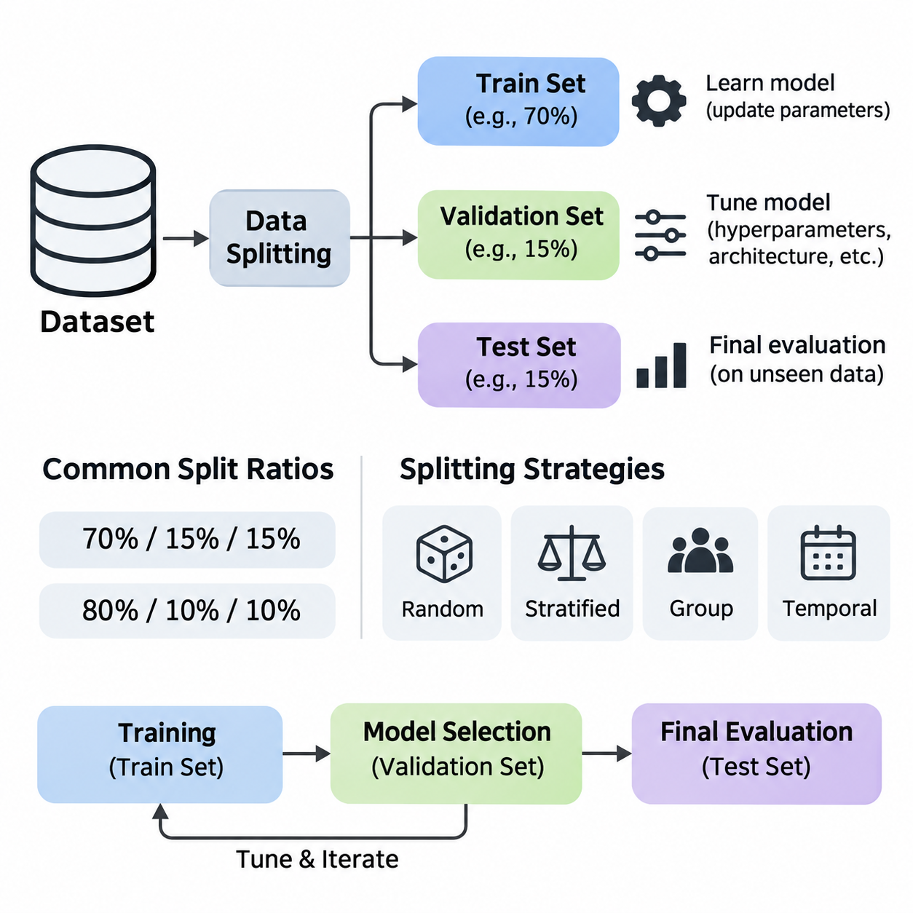
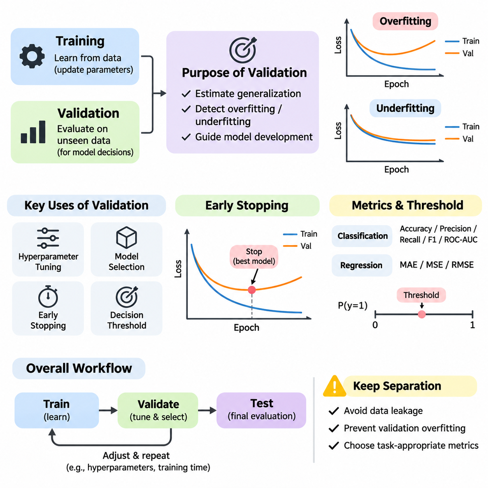
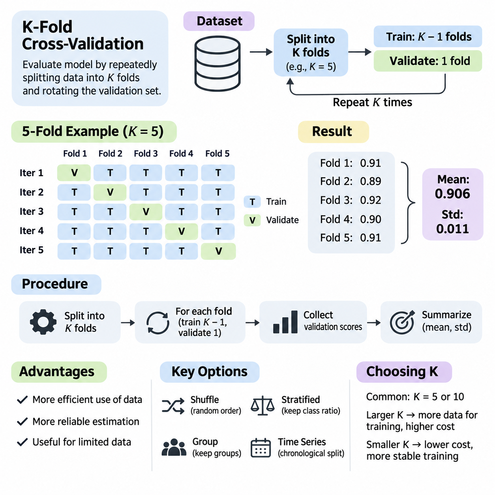
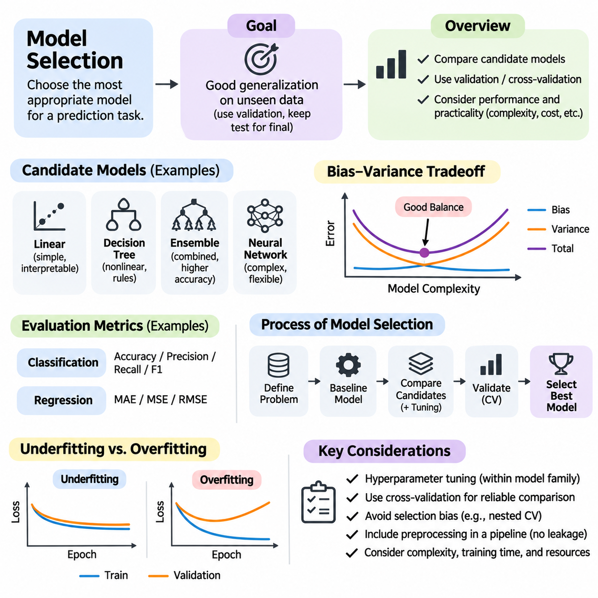
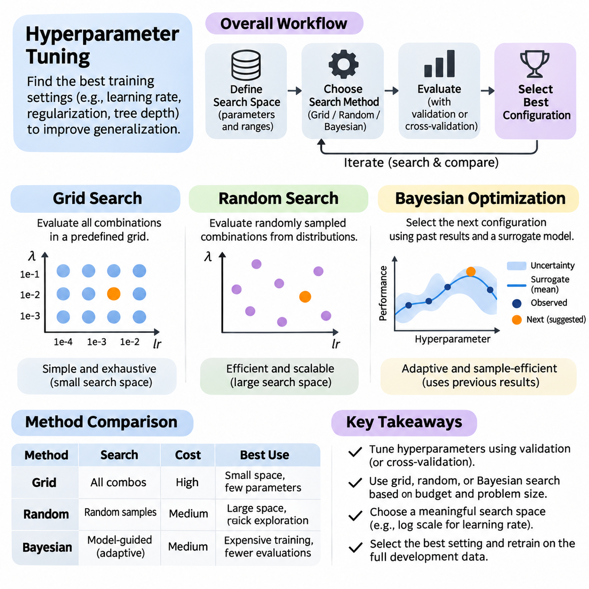
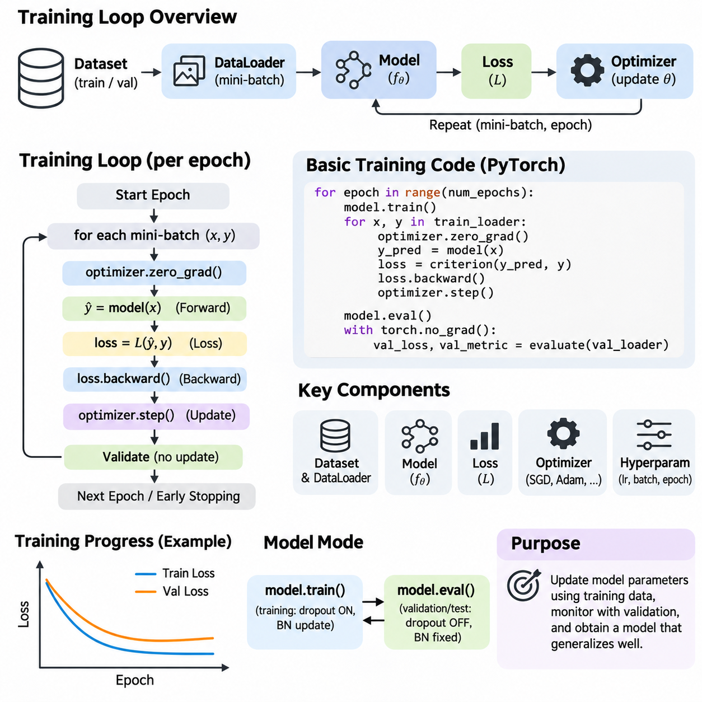
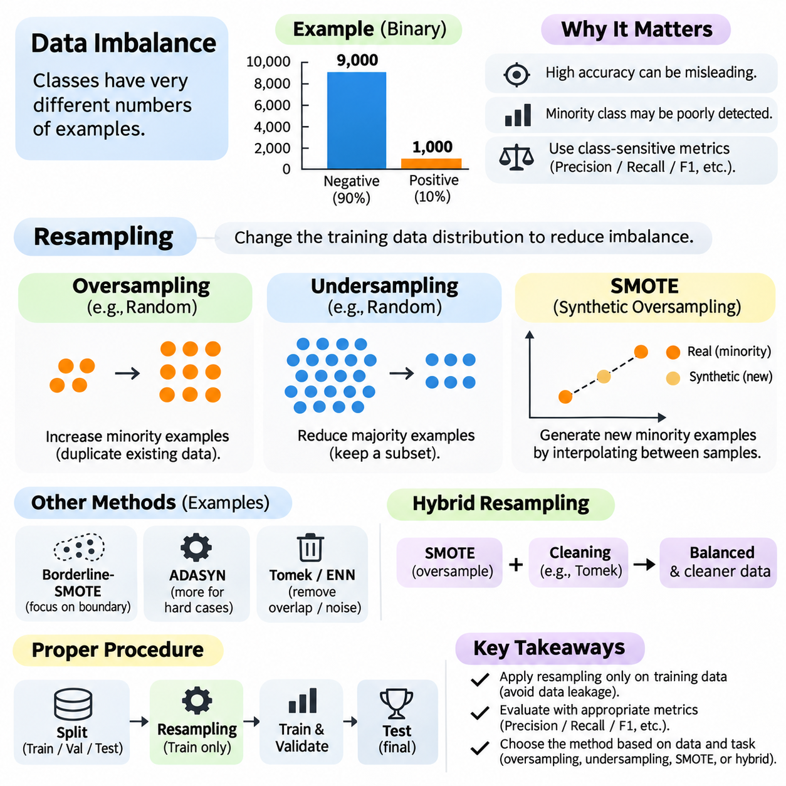
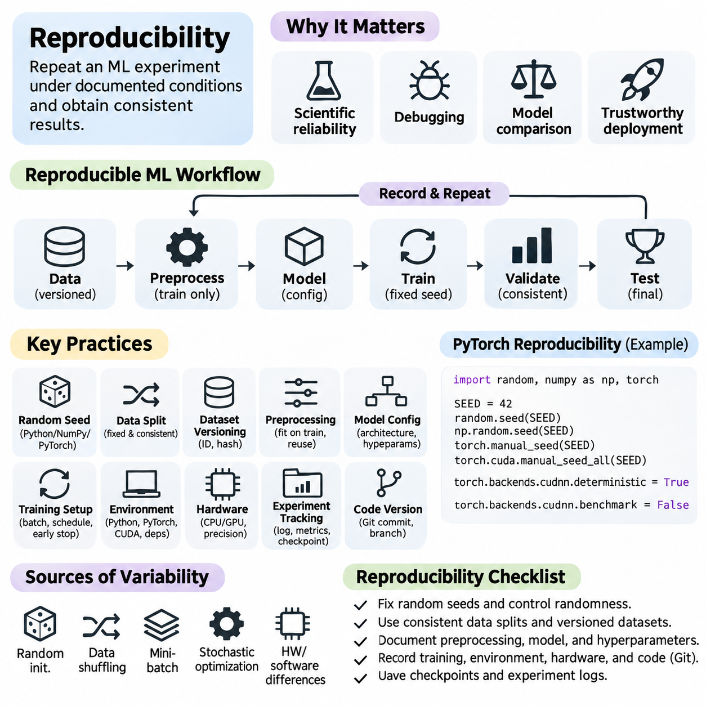

**Volume 07. Machine Learning Fundamentals**


# 03. Training Validation and Test

## 03.00 Data Splitting

{width="7.268055555555556in" height="7.268055555555556in"}

Data splitting is a fundamental step in machine learning that separates an available dataset into distinct subsets for model training, validation, and testing. This separation enables developers to measure how well a model learns from observed examples and generalizes to unseen data. Without proper splitting, evaluation results may become misleading because the model can be assessed using information already encountered during training.

The training set contains examples used to estimate model parameters and learn relationships between input features and target labels. During training, an optimization algorithm adjusts the model to minimize a defined loss function. The training set usually represents the largest portion of the available data because sufficient examples are necessary to capture meaningful patterns, reduce estimation uncertainty, and support reliable learning.

The validation set provides an independent reference for evaluating model behavior during development. Unlike training examples, validation observations do not directly contribute to parameter updates in a conventional supervised learning workflow. Instead, validation performance guides decisions about model architecture, hyperparameters, regularization, and stopping criteria. Repeated validation helps identify configurations that generalize beyond the training data.

The test set is reserved for the final evaluation of a selected model after development decisions have been completed. Its primary purpose is to estimate predictive performance on previously unseen observations. Test examples must remain isolated from model fitting, feature selection, and hyperparameter optimization. Using test results repeatedly to modify a model compromises their independence and can produce overly optimistic performance estimates.

A common splitting strategy allocates 70 percent of observations to training, 15 percent to validation, and 15 percent to testing. Another widely used arrangement assigns 80 percent to training, 10 percent to validation, and 10 percent to testing. These proportions are practical starting points rather than universal requirements. Appropriate allocation depends on dataset size, task complexity, class distribution, and the precision required for performance estimation.

For a dataset containing 10,000 observations, a 70/15/15 split produces 7,000 training examples, 1,500 validation examples, and 1,500 test examples. The model learns from the first subset, development decisions rely on the second, and final performance is measured using the third. This arrangement provides a straightforward experimental structure while preserving separate data for learning, selection, and independent assessment.

Random splitting assigns observations to subsets using a randomized procedure. When examples are independent and identically distributed, random allocation can help produce subsets with similar statistical characteristics. However, randomness alone does not guarantee representative distributions. Small datasets, rare categories, correlated observations, and systematic collection differences may create substantial variation between subsets, even when the splitting procedure is implemented correctly.

Stratified splitting preserves approximately the same class proportions across training, validation, and test subsets. This approach is particularly useful for classification problems involving imbalanced labels. For example, when positive cases represent only 5 percent of observations, stratification helps prevent a subset from containing too few positive examples. It improves class representation but does not eliminate other sampling biases or guarantee reliable evaluation of rare cases.

Group-based splitting becomes necessary when observations share a common source, subject, device, or experimental session. Multiple images from one patient or repeated measurements from one machine may contain strongly correlated information. Assigning related observations to different subsets can create leakage and inflate reported accuracy. Group splitting keeps observations from the same group together, allowing evaluation on genuinely independent subjects or sources.

Temporal splitting is appropriate when observations follow a chronological sequence, as in forecasting, financial modeling, and predictive maintenance. Training data should generally precede validation data, while test data should represent a later period. Randomly mixing past and future observations can introduce information unavailable at prediction time. Chronological separation better reproduces the operational conditions under which future predictions will be generated.

Data leakage occurs when information from validation or test observations influences model development in an inappropriate way. Leakage can arise through preprocessing, duplicated records, target-derived features, or overlapping groups. Even apparently harmless operations, such as calculating normalization statistics using the entire dataset, can expose information from held-out observations. Preventing leakage requires maintaining clear boundaries throughout the complete machine learning pipeline.

Preprocessing operations that learn statistics or parameters from data should generally be fitted using the training subset alone. Examples include standardization, missing-value imputation, feature selection, and dimensionality reduction. The resulting transformations are then applied to validation and test observations without refitting. This procedure ensures that evaluation reflects how a deployed system would process new inputs using information obtained during training.

Data augmentation requires similar attention because transformed versions of the same original observation may remain highly correlated. If augmented images are distributed across training and test subsets, the model may recognize familiar visual structures rather than demonstrate genuine generalization. A safer procedure is to split original observations first and apply training augmentation only within the training subset. Evaluation transformations should remain consistent and controlled.

In Python, scikit-learn provides the train_test_split function for constructing randomized training and evaluation subsets. A three-way split can be implemented through two successive operations. The first separates the final test set, while the second divides the remaining observations into training and validation subsets. The second split ratio must be adjusted to achieve the desired overall proportions rather than applying the original percentage again.

For example, an initial split with test_size equal to 0.15 reserves 15 percent of the complete dataset for testing. The remaining 85 percent can then be divided by assigning approximately 0.17647 of that remainder to validation. This produces an overall allocation close to 70/15/15. A fixed random_state value makes the randomized partition reproducible, allowing subsequent experiments to use identical data assignments.

Reproducibility is essential because different random partitions can produce different performance estimates. Recording the random seed, splitting algorithm, dataset version, and sample identifiers allows experiments to be repeated and audited. However, fixing a seed does not eliminate sampling uncertainty. Evaluating several appropriate partitions or using cross-validation can provide additional evidence about the stability of model performance.

Cross-validation extends the idea of validation by repeatedly dividing development data into training and validation folds. Each iteration trains a model using one portion and evaluates it using another. Aggregating the results provides a broader assessment of model selection stability. When a separate test set exists, it should remain untouched throughout cross-validation and be used only after the final configuration has been selected.

Dataset size strongly influences the splitting strategy. Large datasets may provide reliable evaluation estimates even when relatively small percentages are reserved for validation and testing. Small datasets require greater care because holding out too many observations can weaken training, while holding out too few can make performance estimates unstable. Cross-validation, uncertainty reporting, and task-specific sampling strategies become especially valuable under limited-data conditions.

Representative sampling also requires consideration of deployment conditions. A dataset collected from multiple geographic regions, camera systems, or manufacturing environments may contain meaningful distribution differences. If deployment involves previously unseen environments, evaluation should include appropriately separated environmental groups. A randomly mixed test set may measure interpolation within familiar conditions rather than the robustness required for real-world operation.

Class imbalance introduces additional challenges when rare events are central to the prediction task. Stratification can preserve class frequencies, but the number of rare observations may still be insufficient for precise performance estimation. Evaluation design should consider whether the test set contains enough examples of important outcomes. Resampling or synthetic-data generation, when used, must be restricted to training data to avoid contaminating evaluation.

A reliable splitting workflow begins by identifying the prediction objective and the unit of independence. Developers then examine duplicates, class distributions, temporal relationships, and group membership before selecting a partitioning strategy. Once the subsets are established, their identifiers and metadata should be preserved. Subsequent preprocessing, model training, and selection procedures must respect these boundaries to maintain experimental validity.

The final test evaluation should report metrics appropriate to the problem, together with relevant information about the evaluation dataset. Classification tasks may use accuracy, precision, recall, and F1 score, while regression tasks may use mean absolute error or mean squared error. Where appropriate, confidence intervals can communicate estimation uncertainty. Performance interpretation must also consider whether the test distribution resembles the intended deployment environment.

After model selection, developers may retrain the chosen configuration using combined training and validation data, provided that the test set remains isolated and the procedure is defined appropriately. This can increase the information available for final parameter estimation. However, any additional changes driven by test performance invalidate the interpretation of the test set as an independent final assessment and may require a new evaluation dataset.

Effective train-validation-test splitting is therefore more than a mechanical division of observations. It establishes the experimental boundaries that distinguish learning, development decisions, and final performance assessment. A carefully designed split protects against leakage, supports reproducibility, and provides credible evidence of generalization. These principles form the foundation for trustworthy model selection, evaluation, and deployment in practical machine learning systems.

데이터 분할(Data Splitting)은 사용 가능한 데이터셋(Dataset)을 모델 학습(Training), 검증(Validation), 테스트(Test)를 위한 독립적인 부분집합(Subset)으로 나누는 기계학습(Machine Learning)의 기본 단계이다. 이러한 분리는 모델(Model)이 관측된 예제(Observed Examples)로부터 얼마나 효과적으로 학습하고, 이전에 보지 못한 데이터(Unseen Data)에 얼마나 잘 일반화(Generalization)하는지를 측정할 수 있도록 한다. 적절한 데이터 분할이 이루어지지 않으면 모델이 학습 과정에서 이미 접한 정보를 이용하여 평가될 수 있으므로 평가 결과(Evaluation Results)가 실제보다 좋게 나타날 수 있다.

학습 데이터셋(Training Set)은 모델 매개변수(Model Parameters)를 추정하고 입력 특징(Input Features)과 목표 레이블(Target Labels) 사이의 관계를 학습하는 데 사용되는 예제들로 구성된다. 학습 과정에서 최적화 알고리즘(Optimization Algorithm)은 정의된 손실 함수(Loss Function)를 최소화하도록 모델을 조정한다. 학습 데이터셋은 의미 있는 패턴(Patterns)을 포착하고 추정 불확실성(Estimation Uncertainty)을 줄이며 안정적인 학습을 지원하기 위해 충분한 예제가 필요하므로 일반적으로 전체 데이터에서 가장 큰 비중을 차지한다.

검증 데이터셋(Validation Set)은 모델 개발 과정에서 모델의 동작을 평가하기 위한 독립적인 기준을 제공한다. 일반적인 지도학습(Supervised Learning) 과정에서 검증 데이터는 학습 데이터와 달리 모델 매개변수의 직접적인 갱신(Parameter Updates)에 사용되지 않는다. 대신 검증 성능(Validation Performance)은 모델 구조(Model Architecture), 하이퍼파라미터(Hyperparameters), 정규화(Regularization), 학습 중단 기준(Stopping Criteria)에 관한 의사결정을 지원한다. 반복적인 검증은 학습 데이터 외부에서도 일반화할 수 있는 모델 구성을 식별하는 데 도움을 준다.

테스트 데이터셋(Test Set)은 모델 개발과 선택 과정이 완료된 이후 최종 평가(Final Evaluation)를 수행하기 위해 별도로 보존된다. 주요 목적은 이전에 관측하지 않은 데이터에 대한 예측 성능(Predictive Performance)을 추정하는 것이다. 테스트 데이터는 모델 학습(Model Fitting), 특징 선택(Feature Selection), 하이퍼파라미터 최적화(Hyperparameter Optimization) 과정에서 독립적으로 유지되어야 한다. 테스트 결과를 반복적으로 사용하여 모델을 수정하면 평가의 독립성이 훼손되고 실제보다 낙관적인 성능 추정(Optimistic Performance Estimates)이 발생할 수 있다.

일반적인 데이터 분할 전략(Splitting Strategy)은 전체 관측값의 70%를 학습에, 15%를 검증에, 15%를 테스트에 할당한다. 또 다른 널리 사용되는 구성은 학습 80%, 검증 10%, 테스트 10%이다. 이러한 비율은 보편적인 필수 조건이 아니라 실용적인 출발점(Practical Starting Points)이다. 적절한 데이터 할당 비율은 데이터셋 크기(Dataset Size), 작업 복잡도(Task Complexity), 클래스 분포(Class Distribution), 성능 추정에 요구되는 정밀도(Precision)에 따라 달라진다.

10,000개의 관측값(Observations)을 포함하는 데이터셋에 70/15/15 분할을 적용하면 학습 예제 7,000개, 검증 예제 1,500개, 테스트 예제 1,500개가 생성된다. 모델은 첫 번째 부분집합에서 학습하고, 개발 과정의 의사결정은 두 번째 부분집합을 기반으로 수행하며, 최종 성능은 세 번째 부분집합으로 측정한다. 이러한 구성은 학습(Learning), 모델 선택(Model Selection), 독립적인 성능 평가(Independent Assessment)를 위한 데이터를 분리하면서 명확한 실험 구조(Experimental Structure)를 제공한다.

무작위 분할(Random Splitting)은 무작위 절차(Randomized Procedure)를 이용하여 관측값을 각 부분집합에 할당하는 방법이다. 예제들이 독립적이고 동일한 분포(Independent and Identically Distributed, IID)를 따른다면 무작위 할당은 통계적 특성이 유사한 부분집합을 생성하는 데 도움이 된다. 그러나 무작위성(Randomness)만으로 대표성 있는 분포(Representative Distributions)가 보장되지는 않는다. 작은 데이터셋, 희귀 클래스(Rare Categories), 상관관계가 있는 관측값(Correlated Observations), 체계적인 수집 차이는 분할 결과에 상당한 변동을 발생시킬 수 있다.

계층화 분할(Stratified Splitting)은 학습, 검증, 테스트 부분집합에서 클래스 비율(Class Proportions)이 대체로 동일하게 유지되도록 하는 방법이다. 이 접근법은 불균형 레이블(Imbalanced Labels)을 포함하는 분류 문제(Classification Problems)에 특히 유용하다. 예를 들어 양성 사례(Positive Cases)가 전체 관측값의 5%에 불과한 경우, 계층화는 특정 부분집합에 양성 예제가 지나치게 적게 포함되는 문제를 완화한다. 그러나 다른 표본 편향(Sampling Bias)을 제거하거나 희귀 사례에 대한 신뢰성 있는 평가를 보장하지는 않는다.

그룹 기반 분할(Group-Based Splitting)은 관측값들이 동일한 출처(Source), 대상자(Subject), 장치(Device), 실험 세션(Experimental Session)을 공유하는 경우 필요하다. 한 환자에게서 얻은 여러 영상이나 동일한 기계에서 반복 측정한 데이터는 강한 상관관계(Strong Correlation)를 가질 수 있다. 관련 관측값이 서로 다른 부분집합에 배치되면 데이터 누출(Data Leakage)이 발생하여 보고된 정확도(Accuracy)가 과대평가될 수 있다. 그룹 분할은 동일한 그룹의 관측값을 함께 유지하여 독립적인 대상이나 출처에 대한 평가를 가능하게 한다.

시간 기반 분할(Temporal Splitting)은 시계열 예측(Forecasting), 금융 모델링(Financial Modeling), 예지보전(Predictive Maintenance)처럼 관측값이 시간 순서(Chronological Sequence)를 따르는 경우 적합하다. 일반적으로 학습 데이터는 검증 데이터보다 이전 시점에 위치하고, 테스트 데이터는 더 나중의 기간을 나타내야 한다. 과거와 미래의 관측값을 무작위로 혼합하면 실제 예측 시점에 사용할 수 없는 정보가 포함될 수 있다. 시간 순서에 따른 분리는 미래 예측이 수행되는 실제 운영 조건(Operational Conditions)을 더 적절하게 재현한다.

데이터 누출(Data Leakage)은 검증 또는 테스트 관측값의 정보가 부적절한 방식으로 모델 개발에 영향을 미칠 때 발생한다. 누출은 전처리(Preprocessing), 중복 레코드(Duplicated Records), 목표값에서 파생된 특징(Target-Derived Features), 중복되는 그룹(Overlapping Groups)을 통해 발생할 수 있다. 전체 데이터셋을 사용하여 정규화 통계량(Normalization Statistics)을 계산하는 것처럼 단순해 보이는 작업도 평가용 데이터의 정보를 노출할 수 있다. 이를 방지하려면 전체 기계학습 파이프라인(Machine Learning Pipeline)에서 명확한 데이터 경계를 유지해야 한다.

데이터로부터 통계량이나 매개변수를 학습하는 전처리 작업(Preprocessing Operations)은 일반적으로 학습 부분집합만을 사용하여 적합(Fitting)해야 한다. 대표적인 예로 표준화(Standardization), 결측값 대체(Missing-Value Imputation), 특징 선택(Feature Selection), 차원 축소(Dimensionality Reduction)가 있다. 학습 데이터에서 얻은 변환(Transformations)은 다시 적합하지 않고 검증 및 테스트 데이터에 적용한다. 이러한 절차는 배포된 시스템(Deployed System)이 학습 과정에서 획득한 정보만으로 새로운 입력을 처리하는 상황을 반영한다.

데이터 증강(Data Augmentation)도 유사한 주의가 필요하다. 동일한 원본 관측값에서 생성된 변형 데이터는 높은 상관관계를 유지할 수 있기 때문이다. 증강된 이미지(Augmented Images)가 학습 및 테스트 부분집합에 분산되면 모델은 실제 일반화 능력을 보여주기보다 익숙한 시각적 구조(Visual Structures)를 인식할 수 있다. 더 안전한 절차는 원본 관측값을 먼저 분할한 후 학습 부분집합 내부에서만 학습용 데이터 증강을 적용하는 것이다. 평가용 변환(Evaluation Transformations)은 일관되고 통제된 상태로 유지해야 한다.

파이썬(Python)의 사이킷런(scikit-learn)은 무작위 학습 및 평가 부분집합을 생성하기 위한 train_test_split 함수를 제공한다. 세 부분으로 나누는 분할(Three-Way Split)은 두 번의 연속적인 분할 작업으로 구현할 수 있다. 첫 번째 작업에서는 최종 테스트 데이터셋을 분리하고, 두 번째 작업에서는 남은 관측값을 학습 및 검증 부분집합으로 나눈다. 원하는 전체 분할 비율을 얻으려면 두 번째 분할 비율을 조정해야 하며, 최초의 비율을 그대로 다시 적용해서는 안 된다.

예를 들어 첫 번째 분할에서 test_size를 0.15로 설정하면 전체 데이터셋의 15%가 테스트용으로 확보된다. 남은 85%의 데이터에서 약 0.17647을 검증용으로 할당하면 전체적으로 약 70/15/15의 분할 비율이 만들어진다. 고정된 난수 상태 값(Random State)을 사용하면 무작위 분할의 재현성(Reproducibility)을 확보할 수 있으며, 이후 실험에서도 동일한 데이터 할당(Data Assignments)을 사용하여 결과를 비교할 수 있다.

재현성(Reproducibility)은 서로 다른 무작위 분할이 서로 다른 성능 추정값(Performance Estimates)을 생성할 수 있기 때문에 중요하다. 난수 시드(Random Seed), 분할 알고리즘(Splitting Algorithm), 데이터셋 버전(Dataset Version), 샘플 식별자(Sample Identifiers)를 기록하면 실험을 반복하고 검증할 수 있다. 그러나 난수 시드를 고정한다고 표본 추출 불확실성(Sampling Uncertainty)이 제거되는 것은 아니다. 적절한 여러 분할을 평가하거나 교차 검증(Cross-Validation)을 활용하면 모델 성능의 안정성(Stability)에 관한 추가적인 근거를 확보할 수 있다.

교차 검증(Cross-Validation)은 개발 데이터를 학습 및 검증 폴드(Folds)로 반복적으로 나누어 검증 개념을 확장하는 방법이다. 각 반복 과정에서는 데이터의 한 부분으로 모델을 학습하고 다른 부분으로 평가한다. 여러 결과를 집계(Aggregation)하면 모델 선택의 안정성을 더욱 폭넓게 평가할 수 있다. 별도의 테스트 데이터셋이 존재한다면 교차 검증 과정 전체에서 이를 사용하지 않아야 하며, 최종 모델 구성이 선택된 이후에만 테스트에 활용해야 한다.

데이터셋 크기(Dataset Size)는 분할 전략에 큰 영향을 미친다. 대규모 데이터셋(Large Datasets)은 검증 및 테스트에 상대적으로 작은 비율을 할당하더라도 신뢰성 있는 평가 추정값을 제공할 수 있다. 반면 소규모 데이터셋(Small Datasets)은 지나치게 많은 관측값을 제외하면 학습이 약화되고, 너무 적은 관측값을 평가에 사용하면 성능 추정이 불안정해질 수 있으므로 더욱 신중한 설계가 필요하다. 데이터가 제한된 조건에서는 교차 검증, 불확실성 보고(Uncertainty Reporting), 작업별 표본 추출 전략(Task-Specific Sampling Strategies)이 특히 중요하다.

대표성 있는 표본 추출(Representative Sampling)을 위해서는 실제 배포 조건(Deployment Conditions)도 고려해야 한다. 여러 지역(Geographic Regions), 카메라 시스템(Camera Systems), 제조 환경(Manufacturing Environments)에서 수집한 데이터는 의미 있는 분포 차이(Distribution Differences)를 포함할 수 있다. 배포 환경에 이전에 관측하지 않은 조건이 포함된다면 평가에서도 적절하게 분리된 환경 그룹(Environmental Groups)을 사용해야 한다. 무작위로 혼합된 테스트 데이터셋은 실제 환경에서 필요한 강건성(Robustness)보다 익숙한 조건 내부의 보간 성능(Interpolation Performance)을 측정할 수 있다.

클래스 불균형(Class Imbalance)은 희귀 사건(Rare Events)이 예측 작업의 핵심인 경우 추가적인 문제를 발생시킨다. 계층화(Stratification)는 클래스 빈도(Class Frequencies)를 유지하는 데 도움이 되지만, 희귀 관측값의 수가 여전히 부족하여 정밀한 성능 추정이 어려울 수 있다. 따라서 평가 설계에서는 테스트 데이터셋에 중요한 결과를 나타내는 예제가 충분히 포함되어 있는지 고려해야 한다. 재표본 추출(Resampling)이나 합성 데이터 생성(Synthetic-Data Generation)을 사용하는 경우 평가 데이터 오염(Evaluation Contamination)을 방지하기 위해 학습 데이터에만 적용해야 한다.

신뢰성 있는 데이터 분할 작업 흐름(Splitting Workflow)은 예측 목표(Prediction Objective)와 독립성의 단위(Unit of Independence)를 식별하는 것에서 시작한다. 이후 개발자는 분할 전략을 선택하기 전에 중복 데이터(Duplicates), 클래스 분포(Class Distributions), 시간적 관계(Temporal Relationships), 그룹 소속(Group Membership)을 검토한다. 부분집합이 확정되면 식별자와 메타데이터(Metadata)를 보존해야 한다. 이후의 전처리, 모델 학습, 선택 절차는 실험 타당성(Experimental Validity)을 유지하도록 이러한 경계를 준수해야 한다.

최종 테스트 평가(Final Test Evaluation)에서는 문제에 적합한 평가 지표(Evaluation Metrics)와 평가 데이터셋에 관한 관련 정보를 함께 보고해야 한다. 분류 작업(Classification Tasks)에는 정확도(Accuracy), 정밀도(Precision), 재현율(Recall), F1 점수(F1 Score)를 사용할 수 있으며, 회귀 작업(Regression Tasks)에는 평균 절대 오차(Mean Absolute Error)나 평균 제곱 오차(Mean Squared Error)를 사용할 수 있다. 필요한 경우 신뢰구간(Confidence Intervals)을 통해 추정 불확실성을 표현할 수 있다. 성능 해석에서는 테스트 분포(Test Distribution)가 실제 배포 환경의 분포와 얼마나 유사한지도 고려해야 한다.

모델 선택(Model Selection)이 완료된 이후에는 테스트 데이터셋을 독립적으로 유지하고 재학습 절차(Retraining Procedure)가 적절하게 정의되어 있다는 조건에서 학습 데이터와 검증 데이터를 결합하여 선택된 모델 구성을 다시 학습할 수 있다. 이를 통해 최종 매개변수 추정(Final Parameter Estimation)에 사용할 수 있는 정보량을 늘릴 수 있다. 그러나 테스트 성능에 따라 추가적인 변경을 수행하면 테스트 데이터셋을 독립적인 최종 평가 기준으로 해석할 수 없게 되며, 새로운 평가 데이터셋이 필요할 수 있다.

효과적인 학습·검증·테스트 분할(Train-Validation-Test Splitting)은 단순히 관측값을 기계적으로 나누는 작업 이상의 의미를 가진다. 이는 학습(Learning), 개발 의사결정(Development Decisions), 최종 성능 평가(Final Performance Assessment)를 구분하는 실험적 경계(Experimental Boundaries)를 설정한다. 신중하게 설계된 데이터 분할은 데이터 누출을 방지하고 재현성을 지원하며 일반화 성능에 관한 신뢰성 있는 근거를 제공한다. 이러한 원칙은 실제 기계학습 시스템에서 신뢰할 수 있는 모델 선택, 평가, 배포(Deployment)를 위한 기초가 된다.

## 03.01 Why Validation

{width="7.268055555555556in" height="7.268055555555556in"}

Validation is a fundamental component of machine learning that evaluates how effectively a trained model performs on data not used for parameter optimization. While training measures the ability to learn patterns from observed examples, validation examines whether those patterns remain useful beyond the training dataset. This distinction is essential because strong training performance does not necessarily indicate reliable predictions on unseen observations.

The primary purpose of validation is to estimate generalization performance during model development. A model may achieve extremely low training error by memorizing individual examples rather than learning meaningful relationships. Validation provides an independent reference that helps distinguish genuine learning from memorization. By comparing training and validation performance, developers can identify potential weaknesses before conducting final testing.

Overfitting occurs when a model becomes excessively specialized to its training data, including noise and accidental correlations. Such a model may demonstrate excellent training accuracy while producing significantly worse validation results. A growing difference between training and validation performance often indicates overfitting. Monitoring this difference helps developers determine whether model complexity or training duration should be adjusted.

Underfitting represents the opposite problem, where a model fails to capture important patterns even within its training data. Both training and validation performance may remain poor because the model lacks sufficient capacity, suitable features, or effective optimization. Validation results help distinguish underfitting from overfitting when interpreted alongside training metrics. This distinction supports more appropriate decisions about improving model performance.

Validation plays a central role in hyperparameter tuning because many important training settings cannot be learned directly through ordinary parameter optimization. Examples include learning rate, batch size, regularization strength, network depth, and tree complexity. Developers compare candidate configurations using validation performance and select settings that provide a favorable balance between predictive accuracy, computational cost, and generalization.

Model selection also depends on validation because different algorithms may exhibit substantially different behavior on the same dataset. A linear model, decision tree, ensemble method, and neural network can achieve different levels of predictive performance and complexity. Evaluating these alternatives on a common validation dataset supports systematic comparison. The selected model should satisfy both predictive requirements and practical constraints.

Validation is particularly important when deciding how long a model should continue training. During iterative optimization, training loss often decreases continuously, while validation loss may eventually stop improving. Continuing beyond this point can increase overfitting. Early stopping uses validation performance to determine when training should terminate, potentially improving generalization while reducing unnecessary computation.

A typical early stopping procedure evaluates validation loss after each training epoch and records the best observed result. If validation performance fails to improve for a specified number of epochs, known as patience, training is stopped. The model parameters associated with the best validation result may then be restored. This approach provides a practical mechanism for controlling training duration without relying exclusively on training loss.

Validation metrics must reflect the actual objective of the machine learning task. Classification problems may require accuracy, precision, recall, F1 score, or area under the ROC curve. Regression problems commonly use mean absolute error, mean squared error, or related measures. Choosing an inappropriate validation metric can favor a model that performs well numerically but fails to satisfy important application requirements.

For imbalanced classification, validation accuracy alone may be misleading because a model can achieve high accuracy by predicting the majority class. Precision and recall provide additional information about false positive and false negative predictions. In applications involving rare defects or critical events, recall may be especially important. Validation therefore requires selecting metrics that reflect the consequences of different prediction errors.

Validation also supports the selection of decision thresholds for probabilistic classifiers. A model may output the estimated probability of a positive class, but a threshold is required to convert that probability into a categorical prediction. Different thresholds produce different tradeoffs between precision and recall. Validation data can be used to select a threshold that meets operational requirements without using the final test dataset.

A reliable validation process requires separation between training and evaluation information. Data leakage occurs when information from validation observations influences training inappropriately. For example, fitting a normalization transformation using the entire dataset exposes statistics from validation examples. Preprocessing parameters should generally be estimated using training data and then applied unchanged to validation observations.

Repeated use of the same validation dataset introduces another important limitation. Although validation examples are not directly used for ordinary parameter updates, repeated experimentation can indirectly adapt model development decisions to their specific characteristics. This process is sometimes called validation overfitting. As the number of experiments increases, the selected configuration may perform unusually well on validation data without providing equivalent improvements on new observations.

Cross-validation reduces dependence on a single partition by evaluating candidate models across multiple training and validation subsets. In K-fold cross-validation, the development dataset is divided into K folds, and each fold serves as validation data once. Performance measurements are aggregated to estimate model stability. This approach is particularly useful when available data is limited or results vary substantially across different random splits.

Validation strategies must also respect the structure of the underlying data. Random splitting is appropriate only when observations can reasonably be treated as independent and similarly distributed. Time-series forecasting requires chronological validation to prevent future information from influencing earlier predictions. Group-based validation keeps related observations together, preventing overly optimistic results caused by shared subjects, devices, or collection sessions.

Distribution differences between training and validation datasets can reveal limitations in model robustness. For example, a vision model trained under controlled lighting may perform poorly on images collected under different illumination conditions. Such results indicate that the learned representation may depend on environmental characteristics. Validation across relevant operating conditions helps identify weaknesses that ordinary random evaluation might overlook.

Validation curves provide additional insight into model behavior during development. Plotting training and validation loss across epochs can reveal convergence patterns, overfitting, and unstable optimization. Comparing performance across model capacities or regularization strengths can expose sensitivity to configuration choices. These observations support more informed adjustments than relying on a single final accuracy value.

The size and composition of the validation dataset influence the reliability of its conclusions. A very small validation set may produce unstable performance estimates, especially when rare classes are present. A larger validation set generally improves estimation precision but reduces the data available for training. Developers must balance these competing requirements according to dataset size, task complexity, and the importance of accurate model comparison.

Validation should be distinguished from final testing because the two stages serve different purposes. Validation guides model development, while testing evaluates the selected system after development decisions have been completed. Using test results to repeatedly adjust model configurations effectively turns the test set into another validation set. Maintaining this distinction protects the credibility of the final reported performance.

After selecting a model and its hyperparameters, developers may retrain the final configuration using combined training and validation data. This allows the model to benefit from additional examples before deployment. However, the final test set must remain independent, and any retraining procedure should follow previously established decisions. The resulting model can then be evaluated once using the reserved test observations.

In production-oriented machine learning, validation should also consider practical requirements beyond predictive accuracy. Inference latency, memory consumption, computational cost, robustness, and operational constraints may influence model selection. A highly accurate model may be unsuitable if it exceeds available hardware resources or fails to meet response-time requirements. Validation therefore connects statistical evaluation with practical system engineering.

Ultimately, validation provides the evidence needed to make informed decisions throughout machine learning development. It helps detect overfitting and underfitting, supports hyperparameter tuning, guides model selection, and controls training duration. When designed carefully and kept separate from final testing, validation improves the likelihood that selected models will perform reliably on unseen data and under realistic deployment conditions.

검증(Validation)은 매개변수 최적화(Parameter Optimization)에 사용되지 않은 데이터에서 학습된 모델(Trained Model)이 얼마나 효과적으로 작동하는지를 평가하는 기계학습(Machine Learning)의 핵심 구성 요소이다. 학습(Training)이 관측된 예제(Observed Examples)로부터 패턴(Patterns)을 학습하는 능력을 측정한다면, 검증은 이러한 패턴이 학습 데이터셋(Training Dataset) 외부에서도 유용하게 유지되는지를 확인한다. 이러한 구분은 높은 학습 성능이 반드시 이전에 관측하지 않은 데이터(Unseen Data)에 대한 신뢰성 있는 예측을 의미하지는 않기 때문에 중요하다.

검증의 주요 목적은 모델 개발(Model Development) 과정에서 일반화 성능(Generalization Performance)을 추정하는 것이다. 모델은 의미 있는 관계(Meaningful Relationships)를 학습하기보다 개별 예제를 암기(Memorization)하여 매우 낮은 학습 오차(Training Error)를 달성할 수 있다. 검증은 실제 학습(Genuine Learning)과 암기를 구별하는 데 도움이 되는 독립적인 기준(Independent Reference)을 제공한다. 학습 성능과 검증 성능을 비교하면 최종 테스트(Final Testing)를 수행하기 전에 잠재적인 약점을 식별할 수 있다.

과적합(Overfitting)은 모델이 잡음(Noise)과 우연한 상관관계(Accidental Correlations)를 포함한 학습 데이터의 특성에 지나치게 특화될 때 발생한다. 이러한 모델은 학습 정확도(Training Accuracy)가 매우 높더라도 검증 결과(Validation Results)는 상당히 낮을 수 있다. 학습 성능과 검증 성능 사이의 차이가 점차 커지는 현상은 과적합을 나타내는 경우가 많다. 이러한 차이를 관찰하면 모델 복잡도(Model Complexity)나 학습 기간(Training Duration)을 조정해야 하는지 판단하는 데 도움이 된다.

과소적합(Underfitting)은 모델이 학습 데이터 내부의 중요한 패턴조차 충분히 포착하지 못하는 반대 상황을 의미한다. 모델 용량(Model Capacity)이 부족하거나 적절한 특징(Features)이 없거나 최적화(Optimization)가 효과적으로 이루어지지 않으면 학습 성능과 검증 성능이 모두 낮게 유지될 수 있다. 검증 결과를 학습 지표(Training Metrics)와 함께 해석하면 과소적합과 과적합을 구별하는 데 도움이 된다. 이러한 구분은 모델 성능을 개선하기 위한 더욱 적절한 의사결정을 지원한다.

검증은 하이퍼파라미터 튜닝(Hyperparameter Tuning)에서 중심적인 역할을 수행한다. 많은 중요한 학습 설정이 일반적인 매개변수 최적화(Parameter Optimization)를 통해 직접 학습되지 않기 때문이다. 대표적인 예로 학습률(Learning Rate), 배치 크기(Batch Size), 정규화 강도(Regularization Strength), 신경망 깊이(Network Depth), 트리 복잡도(Tree Complexity)가 있다. 개발자는 검증 성능을 이용하여 후보 구성을 비교하고 예측 정확도(Predictive Accuracy), 계산 비용(Computational Cost), 일반화 성능 사이에서 적절한 균형을 제공하는 설정을 선택한다.

모델 선택(Model Selection) 역시 검증에 의존한다. 서로 다른 알고리즘(Algorithms)은 동일한 데이터셋에서도 상당히 다른 동작을 보일 수 있기 때문이다. 선형 모델(Linear Model), 의사결정나무(Decision Tree), 앙상블 기법(Ensemble Method), 신경망(Neural Network)은 서로 다른 예측 성능과 복잡도를 가질 수 있다. 공통 검증 데이터셋(Common Validation Dataset)에서 이러한 대안을 평가하면 체계적인 비교가 가능하다. 선택된 모델은 예측 요구사항(Predictive Requirements)과 실제 운영 제약조건(Practical Constraints)을 모두 충족해야 한다.

검증은 모델 학습을 얼마나 오래 지속해야 하는지 결정할 때 특히 중요하다. 반복적인 최적화(Iterative Optimization) 과정에서 학습 손실(Training Loss)은 지속적으로 감소하는 반면, 검증 손실(Validation Loss)은 어느 시점부터 개선되지 않을 수 있다. 이 시점 이후에도 학습을 계속하면 과적합이 증가할 수 있다. 조기 종료(Early Stopping)는 검증 성능을 이용하여 학습 종료 시점을 결정하며, 불필요한 계산을 줄이면서 일반화 성능을 개선할 수 있다.

일반적인 조기 종료 절차(Early Stopping Procedure)는 각 학습 에포크(Training Epoch)가 끝난 후 검증 손실을 평가하고 가장 좋은 결과를 기록한다. 인내 횟수(Patience)라고 하는 지정된 에포크 수 동안 검증 성능이 개선되지 않으면 학습을 중단한다. 이후 가장 좋은 검증 결과를 얻었던 모델 매개변수(Model Parameters)를 복원할 수 있다. 이러한 접근법은 학습 손실에만 의존하지 않고 학습 기간을 제어하는 실용적인 방법을 제공한다.

검증 지표(Validation Metrics)는 기계학습 작업의 실제 목표(Actual Objective)를 반영해야 한다. 분류 문제(Classification Problems)에서는 정확도(Accuracy), 정밀도(Precision), 재현율(Recall), F1 점수(F1 Score), ROC 곡선 아래 면적(Area Under the ROC Curve, ROC-AUC) 등이 필요할 수 있다. 회귀 문제(Regression Problems)에서는 평균 절대 오차(Mean Absolute Error), 평균 제곱 오차(Mean Squared Error) 또는 관련 지표를 일반적으로 사용한다. 부적절한 검증 지표를 선택하면 수치적으로는 좋은 성능을 보이지만 중요한 응용 요구사항(Application Requirements)을 충족하지 못하는 모델이 선택될 수 있다.

불균형 분류(Imbalanced Classification)에서는 검증 정확도만 사용하는 것이 오해를 일으킬 수 있다. 모델이 다수 클래스(Majority Class)만 예측하더라도 높은 정확도를 달성할 수 있기 때문이다. 정밀도와 재현율은 거짓 양성(False Positive) 및 거짓 음성(False Negative) 예측에 관한 추가 정보를 제공한다. 희귀 결함(Rare Defects)이나 중대한 사건(Critical Events)을 다루는 응용 분야에서는 재현율이 특히 중요할 수 있다. 따라서 검증에서는 서로 다른 예측 오류(Prediction Errors)의 결과를 반영하는 지표를 선택해야 한다.

검증은 확률적 분류기(Probabilistic Classifiers)의 결정 임계값(Decision Thresholds)을 선택하는 데도 사용된다. 모델은 양성 클래스(Positive Class)에 속할 추정 확률(Estimated Probability)을 출력할 수 있지만, 이를 범주형 예측(Categorical Prediction)으로 변환하려면 임계값(Threshold)이 필요하다. 임계값에 따라 정밀도와 재현율 사이의 상충관계(Tradeoff)가 달라진다. 검증 데이터는 최종 테스트 데이터셋(Final Test Dataset)을 사용하지 않고 운영 요구사항(Operational Requirements)을 충족하는 임계값을 선택하는 데 활용할 수 있다.

신뢰성 있는 검증 과정(Reliable Validation Process)을 위해서는 학습 정보와 평가 정보 사이의 분리(Separation)가 필요하다. 데이터 누출(Data Leakage)은 검증 관측값(Validation Observations)의 정보가 부적절하게 학습에 영향을 미칠 때 발생한다. 예를 들어 전체 데이터셋을 사용하여 정규화 변환(Normalization Transformation)을 적합(Fitting)하면 검증 예제의 통계 정보가 노출된다. 전처리 매개변수(Preprocessing Parameters)는 일반적으로 학습 데이터만을 사용하여 추정한 후 검증 관측값에 변경 없이 적용해야 한다.

동일한 검증 데이터셋을 반복적으로 사용하는 것도 중요한 한계를 발생시킨다. 검증 예제가 일반적인 매개변수 갱신(Parameter Updates)에 직접 사용되지는 않지만, 반복적인 실험(Repeated Experimentation)은 모델 개발 의사결정이 검증 데이터의 특정 특성에 간접적으로 적응하도록 만들 수 있다. 이러한 현상을 검증 과적합(Validation Overfitting)이라고 한다. 실험 횟수가 증가할수록 선택된 모델 구성이 검증 데이터에서는 비정상적으로 좋은 성능을 보이지만 새로운 관측값에서는 동일한 개선을 제공하지 못할 수 있다.

교차 검증(Cross-Validation)은 여러 학습 및 검증 부분집합(Training and Validation Subsets)에서 후보 모델을 평가하여 단일 데이터 분할(Single Partition)에 대한 의존성을 줄인다. K-겹 교차 검증(K-Fold Cross-Validation)에서는 개발 데이터셋(Development Dataset)을 K개의 폴드(Folds)로 나누고 각 폴드를 한 번씩 검증 데이터로 사용한다. 성능 측정값(Performance Measurements)을 집계하여 모델 안정성(Model Stability)을 추정한다. 이 접근법은 사용 가능한 데이터가 제한적이거나 서로 다른 무작위 분할에서 결과가 크게 달라지는 경우 특히 유용하다.

검증 전략(Validation Strategies)은 기본 데이터의 구조(Underlying Data Structure)도 고려해야 한다. 무작위 분할(Random Splitting)은 관측값을 독립적이고 유사한 분포(Independent and Similarly Distributed)를 가진 것으로 합리적으로 간주할 수 있을 때 적합하다. 시계열 예측(Time-Series Forecasting)에서는 미래 정보가 이전 시점의 예측에 영향을 미치지 않도록 시간 순서에 따른 검증(Chronological Validation)이 필요하다. 그룹 기반 검증(Group-Based Validation)은 관련 관측값을 함께 유지하여 동일한 대상자, 장치 또는 수집 세션(Collection Sessions)으로 인해 지나치게 낙관적인 결과가 발생하는 것을 방지한다.

학습 데이터셋과 검증 데이터셋 사이의 분포 차이(Distribution Differences)는 모델 강건성(Model Robustness)의 한계를 드러낼 수 있다. 예를 들어 통제된 조명(Controlled Lighting) 아래에서 학습한 비전 모델(Vision Model)은 다른 조명 조건(Illumination Conditions)에서 수집한 이미지에 대해 낮은 성능을 보일 수 있다. 이러한 결과는 학습된 표현(Learned Representation)이 환경적 특성(Environmental Characteristics)에 의존할 가능성을 나타낸다. 관련 운영 조건(Operating Conditions)에 걸친 검증은 일반적인 무작위 평가에서 발견하기 어려운 약점을 식별하는 데 도움이 된다.

검증 곡선(Validation Curves)은 모델 개발 과정에서 모델의 동작을 이해하기 위한 추가적인 정보를 제공한다. 에포크에 따른 학습 손실과 검증 손실을 그래프로 나타내면 수렴 패턴(Convergence Patterns), 과적합, 불안정한 최적화(Unstable Optimization)를 확인할 수 있다. 모델 용량이나 정규화 강도에 따른 성능을 비교하면 설정 선택에 대한 민감도(Sensitivity)를 파악할 수 있다. 이러한 관찰은 단일 최종 정확도 값에만 의존하는 것보다 더 근거 있는 모델 조정을 지원한다.

검증 데이터셋의 크기(Size)와 구성(Composition)은 검증 결론의 신뢰성(Reliability)에 영향을 미친다. 매우 작은 검증 데이터셋은 특히 희귀 클래스(Rare Classes)가 존재할 때 불안정한 성능 추정값(Performance Estimates)을 생성할 수 있다. 일반적으로 검증 데이터셋이 클수록 추정 정밀도(Estimation Precision)가 향상되지만 학습에 사용할 수 있는 데이터는 감소한다. 개발자는 데이터셋 크기, 작업 복잡도, 정확한 모델 비교(Model Comparison)의 중요성에 따라 이러한 상충관계의 균형을 조정해야 한다.

검증(Validation)과 최종 테스트(Final Testing)는 서로 다른 목적을 가지므로 구분해야 한다. 검증은 모델 개발을 지원하는 반면, 테스트는 개발 의사결정이 완료된 이후 선택된 시스템을 평가한다. 테스트 결과를 사용하여 모델 구성을 반복적으로 조정하면 테스트 데이터셋이 사실상 또 다른 검증 데이터셋으로 바뀐다. 이러한 구분을 유지하는 것은 최종 보고 성능(Final Reported Performance)의 신뢰성(Credibility)을 보호하는 데 중요하다.

모델과 하이퍼파라미터(Hyperparameters)를 선택한 이후 개발자는 학습 데이터와 검증 데이터를 결합하여 최종 모델 구성(Final Configuration)을 다시 학습할 수 있다. 이를 통해 모델은 배포(Deployment) 전에 더 많은 예제를 활용할 수 있다. 그러나 최종 테스트 데이터셋은 독립적으로 유지되어야 하며, 재학습 절차(Retraining Procedure)는 이전에 확정된 의사결정을 따라야 한다. 이후 확보해 둔 테스트 관측값(Reserved Test Observations)을 사용하여 최종 모델을 평가할 수 있다.

실제 운영을 고려한 기계학습(Production-Oriented Machine Learning)에서 검증은 예측 정확도 이외의 실용적인 요구사항(Practical Requirements)도 고려해야 한다. 추론 지연시간(Inference Latency), 메모리 사용량(Memory Consumption), 계산 비용(Computational Cost), 강건성(Robustness), 운영 제약조건(Operational Constraints)은 모델 선택에 영향을 미칠 수 있다. 매우 높은 정확도를 가진 모델이라도 사용 가능한 하드웨어 자원(Hardware Resources)을 초과하거나 응답시간 요구사항(Response-Time Requirements)을 충족하지 못하면 적합하지 않을 수 있다. 따라서 검증은 통계적 평가(Statistical Evaluation)와 실제 시스템 엔지니어링(System Engineering)을 연결한다.

궁극적으로 검증(Validation)은 기계학습 개발 전반에서 근거 있는 의사결정을 내리는 데 필요한 증거(Evidence)를 제공한다. 검증은 과적합과 과소적합을 탐지하고, 하이퍼파라미터 튜닝을 지원하며, 모델 선택을 안내하고, 학습 기간을 제어하는 데 도움을 준다. 신중하게 설계되고 최종 테스트와 분리된 검증은 선택된 모델이 이전에 관측하지 않은 데이터와 실제 배포 조건(Realistic Deployment Conditions)에서도 신뢰성 있게 작동할 가능성을 높인다.

## 03.02 Cross Validation

{width="7.268055555555556in" height="7.268055555555556in"}

Cross-validation is a statistical evaluation technique used to estimate how well a machine learning model generalizes to unseen data. Instead of relying on a single training and validation split, cross-validation repeatedly evaluates the model using different subsets of the available development dataset. This approach provides a broader understanding of predictive performance and reduces dependence on one potentially unrepresentative partition.

K-fold cross-validation is one of the most widely used validation methods in supervised machine learning. The dataset is divided into K approximately equal, non-overlapping subsets called folds. During each iteration, one fold serves as the validation set, while the remaining K minus one folds form the training set. The process continues until every fold has been used exactly once for validation.

For example, five-fold cross-validation divides the development dataset into five subsets. The model is trained five separate times, each time using four folds for training and the remaining fold for validation. Every observation contributes to validation exactly once and participates in training during the other four iterations. The resulting validation scores are combined to summarize performance across different partitions.

The primary advantage of K-fold cross-validation is more efficient use of limited data. A conventional holdout method reserves a fixed portion for validation, reducing the examples available for training. K-fold cross-validation rotates the validation subset so that every observation contributes to both training and evaluation across separate iterations. This is particularly valuable when collecting additional labeled examples is expensive or difficult.

The number of folds, K, determines the balance between computational cost and evaluation behavior. Common choices include five-fold and ten-fold cross-validation. With five folds, each model is trained using approximately 80 percent of the development data. With ten folds, approximately 90 percent is used for training during each iteration. Larger K values generally increase computational requirements because more models must be fitted.

Selecting K involves practical tradeoffs. Smaller values reduce training time but evaluate models trained on smaller fractions of the available dataset. Larger values provide training subsets closer to the complete development dataset but require additional computation. The optimal choice depends on dataset size, model complexity, training cost, and evaluation objectives. No single value is universally appropriate for every machine learning problem.

Cross-validation performance is commonly summarized using the mean of the validation scores across folds. If five validation accuracies are obtained, their arithmetic mean provides an overall estimate of performance under the selected partitioning procedure. The standard deviation can also be reported to describe variation between folds. However, fold scores are statistically dependent, so their standard deviation should not automatically be interpreted as a confidence interval.

A reliable K-fold procedure requires training a fresh model independently for each fold. Model parameters learned during one iteration must not carry over into subsequent iterations because doing so would expose information from previous validation subsets. Each iteration should begin with an appropriately initialized estimator and use only its designated training observations. This separation preserves the intended evaluation structure.

Preprocessing must also be performed independently within each cross-validation iteration. Operations such as standardization, missing-value imputation, feature selection, and dimensionality reduction can learn information from their input data. Fitting these transformations before creating the folds introduces data leakage. Instead, preprocessing parameters should be learned from each training fold and applied unchanged to its corresponding validation fold.

Machine learning pipelines provide a convenient mechanism for maintaining these boundaries. In scikit-learn, a Pipeline can combine preprocessing transformations and an estimator into a single workflow. During cross-validation, each pipeline is fitted independently using the training observations of the current fold. This approach reduces implementation mistakes and ensures that transformations requiring fitted statistics remain isolated from validation data.

The scikit-learn library provides the KFold class for generating training and validation indices. A typical configuration specifies n_splits equal to five, optionally enables shuffling, and supplies a fixed random_state when reproducible randomized partitions are required. The split method produces index pairs identifying training and validation observations. These indices can then be used to fit models and calculate evaluation metrics.

Shuffling determines whether observations are randomly reordered before folds are constructed. When examples are independent and similarly distributed, shuffling may improve the balance of observations across folds. Without shuffling, KFold uses the existing sample order, which can be problematic when records are sorted by class or collection conditions. However, shuffling is not appropriate when chronological or group relationships must be preserved.

Standard K-fold cross-validation does not explicitly maintain class proportions. In classification problems with imbalanced labels, some folds may contain too few minority-class examples for meaningful evaluation. Stratified K-fold cross-validation addresses this issue by approximately preserving class frequencies across folds. It is often preferable for classification tasks where class imbalance could distort performance comparisons.

Grouped observations require a different strategy because ordinary K-fold splitting may place related samples in both training and validation subsets. Repeated measurements from the same patient, robot, or manufacturing device can share information that makes validation artificially easy. GroupKFold keeps observations from each group together within a single validation fold. This supports more realistic evaluation of generalization to previously unseen groups.

Time-dependent datasets also require special treatment. Random or ordinary K-fold partitions may train models on future observations while validating predictions for earlier periods. This violates the information constraints of many forecasting applications. TimeSeriesSplit provides an alternative in which training observations precede validation observations, better reflecting the chronological structure of real-world prediction tasks.

Cross-validation is especially useful for comparing candidate algorithms under consistent evaluation conditions. Linear regression, decision trees, random forests, and neural networks can be evaluated using the same folds and metrics. This makes performance differences easier to interpret because the models are assessed on comparable partitions. Nevertheless, computational cost, interpretability, and deployment requirements should also influence final model selection.

Hyperparameter tuning frequently uses cross-validation to compare candidate configurations. Grid search and randomized search can evaluate combinations of hyperparameters across multiple folds and aggregate the resulting scores. The configuration with the strongest average validation performance is selected according to the chosen metric. Because this selection adapts to cross-validation results, its reported score may still be optimistic.

Nested cross-validation provides a more rigorous approach when model selection and performance estimation must be separated. An inner cross-validation loop selects hyperparameters, while an outer loop evaluates the complete selection procedure on held-out folds. This reduces bias caused by evaluating a model using the same observations that guided its configuration. However, nested cross-validation can be computationally expensive.

Cross-validation does not eliminate the need for an independent test set when a final unbiased assessment is required. A common workflow reserves test observations before development and performs cross-validation only on the remaining data. After selecting the model and hyperparameters, the chosen configuration is fitted using the available development dataset. The reserved test set is then used for final evaluation without further tuning.

Repeated K-fold cross-validation extends the basic procedure by generating multiple randomized fold partitions. Each repetition provides another collection of validation scores, allowing developers to examine sensitivity to random partitioning. This can be useful when datasets are small or performance varies substantially between splits. However, repeated folds remain statistically dependent and do not create additional independent observations.

The reliability of cross-validation depends on whether the folds represent the intended prediction environment. Random folds may provide optimistic results when deployment involves new geographic regions, devices, subjects, or operating conditions. Evaluation should therefore reproduce the independence assumptions and distribution changes expected during deployment. Choosing the correct splitting strategy is often more important than increasing the number of folds.

Computational efficiency becomes important when cross-validation involves expensive models. Training a deep neural network ten times may require substantially more resources than fitting a single model. Parallel execution, smaller candidate searches, and carefully selected fold counts can reduce evaluation cost. However, computational shortcuts should not compromise the independence of training and validation observations or introduce information leakage.

Ultimately, K-fold cross-validation provides a systematic framework for evaluating generalization, comparing models, and selecting hyperparameters. Its rotating validation structure makes effective use of available data while revealing variation across partitions. When combined with leakage-free preprocessing, appropriate fold construction, and independent final testing, cross-validation supports more reliable and reproducible machine learning development.

교차 검증(Cross-Validation)은 기계학습(Machine Learning) 모델이 이전에 관측하지 않은 데이터(Unseen Data)에 얼마나 잘 일반화(Generalization)하는지를 추정하는 통계적 평가 기법(Statistical Evaluation Technique)이다. 단일 학습 및 검증 분할(Training and Validation Split)에만 의존하는 대신, 교차 검증은 사용 가능한 개발 데이터셋(Development Dataset)의 서로 다른 부분집합(Subset)을 사용하여 모델을 반복적으로 평가한다. 이러한 접근법은 예측 성능(Predictive Performance)을 더욱 폭넓게 이해하도록 하며, 대표성이 부족할 수 있는 하나의 데이터 분할(Partition)에 대한 의존성을 줄인다.

K-겹 교차 검증(K-Fold Cross-Validation)은 지도학습(Supervised Machine Learning)에서 가장 널리 사용되는 검증 방법 중 하나이다. 데이터셋은 폴드(Fold)라고 하는 크기가 거의 동일하고 서로 겹치지 않는 K개의 부분집합으로 나뉜다. 각 반복(Iteration)에서는 하나의 폴드를 검증 데이터셋(Validation Set)으로 사용하고, 나머지 K-1개의 폴드를 학습 데이터셋(Training Set)으로 사용한다. 모든 폴드가 정확히 한 번씩 검증 데이터로 사용될 때까지 이 과정을 반복한다.

예를 들어 5-겹 교차 검증(Five-Fold Cross-Validation)은 개발 데이터셋을 다섯 개의 부분집합으로 나눈다. 모델은 총 다섯 번 독립적으로 학습되며, 매번 네 개의 폴드를 학습에 사용하고 나머지 하나의 폴드를 검증에 사용한다. 모든 관측값(Observations)은 정확히 한 번 검증에 참여하고, 나머지 네 번의 반복에서는 학습에 참여한다. 이렇게 얻은 검증 점수(Validation Scores)를 결합하여 서로 다른 데이터 분할에 걸친 성능을 요약한다.

K-겹 교차 검증의 주요 장점은 제한된 데이터를 더욱 효율적으로 활용할 수 있다는 점이다. 일반적인 홀드아웃 방법(Holdout Method)은 검증을 위해 데이터의 일정 부분을 고정적으로 확보하므로 학습에 사용할 수 있는 예제가 감소한다. 반면 K-겹 교차 검증은 검증 부분집합을 순환시켜 모든 관측값이 서로 다른 반복에서 학습과 평가에 모두 기여하도록 한다. 이러한 특성은 추가적인 레이블 데이터(Labeled Data)를 수집하는 데 많은 비용이나 어려움이 발생하는 경우 특히 유용하다.

폴드 수(Number of Folds)인 K는 계산 비용(Computational Cost)과 평가 특성(Evaluation Behavior) 사이의 균형을 결정한다. 일반적으로 5-겹 교차 검증과 10-겹 교차 검증(Ten-Fold Cross-Validation)이 널리 사용된다. 5개의 폴드를 사용하면 각 모델은 개발 데이터의 약 80%로 학습된다. 10개의 폴드를 사용하면 각 반복에서 약 90%가 학습에 사용된다. K가 커질수록 더 많은 모델을 학습해야 하므로 일반적으로 계산 요구량(Computational Requirements)이 증가한다.

K값을 선택할 때는 실용적인 상충관계(Practical Tradeoffs)를 고려해야 한다. 작은 K값은 학습 시간을 줄이지만 사용 가능한 데이터의 더 작은 비율로 학습된 모델을 평가하게 된다. 큰 K값은 전체 개발 데이터셋에 더 가까운 크기의 학습 부분집합을 제공하지만 추가적인 계산이 필요하다. 최적의 선택은 데이터셋 크기(Dataset Size), 모델 복잡도(Model Complexity), 학습 비용(Training Cost), 평가 목표(Evaluation Objectives)에 따라 달라진다. 모든 기계학습 문제에 보편적으로 적합한 단일 K값은 존재하지 않는다.

교차 검증 성능(Cross-Validation Performance)은 일반적으로 폴드별 검증 점수의 평균(Mean)을 사용하여 요약한다. 다섯 개의 검증 정확도(Validation Accuracies)를 얻었다면 산술평균(Arithmetic Mean)은 선택한 데이터 분할 절차에서의 전반적인 성능 추정값을 제공한다. 폴드 사이의 변동(Variation)을 설명하기 위해 표준편차(Standard Deviation)를 함께 보고할 수도 있다. 그러나 폴드 점수는 통계적으로 서로 의존적(Statistically Dependent)이므로 표준편차를 자동으로 신뢰구간(Confidence Interval)으로 해석해서는 안 된다.

신뢰성 있는 K-겹 교차 검증 절차(Reliable K-Fold Procedure)에서는 각 폴드마다 새로운 모델을 독립적으로 학습해야 한다. 한 반복에서 학습된 모델 매개변수(Model Parameters)가 이후 반복으로 전달되어서는 안 된다. 이러한 전달은 이전 검증 부분집합의 정보를 노출하기 때문이다. 각 반복은 적절하게 초기화된 추정기(Estimator)에서 시작하고 지정된 학습 관측값만 사용해야 한다. 이러한 분리는 의도된 평가 구조(Evaluation Structure)를 유지한다.

전처리(Preprocessing) 역시 각 교차 검증 반복 내부에서 독립적으로 수행해야 한다. 표준화(Standardization), 결측값 대체(Missing-Value Imputation), 특징 선택(Feature Selection), 차원 축소(Dimensionality Reduction)와 같은 작업은 입력 데이터로부터 정보를 학습할 수 있다. 폴드를 생성하기 전에 이러한 변환을 적합(Fitting)하면 데이터 누출(Data Leakage)이 발생한다. 대신 각 학습 폴드에서 전처리 매개변수(Preprocessing Parameters)를 학습하고 해당 검증 폴드에는 변경 없이 적용해야 한다.

기계학습 파이프라인(Machine Learning Pipelines)은 이러한 데이터 경계를 유지하기 위한 편리한 방법을 제공한다. 사이킷런(scikit-learn)의 파이프라인(Pipeline)은 전처리 변환(Preprocessing Transformations)과 추정기(Estimator)를 하나의 작업 흐름(Workflow)으로 결합할 수 있다. 교차 검증 중에는 각 파이프라인이 현재 폴드의 학습 관측값만 사용하여 독립적으로 적합된다. 이러한 접근법은 구현 오류(Implementation Mistakes)를 줄이고 통계량 학습이 필요한 변환이 검증 데이터와 분리되도록 보장한다.

사이킷런(scikit-learn) 라이브러리는 학습 및 검증 인덱스(Training and Validation Indices)를 생성하기 위한 KFold 클래스를 제공한다. 일반적인 구성에서는 n_splits를 5로 지정하고, 필요에 따라 셔플링(Shuffling)을 활성화하며, 재현 가능한 무작위 분할(Reproducible Randomized Partitions)이 필요한 경우 고정된 random_state를 제공한다. split 메서드(Method)는 학습 및 검증 관측값을 식별하는 인덱스 쌍(Index Pairs)을 생성한다. 이러한 인덱스는 모델 학습과 평가 지표(Evaluation Metrics) 계산에 사용할 수 있다.

셔플링(Shuffling)은 폴드를 구성하기 전에 관측값의 순서를 무작위로 재배열할지 결정한다. 예제들이 독립적이고 유사한 분포(Independent and Similarly Distributed)를 가진다면 셔플링은 폴드 간 관측값의 균형을 개선할 수 있다. 셔플링을 사용하지 않으면 KFold는 기존 샘플 순서(Sample Order)를 유지하며, 레코드가 클래스나 수집 조건(Collection Conditions)에 따라 정렬되어 있는 경우 문제가 발생할 수 있다. 그러나 시간 순서(Chronological Relationships)나 그룹 관계(Group Relationships)를 보존해야 하는 경우에는 셔플링이 적합하지 않다.

표준 K-겹 교차 검증(Standard K-Fold Cross-Validation)은 클래스 비율(Class Proportions)을 명시적으로 유지하지 않는다. 불균형 레이블(Imbalanced Labels)을 포함하는 분류 문제(Classification Problems)에서는 일부 폴드에 소수 클래스(Minority Class)의 예제가 너무 적게 포함되어 의미 있는 평가가 어려울 수 있다. 계층화 K-겹 교차 검증(Stratified K-Fold Cross-Validation)은 폴드 전반에서 클래스 빈도(Class Frequencies)를 대체로 유지하여 이러한 문제를 해결한다. 클래스 불균형(Class Imbalance)이 성능 비교를 왜곡할 수 있는 분류 작업에서 선호되는 경우가 많다.

그룹화된 관측값(Grouped Observations)은 일반적인 K-겹 분할이 관련 샘플을 학습 및 검증 부분집합에 동시에 배치할 수 있으므로 다른 전략이 필요하다. 동일한 환자, 로봇 또는 제조 장치에서 얻은 반복 측정값(Repeated Measurements)은 검증을 인위적으로 쉽게 만드는 정보를 공유할 수 있다. 그룹 K-겹 교차 검증(GroupKFold)은 각 그룹의 관측값이 하나의 검증 폴드에 함께 배치되도록 유지한다. 이를 통해 이전에 관측하지 않은 그룹(Unseen Groups)에 대한 일반화 성능을 더욱 현실적으로 평가할 수 있다.

시간 의존적 데이터셋(Time-Dependent Datasets)도 특별한 처리가 필요하다. 무작위 분할이나 일반적인 K-겹 분할은 미래 관측값(Future Observations)으로 모델을 학습한 후 과거 기간의 예측을 검증하는 상황을 만들 수 있다. 이는 많은 예측 응용 분야(Forecasting Applications)에서 정보 사용 제약조건(Information Constraints)을 위반한다. 시계열 분할(TimeSeriesSplit)은 학습 관측값이 검증 관측값보다 시간적으로 앞서도록 구성하는 대안을 제공하며, 실제 예측 작업의 시간적 구조(Chronological Structure)를 더욱 적절하게 반영한다.

교차 검증은 일관된 평가 조건(Consistent Evaluation Conditions)에서 후보 알고리즘(Candidate Algorithms)을 비교할 때 특히 유용하다. 선형 회귀(Linear Regression), 의사결정나무(Decision Trees), 랜덤 포레스트(Random Forests), 신경망(Neural Networks)을 동일한 폴드와 평가 지표를 사용하여 평가할 수 있다. 모델들이 비교 가능한 데이터 분할에서 평가되므로 성능 차이를 더욱 쉽게 해석할 수 있다. 그러나 최종 모델 선택에서는 계산 비용, 해석 가능성(Interpretability), 배포 요구사항(Deployment Requirements)도 고려해야 한다.

하이퍼파라미터 튜닝(Hyperparameter Tuning)은 후보 구성을 비교하기 위해 교차 검증을 자주 활용한다. 그리드 탐색(Grid Search)과 무작위 탐색(Randomized Search)은 여러 폴드에서 하이퍼파라미터 조합(Hyperparameter Combinations)을 평가하고 결과 점수를 집계할 수 있다. 선택한 평가 지표에서 가장 높은 평균 검증 성능(Average Validation Performance)을 보이는 구성이 선택된다. 그러나 이러한 선택은 교차 검증 결과에 적응하므로 보고된 점수에는 여전히 낙관적 편향(Optimistic Bias)이 포함될 수 있다.

중첩 교차 검증(Nested Cross-Validation)은 모델 선택과 성능 추정(Performance Estimation)을 분리해야 할 때 더욱 엄격한 접근법을 제공한다. 내부 교차 검증 루프(Inner Cross-Validation Loop)는 하이퍼파라미터를 선택하고, 외부 루프(Outer Loop)는 홀드아웃 폴드(Held-Out Folds)에서 전체 선택 절차를 평가한다. 이를 통해 모델 구성을 결정하는 데 사용된 동일한 관측값으로 모델을 평가할 때 발생하는 편향(Bias)을 줄인다. 그러나 중첩 교차 검증은 계산 비용이 상당히 높을 수 있다.

최종적으로 편향이 적은 독립적인 평가(Independent Final Assessment)가 필요한 경우 교차 검증이 별도의 테스트 데이터셋(Test Set)의 필요성을 없애지는 않는다. 일반적인 작업 흐름에서는 개발 전에 테스트 관측값을 별도로 확보하고 나머지 데이터에서만 교차 검증을 수행한다. 모델과 하이퍼파라미터를 선택한 후 선택된 구성을 사용 가능한 개발 데이터셋으로 학습한다. 이후 추가적인 튜닝 없이 확보된 테스트 데이터셋을 사용하여 최종 평가(Final Evaluation)를 수행한다.

반복 K-겹 교차 검증(Repeated K-Fold Cross-Validation)은 여러 개의 무작위 폴드 분할(Randomized Fold Partitions)을 생성하여 기본 절차를 확장한다. 각 반복은 새로운 검증 점수 집합(Validation Scores)을 제공하므로 개발자는 무작위 분할에 대한 민감도(Sensitivity)를 분석할 수 있다. 이는 데이터셋이 작거나 분할에 따라 성능이 크게 달라지는 경우 유용하다. 그러나 반복된 폴드 역시 통계적으로 서로 의존적이며, 추가적인 독립 관측값(Independent Observations)을 생성하는 것은 아니다.

교차 검증의 신뢰성(Reliability)은 폴드가 의도된 예측 환경(Intended Prediction Environment)을 얼마나 잘 대표하는지에 따라 달라진다. 실제 배포 환경에 새로운 지역(Geographic Regions), 장치(Devices), 대상자(Subjects), 운영 조건(Operating Conditions)이 포함된다면 무작위 폴드는 지나치게 낙관적인 결과를 제공할 수 있다. 따라서 평가에서는 배포 중 예상되는 독립성 가정(Independence Assumptions)과 분포 변화(Distribution Changes)를 재현해야 한다. 올바른 분할 전략을 선택하는 것이 폴드 수를 늘리는 것보다 더 중요한 경우가 많다.

교차 검증에 계산 비용이 높은 모델(Computationally Expensive Models)이 포함되는 경우 계산 효율성(Computational Efficiency)이 중요해진다. 심층 신경망(Deep Neural Network)을 열 번 학습하는 작업은 단일 모델을 학습하는 것보다 훨씬 많은 자원을 필요로 할 수 있다. 병렬 실행(Parallel Execution), 축소된 후보 탐색(Smaller Candidate Searches), 신중하게 선택한 폴드 수(Fold Counts)는 평가 비용을 줄일 수 있다. 그러나 계산을 줄이기 위한 방법이 학습 및 검증 관측값의 독립성을 훼손하거나 정보 누출(Information Leakage)을 발생시켜서는 안 된다.

궁극적으로 K-겹 교차 검증(K-Fold Cross-Validation)은 일반화 성능 평가(Generalization Evaluation), 모델 비교(Model Comparison), 하이퍼파라미터 선택(Hyperparameter Selection)을 위한 체계적인 프레임워크(Systematic Framework)를 제공한다. 검증 폴드를 순환시키는 구조(Rotating Validation Structure)는 사용 가능한 데이터를 효과적으로 활용하면서 분할 간 성능 변동(Performance Variation)을 드러낸다. 데이터 누출이 없는 전처리(Leakage-Free Preprocessing), 적절한 폴드 구성(Appropriate Fold Construction), 독립적인 최종 테스트(Independent Final Testing)를 결합하면 교차 검증은 더욱 신뢰성 있고 재현 가능한 기계학습 개발을 지원한다.

## 03.03 Model Selection

{width="7.268055555555556in" height="7.268055555555556in"}

Model selection is the process of identifying the most appropriate machine learning model for a specific prediction task. Different algorithms can learn different relationships from the same dataset, producing variations in accuracy, complexity, interpretability, and computational requirements. Effective model selection therefore requires more than choosing the model with the highest training score. It requires evaluating generalization and practical suitability.

The central objective of model selection is to identify a model that performs reliably on unseen observations. A model may fit its training examples extremely well while failing to generalize to new data. Validation provides the evidence needed to compare candidate models without relying on their training performance alone. A separate test dataset should remain untouched until the selection process is complete, preserving an independent final assessment.

Model selection begins with a clear definition of the learning problem and its evaluation objectives. Classification, regression, forecasting, and anomaly detection require different algorithms and performance measures. Developers must identify the target variable, input features, available data, and expected deployment conditions. These requirements establish the criteria against which candidate models should be compared.

A baseline model provides an essential reference for evaluating more sophisticated alternatives. For classification, a baseline might predict the majority class or use logistic regression. For regression, it might predict the training mean or use a simple linear model. If a complex algorithm cannot substantially improve upon a reasonable baseline, its additional computational and operational costs may not be justified.

Candidate models should represent meaningful alternatives rather than arbitrary combinations of algorithms. Linear models provide simple and interpretable relationships, while decision trees capture nonlinear patterns through hierarchical rules. Ensemble methods combine multiple learners to improve predictive performance, and neural networks can represent complex relationships. Their suitability depends on data characteristics and application requirements.

Validation performance is the primary quantitative basis for comparing candidate models during development. A consistent validation split or cross-validation procedure should be applied to all candidates. Using identical evaluation metrics and comparable data partitions helps reduce differences caused by experimental design. This allows observed performance differences to reflect model behavior more clearly.

Cross-validation strengthens model comparison by evaluating each candidate across multiple training and validation partitions. K-fold cross-validation produces several validation scores for each model, which can be summarized using their mean and variability. A model with slightly lower average performance but greater stability may be preferable to one with highly variable results, especially in applications requiring predictable behavior.

The choice of evaluation metric directly influences which model is selected. Accuracy may be suitable for balanced classification, while precision, recall, or F1 score may better reflect the requirements of imbalanced problems. Regression models may be compared using mean absolute error or mean squared error. Metrics should represent the actual consequences of prediction errors rather than numerical convenience alone.

Model complexity introduces an important tradeoff between flexibility and generalization. Highly flexible models can capture intricate patterns but may also learn noise and accidental correlations. Simpler models may generalize more consistently when data is limited. This relationship is often described through the bias-variance tradeoff, which helps explain why increasing complexity does not always improve performance.

Underfitting and overfitting provide practical signals during model selection. A model that performs poorly on both training and validation data may lack sufficient capacity or useful features. A model with excellent training performance but weak validation results may be excessively specialized. Comparing these patterns across candidates helps developers decide whether to increase complexity, strengthen regularization, or improve data quality.

Hyperparameter tuning and model selection are closely related but conceptually distinct. Model selection determines which algorithm or model family is appropriate, while hyperparameter tuning identifies effective settings within that family. In practice, developers often compare several model families with multiple configurations. These decisions should be evaluated through a consistent validation procedure to avoid misleading comparisons.

Repeatedly selecting models based on the same validation data can introduce selection bias. As more candidates are tested, some may achieve unusually strong validation scores because of random variation rather than genuine superiority. This effect is sometimes called validation overfitting. Nested cross-validation can reduce such bias by separating the process of choosing models from the process of estimating their performance.

Data preprocessing must be incorporated consistently into model comparisons. Scaling, missing-value imputation, feature selection, and dimensionality reduction may affect different algorithms in different ways. Any transformation that learns from data must be fitted using training observations only. Pipelines help ensure that preprocessing is repeated independently within each validation fold, preventing information leakage.

Computational efficiency is another important selection criterion. Some models require substantial training time, memory capacity, or specialized hardware. Others provide sufficiently accurate predictions with much lower resource consumption. In production systems, inference latency and throughput may be as important as validation accuracy. A model that cannot satisfy operational constraints may be unsuitable despite strong predictive results.

Interpretability can influence model selection when users must understand or justify predictions. Linear models and small decision trees often provide relatively transparent decision mechanisms. Complex ensembles and deep neural networks may offer stronger predictive performance but require additional explanation methods. The appropriate balance depends on regulatory requirements, application risk, and the needs of decision-makers.

Robustness describes a model\'s ability to maintain useful performance under realistic changes in input conditions. A model selected using only one data distribution may fail when sensors, environments, or user populations change. Evaluating candidates across relevant subgroups and operating conditions can reveal weaknesses hidden by aggregate metrics. Robustness should therefore be considered alongside average predictive performance.

Fairness and reliability may also affect model selection, particularly when predictions influence important decisions. Aggregate accuracy can conceal systematic performance differences between relevant populations or operating groups. Developers should examine subgroup metrics, error patterns, and uncertainty where appropriate. Selection criteria should reflect the consequences of model failures rather than treating every error as equally important.

A structured model selection experiment should record candidate algorithms, preprocessing steps, hyperparameters, validation partitions, random seeds, and evaluation metrics. Reproducible experiments make it possible to compare results fairly and investigate unexpected differences. Maintaining consistent records also supports collaboration, auditing, and later improvements when datasets or operational requirements change.

Statistical uncertainty should be considered when candidate models achieve similar validation scores. Small numerical differences may result from sampling variation rather than meaningful improvements. Confidence intervals, repeated evaluations, or paired comparisons can provide additional context when their assumptions are appropriate. Developers should avoid declaring one model superior solely because its reported metric is marginally higher.

A practical selection strategy often begins with simple baselines and gradually introduces more sophisticated candidates. Initial experiments identify whether the dataset contains learnable patterns and establish reference performance. More complex models are then evaluated only when they offer a plausible benefit. This incremental approach limits unnecessary experimentation and makes performance improvements easier to interpret.

After selecting a model family and its hyperparameters, developers may retrain the chosen configuration using the combined training and validation data. This allows the final model to learn from additional observations. The independent test dataset is then used to estimate performance after development decisions are finalized. If test results trigger further model changes, a new independent evaluation may be required.

Model selection should ultimately reflect the complete operating context rather than a single performance metric. Predictive quality, stability, computational cost, interpretability, robustness, and deployment constraints jointly determine suitability. A slightly less accurate model may be preferable when it is substantially faster, simpler, or more reliable. These tradeoffs should be established before final evaluation.

Effective model selection transforms machine learning development from trial-and-error experimentation into a systematic decision process. By combining baselines, consistent validation, careful metric selection, leakage prevention, and operational requirements, developers can identify models that generalize beyond training data. The result is a more defensible and reproducible foundation for reliable machine learning deployment.

모델 선택(Model Selection)은 특정 예측 작업(Prediction Task)에 가장 적합한 기계학습 모델(Machine Learning Model)을 식별하는 과정이다. 서로 다른 알고리즘(Algorithms)은 동일한 데이터셋(Dataset)에서도 서로 다른 관계를 학습할 수 있으며, 정확도(Accuracy), 복잡도(Complexity), 해석 가능성(Interpretability), 계산 요구사항(Computational Requirements)에서 차이를 보인다. 따라서 효과적인 모델 선택은 단순히 학습 점수(Training Score)가 가장 높은 모델을 선택하는 것 이상을 요구하며, 일반화 성능(Generalization Performance)과 실제 적용 적합성(Practical Suitability)을 함께 평가해야 한다.

모델 선택의 핵심 목표는 이전에 관측하지 않은 데이터(Unseen Data)에서도 신뢰성 있게 작동하는 모델을 식별하는 것이다. 모델은 학습 예제(Training Examples)에 매우 잘 적합하면서도 새로운 데이터에 대한 일반화에 실패할 수 있다. 검증(Validation)은 학습 성능에만 의존하지 않고 후보 모델(Candidate Models)을 비교하는 데 필요한 근거를 제공한다. 별도의 테스트 데이터셋(Test Dataset)은 선택 과정이 완료될 때까지 사용하지 않아야 하며, 이를 통해 독립적인 최종 평가(Independent Final Assessment)를 보존할 수 있다.

모델 선택은 학습 문제(Learning Problem)와 평가 목표(Evaluation Objectives)를 명확하게 정의하는 것에서 시작한다. 분류(Classification), 회귀(Regression), 예측(Forecasting), 이상 탐지(Anomaly Detection)는 서로 다른 알고리즘과 성능 측정 방법(Performance Measures)을 요구한다. 개발자는 목표 변수(Target Variable), 입력 특징(Input Features), 사용 가능한 데이터(Available Data), 예상 배포 조건(Expected Deployment Conditions)을 식별해야 한다. 이러한 요구사항은 후보 모델을 비교하기 위한 평가 기준(Evaluation Criteria)을 설정한다.

기준 모델(Baseline Model)은 더욱 정교한 대안들을 평가하기 위한 필수적인 비교 기준(Reference)을 제공한다. 분류 문제에서는 다수 클래스(Majority Class)를 예측하거나 로지스틱 회귀(Logistic Regression)를 사용하는 모델이 기준이 될 수 있다. 회귀 문제에서는 학습 데이터의 평균(Training Mean)을 예측하거나 단순 선형 모델(Simple Linear Model)을 사용할 수 있다. 복잡한 알고리즘이 합리적인 기준 모델보다 충분한 성능 향상을 제공하지 못한다면 추가적인 계산 비용과 운영 비용(Operational Costs)을 정당화하기 어려울 수 있다.

후보 모델(Candidate Models)은 알고리즘을 임의로 조합하기보다 의미 있는 대안들을 대표해야 한다. 선형 모델(Linear Models)은 단순하고 해석하기 쉬운 관계를 제공하는 반면, 의사결정나무(Decision Trees)는 계층적 규칙(Hierarchical Rules)을 통해 비선형 패턴(Nonlinear Patterns)을 포착한다. 앙상블 기법(Ensemble Methods)은 여러 학습기(Learners)를 결합하여 예측 성능을 개선하며, 신경망(Neural Networks)은 복잡한 관계를 표현할 수 있다. 각 모델의 적합성은 데이터 특성(Data Characteristics)과 응용 요구사항(Application Requirements)에 따라 달라진다.

검증 성능(Validation Performance)은 개발 과정에서 후보 모델을 비교하는 주요 정량적 근거(Quantitative Basis)이다. 모든 후보 모델에는 일관된 검증 분할(Validation Split) 또는 교차 검증 절차(Cross-Validation Procedure)를 적용해야 한다. 동일한 평가 지표(Evaluation Metrics)와 비교 가능한 데이터 분할(Data Partitions)을 사용하면 실험 설계(Experimental Design)로 인한 차이를 줄일 수 있다. 이를 통해 관측된 성능 차이가 모델 자체의 동작(Model Behavior)을 더욱 명확하게 반영하도록 한다.

교차 검증(Cross-Validation)은 여러 학습 및 검증 분할(Training and Validation Partitions)에서 각 후보 모델을 평가하여 모델 비교의 신뢰성을 높인다. K-겹 교차 검증(K-Fold Cross-Validation)은 각 모델에 대해 여러 검증 점수를 생성하며, 이를 평균(Mean)과 변동성(Variability)으로 요약할 수 있다. 평균 성능이 약간 낮더라도 안정성(Stability)이 높은 모델은 결과의 예측 가능성(Predictability)이 중요한 응용 분야에서 변동성이 큰 모델보다 선호될 수 있다.

평가 지표(Evaluation Metric)의 선택은 어떤 모델이 최종적으로 선택되는지에 직접적인 영향을 미친다. 정확도(Accuracy)는 균형 잡힌 분류(Balanced Classification)에 적합할 수 있지만, 불균형 문제(Imbalanced Problems)에서는 정밀도(Precision), 재현율(Recall), F1 점수(F1 Score)가 요구사항을 더 잘 반영할 수 있다. 회귀 모델(Regression Models)은 평균 절대 오차(Mean Absolute Error)나 평균 제곱 오차(Mean Squared Error)를 사용하여 비교할 수 있다. 평가 지표는 단순한 수치적 편의성(Numerical Convenience)이 아니라 예측 오류(Prediction Errors)의 실제 결과를 반영해야 한다.

모델 복잡도(Model Complexity)는 유연성(Flexibility)과 일반화(Generalization) 사이에 중요한 상충관계(Tradeoff)를 발생시킨다. 유연성이 높은 모델은 복잡한 패턴을 포착할 수 있지만 잡음(Noise)과 우연한 상관관계(Accidental Correlations)까지 학습할 수 있다. 데이터가 제한된 경우에는 단순한 모델이 더욱 일관되게 일반화할 수 있다. 이러한 관계는 일반적으로 편향-분산 상충관계(Bias-Variance Tradeoff)로 설명되며, 모델 복잡도를 높이는 것이 항상 성능 향상으로 이어지지 않는 이유를 이해하는 데 도움이 된다.

과소적합(Underfitting)과 과적합(Overfitting)은 모델 선택 과정에서 실용적인 판단 근거를 제공한다. 학습 데이터와 검증 데이터 모두에서 성능이 낮은 모델은 충분한 모델 용량(Model Capacity)이나 유용한 특징(Useful Features)이 부족할 수 있다. 학습 성능은 우수하지만 검증 결과가 낮은 모델은 학습 데이터에 지나치게 특화되었을 가능성이 있다. 후보 모델 간 이러한 패턴을 비교하면 복잡도를 높이거나 정규화(Regularization)를 강화하거나 데이터 품질(Data Quality)을 개선해야 하는지 판단하는 데 도움이 된다.

하이퍼파라미터 튜닝(Hyperparameter Tuning)과 모델 선택(Model Selection)은 밀접하게 관련되어 있지만 개념적으로 구별된다. 모델 선택은 어떤 알고리즘 또는 모델 계열(Model Family)이 적합한지를 결정하는 반면, 하이퍼파라미터 튜닝은 해당 계열 내부에서 효과적인 설정(Effective Settings)을 식별한다. 실제로 개발자는 여러 모델 계열과 다양한 구성을 함께 비교하는 경우가 많다. 이러한 의사결정은 잘못된 비교를 방지하기 위해 일관된 검증 절차(Consistent Validation Procedure)를 통해 평가해야 한다.

동일한 검증 데이터를 기반으로 모델을 반복적으로 선택하면 선택 편향(Selection Bias)이 발생할 수 있다. 더 많은 후보 모델을 실험할수록 일부 모델은 실제 우수성(Genuine Superiority)이 아니라 무작위 변동(Random Variation)으로 인해 비정상적으로 높은 검증 점수를 얻을 수 있다. 이러한 현상을 검증 과적합(Validation Overfitting)이라고도 한다. 중첩 교차 검증(Nested Cross-Validation)은 모델 선택 과정과 성능 추정 과정(Performance Estimation)을 분리하여 이러한 편향을 줄일 수 있다.

데이터 전처리(Data Preprocessing)는 모델 비교 과정에 일관되게 포함되어야 한다. 스케일링(Scaling), 결측값 대체(Missing-Value Imputation), 특징 선택(Feature Selection), 차원 축소(Dimensionality Reduction)는 서로 다른 알고리즘에 각기 다른 영향을 미칠 수 있다. 데이터로부터 정보를 학습하는 모든 변환(Transformations)은 학습 관측값(Training Observations)만 사용하여 적합(Fitting)해야 한다. 파이프라인(Pipelines)은 각 검증 폴드(Validation Fold) 내부에서 전처리가 독립적으로 반복되도록 하여 정보 누출(Information Leakage)을 방지한다.

계산 효율성(Computational Efficiency)도 중요한 모델 선택 기준이다. 일부 모델은 상당한 학습 시간(Training Time), 메모리 용량(Memory Capacity), 특수 하드웨어(Specialized Hardware)를 필요로 한다. 반면 다른 모델은 훨씬 적은 자원으로 충분히 정확한 예측을 제공한다. 실제 운영 시스템(Production Systems)에서는 추론 지연시간(Inference Latency)과 처리량(Throughput)이 검증 정확도만큼 중요할 수 있다. 예측 결과가 우수하더라도 운영 제약조건(Operational Constraints)을 충족하지 못하는 모델은 적합하지 않을 수 있다.

해석 가능성(Interpretability)은 사용자가 예측 결과를 이해하거나 정당화해야 하는 경우 모델 선택에 영향을 미칠 수 있다. 선형 모델(Linear Models)과 작은 의사결정나무(Small Decision Trees)는 일반적으로 비교적 투명한 의사결정 메커니즘(Decision Mechanisms)을 제공한다. 복잡한 앙상블(Complex Ensembles)과 심층 신경망(Deep Neural Networks)은 더 높은 예측 성능을 제공할 수 있지만 추가적인 설명 기법(Explanation Methods)이 필요할 수 있다. 적절한 균형은 규제 요구사항(Regulatory Requirements), 응용 위험(Application Risk), 의사결정자(Decision-Makers)의 필요에 따라 달라진다.

강건성(Robustness)은 현실적인 입력 조건(Input Conditions)의 변화에도 유용한 성능을 유지하는 모델의 능력을 의미한다. 단일 데이터 분포(Data Distribution)만을 사용하여 선택된 모델은 센서(Sensors), 환경(Environments), 사용자 집단(User Populations)이 변화할 때 실패할 수 있다. 관련 하위 그룹(Subgroups)과 운영 조건(Operating Conditions) 전반에서 후보 모델을 평가하면 집계 지표(Aggregate Metrics)에 숨겨진 약점을 발견할 수 있다. 따라서 강건성은 평균 예측 성능(Average Predictive Performance)과 함께 고려해야 한다.

공정성(Fairness)과 신뢰성(Reliability) 역시 모델 선택에 영향을 미칠 수 있으며, 특히 예측 결과가 중요한 의사결정에 영향을 주는 경우 더욱 중요하다. 전체 정확도(Aggregate Accuracy)는 관련 인구 집단(Populations)이나 운영 그룹(Operating Groups) 사이의 체계적인 성능 차이(Systematic Performance Differences)를 숨길 수 있다. 개발자는 필요한 경우 하위 그룹 지표(Subgroup Metrics), 오류 패턴(Error Patterns), 불확실성(Uncertainty)을 검토해야 한다. 선택 기준은 모든 오류를 동일하게 취급하기보다 모델 실패(Model Failures)의 결과를 반영해야 한다.

체계적인 모델 선택 실험(Structured Model Selection Experiment)에서는 후보 알고리즘, 전처리 단계(Preprocessing Steps), 하이퍼파라미터, 검증 분할, 난수 시드(Random Seeds), 평가 지표를 기록해야 한다. 재현 가능한 실험(Reproducible Experiments)은 결과를 공정하게 비교하고 예상하지 못한 차이를 조사할 수 있도록 한다. 일관된 기록(Consistent Records)을 유지하면 협업(Collaboration), 감사(Auditing), 데이터셋이나 운영 요구사항이 변경되었을 때의 후속 개선도 지원할 수 있다.

후보 모델들이 유사한 검증 점수를 얻는 경우 통계적 불확실성(Statistical Uncertainty)을 고려해야 한다. 작은 수치적 차이(Numerical Differences)는 의미 있는 성능 향상이 아니라 표본 추출 변동(Sampling Variation)에서 발생할 수 있다. 신뢰구간(Confidence Intervals), 반복 평가(Repeated Evaluations), 대응 비교(Paired Comparisons)는 해당 가정이 적절한 경우 추가적인 판단 근거를 제공한다. 개발자는 보고된 평가 지표가 근소하게 높다는 이유만으로 특정 모델이 우수하다고 단정해서는 안 된다.

실용적인 모델 선택 전략(Practical Selection Strategy)은 일반적으로 단순한 기준 모델(Simple Baselines)에서 시작하여 점진적으로 더 정교한 후보를 도입한다. 초기 실험(Initial Experiments)은 데이터셋에 학습 가능한 패턴(Learnable Patterns)이 존재하는지 확인하고 기준 성능(Reference Performance)을 설정한다. 이후 더 복잡한 모델은 실질적인 이점이 예상되는 경우에 평가한다. 이러한 점진적 접근법(Incremental Approach)은 불필요한 실험을 줄이고 성능 향상의 원인을 더 쉽게 해석하도록 한다.

모델 계열(Model Family)과 하이퍼파라미터를 선택한 후 개발자는 학습 데이터와 검증 데이터를 결합하여 선택된 구성(Chosen Configuration)을 다시 학습할 수 있다. 이를 통해 최종 모델(Final Model)은 추가적인 관측값으로부터 학습할 수 있다. 이후 개발 의사결정이 확정된 상태에서 독립적인 테스트 데이터셋(Independent Test Dataset)을 사용하여 성능을 추정한다. 테스트 결과가 추가적인 모델 변경을 유발한다면 새로운 독립 평가(New Independent Evaluation)가 필요할 수 있다.

모델 선택은 궁극적으로 단일 성능 지표(Single Performance Metric)가 아니라 전체 운영 환경(Operating Context)을 반영해야 한다. 예측 품질(Predictive Quality), 안정성(Stability), 계산 비용(Computational Cost), 해석 가능성, 강건성, 배포 제약조건(Deployment Constraints)이 함께 모델의 적합성을 결정한다. 정확도가 약간 낮은 모델이라도 훨씬 빠르고 단순하거나 신뢰성이 높다면 더 적합할 수 있다. 이러한 상충관계는 최종 평가 전에 명확하게 설정해야 한다.

효과적인 모델 선택(Effective Model Selection)은 기계학습 개발을 시행착오 중심의 실험(Trial-and-Error Experimentation)에서 체계적인 의사결정 과정(Systematic Decision Process)으로 전환한다. 기준 모델, 일관된 검증(Consistent Validation), 신중한 평가 지표 선택(Careful Metric Selection), 데이터 누출 방지(Leakage Prevention), 운영 요구사항을 결합하면 개발자는 학습 데이터 외부에서도 일반화할 수 있는 모델을 식별할 수 있다. 그 결과 신뢰성 있는 기계학습 배포(Reliable Machine Learning Deployment)를 위한 더욱 타당하고 재현 가능한 기반이 마련된다.

## 03.04 Hyperparameter Tuning

{width="7.268055555555556in" height="7.268055555555556in"}

Hyperparameter tuning is the process of selecting configuration settings that control how a machine learning algorithm learns from data. Unlike model parameters, which are estimated during training, hyperparameters are specified before or around the training procedure. Examples include learning rate, regularization strength, tree depth, batch size, and network architecture. Appropriate tuning improves generalization, training stability, and computational efficiency.

The objective of hyperparameter optimization is to identify configurations that perform well on validation data rather than merely minimizing training error. Each candidate configuration defines a training experiment whose performance is measured using a consistent evaluation metric. Cross-validation can provide more reliable estimates by evaluating candidates across multiple partitions. The final test dataset must remain independent throughout optimization.

A hyperparameter search space defines the values or distributions considered during optimization. Continuous parameters include learning rates and regularization coefficients, while discrete parameters include tree depth and numbers of layers. Categorical choices may represent optimizers or activation functions. Search spaces should reflect domain knowledge, computational limits, and meaningful ranges rather than arbitrary combinations.

Grid search is a systematic optimization method that evaluates every combination of values specified in a predefined parameter grid. If three learning rates, four regularization strengths, and two model configurations are provided, grid search evaluates twenty-four combinations. Each candidate is trained and validated under the same evaluation procedure. The configuration achieving the strongest validation score is selected.

The main advantage of grid search is its simplicity and reproducibility. Because every predefined combination is evaluated, the search procedure is transparent and easy to inspect. Results can reveal how performance changes across specific parameter values and interactions. Grid search is particularly useful when the number of parameters is small and the candidate ranges are sufficiently narrow to permit exhaustive evaluation.

Grid search becomes computationally expensive as the number of parameters and candidate values increases. This problem is known as the curse of dimensionality. Adding another parameter multiplies the total number of combinations by the number of values considered for that parameter. Consequently, exhaustive search becomes impractical for large neural networks or models with many interacting hyperparameters.

In scikit-learn, GridSearchCV combines parameter grid evaluation with cross-validation. Developers specify an estimator, a dictionary of candidate values, a scoring metric, and the number of validation folds. The procedure trains candidate models across the requested combinations and records their scores. The best configuration can then be retrieved and, by default, refitted on the complete development dataset supplied to the search.

Random search addresses the limitations of exhaustive grids by sampling hyperparameter combinations from predefined distributions. Rather than evaluating every possible combination, it tests a specified number of randomly selected configurations. This allows developers to control computational cost directly. Random search can explore broad parameter ranges without requiring a dense grid across every dimension.

The effectiveness of random search comes from its ability to explore more distinct values of influential parameters within a fixed evaluation budget. In many problems, only a subset of hyperparameters strongly affects model performance. A grid may repeatedly test unimportant dimensions while examining relatively few values of important ones. Random sampling can provide better coverage when the search space is large.

RandomizedSearchCV implements random search with cross-validation in scikit-learn. Developers define parameter distributions, select the number of sampled configurations through n_iter, and specify the evaluation metric. A fixed random_state supports reproducibility when the sampling process is randomized. Each sampled configuration is evaluated using the selected validation strategy, allowing systematic comparison under a controlled budget.

The choice of sampling distribution is important for random search. Learning rates and regularization strengths often span several orders of magnitude, making logarithmic sampling more appropriate than uniform sampling over raw values. Integer parameters may use bounded discrete distributions, while categorical parameters can be sampled from predefined alternatives. Poorly designed distributions can waste evaluations on implausible configurations.

Bayesian optimization provides a more adaptive approach by using previous evaluation results to guide the selection of future hyperparameters. Instead of sampling configurations independently, it constructs a probabilistic surrogate model of the relationship between hyperparameters and validation performance. This surrogate estimates promising regions and uncertainty, allowing the optimization procedure to make informed decisions about subsequent experiments.

A typical Bayesian optimization process begins by evaluating several initial configurations. Their observed validation scores are used to fit a surrogate model, such as a Gaussian process or a tree-based probabilistic estimator. An acquisition function then determines which configuration should be evaluated next. After the new result is observed, the surrogate is updated, and the process continues until the search budget is exhausted.

Acquisition functions balance exploration and exploitation during Bayesian optimization. Exploration investigates uncertain regions that may contain better configurations, while exploitation focuses on regions already predicted to perform well. Common acquisition strategies include expected improvement, probability of improvement, and upper confidence bound. The appropriate strategy depends on uncertainty estimates, optimization objectives, and evaluation costs.

Bayesian optimization is particularly attractive when each model evaluation is expensive. Training deep neural networks, performing complex simulations, or evaluating large datasets may require substantial computation. By adapting the search based on accumulated evidence, Bayesian optimization can sometimes identify strong configurations using fewer evaluations than grid or random search. However, its effectiveness depends on surrogate quality and search-space structure.

Bayesian optimization also introduces additional complexity. Surrogate models and acquisition functions require computational resources, and optimization behavior can depend on initialization and modeling assumptions. High-dimensional, highly conditional, or noisy search spaces may be difficult to model accurately. Consequently, Bayesian optimization is not universally superior, particularly when evaluations are inexpensive or extensive parallel execution is available.

Grid search, random search, and Bayesian optimization represent different strategies for allocating evaluation resources. Grid search provides exhaustive coverage of a predefined discrete space, random search provides flexible exploration under a fixed budget, and Bayesian optimization uses previous results to guide future trials. Their relative effectiveness depends on parameter dimensionality, evaluation cost, parallelism, and the structure of the objective function.

A fair comparison of tuning strategies requires consistent validation procedures and evaluation budgets. Each method should use comparable training data, scoring metrics, and computational constraints. Differences in the number of trials or validation folds can otherwise distort conclusions. Reporting both predictive performance and total optimization cost provides a more complete assessment of the efficiency of each search method.

Data leakage must be prevented throughout hyperparameter tuning. Preprocessing transformations that estimate statistics from data should be fitted separately within each training fold. Validation observations must not influence feature selection, normalization, or model fitting. Pipelines help enforce these boundaries. Repeated optimization against the same validation data can still produce selection bias, even when direct leakage is avoided.

Nested cross-validation can provide a more rigorous estimate of performance after extensive tuning. The inner loop searches for effective hyperparameters, while the outer loop evaluates the complete tuning procedure on unseen folds. This separates configuration selection from performance estimation. Although computationally demanding, nested evaluation is valuable when unbiased model comparison is more important than minimizing experimentation cost.

Practical tuning also requires managing training resources and experimental reproducibility. Developers should record search spaces, sampled configurations, random seeds, validation scores, training durations, and software versions. Early stopping and resource-aware scheduling can reduce wasted computation on weak candidates. However, these mechanisms must be applied consistently to avoid introducing unfair comparisons or evaluation bias.

After tuning is complete, the selected configuration may be trained using the combined development data before final testing. The independent test dataset is then used to assess generalization without further optimization. A strong tuning workflow therefore combines meaningful search spaces, appropriate validation, controlled computational budgets, and reproducible experiments. These principles support efficient model development and reliable deployment decisions.

하이퍼파라미터 튜닝(Hyperparameter Tuning)은 기계학습 알고리즘(Machine Learning Algorithm)이 데이터로부터 학습하는 방식을 제어하는 설정값(Configuration Settings)을 선택하는 과정이다. 학습 중에 추정되는 모델 매개변수(Model Parameters)와 달리 하이퍼파라미터(Hyperparameters)는 학습 절차 이전이나 학습 과정의 설정 단계에서 지정된다. 대표적인 예로 학습률(Learning Rate), 정규화 강도(Regularization Strength), 트리 깊이(Tree Depth), 배치 크기(Batch Size), 신경망 구조(Network Architecture)가 있다. 적절한 튜닝은 일반화 성능(Generalization), 학습 안정성(Training Stability), 계산 효율성(Computational Efficiency)을 개선한다.

하이퍼파라미터 최적화(Hyperparameter Optimization)의 목적은 단순히 학습 오차(Training Error)를 최소화하는 것이 아니라 검증 데이터(Validation Data)에서 우수한 성능을 보이는 구성을 식별하는 것이다. 각 후보 구성(Candidate Configuration)은 일관된 평가 지표(Evaluation Metric)를 사용하여 성능을 측정하는 학습 실험(Training Experiment)을 정의한다. 교차 검증(Cross-Validation)은 여러 데이터 분할(Partitions)에서 후보를 평가하여 더욱 신뢰성 있는 추정값을 제공할 수 있다. 최종 테스트 데이터셋(Final Test Dataset)은 최적화 과정 전체에서 독립적으로 유지되어야 한다.

하이퍼파라미터 탐색 공간(Hyperparameter Search Space)은 최적화 과정에서 고려하는 값이나 분포(Distributions)를 정의한다. 연속형 매개변수(Continuous Parameters)에는 학습률과 정규화 계수(Regularization Coefficients)가 포함되며, 이산형 매개변수(Discrete Parameters)에는 트리 깊이와 계층 수(Number of Layers)가 포함된다. 범주형 선택(Categorical Choices)은 최적화기(Optimizers)나 활성화 함수(Activation Functions)를 나타낼 수 있다. 탐색 공간은 임의의 조합이 아니라 도메인 지식(Domain Knowledge), 계산 한계(Computational Limits), 의미 있는 값의 범위(Meaningful Ranges)를 반영해야 한다.

그리드 탐색(Grid Search)은 미리 정의된 매개변수 격자(Parameter Grid)에 지정된 모든 값의 조합을 평가하는 체계적인 최적화 방법(Systematic Optimization Method)이다. 세 가지 학습률, 네 가지 정규화 강도, 두 가지 모델 구성이 주어지면 그리드 탐색은 총 24개의 조합을 평가한다. 각 후보는 동일한 평가 절차(Evaluation Procedure)에 따라 학습되고 검증된다. 이후 가장 높은 검증 점수(Validation Score)를 달성한 구성이 선택된다.

그리드 탐색의 주요 장점은 단순성(Simplicity)과 재현성(Reproducibility)이다. 미리 정의된 모든 조합을 평가하므로 탐색 절차(Search Procedure)가 투명하고 결과를 쉽게 검토할 수 있다. 탐색 결과는 특정 매개변수 값과 매개변수 간 상호작용(Interactions)에 따라 성능이 어떻게 변화하는지를 보여줄 수 있다. 그리드 탐색은 매개변수 수가 적고 후보 범위(Candidate Ranges)가 충분히 좁아 모든 조합을 평가할 수 있을 때 특히 유용하다.

그리드 탐색은 매개변수와 후보 값의 수가 증가할수록 계산 비용이 높아진다. 이러한 문제는 차원의 저주(Curse of Dimensionality)라고 알려져 있다. 새로운 매개변수를 추가하면 전체 조합 수는 해당 매개변수에 대해 고려하는 값의 개수만큼 증가한다. 따라서 많은 하이퍼파라미터가 상호작용하는 대규모 신경망(Large Neural Networks)이나 복잡한 모델에서는 완전 탐색(Exhaustive Search)이 비현실적일 수 있다.

사이킷런(scikit-learn)의 GridSearchCV는 매개변수 격자 평가(Parameter Grid Evaluation)와 교차 검증을 결합한다. 개발자는 추정기(Estimator), 후보 값의 사전(Dictionary), 점수 평가 지표(Scoring Metric), 검증 폴드 수(Number of Validation Folds)를 지정한다. 이 절차는 요청된 조합에 대해 후보 모델을 학습하고 점수를 기록한다. 이후 최적 구성(Best Configuration)을 확인할 수 있으며, 기본적으로 탐색에 제공된 전체 개발 데이터셋(Development Dataset)을 사용하여 최적 모델을 다시 적합(Refitting)한다.

무작위 탐색(Random Search)은 미리 정의된 분포에서 하이퍼파라미터 조합을 표본 추출(Sampling)하여 완전 탐색의 한계를 해결한다. 가능한 모든 조합을 평가하는 대신 지정된 수의 무작위 후보 구성(Randomly Selected Configurations)을 시험한다. 이를 통해 개발자는 계산 비용을 직접 제어할 수 있다. 무작위 탐색은 모든 차원(Dimensions)에 대해 촘촘한 격자(Dense Grid)를 구성하지 않고도 넓은 매개변수 범위를 탐색할 수 있다.

무작위 탐색의 효과는 고정된 평가 예산(Evaluation Budget) 안에서 영향력이 큰 매개변수(Influential Parameters)의 더 다양한 값을 탐색할 수 있다는 점에서 나타난다. 많은 문제에서는 일부 하이퍼파라미터만 모델 성능에 큰 영향을 미친다. 그리드 탐색은 중요하지 않은 차원(Unimportant Dimensions)을 반복적으로 시험하면서 중요한 매개변수의 값은 상대적으로 적게 조사할 수 있다. 무작위 표본 추출(Random Sampling)은 탐색 공간이 클 때 더 넓은 범위를 탐색할 수 있다.

RandomizedSearchCV는 사이킷런에서 교차 검증을 사용하는 무작위 탐색을 구현한다. 개발자는 매개변수 분포(Parameter Distributions)를 정의하고, n_iter를 통해 표본 추출할 구성의 수를 선택하며, 평가 지표를 지정한다. 고정된 random_state는 무작위 표본 추출 과정(Randomized Sampling Process)의 재현성을 지원한다. 각 표본 구성은 선택된 검증 전략(Validation Strategy)을 사용하여 평가되므로 통제된 예산 안에서 체계적인 비교가 가능하다.

표본 추출 분포(Sampling Distribution)의 선택은 무작위 탐색에서 중요하다. 학습률과 정규화 강도는 여러 자릿수 규모(Orders of Magnitude)에 걸쳐 변화하는 경우가 많으므로 원래 값에 대한 균등 표본 추출(Uniform Sampling)보다 로그 척도 표본 추출(Logarithmic Sampling)이 더 적합할 수 있다. 정수형 매개변수(Integer Parameters)에는 범위가 제한된 이산 분포(Bounded Discrete Distributions)를 사용할 수 있으며, 범주형 매개변수(Categorical Parameters)는 미리 정의된 대안에서 추출할 수 있다. 부적절하게 설계된 분포는 가능성이 낮은 구성에 평가 자원을 낭비하게 만든다.

베이지안 최적화(Bayesian Optimization)는 이전 평가 결과(Previous Evaluation Results)를 활용하여 다음 하이퍼파라미터 선택을 안내하는 더욱 적응적인 접근법(Adaptive Approach)을 제공한다. 구성을 독립적으로 표본 추출하는 대신 하이퍼파라미터와 검증 성능 사이의 관계를 나타내는 확률적 대리 모델(Probabilistic Surrogate Model)을 구성한다. 이 대리 모델은 유망한 영역(Promising Regions)과 불확실성(Uncertainty)을 추정하여 이후 실험에 관한 정보 기반 의사결정(Informed Decisions)을 가능하게 한다.

일반적인 베이지안 최적화 과정은 여러 초기 구성(Initial Configurations)을 평가하는 것으로 시작한다. 관측된 검증 점수는 가우시안 프로세스(Gaussian Process)나 트리 기반 확률적 추정기(Tree-Based Probabilistic Estimator)와 같은 대리 모델을 적합하는 데 사용된다. 이후 획득 함수(Acquisition Function)가 다음에 평가할 구성을 결정한다. 새로운 결과가 관측되면 대리 모델을 갱신하고 탐색 예산(Search Budget)이 소진될 때까지 이 과정을 반복한다.

획득 함수(Acquisition Functions)는 베이지안 최적화 과정에서 탐색(Exploration)과 활용(Exploitation) 사이의 균형을 조정한다. 탐색은 더 나은 구성이 존재할 수 있는 불확실한 영역을 조사하는 반면, 활용은 이미 높은 성능이 예상되는 영역에 집중한다. 대표적인 획득 전략(Acquisition Strategies)으로는 기대 개선(Expected Improvement), 개선 확률(Probability of Improvement), 신뢰상한(Upper Confidence Bound)이 있다. 적절한 전략은 불확실성 추정값(Uncertainty Estimates), 최적화 목표(Optimization Objectives), 평가 비용(Evaluation Costs)에 따라 달라진다.

베이지안 최적화는 개별 모델 평가(Model Evaluation)의 비용이 높은 경우 특히 매력적이다. 심층 신경망(Deep Neural Networks)의 학습, 복잡한 시뮬레이션(Complex Simulations)의 수행, 대규모 데이터셋(Large Datasets)의 평가는 상당한 계산 자원을 필요로 할 수 있다. 베이지안 최적화는 축적된 근거(Accumulated Evidence)에 따라 탐색을 조정하므로 그리드 탐색이나 무작위 탐색보다 적은 평가 횟수로 우수한 구성을 찾을 수 있는 경우가 있다. 그러나 효과는 대리 모델의 품질(Surrogate Quality)과 탐색 공간의 구조(Search-Space Structure)에 따라 달라진다.

베이지안 최적화는 추가적인 복잡성(Additional Complexity)도 수반한다. 대리 모델과 획득 함수는 계산 자원을 필요로 하며, 최적화 동작(Optimization Behavior)은 초기화(Initialization)와 모델링 가정(Modeling Assumptions)에 영향을 받을 수 있다. 고차원(High-Dimensional), 복잡한 조건부 구조(Highly Conditional Structure), 잡음이 많은 탐색 공간(Noisy Search Spaces)은 정확하게 모델링하기 어려울 수 있다. 따라서 평가 비용이 낮거나 대규모 병렬 실행(Extensive Parallel Execution)이 가능한 경우 베이지안 최적화가 항상 우수한 것은 아니다.

그리드 탐색, 무작위 탐색, 베이지안 최적화는 평가 자원(Evaluation Resources)을 배분하는 서로 다른 전략을 나타낸다. 그리드 탐색은 미리 정의된 이산 탐색 공간(Discrete Search Space)을 완전하게 평가하고, 무작위 탐색은 고정된 예산에서 유연한 탐색을 제공하며, 베이지안 최적화는 이전 결과를 이용하여 이후 실험을 안내한다. 상대적인 효과는 매개변수 차원 수(Parameter Dimensionality), 평가 비용, 병렬성(Parallelism), 목적 함수(Objective Function)의 구조에 따라 달라진다.

튜닝 전략(Tuning Strategies)을 공정하게 비교하려면 일관된 검증 절차(Consistent Validation Procedures)와 평가 예산(Evaluation Budgets)이 필요하다. 각 방법은 비교 가능한 학습 데이터(Training Data), 점수 평가 지표(Scoring Metrics), 계산 제약조건(Computational Constraints)을 사용해야 한다. 그렇지 않으면 시험 횟수(Number of Trials)나 검증 폴드 수의 차이가 결론을 왜곡할 수 있다. 예측 성능(Predictive Performance)과 전체 최적화 비용(Total Optimization Cost)을 함께 보고하면 각 탐색 방법의 효율성을 더욱 종합적으로 평가할 수 있다.

하이퍼파라미터 튜닝 전반에서 데이터 누출(Data Leakage)을 방지해야 한다. 데이터로부터 통계량을 추정하는 전처리 변환(Preprocessing Transformations)은 각 학습 폴드(Training Fold) 내부에서 별도로 적합해야 한다. 검증 관측값(Validation Observations)이 특징 선택(Feature Selection), 정규화(Normalization), 모델 적합(Model Fitting)에 영향을 주어서는 안 된다. 파이프라인(Pipelines)은 이러한 경계를 유지하는 데 도움이 된다. 직접적인 데이터 누출을 방지하더라도 동일한 검증 데이터에 대한 반복적인 최적화는 선택 편향(Selection Bias)을 발생시킬 수 있다.

중첩 교차 검증(Nested Cross-Validation)은 광범위한 튜닝 이후 성능을 더욱 엄격하게 추정할 수 있다. 내부 루프(Inner Loop)는 효과적인 하이퍼파라미터를 탐색하고, 외부 루프(Outer Loop)는 이전에 관측하지 않은 폴드(Unseen Folds)에서 전체 튜닝 절차를 평가한다. 이를 통해 구성 선택(Configuration Selection)과 성능 추정(Performance Estimation)을 분리한다. 계산 요구량이 높지만 편향이 적은 모델 비교(Unbiased Model Comparison)가 실험 비용 최소화보다 중요한 경우 중첩 평가(Nested Evaluation)는 유용하다.

실용적인 튜닝(Practical Tuning)에서는 학습 자원(Training Resources) 관리와 실험 재현성(Experimental Reproducibility)도 필요하다. 개발자는 탐색 공간(Search Spaces), 표본 추출된 구성(Sampled Configurations), 난수 시드(Random Seeds), 검증 점수, 학습 시간(Training Durations), 소프트웨어 버전(Software Versions)을 기록해야 한다. 조기 종료(Early Stopping)와 자원 인식 스케줄링(Resource-Aware Scheduling)은 성능이 낮은 후보에 대한 불필요한 계산을 줄일 수 있다. 그러나 이러한 방법은 불공정한 비교나 평가 편향(Evaluation Bias)을 유발하지 않도록 일관되게 적용해야 한다.

튜닝이 완료되면 선택된 구성(Selected Configuration)을 결합된 개발 데이터(Combined Development Data)로 학습한 후 최종 테스트를 수행할 수 있다. 이후 독립적인 테스트 데이터셋(Independent Test Dataset)을 사용하여 추가적인 최적화 없이 일반화 성능(Generalization Performance)을 평가한다. 따라서 우수한 튜닝 작업 흐름(Strong Tuning Workflow)은 의미 있는 탐색 공간, 적절한 검증, 통제된 계산 예산(Controlled Computational Budgets), 재현 가능한 실험(Reproducible Experiments)을 결합한다. 이러한 원칙은 효율적인 모델 개발(Efficient Model Development)과 신뢰성 있는 배포 의사결정(Reliable Deployment Decisions)을 지원한다.

## 03.05 Training Loop

{width="7.268055555555556in" height="7.268055555555556in"}

A training loop is the central computational process through which a machine learning model progressively improves its parameters using observed data. It repeatedly performs prediction, loss calculation, gradient computation, and parameter updates. These operations transform an initially untrained model into a system capable of recognizing useful patterns. A well-designed training loop also supports monitoring, validation, reproducibility, and efficient resource utilization.

The training process begins by defining a dataset, model architecture, loss function, and optimization algorithm. The dataset provides input features and target values, while the model maps inputs to predictions. The loss function measures prediction errors, and the optimizer determines how model parameters should change. Together, these components establish the computational foundation for iterative learning.

Training data is commonly organized into mini-batches rather than processed entirely at once. A mini-batch contains a subset of training examples used to calculate one parameter update. This approach reduces memory requirements and supports efficient computation on modern hardware. Batch size influences gradient variability, training speed, and memory consumption, making it an important hyperparameter in practical training systems.

An epoch represents one complete traversal of the training dataset. During each epoch, the training loop processes successive mini-batches and updates model parameters repeatedly. Multiple epochs allow the model to refine its predictions as optimization progresses. However, additional epochs do not always improve generalization, making validation monitoring essential for determining an appropriate training duration.

The forward pass is the first computational stage within each training iteration. Input tensors are passed through the model to generate predictions using its current parameters. In neural networks, successive layers transform input representations through weighted operations and activation functions. The resulting outputs are compared with target values to determine how well the model performs on the current mini-batch.

Loss calculation converts prediction differences into a numerical optimization objective. Classification tasks commonly use cross-entropy loss, while regression tasks may use mean squared error or mean absolute error. The selected loss function should reflect the learning objective and output representation. Its value provides the signal needed to calculate gradients and guide subsequent parameter updates.

Backpropagation computes gradients of the loss with respect to trainable model parameters. Automatic differentiation frameworks such as PyTorch construct computational graphs that support efficient gradient calculation. The resulting gradients indicate how small parameter changes affect the loss locally. These derivatives enable gradient-based optimizers to improve model predictions through repeated updates.

The optimizer applies parameter updates based on calculated gradients. Stochastic gradient descent adjusts parameters in directions intended to reduce the loss, while adaptive optimizers such as Adam maintain additional statistics to modify update behavior. Learning rate controls the magnitude of parameter changes and strongly influences convergence. An unsuitable learning rate can cause unstable training or unnecessarily slow progress.

A typical PyTorch training iteration follows a consistent sequence. The optimizer first clears gradients accumulated from previous iterations using zero_grad. The model then performs a forward pass, the loss function calculates prediction error, and backward computes gradients. Finally, optimizer.step updates trainable parameters. Repeating this sequence across mini-batches forms the essential structure of basic training code.

Gradient clearing is necessary because PyTorch accumulates gradients by default. Without resetting them, gradients from previous mini-batches would contribute to subsequent updates, potentially changing the intended optimization behavior. Explicit gradient accumulation can be useful when hardware memory limits prevent large batch sizes. However, it must be implemented deliberately with appropriate loss scaling and update scheduling.

Data loaders automate mini-batch construction, optional shuffling, and efficient data retrieval. In PyTorch, DataLoader connects a dataset to the training loop and provides batches through iteration. Shuffling training examples can reduce undesirable effects caused by fixed sample ordering. Validation and test loaders generally avoid unnecessary randomization, although their batch sizes may differ from the training configuration.

Training metrics should be aggregated carefully to represent performance across an entire epoch. When mini-batches have different sizes, averaging batch losses without weighting can distort the reported result. Accumulating each batch\'s mean loss multiplied by its sample count, then dividing by the total number of samples, produces a sample-weighted average when the loss is averaged per example. Consistent aggregation improves comparisons between epochs.

Validation is performed separately from parameter optimization to estimate generalization performance. The model processes validation examples and calculates metrics without applying optimizer updates. In PyTorch, model.eval activates evaluation behavior for components such as dropout and batch normalization. Using torch.no_grad prevents unnecessary gradient tracking and reduces memory consumption during ordinary validation.

After validation, model.train restores training behavior before the next training epoch. This distinction is important because some neural network components operate differently during training and evaluation. Dropout randomly suppresses activations during training but is normally disabled during evaluation. Batch normalization also changes how statistics are handled. Correct mode management helps ensure meaningful validation results.

A learning rate scheduler can adjust optimization behavior as training progresses. Some schedules gradually decrease the learning rate, while others modify it according to predefined cycles or validation performance. Scheduling may improve convergence and help stabilize later training stages. The scheduler must be updated at the appropriate frequency, such as after each optimizer step or epoch, depending on its design.

Early stopping uses validation performance to determine when additional training is unlikely to be beneficial. If validation loss fails to improve for a specified number of epochs, training may terminate before reaching the maximum epoch count. This can reduce overfitting and unnecessary computation. The best-performing model state is often preserved so that the final selected parameters correspond to the strongest validation result.

Checkpointing saves model states during training to support recovery and later evaluation. A checkpoint may contain model parameters, optimizer state, scheduler state, current epoch, and relevant configuration information. Saving only model weights may be sufficient for inference, but reliable training resumption often requires additional state. Checkpoints should be associated with recorded validation metrics and experiment identifiers.

Reproducibility requires controlling sources of randomness and documenting experimental settings. Random seeds influence parameter initialization, data shuffling, and stochastic operations. Recording dataset versions, hyperparameters, software dependencies, and hardware configuration helps explain differences between runs. Deterministic execution can improve repeatability, although some operations and hardware environments may still produce numerical variation.

Training loops must also handle numerical stability and computational limitations. Extremely large gradients can destabilize optimization, while invalid numerical values may indicate inappropriate learning rates or problematic data. Gradient clipping can limit excessive gradient magnitudes. Mixed-precision training may improve throughput and reduce memory usage on compatible hardware, but it requires suitable numerical safeguards.

Monitoring provides visibility into training progress and helps identify failures before resources are wasted. Tracking training loss, validation loss, learning rate, gradient behavior, and elapsed time can reveal convergence problems or overfitting. Logs and experiment tracking systems preserve these observations for comparison across runs. Reliable monitoring transforms training from an opaque process into an inspectable computational workflow.

A basic training implementation should separate data preparation, model definition, optimization, validation, and checkpoint management into understandable components. Modular design makes it easier to replace models, losses, optimizers, or datasets without rewriting the entire workflow. Clear interfaces also support testing and debugging. Simplicity is particularly valuable when establishing a correct baseline before introducing advanced training techniques.

The training loop ultimately connects mathematical optimization with executable machine learning systems. Its repeated forward passes, loss evaluations, backward passes, and parameter updates enable models to learn from data. Validation, monitoring, checkpointing, and reproducibility controls extend this basic mechanism into a reliable development process. Correct implementation provides the foundation for more advanced and scalable training workflows.

학습 루프(Training Loop)는 기계학습 모델(Machine Learning Model)이 관측된 데이터(Observed Data)를 사용하여 매개변수(Parameters)를 점진적으로 개선하는 핵심 계산 과정(Computational Process)이다. 이 과정에서는 예측(Prediction), 손실 계산(Loss Calculation), 기울기 계산(Gradient Computation), 매개변수 갱신(Parameter Updates)을 반복적으로 수행한다. 이러한 연산을 통해 초기의 미학습 모델(Untrained Model)은 유용한 패턴(Patterns)을 인식할 수 있는 시스템으로 발전한다. 잘 설계된 학습 루프는 모니터링(Monitoring), 검증(Validation), 재현성(Reproducibility), 효율적인 자원 활용(Resource Utilization)도 지원한다.

학습 과정(Training Process)은 데이터셋(Dataset), 모델 구조(Model Architecture), 손실 함수(Loss Function), 최적화 알고리즘(Optimization Algorithm)을 정의하는 것에서 시작한다. 데이터셋은 입력 특징(Input Features)과 목표값(Target Values)을 제공하고, 모델은 입력을 예측값(Predictions)으로 변환한다. 손실 함수는 예측 오차(Prediction Errors)를 측정하며, 최적화기(Optimizer)는 모델 매개변수가 어떻게 변경되어야 하는지를 결정한다. 이러한 구성 요소들은 반복 학습(Iterative Learning)을 위한 계산적 기반(Computational Foundation)을 형성한다.

학습 데이터(Training Data)는 일반적으로 전체 데이터를 한 번에 처리하기보다 미니배치(Mini-Batches)로 구성된다. 미니배치는 한 번의 매개변수 갱신(Parameter Update)을 계산하는 데 사용되는 학습 예제(Training Examples)의 부분집합(Subset)이다. 이러한 접근법은 메모리 요구량(Memory Requirements)을 줄이고 최신 하드웨어(Modern Hardware)에서 효율적인 계산을 지원한다. 배치 크기(Batch Size)는 기울기 변동성(Gradient Variability), 학습 속도(Training Speed), 메모리 사용량(Memory Consumption)에 영향을 미치므로 실제 학습 시스템에서 중요한 하이퍼파라미터(Hyperparameter)이다.

에포크(Epoch)는 전체 학습 데이터셋(Training Dataset)을 한 번 완전히 순회하는 과정을 의미한다. 각 에포크 동안 학습 루프는 연속적인 미니배치를 처리하면서 모델 매개변수를 반복적으로 갱신한다. 여러 에포크를 수행하면 최적화(Optimization)가 진행됨에 따라 모델의 예측을 점진적으로 개선할 수 있다. 그러나 에포크를 추가한다고 일반화 성능(Generalization Performance)이 항상 향상되는 것은 아니므로 적절한 학습 기간(Training Duration)을 결정하기 위한 검증 모니터링(Validation Monitoring)이 필수적이다.

순전파(Forward Pass)는 각 학습 반복(Training Iteration)에서 수행되는 첫 번째 계산 단계이다. 입력 텐서(Input Tensors)는 모델을 통과하며 현재 매개변수를 사용하여 예측값을 생성한다. 신경망(Neural Networks)에서는 연속된 계층(Layers)이 가중치 연산(Weighted Operations)과 활성화 함수(Activation Functions)를 통해 입력 표현(Input Representations)을 변환한다. 생성된 출력(Outputs)은 목표값과 비교되어 현재 미니배치에서 모델이 얼마나 잘 작동하는지를 판단한다.

손실 계산(Loss Calculation)은 예측값과 목표값 사이의 차이를 수치적 최적화 목표(Numerical Optimization Objective)로 변환한다. 분류 작업(Classification Tasks)에서는 일반적으로 교차 엔트로피 손실(Cross-Entropy Loss)을 사용하며, 회귀 작업(Regression Tasks)에서는 평균 제곱 오차(Mean Squared Error)나 평균 절대 오차(Mean Absolute Error)를 사용할 수 있다. 선택된 손실 함수는 학습 목표(Learning Objective)와 출력 표현(Output Representation)을 반영해야 한다. 손실값(Loss Value)은 기울기를 계산하고 이후의 매개변수 갱신을 안내하는 데 필요한 신호를 제공한다.

역전파(Backpropagation)는 학습 가능한 모델 매개변수(Trainable Model Parameters)에 대한 손실의 기울기(Gradients)를 계산한다. 파이토치(PyTorch)와 같은 자동 미분 프레임워크(Automatic Differentiation Frameworks)는 효율적인 기울기 계산을 지원하는 계산 그래프(Computational Graphs)를 구성한다. 계산된 기울기는 매개변수의 작은 변화가 국소적으로 손실에 어떤 영향을 미치는지를 나타낸다. 이러한 도함수(Derivatives)를 통해 기울기 기반 최적화기(Gradient-Based Optimizers)는 반복적인 갱신으로 모델의 예측 성능을 개선할 수 있다.

최적화기(Optimizer)는 계산된 기울기를 기반으로 매개변수 갱신(Parameter Updates)을 적용한다. 확률적 경사하강법(Stochastic Gradient Descent)은 손실을 줄이도록 의도된 방향으로 매개변수를 조정하며, 아담(Adam)과 같은 적응형 최적화기(Adaptive Optimizers)는 추가적인 통계량(Statistics)을 유지하여 갱신 동작(Update Behavior)을 조절한다. 학습률(Learning Rate)은 매개변수 변화의 크기를 제어하며 수렴(Convergence)에 큰 영향을 미친다. 부적절한 학습률은 불안정한 학습(Unstable Training)이나 불필요하게 느린 학습 진행(Slow Progress)을 유발할 수 있다.

일반적인 파이토치 학습 반복(PyTorch Training Iteration)은 일관된 순서를 따른다. 먼저 최적화기는 zero_grad를 사용하여 이전 반복에서 누적된 기울기를 초기화한다. 이후 모델은 순전파를 수행하고, 손실 함수는 예측 오차를 계산하며, backward는 기울기를 계산한다. 마지막으로 optimizer.step은 학습 가능한 매개변수를 갱신한다. 이러한 순서를 미니배치마다 반복하는 것이 기본 학습 코드(Basic Training Code)의 핵심 구조를 형성한다.

파이토치(PyTorch)는 기본적으로 기울기를 누적(Gradient Accumulation)하므로 기울기 초기화(Gradient Clearing)가 필요하다. 기울기를 초기화하지 않으면 이전 미니배치의 기울기가 이후 갱신에 영향을 미쳐 의도한 최적화 동작(Optimization Behavior)을 변경할 수 있다. 하드웨어 메모리 한계(Hardware Memory Limits)로 인해 큰 배치 크기를 사용할 수 없는 경우 명시적인 기울기 누적(Explicit Gradient Accumulation)이 유용할 수 있다. 그러나 이 방법은 적절한 손실 스케일링(Loss Scaling)과 갱신 일정(Update Scheduling)을 고려하여 의도적으로 구현해야 한다.

데이터 로더(Data Loaders)는 미니배치 구성(Mini-Batch Construction), 선택적 셔플링(Optional Shuffling), 효율적인 데이터 검색(Data Retrieval)을 자동화한다. 파이토치의 DataLoader는 데이터셋을 학습 루프에 연결하고 반복(Iteration)을 통해 배치를 제공한다. 학습 예제를 셔플링하면 고정된 샘플 순서(Fixed Sample Ordering)로 인해 발생하는 바람직하지 않은 영향을 줄일 수 있다. 검증 및 테스트 데이터 로더(Validation and Test Loaders)는 일반적으로 불필요한 무작위화를 사용하지 않지만 배치 크기는 학습 설정과 다를 수 있다.

학습 지표(Training Metrics)는 전체 에포크의 성능을 나타낼 수 있도록 신중하게 집계(Aggregation)해야 한다. 미니배치의 크기가 서로 다른 경우 가중치를 적용하지 않고 배치 손실(Batch Losses)을 평균하면 보고된 결과가 왜곡될 수 있다. 손실이 예제별 평균으로 계산되는 경우 각 배치의 평균 손실에 샘플 수를 곱하여 누적한 뒤 전체 샘플 수로 나누면 샘플 가중 평균(Sample-Weighted Average)을 얻을 수 있다. 일관된 집계 방식은 에포크 사이의 성능 비교를 개선한다.

검증(Validation)은 일반화 성능(Generalization Performance)을 추정하기 위해 매개변수 최적화(Parameter Optimization)와 분리하여 수행한다. 모델은 최적화기 갱신(Optimizer Updates)을 적용하지 않고 검증 예제를 처리하고 평가 지표(Evaluation Metrics)를 계산한다. 파이토치에서는 model.eval이 드롭아웃(Dropout)과 배치 정규화(Batch Normalization) 같은 구성 요소의 평가 동작(Evaluation Behavior)을 활성화한다. torch.no_grad를 사용하면 일반적인 검증 과정에서 불필요한 기울기 추적(Gradient Tracking)을 방지하고 메모리 사용량을 줄일 수 있다.

검증 이후에는 다음 학습 에포크를 시작하기 전에 model.train을 사용하여 학습 동작(Training Behavior)을 복원한다. 일부 신경망 구성 요소(Neural Network Components)는 학습과 평가 과정에서 서로 다르게 작동하므로 이러한 구분이 중요하다. 드롭아웃(Dropout)은 학습 중 활성화값(Activations)을 무작위로 억제하지만 평가 중에는 일반적으로 비활성화된다. 배치 정규화 역시 통계량(Statistics)을 처리하는 방식이 달라진다. 올바른 모드 관리(Mode Management)는 의미 있는 검증 결과를 확보하는 데 도움이 된다.

학습률 스케줄러(Learning Rate Scheduler)는 학습이 진행됨에 따라 최적화 동작(Optimization Behavior)을 조정할 수 있다. 일부 스케줄(Schedules)은 학습률을 점진적으로 감소시키며, 다른 스케줄은 미리 정의된 주기(Cycles)나 검증 성능에 따라 학습률을 변경한다. 이러한 조정은 수렴(Convergence)을 개선하고 학습 후반 단계(Later Training Stages)를 안정화하는 데 도움이 될 수 있다. 스케줄러는 설계에 따라 각 최적화기 갱신 이후 또는 각 에포크 이후처럼 적절한 빈도(Frequency)로 갱신해야 한다.

조기 종료(Early Stopping)는 검증 성능을 이용하여 추가적인 학습이 더 이상 유익하지 않을 가능성이 높은 시점을 결정한다. 지정된 에포크 수 동안 검증 손실(Validation Loss)이 개선되지 않으면 최대 에포크 수(Maximum Epoch Count)에 도달하기 전에 학습을 종료할 수 있다. 이는 과적합(Overfitting)과 불필요한 계산을 줄일 수 있다. 일반적으로 가장 좋은 성능을 보인 모델 상태(Best-Performing Model State)를 보존하여 최종 선택된 매개변수가 최상의 검증 결과에 대응하도록 한다.

체크포인트 저장(Checkpointing)은 학습 중 모델 상태(Model States)를 저장하여 복구(Recovery)와 이후 평가를 지원한다. 체크포인트(Checkpoint)에는 모델 매개변수, 최적화기 상태(Optimizer State), 스케줄러 상태(Scheduler State), 현재 에포크(Current Epoch), 관련 설정 정보(Configuration Information)가 포함될 수 있다. 추론(Inference)에는 모델 가중치(Model Weights)만 저장해도 충분할 수 있지만 신뢰성 있는 학습 재개(Training Resumption)를 위해서는 추가적인 상태 정보가 필요한 경우가 많다. 체크포인트는 기록된 검증 지표와 실험 식별자(Experiment Identifiers)에 연결되어야 한다.

재현성(Reproducibility)을 확보하려면 무작위성(Randomness)의 원인을 제어하고 실험 설정(Experimental Settings)을 문서화해야 한다. 난수 시드(Random Seeds)는 매개변수 초기화(Parameter Initialization), 데이터 셔플링(Data Shuffling), 확률적 연산(Stochastic Operations)에 영향을 미친다. 데이터셋 버전(Dataset Versions), 하이퍼파라미터(Hyperparameters), 소프트웨어 의존성(Software Dependencies), 하드웨어 구성(Hardware Configuration)을 기록하면 실행 간 차이를 설명하는 데 도움이 된다. 결정적 실행(Deterministic Execution)은 반복 가능성(Repeatability)을 개선할 수 있지만 일부 연산과 하드웨어 환경에서는 여전히 수치적 변동(Numerical Variation)이 발생할 수 있다.

학습 루프는 수치적 안정성(Numerical Stability)과 계산상의 제약조건(Computational Limitations)도 처리해야 한다. 지나치게 큰 기울기(Gradients)는 최적화를 불안정하게 만들 수 있으며, 유효하지 않은 수치값(Invalid Numerical Values)은 부적절한 학습률이나 문제가 있는 데이터를 나타낼 수 있다. 기울기 클리핑(Gradient Clipping)은 과도한 기울기 크기(Gradient Magnitudes)를 제한할 수 있다. 혼합 정밀도 학습(Mixed-Precision Training)은 호환되는 하드웨어에서 처리량(Throughput)을 높이고 메모리 사용량을 줄일 수 있지만 적절한 수치적 보호 장치(Numerical Safeguards)가 필요하다.

모니터링(Monitoring)은 학습 진행 상황(Training Progress)을 파악하고 자원이 낭비되기 전에 문제를 식별하는 데 도움을 준다. 학습 손실(Training Loss), 검증 손실(Validation Loss), 학습률(Learning Rate), 기울기 동작(Gradient Behavior), 경과 시간(Elapsed Time)을 추적하면 수렴 문제(Convergence Problems)나 과적합을 발견할 수 있다. 로그(Logs)와 실험 추적 시스템(Experiment Tracking Systems)은 실행 간 비교를 위해 이러한 관측 결과를 보존한다. 신뢰성 있는 모니터링은 학습을 내부 동작을 알기 어려운 과정(Opaque Process)에서 점검 가능한 계산 작업 흐름(Inspectable Computational Workflow)으로 전환한다.

기본 학습 구현(Basic Training Implementation)은 데이터 준비(Data Preparation), 모델 정의(Model Definition), 최적화(Optimization), 검증(Validation), 체크포인트 관리(Checkpoint Management)를 이해하기 쉬운 구성 요소로 분리해야 한다. 모듈식 설계(Modular Design)를 적용하면 전체 작업 흐름을 다시 작성하지 않고도 모델, 손실 함수, 최적화기 또는 데이터셋을 교체하기 쉬워진다. 명확한 인터페이스(Clear Interfaces)는 테스트(Testing)와 디버깅(Debugging)도 지원한다. 특히 고급 학습 기법(Advanced Training Techniques)을 도입하기 전에 올바른 기준 구현(Correct Baseline)을 확립할 때 단순성(Simplicity)은 중요한 가치를 가진다.

궁극적으로 학습 루프(Training Loop)는 수학적 최적화(Mathematical Optimization)와 실행 가능한 기계학습 시스템(Executable Machine Learning Systems)을 연결한다. 반복적인 순전파(Forward Passes), 손실 평가(Loss Evaluations), 역전파(Backward Passes), 매개변수 갱신(Parameter Updates)을 통해 모델은 데이터로부터 학습할 수 있다. 검증, 모니터링, 체크포인트 저장, 재현성 제어(Reproducibility Controls)는 이러한 기본 메커니즘(Basic Mechanism)을 신뢰성 있는 개발 과정(Reliable Development Process)으로 확장한다. 올바른 구현(Correct Implementation)은 더욱 고급화되고 확장 가능한 학습 작업 흐름(Scalable Training Workflows)을 위한 기반을 제공한다.

## 03.06 Data Imbalance

{width="7.268055555555556in" height="7.268055555555556in"}

Data imbalance occurs when the classes in a machine learning dataset contain substantially different numbers of observations. In binary classification, one class may represent the overwhelming majority while the other contains relatively few examples. This situation commonly appears in fraud detection, medical diagnosis, equipment failure prediction, and anomaly detection. Imbalance can distort learning and evaluation when algorithms favor frequently observed classes.

A model trained on imbalanced data may achieve high overall accuracy while performing poorly on the minority class. For example, if 99 percent of observations belong to the negative class, predicting every example as negative produces 99 percent accuracy without detecting any positive cases. This demonstrates why accuracy alone is insufficient for evaluating imbalanced classification. Minority-class recall and other class-sensitive metrics are essential.

Class imbalance affects model training because majority-class observations often dominate the aggregate loss function. Their larger contribution can encourage decision boundaries that favor common examples while overlooking rare but important patterns. However, imbalance does not automatically imply poor performance. Its effects depend on class overlap, sample size, model capacity, loss weighting, and the operational consequences of prediction errors.

Resampling is a data-level strategy that changes the class distribution of training examples to reduce imbalance during learning. The two primary approaches are oversampling, which increases minority-class representation, and undersampling, which reduces majority-class representation. These methods can be used independently or combined. Their purpose is to improve learning conditions rather than guarantee balanced predictive performance.

Random oversampling increases minority-class representation by selecting existing minority examples repeatedly, typically with replacement. If a dataset contains 9,000 majority examples and 1,000 minority examples, oversampling can increase the minority training count to match the majority. This preserves the original observations but introduces repeated examples. It is simple to implement and can help models pay greater attention to rare classes.

The main limitation of random oversampling is that duplicated observations do not provide genuinely new information. Repeated minority examples may encourage memorization, especially when the minority dataset is very small or noisy. Oversampling also increases the number of training instances, potentially raising computational costs. Its effectiveness should therefore be assessed through validation rather than assumed from the resulting class balance.

Random undersampling reduces the number of majority-class examples to create a more balanced training dataset. In the same 9,000-to-1,000 example scenario, undersampling could retain 1,000 majority observations alongside all minority examples. This reduces training time and memory consumption. However, discarding majority observations may remove useful information about the diversity and boundaries of the majority class.

Undersampling is often attractive when the majority class contains substantial redundancy or the dataset is extremely large. A carefully selected subset may preserve important majority-class patterns while improving computational efficiency. Nevertheless, aggressive undersampling can weaken generalization by removing informative or difficult examples. The sampling ratio should be treated as a tunable configuration rather than fixed automatically.

Synthetic Minority Over-sampling Technique, commonly called SMOTE, generates artificial minority-class examples using relationships among existing minority observations. A standard implementation selects neighboring minority samples and interpolates between their feature vectors. Unlike random oversampling, SMOTE can introduce new feature combinations. This may help some classifiers learn broader minority-class decision regions.

SMOTE relies on assumptions about the geometry of the feature space. Interpolated samples may be unrealistic when features are categorical, highly constrained, or located near overlapping class boundaries. Standard SMOTE is primarily designed for continuous numerical features, while specialized variants support mixed data types. Synthetic examples should be examined carefully because generating more observations does not necessarily improve their quality.

Several resampling methods attempt to improve the selection or generation of training examples. Borderline-SMOTE emphasizes minority observations near difficult decision boundaries. ADASYN generates more synthetic examples in minority regions considered harder to learn. Tomek links and edited nearest neighbors can remove selected observations associated with overlapping or ambiguous regions. Each method introduces assumptions that must be validated.

Hybrid resampling combines oversampling and undersampling to balance class representation while reducing noisy or redundant examples. For instance, SMOTE can generate minority observations before a cleaning method removes selected ambiguous samples. Such combinations may improve decision boundaries for particular datasets. However, additional processing increases complexity and can remove useful observations if applied without careful evaluation.

Resampling must be performed only on the training portion of a dataset. Applying oversampling or synthetic sample generation before dividing data into training and validation subsets can create information leakage. Related or duplicated examples may then appear on both sides of the split, producing overly optimistic performance estimates. Validation and test datasets should preserve their intended evaluation distributions.

Cross-validation requires additional care because resampling must occur independently within each training fold. The correct procedure fits the resampling operation using only the current training partition, trains the model on the modified data, and evaluates it on the untouched validation fold. Applying resampling to the entire development dataset before cross-validation invalidates this separation. Specialized pipelines can automate the correct sequence.

The imbalanced-learn library provides implementations of RandomOverSampler, RandomUnderSampler, SMOTE, and several related methods. Its Pipeline interface can integrate resampling with preprocessing and classification during cross-validation. This differs from ordinary transformations because resampling changes the number of training observations. Correct pipeline design helps prevent accidental modification of validation data.

Resampling is not the only method for addressing class imbalance. Cost-sensitive learning modifies the training objective so that errors involving minority examples receive greater importance. Class-weighted loss functions can adjust the contribution of each class without duplicating or removing observations. Some algorithms also support balanced class weights directly. Comparing weighting and resampling strategies is often more informative than assuming one is universally superior.

Decision threshold adjustment offers another approach when classifiers produce probabilities or continuous scores. Changing the classification threshold can increase minority recall or improve precision according to operational requirements. Unlike resampling, threshold tuning does not change the training dataset. It should be performed using validation predictions, with final performance assessed on an independent test set.

Evaluation metrics must reflect minority-class performance and the consequences of errors. Precision, recall, F1 score, balanced accuracy, and precision-recall curves provide information that overall accuracy can conceal. For rare positive events, average precision may be especially informative. Confusion matrices also reveal false positives and false negatives. Metric selection should reflect whether missed detections or unnecessary alarms are more costly.

Resampling can affect probability calibration because the class proportions seen during training may differ from those encountered during deployment. A classifier trained on artificially balanced data may produce probabilities that do not accurately represent real-world event frequencies. Calibration should therefore be evaluated using data with a representative class distribution. Reliable probabilities are particularly important when predictions guide risk-sensitive decisions.

A practical resampling experiment should begin with an unchanged-data baseline and clearly defined evaluation metrics. Developers can then compare random oversampling, undersampling, synthetic sampling, and class weighting under consistent validation conditions. Sampling ratios and method-specific parameters should be tuned using development data only. Recording class counts, random seeds, and processing steps supports reproducibility.

The appropriate strategy depends on minority sample availability, class overlap, feature characteristics, and computational constraints. Oversampling may be useful when minority observations are scarce, while undersampling can reduce the cost of very large datasets. Synthetic methods may help when meaningful interpolation is possible. No technique can fully compensate for missing information, incorrect labels, or inadequate representation of rare operating conditions.

Ultimately, data imbalance requires coordinated decisions about training distributions, evaluation metrics, and operational objectives. Resampling can improve minority-class learning, but its benefits must be demonstrated through leakage-free validation and independent testing. Combining appropriate sampling methods with cost-sensitive objectives, threshold selection, and careful monitoring provides a stronger foundation for reliable classification under unequal class frequencies.

데이터 불균형(Data Imbalance)은 기계학습 데이터셋(Machine Learning Dataset)에서 클래스(Class)별 관측값(Observations)의 수가 상당히 다를 때 발생한다. 이진 분류(Binary Classification)에서는 하나의 클래스가 압도적인 다수(Majority)를 차지하는 반면, 다른 클래스에는 상대적으로 적은 예제(Examples)만 포함될 수 있다. 이러한 상황은 사기 탐지(Fraud Detection), 의료 진단(Medical Diagnosis), 장비 고장 예측(Equipment Failure Prediction), 이상 탐지(Anomaly Detection)에서 흔히 나타난다. 데이터 불균형은 알고리즘이 자주 관측되는 클래스를 선호할 때 학습과 평가 결과를 왜곡할 수 있다.

불균형 데이터(Imbalanced Data)로 학습한 모델은 전체 정확도(Overall Accuracy)가 높더라도 소수 클래스(Minority Class)에 대해서는 낮은 성능을 보일 수 있다. 예를 들어 관측값의 99%가 음성 클래스(Negative Class)에 속한다면 모든 예제를 음성으로 예측하는 모델은 양성 사례(Positive Cases)를 하나도 탐지하지 못하면서도 99%의 정확도를 달성한다. 이는 불균형 분류(Imbalanced Classification)를 평가할 때 정확도만으로는 충분하지 않다는 사실을 보여준다. 소수 클래스 재현율(Minority-Class Recall)과 기타 클래스 민감형 평가 지표(Class-Sensitive Metrics)가 필수적이다.

클래스 불균형(Class Imbalance)은 다수 클래스(Majority Class)의 관측값이 전체 손실 함수(Aggregate Loss Function)를 지배하는 경우가 많기 때문에 모델 학습에 영향을 미친다. 다수 클래스의 큰 기여도는 드물지만 중요한 패턴(Rare but Important Patterns)을 간과하면서 일반적인 예제에 유리한 결정 경계(Decision Boundaries)를 형성하도록 유도할 수 있다. 그러나 불균형이 반드시 낮은 성능을 의미하는 것은 아니다. 그 영향은 클래스 중첩(Class Overlap), 표본 크기(Sample Size), 모델 용량(Model Capacity), 손실 가중치(Loss Weighting), 예측 오류의 운영상 결과(Operational Consequences)에 따라 달라진다.

재표본 추출(Resampling)은 학습 과정에서 불균형을 줄이기 위해 학습 예제(Training Examples)의 클래스 분포(Class Distribution)를 변경하는 데이터 수준 전략(Data-Level Strategy)이다. 두 가지 주요 접근법은 소수 클래스의 비중을 증가시키는 오버샘플링(Oversampling)과 다수 클래스의 비중을 감소시키는 언더샘플링(Undersampling)이다. 이러한 방법은 독립적으로 사용하거나 결합할 수 있다. 목적은 균형 잡힌 예측 성능(Balanced Predictive Performance)을 보장하는 것이 아니라 학습 조건(Learning Conditions)을 개선하는 데 있다.

무작위 오버샘플링(Random Oversampling)은 기존 소수 클래스 예제를 반복적으로 선택하여 소수 클래스의 비중을 증가시키며, 일반적으로 복원 추출(Sampling with Replacement)을 사용한다. 데이터셋에 다수 클래스 예제 9,000개와 소수 클래스 예제 1,000개가 있다면 오버샘플링을 통해 소수 클래스의 학습 예제 수를 다수 클래스와 동일하게 늘릴 수 있다. 이 방법은 원본 관측값(Original Observations)을 유지하지만 중복 예제(Duplicated Examples)를 생성한다. 구현이 간단하며 모델이 희귀 클래스(Rare Classes)에 더 많은 주의를 기울이도록 도울 수 있다.

무작위 오버샘플링의 주요 한계는 중복된 관측값이 실제로 새로운 정보(New Information)를 제공하지 않는다는 점이다. 반복된 소수 클래스 예제는 특히 소수 클래스 데이터셋이 매우 작거나 잡음(Noisy Data)이 많은 경우 암기(Memorization)를 유발할 수 있다. 오버샘플링은 학습 인스턴스(Training Instances)의 수도 증가시키므로 계산 비용(Computational Costs)이 높아질 수 있다. 따라서 생성된 클래스 균형(Class Balance)만을 근거로 효과를 가정하기보다 검증(Validation)을 통해 평가해야 한다.

무작위 언더샘플링(Random Undersampling)은 다수 클래스 예제의 수를 줄여 더욱 균형 잡힌 학습 데이터셋(Balanced Training Dataset)을 생성한다. 앞서 제시한 9,000대 1,000의 예제 구성에서는 소수 클래스 예제 전체와 함께 다수 클래스 관측값 1,000개만 유지할 수 있다. 이 방법은 학습 시간(Training Time)과 메모리 사용량(Memory Consumption)을 줄인다. 그러나 다수 클래스 관측값을 제거하면 해당 클래스의 다양성(Diversity)과 결정 경계에 관한 유용한 정보가 손실될 수 있다.

언더샘플링은 다수 클래스에 상당한 중복성(Redundancy)이 존재하거나 데이터셋이 매우 큰 경우 특히 유용하다. 신중하게 선택한 부분집합(Subset)은 중요한 다수 클래스 패턴(Majority-Class Patterns)을 유지하면서 계산 효율성(Computational Efficiency)을 개선할 수 있다. 그러나 지나치게 공격적인 언더샘플링(Aggressive Undersampling)은 정보량이 많거나 분류하기 어려운 예제(Informative or Difficult Examples)를 제거하여 일반화 성능(Generalization)을 약화시킬 수 있다. 따라서 표본 추출 비율(Sampling Ratio)은 자동으로 고정하기보다 조정 가능한 설정(Tunable Configuration)으로 다루어야 한다.

합성 소수 클래스 오버샘플링 기법(Synthetic Minority Over-sampling Technique, SMOTE)은 기존 소수 클래스 관측값 사이의 관계를 활용하여 인공적인 소수 클래스 예제(Artificial Minority-Class Examples)를 생성한다. 표준 구현(Standard Implementation)은 인접한 소수 클래스 표본(Neighboring Minority Samples)을 선택하고 특징 벡터(Feature Vectors) 사이를 보간(Interpolation)한다. 무작위 오버샘플링과 달리 SMOTE는 새로운 특징 조합(Feature Combinations)을 생성할 수 있다. 이는 일부 분류기(Classifiers)가 더 넓은 소수 클래스 결정 영역(Decision Regions)을 학습하도록 도울 수 있다.

SMOTE는 특징 공간(Feature Space)의 기하학적 구조(Geometry)에 관한 가정(Assumptions)에 의존한다. 특징이 범주형(Categorical)이거나 강한 제약조건(Highly Constrained)을 가지거나 클래스 경계가 중첩되는 영역(Overlapping Class Boundaries) 근처에 위치한다면 보간된 표본(Interpolated Samples)이 비현실적일 수 있다. 표준 SMOTE는 주로 연속형 수치 특징(Continuous Numerical Features)을 위해 설계되었으며, 특수 변형 기법(Specialized Variants)은 혼합 데이터 유형(Mixed Data Types)을 지원한다. 더 많은 관측값을 생성한다고 반드시 품질이 개선되는 것은 아니므로 합성 예제(Synthetic Examples)를 신중하게 검토해야 한다.

여러 재표본 추출 방법(Resampling Methods)은 학습 예제의 선택이나 생성 과정을 개선하려고 한다. 경계선 SMOTE(Borderline-SMOTE)는 분류하기 어려운 결정 경계(Difficult Decision Boundaries) 근처의 소수 클래스 관측값을 강조한다. 적응형 합성 표본 생성(Adaptive Synthetic Sampling, ADASYN)은 학습하기 어렵다고 판단되는 소수 클래스 영역에서 더 많은 합성 예제를 생성한다. 토멕 링크(Tomek Links)와 편집된 최근접 이웃(Edited Nearest Neighbors)은 중첩되거나 모호한 영역(Overlapping or Ambiguous Regions)에 관련된 특정 관측값을 제거할 수 있다. 각 방법은 검증해야 할 고유한 가정을 포함한다.

혼합 재표본 추출(Hybrid Resampling)은 오버샘플링과 언더샘플링을 결합하여 클래스 비중을 조정하면서 잡음이 많거나 중복된 예제를 줄인다. 예를 들어 SMOTE로 소수 클래스 관측값을 생성한 다음 정제 방법(Cleaning Method)을 사용하여 일부 모호한 표본(Ambiguous Samples)을 제거할 수 있다. 이러한 조합은 특정 데이터셋의 결정 경계를 개선할 수 있다. 그러나 추가적인 처리 과정은 복잡성(Complexity)을 높이며 신중한 평가 없이 적용하면 유용한 관측값까지 제거할 수 있다.

재표본 추출은 반드시 데이터셋의 학습 부분(Training Portion)에만 수행해야 한다. 데이터를 학습 부분집합(Training Subset)과 검증 부분집합(Validation Subset)으로 나누기 전에 오버샘플링이나 합성 표본 생성(Synthetic Sample Generation)을 적용하면 정보 누출(Information Leakage)이 발생할 수 있다. 관련성이 있거나 중복된 예제가 분할된 양쪽 데이터에 나타나면 성능 추정값(Performance Estimates)이 지나치게 낙관적으로 계산될 수 있다. 검증 데이터셋(Validation Dataset)과 테스트 데이터셋(Test Dataset)은 의도된 평가 분포(Evaluation Distributions)를 유지해야 한다.

교차 검증(Cross-Validation)에서는 재표본 추출을 각 학습 폴드(Training Fold) 내부에서 독립적으로 수행해야 하므로 추가적인 주의가 필요하다. 올바른 절차는 현재 학습 분할(Current Training Partition)만을 사용하여 재표본 추출 연산을 적합하고, 수정된 데이터로 모델을 학습한 다음 변경되지 않은 검증 폴드(Untouched Validation Fold)에서 평가하는 것이다. 교차 검증 전에 전체 개발 데이터셋(Development Dataset)에 재표본 추출을 적용하면 이러한 분리가 무효화된다. 특수 파이프라인(Specialized Pipelines)을 사용하면 올바른 처리 순서를 자동화할 수 있다.

imbalanced-learn 라이브러리(Library)는 RandomOverSampler, RandomUnderSampler, SMOTE 및 여러 관련 방법의 구현을 제공한다. 이 라이브러리의 Pipeline 인터페이스(Interface)는 교차 검증 과정에서 재표본 추출을 전처리(Preprocessing) 및 분류(Classification)와 통합할 수 있다. 재표본 추출은 학습 관측값의 수를 변경한다는 점에서 일반적인 변환(Ordinary Transformations)과 다르다. 올바른 파이프라인 설계(Pipeline Design)는 검증 데이터가 의도치 않게 수정되는 문제를 방지하는 데 도움이 된다.

재표본 추출만이 클래스 불균형을 해결하는 유일한 방법은 아니다. 비용 민감 학습(Cost-Sensitive Learning)은 소수 클래스 예제와 관련된 오류에 더 큰 중요도를 부여하도록 학습 목표(Training Objective)를 수정한다. 클래스 가중 손실 함수(Class-Weighted Loss Functions)는 관측값을 복제하거나 제거하지 않고도 각 클래스의 기여도를 조정할 수 있다. 일부 알고리즘은 균형 클래스 가중치(Balanced Class Weights)를 직접 지원한다. 가중치 부여(Weighting)와 재표본 추출 전략을 비교하는 것이 특정 방법이 항상 우수하다고 가정하는 것보다 유익한 경우가 많다.

결정 임계값 조정(Decision Threshold Adjustment)은 분류기가 확률(Probabilities)이나 연속 점수(Continuous Scores)를 출력할 때 사용할 수 있는 또 다른 접근법이다. 분류 임계값(Classification Threshold)을 변경하면 운영 요구사항(Operational Requirements)에 따라 소수 클래스 재현율(Minority Recall)을 높이거나 정밀도(Precision)를 개선할 수 있다. 재표본 추출과 달리 임계값 튜닝(Threshold Tuning)은 학습 데이터셋을 변경하지 않는다. 임계값은 검증 예측값(Validation Predictions)을 사용하여 조정해야 하며, 최종 성능은 독립적인 테스트 세트(Independent Test Set)에서 평가해야 한다.

평가 지표(Evaluation Metrics)는 소수 클래스 성능(Minority-Class Performance)과 오류의 결과(Consequences of Errors)를 반영해야 한다. 정밀도(Precision), 재현율(Recall), F1 점수(F1 Score), 균형 정확도(Balanced Accuracy), 정밀도-재현율 곡선(Precision-Recall Curves)은 전체 정확도가 드러내지 못하는 정보를 제공한다. 드문 양성 사건(Rare Positive Events)에서는 평균 정밀도(Average Precision)가 특히 유용할 수 있다. 혼동 행렬(Confusion Matrices)은 거짓 양성(False Positives)과 거짓 음성(False Negatives)도 보여준다. 평가 지표는 탐지 누락(Missed Detections)과 불필요한 경보(Unnecessary Alarms) 중 어느 쪽의 비용이 더 큰지를 반영하여 선택해야 한다.

재표본 추출은 학습 중 관측되는 클래스 비율(Class Proportions)이 실제 배포 환경(Deployment Environment)의 비율과 다를 수 있으므로 확률 보정(Probability Calibration)에 영향을 줄 수 있다. 인위적으로 균형을 맞춘 데이터(Artificially Balanced Data)로 학습한 분류기는 실제 사건 발생 빈도(Real-World Event Frequencies)를 정확하게 나타내지 못하는 확률을 출력할 수 있다. 따라서 보정 성능(Calibration Performance)은 대표성 있는 클래스 분포(Representative Class Distribution)를 가진 데이터로 평가해야 한다. 신뢰할 수 있는 확률(Reliable Probabilities)은 예측이 위험에 민감한 의사결정(Risk-Sensitive Decisions)을 지원할 때 특히 중요하다.

실용적인 재표본 추출 실험(Practical Resampling Experiment)은 원본 데이터를 변경하지 않은 기준 모델(Unchanged-Data Baseline)과 명확하게 정의된 평가 지표에서 시작해야 한다. 이후 개발자는 일관된 검증 조건(Consistent Validation Conditions)에서 무작위 오버샘플링, 언더샘플링, 합성 표본 추출(Synthetic Sampling), 클래스 가중치 부여(Class Weighting)를 비교할 수 있다. 표본 추출 비율(Sampling Ratios)과 방법별 매개변수(Method-Specific Parameters)는 개발 데이터(Development Data)만 사용하여 튜닝해야 한다. 클래스별 표본 수(Class Counts), 난수 시드(Random Seeds), 처리 단계(Processing Steps)를 기록하면 재현성을 확보하는 데 도움이 된다.

적절한 전략은 소수 클래스 표본의 가용성(Minority Sample Availability), 클래스 중첩(Class Overlap), 특징의 특성(Feature Characteristics), 계산 제약조건(Computational Constraints)에 따라 달라진다. 소수 클래스 관측값이 부족한 경우 오버샘플링이 유용할 수 있으며, 언더샘플링은 매우 큰 데이터셋의 계산 비용을 줄일 수 있다. 합성 기법(Synthetic Methods)은 의미 있는 보간(Meaningful Interpolation)이 가능한 경우 도움이 될 수 있다. 그러나 어떤 기법도 정보 부족(Missing Information), 잘못된 레이블(Incorrect Labels), 드문 운영 조건(Rare Operating Conditions)에 대한 불충분한 표현(Inadequate Representation)을 완전히 보완할 수는 없다.

궁극적으로 데이터 불균형(Data Imbalance)을 해결하려면 학습 분포(Training Distributions), 평가 지표(Evaluation Metrics), 운영 목표(Operational Objectives)에 관한 의사결정을 종합적으로 조정해야 한다. 재표본 추출은 소수 클래스 학습(Minority-Class Learning)을 개선할 수 있지만 그 효과는 데이터 누출이 없는 검증(Leakage-Free Validation)과 독립적인 테스트(Independent Testing)를 통해 입증해야 한다. 적절한 표본 추출 방법(Sampling Methods)을 비용 민감 목적 함수(Cost-Sensitive Objectives), 임계값 선택(Threshold Selection), 신중한 모니터링(Careful Monitoring)과 결합하면 클래스 빈도(Class Frequencies)가 불균등한 환경에서도 신뢰성 있는 분류(Reliable Classification)를 수행하기 위한 더욱 견고한 기반을 마련할 수 있다.

## 03.07 Reproducibility [w/Code]

{width="7.268055555555556in" height="7.268055555555556in"}

Reproducibility is the ability to repeat a machine learning experiment under documented conditions and obtain consistent or sufficiently similar results. It is essential for scientific reliability, debugging, model comparison, and trustworthy deployment. A reproducible experiment makes it possible to determine whether observed improvements arise from genuine methodological changes rather than uncontrolled randomness or differences in execution environments.

Machine learning experiments involve numerous sources of variability, including random parameter initialization, data shuffling, mini-batch construction, stochastic optimization, and hardware execution. Even when the same algorithm and dataset are used, these factors can produce different outcomes. Reproducibility therefore requires systematic control of experimental conditions and careful documentation of factors that cannot be completely controlled.

Random seeds provide a basic mechanism for controlling stochastic behavior. Pseudorandom number generators produce deterministic sequences when initialized with the same seed and used under equivalent conditions. In Python-based workflows, developers commonly configure the random module, NumPy, and machine learning frameworks such as PyTorch. A shared seed value simplifies experiment tracking, although it does not guarantee identical execution across environments.

In PyTorch, reproducibility often begins with configuring torch.manual_seed and the random generators used by supporting libraries. CUDA-related operations may also require additional deterministic settings. Developers can enable deterministic algorithm enforcement where supported and configure backend behavior appropriately. However, some operations lack deterministic implementations, and exact numerical equality may remain unavailable across different hardware or software versions.

Data splitting is another critical component of reproducible experimentation. Training, validation, and test partitions must remain consistent when comparing models or optimization methods. Randomized splitting procedures should use recorded seeds, while fixed evaluation datasets should be preserved across experiments. For grouped or time-dependent observations, splitting rules must also respect dependencies and chronological ordering to prevent misleading comparisons.

Dataset versioning ensures that experiments use identifiable and recoverable collections of observations. Changes in source files, labels, preprocessing rules, or feature definitions can alter model behavior even when the training code remains unchanged. Recording dataset identifiers, file hashes, and transformation configurations helps establish data provenance. Reproducibility becomes difficult when datasets are silently modified or replaced.

Preprocessing pipelines must be documented with the same care as model architectures. Normalization, missing-value handling, categorical encoding, feature selection, and augmentation can all influence learned representations. Transformations that estimate statistics should be fitted only on training data and applied consistently to validation and test data. Saving fitted preprocessing components helps reproduce inference behavior after training.

Model configuration includes architecture, initialization rules, activation functions, regularization settings, and other structural choices. Hyperparameters such as learning rate, batch size, optimizer type, and training duration must also be recorded. Even small configuration differences can affect convergence and generalization. Structured configuration files reduce ambiguity and make experiments easier to inspect, compare, and repeat.

Training procedures introduce additional reproducibility requirements. The order of mini-batches, gradient accumulation settings, optimizer updates, learning rate schedules, and early stopping criteria should remain consistent. Checkpoint selection rules must also be explicit. A model selected using the lowest validation loss may differ from one selected using maximum accuracy, even when both originate from the same training run.

Software environments can significantly influence experimental outcomes. Different versions of Python, PyTorch, NumPy, CUDA, or supporting libraries may change numerical behavior or implementation details. Dependency files and environment specifications help recreate compatible installations. Containers and isolated virtual environments further reduce differences between development machines, research servers, and deployment systems.

Hardware configuration also matters because numerical operations may behave differently across processors and accelerators. CPU and GPU implementations can use different execution orders, arithmetic precision, and parallel reduction strategies. Floating-point calculations are sensitive to operation ordering, potentially producing small numerical differences. These variations may accumulate during optimization, especially in sensitive training procedures.

Parallel data loading introduces randomness that requires special attention. Multiple worker processes may generate random transformations or retrieve samples in different orders. Worker initialization and random generator configuration should be controlled when deterministic behavior is required. Distributed training introduces further complexity through communication ordering, synchronization, and device-specific operations, making exact repetition more difficult.

Experiment tracking systems preserve the relationship between configurations, execution conditions, and observed results. Useful records include run identifiers, timestamps, source code revisions, dataset versions, hyperparameters, random seeds, metrics, and checkpoint locations. Automated logging reduces the risk of missing information. A well-maintained experiment history supports debugging and allows researchers to trace the origin of reported improvements.

Source code version control is essential for identifying the exact implementation used during an experiment. Git commits provide stable references to code changes, while branches can separate experimental modifications from validated implementations. Recording the commit identifier alongside training results connects observed behavior to a specific code state. Uncommitted modifications should be documented because they may affect reproducibility.

Checkpoints support reproducibility by preserving model states and relevant training information. A complete training checkpoint may include model weights, optimizer state, scheduler state, epoch counters, and random generator states. Restoring these components can support continuation from an interrupted experiment. Nevertheless, exact continuation may still depend on data loader state, execution order, and deterministic hardware behavior.

Evaluation procedures must remain consistent across experimental runs. Metrics should use identical definitions, averaging conventions, decision thresholds, and dataset partitions. For classification, changes in class weighting or threshold selection can alter reported precision and recall. For regression, differences in normalization or target scaling can affect error measurements. Standardized evaluation code reduces accidental inconsistencies.

Reproducibility does not always require bitwise-identical results. Exact reproducibility means obtaining identical numerical outputs under equivalent conditions, while statistical reproducibility emphasizes consistent conclusions across repeated runs. Stochastic machine learning methods may produce different parameter values while achieving similar performance. The required level of agreement depends on the scientific question and operational application.

Repeated experiments with multiple random seeds help quantify variability rather than conceal it. Reporting mean performance, standard deviation, and confidence intervals when appropriate provides a more informative assessment than presenting a single favorable result. Differences between models should be interpreted relative to observed variation. A small improvement may not be meaningful if its magnitude is comparable to normal run-to-run fluctuations.

Reproducibility also requires preventing information leakage and unintended evaluation changes. Hyperparameter tuning, feature selection, and resampling should occur within appropriate training partitions. Test data must not influence model selection decisions. Repeatedly adjusting a model after examining test results compromises the independence of final evaluation. Documented experimental protocols help preserve valid comparisons.

Practical reproducibility can be improved through automated training scripts, configuration management, environment validation, and continuous testing. A single command should ideally reconstruct the experiment from recorded inputs and settings. Automated checks can verify dataset integrity, configuration completeness, and expected output formats. These practices reduce dependence on undocumented manual operations and individual developer knowledge.

A reproducibility checklist should cover data provenance, splitting rules, preprocessing, random seeds, model configuration, software dependencies, hardware details, training procedures, evaluation metrics, and saved artifacts. Not every source of nondeterminism can be eliminated, but important sources should be identified and documented. Clear reporting enables others to distinguish implementation errors from legitimate experimental variability.

Ultimately, reproducibility transforms machine learning from a collection of isolated training runs into a systematic and auditable development process. Controlled randomness, versioned data, consistent evaluation, and complete experiment records make results easier to verify and extend. These practices support reliable model selection, collaborative research, and responsible deployment while providing a foundation for increasingly complex machine learning systems.

재현성(Reproducibility)은 문서화된 조건(Documented Conditions)에서 기계학습 실험(Machine Learning Experiment)을 반복하여 동일하거나 충분히 유사한 결과를 얻을 수 있는 능력을 의미한다. 이는 과학적 신뢰성(Scientific Reliability), 디버깅(Debugging), 모델 비교(Model Comparison), 신뢰할 수 있는 배포(Trustworthy Deployment)를 위해 필수적이다. 재현 가능한 실험(Reproducible Experiment)은 관측된 성능 향상이 통제되지 않은 무작위성(Uncontrolled Randomness)이나 실행 환경(Execution Environment)의 차이가 아니라 실제 방법론적 변화(Methodological Changes)에서 비롯되었는지를 판단할 수 있게 한다.

기계학습 실험에는 무작위 매개변수 초기화(Random Parameter Initialization), 데이터 셔플링(Data Shuffling), 미니배치 구성(Mini-Batch Construction), 확률적 최적화(Stochastic Optimization), 하드웨어 실행(Hardware Execution) 등 다양한 변동 요인(Sources of Variability)이 존재한다. 동일한 알고리즘과 데이터셋을 사용하더라도 이러한 요인으로 인해 서로 다른 결과가 발생할 수 있다. 따라서 재현성을 확보하려면 실험 조건(Experimental Conditions)을 체계적으로 통제하고 완전히 제어할 수 없는 요인까지 신중하게 문서화해야 한다.

난수 시드(Random Seeds)는 확률적 동작(Stochastic Behavior)을 제어하는 기본적인 메커니즘을 제공한다. 의사난수 생성기(Pseudorandom Number Generators)는 동일한 시드로 초기화되고 동등한 조건에서 사용될 때 결정적인 수열(Deterministic Sequences)을 생성한다. 파이썬 기반 작업 흐름(Python-Based Workflows)에서는 일반적으로 random 모듈, NumPy, 파이토치(PyTorch)와 같은 기계학습 프레임워크(Machine Learning Frameworks)를 설정한다. 공통 시드값(Shared Seed Value)은 실험 추적(Experiment Tracking)을 단순화하지만 서로 다른 환경에서 완전히 동일한 실행을 보장하지는 않는다.

파이토치(PyTorch)에서 재현성 확보는 일반적으로 torch.manual_seed와 지원 라이브러리(Supporting Libraries)에서 사용하는 난수 생성기(Random Generators)를 설정하는 것에서 시작한다. CUDA 관련 연산(CUDA-Related Operations)에는 추가적인 결정적 설정(Deterministic Settings)이 필요할 수도 있다. 개발자는 지원되는 경우 결정적 알고리즘 실행(Deterministic Algorithm Enforcement)을 활성화하고 백엔드 동작(Backend Behavior)을 적절하게 설정할 수 있다. 그러나 일부 연산에는 결정적 구현(Deterministic Implementations)이 존재하지 않으며, 서로 다른 하드웨어나 소프트웨어 버전에서는 정확한 수치적 일치(Exact Numerical Equality)가 불가능할 수 있다.

데이터 분할(Data Splitting)은 재현 가능한 실험에서 또 다른 핵심 요소이다. 모델이나 최적화 방법(Optimization Methods)을 비교할 때 학습, 검증, 테스트 분할(Training, Validation, and Test Partitions)은 일관되게 유지되어야 한다. 무작위 분할 절차(Randomized Splitting Procedures)에는 기록된 시드를 사용해야 하며, 고정된 평가 데이터셋(Fixed Evaluation Datasets)은 실험 전반에 걸쳐 보존해야 한다. 그룹화된 관측값(Grouped Observations)이나 시간 의존적 관측값(Time-Dependent Observations)의 경우 잘못된 비교를 방지하기 위해 분할 규칙(Splitting Rules)이 데이터 간 종속성(Dependencies)과 시간적 순서(Chronological Ordering)를 존중해야 한다.

데이터셋 버전 관리(Dataset Versioning)는 실험에서 식별하고 복구할 수 있는 관측값 집합(Collections of Observations)을 사용하도록 보장한다. 학습 코드(Training Code)가 변경되지 않더라도 원본 파일(Source Files), 레이블(Labels), 전처리 규칙(Preprocessing Rules), 특징 정의(Feature Definitions)의 변화는 모델 동작(Model Behavior)을 변경할 수 있다. 데이터셋 식별자(Dataset Identifiers), 파일 해시(File Hashes), 변환 설정(Transformation Configurations)을 기록하면 데이터 출처(Data Provenance)를 확인하는 데 도움이 된다. 데이터셋이 명시적인 기록 없이 수정되거나 교체되면 재현성을 확보하기 어려워진다.

전처리 파이프라인(Preprocessing Pipelines)은 모델 구조(Model Architectures)와 동일한 수준으로 신중하게 문서화해야 한다. 정규화(Normalization), 결측값 처리(Missing-Value Handling), 범주형 인코딩(Categorical Encoding), 특징 선택(Feature Selection), 데이터 증강(Data Augmentation)은 모두 학습된 표현(Learned Representations)에 영향을 미칠 수 있다. 통계량을 추정하는 변환(Transformations)은 학습 데이터에 대해서만 적합(Fitting)하고 검증 및 테스트 데이터에 일관되게 적용해야 한다. 적합된 전처리 구성 요소(Fitted Preprocessing Components)를 저장하면 학습 이후 추론 동작(Inference Behavior)을 재현하는 데 도움이 된다.

모델 설정(Model Configuration)에는 모델 구조(Architecture), 초기화 규칙(Initialization Rules), 활성화 함수(Activation Functions), 정규화 설정(Regularization Settings), 기타 구조적 선택(Structural Choices)이 포함된다. 학습률(Learning Rate), 배치 크기(Batch Size), 최적화기 유형(Optimizer Type), 학습 기간(Training Duration)과 같은 하이퍼파라미터(Hyperparameters)도 기록해야 한다. 작은 설정 차이도 수렴(Convergence)과 일반화 성능(Generalization)에 영향을 줄 수 있다. 구조화된 설정 파일(Structured Configuration Files)은 모호성을 줄이고 실험을 더 쉽게 검토, 비교, 반복할 수 있도록 한다.

학습 절차(Training Procedures)는 추가적인 재현성 요구사항(Reproducibility Requirements)을 발생시킨다. 미니배치 순서(Mini-Batch Order), 기울기 누적 설정(Gradient Accumulation Settings), 최적화기 갱신(Optimizer Updates), 학습률 스케줄(Learning Rate Schedules), 조기 종료 기준(Early Stopping Criteria)은 일관되게 유지되어야 한다. 체크포인트 선택 규칙(Checkpoint Selection Rules)도 명확해야 한다. 두 모델이 동일한 학습 실행(Training Run)에서 생성되었더라도 최소 검증 손실(Lowest Validation Loss)을 기준으로 선택한 모델은 최대 정확도(Maximum Accuracy)를 기준으로 선택한 모델과 다를 수 있다.

소프트웨어 환경(Software Environments)은 실험 결과(Experimental Outcomes)에 상당한 영향을 미칠 수 있다. 파이썬(Python), 파이토치(PyTorch), 넘파이(NumPy), CUDA 또는 지원 라이브러리의 버전이 달라지면 수치적 동작(Numerical Behavior)이나 구현 세부사항(Implementation Details)이 변경될 수 있다. 의존성 파일(Dependency Files)과 환경 명세(Environment Specifications)는 호환 가능한 설치 환경을 재구성하는 데 도움이 된다. 컨테이너(Containers)와 격리된 가상 환경(Isolated Virtual Environments)은 개발 컴퓨터(Development Machines), 연구 서버(Research Servers), 배포 시스템(Deployment Systems) 사이의 차이를 더욱 줄여준다.

하드웨어 구성(Hardware Configuration)도 중요하다. 프로세서(Processors)와 가속기(Accelerators)에 따라 수치 연산(Numerical Operations)이 서로 다르게 수행될 수 있기 때문이다. CPU와 GPU 구현은 실행 순서(Execution Orders), 산술 정밀도(Arithmetic Precision), 병렬 축약 전략(Parallel Reduction Strategies)이 다를 수 있다. 부동소수점 계산(Floating-Point Calculations)은 연산 순서에 민감하므로 작은 수치적 차이(Numerical Differences)가 발생할 수 있다. 이러한 차이는 특히 민감한 학습 절차(Sensitive Training Procedures)에서 최적화 과정 동안 누적될 수 있다.

병렬 데이터 로딩(Parallel Data Loading)은 특별한 주의가 필요한 무작위성을 도입한다. 여러 작업자 프로세스(Worker Processes)는 무작위 변환(Random Transformations)을 생성하거나 서로 다른 순서로 표본(Samples)을 가져올 수 있다. 결정적 동작(Deterministic Behavior)이 필요한 경우 작업자 초기화(Worker Initialization)와 난수 생성기 설정(Random Generator Configuration)을 제어해야 한다. 분산 학습(Distributed Training)은 통신 순서(Communication Ordering), 동기화(Synchronization), 장치별 연산(Device-Specific Operations)으로 인해 복잡성이 더욱 증가하므로 정확한 반복 실행이 어려워진다.

실험 추적 시스템(Experiment Tracking Systems)은 설정(Configuration), 실행 조건(Execution Conditions), 관측 결과(Observed Results) 사이의 관계를 보존한다. 유용한 기록에는 실행 식별자(Run Identifiers), 타임스탬프(Timestamps), 소스 코드 리비전(Source Code Revisions), 데이터셋 버전(Dataset Versions), 하이퍼파라미터, 난수 시드, 평가 지표(Metrics), 체크포인트 위치(Checkpoint Locations)가 포함된다. 자동 로깅(Automated Logging)은 정보 누락의 위험을 줄인다. 잘 관리된 실험 이력(Experiment History)은 디버깅을 지원하고 연구자가 보고된 성능 향상의 출처를 추적할 수 있도록 한다.

소스 코드 버전 관리(Source Code Version Control)는 실험에 사용된 정확한 구현(Exact Implementation)을 식별하는 데 필수적이다. 깃 커밋(Git Commits)은 코드 변경(Code Changes)에 대한 안정적인 참조(Stable References)를 제공하며, 브랜치(Branches)는 실험적 수정(Experimental Modifications)과 검증된 구현(Validated Implementations)을 분리할 수 있다. 학습 결과와 함께 커밋 식별자(Commit Identifier)를 기록하면 관측된 동작을 특정 코드 상태(Code State)에 연결할 수 있다. 커밋되지 않은 수정 사항(Uncommitted Modifications)도 재현성에 영향을 줄 수 있으므로 문서화해야 한다.

체크포인트(Checkpoints)는 모델 상태(Model States)와 관련 학습 정보(Training Information)를 보존하여 재현성을 지원한다. 완전한 학습 체크포인트(Complete Training Checkpoint)에는 모델 가중치(Model Weights), 최적화기 상태(Optimizer State), 스케줄러 상태(Scheduler State), 에포크 카운터(Epoch Counters), 난수 생성기 상태(Random Generator States)가 포함될 수 있다. 이러한 구성 요소를 복원하면 중단된 실험(Interrupted Experiment)을 이어서 수행할 수 있다. 그러나 정확한 학습 재개(Exact Continuation)는 여전히 데이터 로더 상태(Data Loader State), 실행 순서(Execution Order), 결정적 하드웨어 동작(Deterministic Hardware Behavior)에 영향을 받을 수 있다.

평가 절차(Evaluation Procedures)는 실험 실행(Experimental Runs) 전반에서 일관되게 유지되어야 한다. 평가 지표는 동일한 정의(Definitions), 평균 계산 방식(Averaging Conventions), 결정 임계값(Decision Thresholds), 데이터셋 분할(Dataset Partitions)을 사용해야 한다. 분류(Classification)에서는 클래스 가중치(Class Weighting)나 임계값 선택(Threshold Selection)의 변화가 보고된 정밀도(Precision)와 재현율(Recall)을 변경할 수 있다. 회귀(Regression)에서는 정규화(Normalization)나 목표값 스케일링(Target Scaling)의 차이가 오차 측정(Error Measurements)에 영향을 줄 수 있다. 표준화된 평가 코드(Standardized Evaluation Code)는 의도하지 않은 불일치를 줄인다.

재현성이 항상 비트 단위로 동일한 결과(Bitwise-Identical Results)를 요구하는 것은 아니다. 정확한 재현성(Exact Reproducibility)은 동등한 조건에서 동일한 수치 출력(Numerical Outputs)을 얻는 것을 의미하며, 통계적 재현성(Statistical Reproducibility)은 반복 실행에서 일관된 결론(Consistent Conclusions)을 얻는 데 중점을 둔다. 확률적 기계학습 방법(Stochastic Machine Learning Methods)은 서로 다른 매개변수 값을 생성하면서도 유사한 성능을 달성할 수 있다. 필요한 일치 수준(Level of Agreement)은 과학적 질문(Scientific Question)과 운영 응용 분야(Operational Application)에 따라 달라진다.

여러 난수 시드(Random Seeds)를 사용한 반복 실험(Repeated Experiments)은 변동성을 숨기는 대신 정량화하는 데 도움이 된다. 적절한 경우 평균 성능(Mean Performance), 표준편차(Standard Deviation), 신뢰구간(Confidence Intervals)을 보고하면 하나의 유리한 결과만 제시하는 것보다 더 많은 정보를 제공할 수 있다. 모델 간 차이(Differences Between Models)는 관측된 변동성(Observed Variation)을 고려하여 해석해야 한다. 작은 성능 향상은 그 크기가 일반적인 실행 간 변동(Run-to-Run Fluctuations)과 비슷하다면 의미가 크지 않을 수 있다.

재현성을 확보하려면 정보 누출(Information Leakage)과 의도하지 않은 평가 변경(Unintended Evaluation Changes)도 방지해야 한다. 하이퍼파라미터 튜닝(Hyperparameter Tuning), 특징 선택(Feature Selection), 재표본 추출(Resampling)은 적절한 학습 분할(Training Partitions) 내부에서 수행되어야 한다. 테스트 데이터(Test Data)는 모델 선택 의사결정(Model Selection Decisions)에 영향을 주어서는 안 된다. 테스트 결과를 확인한 후 모델을 반복적으로 조정하면 최종 평가(Final Evaluation)의 독립성이 훼손된다. 문서화된 실험 프로토콜(Experimental Protocols)은 유효한 비교(Valid Comparisons)를 유지하는 데 도움이 된다.

실용적인 재현성(Practical Reproducibility)은 자동화된 학습 스크립트(Automated Training Scripts), 설정 관리(Configuration Management), 환경 검증(Environment Validation), 지속적인 테스트(Continuous Testing)를 통해 개선할 수 있다. 이상적으로는 하나의 명령(Single Command)으로 기록된 입력과 설정을 사용하여 실험을 재구성할 수 있어야 한다. 자동화된 검사(Automated Checks)는 데이터셋 무결성(Dataset Integrity), 설정 완전성(Configuration Completeness), 예상 출력 형식(Expected Output Formats)을 확인할 수 있다. 이러한 관행은 문서화되지 않은 수동 작업(Undocumented Manual Operations)과 개별 개발자의 지식(Individual Developer Knowledge)에 대한 의존성을 줄인다.

재현성 점검표(Reproducibility Checklist)에는 데이터 출처(Data Provenance), 분할 규칙(Splitting Rules), 전처리(Preprocessing), 난수 시드(Random Seeds), 모델 설정(Model Configuration), 소프트웨어 의존성(Software Dependencies), 하드웨어 세부사항(Hardware Details), 학습 절차(Training Procedures), 평가 지표(Evaluation Metrics), 저장된 산출물(Saved Artifacts)이 포함되어야 한다. 모든 비결정성의 원인(Sources of Nondeterminism)을 제거할 수는 없지만 중요한 원인은 식별하고 문서화해야 한다. 명확한 보고(Clear Reporting)는 다른 연구자가 구현 오류(Implementation Errors)와 정당한 실험적 변동성(Legitimate Experimental Variability)을 구분할 수 있도록 한다.

궁극적으로 재현성(Reproducibility)은 기계학습을 개별적인 학습 실행(Isolated Training Runs)의 집합에서 체계적이고 감사 가능한 개발 과정(Systematic and Auditable Development Process)으로 전환한다. 통제된 무작위성(Controlled Randomness), 버전 관리된 데이터(Versioned Data), 일관된 평가(Consistent Evaluation), 완전한 실험 기록(Complete Experiment Records)은 결과를 더욱 쉽게 검증하고 확장할 수 있도록 한다. 이러한 관행은 신뢰성 있는 모델 선택(Reliable Model Selection), 협력 연구(Collaborative Research), 책임 있는 배포(Responsible Deployment)를 지원하며 점점 더 복잡해지는 기계학습 시스템(Machine Learning Systems)을 위한 기반을 제공한다.
