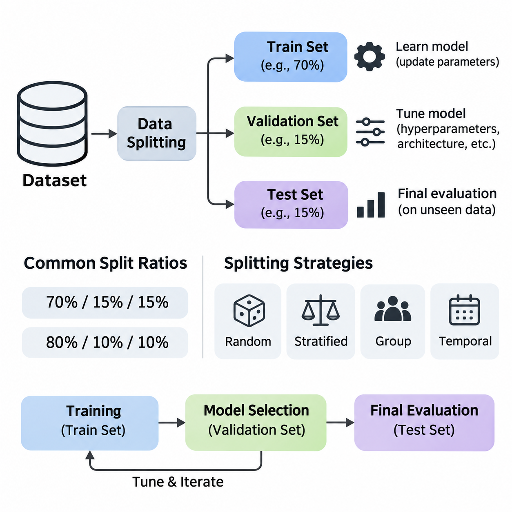
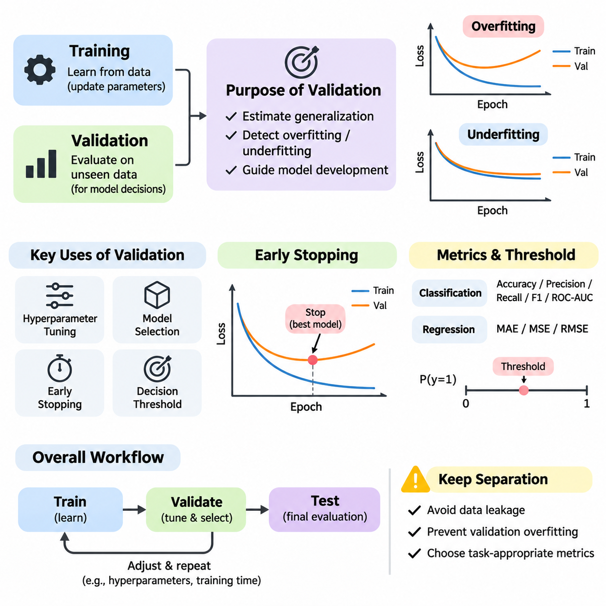
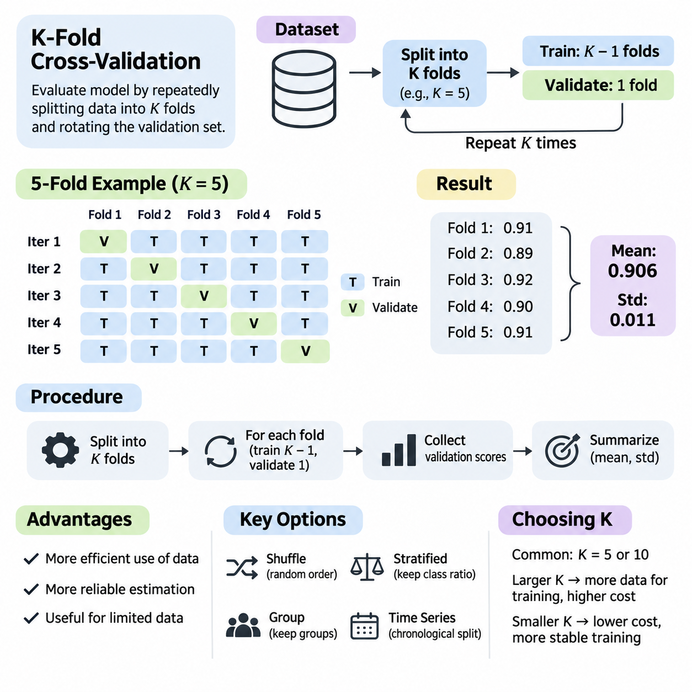
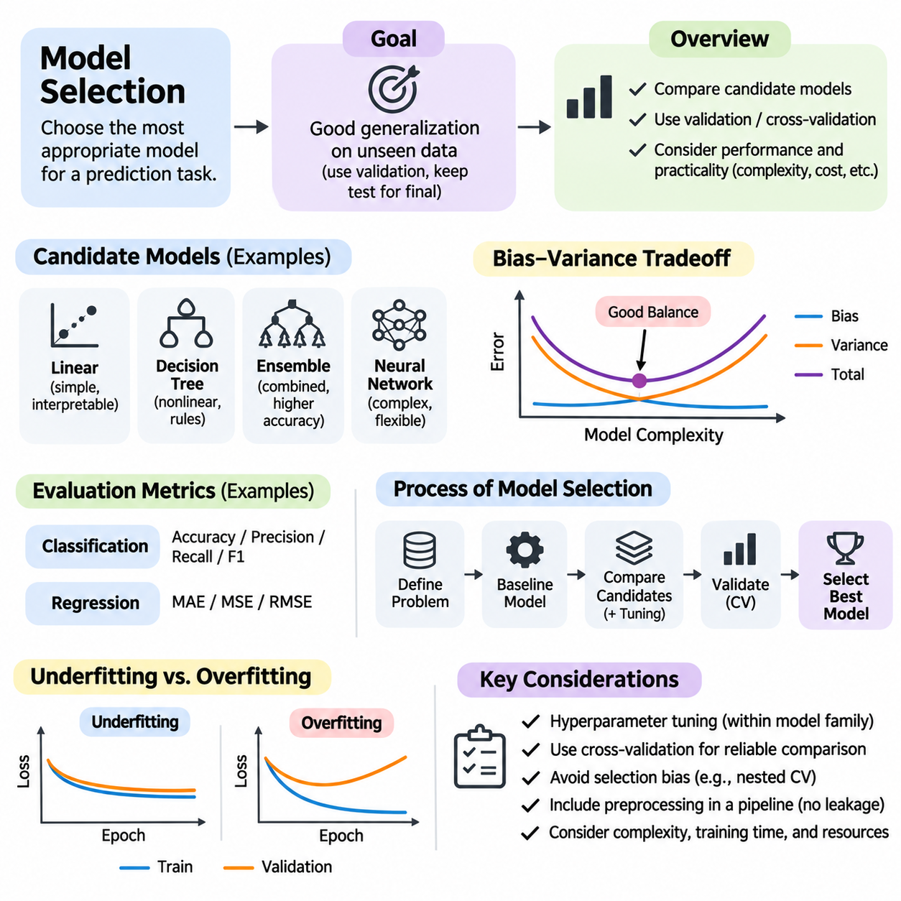
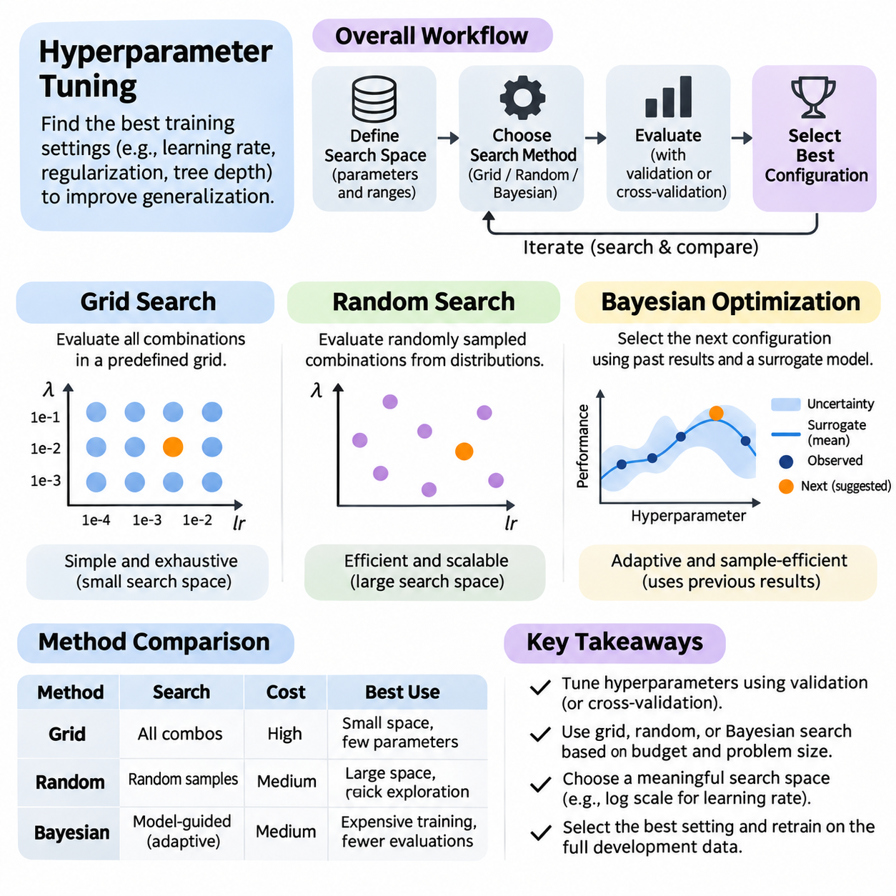
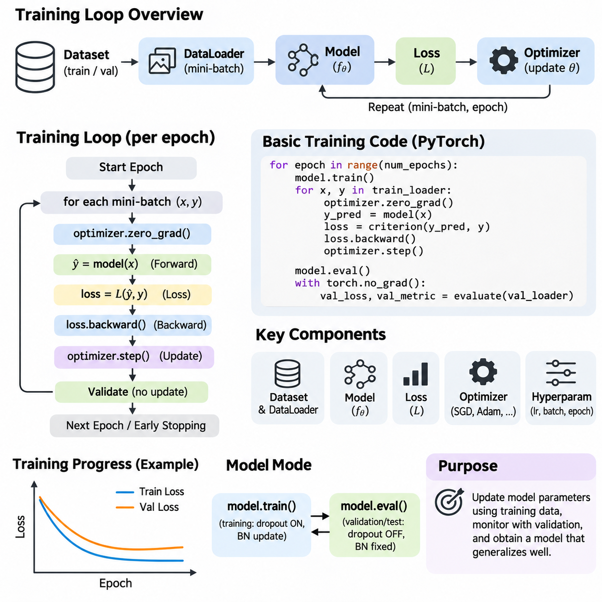
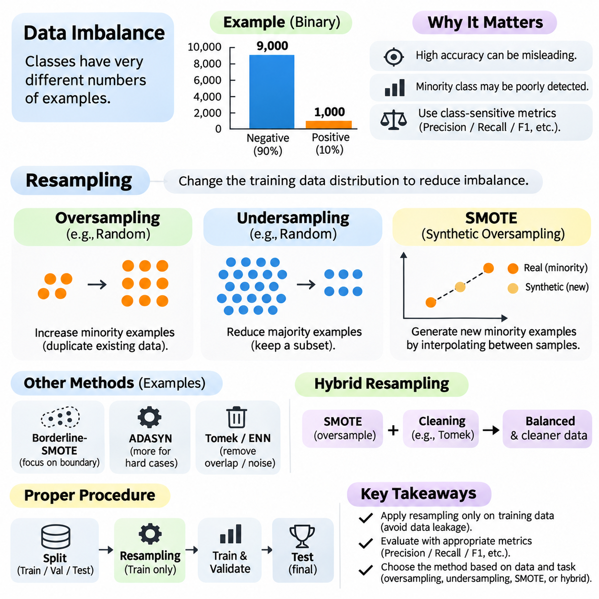
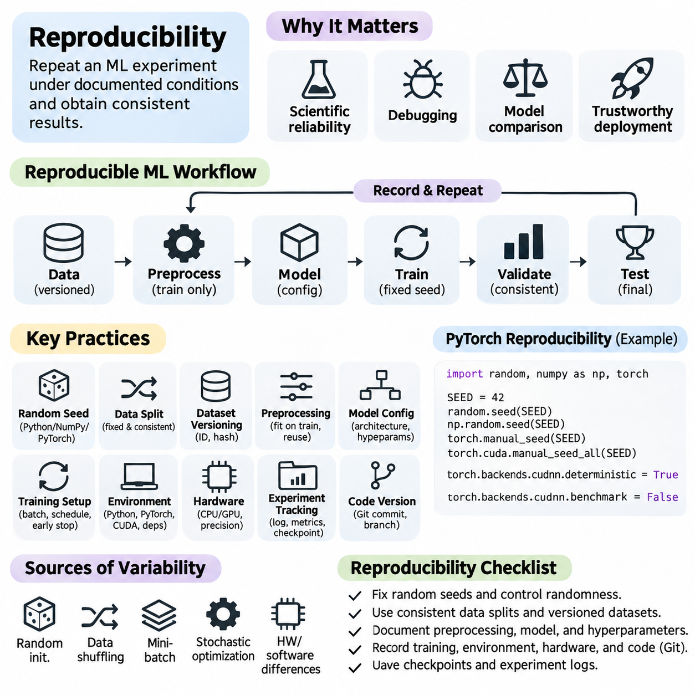

**Volume 07. Machine Learning Fundamentals**

# 03. Training Validation and Test

## 03.00 Data Splitting

{width="7.268055555555556in" height="7.268055555555556in"}

Data splitting is a fundamental step in machine learning that separates an available dataset into distinct subsets for model training, validation, and testing. This separation enables developers to measure how well a model learns from observed examples and generalizes to unseen data. Without proper splitting, evaluation results may become misleading because the model can be assessed using information already encountered during training.

The training set contains examples used to estimate model parameters and learn relationships between input features and target labels. During training, an optimization algorithm adjusts the model to minimize a defined loss function. The training set usually represents the largest portion of the available data because sufficient examples are necessary to capture meaningful patterns, reduce estimation uncertainty, and support reliable learning.

The validation set provides an independent reference for evaluating model behavior during development. Unlike training examples, validation observations do not directly contribute to parameter updates in a conventional supervised learning workflow. Instead, validation performance guides decisions about model architecture, hyperparameters, regularization, and stopping criteria. Repeated validation helps identify configurations that generalize beyond the training data.

The test set is reserved for the final evaluation of a selected model after development decisions have been completed. Its primary purpose is to estimate predictive performance on previously unseen observations. Test examples must remain isolated from model fitting, feature selection, and hyperparameter optimization. Using test results repeatedly to modify a model compromises their independence and can produce overly optimistic performance estimates.

A common splitting strategy allocates 70 percent of observations to training, 15 percent to validation, and 15 percent to testing. Another widely used arrangement assigns 80 percent to training, 10 percent to validation, and 10 percent to testing. These proportions are practical starting points rather than universal requirements. Appropriate allocation depends on dataset size, task complexity, class distribution, and the precision required for performance estimation.

For a dataset containing 10,000 observations, a 70/15/15 split produces 7,000 training examples, 1,500 validation examples, and 1,500 test examples. The model learns from the first subset, development decisions rely on the second, and final performance is measured using the third. This arrangement provides a straightforward experimental structure while preserving separate data for learning, selection, and independent assessment.

Random splitting assigns observations to subsets using a randomized procedure. When examples are independent and identically distributed, random allocation can help produce subsets with similar statistical characteristics. However, randomness alone does not guarantee representative distributions. Small datasets, rare categories, correlated observations, and systematic collection differences may create substantial variation between subsets, even when the splitting procedure is implemented correctly.

Stratified splitting preserves approximately the same class proportions across training, validation, and test subsets. This approach is particularly useful for classification problems involving imbalanced labels. For example, when positive cases represent only 5 percent of observations, stratification helps prevent a subset from containing too few positive examples. It improves class representation but does not eliminate other sampling biases or guarantee reliable evaluation of rare cases.

Group-based splitting becomes necessary when observations share a common source, subject, device, or experimental session. Multiple images from one patient or repeated measurements from one machine may contain strongly correlated information. Assigning related observations to different subsets can create leakage and inflate reported accuracy. Group splitting keeps observations from the same group together, allowing evaluation on genuinely independent subjects or sources.

Temporal splitting is appropriate when observations follow a chronological sequence, as in forecasting, financial modeling, and predictive maintenance. Training data should generally precede validation data, while test data should represent a later period. Randomly mixing past and future observations can introduce information unavailable at prediction time. Chronological separation better reproduces the operational conditions under which future predictions will be generated.

Data leakage occurs when information from validation or test observations influences model development in an inappropriate way. Leakage can arise through preprocessing, duplicated records, target-derived features, or overlapping groups. Even apparently harmless operations, such as calculating normalization statistics using the entire dataset, can expose information from held-out observations. Preventing leakage requires maintaining clear boundaries throughout the complete machine learning pipeline.

Preprocessing operations that learn statistics or parameters from data should generally be fitted using the training subset alone. Examples include standardization, missing-value imputation, feature selection, and dimensionality reduction. The resulting transformations are then applied to validation and test observations without refitting. This procedure ensures that evaluation reflects how a deployed system would process new inputs using information obtained during training.

Data augmentation requires similar attention because transformed versions of the same original observation may remain highly correlated. If augmented images are distributed across training and test subsets, the model may recognize familiar visual structures rather than demonstrate genuine generalization. A safer procedure is to split original observations first and apply training augmentation only within the training subset. Evaluation transformations should remain consistent and controlled.

In Python, scikit-learn provides the train_test_split function for constructing randomized training and evaluation subsets. A three-way split can be implemented through two successive operations. The first separates the final test set, while the second divides the remaining observations into training and validation subsets. The second split ratio must be adjusted to achieve the desired overall proportions rather than applying the original percentage again.

For example, an initial split with test_size equal to 0.15 reserves 15 percent of the complete dataset for testing. The remaining 85 percent can then be divided by assigning approximately 0.17647 of that remainder to validation. This produces an overall allocation close to 70/15/15. A fixed random_state value makes the randomized partition reproducible, allowing subsequent experiments to use identical data assignments.

Reproducibility is essential because different random partitions can produce different performance estimates. Recording the random seed, splitting algorithm, dataset version, and sample identifiers allows experiments to be repeated and audited. However, fixing a seed does not eliminate sampling uncertainty. Evaluating several appropriate partitions or using cross-validation can provide additional evidence about the stability of model performance.

Cross-validation extends the idea of validation by repeatedly dividing development data into training and validation folds. Each iteration trains a model using one portion and evaluates it using another. Aggregating the results provides a broader assessment of model selection stability. When a separate test set exists, it should remain untouched throughout cross-validation and be used only after the final configuration has been selected.

Dataset size strongly influences the splitting strategy. Large datasets may provide reliable evaluation estimates even when relatively small percentages are reserved for validation and testing. Small datasets require greater care because holding out too many observations can weaken training, while holding out too few can make performance estimates unstable. Cross-validation, uncertainty reporting, and task-specific sampling strategies become especially valuable under limited-data conditions.

Representative sampling also requires consideration of deployment conditions. A dataset collected from multiple geographic regions, camera systems, or manufacturing environments may contain meaningful distribution differences. If deployment involves previously unseen environments, evaluation should include appropriately separated environmental groups. A randomly mixed test set may measure interpolation within familiar conditions rather than the robustness required for real-world operation.

Class imbalance introduces additional challenges when rare events are central to the prediction task. Stratification can preserve class frequencies, but the number of rare observations may still be insufficient for precise performance estimation. Evaluation design should consider whether the test set contains enough examples of important outcomes. Resampling or synthetic-data generation, when used, must be restricted to training data to avoid contaminating evaluation.

A reliable splitting workflow begins by identifying the prediction objective and the unit of independence. Developers then examine duplicates, class distributions, temporal relationships, and group membership before selecting a partitioning strategy. Once the subsets are established, their identifiers and metadata should be preserved. Subsequent preprocessing, model training, and selection procedures must respect these boundaries to maintain experimental validity.

The final test evaluation should report metrics appropriate to the problem, together with relevant information about the evaluation dataset. Classification tasks may use accuracy, precision, recall, and F1 score, while regression tasks may use mean absolute error or mean squared error. Where appropriate, confidence intervals can communicate estimation uncertainty. Performance interpretation must also consider whether the test distribution resembles the intended deployment environment.

After model selection, developers may retrain the chosen configuration using combined training and validation data, provided that the test set remains isolated and the procedure is defined appropriately. This can increase the information available for final parameter estimation. However, any additional changes driven by test performance invalidate the interpretation of the test set as an independent final assessment and may require a new evaluation dataset.

Effective train-validation-test splitting is therefore more than a mechanical division of observations. It establishes the experimental boundaries that distinguish learning, development decisions, and final performance assessment. A carefully designed split protects against leakage, supports reproducibility, and provides credible evidence of generalization. These principles form the foundation for trustworthy model selection, evaluation, and deployment in practical machine learning systems.

## 03.01 Why Validation

{width="7.268055555555556in" height="7.268055555555556in"}

Validation is a fundamental component of machine learning that evaluates how effectively a trained model performs on data not used for parameter optimization. While training measures the ability to learn patterns from observed examples, validation examines whether those patterns remain useful beyond the training dataset. This distinction is essential because strong training performance does not necessarily indicate reliable predictions on unseen observations.

The primary purpose of validation is to estimate generalization performance during model development. A model may achieve extremely low training error by memorizing individual examples rather than learning meaningful relationships. Validation provides an independent reference that helps distinguish genuine learning from memorization. By comparing training and validation performance, developers can identify potential weaknesses before conducting final testing.

Overfitting occurs when a model becomes excessively specialized to its training data, including noise and accidental correlations. Such a model may demonstrate excellent training accuracy while producing significantly worse validation results. A growing difference between training and validation performance often indicates overfitting. Monitoring this difference helps developers determine whether model complexity or training duration should be adjusted.

Underfitting represents the opposite problem, where a model fails to capture important patterns even within its training data. Both training and validation performance may remain poor because the model lacks sufficient capacity, suitable features, or effective optimization. Validation results help distinguish underfitting from overfitting when interpreted alongside training metrics. This distinction supports more appropriate decisions about improving model performance.

Validation plays a central role in hyperparameter tuning because many important training settings cannot be learned directly through ordinary parameter optimization. Examples include learning rate, batch size, regularization strength, network depth, and tree complexity. Developers compare candidate configurations using validation performance and select settings that provide a favorable balance between predictive accuracy, computational cost, and generalization.

Model selection also depends on validation because different algorithms may exhibit substantially different behavior on the same dataset. A linear model, decision tree, ensemble method, and neural network can achieve different levels of predictive performance and complexity. Evaluating these alternatives on a common validation dataset supports systematic comparison. The selected model should satisfy both predictive requirements and practical constraints.

Validation is particularly important when deciding how long a model should continue training. During iterative optimization, training loss often decreases continuously, while validation loss may eventually stop improving. Continuing beyond this point can increase overfitting. Early stopping uses validation performance to determine when training should terminate, potentially improving generalization while reducing unnecessary computation.

A typical early stopping procedure evaluates validation loss after each training epoch and records the best observed result. If validation performance fails to improve for a specified number of epochs, known as patience, training is stopped. The model parameters associated with the best validation result may then be restored. This approach provides a practical mechanism for controlling training duration without relying exclusively on training loss.

Validation metrics must reflect the actual objective of the machine learning task. Classification problems may require accuracy, precision, recall, F1 score, or area under the ROC curve. Regression problems commonly use mean absolute error, mean squared error, or related measures. Choosing an inappropriate validation metric can favor a model that performs well numerically but fails to satisfy important application requirements.

For imbalanced classification, validation accuracy alone may be misleading because a model can achieve high accuracy by predicting the majority class. Precision and recall provide additional information about false positive and false negative predictions. In applications involving rare defects or critical events, recall may be especially important. Validation therefore requires selecting metrics that reflect the consequences of different prediction errors.

Validation also supports the selection of decision thresholds for probabilistic classifiers. A model may output the estimated probability of a positive class, but a threshold is required to convert that probability into a categorical prediction. Different thresholds produce different tradeoffs between precision and recall. Validation data can be used to select a threshold that meets operational requirements without using the final test dataset.

A reliable validation process requires separation between training and evaluation information. Data leakage occurs when information from validation observations influences training inappropriately. For example, fitting a normalization transformation using the entire dataset exposes statistics from validation examples. Preprocessing parameters should generally be estimated using training data and then applied unchanged to validation observations.

Repeated use of the same validation dataset introduces another important limitation. Although validation examples are not directly used for ordinary parameter updates, repeated experimentation can indirectly adapt model development decisions to their specific characteristics. This process is sometimes called validation overfitting. As the number of experiments increases, the selected configuration may perform unusually well on validation data without providing equivalent improvements on new observations.

Cross-validation reduces dependence on a single partition by evaluating candidate models across multiple training and validation subsets. In K-fold cross-validation, the development dataset is divided into K folds, and each fold serves as validation data once. Performance measurements are aggregated to estimate model stability. This approach is particularly useful when available data is limited or results vary substantially across different random splits.

Validation strategies must also respect the structure of the underlying data. Random splitting is appropriate only when observations can reasonably be treated as independent and similarly distributed. Time-series forecasting requires chronological validation to prevent future information from influencing earlier predictions. Group-based validation keeps related observations together, preventing overly optimistic results caused by shared subjects, devices, or collection sessions.

Distribution differences between training and validation datasets can reveal limitations in model robustness. For example, a vision model trained under controlled lighting may perform poorly on images collected under different illumination conditions. Such results indicate that the learned representation may depend on environmental characteristics. Validation across relevant operating conditions helps identify weaknesses that ordinary random evaluation might overlook.

Validation curves provide additional insight into model behavior during development. Plotting training and validation loss across epochs can reveal convergence patterns, overfitting, and unstable optimization. Comparing performance across model capacities or regularization strengths can expose sensitivity to configuration choices. These observations support more informed adjustments than relying on a single final accuracy value.

The size and composition of the validation dataset influence the reliability of its conclusions. A very small validation set may produce unstable performance estimates, especially when rare classes are present. A larger validation set generally improves estimation precision but reduces the data available for training. Developers must balance these competing requirements according to dataset size, task complexity, and the importance of accurate model comparison.

Validation should be distinguished from final testing because the two stages serve different purposes. Validation guides model development, while testing evaluates the selected system after development decisions have been completed. Using test results to repeatedly adjust model configurations effectively turns the test set into another validation set. Maintaining this distinction protects the credibility of the final reported performance.

After selecting a model and its hyperparameters, developers may retrain the final configuration using combined training and validation data. This allows the model to benefit from additional examples before deployment. However, the final test set must remain independent, and any retraining procedure should follow previously established decisions. The resulting model can then be evaluated once using the reserved test observations.

In production-oriented machine learning, validation should also consider practical requirements beyond predictive accuracy. Inference latency, memory consumption, computational cost, robustness, and operational constraints may influence model selection. A highly accurate model may be unsuitable if it exceeds available hardware resources or fails to meet response-time requirements. Validation therefore connects statistical evaluation with practical system engineering.

Ultimately, validation provides the evidence needed to make informed decisions throughout machine learning development. It helps detect overfitting and underfitting, supports hyperparameter tuning, guides model selection, and controls training duration. When designed carefully and kept separate from final testing, validation improves the likelihood that selected models will perform reliably on unseen data and under realistic deployment conditions.

## 03.02 Cross Validation

{width="7.268055555555556in" height="7.268055555555556in"}

Cross-validation is a statistical evaluation technique used to estimate how well a machine learning model generalizes to unseen data. Instead of relying on a single training and validation split, cross-validation repeatedly evaluates the model using different subsets of the available development dataset. This approach provides a broader understanding of predictive performance and reduces dependence on one potentially unrepresentative partition.

K-fold cross-validation is one of the most widely used validation methods in supervised machine learning. The dataset is divided into K approximately equal, non-overlapping subsets called folds. During each iteration, one fold serves as the validation set, while the remaining K minus one folds form the training set. The process continues until every fold has been used exactly once for validation.

For example, five-fold cross-validation divides the development dataset into five subsets. The model is trained five separate times, each time using four folds for training and the remaining fold for validation. Every observation contributes to validation exactly once and participates in training during the other four iterations. The resulting validation scores are combined to summarize performance across different partitions.

The primary advantage of K-fold cross-validation is more efficient use of limited data. A conventional holdout method reserves a fixed portion for validation, reducing the examples available for training. K-fold cross-validation rotates the validation subset so that every observation contributes to both training and evaluation across separate iterations. This is particularly valuable when collecting additional labeled examples is expensive or difficult.

The number of folds, K, determines the balance between computational cost and evaluation behavior. Common choices include five-fold and ten-fold cross-validation. With five folds, each model is trained using approximately 80 percent of the development data. With ten folds, approximately 90 percent is used for training during each iteration. Larger K values generally increase computational requirements because more models must be fitted.

Selecting K involves practical tradeoffs. Smaller values reduce training time but evaluate models trained on smaller fractions of the available dataset. Larger values provide training subsets closer to the complete development dataset but require additional computation. The optimal choice depends on dataset size, model complexity, training cost, and evaluation objectives. No single value is universally appropriate for every machine learning problem.

Cross-validation performance is commonly summarized using the mean of the validation scores across folds. If five validation accuracies are obtained, their arithmetic mean provides an overall estimate of performance under the selected partitioning procedure. The standard deviation can also be reported to describe variation between folds. However, fold scores are statistically dependent, so their standard deviation should not automatically be interpreted as a confidence interval.

A reliable K-fold procedure requires training a fresh model independently for each fold. Model parameters learned during one iteration must not carry over into subsequent iterations because doing so would expose information from previous validation subsets. Each iteration should begin with an appropriately initialized estimator and use only its designated training observations. This separation preserves the intended evaluation structure.

Preprocessing must also be performed independently within each cross-validation iteration. Operations such as standardization, missing-value imputation, feature selection, and dimensionality reduction can learn information from their input data. Fitting these transformations before creating the folds introduces data leakage. Instead, preprocessing parameters should be learned from each training fold and applied unchanged to its corresponding validation fold.

Machine learning pipelines provide a convenient mechanism for maintaining these boundaries. In scikit-learn, a Pipeline can combine preprocessing transformations and an estimator into a single workflow. During cross-validation, each pipeline is fitted independently using the training observations of the current fold. This approach reduces implementation mistakes and ensures that transformations requiring fitted statistics remain isolated from validation data.

The scikit-learn library provides the KFold class for generating training and validation indices. A typical configuration specifies n_splits equal to five, optionally enables shuffling, and supplies a fixed random_state when reproducible randomized partitions are required. The split method produces index pairs identifying training and validation observations. These indices can then be used to fit models and calculate evaluation metrics.

Shuffling determines whether observations are randomly reordered before folds are constructed. When examples are independent and similarly distributed, shuffling may improve the balance of observations across folds. Without shuffling, KFold uses the existing sample order, which can be problematic when records are sorted by class or collection conditions. However, shuffling is not appropriate when chronological or group relationships must be preserved.

Standard K-fold cross-validation does not explicitly maintain class proportions. In classification problems with imbalanced labels, some folds may contain too few minority-class examples for meaningful evaluation. Stratified K-fold cross-validation addresses this issue by approximately preserving class frequencies across folds. It is often preferable for classification tasks where class imbalance could distort performance comparisons.

Grouped observations require a different strategy because ordinary K-fold splitting may place related samples in both training and validation subsets. Repeated measurements from the same patient, robot, or manufacturing device can share information that makes validation artificially easy. GroupKFold keeps observations from each group together within a single validation fold. This supports more realistic evaluation of generalization to previously unseen groups.

Time-dependent datasets also require special treatment. Random or ordinary K-fold partitions may train models on future observations while validating predictions for earlier periods. This violates the information constraints of many forecasting applications. TimeSeriesSplit provides an alternative in which training observations precede validation observations, better reflecting the chronological structure of real-world prediction tasks.

Cross-validation is especially useful for comparing candidate algorithms under consistent evaluation conditions. Linear regression, decision trees, random forests, and neural networks can be evaluated using the same folds and metrics. This makes performance differences easier to interpret because the models are assessed on comparable partitions. Nevertheless, computational cost, interpretability, and deployment requirements should also influence final model selection.

Hyperparameter tuning frequently uses cross-validation to compare candidate configurations. Grid search and randomized search can evaluate combinations of hyperparameters across multiple folds and aggregate the resulting scores. The configuration with the strongest average validation performance is selected according to the chosen metric. Because this selection adapts to cross-validation results, its reported score may still be optimistic.

Nested cross-validation provides a more rigorous approach when model selection and performance estimation must be separated. An inner cross-validation loop selects hyperparameters, while an outer loop evaluates the complete selection procedure on held-out folds. This reduces bias caused by evaluating a model using the same observations that guided its configuration. However, nested cross-validation can be computationally expensive.

Cross-validation does not eliminate the need for an independent test set when a final unbiased assessment is required. A common workflow reserves test observations before development and performs cross-validation only on the remaining data. After selecting the model and hyperparameters, the chosen configuration is fitted using the available development dataset. The reserved test set is then used for final evaluation without further tuning.

Repeated K-fold cross-validation extends the basic procedure by generating multiple randomized fold partitions. Each repetition provides another collection of validation scores, allowing developers to examine sensitivity to random partitioning. This can be useful when datasets are small or performance varies substantially between splits. However, repeated folds remain statistically dependent and do not create additional independent observations.

The reliability of cross-validation depends on whether the folds represent the intended prediction environment. Random folds may provide optimistic results when deployment involves new geographic regions, devices, subjects, or operating conditions. Evaluation should therefore reproduce the independence assumptions and distribution changes expected during deployment. Choosing the correct splitting strategy is often more important than increasing the number of folds.

Computational efficiency becomes important when cross-validation involves expensive models. Training a deep neural network ten times may require substantially more resources than fitting a single model. Parallel execution, smaller candidate searches, and carefully selected fold counts can reduce evaluation cost. However, computational shortcuts should not compromise the independence of training and validation observations or introduce information leakage.

Ultimately, K-fold cross-validation provides a systematic framework for evaluating generalization, comparing models, and selecting hyperparameters. Its rotating validation structure makes effective use of available data while revealing variation across partitions. When combined with leakage-free preprocessing, appropriate fold construction, and independent final testing, cross-validation supports more reliable and reproducible machine learning development.

## 03.03 Model Selection

{width="7.268055555555556in" height="7.268055555555556in"}

Model selection is the process of identifying the most appropriate machine learning model for a specific prediction task. Different algorithms can learn different relationships from the same dataset, producing variations in accuracy, complexity, interpretability, and computational requirements. Effective model selection therefore requires more than choosing the model with the highest training score. It requires evaluating generalization and practical suitability.

The central objective of model selection is to identify a model that performs reliably on unseen observations. A model may fit its training examples extremely well while failing to generalize to new data. Validation provides the evidence needed to compare candidate models without relying on their training performance alone. A separate test dataset should remain untouched until the selection process is complete, preserving an independent final assessment.

Model selection begins with a clear definition of the learning problem and its evaluation objectives. Classification, regression, forecasting, and anomaly detection require different algorithms and performance measures. Developers must identify the target variable, input features, available data, and expected deployment conditions. These requirements establish the criteria against which candidate models should be compared.

A baseline model provides an essential reference for evaluating more sophisticated alternatives. For classification, a baseline might predict the majority class or use logistic regression. For regression, it might predict the training mean or use a simple linear model. If a complex algorithm cannot substantially improve upon a reasonable baseline, its additional computational and operational costs may not be justified.

Candidate models should represent meaningful alternatives rather than arbitrary combinations of algorithms. Linear models provide simple and interpretable relationships, while decision trees capture nonlinear patterns through hierarchical rules. Ensemble methods combine multiple learners to improve predictive performance, and neural networks can represent complex relationships. Their suitability depends on data characteristics and application requirements.

Validation performance is the primary quantitative basis for comparing candidate models during development. A consistent validation split or cross-validation procedure should be applied to all candidates. Using identical evaluation metrics and comparable data partitions helps reduce differences caused by experimental design. This allows observed performance differences to reflect model behavior more clearly.

Cross-validation strengthens model comparison by evaluating each candidate across multiple training and validation partitions. K-fold cross-validation produces several validation scores for each model, which can be summarized using their mean and variability. A model with slightly lower average performance but greater stability may be preferable to one with highly variable results, especially in applications requiring predictable behavior.

The choice of evaluation metric directly influences which model is selected. Accuracy may be suitable for balanced classification, while precision, recall, or F1 score may better reflect the requirements of imbalanced problems. Regression models may be compared using mean absolute error or mean squared error. Metrics should represent the actual consequences of prediction errors rather than numerical convenience alone.

Model complexity introduces an important tradeoff between flexibility and generalization. Highly flexible models can capture intricate patterns but may also learn noise and accidental correlations. Simpler models may generalize more consistently when data is limited. This relationship is often described through the bias-variance tradeoff, which helps explain why increasing complexity does not always improve performance.

Underfitting and overfitting provide practical signals during model selection. A model that performs poorly on both training and validation data may lack sufficient capacity or useful features. A model with excellent training performance but weak validation results may be excessively specialized. Comparing these patterns across candidates helps developers decide whether to increase complexity, strengthen regularization, or improve data quality.

Hyperparameter tuning and model selection are closely related but conceptually distinct. Model selection determines which algorithm or model family is appropriate, while hyperparameter tuning identifies effective settings within that family. In practice, developers often compare several model families with multiple configurations. These decisions should be evaluated through a consistent validation procedure to avoid misleading comparisons.

Repeatedly selecting models based on the same validation data can introduce selection bias. As more candidates are tested, some may achieve unusually strong validation scores because of random variation rather than genuine superiority. This effect is sometimes called validation overfitting. Nested cross-validation can reduce such bias by separating the process of choosing models from the process of estimating their performance.

Data preprocessing must be incorporated consistently into model comparisons. Scaling, missing-value imputation, feature selection, and dimensionality reduction may affect different algorithms in different ways. Any transformation that learns from data must be fitted using training observations only. Pipelines help ensure that preprocessing is repeated independently within each validation fold, preventing information leakage.

Computational efficiency is another important selection criterion. Some models require substantial training time, memory capacity, or specialized hardware. Others provide sufficiently accurate predictions with much lower resource consumption. In production systems, inference latency and throughput may be as important as validation accuracy. A model that cannot satisfy operational constraints may be unsuitable despite strong predictive results.

Interpretability can influence model selection when users must understand or justify predictions. Linear models and small decision trees often provide relatively transparent decision mechanisms. Complex ensembles and deep neural networks may offer stronger predictive performance but require additional explanation methods. The appropriate balance depends on regulatory requirements, application risk, and the needs of decision-makers.

Robustness describes a model\'s ability to maintain useful performance under realistic changes in input conditions. A model selected using only one data distribution may fail when sensors, environments, or user populations change. Evaluating candidates across relevant subgroups and operating conditions can reveal weaknesses hidden by aggregate metrics. Robustness should therefore be considered alongside average predictive performance.

Fairness and reliability may also affect model selection, particularly when predictions influence important decisions. Aggregate accuracy can conceal systematic performance differences between relevant populations or operating groups. Developers should examine subgroup metrics, error patterns, and uncertainty where appropriate. Selection criteria should reflect the consequences of model failures rather than treating every error as equally important.

A structured model selection experiment should record candidate algorithms, preprocessing steps, hyperparameters, validation partitions, random seeds, and evaluation metrics. Reproducible experiments make it possible to compare results fairly and investigate unexpected differences. Maintaining consistent records also supports collaboration, auditing, and later improvements when datasets or operational requirements change.

Statistical uncertainty should be considered when candidate models achieve similar validation scores. Small numerical differences may result from sampling variation rather than meaningful improvements. Confidence intervals, repeated evaluations, or paired comparisons can provide additional context when their assumptions are appropriate. Developers should avoid declaring one model superior solely because its reported metric is marginally higher.

A practical selection strategy often begins with simple baselines and gradually introduces more sophisticated candidates. Initial experiments identify whether the dataset contains learnable patterns and establish reference performance. More complex models are then evaluated only when they offer a plausible benefit. This incremental approach limits unnecessary experimentation and makes performance improvements easier to interpret.

After selecting a model family and its hyperparameters, developers may retrain the chosen configuration using the combined training and validation data. This allows the final model to learn from additional observations. The independent test dataset is then used to estimate performance after development decisions are finalized. If test results trigger further model changes, a new independent evaluation may be required.

Model selection should ultimately reflect the complete operating context rather than a single performance metric. Predictive quality, stability, computational cost, interpretability, robustness, and deployment constraints jointly determine suitability. A slightly less accurate model may be preferable when it is substantially faster, simpler, or more reliable. These tradeoffs should be established before final evaluation.

Effective model selection transforms machine learning development from trial-and-error experimentation into a systematic decision process. By combining baselines, consistent validation, careful metric selection, leakage prevention, and operational requirements, developers can identify models that generalize beyond training data. The result is a more defensible and reproducible foundation for reliable machine learning deployment.

## 03.04 Hyperparameter Tuning

{width="7.268055555555556in" height="7.268055555555556in"}

Hyperparameter tuning is the process of selecting configuration settings that control how a machine learning algorithm learns from data. Unlike model parameters, which are estimated during training, hyperparameters are specified before or around the training procedure. Examples include learning rate, regularization strength, tree depth, batch size, and network architecture. Appropriate tuning improves generalization, training stability, and computational efficiency.

The objective of hyperparameter optimization is to identify configurations that perform well on validation data rather than merely minimizing training error. Each candidate configuration defines a training experiment whose performance is measured using a consistent evaluation metric. Cross-validation can provide more reliable estimates by evaluating candidates across multiple partitions. The final test dataset must remain independent throughout optimization.

A hyperparameter search space defines the values or distributions considered during optimization. Continuous parameters include learning rates and regularization coefficients, while discrete parameters include tree depth and numbers of layers. Categorical choices may represent optimizers or activation functions. Search spaces should reflect domain knowledge, computational limits, and meaningful ranges rather than arbitrary combinations.

Grid search is a systematic optimization method that evaluates every combination of values specified in a predefined parameter grid. If three learning rates, four regularization strengths, and two model configurations are provided, grid search evaluates twenty-four combinations. Each candidate is trained and validated under the same evaluation procedure. The configuration achieving the strongest validation score is selected.

The main advantage of grid search is its simplicity and reproducibility. Because every predefined combination is evaluated, the search procedure is transparent and easy to inspect. Results can reveal how performance changes across specific parameter values and interactions. Grid search is particularly useful when the number of parameters is small and the candidate ranges are sufficiently narrow to permit exhaustive evaluation.

Grid search becomes computationally expensive as the number of parameters and candidate values increases. This problem is known as the curse of dimensionality. Adding another parameter multiplies the total number of combinations by the number of values considered for that parameter. Consequently, exhaustive search becomes impractical for large neural networks or models with many interacting hyperparameters.

In scikit-learn, GridSearchCV combines parameter grid evaluation with cross-validation. Developers specify an estimator, a dictionary of candidate values, a scoring metric, and the number of validation folds. The procedure trains candidate models across the requested combinations and records their scores. The best configuration can then be retrieved and, by default, refitted on the complete development dataset supplied to the search.

Random search addresses the limitations of exhaustive grids by sampling hyperparameter combinations from predefined distributions. Rather than evaluating every possible combination, it tests a specified number of randomly selected configurations. This allows developers to control computational cost directly. Random search can explore broad parameter ranges without requiring a dense grid across every dimension.

The effectiveness of random search comes from its ability to explore more distinct values of influential parameters within a fixed evaluation budget. In many problems, only a subset of hyperparameters strongly affects model performance. A grid may repeatedly test unimportant dimensions while examining relatively few values of important ones. Random sampling can provide better coverage when the search space is large.

RandomizedSearchCV implements random search with cross-validation in scikit-learn. Developers define parameter distributions, select the number of sampled configurations through n_iter, and specify the evaluation metric. A fixed random_state supports reproducibility when the sampling process is randomized. Each sampled configuration is evaluated using the selected validation strategy, allowing systematic comparison under a controlled budget.

The choice of sampling distribution is important for random search. Learning rates and regularization strengths often span several orders of magnitude, making logarithmic sampling more appropriate than uniform sampling over raw values. Integer parameters may use bounded discrete distributions, while categorical parameters can be sampled from predefined alternatives. Poorly designed distributions can waste evaluations on implausible configurations.

Bayesian optimization provides a more adaptive approach by using previous evaluation results to guide the selection of future hyperparameters. Instead of sampling configurations independently, it constructs a probabilistic surrogate model of the relationship between hyperparameters and validation performance. This surrogate estimates promising regions and uncertainty, allowing the optimization procedure to make informed decisions about subsequent experiments.

A typical Bayesian optimization process begins by evaluating several initial configurations. Their observed validation scores are used to fit a surrogate model, such as a Gaussian process or a tree-based probabilistic estimator. An acquisition function then determines which configuration should be evaluated next. After the new result is observed, the surrogate is updated, and the process continues until the search budget is exhausted.

Acquisition functions balance exploration and exploitation during Bayesian optimization. Exploration investigates uncertain regions that may contain better configurations, while exploitation focuses on regions already predicted to perform well. Common acquisition strategies include expected improvement, probability of improvement, and upper confidence bound. The appropriate strategy depends on uncertainty estimates, optimization objectives, and evaluation costs.

Bayesian optimization is particularly attractive when each model evaluation is expensive. Training deep neural networks, performing complex simulations, or evaluating large datasets may require substantial computation. By adapting the search based on accumulated evidence, Bayesian optimization can sometimes identify strong configurations using fewer evaluations than grid or random search. However, its effectiveness depends on surrogate quality and search-space structure.

Bayesian optimization also introduces additional complexity. Surrogate models and acquisition functions require computational resources, and optimization behavior can depend on initialization and modeling assumptions. High-dimensional, highly conditional, or noisy search spaces may be difficult to model accurately. Consequently, Bayesian optimization is not universally superior, particularly when evaluations are inexpensive or extensive parallel execution is available.

Grid search, random search, and Bayesian optimization represent different strategies for allocating evaluation resources. Grid search provides exhaustive coverage of a predefined discrete space, random search provides flexible exploration under a fixed budget, and Bayesian optimization uses previous results to guide future trials. Their relative effectiveness depends on parameter dimensionality, evaluation cost, parallelism, and the structure of the objective function.

A fair comparison of tuning strategies requires consistent validation procedures and evaluation budgets. Each method should use comparable training data, scoring metrics, and computational constraints. Differences in the number of trials or validation folds can otherwise distort conclusions. Reporting both predictive performance and total optimization cost provides a more complete assessment of the efficiency of each search method.

Data leakage must be prevented throughout hyperparameter tuning. Preprocessing transformations that estimate statistics from data should be fitted separately within each training fold. Validation observations must not influence feature selection, normalization, or model fitting. Pipelines help enforce these boundaries. Repeated optimization against the same validation data can still produce selection bias, even when direct leakage is avoided.

Nested cross-validation can provide a more rigorous estimate of performance after extensive tuning. The inner loop searches for effective hyperparameters, while the outer loop evaluates the complete tuning procedure on unseen folds. This separates configuration selection from performance estimation. Although computationally demanding, nested evaluation is valuable when unbiased model comparison is more important than minimizing experimentation cost.

Practical tuning also requires managing training resources and experimental reproducibility. Developers should record search spaces, sampled configurations, random seeds, validation scores, training durations, and software versions. Early stopping and resource-aware scheduling can reduce wasted computation on weak candidates. However, these mechanisms must be applied consistently to avoid introducing unfair comparisons or evaluation bias.

After tuning is complete, the selected configuration may be trained using the combined development data before final testing. The independent test dataset is then used to assess generalization without further optimization. A strong tuning workflow therefore combines meaningful search spaces, appropriate validation, controlled computational budgets, and reproducible experiments. These principles support efficient model development and reliable deployment decisions.

## 03.05 Training Loop

{width="7.268055555555556in" height="7.268055555555556in"}

A training loop is the central computational process through which a machine learning model progressively improves its parameters using observed data. It repeatedly performs prediction, loss calculation, gradient computation, and parameter updates. These operations transform an initially untrained model into a system capable of recognizing useful patterns. A well-designed training loop also supports monitoring, validation, reproducibility, and efficient resource utilization.

The training process begins by defining a dataset, model architecture, loss function, and optimization algorithm. The dataset provides input features and target values, while the model maps inputs to predictions. The loss function measures prediction errors, and the optimizer determines how model parameters should change. Together, these components establish the computational foundation for iterative learning.

Training data is commonly organized into mini-batches rather than processed entirely at once. A mini-batch contains a subset of training examples used to calculate one parameter update. This approach reduces memory requirements and supports efficient computation on modern hardware. Batch size influences gradient variability, training speed, and memory consumption, making it an important hyperparameter in practical training systems.

An epoch represents one complete traversal of the training dataset. During each epoch, the training loop processes successive mini-batches and updates model parameters repeatedly. Multiple epochs allow the model to refine its predictions as optimization progresses. However, additional epochs do not always improve generalization, making validation monitoring essential for determining an appropriate training duration.

The forward pass is the first computational stage within each training iteration. Input tensors are passed through the model to generate predictions using its current parameters. In neural networks, successive layers transform input representations through weighted operations and activation functions. The resulting outputs are compared with target values to determine how well the model performs on the current mini-batch.

Loss calculation converts prediction differences into a numerical optimization objective. Classification tasks commonly use cross-entropy loss, while regression tasks may use mean squared error or mean absolute error. The selected loss function should reflect the learning objective and output representation. Its value provides the signal needed to calculate gradients and guide subsequent parameter updates.

Backpropagation computes gradients of the loss with respect to trainable model parameters. Automatic differentiation frameworks such as PyTorch construct computational graphs that support efficient gradient calculation. The resulting gradients indicate how small parameter changes affect the loss locally. These derivatives enable gradient-based optimizers to improve model predictions through repeated updates.

The optimizer applies parameter updates based on calculated gradients. Stochastic gradient descent adjusts parameters in directions intended to reduce the loss, while adaptive optimizers such as Adam maintain additional statistics to modify update behavior. Learning rate controls the magnitude of parameter changes and strongly influences convergence. An unsuitable learning rate can cause unstable training or unnecessarily slow progress.

A typical PyTorch training iteration follows a consistent sequence. The optimizer first clears gradients accumulated from previous iterations using zero_grad. The model then performs a forward pass, the loss function calculates prediction error, and backward computes gradients. Finally, optimizer.step updates trainable parameters. Repeating this sequence across mini-batches forms the essential structure of basic training code.

Gradient clearing is necessary because PyTorch accumulates gradients by default. Without resetting them, gradients from previous mini-batches would contribute to subsequent updates, potentially changing the intended optimization behavior. Explicit gradient accumulation can be useful when hardware memory limits prevent large batch sizes. However, it must be implemented deliberately with appropriate loss scaling and update scheduling.

Data loaders automate mini-batch construction, optional shuffling, and efficient data retrieval. In PyTorch, DataLoader connects a dataset to the training loop and provides batches through iteration. Shuffling training examples can reduce undesirable effects caused by fixed sample ordering. Validation and test loaders generally avoid unnecessary randomization, although their batch sizes may differ from the training configuration.

Training metrics should be aggregated carefully to represent performance across an entire epoch. When mini-batches have different sizes, averaging batch losses without weighting can distort the reported result. Accumulating each batch\'s mean loss multiplied by its sample count, then dividing by the total number of samples, produces a sample-weighted average when the loss is averaged per example. Consistent aggregation improves comparisons between epochs.

Validation is performed separately from parameter optimization to estimate generalization performance. The model processes validation examples and calculates metrics without applying optimizer updates. In PyTorch, model.eval activates evaluation behavior for components such as dropout and batch normalization. Using torch.no_grad prevents unnecessary gradient tracking and reduces memory consumption during ordinary validation.

After validation, model.train restores training behavior before the next training epoch. This distinction is important because some neural network components operate differently during training and evaluation. Dropout randomly suppresses activations during training but is normally disabled during evaluation. Batch normalization also changes how statistics are handled. Correct mode management helps ensure meaningful validation results.

A learning rate scheduler can adjust optimization behavior as training progresses. Some schedules gradually decrease the learning rate, while others modify it according to predefined cycles or validation performance. Scheduling may improve convergence and help stabilize later training stages. The scheduler must be updated at the appropriate frequency, such as after each optimizer step or epoch, depending on its design.

Early stopping uses validation performance to determine when additional training is unlikely to be beneficial. If validation loss fails to improve for a specified number of epochs, training may terminate before reaching the maximum epoch count. This can reduce overfitting and unnecessary computation. The best-performing model state is often preserved so that the final selected parameters correspond to the strongest validation result.

Checkpointing saves model states during training to support recovery and later evaluation. A checkpoint may contain model parameters, optimizer state, scheduler state, current epoch, and relevant configuration information. Saving only model weights may be sufficient for inference, but reliable training resumption often requires additional state. Checkpoints should be associated with recorded validation metrics and experiment identifiers.

Reproducibility requires controlling sources of randomness and documenting experimental settings. Random seeds influence parameter initialization, data shuffling, and stochastic operations. Recording dataset versions, hyperparameters, software dependencies, and hardware configuration helps explain differences between runs. Deterministic execution can improve repeatability, although some operations and hardware environments may still produce numerical variation.

Training loops must also handle numerical stability and computational limitations. Extremely large gradients can destabilize optimization, while invalid numerical values may indicate inappropriate learning rates or problematic data. Gradient clipping can limit excessive gradient magnitudes. Mixed-precision training may improve throughput and reduce memory usage on compatible hardware, but it requires suitable numerical safeguards.

Monitoring provides visibility into training progress and helps identify failures before resources are wasted. Tracking training loss, validation loss, learning rate, gradient behavior, and elapsed time can reveal convergence problems or overfitting. Logs and experiment tracking systems preserve these observations for comparison across runs. Reliable monitoring transforms training from an opaque process into an inspectable computational workflow.

A basic training implementation should separate data preparation, model definition, optimization, validation, and checkpoint management into understandable components. Modular design makes it easier to replace models, losses, optimizers, or datasets without rewriting the entire workflow. Clear interfaces also support testing and debugging. Simplicity is particularly valuable when establishing a correct baseline before introducing advanced training techniques.

The training loop ultimately connects mathematical optimization with executable machine learning systems. Its repeated forward passes, loss evaluations, backward passes, and parameter updates enable models to learn from data. Validation, monitoring, checkpointing, and reproducibility controls extend this basic mechanism into a reliable development process. Correct implementation provides the foundation for more advanced and scalable training workflows.

## 03.06 Data Imbalance

{width="7.268055555555556in" height="7.268055555555556in"}

Data imbalance occurs when the classes in a machine learning dataset contain substantially different numbers of observations. In binary classification, one class may represent the overwhelming majority while the other contains relatively few examples. This situation commonly appears in fraud detection, medical diagnosis, equipment failure prediction, and anomaly detection. Imbalance can distort learning and evaluation when algorithms favor frequently observed classes.

A model trained on imbalanced data may achieve high overall accuracy while performing poorly on the minority class. For example, if 99 percent of observations belong to the negative class, predicting every example as negative produces 99 percent accuracy without detecting any positive cases. This demonstrates why accuracy alone is insufficient for evaluating imbalanced classification. Minority-class recall and other class-sensitive metrics are essential.

Class imbalance affects model training because majority-class observations often dominate the aggregate loss function. Their larger contribution can encourage decision boundaries that favor common examples while overlooking rare but important patterns. However, imbalance does not automatically imply poor performance. Its effects depend on class overlap, sample size, model capacity, loss weighting, and the operational consequences of prediction errors.

Resampling is a data-level strategy that changes the class distribution of training examples to reduce imbalance during learning. The two primary approaches are oversampling, which increases minority-class representation, and undersampling, which reduces majority-class representation. These methods can be used independently or combined. Their purpose is to improve learning conditions rather than guarantee balanced predictive performance.

Random oversampling increases minority-class representation by selecting existing minority examples repeatedly, typically with replacement. If a dataset contains 9,000 majority examples and 1,000 minority examples, oversampling can increase the minority training count to match the majority. This preserves the original observations but introduces repeated examples. It is simple to implement and can help models pay greater attention to rare classes.

The main limitation of random oversampling is that duplicated observations do not provide genuinely new information. Repeated minority examples may encourage memorization, especially when the minority dataset is very small or noisy. Oversampling also increases the number of training instances, potentially raising computational costs. Its effectiveness should therefore be assessed through validation rather than assumed from the resulting class balance.

Random undersampling reduces the number of majority-class examples to create a more balanced training dataset. In the same 9,000-to-1,000 example scenario, undersampling could retain 1,000 majority observations alongside all minority examples. This reduces training time and memory consumption. However, discarding majority observations may remove useful information about the diversity and boundaries of the majority class.

Undersampling is often attractive when the majority class contains substantial redundancy or the dataset is extremely large. A carefully selected subset may preserve important majority-class patterns while improving computational efficiency. Nevertheless, aggressive undersampling can weaken generalization by removing informative or difficult examples. The sampling ratio should be treated as a tunable configuration rather than fixed automatically.

Synthetic Minority Over-sampling Technique, commonly called SMOTE, generates artificial minority-class examples using relationships among existing minority observations. A standard implementation selects neighboring minority samples and interpolates between their feature vectors. Unlike random oversampling, SMOTE can introduce new feature combinations. This may help some classifiers learn broader minority-class decision regions.

SMOTE relies on assumptions about the geometry of the feature space. Interpolated samples may be unrealistic when features are categorical, highly constrained, or located near overlapping class boundaries. Standard SMOTE is primarily designed for continuous numerical features, while specialized variants support mixed data types. Synthetic examples should be examined carefully because generating more observations does not necessarily improve their quality.

Several resampling methods attempt to improve the selection or generation of training examples. Borderline-SMOTE emphasizes minority observations near difficult decision boundaries. ADASYN generates more synthetic examples in minority regions considered harder to learn. Tomek links and edited nearest neighbors can remove selected observations associated with overlapping or ambiguous regions. Each method introduces assumptions that must be validated.

Hybrid resampling combines oversampling and undersampling to balance class representation while reducing noisy or redundant examples. For instance, SMOTE can generate minority observations before a cleaning method removes selected ambiguous samples. Such combinations may improve decision boundaries for particular datasets. However, additional processing increases complexity and can remove useful observations if applied without careful evaluation.

Resampling must be performed only on the training portion of a dataset. Applying oversampling or synthetic sample generation before dividing data into training and validation subsets can create information leakage. Related or duplicated examples may then appear on both sides of the split, producing overly optimistic performance estimates. Validation and test datasets should preserve their intended evaluation distributions.

Cross-validation requires additional care because resampling must occur independently within each training fold. The correct procedure fits the resampling operation using only the current training partition, trains the model on the modified data, and evaluates it on the untouched validation fold. Applying resampling to the entire development dataset before cross-validation invalidates this separation. Specialized pipelines can automate the correct sequence.

The imbalanced-learn library provides implementations of RandomOverSampler, RandomUnderSampler, SMOTE, and several related methods. Its Pipeline interface can integrate resampling with preprocessing and classification during cross-validation. This differs from ordinary transformations because resampling changes the number of training observations. Correct pipeline design helps prevent accidental modification of validation data.

Resampling is not the only method for addressing class imbalance. Cost-sensitive learning modifies the training objective so that errors involving minority examples receive greater importance. Class-weighted loss functions can adjust the contribution of each class without duplicating or removing observations. Some algorithms also support balanced class weights directly. Comparing weighting and resampling strategies is often more informative than assuming one is universally superior.

Decision threshold adjustment offers another approach when classifiers produce probabilities or continuous scores. Changing the classification threshold can increase minority recall or improve precision according to operational requirements. Unlike resampling, threshold tuning does not change the training dataset. It should be performed using validation predictions, with final performance assessed on an independent test set.

Evaluation metrics must reflect minority-class performance and the consequences of errors. Precision, recall, F1 score, balanced accuracy, and precision-recall curves provide information that overall accuracy can conceal. For rare positive events, average precision may be especially informative. Confusion matrices also reveal false positives and false negatives. Metric selection should reflect whether missed detections or unnecessary alarms are more costly.

Resampling can affect probability calibration because the class proportions seen during training may differ from those encountered during deployment. A classifier trained on artificially balanced data may produce probabilities that do not accurately represent real-world event frequencies. Calibration should therefore be evaluated using data with a representative class distribution. Reliable probabilities are particularly important when predictions guide risk-sensitive decisions.

A practical resampling experiment should begin with an unchanged-data baseline and clearly defined evaluation metrics. Developers can then compare random oversampling, undersampling, synthetic sampling, and class weighting under consistent validation conditions. Sampling ratios and method-specific parameters should be tuned using development data only. Recording class counts, random seeds, and processing steps supports reproducibility.

The appropriate strategy depends on minority sample availability, class overlap, feature characteristics, and computational constraints. Oversampling may be useful when minority observations are scarce, while undersampling can reduce the cost of very large datasets. Synthetic methods may help when meaningful interpolation is possible. No technique can fully compensate for missing information, incorrect labels, or inadequate representation of rare operating conditions.

Ultimately, data imbalance requires coordinated decisions about training distributions, evaluation metrics, and operational objectives. Resampling can improve minority-class learning, but its benefits must be demonstrated through leakage-free validation and independent testing. Combining appropriate sampling methods with cost-sensitive objectives, threshold selection, and careful monitoring provides a stronger foundation for reliable classification under unequal class frequencies.

## 03.07 Reproducibility [w/Code]

{width="7.268055555555556in" height="7.268055555555556in"}

Reproducibility is the ability to repeat a machine learning experiment under documented conditions and obtain consistent or sufficiently similar results. It is essential for scientific reliability, debugging, model comparison, and trustworthy deployment. A reproducible experiment makes it possible to determine whether observed improvements arise from genuine methodological changes rather than uncontrolled randomness or differences in execution environments.

Machine learning experiments involve numerous sources of variability, including random parameter initialization, data shuffling, mini-batch construction, stochastic optimization, and hardware execution. Even when the same algorithm and dataset are used, these factors can produce different outcomes. Reproducibility therefore requires systematic control of experimental conditions and careful documentation of factors that cannot be completely controlled.

Random seeds provide a basic mechanism for controlling stochastic behavior. Pseudorandom number generators produce deterministic sequences when initialized with the same seed and used under equivalent conditions. In Python-based workflows, developers commonly configure the random module, NumPy, and machine learning frameworks such as PyTorch. A shared seed value simplifies experiment tracking, although it does not guarantee identical execution across environments.

In PyTorch, reproducibility often begins with configuring torch.manual_seed and the random generators used by supporting libraries. CUDA-related operations may also require additional deterministic settings. Developers can enable deterministic algorithm enforcement where supported and configure backend behavior appropriately. However, some operations lack deterministic implementations, and exact numerical equality may remain unavailable across different hardware or software versions.

Data splitting is another critical component of reproducible experimentation. Training, validation, and test partitions must remain consistent when comparing models or optimization methods. Randomized splitting procedures should use recorded seeds, while fixed evaluation datasets should be preserved across experiments. For grouped or time-dependent observations, splitting rules must also respect dependencies and chronological ordering to prevent misleading comparisons.

Dataset versioning ensures that experiments use identifiable and recoverable collections of observations. Changes in source files, labels, preprocessing rules, or feature definitions can alter model behavior even when the training code remains unchanged. Recording dataset identifiers, file hashes, and transformation configurations helps establish data provenance. Reproducibility becomes difficult when datasets are silently modified or replaced.

Preprocessing pipelines must be documented with the same care as model architectures. Normalization, missing-value handling, categorical encoding, feature selection, and augmentation can all influence learned representations. Transformations that estimate statistics should be fitted only on training data and applied consistently to validation and test data. Saving fitted preprocessing components helps reproduce inference behavior after training.

Model configuration includes architecture, initialization rules, activation functions, regularization settings, and other structural choices. Hyperparameters such as learning rate, batch size, optimizer type, and training duration must also be recorded. Even small configuration differences can affect convergence and generalization. Structured configuration files reduce ambiguity and make experiments easier to inspect, compare, and repeat.

Training procedures introduce additional reproducibility requirements. The order of mini-batches, gradient accumulation settings, optimizer updates, learning rate schedules, and early stopping criteria should remain consistent. Checkpoint selection rules must also be explicit. A model selected using the lowest validation loss may differ from one selected using maximum accuracy, even when both originate from the same training run.

Software environments can significantly influence experimental outcomes. Different versions of Python, PyTorch, NumPy, CUDA, or supporting libraries may change numerical behavior or implementation details. Dependency files and environment specifications help recreate compatible installations. Containers and isolated virtual environments further reduce differences between development machines, research servers, and deployment systems.

Hardware configuration also matters because numerical operations may behave differently across processors and accelerators. CPU and GPU implementations can use different execution orders, arithmetic precision, and parallel reduction strategies. Floating-point calculations are sensitive to operation ordering, potentially producing small numerical differences. These variations may accumulate during optimization, especially in sensitive training procedures.

Parallel data loading introduces randomness that requires special attention. Multiple worker processes may generate random transformations or retrieve samples in different orders. Worker initialization and random generator configuration should be controlled when deterministic behavior is required. Distributed training introduces further complexity through communication ordering, synchronization, and device-specific operations, making exact repetition more difficult.

Experiment tracking systems preserve the relationship between configurations, execution conditions, and observed results. Useful records include run identifiers, timestamps, source code revisions, dataset versions, hyperparameters, random seeds, metrics, and checkpoint locations. Automated logging reduces the risk of missing information. A well-maintained experiment history supports debugging and allows researchers to trace the origin of reported improvements.

Source code version control is essential for identifying the exact implementation used during an experiment. Git commits provide stable references to code changes, while branches can separate experimental modifications from validated implementations. Recording the commit identifier alongside training results connects observed behavior to a specific code state. Uncommitted modifications should be documented because they may affect reproducibility.

Checkpoints support reproducibility by preserving model states and relevant training information. A complete training checkpoint may include model weights, optimizer state, scheduler state, epoch counters, and random generator states. Restoring these components can support continuation from an interrupted experiment. Nevertheless, exact continuation may still depend on data loader state, execution order, and deterministic hardware behavior.

Evaluation procedures must remain consistent across experimental runs. Metrics should use identical definitions, averaging conventions, decision thresholds, and dataset partitions. For classification, changes in class weighting or threshold selection can alter reported precision and recall. For regression, differences in normalization or target scaling can affect error measurements. Standardized evaluation code reduces accidental inconsistencies.

Reproducibility does not always require bitwise-identical results. Exact reproducibility means obtaining identical numerical outputs under equivalent conditions, while statistical reproducibility emphasizes consistent conclusions across repeated runs. Stochastic machine learning methods may produce different parameter values while achieving similar performance. The required level of agreement depends on the scientific question and operational application.

Repeated experiments with multiple random seeds help quantify variability rather than conceal it. Reporting mean performance, standard deviation, and confidence intervals when appropriate provides a more informative assessment than presenting a single favorable result. Differences between models should be interpreted relative to observed variation. A small improvement may not be meaningful if its magnitude is comparable to normal run-to-run fluctuations.

Reproducibility also requires preventing information leakage and unintended evaluation changes. Hyperparameter tuning, feature selection, and resampling should occur within appropriate training partitions. Test data must not influence model selection decisions. Repeatedly adjusting a model after examining test results compromises the independence of final evaluation. Documented experimental protocols help preserve valid comparisons.

Practical reproducibility can be improved through automated training scripts, configuration management, environment validation, and continuous testing. A single command should ideally reconstruct the experiment from recorded inputs and settings. Automated checks can verify dataset integrity, configuration completeness, and expected output formats. These practices reduce dependence on undocumented manual operations and individual developer knowledge.

A reproducibility checklist should cover data provenance, splitting rules, preprocessing, random seeds, model configuration, software dependencies, hardware details, training procedures, evaluation metrics, and saved artifacts. Not every source of nondeterminism can be eliminated, but important sources should be identified and documented. Clear reporting enables others to distinguish implementation errors from legitimate experimental variability.

Ultimately, reproducibility transforms machine learning from a collection of isolated training runs into a systematic and auditable development process. Controlled randomness, versioned data, consistent evaluation, and complete experiment records make results easier to verify and extend. These practices support reliable model selection, collaborative research, and responsible deployment while providing a foundation for increasingly complex machine learning systems.
