**Volume 07. Machine Learning Fundamentals**


# 04. Evaluation Metrics

## 04.00 Why Evaluation Matters

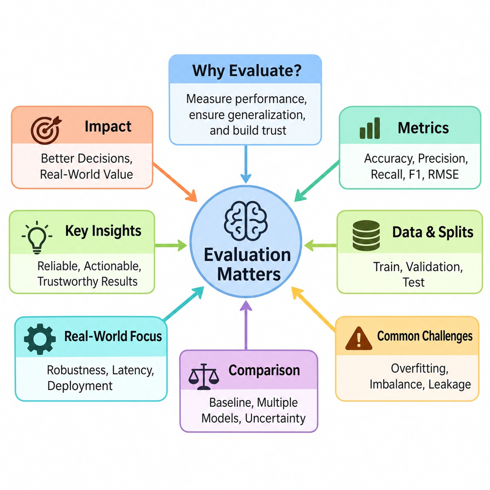{width="7.268055555555556in" height="7.268055555555556in"}

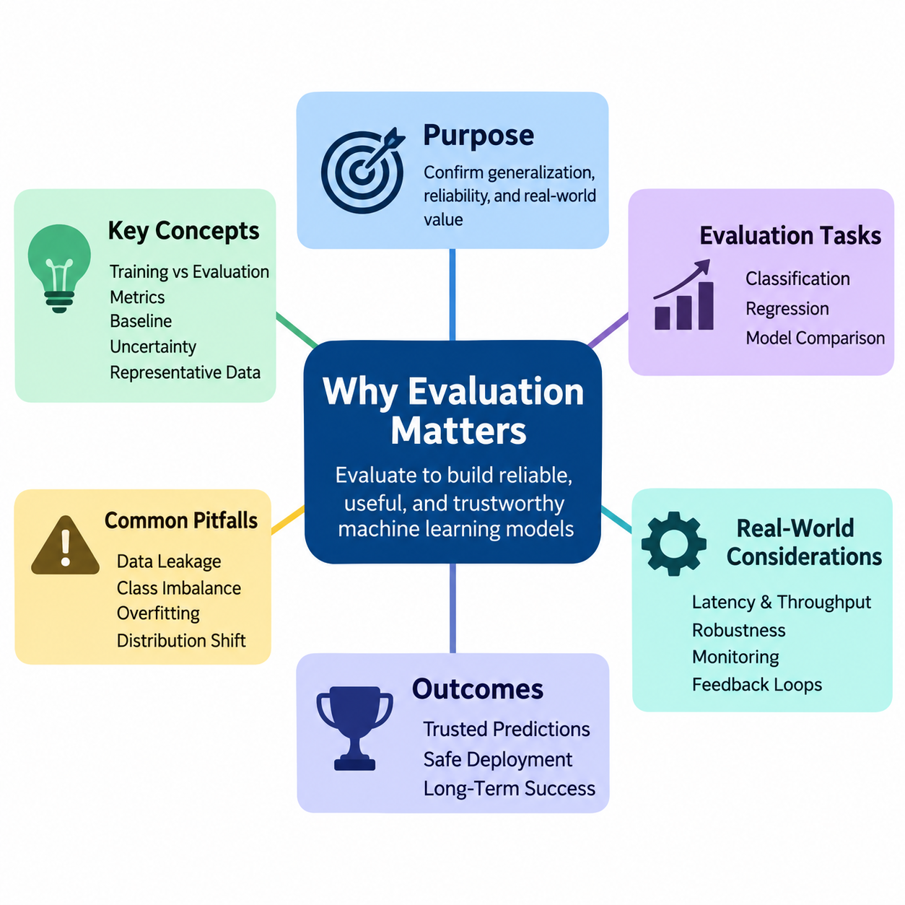{width="7.268055555555556in" height="7.268055555555556in"}

Machine learning evaluation is the systematic process of measuring how effectively a trained model performs a defined task. Training produces a model by optimizing its parameters, but successful optimization does not automatically guarantee useful predictions. Evaluation provides independent evidence about predictive quality, generalization, reliability, and suitability for practical applications.

The primary purpose of evaluation is to determine whether a model has learned patterns that extend beyond its training examples. A model may achieve excellent training performance by memorizing observations rather than discovering meaningful relationships. Evaluating predictions on previously unseen data helps reveal whether the model can generalize to new situations instead of reproducing familiar examples.

Evaluation also establishes a measurable connection between machine learning objectives and real-world requirements. A model is not valuable simply because its mathematical loss becomes small. Its predictions must support the decisions or operations for which it was designed. Appropriate evaluation translates application requirements into measurable performance criteria that can guide development and deployment.

The distinction between training performance and evaluation performance is fundamental. Training performance reflects how closely a model fits the observations used during optimization. Evaluation performance estimates how effectively the resulting model handles independent observations. A substantial difference between these measurements may indicate overfitting, distribution differences, or problems in the experimental procedure.

Reliable evaluation requires careful separation of training, validation, and test data. Training data supports parameter optimization, while validation data guides model selection and hyperparameter tuning. Test data provides a final assessment after development decisions have been completed. Maintaining these boundaries reduces the risk of producing misleading performance estimates through repeated exposure to evaluation examples.

Evaluation metrics convert prediction outcomes into quantitative measurements. Different metrics emphasize different aspects of model behavior, including correctness, error magnitude, ranking quality, and the balance between competing objectives. Selecting an appropriate metric requires understanding the prediction task, the structure of the data, and the practical consequences of incorrect predictions.

Classification problems illustrate why evaluation cannot depend on a single universal measurement. Accuracy describes the proportion of correctly classified examples, but it may hide important weaknesses when classes are imbalanced. Precision, recall, and F1 score provide complementary perspectives by examining different relationships between correct predictions, missed positive cases, and incorrect positive predictions.

Consider a medical screening system in which only a small percentage of patients have a particular condition. A model that predicts every patient as healthy may achieve high accuracy while failing to identify anyone requiring attention. This example demonstrates that numerical performance must be interpreted in relation to class frequencies, error consequences, and the actual purpose of the system.

Regression problems require a different evaluation perspective because predictions represent continuous quantities rather than discrete categories. Metrics such as mean absolute error and mean squared error measure differences between predicted and observed values. Their interpretation depends on the target variable, the scale of measurement, and whether large errors should receive additional penalties.

Evaluation becomes especially important when comparing alternative machine learning models. Different algorithms may achieve similar average performance while exhibiting different error distributions, computational requirements, and sensitivity to unusual observations. A meaningful comparison uses consistent datasets, evaluation procedures, and performance criteria to determine which model best satisfies the intended requirements.

A simple baseline model provides an essential reference point for interpreting evaluation results. Without a baseline, an apparently impressive score may offer little evidence of meaningful learning. Comparing a sophisticated model against majority-class prediction, a simple statistical estimate, or an established conventional method helps determine whether additional complexity produces measurable benefits.

Evaluation should also account for uncertainty in measured performance. A score calculated from a limited sample is an estimate rather than an exact description of future behavior. Different data samples may produce different results, particularly when datasets are small or contain rare events. Repeated evaluation, cross-validation, and confidence intervals can help characterize the stability of performance estimates.

The quality of an evaluation depends strongly on the representativeness of its data. A model tested only on clean, carefully selected examples may perform poorly when exposed to noisy measurements, incomplete inputs, or unfamiliar operating conditions. Evaluation datasets should therefore reflect the important characteristics, variations, and constraints of the environments in which predictions will be used.

Data leakage represents a particularly serious threat to evaluation validity. Leakage occurs when information unavailable during legitimate prediction influences training or model selection. Examples include preprocessing the entire dataset before splitting, introducing future information into historical predictions, or allowing related observations to appear across supposedly independent partitions.

Class imbalance introduces another challenge because overall performance can be dominated by frequently occurring categories. Rare but important cases may contribute little to aggregate scores even when failures have substantial consequences. Evaluating performance separately across classes and examining the tradeoff between precision and recall can reveal weaknesses hidden by a single summary measurement.

Evaluation must distinguish between prediction scores and the decisions derived from those scores. Many classifiers produce probabilities or confidence-like values that are converted into labels using a decision threshold. Changing this threshold can alter the balance between false positives and false negatives without changing the underlying model. Threshold selection should reflect operational requirements and error costs.

Probability quality is another important dimension of model evaluation. A classifier may rank examples correctly while producing poorly calibrated probability estimates. Calibration examines whether predicted probabilities correspond to observed event frequencies. This distinction matters when predictions support risk estimation, resource allocation, or decisions that depend on the estimated likelihood of an outcome.

Evaluation is not limited to average predictive accuracy. Practical systems may require robustness against noisy inputs, stability under changing conditions, fairness across relevant populations, and acceptable computational performance. A model that performs well on a benchmark may still be unsuitable for deployment if its latency, memory consumption, or failure characteristics violate operational constraints.

Real-world machine learning systems frequently operate under changing data distributions. Differences between development data and deployment observations can reduce predictive reliability even when initial test results are strong. Evaluation should therefore consider distribution shift, temporal changes, and differences between data collection environments rather than assuming that historical performance will remain constant.

Error analysis complements numerical metrics by investigating where and why predictions fail. Examining misclassified examples, unusually large regression errors, and performance differences across meaningful subsets can reveal systematic weaknesses. These observations may identify missing features, inconsistent labels, insufficient training coverage, or limitations in the model\'s representation of the problem.

For example, an industrial visual inspection system may classify products accurately under controlled lighting but fail when reflections, camera positions, or surface conditions change. Aggregate test accuracy alone may not reveal these operational weaknesses. Evaluation across lighting conditions, product categories, and defect types provides more useful evidence about readiness for actual manufacturing environments.

Evaluation also supports efficient allocation of development resources. When performance measurements identify a particular weakness, engineers can determine whether improvement requires additional data, better labels, revised preprocessing, different features, or changes to the model architecture. This evidence-based approach reduces unnecessary experimentation and connects optimization efforts to measurable outcomes.

Reproducibility is essential for trustworthy evaluation. Results should be associated with clearly defined datasets, preprocessing procedures, model configurations, random seeds, and metric implementations. Recording these details allows experiments to be repeated and comparisons to be verified. Without reproducibility, apparent improvements may result from uncontrolled experimental differences rather than genuine progress.

Evaluation must also consider the relationship between statistical performance and business or operational value. A small improvement in a metric may have substantial practical significance when applied to millions of decisions. Conversely, a statistically detectable improvement may offer little operational benefit if it introduces excessive computation, maintenance complexity, or unacceptable failure risks.

No single evaluation result can completely characterize a machine learning system. Aggregate metrics, class-specific measurements, error analysis, robustness testing, and operational constraints provide complementary information. Combining these perspectives produces a more comprehensive understanding of model behavior and reduces the risk of selecting a system based on an incomplete performance description.

Evaluation should continue after deployment because real-world conditions can differ from development assumptions. Monitoring prediction quality, data distributions, error patterns, and system behavior helps detect performance degradation. When reliable ground-truth labels become available, observed outcomes can be compared with predictions to determine whether retraining, recalibration, or other corrective actions are necessary.

Ultimately, evaluation is the mechanism that transforms machine learning experimentation into evidence-based engineering. It determines whether a model performs its intended task, whether reported improvements are credible, and whether deployment risks are acceptable. Effective evaluation connects data quality, model development, statistical reasoning, and operational objectives throughout the machine learning lifecycle.

머신러닝 평가(Machine Learning Evaluation)는 학습된 모델(Trained Model)이 정의된 작업(Task)을 얼마나 효과적으로 수행하는지 측정하는 체계적인 과정이다. 학습(Training)은 모델의 매개변수(Parameters)를 최적화하여 모델을 생성하지만, 최적화에 성공했다고 해서 반드시 유용한 예측(Prediction)이 보장되는 것은 아니다. 평가는 예측 품질(Predictive Quality), 일반화(Generalization), 신뢰성(Reliability), 실제 응용 적합성(Application Suitability)에 관한 독립적인 근거를 제공한다.

평가의 주요 목적은 모델이 학습 예제(Training Examples)를 넘어 새로운 데이터에도 적용할 수 있는 패턴(Patterns)을 학습했는지 판단하는 것이다. 모델은 의미 있는 관계를 발견하는 대신 관측값(Observations)을 암기하여 높은 학습 성능(Training Performance)을 달성할 수 있다. 이전에 관측하지 않은 데이터(Unseen Data)에 대한 예측을 평가하면 모델이 익숙한 예제를 재현하는 데 그치지 않고 새로운 상황으로 일반화할 수 있는지 확인할 수 있다.

평가는 머신러닝 목표(Machine Learning Objectives)와 실제 요구사항(Real-World Requirements) 사이에 측정 가능한 연결 관계를 수립한다. 모델의 수학적 손실(Loss)이 작아졌다는 이유만으로 모델이 가치 있다고 판단할 수는 없다. 모델의 예측은 설계 목적에 해당하는 의사결정(Decision Making)이나 운영(Operation)을 지원해야 한다. 적절한 평가는 응용 요구사항(Application Requirements)을 측정 가능한 성능 기준(Performance Criteria)으로 변환하여 개발과 배포(Deployment)를 안내한다.

학습 성능(Training Performance)과 평가 성능(Evaluation Performance)의 구분은 근본적으로 중요하다. 학습 성능은 모델이 최적화 과정에서 사용된 관측값에 얼마나 잘 적합하는지를 나타낸다. 평가 성능은 학습된 모델이 독립적인 관측값(Independent Observations)을 얼마나 효과적으로 처리하는지 추정한다. 두 측정값 사이에 상당한 차이가 나타나면 과적합(Overfitting), 데이터 분포 차이(Distribution Differences), 실험 절차(Experimental Procedure)의 문제를 의심할 수 있다.

신뢰할 수 있는 평가를 위해서는 학습 데이터(Training Data), 검증 데이터(Validation Data), 테스트 데이터(Test Data)를 신중하게 분리해야 한다. 학습 데이터는 매개변수 최적화(Parameter Optimization)에 사용되고, 검증 데이터는 모델 선택(Model Selection)과 하이퍼파라미터 튜닝(Hyperparameter Tuning)을 지원한다. 테스트 데이터는 개발 결정이 완료된 이후 최종 평가에 사용된다. 이러한 경계를 유지하면 평가 예제에 반복적으로 노출되어 잘못된 성능 추정값(Performance Estimates)이 생성되는 위험을 줄일 수 있다.

평가 지표(Evaluation Metrics)는 예측 결과(Prediction Outcomes)를 정량적인 측정값(Quantitative Measurements)으로 변환한다. 서로 다른 지표는 정확성(Correctness), 오차 크기(Error Magnitude), 순위 품질(Ranking Quality), 상충하는 목표 사이의 균형(Tradeoff) 등 모델 동작의 다양한 측면을 강조한다. 적절한 지표를 선택하려면 예측 작업(Prediction Task), 데이터 구조(Data Structure), 잘못된 예측이 초래하는 실제 결과를 이해해야 한다.

분류 문제(Classification Problems)는 하나의 보편적인 측정값만으로 평가할 수 없는 이유를 보여준다. 정확도(Accuracy)는 올바르게 분류된 예제의 비율을 나타내지만, 클래스 불균형(Class Imbalance)이 존재하면 중요한 약점을 숨길 수 있다. 정밀도(Precision), 재현율(Recall), F1 점수(F1 Score)는 올바른 예측, 놓친 양성 사례(Missed Positive Cases), 잘못된 양성 예측(False Positive Predictions) 사이의 관계를 서로 다른 관점에서 평가한다.

특정 질환을 가진 환자가 전체의 극히 일부인 의료 선별 시스템(Medical Screening System)을 생각해 볼 수 있다. 모든 환자를 건강하다고 예측하는 모델은 높은 정확도(Accuracy)를 달성할 수 있지만, 실제로 주의가 필요한 환자를 한 명도 식별하지 못할 수 있다. 이 사례는 수치적 성능(Numerical Performance)을 클래스 빈도(Class Frequencies), 오류의 결과(Error Consequences), 시스템의 실제 목적과 연결하여 해석해야 한다는 사실을 보여준다.

회귀 문제(Regression Problems)는 예측값이 이산적인 범주(Discrete Categories)가 아니라 연속적인 수량(Continuous Quantities)을 나타내므로 다른 평가 관점이 필요하다. 평균 절대 오차(Mean Absolute Error, MAE)와 평균 제곱 오차(Mean Squared Error, MSE)는 예측값과 실제 관측값 사이의 차이를 측정한다. 이러한 지표의 해석은 목표 변수(Target Variable), 측정 척도(Measurement Scale), 큰 오차에 추가적인 불이익을 부여해야 하는지에 따라 달라진다.

평가는 서로 다른 머신러닝 모델(Machine Learning Models)을 비교할 때 특히 중요하다. 서로 다른 알고리즘(Algorithms)은 비슷한 평균 성능(Average Performance)을 달성하더라도 오차 분포(Error Distributions), 계산 요구사항(Computational Requirements), 비정상적인 관측값(Unusual Observations)에 대한 민감도가 다를 수 있다. 의미 있는 비교를 위해서는 일관된 데이터셋(Datasets), 평가 절차(Evaluation Procedures), 성능 기준(Performance Criteria)을 사용하여 어떤 모델이 요구사항을 가장 잘 충족하는지 판단해야 한다.

단순한 기준 모델(Baseline Model)은 평가 결과를 해석하는 데 필수적인 비교 기준(Reference Point)을 제공한다. 기준 모델이 없다면 인상적으로 보이는 점수도 의미 있는 학습이 이루어졌다는 근거가 부족할 수 있다. 복잡한 모델을 다수 클래스 예측(Majority-Class Prediction), 단순 통계 추정(Simple Statistical Estimate), 기존의 전통적인 방법(Conventional Method)과 비교하면 추가적인 복잡성이 실제로 측정 가능한 이점을 제공하는지 판단할 수 있다.

평가는 측정된 성능에 존재하는 불확실성(Uncertainty)도 고려해야 한다. 제한된 표본(Sample)에서 계산한 점수는 미래 동작을 정확하게 설명하는 값이 아니라 추정값(Estimate)이다. 특히 데이터셋이 작거나 희귀한 사건(Rare Events)이 포함된 경우 서로 다른 표본은 서로 다른 결과를 생성할 수 있다. 반복 평가(Repeated Evaluation), 교차 검증(Cross-Validation), 신뢰구간(Confidence Intervals)은 성능 추정값의 안정성(Stability)을 파악하는 데 도움이 된다.

평가의 품질은 데이터의 대표성(Representativeness)에 크게 의존한다. 깨끗하고 신중하게 선택된 예제만으로 테스트한 모델은 잡음이 있는 측정값(Noisy Measurements), 불완전한 입력(Incomplete Inputs), 익숙하지 않은 운영 조건(Unfamiliar Operating Conditions)에 노출되면 성능이 저하될 수 있다. 따라서 평가 데이터셋(Evaluation Dataset)은 실제 예측이 사용되는 환경의 중요한 특성, 변화, 제약조건(Constraints)을 반영해야 한다.

데이터 누출(Data Leakage)은 평가 타당성(Evaluation Validity)을 위협하는 특히 심각한 문제이다. 데이터 누출은 정상적인 예측 시점에 사용할 수 없는 정보가 학습이나 모델 선택에 영향을 미칠 때 발생한다. 대표적인 사례로는 데이터 분할 전에 전체 데이터셋을 전처리(Preprocessing)하거나, 과거 예측에 미래 정보를 포함하거나, 독립적이어야 할 데이터 분할(Data Partitions) 사이에 서로 관련된 관측값이 포함되는 경우가 있다.

클래스 불균형(Class Imbalance)은 전체 성능이 빈번하게 발생하는 범주에 의해 지배될 수 있다는 점에서 또 다른 문제를 발생시킨다. 드물지만 중요한 사례는 실패의 결과가 매우 심각하더라도 집계 점수(Aggregate Scores)에 거의 영향을 미치지 않을 수 있다. 클래스별 성능(Per-Class Performance)을 개별적으로 평가하고 정밀도(Precision)와 재현율(Recall) 사이의 상충 관계를 분석하면 단일 요약 지표(Summary Metric)에 숨겨진 약점을 발견할 수 있다.

평가에서는 예측 점수(Prediction Scores)와 그 점수에서 도출된 의사결정(Decisions)을 구분해야 한다. 많은 분류기(Classifiers)는 확률(Probabilities)이나 신뢰도와 유사한 값(Confidence-Like Values)을 출력하며, 이를 결정 임계값(Decision Threshold)을 사용하여 분류 레이블(Class Labels)로 변환한다. 임계값을 변경하면 기본 모델을 변경하지 않고도 거짓 양성(False Positives)과 거짓 음성(False Negatives) 사이의 균형을 조정할 수 있다. 임계값 선택은 운영 요구사항과 오류 비용(Error Costs)을 반영해야 한다.

확률 품질(Probability Quality) 역시 모델 평가에서 중요한 차원이다. 분류기(Classifier)는 예제의 순위를 올바르게 결정하면서도 잘못 보정된 확률 추정값(Poorly Calibrated Probability Estimates)을 생성할 수 있다. 확률 보정(Calibration)은 예측 확률(Predicted Probabilities)이 실제 관측된 사건 빈도(Observed Event Frequencies)와 일치하는지 확인한다. 이러한 구분은 위험 추정(Risk Estimation), 자원 배분(Resource Allocation), 사건 발생 가능성에 의존하는 의사결정에서 중요하다.

평가는 평균 예측 정확도(Average Predictive Accuracy)에만 제한되지 않는다. 실제 시스템은 잡음이 있는 입력에 대한 강건성(Robustness), 변화하는 조건에서의 안정성(Stability), 관련 집단 사이의 공정성(Fairness), 허용 가능한 계산 성능(Computational Performance)을 요구할 수 있다. 벤치마크(Benchmark)에서 좋은 성능을 보이는 모델이라도 지연시간(Latency), 메모리 사용량(Memory Consumption), 실패 특성(Failure Characteristics)이 운영 제약조건을 위반하면 배포에 적합하지 않을 수 있다.

실제 머신러닝 시스템은 데이터 분포(Data Distributions)가 변화하는 환경에서 작동하는 경우가 많다. 개발 데이터(Development Data)와 배포 환경의 관측값(Deployment Observations) 사이의 차이는 초기 테스트 결과가 우수하더라도 예측 신뢰성(Predictive Reliability)을 감소시킬 수 있다. 따라서 평가는 과거 성능이 일정하게 유지될 것이라고 가정하기보다 분포 이동(Distribution Shift), 시간적 변화(Temporal Changes), 데이터 수집 환경(Data Collection Environments)의 차이를 고려해야 한다.

오류 분석(Error Analysis)은 예측이 어디에서, 왜 실패하는지 조사함으로써 수치적 평가 지표(Numerical Metrics)를 보완한다. 잘못 분류된 예제(Misclassified Examples), 비정상적으로 큰 회귀 오차(Regression Errors), 의미 있는 데이터 하위 집합(Data Subsets) 사이의 성능 차이를 조사하면 체계적인 약점을 발견할 수 있다. 이러한 관측은 누락된 특징(Missing Features), 일관되지 않은 레이블(Inconsistent Labels), 부족한 학습 데이터 범위(Training Coverage), 문제 표현(Problem Representation)의 한계를 식별하는 데 도움이 된다.

예를 들어 산업용 시각 검사 시스템(Industrial Visual Inspection System)은 통제된 조명 환경에서는 제품을 정확하게 분류하지만 반사(Reflections), 카메라 위치(Camera Positions), 표면 상태(Surface Conditions)가 달라지면 실패할 수 있다. 전체 테스트 정확도(Aggregate Test Accuracy)만으로는 이러한 운영상의 약점을 발견하지 못할 수 있다. 조명 조건, 제품 범주, 결함 유형(Defect Types)에 따른 평가는 실제 제조 환경에서 사용할 준비가 되었는지 판단하는 데 더욱 유용한 근거를 제공한다.

평가는 개발 자원(Development Resources)을 효율적으로 배분하는 데도 도움이 된다. 성능 측정값(Performance Measurements)이 특정 약점을 식별하면 엔지니어는 추가 데이터(Additional Data), 더 나은 레이블(Better Labels), 수정된 전처리(Revised Preprocessing), 다른 특징(Features), 모델 아키텍처(Model Architecture)의 변경 중 어떤 개선이 필요한지 판단할 수 있다. 이러한 근거 기반 접근법(Evidence-Based Approach)은 불필요한 실험을 줄이고 최적화 노력을 측정 가능한 결과와 연결한다.

재현성(Reproducibility)은 신뢰할 수 있는 평가를 위한 필수 조건이다. 평가 결과는 명확하게 정의된 데이터셋(Datasets), 전처리 절차(Preprocessing Procedures), 모델 구성(Model Configurations), 난수 시드(Random Seeds), 평가 지표 구현(Metric Implementations)과 연결되어야 한다. 이러한 세부 정보를 기록하면 실험을 반복하고 비교 결과를 검증할 수 있다. 재현성이 없다면 겉으로 나타나는 성능 향상이 실제 발전이 아니라 통제되지 않은 실험 차이에서 비롯되었을 가능성을 배제하기 어렵다.

평가는 통계적 성능(Statistical Performance)과 비즈니스 또는 운영 가치(Business or Operational Value) 사이의 관계도 고려해야 한다. 평가 지표의 작은 개선이라도 수백만 건의 의사결정에 적용되면 상당한 실제적 의미를 가질 수 있다. 반대로 통계적으로 확인 가능한 개선이라도 과도한 계산 비용(Computational Cost), 유지보수 복잡성(Maintenance Complexity), 허용할 수 없는 실패 위험(Failure Risks)을 초래한다면 운영상의 이점은 제한적일 수 있다.

단일 평가 결과만으로 머신러닝 시스템의 모든 특성을 완전하게 설명할 수는 없다. 집계 지표(Aggregate Metrics), 클래스별 측정값(Class-Specific Measurements), 오류 분석(Error Analysis), 강건성 테스트(Robustness Testing), 운영 제약조건(Operational Constraints)은 서로 보완적인 정보를 제공한다. 이러한 관점을 결합하면 모델 동작(Model Behavior)을 더욱 포괄적으로 이해할 수 있으며, 불완전한 성능 설명만으로 시스템을 선택하는 위험을 줄일 수 있다.

평가는 실제 운영 조건이 개발 단계의 가정과 다를 수 있으므로 배포(Deployment) 이후에도 계속되어야 한다. 예측 품질(Prediction Quality), 데이터 분포(Data Distributions), 오류 패턴(Error Patterns), 시스템 동작(System Behavior)을 모니터링(Monitoring)하면 성능 저하(Performance Degradation)를 탐지할 수 있다. 신뢰할 수 있는 정답 레이블(Ground-Truth Labels)을 확보하면 실제 결과와 예측을 비교하여 재학습(Retraining), 재보정(Recalibration), 기타 수정 조치(Corrective Actions)의 필요성을 판단할 수 있다.

궁극적으로 평가(Evaluation)는 머신러닝 실험(Machine Learning Experimentation)을 근거 기반 엔지니어링(Evidence-Based Engineering)으로 전환하는 핵심 메커니즘이다. 평가는 모델이 의도한 작업을 수행하는지, 보고된 개선이 신뢰할 수 있는지, 배포 위험(Deployment Risks)이 허용 가능한지를 판단한다. 효과적인 평가는 머신러닝 생명주기(Machine Learning Lifecycle) 전반에 걸쳐 데이터 품질(Data Quality), 모델 개발(Model Development), 통계적 추론(Statistical Reasoning), 운영 목표(Operational Objectives)를 연결한다.

## 04.01 Classification Metrics

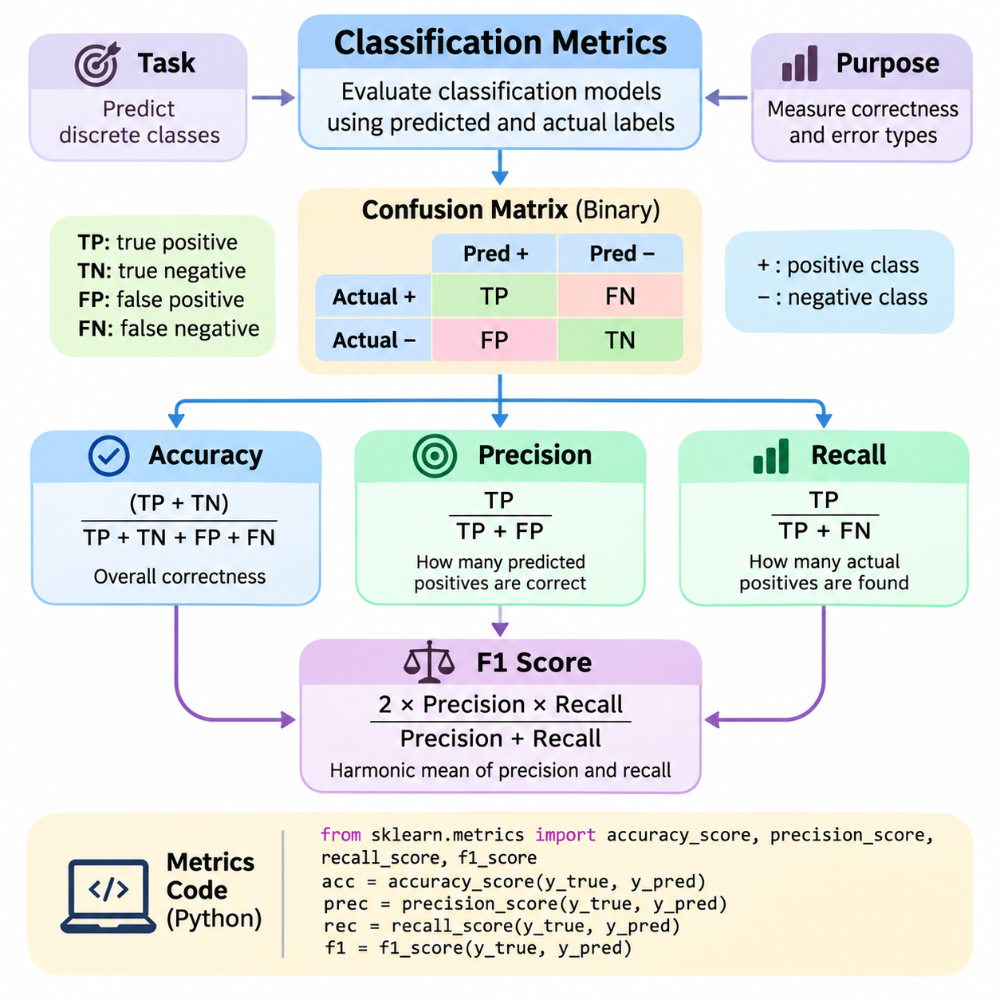{width="7.268055555555556in" height="7.268055555555556in"}

Classification metrics are quantitative measures used to evaluate how accurately a machine learning model assigns observations to predefined categories. Unlike regression, where predictions represent continuous values, classification produces discrete labels or class probabilities. Effective evaluation requires understanding both the number of correct predictions and the types of errors produced by the classifier.

The foundation of classification evaluation is the comparison between predicted labels and actual labels. In binary classification, outcomes are commonly organized into true positives, true negatives, false positives, and false negatives. These four quantities describe whether predictions are correct and how errors are distributed, providing the basis for accuracy, precision, recall, and F1 score.

Accuracy measures the proportion of all predictions that are correct. It is calculated as the number of true positives plus true negatives divided by the total number of observations. Accuracy = (TP + TN) / (TP + TN + FP + FN). This metric is intuitive because it directly expresses overall correctness, making it useful when classes are reasonably balanced and different error types have similar consequences.

For example, consider a classifier that evaluates 1,000 images and correctly identifies 920 of them. Its accuracy is 92%, indicating that most predictions match their reference labels. However, this result does not explain which categories are frequently confused or whether the remaining errors involve important cases. Accuracy therefore provides a useful overview but rarely describes the complete behavior of a classifier.

Accuracy becomes potentially misleading when the dataset contains substantial class imbalance. Suppose 99% of transactions are legitimate and only 1% are fraudulent. A classifier that always predicts legitimate transactions achieves 99% accuracy while detecting no fraud. Although the numerical score appears excellent, the model fails at the application's primary objective, demonstrating why additional metrics are necessary.

Balanced accuracy provides an alternative when class frequencies differ significantly. In binary classification, it is the average of sensitivity and specificity, representing performance across positive and negative classes. Unlike ordinary accuracy, balanced accuracy gives equal importance to both classes. Nevertheless, it should be interpreted alongside other metrics because it does not directly represent the costs of individual prediction errors.

Precision measures the proportion of predicted positive cases that are actually positive. Its formula is Precision = TP / (TP + FP). High precision indicates that positive predictions are generally trustworthy and that relatively few negative observations are incorrectly labeled positive. Precision becomes especially important when false alarms create substantial operational, financial, or human costs.

Consider an automated quality inspection system that identifies defective manufactured products. If the system marks 100 products as defective and 90 are genuinely defective, its precision is 90%. The remaining ten predictions represent false positives, potentially causing unnecessary inspection or disposal. Improving precision reduces these unnecessary interventions, although it may affect the number of actual defects detected.

Recall measures the proportion of actual positive cases that the classifier successfully identifies. It is calculated as Recall = TP / (TP + FN). Recall is also called sensitivity or true positive rate. High recall indicates that relatively few positive observations are missed, making it particularly important when false negatives create serious consequences or when detecting rare events is the primary objective.

In a medical screening application, recall describes how many patients with a particular condition are correctly identified. If 200 patients have the condition and the system detects 180, recall equals 90%. The remaining 20 patients are false negatives. Even when overall accuracy is high, these missed cases may represent substantial clinical risk, emphasizing the importance of evaluating recall separately.

Precision and recall frequently exhibit a tradeoff because changing the classification threshold alters which observations receive positive predictions. Lowering the threshold generally increases recall by identifying more potential positives, but it may reduce precision by introducing additional false positives. Raising the threshold often produces the opposite effect, although the exact relationship depends on the model and dataset.

The appropriate balance between precision and recall depends on application requirements. Fraud detection systems may prioritize recall to identify more suspicious transactions, while automated account suspension systems may require high precision to avoid penalizing legitimate users. Neither metric is universally superior. Their relative importance must be determined by the consequences of false positives and false negatives.

The F1 score combines precision and recall into a single measurement using their harmonic mean. Its formula is F1 = 2 × Precision × Recall / (Precision + Recall), which is equivalent to 2TP / (2TP + FP + FN). The harmonic mean penalizes substantial differences between precision and recall, preventing a high value in one metric from completely compensating for a low value in the other.

For example, if precision is 0.90 and recall is 0.60, the F1 score is 0.72. Although the classifier produces relatively reliable positive predictions, it misses a considerable proportion of actual positive cases. The F1 score reflects this imbalance more clearly than an arithmetic average would, making it useful when both false positives and false negatives matter.

F1 score is particularly useful for imbalanced classification problems, but it is not a universal measure of model quality. It does not incorporate true negatives and therefore cannot fully describe performance on the negative class. A classifier may achieve a favorable F1 score while exhibiting undesirable behavior elsewhere. Consequently, F1 should be interpreted together with class distributions and additional evaluation metrics.

Multiclass classification extends these concepts to problems involving more than two categories. Precision, recall, and F1 can be calculated separately for each class by treating that class as positive and all other classes as negative. This one-versus-rest interpretation enables detailed evaluation of individual categories and helps identify classes that are consistently confused or insufficiently represented.

Macro averaging calculates the arithmetic mean of class-specific metrics, assigning equal weight to every class regardless of frequency. Weighted averaging uses the number of actual observations in each class as its weight. Micro averaging aggregates prediction counts across classes before calculating the metric. These approaches answer different questions and can produce substantially different results on imbalanced datasets.

For single-label multiclass classification, micro-averaged precision, recall, and F1 are equal to overall accuracy when all classes are included. Macro F1, by contrast, highlights performance across categories without allowing large classes to dominate the average. Weighted F1 reflects class prevalence but may conceal weak performance on rare categories. Reporting the averaging method is therefore essential for meaningful interpretation.

Classification metrics can be implemented efficiently using Python and the scikit-learn library. The accuracy_score function calculates overall correctness, while precision_score, recall_score, and f1_score compute their corresponding measures. Each function accepts actual labels and predicted labels, allowing consistent evaluation across models when the same dataset and label definitions are used.

A typical implementation begins by generating predictions with a trained classifier and storing them alongside the reference labels. The evaluation functions then calculate accuracy, precision, recall, and F1 score. For binary classification, the positive label must be defined consistently. For multiclass problems, the average parameter determines whether results are calculated using macro, micro, or weighted aggregation.

The classification_report function provides a convenient summary containing precision, recall, F1 score, and support for individual classes. Support represents the number of actual observations belonging to each category. This report helps reveal whether strong aggregate performance hides weaknesses in minority classes and provides a practical starting point for systematic error analysis.

Metric implementations must also handle cases where mathematical denominators become zero. Precision is undefined when no positive predictions exist, while recall is undefined when no actual positive cases exist. Libraries such as scikit-learn provide configurable zero-division behavior. Explicitly defining this behavior prevents ambiguous results and supports reproducible comparisons across experiments.

Threshold-based evaluation requires additional care because predicted probabilities and predicted labels serve different purposes. Precision, recall, and F1 are generally computed from discrete predictions obtained after applying a decision threshold. Evaluating several thresholds can reveal operational tradeoffs and help select a decision rule that satisfies application-specific requirements without retraining the underlying classifier.

A reproducible evaluation workflow should preserve the test dataset, label encoding, metric definitions, averaging strategy, and classification threshold. Models must be compared using identical evaluation conditions whenever possible. Recording these settings ensures that observed differences reflect model behavior rather than inconsistencies in implementation, preprocessing, or experimental configuration.

Ultimately, accuracy, precision, recall, and F1 score provide complementary perspectives on classification performance. Accuracy measures overall correctness, precision evaluates the reliability of positive predictions, recall measures the ability to detect actual positives, and F1 summarizes their balance. Understanding these distinctions enables more reliable model selection and connects quantitative evaluation with practical decision-making requirements.

분류 평가 지표(Classification Metrics)는 머신러닝 모델(Machine Learning Model)이 관측값(Observations)을 미리 정의된 범주(Predefined Categories)에 얼마나 정확하게 할당하는지 평가하는 정량적 측정값(Quantitative Measures)이다. 예측값이 연속적인 수치(Continuous Values)를 나타내는 회귀(Regression)와 달리, 분류(Classification)는 이산적인 레이블(Discrete Labels)이나 클래스 확률(Class Probabilities)을 생성한다. 효과적인 평가를 위해서는 올바른 예측의 수뿐만 아니라 분류기(Classifier)가 발생시키는 오류의 유형도 이해해야 한다.

분류 평가(Classification Evaluation)의 기초는 예측 레이블(Predicted Labels)과 실제 레이블(Actual Labels)을 비교하는 것이다. 이진 분류(Binary Classification)에서 결과는 일반적으로 참 양성(True Positive, TP), 참 음성(True Negative, TN), 거짓 양성(False Positive, FP), 거짓 음성(False Negative, FN)으로 구분된다. 이러한 네 가지 값은 예측의 정확성과 오류 분포(Error Distribution)를 설명하며, 정확도(Accuracy), 정밀도(Precision), 재현율(Recall), F1 점수(F1 Score)를 계산하는 기초가 된다.

정확도(Accuracy)는 전체 예측 중 올바른 예측이 차지하는 비율을 측정한다. 참 양성(True Positive)과 참 음성(True Negative)의 합을 전체 관측값의 수로 나누어 계산한다. 정확도(Accuracy) = (TP + TN) / (TP + TN + FP + FN)이다. 이 지표는 전체적인 예측 정확성을 직접 나타내므로 직관적으로 이해하기 쉬우며, 클래스가 비교적 균형을 이루고 서로 다른 오류 유형의 결과가 비슷할 때 유용하다.

예를 들어 분류기(Classifier)가 1,000개의 이미지를 평가하여 그중 920개를 올바르게 식별했다고 가정해 보자. 이 모델의 정확도(Accuracy)는 92%이며, 대부분의 예측이 정답 레이블(Reference Labels)과 일치한다는 의미이다. 그러나 이 결과만으로는 어떤 범주가 자주 혼동되는지 또는 나머지 오류가 중요한 사례와 관련되는지 알 수 없다. 따라서 정확도는 유용한 전체 성능 지표이지만 분류기의 모든 동작을 설명하지는 못한다.

정확도(Accuracy)는 데이터셋(Dataset)에 심각한 클래스 불균형(Class Imbalance)이 존재할 때 잘못된 인상을 줄 수 있다. 거래의 99%가 정상이고 1%만 사기 거래(Fraudulent Transactions)라고 가정해 보자. 모든 거래를 정상으로 예측하는 분류기는 99%의 정확도를 달성하지만 사기 거래는 전혀 탐지하지 못한다. 수치적으로는 우수한 점수처럼 보이지만 실제 응용의 핵심 목표를 달성하지 못하므로 추가적인 평가 지표가 필요하다.

균형 정확도(Balanced Accuracy)는 클래스 빈도(Class Frequencies)가 크게 다를 때 사용할 수 있는 대안적인 지표이다. 이진 분류(Binary Classification)에서는 민감도(Sensitivity)와 특이도(Specificity)의 평균으로 계산하며, 양성 클래스(Positive Class)와 음성 클래스(Negative Class)의 성능을 함께 나타낸다. 일반 정확도와 달리 두 클래스에 동일한 중요도를 부여하지만, 개별 예측 오류의 비용을 직접 표현하지 않으므로 다른 지표와 함께 해석해야 한다.

정밀도(Precision)는 양성으로 예측한 사례 중 실제로 양성인 사례의 비율을 측정한다. 계산식은 정밀도(Precision) = TP / (TP + FP)이다. 높은 정밀도는 양성 예측(Positive Predictions)의 신뢰성이 높고 실제 음성인 관측값을 양성으로 잘못 분류하는 경우가 상대적으로 적다는 의미이다. 정밀도는 잘못된 경고(False Alarms)가 상당한 운영 비용, 재정적 손실 또는 인적 비용을 발생시키는 상황에서 특히 중요하다.

제조 제품의 결함을 식별하는 자동 품질 검사 시스템(Automated Quality Inspection System)을 생각해 보자. 시스템이 100개의 제품을 불량으로 판정했으며 그중 90개가 실제 불량품이라면 정밀도(Precision)는 90%이다. 나머지 10개는 거짓 양성(False Positives)에 해당하며 불필요한 추가 검사나 폐기를 초래할 수 있다. 정밀도를 개선하면 이러한 불필요한 조치를 줄일 수 있지만 실제 결함을 탐지하는 비율에도 영향을 미칠 수 있다.

재현율(Recall)은 실제 양성 사례 중 분류기가 성공적으로 식별한 사례의 비율을 측정한다. 계산식은 재현율(Recall) = TP / (TP + FN)이다. 재현율은 민감도(Sensitivity) 또는 참 양성률(True Positive Rate)이라고도 한다. 높은 재현율은 실제 양성 관측값을 놓치는 경우가 상대적으로 적다는 의미이며, 거짓 음성(False Negatives)이 심각한 결과를 초래하거나 희귀 사건(Rare Events)의 탐지가 주요 목표일 때 특히 중요하다.

의료 선별 검사(Medical Screening)에서 재현율(Recall)은 특정 질환을 가진 환자 중 올바르게 식별한 환자의 비율을 나타낸다. 해당 질환을 가진 환자가 200명이고 시스템이 그중 180명을 탐지했다면 재현율은 90%이다. 나머지 20명은 거짓 음성(False Negatives)에 해당한다. 전체 정확도(Accuracy)가 높더라도 이러한 미탐지 사례는 상당한 임상적 위험(Clinical Risk)을 나타낼 수 있으므로 재현율을 별도로 평가하는 것이 중요하다.

정밀도(Precision)와 재현율(Recall)은 분류 임계값(Classification Threshold)을 변경하면 양성으로 예측되는 관측값이 달라지기 때문에 상충 관계(Tradeoff)를 보이는 경우가 많다. 임계값을 낮추면 일반적으로 더 많은 잠재적 양성을 식별하여 재현율이 증가하지만 거짓 양성이 추가되면서 정밀도가 감소할 수 있다. 임계값을 높이면 반대 효과가 나타나는 경우가 많지만 정확한 관계는 모델과 데이터셋에 따라 달라진다.

정밀도(Precision)와 재현율(Recall) 사이의 적절한 균형은 응용 요구사항(Application Requirements)에 따라 달라진다. 사기 탐지 시스템(Fraud Detection System)은 더 많은 의심 거래를 식별하기 위해 재현율을 우선할 수 있지만, 자동 계정 정지 시스템(Automated Account Suspension System)은 정상 사용자가 부당한 제재를 받지 않도록 높은 정밀도를 요구할 수 있다. 어느 지표도 보편적으로 우월하지 않으며, 거짓 양성과 거짓 음성이 초래하는 결과에 따라 상대적 중요도를 결정해야 한다.

F1 점수(F1 Score)는 정밀도(Precision)와 재현율(Recall)의 조화 평균(Harmonic Mean)을 사용하여 두 지표를 하나의 측정값으로 결합한다. 계산식은 F1 = 2 × Precision × Recall / (Precision + Recall)이며, 2TP / (2TP + FP + FN)과 동일하다. 조화 평균은 정밀도와 재현율 사이의 큰 차이에 불이익을 부여하므로 한 지표의 높은 값이 다른 지표의 낮은 값을 완전히 보상하지 못하도록 한다.

예를 들어 정밀도(Precision)가 0.90이고 재현율(Recall)이 0.60이라면 F1 점수(F1 Score)는 0.72이다. 이 분류기는 양성 예측의 신뢰성이 비교적 높지만 실제 양성 사례의 상당 부분을 놓치고 있다. F1 점수는 이러한 불균형을 산술 평균(Arithmetic Mean)보다 명확하게 반영하므로 거짓 양성과 거짓 음성이 모두 중요한 상황에서 유용하다.

F1 점수(F1 Score)는 불균형 분류 문제(Imbalanced Classification Problems)에서 특히 유용하지만 모델 품질(Model Quality)을 나타내는 보편적인 지표는 아니다. F1 점수는 참 음성(True Negatives)을 계산에 포함하지 않으므로 음성 클래스(Negative Class)의 성능을 완전하게 설명할 수 없다. 분류기가 좋은 F1 점수를 달성하더라도 다른 측면에서는 바람직하지 않은 동작을 보일 수 있다. 따라서 클래스 분포(Class Distributions)와 추가적인 평가 지표를 함께 고려해야 한다.

다중 클래스 분류(Multiclass Classification)는 이러한 개념을 두 개보다 많은 범주를 포함하는 문제로 확장한다. 정밀도(Precision), 재현율(Recall), F1 점수(F1 Score)는 특정 클래스를 양성으로 간주하고 나머지 모든 클래스를 음성으로 간주하여 클래스별로 계산할 수 있다. 이러한 일대다 해석(One-versus-Rest Interpretation)은 개별 범주에 대한 상세한 평가를 가능하게 하며, 지속적으로 혼동되거나 충분히 표현되지 않은 클래스를 식별하는 데 도움이 된다.

매크로 평균(Macro Averaging)은 클래스별 지표의 산술 평균을 계산하며 클래스 빈도와 관계없이 모든 클래스에 동일한 가중치를 부여한다. 가중 평균(Weighted Averaging)은 각 클래스의 실제 관측값 수를 가중치로 사용한다. 마이크로 평균(Micro Averaging)은 모든 클래스의 예측 결과를 합산한 후 지표를 계산한다. 이러한 방법은 서로 다른 평가 질문에 답하며, 불균형 데이터셋에서는 상당히 다른 결과를 생성할 수 있다.

단일 레이블 다중 클래스 분류(Single-Label Multiclass Classification)에서 모든 클래스를 포함하면 마이크로 평균 정밀도(Micro-Averaged Precision), 재현율(Recall), F1 점수(F1 Score)는 전체 정확도(Overall Accuracy)와 동일하다. 반면 매크로 F1(Macro F1)은 큰 클래스가 평균을 지배하지 않도록 하면서 범주 전반의 성능을 강조한다. 가중 F1(Weighted F1)은 클래스 출현 비율(Class Prevalence)을 반영하지만 희귀 클래스의 낮은 성능을 숨길 수 있다. 따라서 평균 계산 방법을 명시하는 것이 중요하다.

분류 평가 지표(Classification Metrics)는 파이썬(Python)과 사이킷런(scikit-learn) 라이브러리를 사용하여 효율적으로 구현할 수 있다. accuracy_score 함수는 전체 정확도를 계산하며, precision_score, recall_score, f1_score 함수는 각각 해당 평가 지표를 계산한다. 각 함수는 실제 레이블(Actual Labels)과 예측 레이블(Predicted Labels)을 입력으로 받으며, 동일한 데이터셋과 레이블 정의를 사용하면 서로 다른 모델을 일관되게 평가할 수 있다.

일반적인 구현(Implementation)은 학습된 분류기(Trained Classifier)로 예측을 생성하고 이를 정답 레이블(Reference Labels)과 함께 저장하는 과정에서 시작한다. 이후 평가 함수(Evaluation Functions)를 사용하여 정확도(Accuracy), 정밀도(Precision), 재현율(Recall), F1 점수(F1 Score)를 계산한다. 이진 분류에서는 양성 레이블(Positive Label)을 일관되게 정의해야 하며, 다중 클래스 문제에서는 average 매개변수(Parameter)를 사용하여 매크로(Macro), 마이크로(Micro), 가중 평균(Weighted Aggregation) 중 어떤 방식을 사용할지 결정한다.

classification_report 함수는 개별 클래스의 정밀도(Precision), 재현율(Recall), F1 점수(F1 Score), 표본 수(Support)를 포함하는 편리한 요약 결과를 제공한다. 표본 수(Support)는 각 범주에 실제로 속하는 관측값의 수를 의미한다. 이 보고서는 높은 집계 성능(Aggregate Performance)이 소수 클래스(Minority Classes)의 약점을 숨기고 있는지 확인하는 데 도움이 되며, 체계적인 오류 분석(Error Analysis)을 시작하기 위한 실용적인 기준을 제공한다.

평가 지표 구현(Metric Implementation)에서는 수학적 분모(Denominator)가 0이 되는 경우도 처리해야 한다. 양성 예측이 전혀 없으면 정밀도(Precision)가 정의되지 않으며, 실제 양성 사례가 전혀 없으면 재현율(Recall)이 정의되지 않는다. 사이킷런(scikit-learn)과 같은 라이브러리는 0으로 나누는 상황에 대한 설정 가능한 처리 방식(Zero-Division Behavior)을 제공한다. 이러한 동작을 명시적으로 정의하면 모호한 결과를 방지하고 실험 간 재현 가능한 비교를 지원할 수 있다.

임계값 기반 평가(Threshold-Based Evaluation)에서는 예측 확률(Predicted Probabilities)과 예측 레이블(Predicted Labels)이 서로 다른 목적을 가진다는 점에 주의해야 한다. 정밀도(Precision), 재현율(Recall), F1 점수(F1 Score)는 일반적으로 결정 임계값(Decision Threshold)을 적용한 후 얻은 이산적인 예측값(Discrete Predictions)으로 계산한다. 여러 임계값을 평가하면 운영상의 상충 관계를 확인하고 기본 분류기를 다시 학습하지 않고도 응용별 요구사항을 충족하는 의사결정 규칙(Decision Rule)을 선택할 수 있다.

재현 가능한 평가 작업 흐름(Reproducible Evaluation Workflow)은 테스트 데이터셋(Test Dataset), 레이블 인코딩(Label Encoding), 평가 지표 정의(Metric Definitions), 평균 계산 전략(Averaging Strategy), 분류 임계값(Classification Threshold)을 유지해야 한다. 가능한 경우 모델은 동일한 평가 조건(Evaluation Conditions)에서 비교해야 한다. 이러한 설정을 기록하면 관측된 차이가 구현, 전처리, 실험 구성의 불일치가 아니라 실제 모델 동작(Model Behavior)을 반영하도록 할 수 있다.

궁극적으로 정확도(Accuracy), 정밀도(Precision), 재현율(Recall), F1 점수(F1 Score)는 분류 성능(Classification Performance)을 서로 보완적인 관점에서 설명한다. 정확도는 전체적인 예측 정확성을 측정하고, 정밀도는 양성 예측의 신뢰성을 평가하며, 재현율은 실제 양성을 탐지하는 능력을 측정하고, F1 점수는 두 지표의 균형을 요약한다. 이러한 차이를 이해하면 더욱 신뢰할 수 있는 모델 선택(Model Selection)이 가능해지고 정량적 평가(Quantitative Evaluation)를 실제 의사결정 요구사항(Practical Decision-Making Requirements)과 연결할 수 있다.

## 04.02 Confusion Matrix [w/Code]

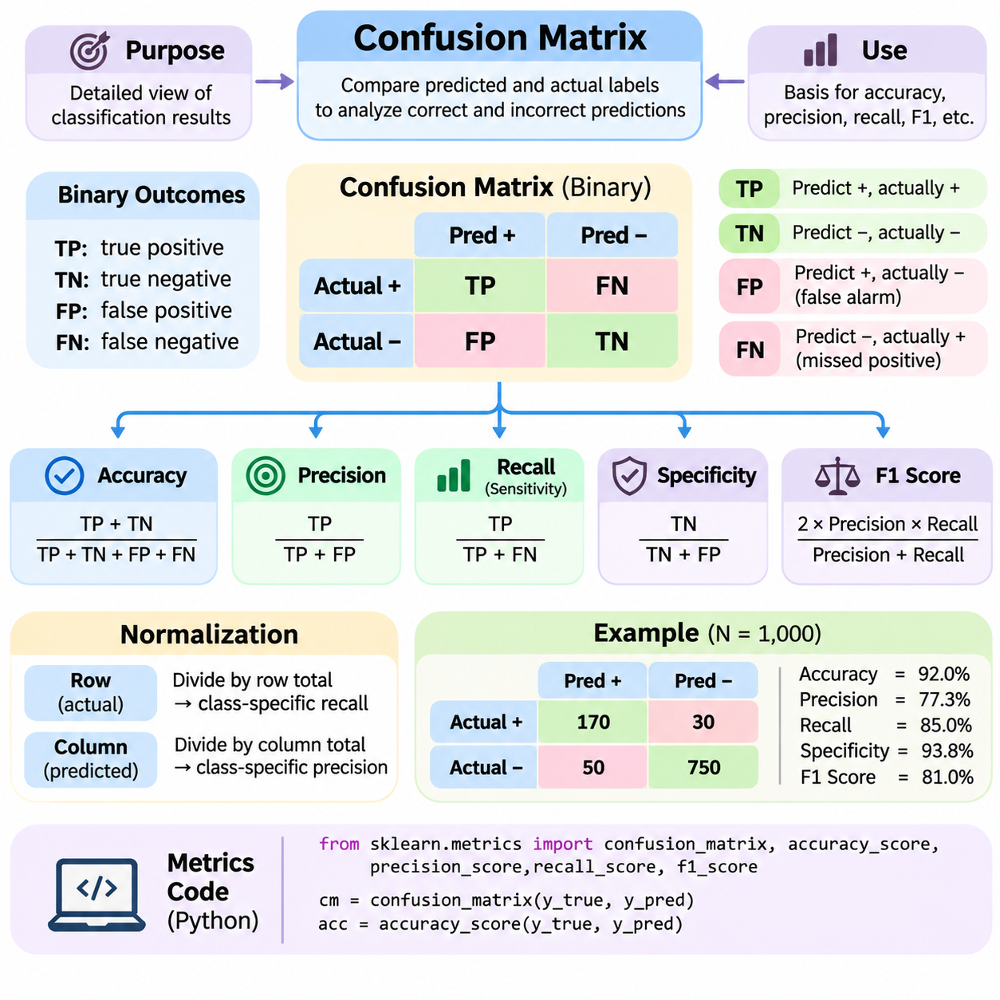{width="7.268055555555556in" height="7.268055555555556in"}

A confusion matrix is a fundamental evaluation tool used to examine the relationship between predicted class labels and actual class labels in a classification problem. Unlike a single performance score, it provides a detailed breakdown of correct and incorrect predictions. By organizing prediction outcomes into a structured matrix, it reveals which categories are recognized successfully and which types of classification errors occur.

In binary classification, a confusion matrix contains four possible outcomes: true positive, true negative, false positive, and false negative. These outcomes are determined by comparing the predicted class with the actual class. Together, they describe the complete distribution of classification decisions and form the mathematical foundation for widely used metrics such as accuracy, precision, recall, specificity, and F1 score.

A true positive, abbreviated TP, occurs when the model predicts the positive class and the actual observation belongs to that class. For example, a medical screening system correctly identifying a patient with a disease produces a true positive. A high number of true positives generally indicates successful detection of the target condition, although the value must be interpreted relative to the total number of actual positive cases.

A true negative, abbreviated TN, occurs when the model predicts the negative class and the actual observation is negative. In fraud detection, correctly identifying a legitimate transaction represents a true negative. True negatives demonstrate the classifier\'s ability to recognize normal or non-target observations and are particularly relevant when evaluating specificity and the frequency of unnecessary positive predictions.

A false positive, abbreviated FP, occurs when the model predicts a positive result for an observation that is actually negative. This error is sometimes called a false alarm. In industrial quality inspection, classifying a properly manufactured product as defective represents a false positive. Such errors can generate unnecessary inspections, wasted resources, and operational disruptions.

A false negative, abbreviated FN, occurs when the model predicts a negative result even though the actual observation belongs to the positive class. In medical diagnosis, failing to identify a patient with a disease represents a false negative. These errors can be especially serious when the objective is to detect rare, dangerous, or costly events that require timely intervention.

The arrangement of a confusion matrix depends on the convention used by the evaluation framework. A common convention places actual classes in rows and predicted classes in columns. Under this arrangement, the binary matrix contains TN and FP in the negative actual-class row, followed by FN and TP in the positive actual-class row. Explicitly identifying axis orientation prevents incorrect interpretation.

Consider a binary classifier evaluated on 1,000 observations, including 200 actual positive cases and 800 actual negative cases. Suppose the model produces 170 true positives, 750 true negatives, 50 false positives, and 30 false negatives. These four counts provide a complete description of the classifier\'s decisions and allow multiple performance measures to be calculated consistently.

From this example, accuracy equals (170 + 750) / 1,000, resulting in 92%. Precision equals 170 / (170 + 50), approximately 77.3%, while recall equals 170 / (170 + 30), or 85%. The F1 score is approximately 81.0%. Although accuracy appears strong, the additional measurements reveal a meaningful number of false alarms and missed positive cases.

The confusion matrix also supports the calculation of specificity, which measures the proportion of actual negative observations correctly classified. Specificity = TN / (TN + FP). In the example, specificity equals 750 / 800, or 93.75%. This metric complements recall by describing how effectively the model avoids incorrectly assigning negative observations to the positive class.

The false positive rate represents the proportion of actual negative cases incorrectly classified as positive. It is calculated as FP / (FP + TN), making it equal to one minus specificity. The false negative rate is FN / (FN + TP), equivalent to one minus recall. These measurements help quantify different error mechanisms and support decisions about acceptable operational risks.

A confusion matrix is especially valuable when classification datasets contain unequal class frequencies. Overall accuracy can be dominated by the majority class, potentially hiding poor detection of rare categories. By exposing individual prediction counts, the matrix makes minority-class failures visible and encourages evaluation based on application requirements rather than a single aggregate score.

Raw confusion matrices contain absolute counts, which are useful for understanding the number of affected observations. However, counts can be difficult to compare when datasets have different sizes or class distributions. Normalized confusion matrices address this limitation by expressing values as proportions, allowing relative classification behavior to be examined across datasets or experimental conditions.

Row normalization divides each matrix entry by the total number of actual observations belonging to its row class. When actual classes occupy rows, the resulting values describe the distribution of predictions for each true category. Diagonal values correspond to class-specific recall, while off-diagonal values indicate the proportions of observations assigned to incorrect categories.

Column normalization divides each entry by the total number of observations predicted as the corresponding class. Under the convention of predicted classes occupying columns, diagonal values represent class-specific precision. This perspective is useful when examining the reliability of predicted categories, particularly when incorrect positive predictions create substantial operational consequences.

Multiclass classification extends the confusion matrix to an N-by-N structure, where N represents the number of classes. Each row corresponds to an actual category, and each column corresponds to a predicted category. Diagonal entries represent correct classifications, while off-diagonal entries identify specific patterns of confusion between different classes.

For example, an image classifier distinguishing cats, dogs, and rabbits may frequently classify rabbits as cats while rarely confusing dogs with rabbits. A single accuracy score cannot clearly describe this relationship. The multiclass confusion matrix exposes these category-specific errors, helping researchers identify visual similarities, insufficient training examples, or weaknesses in learned feature representations.

In multiclass problems, class-specific true positives, false positives, false negatives, and true negatives can be calculated using a one-versus-rest interpretation. One category is treated as positive while all remaining categories are grouped as negative. Repeating this procedure for each category enables precision, recall, and F1 score calculations that are consistent with the underlying confusion matrix.

Confusion matrices can be generated programmatically using Python and the scikit-learn library. The confusion_matrix function accepts actual labels and predicted labels and returns a two-dimensional array of classification counts. The labels parameter can explicitly define class ordering, ensuring that rows and columns remain consistent across different experiments and model comparisons.

A practical implementation begins by obtaining predictions from a trained classifier on an independent test dataset. The predicted labels are compared against the corresponding ground-truth labels using confusion_matrix. The resulting matrix can then be inspected numerically or passed to ConfusionMatrixDisplay for visualization. Consistent label ordering is essential for interpreting each matrix position correctly.

The normalize parameter in scikit-learn supports several normalization strategies. Setting normalize to true normalizes values by actual-class totals, while pred normalizes by predicted-class totals. The all option divides counts by the total number of observations. These alternatives provide complementary perspectives and should be selected according to the intended evaluation question.

Confusion matrices are sensitive to the decision threshold used by probabilistic classifiers. Lowering the threshold for predicting the positive class generally increases true positives and false positives while reducing false negatives and true negatives. Raising the threshold generally produces the opposite pattern. Examining matrices at multiple thresholds helps identify suitable operating points for different applications.

Despite their usefulness, confusion matrices have limitations. They summarize classification outcomes at a particular decision threshold but do not directly describe probability calibration, prediction confidence, or ranking performance across thresholds. They also provide no information about computational latency or deployment cost. Additional evaluation methods are therefore required for comprehensive model assessment.

Reliable confusion matrix analysis requires careful attention to data quality and experimental consistency. Incorrect labels, data leakage, inconsistent class definitions, or evaluation on nonrepresentative samples can produce misleading results. The dataset partition, class ordering, prediction threshold, and normalization method should be documented to support reproducibility and meaningful comparisons.

In practical machine learning workflows, confusion matrices support both quantitative evaluation and diagnostic error analysis. They reveal not only how frequently a classifier succeeds but also which mistakes dominate its behavior. By connecting individual error types to application-specific consequences, confusion matrices provide an essential foundation for model improvement, threshold selection, and reliable deployment decisions.

혼동 행렬(Confusion Matrix)은 분류 문제(Classification Problem)에서 예측 클래스 레이블(Predicted Class Labels)과 실제 클래스 레이블(Actual Class Labels) 사이의 관계를 분석하는 기본적인 평가 도구(Evaluation Tool)이다. 단일 성능 점수(Performance Score)와 달리 올바른 예측과 잘못된 예측을 상세하게 구분하여 제공한다. 예측 결과(Prediction Outcomes)를 구조화된 행렬(Matrix)로 정리함으로써 어떤 범주가 성공적으로 인식되고 어떤 유형의 분류 오류(Classification Errors)가 발생하는지 확인할 수 있다.

이진 분류(Binary Classification)에서 혼동 행렬(Confusion Matrix)은 참 양성(True Positive), 참 음성(True Negative), 거짓 양성(False Positive), 거짓 음성(False Negative)의 네 가지 가능한 결과를 포함한다. 이러한 결과는 예측 클래스(Predicted Class)와 실제 클래스(Actual Class)를 비교하여 결정된다. 네 가지 값은 분류 결정(Classification Decisions)의 전체 분포를 설명하며, 정확도(Accuracy), 정밀도(Precision), 재현율(Recall), 특이도(Specificity), F1 점수(F1 Score)와 같은 평가 지표의 수학적 기초가 된다.

참 양성(True Positive, TP)은 모델이 양성 클래스(Positive Class)를 예측하고 실제 관측값(Actual Observation)도 해당 클래스에 속하는 경우이다. 예를 들어 의료 선별 시스템(Medical Screening System)이 질병을 가진 환자를 올바르게 식별하면 참 양성이 발생한다. 참 양성의 수가 많다는 것은 일반적으로 목표 상태(Target Condition)를 성공적으로 탐지했다는 의미이지만, 실제 양성 사례(Actual Positive Cases)의 전체 수와 비교하여 해석해야 한다.

참 음성(True Negative, TN)은 모델이 음성 클래스(Negative Class)를 예측하고 실제 관측값도 음성인 경우이다. 사기 탐지(Fraud Detection)에서 정상 거래(Legitimate Transaction)를 올바르게 식별하는 것이 참 음성의 사례이다. 참 음성은 분류기(Classifier)가 정상 또는 비목표 관측값(Non-Target Observations)을 인식하는 능력을 나타내며, 특히 특이도(Specificity)와 불필요한 양성 예측(Positive Predictions)의 발생 빈도를 평가할 때 중요하다.

거짓 양성(False Positive, FP)은 실제로 음성인 관측값을 모델이 양성으로 예측하는 경우이다. 이러한 오류는 잘못된 경고(False Alarm)라고도 한다. 산업용 품질 검사(Industrial Quality Inspection)에서 정상적으로 제조된 제품을 불량품으로 분류하는 것이 거짓 양성의 사례이다. 이러한 오류는 불필요한 검사(Unnecessary Inspections), 자원 낭비(Wasted Resources), 운영 중단(Operational Disruptions)을 발생시킬 수 있다.

거짓 음성(False Negative, FN)은 실제 관측값이 양성 클래스에 속하지만 모델이 음성으로 예측하는 경우이다. 의료 진단(Medical Diagnosis)에서 질병을 가진 환자를 식별하지 못하는 것이 거짓 음성의 사례이다. 이러한 오류는 적시에 개입(Timely Intervention)해야 하는 희귀하거나 위험하거나 비용이 큰 사건(Rare, Dangerous, or Costly Events)을 탐지하는 것이 목표일 때 특히 심각한 결과를 초래할 수 있다.

혼동 행렬(Confusion Matrix)의 배열 방식은 평가 프레임워크(Evaluation Framework)에서 사용하는 규칙(Convention)에 따라 달라진다. 일반적인 방식은 실제 클래스(Actual Classes)를 행(Rows)에 배치하고 예측 클래스(Predicted Classes)를 열(Columns)에 배치하는 것이다. 이 방식에서 이진 행렬(Binary Matrix)은 실제 음성 클래스 행에 TN과 FP를 배치하고, 실제 양성 클래스 행에 FN과 TP를 배치한다. 축 방향(Axis Orientation)을 명확하게 정의하면 잘못된 해석을 방지할 수 있다.

실제 양성 사례(Actual Positive Cases) 200개와 실제 음성 사례(Actual Negative Cases) 800개를 포함한 총 1,000개의 관측값으로 이진 분류기(Binary Classifier)를 평가한다고 가정해 보자. 모델이 참 양성(True Positives) 170개, 참 음성(True Negatives) 750개, 거짓 양성(False Positives) 50개, 거짓 음성(False Negatives) 30개를 생성했다고 하자. 이러한 네 가지 값은 분류기의 결정 결과를 완전하게 설명하며 여러 성능 지표를 일관되게 계산할 수 있도록 한다.

이 사례에서 정확도(Accuracy)는 (170 + 750) / 1,000으로 계산되어 92%가 된다. 정밀도(Precision)는 170 / (170 + 50)으로 약 77.3%이며, 재현율(Recall)은 170 / (170 + 30)으로 85%이다. F1 점수(F1 Score)는 약 81.0%이다. 정확도는 높아 보이지만 추가적인 측정값을 통해 상당한 수의 잘못된 경고(False Alarms)와 탐지하지 못한 양성 사례(Missed Positive Cases)가 존재한다는 사실을 확인할 수 있다.

혼동 행렬(Confusion Matrix)은 실제 음성 관측값(Actual Negative Observations) 중 올바르게 분류된 비율을 측정하는 특이도(Specificity)의 계산도 지원한다. 특이도(Specificity) = TN / (TN + FP)이다. 앞의 사례에서 특이도는 750 / 800으로 93.75%이다. 이 지표는 모델이 음성 관측값을 양성 클래스로 잘못 할당하지 않는 능력을 설명하며, 재현율(Recall)을 보완하는 역할을 한다.

거짓 양성률(False Positive Rate)은 실제 음성 사례 중 양성으로 잘못 분류된 비율을 나타낸다. 계산식은 FP / (FP + TN)이며, 1에서 특이도(Specificity)를 뺀 값과 같다. 거짓 음성률(False Negative Rate)은 FN / (FN + TP)로 계산하며, 1에서 재현율(Recall)을 뺀 값과 같다. 이러한 측정값은 서로 다른 오류 발생 메커니즘(Error Mechanisms)을 정량화하고 허용 가능한 운영 위험(Operational Risks)을 결정하는 데 도움이 된다.

혼동 행렬(Confusion Matrix)은 분류 데이터셋(Classification Datasets)에 불균등한 클래스 빈도(Unequal Class Frequencies)가 존재할 때 특히 유용하다. 전체 정확도(Overall Accuracy)는 다수 클래스(Majority Class)에 의해 지배될 수 있으며, 희귀 범주(Rare Categories)의 낮은 탐지 성능을 숨길 수 있다. 혼동 행렬은 개별 예측 결과의 수를 명확하게 보여주므로 소수 클래스(Minority Class)의 실패를 확인하고 단일 집계 점수(Aggregate Score)보다 실제 응용 요구사항(Application Requirements)에 기반한 평가를 수행하도록 돕는다.

원시 혼동 행렬(Raw Confusion Matrix)은 절대 빈도(Absolute Counts)를 포함하며, 영향을 받는 관측값의 수를 이해하는 데 유용하다. 그러나 데이터셋의 크기나 클래스 분포(Class Distributions)가 서로 다르면 절대 빈도를 직접 비교하기 어렵다. 정규화된 혼동 행렬(Normalized Confusion Matrix)은 값을 비율(Proportions)로 표현하여 이러한 한계를 보완하며, 서로 다른 데이터셋이나 실험 조건(Experimental Conditions)에서 상대적인 분류 동작(Classification Behavior)을 비교할 수 있도록 한다.

행 정규화(Row Normalization)는 행렬의 각 원소를 해당 행의 실제 클래스에 속하는 전체 관측값 수로 나누는 방법이다. 실제 클래스가 행에 배치된 경우 결과값은 각 실제 범주에 대한 예측 분포(Prediction Distribution)를 나타낸다. 대각 원소(Diagonal Entries)는 클래스별 재현율(Class-Specific Recall)에 해당하며, 비대각 원소(Off-Diagonal Entries)는 관측값이 잘못된 범주로 할당된 비율을 나타낸다.

열 정규화(Column Normalization)는 각 원소를 해당 열의 예측 클래스로 분류된 전체 관측값 수로 나누는 방법이다. 예측 클래스가 열에 배치된 규칙에서는 대각 원소(Diagonal Entries)가 클래스별 정밀도(Class-Specific Precision)를 나타낸다. 이러한 관점은 예측 범주(Predicted Categories)의 신뢰성을 분석할 때 유용하며, 특히 잘못된 양성 예측(Incorrect Positive Predictions)이 상당한 운영상의 결과를 초래하는 경우 중요하다.

다중 클래스 분류(Multiclass Classification)는 혼동 행렬(Confusion Matrix)을 N×N 구조로 확장하며, 여기서 N은 클래스의 수를 의미한다. 각 행(Row)은 실제 범주(Actual Category)에 해당하고 각 열(Column)은 예측 범주(Predicted Category)에 해당한다. 대각 원소(Diagonal Entries)는 올바른 분류(Correct Classifications)를 나타내며, 비대각 원소(Off-Diagonal Entries)는 서로 다른 클래스 사이에서 발생하는 구체적인 혼동 패턴(Confusion Patterns)을 식별한다.

예를 들어 고양이(Cats), 개(Dogs), 토끼(Rabbits)를 구분하는 이미지 분류기(Image Classifier)가 토끼를 고양이로 자주 분류하지만 개와 토끼를 혼동하는 경우는 거의 없다고 가정해 보자. 단일 정확도(Accuracy) 점수만으로는 이러한 관계를 명확하게 설명할 수 없다. 다중 클래스 혼동 행렬(Multiclass Confusion Matrix)은 범주별 오류(Category-Specific Errors)를 보여주므로 시각적 유사성(Visual Similarities), 부족한 학습 예제(Insufficient Training Examples), 학습된 특징 표현(Learned Feature Representations)의 약점을 식별하는 데 도움이 된다.

다중 클래스 문제(Multiclass Problems)에서는 일대다 해석(One-versus-Rest Interpretation)을 사용하여 클래스별 참 양성(True Positives), 거짓 양성(False Positives), 거짓 음성(False Negatives), 참 음성(True Negatives)을 계산할 수 있다. 하나의 범주를 양성(Positive)으로 간주하고 나머지 모든 범주를 음성(Negative)으로 묶는다. 각 범주에 대해 이 절차를 반복하면 기본 혼동 행렬과 일관된 정밀도(Precision), 재현율(Recall), F1 점수(F1 Score)를 계산할 수 있다.

혼동 행렬(Confusion Matrix)은 파이썬(Python)과 사이킷런(scikit-learn) 라이브러리를 사용하여 프로그래밍 방식으로 생성할 수 있다. confusion_matrix 함수는 실제 레이블(Actual Labels)과 예측 레이블(Predicted Labels)을 입력으로 받아 분류 결과의 빈도를 나타내는 2차원 배열(Two-Dimensional Array)을 반환한다. labels 매개변수(Parameter)를 사용하면 클래스 순서(Class Ordering)를 명시적으로 정의할 수 있으므로 서로 다른 실험과 모델 비교(Model Comparisons)에서 행과 열의 일관성을 유지할 수 있다.

실용적인 구현(Practical Implementation)은 독립적인 테스트 데이터셋(Independent Test Dataset)에 대해 학습된 분류기(Trained Classifier)의 예측값을 얻는 과정에서 시작한다. 예측 레이블(Predicted Labels)은 confusion_matrix 함수를 사용하여 해당 정답 레이블(Ground-Truth Labels)과 비교된다. 생성된 행렬은 수치적으로 분석하거나 시각화를 위해 ConfusionMatrixDisplay에 전달할 수 있다. 각 행렬 위치를 올바르게 해석하려면 일관된 레이블 순서(Label Ordering)가 필수적이다.

사이킷런(scikit-learn)의 normalize 매개변수(Parameter)는 여러 정규화 전략(Normalization Strategies)을 지원한다. normalize를 true로 설정하면 실제 클래스별 합계(Actual-Class Totals)를 기준으로 값을 정규화하고, pred로 설정하면 예측 클래스별 합계(Predicted-Class Totals)를 기준으로 정규화한다. all 옵션은 전체 관측값 수(Total Number of Observations)로 각 빈도를 나눈다. 이러한 방식은 서로 보완적인 관점을 제공하므로 평가 목적에 따라 적절한 방법을 선택해야 한다.

혼동 행렬(Confusion Matrix)은 확률 기반 분류기(Probabilistic Classifiers)에서 사용하는 결정 임계값(Decision Threshold)에 민감하게 반응한다. 양성 클래스를 예측하는 임계값을 낮추면 일반적으로 참 양성(True Positives)과 거짓 양성(False Positives)이 증가하고 거짓 음성(False Negatives)과 참 음성(True Negatives)은 감소한다. 임계값을 높이면 일반적으로 반대 패턴이 나타난다. 여러 임계값에서 혼동 행렬을 분석하면 응용별 적절한 운영 지점(Operating Points)을 식별하는 데 도움이 된다.

혼동 행렬(Confusion Matrix)은 유용하지만 한계(Limitations)도 존재한다. 특정 결정 임계값(Decision Threshold)에서 분류 결과를 요약하지만 확률 보정(Probability Calibration), 예측 신뢰도(Prediction Confidence), 여러 임계값에 걸친 순위 성능(Ranking Performance)을 직접 설명하지는 않는다. 또한 계산 지연시간(Computational Latency)이나 배포 비용(Deployment Cost)에 대한 정보도 제공하지 않는다. 따라서 포괄적인 모델 평가(Comprehensive Model Assessment)를 위해서는 추가적인 평가 방법이 필요하다.

신뢰할 수 있는 혼동 행렬 분석(Confusion Matrix Analysis)을 위해서는 데이터 품질(Data Quality)과 실험 일관성(Experimental Consistency)에 주의를 기울여야 한다. 잘못된 레이블(Incorrect Labels), 데이터 누출(Data Leakage), 일관되지 않은 클래스 정의(Inconsistent Class Definitions), 대표성이 부족한 표본(Nonrepresentative Samples)에 대한 평가는 잘못된 결과를 생성할 수 있다. 재현성(Reproducibility)과 의미 있는 비교를 지원하려면 데이터셋 분할(Dataset Partition), 클래스 순서(Class Ordering), 예측 임계값(Prediction Threshold), 정규화 방법(Normalization Method)을 문서화해야 한다.

실제 머신러닝 작업 흐름(Machine Learning Workflows)에서 혼동 행렬(Confusion Matrix)은 정량적 평가(Quantitative Evaluation)와 진단적 오류 분석(Diagnostic Error Analysis)을 모두 지원한다. 혼동 행렬은 분류기가 얼마나 자주 성공하는지뿐만 아니라 어떤 오류가 모델 동작(Model Behavior)을 지배하는지도 보여준다. 개별 오류 유형(Error Types)을 응용별 결과(Application-Specific Consequences)와 연결함으로써 모델 개선(Model Improvement), 임계값 선택(Threshold Selection), 신뢰할 수 있는 배포 결정(Reliable Deployment Decisions)을 위한 필수적인 기반을 제공한다.

## 04.03 ROC AUC [w/Code]

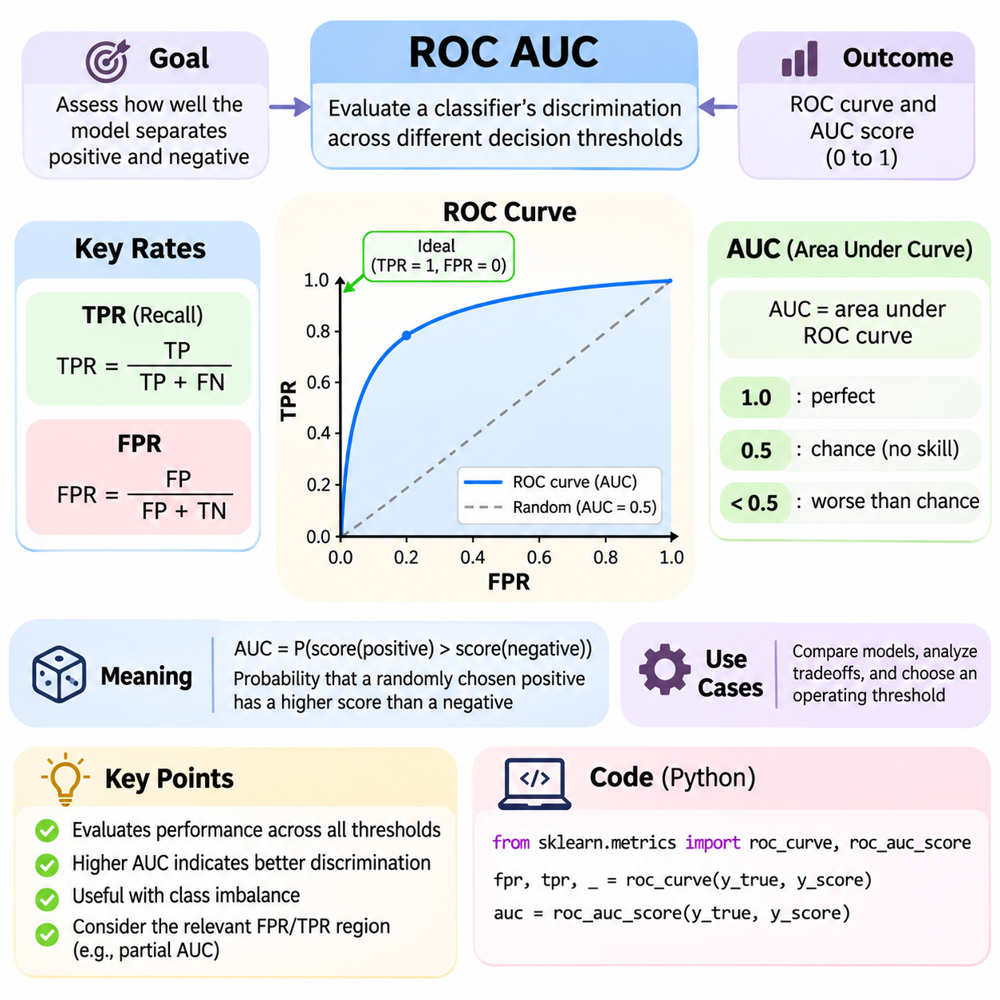{width="7.268055555555556in" height="7.268055555555556in"}

Receiver Operating Characteristic, commonly abbreviated ROC, is an evaluation method used to examine the discrimination capability of binary classification models across different decision thresholds. Instead of measuring performance at a single threshold, ROC analysis describes how the balance between correctly detected positive cases and incorrectly identified negative cases changes as the classification threshold varies.

Many classification models generate continuous prediction scores or estimated probabilities rather than directly producing class labels. A decision threshold converts these scores into positive or negative predictions. Changing the threshold modifies the number of true positives, false positives, true negatives, and false negatives. ROC analysis systematically evaluates these changes to characterize the classifier\'s discrimination performance.

The ROC curve is constructed using the true positive rate and the false positive rate. The true positive rate, also called sensitivity or recall, measures the proportion of actual positive observations correctly identified. It is calculated as TPR = TP / (TP + FN). The false positive rate measures the proportion of actual negative observations incorrectly classified as positive, calculated as FPR = FP / (FP + TN).

Each point on an ROC curve represents a particular decision threshold and its corresponding true positive rate and false positive rate. The horizontal axis represents FPR, while the vertical axis represents TPR. By varying the threshold from a highly restrictive setting to a permissive setting, the curve describes how the classifier trades additional positive detections against additional false alarms.

An ideal classifier would achieve a true positive rate of 1 while maintaining a false positive rate of 0. This corresponds to the upper-left corner of ROC space, indicating complete detection of positive cases without incorrectly labeling negative cases. In contrast, a classifier with no useful ranking discrimination typically produces a curve near the diagonal line connecting the lower-left and upper-right corners.

The diagonal reference line represents the expected ROC behavior of a classifier whose scores do not distinguish positive observations from negative observations. Its true positive rate approximately matches its false positive rate across thresholds. A curve substantially above this line indicates useful discrimination, while a curve below it may suggest that the scoring direction is reversed or that the model performs poorly.

The Area Under the ROC Curve, abbreviated ROC AUC, summarizes the ROC curve into a single numerical value. AUC measures the area beneath the relationship between the true positive rate and false positive rate. Its value ranges from 0 to 1, where 1 represents perfect ranking discrimination, 0.5 corresponds to chance-level ranking, and values below 0.5 indicate systematically unfavorable ranking behavior.

ROC AUC has an important probabilistic interpretation. It represents the probability that a randomly selected positive observation receives a higher prediction score than a randomly selected negative observation, with tied scores receiving half credit. This interpretation emphasizes that AUC evaluates ranking quality rather than the accuracy of probability estimates or the correctness of predictions at one particular threshold.

For example, an ROC AUC of 0.90 indicates that a randomly selected positive-negative pair is correctly ordered approximately 90% of the time, counting ties as half correct. This does not mean that the classifier achieves 90% accuracy or detects 90% of positive cases at every threshold. AUC summarizes discrimination across thresholds and must not be confused with threshold-specific classification metrics.

ROC curves are particularly useful when comparing models that produce different score distributions. Two classifiers may have similar accuracy at a selected threshold but different ROC curves because their ability to separate positive and negative observations differs. Comparing AUC values provides a broad ranking assessment, while examining curve shapes reveals whether one model performs better in operationally important regions.

A model with a higher overall AUC is not necessarily preferable at every decision threshold. ROC curves may intersect, meaning one classifier achieves better sensitivity at low false positive rates while another performs better at higher false positive rates. Model selection should therefore consider the region of the ROC curve relevant to application requirements rather than relying exclusively on the total AUC.

In applications where false positives are expensive, the low-FPR region is particularly important. For example, an industrial defect detection system may need to identify defective products while minimizing unnecessary rejection of acceptable products. A classifier that achieves high recall at a very low false positive rate may be more valuable than one with a slightly higher overall AUC but less favorable operating behavior.

Partial AUC provides a way to evaluate discrimination within a restricted range of false positive rates. Instead of integrating across the entire ROC curve, partial AUC focuses on a selected operating region. This approach is useful when deployment constraints impose a strict maximum false positive rate, although the selected interval and any normalization convention must be documented for meaningful comparison.

ROC AUC is often described as relatively insensitive to class prevalence because its true positive and false positive rates are normalized separately by actual class counts. However, this does not mean ROC analysis is unaffected by dataset composition. Changes in class difficulty, sampling procedures, population characteristics, or score distributions can substantially influence the resulting ROC curve and AUC.

Severe class imbalance can make ROC analysis appear more favorable than operational experience suggests. When negative observations are extremely numerous, a small false positive rate may still correspond to a large number of false alarms. Precision-recall analysis is often more informative when the positive class is rare and the practical objective emphasizes the reliability of positive predictions.

The precision-recall curve evaluates precision against recall as the decision threshold changes. Unlike ROC analysis, precision directly incorporates the proportion of false positives among predicted positive cases and is sensitive to class prevalence. ROC and precision-recall curves therefore provide complementary perspectives, especially in fraud detection, medical screening, and other applications involving rare positive events.

ROC AUC should also be distinguished from probability calibration. A model may achieve excellent AUC while assigning probabilities that do not correspond to observed event frequencies. Any strictly increasing transformation of prediction scores preserves their ranking and therefore preserves ROC AUC. Calibration must be assessed separately when probabilities are used for risk estimation or decision-making.

ROC curves can be calculated efficiently using Python and the scikit-learn library. The roc_curve function accepts ground-truth binary labels and continuous prediction scores, returning arrays of false positive rates, true positive rates, and associated thresholds. The roc_auc_score function calculates the corresponding AUC directly, allowing quantitative comparisons between classifiers evaluated on the same dataset.

A typical implementation begins by obtaining probability estimates or decision scores from a trained model. For a binary classifier supporting predict_proba, the probability assigned to the designated positive class is commonly used. These scores are supplied to roc_curve or roc_auc_score together with actual labels. Using hard class predictions instead of continuous scores discards threshold information and produces a less informative evaluation.

The auc function can also calculate the area beneath a curve from its coordinate arrays. When applied to the false positive rates and true positive rates returned by roc_curve, it provides the ROC AUC through numerical integration. Consistent score orientation, positive-class definition, and dataset selection are essential to ensure that computed results represent the intended classification task.

Multiclass ROC AUC extends binary evaluation through strategies such as one-versus-rest and one-versus-one. One-versus-rest evaluates each class against all remaining classes, while one-versus-one considers pairs of classes. Macro and weighted averaging can summarize these evaluations, but their interpretation depends on the chosen strategy and class frequencies. Reporting these settings is necessary for reproducibility.

AUC estimates are subject to statistical uncertainty because they are calculated from finite evaluation samples. Small datasets, rare positive cases, and correlated observations may produce unstable estimates. Bootstrap resampling and suitable confidence interval methods can help quantify uncertainty. When comparing classifiers, paired evaluation procedures are preferable because both models are assessed using the same observations.

ROC analysis must be performed on data that has not improperly influenced model development. Repeatedly selecting models or thresholds based on test-set ROC results can introduce evaluation bias. Validation data should guide threshold selection and model tuning, while an independent test dataset should provide the final assessment. Data leakage and distribution mismatch can undermine even carefully calculated AUC values.

Ultimately, ROC curves and ROC AUC provide powerful tools for understanding classification discrimination across decision thresholds. ROC curves expose the relationship between positive detection and false alarms, while AUC summarizes overall ranking capability. Their greatest value emerges when combined with confusion matrices, precision-recall analysis, calibration assessment, and application-specific operating requirements.

수신자 조작 특성(Receiver Operating Characteristic, ROC)은 서로 다른 결정 임계값(Decision Thresholds)에서 이진 분류 모델(Binary Classification Models)의 판별 능력(Discrimination Capability)을 평가하는 방법이다. ROC 분석(ROC Analysis)은 단일 임계값에서 성능을 측정하는 대신, 분류 임계값이 변화함에 따라 올바르게 탐지된 양성 사례(Positive Cases)와 잘못 식별된 음성 사례(Negative Cases) 사이의 균형이 어떻게 달라지는지 설명한다.

많은 분류 모델(Classification Models)은 클래스 레이블(Class Labels)을 직접 생성하기보다 연속적인 예측 점수(Continuous Prediction Scores)나 추정 확률(Estimated Probabilities)을 생성한다. 결정 임계값(Decision Threshold)은 이러한 점수를 양성 또는 음성 예측으로 변환한다. 임계값을 변경하면 참 양성(True Positives), 거짓 양성(False Positives), 참 음성(True Negatives), 거짓 음성(False Negatives)의 수가 달라진다. ROC 분석은 이러한 변화를 체계적으로 평가하여 분류기의 판별 성능(Discrimination Performance)을 파악한다.

ROC 곡선(ROC Curve)은 참 양성률(True Positive Rate)과 거짓 양성률(False Positive Rate)을 사용하여 구성된다. 민감도(Sensitivity) 또는 재현율(Recall)이라고도 하는 참 양성률은 실제 양성 관측값(Actual Positive Observations) 중 올바르게 식별된 비율을 측정한다. 계산식은 TPR = TP / (TP + FN)이다. 거짓 양성률은 실제 음성 관측값 중 양성으로 잘못 분류된 비율을 측정하며, FPR = FP / (FP + TN)으로 계산한다.

ROC 곡선(ROC Curve)의 각 점은 특정 결정 임계값(Decision Threshold)과 그에 대응하는 참 양성률(True Positive Rate) 및 거짓 양성률(False Positive Rate)을 나타낸다. 가로축(Horizontal Axis)은 FPR을 나타내고 세로축(Vertical Axis)은 TPR을 나타낸다. 임계값을 매우 엄격한 설정에서 허용적인 설정으로 변화시키면, 추가적인 양성 탐지(Positive Detections)와 추가적인 잘못된 경고(False Alarms) 사이의 상충 관계(Tradeoff)를 확인할 수 있다.

이상적인 분류기(Ideal Classifier)는 거짓 양성률(False Positive Rate)을 0으로 유지하면서 참 양성률(True Positive Rate) 1을 달성한다. 이는 ROC 공간(ROC Space)의 왼쪽 위 모서리(Upper-Left Corner)에 해당하며, 음성 사례를 양성으로 잘못 분류하지 않으면서 모든 양성 사례를 탐지한다는 의미이다. 반면 유용한 순위 판별 능력(Ranking Discrimination)이 없는 분류기는 일반적으로 왼쪽 아래와 오른쪽 위 모서리를 연결하는 대각선(Diagonal Line) 근처의 곡선을 생성한다.

대각선 기준선(Diagonal Reference Line)은 예측 점수(Prediction Scores)가 양성 관측값과 음성 관측값을 구분하지 못하는 분류기의 예상 ROC 동작을 나타낸다. 이 경우 여러 임계값에서 참 양성률(True Positive Rate)은 거짓 양성률(False Positive Rate)과 대체로 비슷하다. 이 기준선보다 상당히 위에 있는 곡선은 유용한 판별 능력을 나타내며, 아래에 있는 곡선은 점수 방향(Scoring Direction)이 반대로 설정되었거나 모델 성능이 낮다는 것을 의미할 수 있다.

ROC 곡선 아래 면적(Area Under the ROC Curve, ROC AUC)은 ROC 곡선을 하나의 수치로 요약하는 지표이다. AUC는 참 양성률(True Positive Rate)과 거짓 양성률(False Positive Rate) 사이의 관계를 나타내는 곡선 아래 면적을 측정한다. 값의 범위는 0에서 1이며, 1은 완벽한 순위 판별 능력(Perfect Ranking Discrimination), 0.5는 우연 수준의 순위 판별(Chance-Level Ranking), 0.5보다 작은 값은 체계적으로 불리한 순위 결정 동작을 나타낸다.

ROC AUC에는 중요한 확률적 해석(Probabilistic Interpretation)이 존재한다. 무작위로 선택한 양성 관측값(Randomly Selected Positive Observation)이 무작위로 선택한 음성 관측값(Randomly Selected Negative Observation)보다 높은 예측 점수(Prediction Score)를 받을 확률을 나타내며, 두 점수가 같으면 절반의 점수를 부여한다. 이러한 해석은 AUC가 확률 추정값(Probability Estimates)의 정확성이나 특정 임계값에서의 예측 정확성보다 순위 품질(Ranking Quality)을 평가한다는 점을 강조한다.

예를 들어 ROC AUC가 0.90이라면 무작위로 선택한 양성-음성 쌍(Positive-Negative Pair)이 약 90%의 비율로 올바른 순서로 정렬된다는 의미이며, 동점은 절반만 올바른 것으로 계산한다. 이는 분류기가 90%의 정확도(Accuracy)를 달성하거나 모든 임계값에서 양성 사례의 90%를 탐지한다는 의미가 아니다. AUC는 여러 임계값에 걸친 판별 능력(Discrimination)을 요약하므로 특정 임계값의 분류 평가 지표와 혼동해서는 안 된다.

ROC 곡선(ROC Curves)은 서로 다른 점수 분포(Score Distributions)를 생성하는 모델을 비교할 때 특히 유용하다. 두 분류기가 특정 임계값에서 비슷한 정확도(Accuracy)를 달성하더라도 양성 관측값과 음성 관측값을 구분하는 능력이 다르면 ROC 곡선도 달라질 수 있다. AUC 값을 비교하면 전반적인 순위 성능(Ranking Performance)을 평가할 수 있으며, 곡선의 형태를 분석하면 운영상 중요한 영역에서 어떤 모델이 더 우수한지 확인할 수 있다.

전체 AUC가 더 높은 모델이 모든 결정 임계값(Decision Thresholds)에서 반드시 더 좋은 것은 아니다. ROC 곡선이 서로 교차할 수 있으며, 이는 한 분류기가 낮은 거짓 양성률(False Positive Rates)에서 더 높은 민감도(Sensitivity)를 달성하는 반면 다른 분류기는 높은 거짓 양성률 영역에서 더 좋은 성능을 보일 수 있음을 의미한다. 따라서 모델 선택(Model Selection)은 전체 AUC에만 의존하지 않고 응용 요구사항과 관련된 ROC 곡선 영역을 고려해야 한다.

거짓 양성(False Positives)의 비용이 높은 응용에서는 낮은 거짓 양성률(Low-FPR) 영역이 특히 중요하다. 예를 들어 산업용 결함 탐지 시스템(Industrial Defect Detection System)은 정상 제품의 불필요한 불합격 판정(Unnecessary Rejection)을 최소화하면서 결함 제품을 식별해야 할 수 있다. 매우 낮은 거짓 양성률에서 높은 재현율(Recall)을 달성하는 분류기는 전체 AUC가 약간 더 높더라도 운영 성능이 불리한 다른 모델보다 더 가치 있을 수 있다.

부분 AUC(Partial AUC)는 제한된 거짓 양성률(False Positive Rate) 범위에서 판별 능력(Discrimination)을 평가하는 방법이다. 전체 ROC 곡선에 걸쳐 면적을 적분(Integration)하는 대신 선택된 운영 영역(Operating Region)에 집중한다. 이러한 접근법은 배포 제약조건(Deployment Constraints)이 엄격한 최대 거짓 양성률을 요구할 때 유용하지만, 의미 있는 비교를 위해 선택한 구간(Selected Interval)과 정규화 규칙(Normalization Convention)을 문서화해야 한다.

ROC AUC는 참 양성률(True Positive Rate)과 거짓 양성률(False Positive Rate)이 실제 클래스별 관측값 수로 각각 정규화되기 때문에 클래스 출현 비율(Class Prevalence)에 상대적으로 둔감한 지표로 설명된다. 그러나 이것이 ROC 분석이 데이터셋 구성(Dataset Composition)의 영향을 받지 않는다는 의미는 아니다. 클래스별 난이도(Class Difficulty), 표본 추출 절차(Sampling Procedures), 모집단 특성(Population Characteristics), 점수 분포(Score Distributions)의 변화는 ROC 곡선과 AUC에 상당한 영향을 줄 수 있다.

심각한 클래스 불균형(Class Imbalance)은 ROC 분석 결과가 실제 운영 경험보다 더 긍정적으로 보이게 만들 수 있다. 음성 관측값(Negative Observations)이 매우 많으면 작은 거짓 양성률(False Positive Rate)도 상당한 수의 잘못된 경고(False Alarms)에 해당할 수 있다. 양성 클래스(Positive Class)가 드물고 실제 목표가 양성 예측의 신뢰성(Reliability of Positive Predictions)을 강조하는 경우에는 정밀도-재현율 분석(Precision-Recall Analysis)이 더 유용한 경우가 많다.

정밀도-재현율 곡선(Precision-Recall Curve)은 결정 임계값(Decision Threshold)이 변화할 때 정밀도(Precision)와 재현율(Recall) 사이의 관계를 평가한다. ROC 분석과 달리 정밀도는 양성으로 예측된 사례 중 거짓 양성(False Positives)의 비율을 직접 반영하며, 클래스 출현 비율(Class Prevalence)에 민감하다. 따라서 ROC 곡선과 정밀도-재현율 곡선은 특히 사기 탐지(Fraud Detection), 의료 선별 검사(Medical Screening), 희귀 양성 사건(Rare Positive Events)을 포함하는 응용에서 상호 보완적인 관점을 제공한다.

ROC AUC는 확률 보정(Probability Calibration)과도 구분해야 한다. 모델은 매우 높은 AUC를 달성하면서도 실제 관측된 사건 빈도(Observed Event Frequencies)와 일치하지 않는 확률을 출력할 수 있다. 예측 점수(Prediction Scores)에 엄격한 단조 증가 변환(Strictly Increasing Transformation)을 적용하더라도 순위는 유지되므로 ROC AUC 역시 변하지 않는다. 따라서 확률이 위험 추정(Risk Estimation)이나 의사결정(Decision-Making)에 사용되는 경우 확률 보정을 별도로 평가해야 한다.

ROC 곡선(ROC Curves)은 파이썬(Python)과 사이킷런(scikit-learn) 라이브러리를 사용하여 효율적으로 계산할 수 있다. roc_curve 함수는 이진 정답 레이블(Ground-Truth Binary Labels)과 연속적인 예측 점수(Continuous Prediction Scores)를 입력으로 받아 거짓 양성률(False Positive Rates), 참 양성률(True Positive Rates), 해당 임계값(Thresholds)의 배열을 반환한다. roc_auc_score 함수는 대응하는 AUC를 직접 계산하여 동일한 데이터셋에서 평가된 분류기 사이의 정량적 비교를 지원한다.

일반적인 구현(Implementation)은 학습된 모델(Trained Model)에서 확률 추정값(Probability Estimates)이나 결정 점수(Decision Scores)를 얻는 과정으로 시작한다. predict_proba를 지원하는 이진 분류기(Binary Classifier)에서는 지정된 양성 클래스(Positive Class)에 할당된 확률을 일반적으로 사용한다. 이러한 점수를 실제 레이블(Actual Labels)과 함께 roc_curve 또는 roc_auc_score에 전달한다. 연속적인 점수 대신 확정된 클래스 예측값(Hard Class Predictions)을 사용하면 임계값 정보(Threshold Information)가 손실되어 평가의 유용성이 감소한다.

auc 함수는 곡선의 좌표 배열(Coordinate Arrays)로부터 곡선 아래 면적(Area Under the Curve)을 계산할 수도 있다. roc_curve에서 반환된 거짓 양성률(False Positive Rates)과 참 양성률(True Positive Rates)에 적용하면 수치 적분(Numerical Integration)을 통해 ROC AUC를 계산한다. 계산 결과가 의도한 분류 작업(Classification Task)을 정확하게 나타내도록 하려면 일관된 점수 방향(Score Orientation), 양성 클래스 정의(Positive-Class Definition), 데이터셋 선택(Dataset Selection)이 필수적이다.

다중 클래스 ROC AUC(Multiclass ROC AUC)는 일대다(One-versus-Rest) 및 일대일(One-versus-One)과 같은 전략을 통해 이진 평가를 확장한다. 일대다 방식은 각 클래스를 나머지 모든 클래스와 비교하고, 일대일 방식은 클래스 쌍(Class Pairs)을 비교한다. 매크로 평균(Macro Averaging)과 가중 평균(Weighted Averaging)을 사용하여 이러한 평가를 요약할 수 있지만, 해석은 선택한 전략과 클래스 빈도(Class Frequencies)에 따라 달라진다. 재현성(Reproducibility)을 위해 이러한 설정을 명시해야 한다.

AUC 추정값(AUC Estimates)은 유한한 평가 표본(Finite Evaluation Samples)으로 계산되므로 통계적 불확실성(Statistical Uncertainty)을 가진다. 작은 데이터셋(Small Datasets), 희귀 양성 사례(Rare Positive Cases), 상관관계가 있는 관측값(Correlated Observations)은 불안정한 추정값을 생성할 수 있다. 부트스트랩 재표본추출(Bootstrap Resampling)과 적절한 신뢰구간 방법(Confidence Interval Methods)은 불확실성을 정량화하는 데 도움이 된다. 분류기를 비교할 때는 두 모델을 동일한 관측값으로 평가하는 대응 평가 절차(Paired Evaluation Procedures)가 바람직하다.

ROC 분석(ROC Analysis)은 모델 개발(Model Development)에 부적절하게 영향을 주지 않은 데이터에서 수행해야 한다. 테스트 데이터셋(Test Set)의 ROC 결과를 반복적으로 사용하여 모델이나 임계값을 선택하면 평가 편향(Evaluation Bias)이 발생할 수 있다. 검증 데이터(Validation Data)는 임계값 선택(Threshold Selection)과 모델 튜닝(Model Tuning)에 사용하고, 독립적인 테스트 데이터셋(Independent Test Dataset)은 최종 평가에 사용해야 한다. 데이터 누출(Data Leakage)과 분포 불일치(Distribution Mismatch)는 신중하게 계산한 AUC 값의 신뢰성도 훼손할 수 있다.

궁극적으로 ROC 곡선(ROC Curves)과 ROC AUC는 다양한 결정 임계값(Decision Thresholds)에 걸쳐 분류기의 판별 능력(Classification Discrimination)을 이해하기 위한 강력한 도구이다. ROC 곡선은 양성 탐지(Positive Detection)와 잘못된 경고(False Alarms) 사이의 관계를 보여주며, AUC는 전반적인 순위 판별 능력(Ranking Capability)을 요약한다. 혼동 행렬(Confusion Matrices), 정밀도-재현율 분석(Precision-Recall Analysis), 확률 보정 평가(Calibration Assessment), 응용별 운영 요구사항(Application-Specific Operating Requirements)과 함께 사용할 때 가장 큰 가치를 제공한다.

## 04.04 Regression Metrics

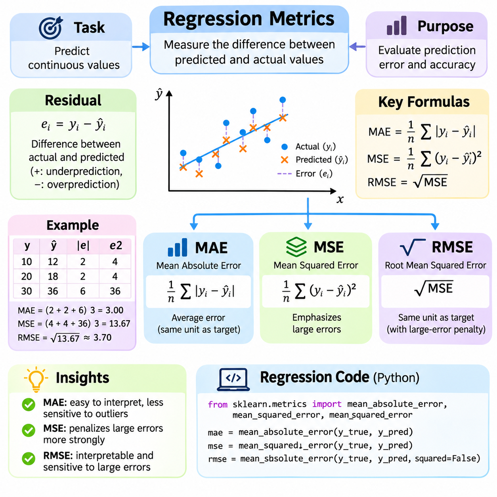{width="7.268055555555556in" height="7.268055555555556in"}

Regression metrics are quantitative measures used to evaluate how accurately machine learning models predict continuous numerical values. Unlike classification metrics, which examine categorical decisions, regression metrics measure differences between predicted and observed quantities. Their purpose is to determine prediction quality, identify systematic errors, and assess whether a model satisfies practical accuracy requirements.

Regression evaluation begins by comparing predicted values with corresponding ground-truth observations. The difference between an observed value and its prediction is called a residual. Residuals describe both the magnitude and direction of prediction errors. Positive residuals indicate underprediction when residuals are defined as actual minus predicted values, while negative residuals indicate overprediction.

Mean Absolute Error, abbreviated MAE, measures the average absolute difference between predicted and actual values. For n observations, MAE = (1/n) × Σ\|yᵢ − ŷᵢ\|, where yᵢ represents the actual value and ŷᵢ represents the prediction. Absolute values prevent positive and negative errors from canceling each other, producing an intuitive measure of typical prediction error.

MAE is expressed in the same units as the target variable, making its interpretation straightforward. If a temperature prediction model achieves an MAE of 2°C, its average absolute prediction error is two degrees Celsius. Similarly, an MAE of 5 millimeters in a distance estimation system indicates an average absolute deviation of five millimeters from measured values.

Mean Squared Error, abbreviated MSE, measures the average squared difference between predicted and actual values. Its formula is MSE = (1/n) × Σ(yᵢ − ŷᵢ)². Squaring eliminates negative signs and assigns disproportionately larger penalties to large errors. Consequently, MSE emphasizes substantial prediction failures more strongly than MAE and is widely used in regression model training.

Consider a regression model producing prediction errors of 1, 2, and 6 units. The MAE equals (1 + 2 + 6) / 3 = 3 units, while the MSE equals (1 + 4 + 36) / 3 ≈ 13.67 squared units. The largest error contributes 36 of the total 41 squared-error units. This example illustrates why MSE is particularly sensitive to occasional large deviations.

The distinction between MAE and MSE is important when selecting an evaluation objective. MAE treats prediction errors proportionally to their absolute magnitude, making it relatively less sensitive to extreme observations. MSE penalizes large errors quadratically, which is valuable when substantial mistakes are especially undesirable. Neither metric is universally superior because their usefulness depends on application requirements.

Outliers can significantly influence regression evaluation. An unusually large prediction error may dominate MSE even when most predictions are accurate. MAE is less affected by such extreme errors, although it is not completely immune to them. Comparing both metrics helps determine whether a model exhibits generally consistent errors or occasionally produces unusually large failures.

Root Mean Squared Error, abbreviated RMSE, is calculated by taking the square root of MSE. Its formula is RMSE = √MSE. Unlike MSE, RMSE is expressed in the original units of the target variable. This makes RMSE easier to interpret while retaining sensitivity to large errors, providing a practical compromise between interpretability and error penalization.

The relationship between RMSE and MAE can reveal characteristics of the error distribution. RMSE is always greater than or equal to MAE when calculated over the same observations. A substantial difference between them often indicates the presence of relatively large errors. However, this relationship alone cannot identify the causes of those errors, so additional residual analysis remains necessary.

Regression metrics should be interpreted relative to the scale of the target variable. An MAE of 10 may be excellent when predicting values around one million but unacceptable when predicting values around 20. Therefore, absolute metric values should be compared against domain requirements, baseline models, and the natural variability of the measured quantity.

The coefficient of determination, commonly called R-squared or R², measures how well model predictions explain variation in the target relative to predicting the evaluation sample\'s mean. It is calculated as R² = 1 − SS_res / SS_tot, where SS_res represents the sum of squared residuals and SS_tot represents the total squared deviation from the observed mean.

An R² value of 1 indicates perfect predictions, while 0 indicates performance equivalent to predicting the evaluation sample mean under the standard definition. Negative R² values are possible when predictions perform worse than this baseline. Although R² provides a useful relative measure, it does not directly describe the magnitude of prediction errors in physical or operational units.

Mean Absolute Percentage Error, abbreviated MAPE, expresses prediction errors as percentages relative to actual values. This can improve interpretability when comparing predictions across different scales. However, MAPE becomes undefined when actual values equal zero and unstable when they approach zero. It can also behave asymmetrically, making it unsuitable for some regression applications.

Residual analysis complements numerical metrics by examining patterns in prediction errors. Ideally, residuals should not exhibit systematic relationships with predicted values, input features, or time. Persistent positive or negative residuals may indicate bias, while increasing error dispersion may suggest heteroscedasticity. These patterns can reveal weaknesses that aggregate MAE or MSE values conceal.

Regression metrics can be implemented efficiently using Python and the scikit-learn library. The mean_absolute_error and mean_squared_error functions accept arrays of actual and predicted values. The root_mean_squared_error function calculates RMSE in supported versions, while r2_score computes the coefficient of determination. Consistent input ordering is essential for meaningful results.

A typical regression evaluation workflow begins by training a model on training data and generating predictions for an independent test dataset. Actual values and predictions are then supplied to the metric functions. MAE, MSE, RMSE, and R² can be recorded together, allowing engineers to examine average error magnitude, sensitivity to large deviations, and performance relative to a baseline.

For example, Python arrays containing actual values of [10, 20, 30, 40] and predicted values of [12, 18, 33, 37] produce absolute errors of [2, 2, 3, 3]. The resulting MAE is 2.5, MSE is 6.5, and RMSE is approximately 2.55. These calculations demonstrate how the same predictions can be summarized using different error functions.

When implementing regression metrics, preprocessing consistency is essential. If a model predicts normalized or standardized target values, predictions and reference values should be transformed back to the original scale before reporting operational error metrics. Otherwise, MAE and MSE may describe transformed units rather than quantities meaningful to users or engineering systems.

Multi-output regression introduces additional evaluation considerations because models may predict several continuous variables simultaneously. Metrics can be calculated independently for each target or aggregated across outputs. When target variables use different units or scales, unweighted aggregation may produce misleading conclusions. Output-specific metrics are often necessary for reliable interpretation.

Evaluation must also account for differences between development data and real-world operating conditions. A model that predicts accurately on randomly sampled test data may perform poorly when sensor conditions, seasonal patterns, or operating environments change. Temporal validation, representative test datasets, and subgroup analysis help determine whether reported regression performance is likely to generalize.

Model comparison requires identical evaluation datasets and consistent metric definitions. A lower MAE or MSE generally indicates better predictive accuracy under the corresponding error criterion, but small numerical improvements may not justify additional computational cost or operational complexity. Statistical uncertainty, inference latency, and deployment constraints should also influence model selection.

In practical applications, acceptable regression error depends on the consequences of inaccurate predictions. A small average error may be insufficient for precision manufacturing if occasional large deviations exceed safety tolerances. Conversely, moderate prediction errors may be acceptable in demand forecasting when uncertainty is inherently high. Evaluation criteria should reflect these domain-specific requirements.

Ultimately, MAE, MSE, RMSE, and R² provide complementary perspectives on regression performance. MAE describes average absolute deviation, MSE emphasizes large errors, RMSE expresses squared-error sensitivity in original units, and R² measures relative explanatory performance. Combining these metrics with residual analysis and application requirements supports reliable regression model development and deployment.

회귀 평가 지표(Regression Metrics)는 머신러닝 모델(Machine Learning Models)이 연속적인 수치값(Continuous Numerical Values)을 얼마나 정확하게 예측하는지 평가하는 정량적 측정값(Quantitative Measures)이다. 범주형 결정(Categorical Decisions)을 평가하는 분류 지표(Classification Metrics)와 달리, 회귀 지표는 예측값(Predicted Values)과 실제 관측값(Observed Values) 사이의 차이를 측정한다. 주요 목적은 예측 품질(Prediction Quality)을 판단하고, 체계적인 오류(Systematic Errors)를 식별하며, 모델이 실제 정확도 요구사항(Practical Accuracy Requirements)을 충족하는지 평가하는 것이다.

회귀 평가(Regression Evaluation)는 예측값(Predicted Values)과 이에 대응하는 정답 관측값(Ground-Truth Observations)을 비교하는 과정에서 시작한다. 관측값과 예측값 사이의 차이를 잔차(Residual)라고 한다. 잔차는 예측 오류(Prediction Errors)의 크기와 방향을 모두 설명한다. 잔차를 실제값에서 예측값을 뺀 값으로 정의하면 양의 잔차(Positive Residuals)는 과소 예측(Underprediction)을 나타내고, 음의 잔차(Negative Residuals)는 과대 예측(Overprediction)을 나타낸다.

평균 절대 오차(Mean Absolute Error, MAE)는 예측값과 실제값 사이의 절대 차이(Absolute Difference)를 평균한 값이다. 관측값이 n개일 때 계산식은 MAE = (1/n) × Σ\|yᵢ − ŷᵢ\|이며, yᵢ는 실제값(Actual Value), ŷᵢ는 예측값(Predicted Value)을 나타낸다. 절대값(Absolute Values)을 사용하면 양의 오류와 음의 오류가 서로 상쇄되는 현상을 방지할 수 있으며, 일반적인 예측 오차의 크기를 직관적으로 나타낼 수 있다.

평균 절대 오차(MAE)는 목표 변수(Target Variable)와 동일한 단위(Units)로 표현되므로 해석하기 쉽다. 온도 예측 모델(Temperature Prediction Model)의 MAE가 2°C라면 평균 절대 예측 오차(Average Absolute Prediction Error)가 섭씨 2도라는 의미이다. 마찬가지로 거리 추정 시스템(Distance Estimation System)의 MAE가 5밀리미터라면 측정값(Measured Values)으로부터 평균적으로 5밀리미터의 절대 편차(Absolute Deviation)가 발생한다는 의미이다.

평균 제곱 오차(Mean Squared Error, MSE)는 예측값과 실제값 사이의 차이를 제곱한 후 평균한 값이다. 계산식은 MSE = (1/n) × Σ(yᵢ − ŷᵢ)²이다. 제곱 연산(Squaring)은 음수 부호를 제거하고 큰 오차에 불균형적으로 더 큰 불이익(Penalties)을 부여한다. 따라서 MSE는 MAE보다 큰 예측 실패(Substantial Prediction Failures)를 더욱 강하게 강조하며, 회귀 모델 학습(Regression Model Training)에서 널리 사용된다.

회귀 모델(Regression Model)이 1, 2, 6단위의 예측 오차(Prediction Errors)를 생성한다고 가정해 보자. MAE는 (1 + 2 + 6) / 3 = 3단위이며, MSE는 (1 + 4 + 36) / 3 ≈ 13.67제곱 단위이다. 가장 큰 오차는 전체 제곱 오차의 합인 41 중 36을 차지한다. 이 사례는 MSE가 간헐적으로 발생하는 큰 편차(Large Deviations)에 특히 민감한 이유를 보여준다.

평가 목표(Evaluation Objective)를 선택할 때 MAE와 MSE의 차이를 이해하는 것이 중요하다. MAE는 예측 오차의 절대 크기(Absolute Magnitude)에 비례하여 오차를 평가하므로 극단적인 관측값(Extreme Observations)에 상대적으로 덜 민감하다. MSE는 큰 오차에 제곱에 비례하는 불이익(Quadratic Penalty)을 부여하므로 큰 실수가 특히 바람직하지 않은 상황에서 유용하다. 어느 지표도 보편적으로 우월하지 않으며, 적합성은 응용 요구사항(Application Requirements)에 따라 달라진다.

이상치(Outliers)는 회귀 평가(Regression Evaluation)에 상당한 영향을 미칠 수 있다. 비정상적으로 큰 예측 오차(Unusually Large Prediction Error)는 대부분의 예측이 정확하더라도 MSE를 지배할 수 있다. MAE는 이러한 극단적인 오차의 영향을 상대적으로 적게 받지만 완전히 영향을 받지 않는 것은 아니다. 두 지표를 함께 비교하면 모델이 전반적으로 일관된 오차(Consistent Errors)를 보이는지 또는 간헐적으로 비정상적으로 큰 실패를 발생시키는지 판단하는 데 도움이 된다.

평균 제곱근 오차(Root Mean Squared Error, RMSE)는 MSE의 제곱근(Square Root)을 계산하여 얻는다. 계산식은 RMSE = √MSE이다. MSE와 달리 RMSE는 목표 변수(Target Variable)의 원래 단위(Original Units)로 표현된다. 따라서 큰 오차에 대한 민감도(Sensitivity to Large Errors)를 유지하면서도 해석하기 쉬우며, 해석 가능성(Interpretability)과 오차에 대한 불이익(Error Penalization) 사이에서 실용적인 균형을 제공한다.

RMSE와 MAE 사이의 관계는 오차 분포(Error Distribution)의 특성을 파악하는 데 도움이 된다. 동일한 관측값에 대해 계산하면 RMSE는 항상 MAE보다 크거나 같다. 두 값 사이의 차이가 크면 상대적으로 큰 오차가 존재한다는 것을 나타내는 경우가 많다. 그러나 이러한 관계만으로 오차의 원인(Causes of Errors)을 식별할 수는 없으므로 추가적인 잔차 분석(Residual Analysis)이 필요하다.

회귀 평가 지표(Regression Metrics)는 목표 변수(Target Variable)의 척도(Scale)를 고려하여 해석해야 한다. MAE가 10이라는 값은 약 100만 수준의 값을 예측할 때는 매우 우수할 수 있지만, 약 20 수준의 값을 예측할 때는 허용할 수 없을 수 있다. 따라서 절대적인 지표 값(Absolute Metric Values)은 해당 분야의 요구사항(Domain Requirements), 기준 모델(Baseline Models), 측정 대상의 자연적인 변동성(Natural Variability)과 비교해야 한다.

결정계수(Coefficient of Determination)는 일반적으로 R 제곱(R-squared, R²)이라고 하며, 평가 표본의 평균값(Evaluation Sample Mean)을 예측하는 기준과 비교하여 모델 예측이 목표 변수의 변동(Variation)을 얼마나 잘 설명하는지 측정한다. 계산식은 R² = 1 − SS_res / SS_tot이며, SS_res는 잔차 제곱합(Sum of Squared Residuals), SS_tot는 관측값의 평균으로부터 계산한 총 제곱 편차(Total Squared Deviation)를 나타낸다.

R² 값이 1이면 완벽한 예측(Perfect Predictions)을 의미하며, 0이면 표준적인 정의(Standard Definition)에서 평가 표본의 평균값을 예측하는 것과 동일한 성능을 의미한다. 예측 성능이 이러한 기준 모델(Baseline Model)보다 낮으면 음의 R² 값(Negative R² Values)이 나타날 수 있다. R²는 유용한 상대적 측정값(Relative Measure)이지만, 물리적 또는 운영 단위(Physical or Operational Units)로 예측 오차의 크기를 직접 설명하지는 않는다.

평균 절대 백분율 오차(Mean Absolute Percentage Error, MAPE)는 예측 오차를 실제값(Actual Values)에 대한 백분율(Percentages)로 표현한다. 이는 서로 다른 척도(Scales)의 예측 결과를 비교할 때 해석 가능성을 높일 수 있다. 그러나 실제값이 0이면 MAPE는 정의되지 않으며, 실제값이 0에 가까워지면 불안정해진다. 또한 비대칭적인 동작(Asymmetric Behavior)을 보일 수 있으므로 일부 회귀 응용(Regression Applications)에는 적합하지 않다.

잔차 분석(Residual Analysis)은 예측 오류(Prediction Errors)의 패턴을 조사하여 수치적 평가 지표(Numerical Metrics)를 보완한다. 이상적으로 잔차는 예측값(Predicted Values), 입력 특징(Input Features), 시간(Time)과 체계적인 관계를 나타내지 않아야 한다. 지속적으로 양수 또는 음수인 잔차는 편향(Bias)을 나타낼 수 있으며, 오차의 분산이 증가하는 현상은 이분산성(Heteroscedasticity)을 시사할 수 있다. 이러한 패턴은 집계된 MAE나 MSE 값에 숨겨진 약점을 드러낼 수 있다.

회귀 평가 지표(Regression Metrics)는 파이썬(Python)과 사이킷런(scikit-learn) 라이브러리를 사용하여 효율적으로 구현할 수 있다. mean_absolute_error와 mean_squared_error 함수는 실제값과 예측값의 배열(Arrays)을 입력으로 받는다. 지원되는 버전에서는 root_mean_squared_error 함수가 RMSE를 계산하며, r2_score 함수는 결정계수(Coefficient of Determination)를 계산한다. 의미 있는 결과를 얻으려면 입력값의 순서(Input Ordering)를 일관되게 유지해야 한다.

일반적인 회귀 평가 작업 흐름(Regression Evaluation Workflow)은 학습 데이터(Training Data)로 모델을 학습하고 독립적인 테스트 데이터셋(Independent Test Dataset)에 대한 예측값을 생성하는 과정에서 시작한다. 이후 실제값과 예측값을 평가 지표 함수(Metric Functions)에 전달한다. MAE, MSE, RMSE, R²를 함께 기록하면 엔지니어가 평균 오차 크기(Average Error Magnitude), 큰 편차에 대한 민감도(Sensitivity to Large Deviations), 기준 모델 대비 성능(Performance Relative to a Baseline)을 종합적으로 분석할 수 있다.

예를 들어 실제값(Actual Values)이 [10, 20, 30, 40]이고 예측값(Predicted Values)이 [12, 18, 33, 37]인 파이썬 배열(Python Arrays)을 생각해 보자. 절대 오차(Absolute Errors)는 [2, 2, 3, 3]이며, MAE는 2.5, MSE는 6.5, RMSE는 약 2.55이다. 이러한 계산은 동일한 예측 결과라도 서로 다른 오차 함수(Error Functions)를 사용하여 다양한 방식으로 요약할 수 있음을 보여준다.

회귀 평가 지표(Regression Metrics)를 구현할 때는 전처리 일관성(Preprocessing Consistency)이 필수적이다. 모델이 정규화(Normalization)되거나 표준화(Standardization)된 목표값을 예측한다면, 운영상의 오차 지표(Operational Error Metrics)를 보고하기 전에 예측값과 기준값(Reference Values)을 원래 척도(Original Scale)로 역변환해야 한다. 그렇지 않으면 MAE와 MSE가 사용자나 엔지니어링 시스템에 의미 있는 실제 수량이 아니라 변환된 단위(Transformed Units)를 설명할 수 있다.

다중 출력 회귀(Multi-Output Regression)는 모델이 여러 연속 변수(Continuous Variables)를 동시에 예측하므로 추가적인 평가 고려사항(Evaluation Considerations)이 필요하다. 평가 지표는 각 목표 변수(Target Variable)에 대해 독립적으로 계산하거나 여러 출력에 걸쳐 집계(Aggregation)할 수 있다. 목표 변수마다 단위나 척도가 다르면 가중치를 적용하지 않은 집계(Unweighted Aggregation)가 잘못된 결론을 초래할 수 있다. 따라서 신뢰할 수 있는 해석을 위해 출력별 평가 지표(Output-Specific Metrics)가 필요한 경우가 많다.

평가는 개발 데이터(Development Data)와 실제 운영 조건(Real-World Operating Conditions) 사이의 차이도 고려해야 한다. 무작위로 추출한 테스트 데이터(Randomly Sampled Test Data)에서 정확한 예측을 수행하는 모델이라도 센서 조건(Sensor Conditions), 계절적 패턴(Seasonal Patterns), 운영 환경(Operating Environments)이 변화하면 성능이 저하될 수 있다. 시간 기반 검증(Temporal Validation), 대표성 있는 테스트 데이터셋(Representative Test Datasets), 하위 집단 분석(Subgroup Analysis)은 보고된 회귀 성능이 새로운 환경에도 일반화될 가능성을 판단하는 데 도움이 된다.

모델 비교(Model Comparison)에는 동일한 평가 데이터셋(Evaluation Datasets)과 일관된 평가 지표 정의(Metric Definitions)가 필요하다. MAE나 MSE가 낮다는 것은 일반적으로 해당 오차 기준(Error Criterion)에서 더 나은 예측 정확도(Predictive Accuracy)를 의미하지만, 작은 수치적 개선이 추가적인 계산 비용(Computational Cost)이나 운영 복잡성(Operational Complexity)을 정당화하지는 않을 수 있다. 통계적 불확실성(Statistical Uncertainty), 추론 지연시간(Inference Latency), 배포 제약조건(Deployment Constraints)도 모델 선택에 반영해야 한다.

실제 응용(Practical Applications)에서 허용 가능한 회귀 오차(Acceptable Regression Error)는 부정확한 예측이 초래하는 결과에 따라 달라진다. 정밀 제조(Precision Manufacturing)에서는 평균 오차가 작더라도 간헐적으로 발생하는 큰 편차가 안전 허용오차(Safety Tolerances)를 초과한다면 충분하지 않을 수 있다. 반면 수요 예측(Demand Forecasting)에서는 본질적인 불확실성(Inherent Uncertainty)이 높기 때문에 중간 수준의 예측 오차가 허용될 수 있다. 평가 기준(Evaluation Criteria)은 이러한 분야별 요구사항(Domain-Specific Requirements)을 반영해야 한다.

궁극적으로 MAE, MSE, RMSE, R²는 회귀 성능(Regression Performance)을 서로 보완적인 관점에서 설명한다. MAE는 평균 절대 편차(Average Absolute Deviation)를 나타내고, MSE는 큰 오차를 강조하며, RMSE는 제곱 오차에 대한 민감도(Squared-Error Sensitivity)를 원래 단위로 표현하고, R²는 상대적인 설명 성능(Relative Explanatory Performance)을 측정한다. 이러한 지표를 잔차 분석(Residual Analysis) 및 응용 요구사항(Application Requirements)과 결합하면 신뢰할 수 있는 회귀 모델 개발(Regression Model Development)과 배포(Deployment)를 지원할 수 있다.

## 04.05 Ranking Metrics

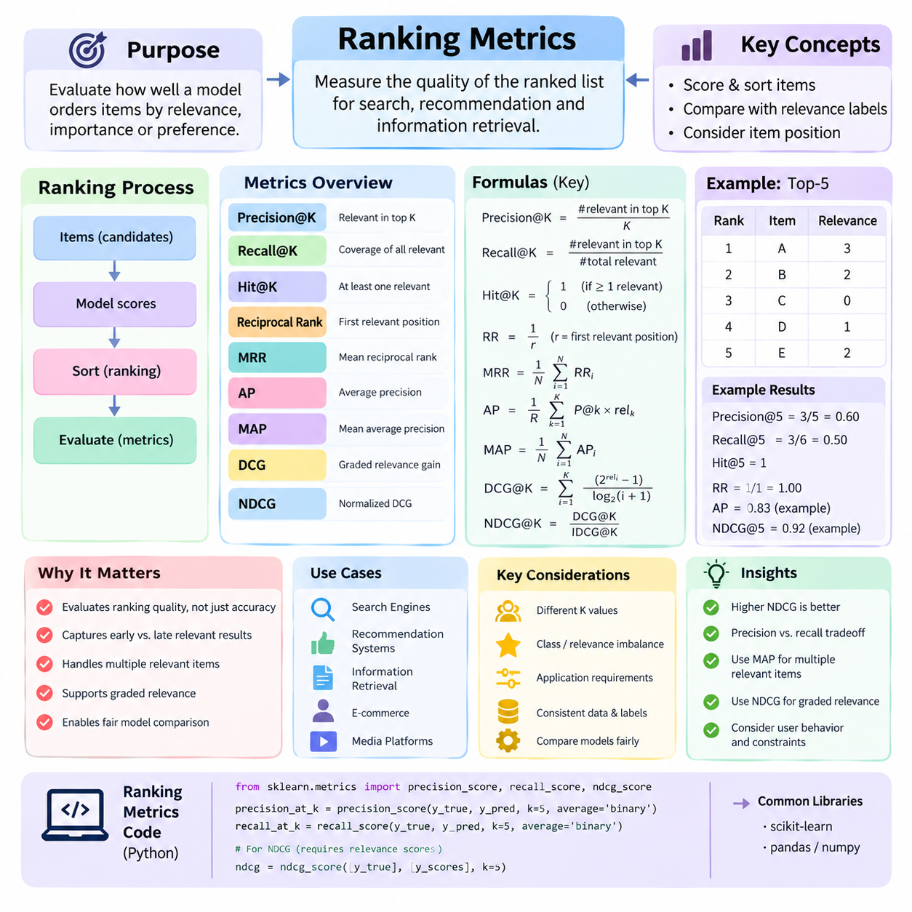{width="7.268055555555556in" height="7.268055555555556in"}

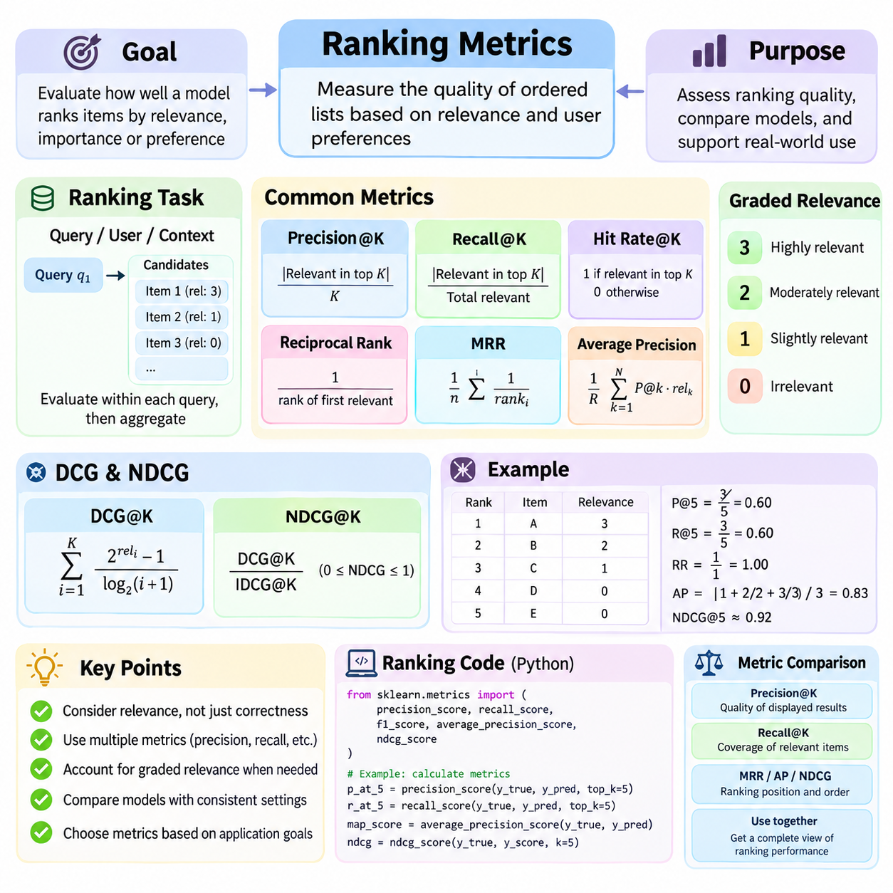{width="7.268055555555556in" height="7.268055555555556in"}

Ranking metrics evaluate how effectively a machine learning system orders items according to relevance, importance, preference, or predicted utility. Unlike classification metrics, which primarily assess categorical correctness, ranking metrics emphasize the relative positions of items in an ordered list. They are essential for search engines, recommendation systems, information retrieval, and applications where users examine only the highest-ranked results.

A ranking model typically assigns a numerical score to each candidate item and sorts the candidates according to those scores. Evaluation compares the resulting order with reference relevance judgments or observed preferences. A model may identify relevant items correctly but place them too far down the list. Ranking evaluation therefore considers not only whether relevant items are retrieved but also where they appear.

Ranking tasks are commonly organized around queries, users, or decision contexts. Each context defines a candidate set containing items with different relevance levels. Evaluation is generally performed within each context before results are aggregated across contexts. This distinction is important because ranking quality depends on comparisons among candidates associated with the same query rather than arbitrary comparisons across unrelated queries.

Precision at K, written Precision\\@K, measures the proportion of relevant items among the first K ranked results. It is calculated by dividing the number of relevant items in the top K positions by K. For example, if three of the first five recommended products are relevant, Precision\\@5 equals 0.60. This metric is useful when users primarily interact with a limited number of visible recommendations.

Recall at K, written Recall\\@K, measures the proportion of all relevant items successfully retrieved within the first K positions. Its denominator is the total number of relevant items associated with the query. If a query has eight relevant documents and five appear among the first ten results, Recall\\@10 equals 0.625. This metric emphasizes coverage rather than the concentration of relevant results.

Precision\\@K and Recall\\@K provide complementary perspectives on ranking performance. Precision\\@K measures the quality of the displayed results, while Recall\\@K measures how completely relevant information is recovered. Increasing K often improves recall but can reduce precision as less relevant items enter the list. The appropriate cutoff depends on interface constraints, user behavior, and application objectives.

Hit Rate at K, commonly written Hit\\@K, indicates whether at least one relevant item appears within the first K results. For an individual query, the result is one when a relevant item is present and zero otherwise. Averaging across queries produces the overall hit rate. This metric is particularly useful when successful retrieval requires finding at least one acceptable answer or recommendation.

Reciprocal Rank evaluates the position of the first relevant result. If the first relevant item appears at position r, its reciprocal rank is 1/r. A relevant item ranked first receives a score of 1, while one ranked fourth receives 0.25. This metric strongly rewards early retrieval and becomes especially meaningful when users usually need only one satisfactory result.

Mean Reciprocal Rank, abbreviated MRR, averages reciprocal ranks across multiple queries. Queries without a relevant retrieved result contribute zero under the usual convention. MRR is widely used in question answering, search, and retrieval systems where identifying the first correct result is important. However, it ignores additional relevant items appearing after the first successful result.

Average Precision, abbreviated AP, evaluates ranking quality by considering precision at positions containing relevant items. For binary relevance, AP is commonly calculated as the sum of Precision\\@k multiplied by the relevance indicator at position k, divided by the total number of relevant items. It rewards systems that place relevant results early while accounting for multiple relevant documents.

Mean Average Precision, abbreviated MAP, is the arithmetic mean of Average Precision across evaluation queries. It provides a comprehensive measure of binary-relevance ranking quality when several relevant results may exist for each query. Unlike MRR, MAP considers the ordering of multiple relevant items. Its interpretation depends on consistent relevance labels and clearly defined candidate sets.

Discounted Cumulative Gain, abbreviated DCG, extends ranking evaluation to graded relevance judgments. Instead of treating every item as simply relevant or irrelevant, DCG assigns different gains to different relevance levels. A common formulation is DCG\\@K = Σ(2\^relᵢ − 1) / log₂(i + 1), summed over positions from 1 through K.

The logarithmic discount in DCG reduces the contribution of items appearing farther down the ranking. Highly relevant items placed near the beginning contribute more than equally relevant items appearing later. This reflects the practical observation that users are more likely to inspect early results. The exponential gain formulation also places greater emphasis on highly relevant items.

Normalized Discounted Cumulative Gain, abbreviated NDCG, compares the observed DCG with the ideal DCG obtained from a perfectly ordered ranking. NDCG\\@K = DCG\\@K / IDCG\\@K when the ideal gain is positive. This normalization produces values between zero and one for nonnegative relevance gains, making ranking quality easier to compare across queries with different relevance distributions.

NDCG is particularly valuable for search engines and recommendation systems because relevance often exists on a graded scale. A document may be highly relevant, moderately relevant, or irrelevant to a query. NDCG captures these distinctions while rewarding appropriate placement. However, its numerical value depends on the gain function, discount convention, and selected cutoff K.

Ranking evaluation also includes pairwise measures that assess whether pairs of items appear in the correct relative order. Pairwise accuracy calculates the proportion of comparable item pairs ordered consistently with their reference preferences. Such measures are useful when training objectives focus on pairwise comparisons rather than predicting absolute relevance scores.

Kendall\'s tau and Spearman\'s rank correlation measure agreement between two orderings. Kendall\'s tau examines concordant and discordant item pairs, while Spearman\'s correlation evaluates relationships between assigned ranks. These statistics are useful when complete or comparable reference rankings are available, although they may be less suitable for retrieval tasks with incomplete relevance judgments.

The choice of ranking metric depends strongly on the application\'s interaction pattern. MRR emphasizes finding the first useful result, MAP rewards retrieving multiple relevant results early, and NDCG handles graded relevance. Precision\\@K and Recall\\@K evaluate top-ranked quality and coverage. Selecting a metric requires identifying what successful ranking means for the intended users.

Ranking metrics can be implemented using Python and libraries such as scikit-learn. The ndcg_score function calculates normalized discounted cumulative gain from relevance labels and prediction scores. The average_precision_score function supports average precision calculations for suitable binary relevance settings. Custom implementations are often used for Precision\\@K, Recall\\@K, MRR, and query-level aggregation.

A reliable implementation first groups candidate items by query or user context, then sorts each group by predicted ranking scores. Reference relevance labels are aligned with the sorted items before calculating the selected metrics. Scores are aggregated across contexts using a clearly specified averaging procedure. Incorrect alignment or inconsistent grouping can invalidate otherwise correct calculations.

Evaluation must account for incomplete relevance judgments and position bias in observed interaction data. Users are more likely to click items displayed near the top, even when lower-ranked items are equally relevant. Consequently, click data does not always provide unbiased relevance labels. Careful experimental design, randomized exposure, or appropriate bias correction may be necessary.

Offline ranking metrics provide useful evidence but cannot fully predict real-world user satisfaction. Online evaluation may examine click-through rate, conversion rate, engagement, or task completion through controlled experiments. These measurements introduce additional considerations involving user behavior, presentation effects, and operational constraints. Combining offline and online evaluation provides a broader assessment.

Ultimately, ranking metrics connect numerical ordering quality with practical retrieval and recommendation objectives. Precision\\@K, Recall\\@K, MRR, MAP, and NDCG emphasize different aspects of relevance and position. Understanding their assumptions and limitations enables meaningful model comparisons, reliable evaluation procedures, and ranking systems that better support real-world information access and decision-making.

순위 평가 지표(Ranking Metrics)는 머신러닝 시스템(Machine Learning System)이 관련성(Relevance), 중요도(Importance), 선호도(Preference), 예측 효용(Predicted Utility)에 따라 항목(Items)을 얼마나 효과적으로 정렬하는지 평가한다. 주로 범주형 예측의 정확성을 평가하는 분류 지표(Classification Metrics)와 달리, 순위 평가 지표는 정렬된 목록(Ordered List)에서 항목의 상대적 위치(Relative Positions)를 강조한다. 이러한 지표는 검색 엔진(Search Engines), 추천 시스템(Recommendation Systems), 정보 검색(Information Retrieval), 사용자가 상위 순위 결과만 확인하는 응용에서 필수적이다.

순위 모델(Ranking Model)은 일반적으로 각 후보 항목(Candidate Item)에 수치 점수(Numerical Score)를 할당하고 해당 점수에 따라 후보를 정렬한다. 평가는 생성된 순서를 기준 관련성 판단(Reference Relevance Judgments)이나 관측된 선호도(Observed Preferences)와 비교한다. 모델이 관련 항목(Relevant Items)을 올바르게 식별하더라도 목록의 너무 낮은 위치에 배치할 수 있다. 따라서 순위 평가는 관련 항목이 검색되었는지뿐만 아니라 해당 항목이 어디에 배치되었는지도 고려한다.

순위 작업(Ranking Tasks)은 일반적으로 질의(Queries), 사용자(Users), 의사결정 맥락(Decision Contexts)을 중심으로 구성된다. 각 맥락은 서로 다른 관련성 수준(Relevance Levels)을 가진 항목들로 이루어진 후보 집합(Candidate Set)을 정의한다. 평가는 일반적으로 각 맥락 내에서 수행한 후 여러 맥락의 결과를 집계(Aggregation)한다. 순위 품질(Ranking Quality)은 관련 없는 질의 사이의 임의적인 비교가 아니라 동일한 질의에 속한 후보 사이의 비교에 의존하므로 이러한 구분이 중요하다.

상위 K개 정밀도(Precision at K, Precision\\@K)는 순위가 높은 처음 K개 결과 중 관련 항목(Relevant Items)이 차지하는 비율을 측정한다. 상위 K개 위치에 포함된 관련 항목의 수를 K로 나누어 계산한다. 예를 들어 처음 다섯 개의 추천 제품 중 세 개가 관련성이 있다면 Precision\\@5는 0.60이다. 이 지표는 사용자가 화면에 표시되는 제한된 수의 추천 결과와 주로 상호작용하는 경우 유용하다.

상위 K개 재현율(Recall at K, Recall\\@K)은 전체 관련 항목 중 상위 K개 위치에서 성공적으로 검색된 항목의 비율을 측정한다. 분모는 해당 질의(Query)와 관련된 전체 관련 항목의 수이다. 하나의 질의에 관련 문서(Relevant Documents)가 8개 존재하고 그중 5개가 처음 10개 결과에 포함되었다면 Recall\\@10은 0.625이다. 이 지표는 관련 결과의 집중도보다 검색 범위(Coverage)를 강조한다.

상위 K개 정밀도(Precision\\@K)와 상위 K개 재현율(Recall\\@K)은 순위 성능(Ranking Performance)을 서로 보완적인 관점에서 설명한다. Precision\\@K는 표시된 결과(Displayed Results)의 품질을 측정하고, Recall\\@K는 관련 정보(Relevant Information)가 얼마나 완전하게 검색되었는지 측정한다. K를 증가시키면 일반적으로 재현율은 개선되지만 관련성이 낮은 항목이 목록에 추가되면서 정밀도는 감소할 수 있다. 적절한 절단 기준(Cutoff)은 인터페이스 제약조건(Interface Constraints), 사용자 행동(User Behavior), 응용 목표(Application Objectives)에 따라 달라진다.

상위 K개 적중률(Hit Rate at K, Hit\\@K)은 처음 K개 결과 안에 관련 항목이 최소 하나 이상 존재하는지 나타낸다. 개별 질의에서 관련 항목이 존재하면 결과는 1이고, 존재하지 않으면 0이다. 여러 질의에 대한 결과를 평균하면 전체 적중률(Overall Hit Rate)을 얻는다. 이 지표는 성공적인 검색을 위해 최소 하나의 적절한 답변이나 추천 항목을 찾는 것이 중요한 경우 특히 유용하다.

역순위(Reciprocal Rank)는 첫 번째 관련 결과(First Relevant Result)의 위치를 평가한다. 첫 번째 관련 항목이 r번째 위치에 나타나면 역순위는 1/r이다. 관련 항목이 첫 번째에 배치되면 점수는 1이고, 네 번째에 배치되면 0.25이다. 이 지표는 관련 결과를 앞쪽에서 검색하는 것을 강하게 보상하며, 사용자가 일반적으로 하나의 만족스러운 결과만 필요로 하는 경우 특히 의미가 있다.

평균 역순위(Mean Reciprocal Rank, MRR)는 여러 질의에 대한 역순위(Reciprocal Ranks)를 평균한 값이다. 일반적인 규칙에서는 검색된 관련 결과가 없는 질의에 0점을 부여한다. MRR은 첫 번째 정답 결과(First Correct Result)를 식별하는 것이 중요한 질의응답(Question Answering), 검색(Search), 정보 검색 시스템(Retrieval Systems)에서 널리 사용된다. 그러나 첫 번째 관련 결과 이후에 나타나는 추가적인 관련 항목은 고려하지 않는다.

평균 정밀도(Average Precision, AP)는 관련 항목이 나타나는 위치에서의 정밀도(Precision)를 고려하여 순위 품질을 평가한다. 이진 관련성(Binary Relevance)에서 AP는 일반적으로 각 위치 k의 Precision\\@k에 해당 위치의 관련성 지시값(Relevance Indicator)을 곱한 값을 합산한 후 전체 관련 항목의 수로 나누어 계산한다. 이 지표는 여러 관련 문서를 고려하면서 관련 결과를 상위에 배치하는 시스템에 높은 점수를 부여한다.

평균 정밀도의 평균(Mean Average Precision, MAP)은 평가 질의(Evaluation Queries) 전체에 대한 평균 정밀도(Average Precision)의 산술 평균(Arithmetic Mean)이다. 각 질의에 여러 관련 결과가 존재할 수 있는 상황에서 이진 관련성 순위 품질(Binary-Relevance Ranking Quality)을 포괄적으로 측정한다. MRR과 달리 MAP는 여러 관련 항목의 정렬 순서를 고려한다. 해석은 일관된 관련성 레이블(Relevance Labels)과 명확하게 정의된 후보 집합(Candidate Sets)에 의존한다.

할인 누적 이득(Discounted Cumulative Gain, DCG)은 등급별 관련성 판단(Graded Relevance Judgments)을 처리할 수 있도록 순위 평가를 확장한다. 모든 항목을 단순히 관련 또는 무관으로 구분하는 대신, DCG는 서로 다른 관련성 수준에 서로 다른 이득(Gains)을 부여한다. 일반적인 계산식은 DCG\\@K = Σ(2\^relᵢ − 1) / log₂(i + 1)이며, 1번째 위치부터 K번째 위치까지 합산한다.

DCG의 로그 할인(Logarithmic Discount)은 순위 목록의 아래쪽에 나타나는 항목의 기여도를 감소시킨다. 상위에 배치된 관련성이 높은 항목은 동일한 관련성을 가지지만 아래쪽에 배치된 항목보다 더 큰 기여도를 가진다. 이는 사용자가 상위 결과(Early Results)를 확인할 가능성이 더 높다는 실제 관측을 반영한다. 지수 이득 공식(Exponential Gain Formulation)은 관련성이 매우 높은 항목에 더 큰 중요도를 부여한다.

정규화 할인 누적 이득(Normalized Discounted Cumulative Gain, NDCG)은 관측된 DCG를 완벽하게 정렬된 순위에서 얻을 수 있는 이상적인 DCG(Ideal DCG, IDCG)와 비교한다. 이상적인 이득이 양수일 때 계산식은 NDCG\\@K = DCG\\@K / IDCG\\@K이다. 이러한 정규화(Normalization)는 음수가 아닌 관련성 이득(Nonnegative Relevance Gains)에 대해 0에서 1 사이의 값을 생성하므로 관련성 분포가 서로 다른 질의의 순위 품질을 더 쉽게 비교할 수 있다.

NDCG는 관련성이 여러 등급으로 존재하는 검색 엔진(Search Engines)과 추천 시스템(Recommendation Systems)에서 특히 유용하다. 문서는 특정 질의에 대해 매우 관련성이 높거나, 어느 정도 관련성이 있거나, 전혀 관련성이 없을 수 있다. NDCG는 이러한 차이를 반영하면서 적절한 위치 배치를 보상한다. 그러나 수치값은 이득 함수(Gain Function), 할인 규칙(Discount Convention), 선택한 절단 기준 K에 따라 달라진다.

순위 평가(Ranking Evaluation)에는 항목 쌍이 올바른 상대적 순서로 배치되었는지 평가하는 쌍별 측정 지표(Pairwise Measures)도 포함된다. 쌍별 정확도(Pairwise Accuracy)는 비교 가능한 항목 쌍(Comparable Item Pairs) 중 기준 선호도(Reference Preferences)와 일치하는 순서로 정렬된 비율을 계산한다. 이러한 지표는 절대적인 관련성 점수(Absolute Relevance Scores)를 예측하기보다 쌍별 비교(Pairwise Comparisons)에 초점을 맞춘 학습 목표(Training Objectives)에서 유용하다.

켄달 타우(Kendall\'s Tau)와 스피어만 순위 상관계수(Spearman\'s Rank Correlation)는 두 순위 배열(Orderings) 사이의 일치 정도를 측정한다. 켄달 타우는 일치 쌍(Concordant Pairs)과 불일치 쌍(Discordant Pairs)을 분석하며, 스피어만 상관계수는 부여된 순위(Assigned Ranks) 사이의 관계를 평가한다. 이러한 통계량은 완전하거나 비교 가능한 기준 순위(Reference Rankings)가 존재할 때 유용하지만, 관련성 판단이 불완전한 정보 검색 작업에는 적합성이 낮을 수 있다.

순위 평가 지표(Ranking Metrics)의 선택은 응용의 상호작용 패턴(Interaction Pattern)에 크게 의존한다. MRR은 첫 번째 유용한 결과를 찾는 것을 강조하고, MAP는 여러 관련 결과를 상위에 검색하는 것을 보상하며, NDCG는 등급별 관련성(Graded Relevance)을 처리한다. Precision\\@K와 Recall\\@K는 상위 결과의 품질과 검색 범위를 평가한다. 적절한 지표를 선택하려면 목표 사용자의 관점에서 성공적인 순위 결정이 무엇인지 정의해야 한다.

순위 평가 지표(Ranking Metrics)는 파이썬(Python)과 사이킷런(scikit-learn) 같은 라이브러리를 사용하여 구현할 수 있다. ndcg_score 함수는 관련성 레이블(Relevance Labels)과 예측 점수(Prediction Scores)를 사용하여 정규화 할인 누적 이득(NDCG)을 계산한다. average_precision_score 함수는 적절한 이진 관련성 설정(Binary Relevance Settings)에서 평균 정밀도(AP) 계산을 지원한다. Precision\\@K, Recall\\@K, MRR 및 질의별 집계(Query-Level Aggregation)에는 사용자 정의 구현(Custom Implementations)이 자주 사용된다.

신뢰할 수 있는 구현(Reliable Implementation)은 먼저 후보 항목(Candidate Items)을 질의(Query) 또는 사용자 맥락(User Context)에 따라 그룹화한 다음, 예측 순위 점수(Predicted Ranking Scores)에 따라 각 그룹을 정렬한다. 기준 관련성 레이블(Reference Relevance Labels)은 선택한 평가 지표를 계산하기 전에 정렬된 항목과 일치하도록 정렬해야 한다. 이후 명확하게 지정된 평균 계산 절차(Averaging Procedure)를 사용하여 여러 맥락의 점수를 집계한다. 잘못된 정렬이나 일관되지 않은 그룹화는 계산식 자체가 올바르더라도 평가 결과를 무효화할 수 있다.

평가에서는 불완전한 관련성 판단(Incomplete Relevance Judgments)과 관측된 상호작용 데이터(Observed Interaction Data)의 위치 편향(Position Bias)을 고려해야 한다. 사용자는 아래쪽에 배치된 항목의 관련성이 동일하더라도 상위에 표시된 항목을 클릭할 가능성이 더 높다. 따라서 클릭 데이터(Click Data)가 항상 편향되지 않은 관련성 레이블(Unbiased Relevance Labels)을 제공하는 것은 아니다. 신중한 실험 설계(Experimental Design), 무작위 노출(Randomized Exposure), 적절한 편향 보정(Bias Correction)이 필요할 수 있다.

오프라인 순위 평가 지표(Offline Ranking Metrics)는 유용한 근거를 제공하지만 실제 사용자 만족도(Real-World User Satisfaction)를 완전하게 예측할 수는 없다. 온라인 평가(Online Evaluation)는 통제된 실험(Controlled Experiments)을 통해 클릭률(Click-Through Rate), 전환율(Conversion Rate), 참여도(Engagement), 작업 완료율(Task Completion)을 분석할 수 있다. 이러한 측정에는 사용자 행동(User Behavior), 표시 효과(Presentation Effects), 운영 제약조건(Operational Constraints)에 관한 추가적인 고려가 필요하다. 오프라인 평가와 온라인 평가를 결합하면 더 폭넓은 성능 평가가 가능하다.

궁극적으로 순위 평가 지표(Ranking Metrics)는 수치적인 정렬 품질(Numerical Ordering Quality)을 실제 검색 및 추천 목표(Practical Retrieval and Recommendation Objectives)와 연결한다. Precision\\@K, Recall\\@K, MRR, MAP, NDCG는 관련성과 위치의 서로 다른 측면을 강조한다. 이러한 지표의 가정(Assumptions)과 한계(Limitations)를 이해하면 의미 있는 모델 비교(Model Comparisons), 신뢰할 수 있는 평가 절차(Reliable Evaluation Procedures), 실제 정보 접근(Information Access)과 의사결정(Decision-Making)을 더욱 효과적으로 지원하는 순위 시스템(Ranking Systems)을 개발할 수 있다.

## 04.06 Model Comparison

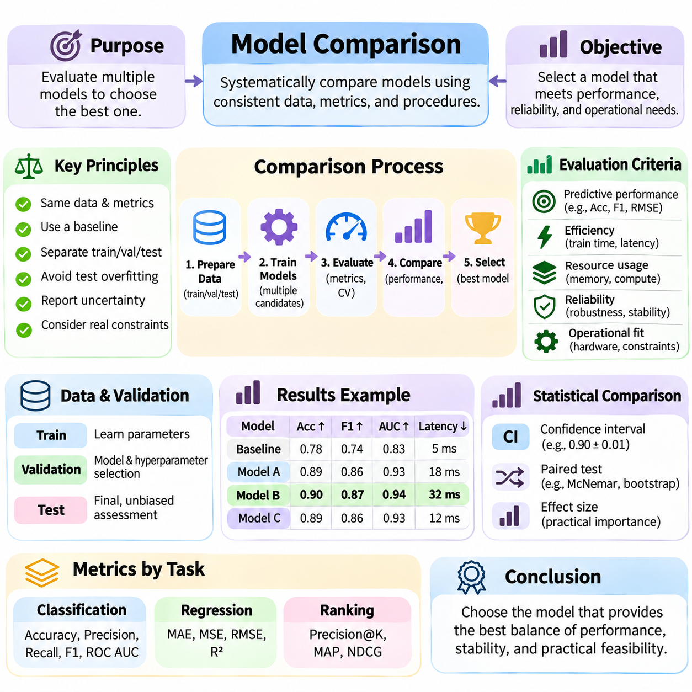{width="7.268055555555556in" height="7.268055555555556in"}

Model comparison is the systematic process of evaluating multiple machine learning models to determine which best satisfies a defined prediction objective. Rather than selecting a model solely because it achieves the highest score, comparison considers predictive performance, reliability, computational efficiency, and operational requirements. A meaningful comparison requires consistent datasets, evaluation procedures, and clearly defined success criteria.

The first step in model comparison is establishing a common evaluation framework. Candidate models must be assessed using compatible input data, target definitions, and performance metrics. Comparing accuracy from one dataset with F1-score from another does not provide a valid basis for selection. Standardized evaluation conditions help ensure that observed differences reflect model behavior rather than inconsistencies in measurement.

Baseline models provide essential reference points for interpreting performance. A classification baseline might predict the majority class, while a regression baseline might predict the training target mean. More sophisticated candidates should demonstrate meaningful improvements over these simple approaches. Without a baseline, an apparently impressive metric may conceal the fact that a substantially simpler model performs almost as well.

Training, validation, and test datasets serve different purposes during model comparison. Training data determines model parameters, while validation data supports model selection and hyperparameter tuning. An independent test dataset estimates final generalization performance. Repeatedly choosing models based on test results introduces selection bias and can make reported performance overly optimistic.

Cross-validation provides a more comprehensive comparison when evaluation data is limited. In K-fold cross-validation, the dataset is divided into K subsets, and each model is trained and evaluated across multiple partitions. Averaging the resulting scores reduces dependence on one particular split. Using identical folds for all candidates supports fairer comparisons and allows differences to be examined across matched evaluations.

Model comparison should consider variability as well as average performance. Two models may achieve similar mean cross-validation scores while exhibiting substantially different variation across folds. A model with slightly lower average performance but more stable results may be preferable in sensitive applications. However, fold-level variability does not automatically provide a complete estimate of uncertainty in deployment.

Metric selection must reflect the structure of the prediction problem. Classification models may require precision, recall, F1-score, ROC AUC, or calibration measures. Regression models may be compared using MAE, MSE, RMSE, and R². Ranking systems may require Precision\\@K, MAP, or NDCG. Different metrics emphasize different error characteristics, so a single metric rarely captures every operational requirement.

Class imbalance introduces additional considerations when comparing classifiers. Accuracy can appear high even when a model fails to identify rare positive cases. Precision, recall, F1-score, and precision-recall curves often reveal differences hidden by overall accuracy. Comparisons should use consistent positive-class definitions, averaging conventions, and decision thresholds to avoid misleading conclusions.

Threshold-dependent metrics require particular care because different thresholds can produce substantially different results from the same model. A classifier may achieve high recall by accepting more false positives, while another threshold prioritizes precision. Thresholds should be selected using validation data and application costs. Final test comparisons should evaluate the previously selected operating configurations.

Statistical uncertainty is an important component of model comparison. Performance scores calculated from finite samples are estimates rather than exact measures of future behavior. Confidence intervals, bootstrap resampling, and appropriate statistical tests can help assess whether observed differences are distinguishable from sampling variation. The chosen method must respect dependencies and the structure of the evaluation data.

Paired comparisons are particularly useful when candidate models are evaluated on the same observations. Because each model encounters identical examples, differences can be analyzed directly rather than treating scores as independent measurements. For classification, McNemar\'s test may be suitable for comparing paired error outcomes, while bootstrap procedures can support comparisons of more general performance metrics.

Statistical significance should not be confused with practical importance. A small improvement may be statistically detectable on a large dataset but provide negligible operational benefit. Conversely, an improvement with uncertain statistical evidence may still warrant further investigation when its potential value is substantial. Model selection should consider effect size, uncertainty, application costs, and deployment consequences together.

Computational efficiency often determines whether a high-performing model is practical. Training time, inference latency, memory consumption, energy requirements, and hardware compatibility can differ considerably between candidates. A complex model may provide slightly better accuracy while requiring substantially more resources. Evaluation should therefore measure predictive quality alongside resource consumption under representative conditions.

Inference performance should be measured using realistic workloads and deployment hardware. Batch size, input dimensions, preprocessing overhead, and concurrent requests can significantly influence latency and throughput. Comparisons conducted on different hardware configurations may produce misleading efficiency conclusions. Consistent benchmarking conditions are necessary to establish meaningful performance and resource tradeoffs.

Model complexity also affects maintainability and interpretability. Simpler models may be easier to debug, explain, retrain, and deploy, while more complex architectures may capture relationships unavailable to simpler alternatives. Interpretability can be particularly important when predictions influence consequential decisions. These considerations should complement quantitative metrics rather than replace objective performance evaluation.

Robustness testing examines whether model performance remains acceptable under realistic variations in input conditions. Noise, missing values, sensor degradation, distribution shifts, and unusual observations can expose weaknesses that ordinary test datasets overlook. A model with the highest benchmark score may not be the most reliable under changing conditions. Stress testing provides additional evidence for deployment decisions.

Subgroup evaluation can reveal performance differences across meaningful segments of the data. A model may achieve strong aggregate accuracy while performing poorly on particular operating conditions, geographic regions, device types, or rare scenarios. Comparing subgroup metrics helps identify hidden weaknesses and uneven reliability. Subgroups should be defined using relevant domain requirements and evaluated with appropriate sample sizes.

Learning curves provide another perspective on candidate models by showing how performance changes with increasing training data. A model that currently performs worse may improve substantially with additional examples, while another may have reached a performance plateau. Comparing learning curves helps determine whether further data collection, architectural changes, or additional tuning is likely to provide useful improvements.

Hyperparameter tuning must be conducted fairly across candidate models. Providing extensive optimization resources to one algorithm while using default settings for another can distort conclusions. Comparable search budgets, consistent validation procedures, and transparent reporting improve fairness. When extensive model selection is performed, nested cross-validation can help estimate performance without reusing selection data for final evaluation.

Reproducibility requires recording the experimental configuration associated with each candidate. Important information includes dataset versions, preprocessing procedures, random seeds, model parameters, hyperparameters, software dependencies, and hardware settings. Experiment tracking systems can organize metrics and artifacts. Repeated runs help determine whether apparent improvements are stable rather than consequences of random initialization.

Multi-objective comparison recognizes that predictive accuracy is only one dimension of model quality. A candidate may offer superior accuracy but higher latency, while another provides lower resource consumption with slightly weaker predictions. Pareto analysis identifies models for which no alternative improves one objective without worsening another. This perspective supports decisions involving competing engineering requirements.

A practical comparison report should document the evaluation dataset, baseline results, candidate configurations, selected metrics, uncertainty estimates, and operational measurements. Results should distinguish validation performance from final test performance. Any limitations involving sample size, distribution mismatch, or incomplete testing should be explicitly stated. Transparent reporting enables others to understand and reproduce the selection process.

Ultimately, model comparison is a decision-making process that integrates statistical evidence with practical constraints. Reliable selection depends on fair experimental conditions, appropriate metrics, uncertainty analysis, robustness testing, and operational feasibility. The preferred model is not necessarily the one with the highest isolated benchmark score, but the one that provides the strongest overall fit for the intended application.

모델 비교(Model Comparison)는 여러 머신러닝 모델(Machine Learning Models)을 체계적으로 평가하여 정의된 예측 목표(Prediction Objective)를 가장 잘 충족하는 모델을 결정하는 과정이다. 단순히 가장 높은 점수를 달성한 모델을 선택하는 대신, 예측 성능(Predictive Performance), 신뢰성(Reliability), 계산 효율성(Computational Efficiency), 운영 요구사항(Operational Requirements)을 함께 고려한다. 의미 있는 비교를 위해서는 일관된 데이터셋(Datasets), 평가 절차(Evaluation Procedures), 명확하게 정의된 성공 기준(Success Criteria)이 필요하다.

모델 비교(Model Comparison)의 첫 번째 단계는 공통 평가 체계(Common Evaluation Framework)를 수립하는 것이다. 후보 모델(Candidate Models)은 호환 가능한 입력 데이터(Input Data), 목표 변수 정의(Target Definitions), 성능 평가 지표(Performance Metrics)를 사용하여 평가해야 한다. 한 데이터셋에서 계산한 정확도(Accuracy)를 다른 데이터셋에서 계산한 F1 점수(F1-Score)와 비교하는 것은 유효한 선택 근거가 되지 않는다. 표준화된 평가 조건(Standardized Evaluation Conditions)은 관측된 차이가 측정 방식의 불일치가 아니라 실제 모델 동작(Model Behavior)을 반영하도록 돕는다.

기준 모델(Baseline Models)은 성능을 해석하기 위한 필수적인 비교 기준(Reference Points)을 제공한다. 분류 기준 모델(Classification Baseline)은 다수 클래스(Majority Class)를 예측할 수 있으며, 회귀 기준 모델(Regression Baseline)은 학습 데이터의 목표값 평균(Training Target Mean)을 예측할 수 있다. 더 복잡한 후보 모델은 이러한 단순한 접근법보다 의미 있는 개선을 보여야 한다. 기준 모델이 없다면 겉보기에 인상적인 평가 지표가 훨씬 단순한 모델과 거의 동일한 성능이라는 사실을 감출 수 있다.

학습 데이터셋(Training Dataset), 검증 데이터셋(Validation Dataset), 테스트 데이터셋(Test Dataset)은 모델 비교 과정에서 서로 다른 역할을 수행한다. 학습 데이터는 모델 매개변수(Model Parameters)를 결정하고, 검증 데이터는 모델 선택(Model Selection)과 하이퍼파라미터 튜닝(Hyperparameter Tuning)을 지원한다. 독립적인 테스트 데이터셋(Independent Test Dataset)은 최종 일반화 성능(Generalization Performance)을 추정한다. 테스트 결과를 반복적으로 사용하여 모델을 선택하면 선택 편향(Selection Bias)이 발생하고 보고된 성능이 지나치게 낙관적으로 나타날 수 있다.

교차 검증(Cross-Validation)은 평가 데이터가 제한된 상황에서 더욱 포괄적인 비교를 제공한다. K겹 교차 검증(K-Fold Cross-Validation)에서는 데이터셋을 K개의 부분집합(Subsets)으로 나누고, 각 모델을 여러 데이터 분할(Partitions)에 걸쳐 학습하고 평가한다. 결과 점수를 평균하면 특정 데이터 분할에 대한 의존성을 줄일 수 있다. 모든 후보 모델에 동일한 폴드(Folds)를 사용하면 더 공정한 비교가 가능하며 대응되는 평가 결과 사이의 차이를 분석할 수 있다.

모델 비교에서는 평균 성능(Average Performance)뿐만 아니라 변동성(Variability)도 고려해야 한다. 두 모델의 평균 교차 검증 점수(Mean Cross-Validation Scores)가 비슷하더라도 폴드 사이의 변동은 상당히 다를 수 있다. 평균 성능이 약간 낮더라도 더 안정적인 결과를 제공하는 모델이 민감한 응용(Sensitive Applications)에서는 더 적합할 수 있다. 그러나 폴드별 변동성(Fold-Level Variability)만으로 실제 배포 환경의 불확실성(Uncertainty)을 완전하게 추정할 수는 없다.

평가 지표 선택(Metric Selection)은 예측 문제(Prediction Problem)의 구조를 반영해야 한다. 분류 모델(Classification Models)에는 정밀도(Precision), 재현율(Recall), F1 점수(F1-Score), ROC 곡선 아래 면적(ROC AUC), 확률 보정 지표(Calibration Measures)가 필요할 수 있다. 회귀 모델(Regression Models)은 MAE, MSE, RMSE, R²를 사용하여 비교할 수 있다. 순위 시스템(Ranking Systems)에는 Precision\\@K, MAP, NDCG가 필요할 수 있다. 서로 다른 지표는 서로 다른 오차 특성(Error Characteristics)을 강조하므로 단일 지표만으로 모든 운영 요구사항을 설명하기는 어렵다.

클래스 불균형(Class Imbalance)은 분류기(Classifiers)를 비교할 때 추가적인 고려사항을 발생시킨다. 모델이 드문 양성 사례(Rare Positive Cases)를 식별하지 못하더라도 정확도(Accuracy)는 높게 나타날 수 있다. 정밀도(Precision), 재현율(Recall), F1 점수(F1-Score), 정밀도-재현율 곡선(Precision-Recall Curves)은 전체 정확도에 숨겨진 차이를 드러내는 경우가 많다. 잘못된 결론을 방지하려면 양성 클래스 정의(Positive-Class Definitions), 평균 계산 규칙(Averaging Conventions), 결정 임계값(Decision Thresholds)을 일관되게 적용해야 한다.

임계값 의존 평가 지표(Threshold-Dependent Metrics)는 동일한 모델이라도 임계값에 따라 결과가 크게 달라질 수 있으므로 특별한 주의가 필요하다. 분류기는 더 많은 거짓 양성(False Positives)을 허용하여 높은 재현율(Recall)을 달성할 수 있으며, 다른 임계값에서는 정밀도(Precision)를 우선할 수 있다. 임계값은 검증 데이터(Validation Data)와 응용 비용(Application Costs)을 사용하여 선택해야 한다. 최종 테스트 비교에서는 사전에 선택한 운영 설정(Operating Configurations)을 평가해야 한다.

통계적 불확실성(Statistical Uncertainty)은 모델 비교(Model Comparison)의 중요한 구성 요소이다. 유한한 표본(Finite Samples)에서 계산한 성능 점수는 미래 동작에 대한 정확한 값이 아니라 추정값(Estimates)이다. 신뢰구간(Confidence Intervals), 부트스트랩 재표본추출(Bootstrap Resampling), 적절한 통계 검정(Statistical Tests)은 관측된 차이가 표본 변동(Sampling Variation)과 구별되는지 평가하는 데 도움이 된다. 선택한 방법은 평가 데이터의 의존성(Dependencies)과 구조를 적절하게 반영해야 한다.

대응 비교(Paired Comparisons)는 후보 모델을 동일한 관측값(Observations)에서 평가할 때 특히 유용하다. 각 모델이 동일한 예제를 처리하므로 점수를 독립적인 측정값으로 취급하지 않고 차이를 직접 분석할 수 있다. 분류 문제에서는 대응되는 오류 결과(Paired Error Outcomes)를 비교하기 위해 맥니마 검정(McNemar\'s Test)이 적합할 수 있으며, 부트스트랩 절차(Bootstrap Procedures)는 보다 일반적인 성능 평가 지표의 비교를 지원할 수 있다.

통계적 유의성(Statistical Significance)을 실질적 중요성(Practical Importance)과 혼동해서는 안 된다. 대규모 데이터셋에서는 작은 성능 개선도 통계적으로 검출할 수 있지만 실제 운영상 이점은 미미할 수 있다. 반대로 통계적 근거가 불확실한 개선이라도 잠재적 가치가 크다면 추가적인 검토가 필요할 수 있다. 모델 선택에서는 효과 크기(Effect Size), 불확실성(Uncertainty), 응용 비용(Application Costs), 배포 결과(Deployment Consequences)를 함께 고려해야 한다.

계산 효율성(Computational Efficiency)은 높은 성능을 가진 모델이 실제로 사용 가능한지를 결정하는 경우가 많다. 학습 시간(Training Time), 추론 지연시간(Inference Latency), 메모리 사용량(Memory Consumption), 에너지 요구량(Energy Requirements), 하드웨어 호환성(Hardware Compatibility)은 후보 모델마다 상당히 다를 수 있다. 복잡한 모델은 정확도가 약간 더 높지만 훨씬 많은 자원을 요구할 수 있다. 따라서 평가는 대표적인 조건에서 예측 품질과 자원 소비(Resource Consumption)를 함께 측정해야 한다.

추론 성능(Inference Performance)은 실제 작업 부하(Realistic Workloads)와 배포 하드웨어(Deployment Hardware)를 사용하여 측정해야 한다. 배치 크기(Batch Size), 입력 차원(Input Dimensions), 전처리 오버헤드(Preprocessing Overhead), 동시 요청(Concurrent Requests)은 지연시간(Latency)과 처리량(Throughput)에 상당한 영향을 줄 수 있다. 서로 다른 하드웨어 구성(Hardware Configurations)에서 수행한 비교는 효율성에 관한 잘못된 결론을 초래할 수 있다. 의미 있는 성능 및 자원 상충 관계(Performance and Resource Tradeoffs)를 파악하려면 일관된 벤치마킹 조건(Benchmarking Conditions)이 필요하다.

모델 복잡도(Model Complexity)는 유지보수성(Maintainability)과 해석 가능성(Interpretability)에도 영향을 미친다. 단순한 모델은 디버깅(Debugging), 설명(Explanation), 재학습(Retraining), 배포(Deployment)가 더 쉬울 수 있지만, 복잡한 아키텍처(Complex Architectures)는 단순한 대안으로 표현하기 어려운 관계를 학습할 수 있다. 예측이 중대한 의사결정(Consequential Decisions)에 영향을 미치는 경우 해석 가능성이 특히 중요할 수 있다. 이러한 고려사항은 객관적인 성능 평가(Objective Performance Evaluation)를 대체하는 것이 아니라 보완해야 한다.

강건성 시험(Robustness Testing)은 현실적인 입력 조건의 변화에도 모델 성능이 허용 가능한 수준을 유지하는지 평가한다. 잡음(Noise), 결측값(Missing Values), 센서 성능 저하(Sensor Degradation), 분포 변화(Distribution Shifts), 비정상적인 관측값(Unusual Observations)은 일반적인 테스트 데이터셋에서 드러나지 않는 약점을 노출할 수 있다. 벤치마크 점수(Benchmark Score)가 가장 높은 모델이 변화하는 조건에서 가장 신뢰할 수 있는 모델은 아닐 수 있다. 스트레스 시험(Stress Testing)은 배포 의사결정(Deployment Decisions)에 추가적인 근거를 제공한다.

하위 집단 평가(Subgroup Evaluation)는 데이터의 의미 있는 세부 집단(Segments) 사이에서 발생하는 성능 차이를 드러낼 수 있다. 모델이 전체 정확도(Aggregate Accuracy)는 높더라도 특정 운영 조건(Operating Conditions), 지리적 지역(Geographic Regions), 장치 유형(Device Types), 드문 상황(Rare Scenarios)에서는 낮은 성능을 보일 수 있다. 하위 집단별 평가 지표(Subgroup Metrics)를 비교하면 숨겨진 약점과 불균등한 신뢰성(Uneven Reliability)을 식별하는 데 도움이 된다. 하위 집단은 관련 분야의 요구사항에 따라 정의하고 적절한 표본 크기(Sample Sizes)를 확보하여 평가해야 한다.

학습 곡선(Learning Curves)은 학습 데이터(Training Data)가 증가함에 따라 성능이 어떻게 변화하는지 보여주므로 후보 모델을 평가하는 또 다른 관점을 제공한다. 현재 성능이 낮은 모델도 추가적인 예제(Additional Examples)를 통해 크게 개선될 수 있지만, 다른 모델은 이미 성능 정체 구간(Performance Plateau)에 도달했을 수 있다. 학습 곡선을 비교하면 추가 데이터 수집(Data Collection), 아키텍처 변경(Architectural Changes), 추가 튜닝(Additional Tuning)이 유용한 개선을 제공할 가능성을 판단할 수 있다.

하이퍼파라미터 튜닝(Hyperparameter Tuning)은 후보 모델 사이에서 공정하게 수행해야 한다. 한 알고리즘에는 광범위한 최적화 자원(Optimization Resources)을 제공하면서 다른 알고리즘에는 기본 설정(Default Settings)만 적용하면 결론이 왜곡될 수 있다. 비교 가능한 탐색 예산(Search Budgets), 일관된 검증 절차(Validation Procedures), 투명한 결과 보고(Transparent Reporting)는 공정성을 높인다. 광범위한 모델 선택을 수행하는 경우 중첩 교차 검증(Nested Cross-Validation)은 선택에 사용한 데이터를 최종 평가에 재사용하지 않고 성능을 추정하는 데 도움이 된다.

재현성(Reproducibility)을 확보하려면 각 후보 모델과 관련된 실험 설정(Experimental Configuration)을 기록해야 한다. 중요한 정보에는 데이터셋 버전(Dataset Versions), 전처리 절차(Preprocessing Procedures), 난수 시드(Random Seeds), 모델 매개변수(Model Parameters), 하이퍼파라미터(Hyperparameters), 소프트웨어 의존성(Software Dependencies), 하드웨어 설정(Hardware Settings)이 포함된다. 실험 추적 시스템(Experiment Tracking Systems)은 평가 지표와 산출물(Artifacts)을 체계적으로 관리할 수 있다. 반복 실행(Repeated Runs)은 관측된 개선이 무작위 초기화(Random Initialization)의 결과가 아니라 안정적인 현상인지 판단하는 데 도움이 된다.

다목적 비교(Multi-Objective Comparison)는 예측 정확도(Predictive Accuracy)가 모델 품질(Model Quality)의 여러 차원 중 하나라는 사실을 반영한다. 어떤 후보 모델은 정확도가 우수하지만 지연시간(Latency)이 길 수 있고, 다른 모델은 예측 성능이 약간 낮더라도 자원 소비(Resource Consumption)가 적을 수 있다. 파레토 분석(Pareto Analysis)은 다른 목표를 악화시키지 않으면서 특정 목표를 개선하는 대안이 존재하지 않는 모델을 식별한다. 이러한 관점은 서로 경쟁하는 엔지니어링 요구사항(Engineering Requirements)을 고려한 의사결정을 지원한다.

실용적인 모델 비교 보고서(Model Comparison Report)에는 평가 데이터셋(Evaluation Dataset), 기준 모델 결과(Baseline Results), 후보 모델 설정(Candidate Configurations), 선택한 평가 지표(Selected Metrics), 불확실성 추정값(Uncertainty Estimates), 운영 측정값(Operational Measurements)을 기록해야 한다. 검증 성능(Validation Performance)과 최종 테스트 성능(Final Test Performance)은 구분하여 보고해야 한다. 표본 크기(Sample Size), 분포 불일치(Distribution Mismatch), 불완전한 시험(Incomplete Testing)과 관련된 한계도 명확하게 기술해야 한다. 투명한 보고(Transparent Reporting)는 다른 사람이 모델 선택 과정을 이해하고 재현할 수 있도록 한다.

궁극적으로 모델 비교(Model Comparison)는 통계적 근거(Statistical Evidence)와 실제 제약조건(Practical Constraints)을 통합하는 의사결정 과정(Decision-Making Process)이다. 신뢰할 수 있는 모델 선택(Reliable Model Selection)은 공정한 실험 조건(Fair Experimental Conditions), 적절한 평가 지표(Appropriate Metrics), 불확실성 분석(Uncertainty Analysis), 강건성 시험(Robustness Testing), 운영 가능성(Operational Feasibility)에 의존한다. 가장 적합한 모델은 반드시 개별 벤치마크 점수(Isolated Benchmark Score)가 가장 높은 모델이 아니라, 목표 응용(Intended Application)에 가장 적합한 종합적인 성능(Overall Fit)을 제공하는 모델이다.

## 04.07 Evaluation Pitfalls

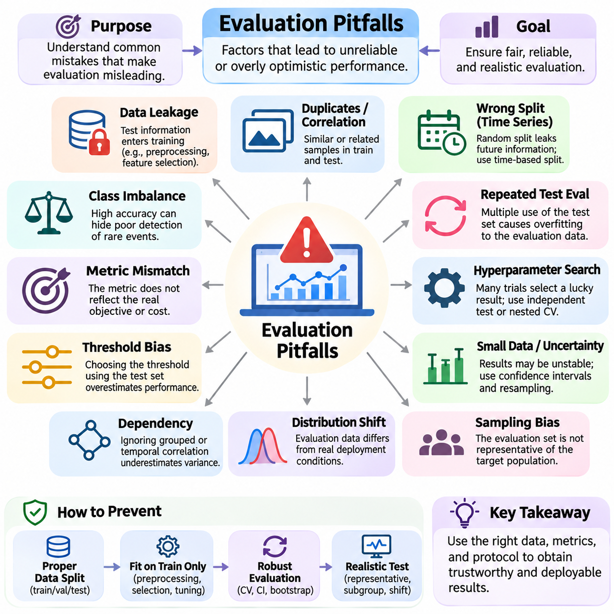{width="7.268055555555556in" height="7.268055555555556in"}

Evaluation pitfalls are methodological mistakes that cause machine learning performance estimates to become misleading, unreliable, or overly optimistic. Even when evaluation metrics are calculated correctly, inappropriate experimental design can produce invalid conclusions. Understanding these pitfalls is essential because model selection, deployment decisions, and claims about generalization depend on trustworthy evaluation procedures.

Data leakage occurs when information unavailable during real-world prediction improperly influences model training or evaluation. Leakage may arise when test observations affect preprocessing, feature selection, or hyperparameter tuning. A model can then achieve excellent evaluation scores without learning relationships that generalize. Preventing leakage requires strict separation of information across development stages.

Preprocessing leakage is particularly common when transformations are fitted before dividing data into training and test sets. For example, calculating normalization statistics using the entire dataset allows test information to influence training. Imputation, feature selection, and dimensionality reduction can introduce similar problems. Such transformations should be fitted on training data and subsequently applied to validation and test observations.

Duplicate and correlated observations can also compromise evaluation. If nearly identical records appear in both training and test datasets, the model may effectively encounter test examples during training. Images from the same recording, measurements from the same patient, or repeated observations from one device can create hidden dependencies. Group-aware splitting helps prevent these forms of contamination.

Random dataset splitting is not appropriate for every prediction problem. Time-series forecasting requires evaluation on observations occurring after the training period to approximate future deployment. Randomly mixing historical and future records can expose information that would not exist at prediction time. Chronological splitting and rolling-window evaluation provide more realistic estimates for temporal applications.

Class imbalance can make common classification metrics deceptive. A classifier predicting only the majority class may achieve high accuracy while completely failing to identify rare but important events. Precision, recall, F1-score, and precision-recall curves can reveal weaknesses hidden by accuracy. Evaluation should consider class prevalence, error consequences, and the practical significance of minority-class detection.

Metric mismatch occurs when the selected evaluation measure does not reflect the actual application objective. Optimizing accuracy may be inappropriate when false negatives are especially costly, while minimizing average regression error may conceal dangerous extreme deviations. Metrics should correspond to operational requirements rather than being selected solely because they are familiar or easy to calculate.

Threshold selection can introduce hidden evaluation bias. Classification models often produce scores that must be converted into decisions using a threshold. Selecting the threshold that maximizes performance on the final test dataset effectively uses test information for optimization. Thresholds should instead be selected using validation data, with final performance measured on untouched test observations.

Repeated test-set evaluation is another common source of optimistic estimates. When developers continually modify models after inspecting test results, the test dataset gradually becomes part of the development process. Even without directly training on test examples, repeated decisions can overfit the evaluation set. A separate final holdout or carefully controlled evaluation protocol helps preserve independence.

Hyperparameter search introduces selection effects because many configurations are evaluated before the best-performing candidate is chosen. The selected validation score may be unusually favorable due to random variation. Reporting this score as an unbiased estimate of future performance is misleading. Independent testing or nested cross-validation can provide more defensible estimates after model selection.

Small evaluation datasets create substantial statistical uncertainty. A model may appear superior because only a few observations determine the measured difference. Rare classes, unusual events, and high-variance outcomes make this problem more severe. Confidence intervals, repeated evaluation, and appropriate resampling methods help distinguish stable improvements from fluctuations caused by limited samples.

Ignoring dependencies between observations can produce invalid uncertainty estimates. Standard bootstrap procedures assume an appropriate sampling structure, but repeated measurements from the same subject or device are not independent. Resampling individual records may underestimate variability. Group-level or block-based resampling should be considered when observations are clustered or temporally correlated.

Distribution shift occurs when deployment data differs from the data used for evaluation. Changes in sensors, environments, customer behavior, operating conditions, or data collection procedures can reduce predictive performance. A model that performs well on a benchmark may fail under unfamiliar conditions. Representative testing, subgroup evaluation, and monitoring help identify generalization weaknesses.

Sampling bias arises when evaluation observations do not adequately represent the intended deployment population. A dataset collected under convenient laboratory conditions may exclude difficult operating scenarios. Similarly, a recommendation benchmark may overrepresent frequently viewed items. Evaluation should document how samples were collected and whether important populations or operating conditions are missing.

Incorrect label quality can distort evaluation even when model predictions are reasonable. Human annotation errors, inconsistent labeling guidelines, ambiguous categories, and outdated reference values can introduce noise into ground-truth data. Such errors may penalize correct predictions or reward incorrect ones. Label audits, agreement analysis, and clear annotation protocols improve evaluation reliability.

Aggregate metrics can conceal serious subgroup failures. A model may achieve strong overall performance while producing poor results for particular environments, devices, rare categories, or operating conditions. Evaluating meaningful subgroups reveals whether performance is distributed consistently. However, subgroup estimates require sufficient samples and appropriate uncertainty reporting.

Confusing ranking quality with probability calibration is another important pitfall. A classifier may achieve high ROC AUC while producing poorly calibrated probability estimates. Conversely, calibration improvements may not change the ordering of predictions. When probabilities guide risk assessment or resource allocation, calibration metrics and reliability analysis should complement discrimination measures.

Regression evaluation can become misleading when target scales or transformations are handled inconsistently. MAE and RMSE calculated on standardized targets cannot be interpreted directly in original physical units. Outliers may dominate MSE, while percentage errors become unstable near zero. Metric selection and inverse transformations must reflect the quantities that matter operationally.

Model comparison is unreliable when candidates receive unequal evaluation conditions. Different test sets, preprocessing pipelines, tuning budgets, or hardware configurations can create artificial advantages. Fair comparison requires consistent protocols and transparent reporting. Improvements should be attributed to model differences only after major experimental confounders have been controlled.

Statistical significance does not automatically imply practical importance. A tiny performance difference may become statistically detectable with enough observations but offer little operational value. Conversely, a potentially meaningful improvement may remain uncertain with limited data. Evaluation should report effect sizes, uncertainty, application costs, and consequences rather than relying exclusively on significance tests.

Offline evaluation can fail to capture how users or physical systems behave after deployment. Recommendation models may change user interactions, while robotic policies may encounter states absent from recorded datasets. Feedback effects can alter the distribution of future observations. Online experiments, controlled pilots, and operational monitoring provide complementary evidence when deployment is feasible and safe.

Reproducibility problems make evaluation results difficult to verify. Missing random seeds, undocumented preprocessing, changing dataset versions, and inconsistent software dependencies can produce unexplained score differences. Reliable experiments should preserve configurations, data partitions, model artifacts, and evaluation code. Repeated runs help identify instability caused by stochastic training procedures.

Ultimately, trustworthy evaluation requires more than computing the correct metrics. It depends on preventing leakage, maintaining independent test data, respecting temporal and group structure, selecting meaningful measures, and quantifying uncertainty. Recognizing evaluation pitfalls helps distinguish genuine generalization from misleading benchmark success and supports safer, more reliable machine learning deployment.

평가상의 함정(Evaluation Pitfalls)은 머신러닝 성능 추정값(Machine Learning Performance Estimates)을 오해의 소지가 있거나 신뢰할 수 없거나 지나치게 낙관적으로 만드는 방법론적 오류(Methodological Mistakes)이다. 평가 지표(Evaluation Metrics)를 올바르게 계산하더라도 부적절한 실험 설계(Experimental Design)는 잘못된 결론을 초래할 수 있다. 모델 선택(Model Selection), 배포 의사결정(Deployment Decisions), 일반화 성능(Generalization Performance)에 관한 주장은 신뢰할 수 있는 평가 절차(Evaluation Procedures)에 의존하므로 이러한 함정을 이해하는 것이 필수적이다.

데이터 누출(Data Leakage)은 실제 예측 과정에서 사용할 수 없는 정보가 모델 학습(Model Training)이나 평가(Evaluation)에 부적절하게 영향을 미칠 때 발생한다. 테스트 관측값(Test Observations)이 전처리(Preprocessing), 특징 선택(Feature Selection), 하이퍼파라미터 튜닝(Hyperparameter Tuning)에 영향을 주면 누출이 발생할 수 있다. 이 경우 모델은 일반화 가능한 관계를 학습하지 못했더라도 매우 높은 평가 점수를 달성할 수 있다. 데이터 누출을 방지하려면 개발 단계(Development Stages) 사이에서 정보를 엄격하게 분리해야 한다.

전처리 누출(Preprocessing Leakage)은 데이터를 학습 집합(Training Set)과 테스트 집합(Test Set)으로 분할하기 전에 변환(Transformations)을 학습시키는 경우 특히 흔하게 발생한다. 예를 들어 전체 데이터셋을 사용하여 정규화 통계량(Normalization Statistics)을 계산하면 테스트 정보가 학습 과정에 영향을 미친다. 결측값 대체(Imputation), 특징 선택(Feature Selection), 차원 축소(Dimensionality Reduction)에서도 유사한 문제가 발생할 수 있다. 이러한 변환은 학습 데이터에서만 적합(Fitting)한 후 검증 및 테스트 관측값에 적용해야 한다.

중복 관측값(Duplicate Observations)과 상관관계가 있는 관측값(Correlated Observations)도 평가의 신뢰성을 훼손할 수 있다. 거의 동일한 레코드(Records)가 학습 데이터셋과 테스트 데이터셋에 모두 존재하면 모델이 학습 중 테스트 예제를 사실상 경험하게 될 수 있다. 동일한 녹화 영상의 이미지, 동일한 환자의 측정값, 하나의 장치에서 반복적으로 수집한 관측값은 숨겨진 의존성(Hidden Dependencies)을 형성할 수 있다. 그룹 인식 데이터 분할(Group-Aware Splitting)은 이러한 데이터 오염(Contamination)을 방지하는 데 도움이 된다.

무작위 데이터셋 분할(Random Dataset Splitting)이 모든 예측 문제에 적합한 것은 아니다. 시계열 예측(Time-Series Forecasting)은 미래 배포 상황을 근사하기 위해 학습 기간 이후에 발생한 관측값으로 평가해야 한다. 과거 기록과 미래 기록을 무작위로 혼합하면 실제 예측 시점(Prediction Time)에는 존재하지 않는 정보가 노출될 수 있다. 시간순 분할(Chronological Splitting)과 이동 구간 평가(Rolling-Window Evaluation)는 시간적 특성을 가진 응용에서 더욱 현실적인 성능 추정값을 제공한다.

클래스 불균형(Class Imbalance)은 일반적인 분류 평가 지표(Classification Metrics)를 오해하게 만들 수 있다. 다수 클래스(Majority Class)만 예측하는 분류기는 드물지만 중요한 사건(Rare but Important Events)을 전혀 식별하지 못하면서도 높은 정확도(Accuracy)를 달성할 수 있다. 정밀도(Precision), 재현율(Recall), F1 점수(F1-Score), 정밀도-재현율 곡선(Precision-Recall Curves)은 정확도에 숨겨진 약점을 드러낼 수 있다. 평가에서는 클래스 출현 비율(Class Prevalence), 오류의 결과(Error Consequences), 소수 클래스 탐지(Minority-Class Detection)의 실질적인 중요성을 고려해야 한다.

평가 지표 불일치(Metric Mismatch)는 선택한 평가 척도(Evaluation Measure)가 실제 응용 목표(Application Objective)를 반영하지 못할 때 발생한다. 거짓 음성(False Negatives)의 비용이 특히 높은 상황에서는 정확도(Accuracy)를 최적화하는 것이 부적절할 수 있으며, 평균 회귀 오차(Average Regression Error)를 최소화하는 것은 위험한 극단적 편차(Extreme Deviations)를 감출 수 있다. 평가 지표는 익숙하거나 계산하기 쉽다는 이유만으로 선택하지 않고 운영 요구사항(Operational Requirements)에 대응하도록 선정해야 한다.

임계값 선택(Threshold Selection)은 숨겨진 평가 편향(Evaluation Bias)을 발생시킬 수 있다. 분류 모델(Classification Models)은 종종 임계값을 사용하여 의사결정(Decisions)으로 변환해야 하는 점수(Scores)를 생성한다. 최종 테스트 데이터셋(Final Test Dataset)에서 성능을 최대화하는 임계값을 선택하면 테스트 정보를 최적화에 사용한 것과 같다. 따라서 임계값은 검증 데이터(Validation Data)를 사용하여 선택하고, 최종 성능은 사용되지 않은 테스트 관측값(Untouched Test Observations)에서 측정해야 한다.

반복적인 테스트 집합 평가(Repeated Test-Set Evaluation)는 지나치게 낙관적인 성능 추정값(Optimistic Estimates)을 발생시키는 또 다른 일반적인 원인이다. 개발자가 테스트 결과를 확인한 후 지속적으로 모델을 수정하면 테스트 데이터셋은 점차 개발 과정(Development Process)의 일부가 된다. 테스트 예제를 직접 학습하지 않더라도 반복적인 의사결정으로 평가 집합(Evaluation Set)에 과적합(Overfitting)될 수 있다. 별도의 최종 보류 데이터셋(Final Holdout Dataset)이나 엄격하게 통제된 평가 프로토콜(Evaluation Protocol)은 독립성을 유지하는 데 도움이 된다.

하이퍼파라미터 탐색(Hyperparameter Search)은 가장 높은 성능을 보이는 후보를 선택하기 전에 여러 설정(Configurations)을 평가하므로 선택 효과(Selection Effects)를 발생시킨다. 선택된 검증 점수(Validation Score)는 무작위 변동(Random Variation)으로 인해 비정상적으로 유리하게 나타날 수 있다. 이러한 점수를 미래 성능에 대한 편향되지 않은 추정값(Unbiased Estimate)으로 보고하는 것은 오해를 초래한다. 독립적인 테스트(Independent Testing) 또는 중첩 교차 검증(Nested Cross-Validation)은 모델 선택 이후 더 타당한 성능 추정값을 제공할 수 있다.

작은 평가 데이터셋(Small Evaluation Datasets)은 상당한 통계적 불확실성(Statistical Uncertainty)을 발생시킨다. 소수의 관측값만으로 측정된 차이가 결정되기 때문에 특정 모델이 더 우수한 것처럼 보일 수 있다. 희귀 클래스(Rare Classes), 비정상적인 사건(Unusual Events), 분산이 큰 결과(High-Variance Outcomes)는 이러한 문제를 더욱 심각하게 만든다. 신뢰구간(Confidence Intervals), 반복 평가(Repeated Evaluation), 적절한 재표본추출 방법(Resampling Methods)은 제한된 표본으로 인한 변동과 안정적인 개선을 구별하는 데 도움이 된다.

관측값 사이의 의존성(Dependencies)을 무시하면 잘못된 불확실성 추정값(Uncertainty Estimates)이 생성될 수 있다. 표준 부트스트랩 절차(Standard Bootstrap Procedures)는 적절한 표본 추출 구조(Sampling Structure)를 전제로 하지만, 동일한 대상(Subject)이나 장치(Device)에서 반복적으로 측정한 값은 서로 독립적이지 않다. 개별 레코드를 재표본추출하면 변동성(Variability)을 과소평가할 수 있다. 관측값이 군집화(Clustering)되어 있거나 시간적 상관관계(Temporal Correlation)를 가진 경우 그룹 수준 재표본추출(Group-Level Resampling) 또는 블록 기반 재표본추출(Block-Based Resampling)을 고려해야 한다.

분포 변화(Distribution Shift)는 배포 데이터(Deployment Data)가 평가에 사용된 데이터와 달라질 때 발생한다. 센서(Sensors), 환경(Environments), 고객 행동(Customer Behavior), 운영 조건(Operating Conditions), 데이터 수집 절차(Data Collection Procedures)의 변화는 예측 성능(Predictive Performance)을 저하시킬 수 있다. 벤치마크(Benchmark)에서 우수한 성능을 보이는 모델도 익숙하지 않은 조건에서는 실패할 수 있다. 대표성 있는 테스트(Representative Testing), 하위 집단 평가(Subgroup Evaluation), 모니터링(Monitoring)은 일반화 성능의 약점을 식별하는 데 도움이 된다.

표본 추출 편향(Sampling Bias)은 평가 관측값(Evaluation Observations)이 실제 배포 대상 모집단(Intended Deployment Population)을 충분히 대표하지 못할 때 발생한다. 편리한 실험실 조건(Laboratory Conditions)에서 수집한 데이터셋은 어려운 운영 상황(Difficult Operating Scenarios)을 포함하지 않을 수 있다. 마찬가지로 추천 시스템 벤치마크(Recommendation Benchmark)는 자주 조회되는 항목(Frequently Viewed Items)을 과도하게 포함할 수 있다. 평가에서는 표본 수집 방법(Sampling Methods)과 중요한 모집단 또는 운영 조건의 누락 여부를 문서화해야 한다.

잘못된 레이블 품질(Label Quality)은 모델 예측이 합리적이더라도 평가 결과를 왜곡할 수 있다. 사람의 주석 오류(Human Annotation Errors), 일관되지 않은 레이블링 지침(Inconsistent Labeling Guidelines), 모호한 범주(Ambiguous Categories), 오래된 기준값(Outdated Reference Values)은 정답 데이터(Ground-Truth Data)에 잡음(Noise)을 유입할 수 있다. 이러한 오류는 올바른 예측에 불이익을 주거나 잘못된 예측을 보상할 수 있다. 레이블 감사(Label Audits), 일치도 분석(Agreement Analysis), 명확한 주석 프로토콜(Annotation Protocols)은 평가 신뢰성(Evaluation Reliability)을 향상시킨다.

집계 평가 지표(Aggregate Metrics)는 심각한 하위 집단 실패(Subgroup Failures)를 감출 수 있다. 모델이 전체적으로 높은 성능을 달성하더라도 특정 환경(Environments), 장치(Devices), 희귀 범주(Rare Categories), 운영 조건(Operating Conditions)에서는 낮은 성능을 보일 수 있다. 의미 있는 하위 집단(Subgroups)을 평가하면 성능이 일관되게 분포하는지 확인할 수 있다. 그러나 하위 집단별 추정값(Subgroup Estimates)에는 충분한 표본과 적절한 불확실성 보고(Uncertainty Reporting)가 필요하다.

순위 품질(Ranking Quality)과 확률 보정(Probability Calibration)을 혼동하는 것도 중요한 평가상의 함정이다. 분류기는 높은 ROC AUC를 달성하면서도 보정이 잘되지 않은 확률 추정값(Poorly Calibrated Probability Estimates)을 생성할 수 있다. 반대로 확률 보정이 개선되더라도 예측 순서(Prediction Ordering)는 변하지 않을 수 있다. 확률이 위험 평가(Risk Assessment)나 자원 할당(Resource Allocation)에 사용되는 경우 확률 보정 지표(Calibration Metrics)와 신뢰도 분석(Reliability Analysis)을 판별 능력 측정(Discrimination Measures)과 함께 사용해야 한다.

회귀 평가(Regression Evaluation)는 목표값의 척도(Target Scales)나 변환(Transformations)을 일관되지 않게 처리하면 오해를 초래할 수 있다. 표준화된 목표값(Standardized Targets)에서 계산한 MAE와 RMSE는 원래 물리적 단위(Original Physical Units)로 직접 해석할 수 없다. 이상치(Outliers)는 MSE를 지배할 수 있으며, 백분율 오차(Percentage Errors)는 실제값이 0에 가까워지면 불안정해진다. 평가 지표 선택(Metric Selection)과 역변환(Inverse Transformations)은 운영상 중요한 수량(Operationally Relevant Quantities)을 반영해야 한다.

후보 모델(Candidate Models)에 서로 다른 평가 조건(Evaluation Conditions)을 적용하면 모델 비교(Model Comparison)의 신뢰성이 떨어진다. 서로 다른 테스트 집합(Test Sets), 전처리 파이프라인(Preprocessing Pipelines), 튜닝 예산(Tuning Budgets), 하드웨어 구성(Hardware Configurations)은 인위적인 이점(Artificial Advantages)을 만들어낼 수 있다. 공정한 비교(Fair Comparison)를 위해서는 일관된 프로토콜(Consistent Protocols)과 투명한 보고(Transparent Reporting)가 필요하다. 주요 실험 교란 요인(Experimental Confounders)을 통제한 후에만 성능 개선을 모델 자체의 차이로 해석해야 한다.

통계적 유의성(Statistical Significance)이 반드시 실질적 중요성(Practical Importance)을 의미하는 것은 아니다. 관측값이 충분히 많으면 매우 작은 성능 차이도 통계적으로 검출할 수 있지만 실제 운영상 가치는 거의 없을 수 있다. 반대로 잠재적으로 의미 있는 개선도 데이터가 제한적이면 불확실하게 나타날 수 있다. 평가는 유의성 검정(Significance Tests)에만 의존하지 않고 효과 크기(Effect Sizes), 불확실성(Uncertainty), 응용 비용(Application Costs), 결과적 영향(Consequences)을 함께 보고해야 한다.

오프라인 평가(Offline Evaluation)는 배포 이후 사용자나 물리적 시스템(Physical Systems)의 동작을 충분히 반영하지 못할 수 있다. 추천 모델(Recommendation Models)은 사용자 상호작용(User Interactions)을 변화시킬 수 있으며, 로봇 정책(Robotic Policies)은 기록된 데이터셋에 존재하지 않는 상태(States)를 경험할 수 있다. 피드백 효과(Feedback Effects)는 미래 관측값의 분포(Distribution)를 변화시킬 수 있다. 배포가 가능하고 안전한 경우 온라인 실험(Online Experiments), 통제된 시범 운영(Controlled Pilots), 운영 모니터링(Operational Monitoring)은 상호 보완적인 근거를 제공한다.

재현성 문제(Reproducibility Problems)는 평가 결과를 검증하기 어렵게 만든다. 누락된 난수 시드(Random Seeds), 문서화되지 않은 전처리(Undocumented Preprocessing), 변경되는 데이터셋 버전(Changing Dataset Versions), 일관되지 않은 소프트웨어 의존성(Software Dependencies)은 설명하기 어려운 점수 차이를 발생시킬 수 있다. 신뢰할 수 있는 실험(Reliable Experiments)은 설정(Configurations), 데이터 분할(Data Partitions), 모델 산출물(Model Artifacts), 평가 코드(Evaluation Code)를 보존해야 한다. 반복 실행(Repeated Runs)은 확률적 학습 절차(Stochastic Training Procedures)에서 발생하는 불안정성을 식별하는 데 도움이 된다.

궁극적으로 신뢰할 수 있는 평가(Trustworthy Evaluation)는 올바른 평가 지표를 계산하는 것 이상의 조건을 요구한다. 데이터 누출(Data Leakage)을 방지하고, 독립적인 테스트 데이터(Independent Test Data)를 유지하며, 시간적 구조(Temporal Structure)와 그룹 구조(Group Structure)를 존중하고, 의미 있는 평가 척도(Meaningful Measures)를 선택하며, 불확실성(Uncertainty)을 정량화해야 한다. 평가상의 함정(Evaluation Pitfalls)을 이해하면 진정한 일반화 성능(Genuine Generalization)과 오해를 초래하는 벤치마크 성공(Misleading Benchmark Success)을 구별할 수 있으며, 더욱 안전하고 신뢰할 수 있는 머신러닝 배포(Machine Learning Deployment)를 지원할 수 있다.

## 04.08 Real World Evaluation [w/Code]

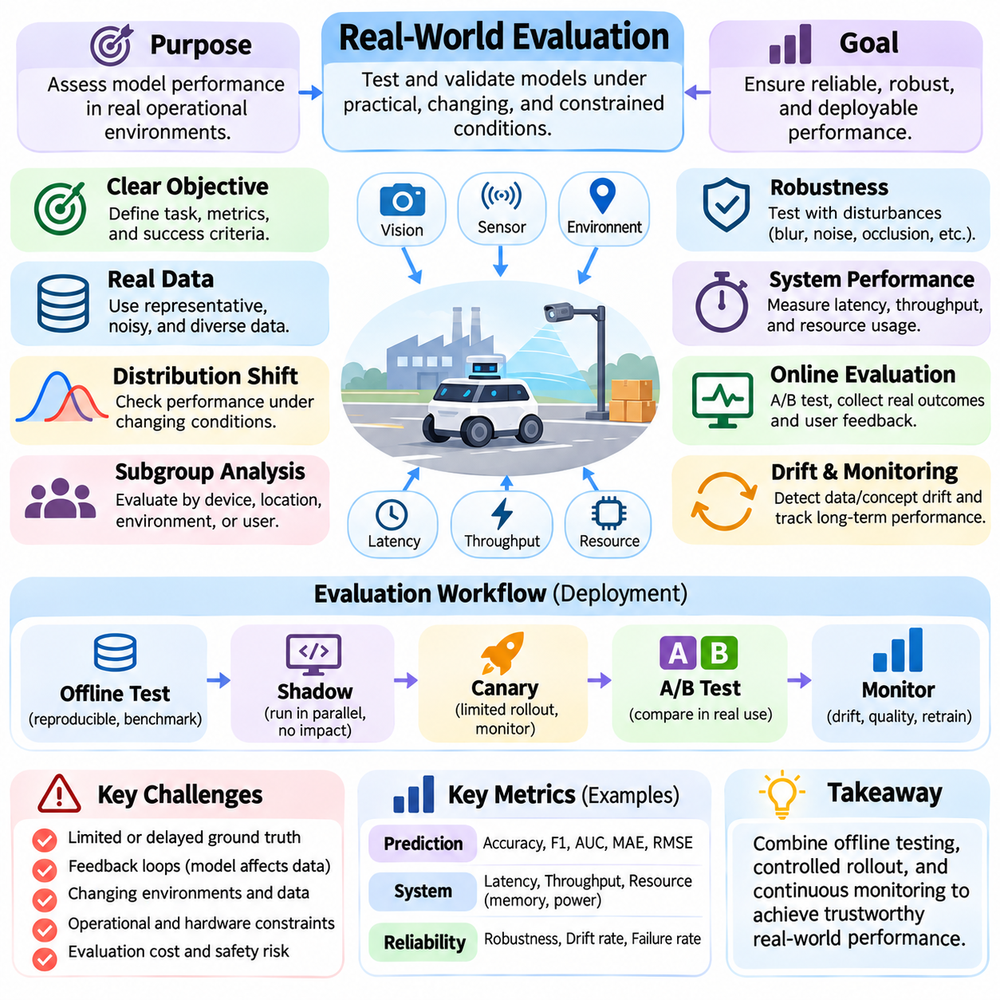{width="7.268055555555556in" height="7.268055555555556in"}

Real-world evaluation examines how machine learning models perform under the practical conditions in which they are deployed. Unlike controlled benchmark testing, it considers changing environments, imperfect inputs, operational constraints, and interactions with users or physical systems. Its purpose is to determine whether laboratory performance translates into dependable outcomes when models encounter realistic workloads and unexpected situations.

A successful real-world evaluation begins with clearly defined operational objectives. Technical metrics such as accuracy, F1-score, and RMSE must be connected to measurable application requirements. For example, a manufacturing inspection system may prioritize missed defects, while a demand forecasting system may emphasize inventory costs. Evaluation criteria should reflect the consequences of model decisions rather than abstract benchmark scores alone.

Representative evaluation data is essential because deployment conditions rarely match idealized training datasets. Real inputs may contain missing values, sensor noise, unusual lighting, changing backgrounds, or unexpected user behavior. Evaluation datasets should include normal operations and difficult scenarios. Sampling procedures must also reflect the frequency and diversity of situations the deployed system is expected to encounter.

Distribution shift is a central concern in real-world evaluation. Input distributions may change because of new devices, environmental conditions, seasonal patterns, or evolving user preferences. A model trained on historical observations may become less accurate as these conditions change. Evaluating performance across time periods, locations, and operating regimes helps identify vulnerabilities before they cause operational failures.

Real-world evaluation should distinguish between average performance and performance under critical conditions. A model may achieve excellent overall accuracy while failing during rare but consequential events. Safety-sensitive applications require explicit evaluation of failure scenarios, extreme inputs, and operational boundaries. Tail-risk analysis and worst-case testing complement average metrics by exposing potentially unacceptable behavior.

Operational latency is often as important as predictive accuracy. A model that produces accurate results too slowly may be unsuitable for real-time applications. Evaluation should measure end-to-end response time, including data acquisition, preprocessing, inference, postprocessing, and communication delays. Average latency alone may conceal occasional delays that violate operational deadlines.

Throughput measures how many predictions or requests a system can process within a given time interval. Real deployments may experience fluctuating workloads, concurrent users, or bursts of sensor data. Stress testing helps determine whether performance remains acceptable as demand increases. Throughput measurements should be interpreted together with latency, resource utilization, and the system\'s expected service capacity.

Hardware constraints influence practical model performance. Edge devices may have limited memory, processing capability, power budgets, and thermal capacity. A model that operates efficiently on a server GPU may perform differently on embedded hardware. Real-world evaluation should therefore use representative deployment devices and measure memory consumption, energy use, sustained throughput, and thermal stability.

Robustness evaluation investigates how predictions respond to realistic disturbances. Camera-based systems may encounter blur, occlusion, reflections, or illumination changes, while industrial sensors may experience drift or intermittent failures. Controlled perturbation tests can reveal sensitivity to these conditions. However, synthetic disturbances should be complemented by observations collected from actual operating environments.

Subgroup evaluation is necessary when model performance varies across operational contexts. Different device models, environmental conditions, product categories, or geographic regions may produce unequal error rates. Aggregate metrics can conceal these differences. Reporting subgroup performance with sample counts and uncertainty estimates helps identify deployment limitations and determine where additional data or model improvements are needed.

Online evaluation measures system behavior during actual operation rather than relying exclusively on stored datasets. Controlled experiments can compare model versions using user engagement, task completion, or operational outcomes. A/B testing randomly assigns eligible traffic to alternative systems to estimate their effects. Experimental design must account for interference, delayed outcomes, and potential risks to users or equipment.

Shadow deployment provides an intermediate evaluation stage before a model influences live decisions. The candidate model receives production inputs and generates predictions, but an existing system continues to control actual outcomes. Comparing predictions, latency, and failure patterns helps identify unexpected behavior. Shadow testing cannot fully measure consequences that would arise if the candidate\'s decisions changed the environment.

Canary deployment gradually introduces a new model to a limited portion of operational traffic or devices. Performance and reliability are monitored before expanding deployment. This approach reduces the exposure associated with immediate system-wide replacement. Rollback criteria should be established in advance so that unacceptable error rates, latency, or safety conditions trigger a return to a previously validated configuration.

Monitoring is essential because model quality can deteriorate after deployment. Input distributions, prediction distributions, missing-value rates, and operational error indicators can reveal emerging problems. When ground-truth labels become available, predictive metrics should be recalculated. Monitoring systems must distinguish changes in data characteristics from confirmed declines in predictive accuracy.

Data drift and concept drift describe different forms of change. Data drift concerns changes in the distribution of model inputs, while concept drift concerns changes in the relationship between inputs and target outcomes. Input monitoring may detect data drift without demonstrating reduced accuracy. Concept drift often requires labeled observations or other outcome evidence to confirm its effect on model performance.

Feedback loops can complicate real-world evaluation because model predictions may influence the data subsequently collected. Recommendation systems affect which items users encounter, while autonomous systems alter the states they visit. Consequently, future observations may not represent an independent sample of the original environment. Evaluation should account for selection effects and changes induced by deployed decisions.

Ground-truth availability presents another practical challenge. Some outcomes become known immediately, while others require human inspection or appear only after long delays. Missing labels can make performance monitoring incomplete or biased. Evaluation pipelines should document label sources, collection delays, and coverage limitations. Human review procedures may be necessary for ambiguous or high-consequence cases.

Real-world regression evaluation must consider operational error tolerances. MAE and RMSE describe typical and large prediction deviations, but they may not reveal whether individual errors exceed acceptable limits. Evaluating threshold exceedance rates and error distributions can provide additional insight. Physical measurement systems should also account for reference sensor uncertainty and calibration quality.

Classification evaluation should connect decision thresholds to the costs of false positives and false negatives. Different operating conditions may require different precision-recall tradeoffs. Thresholds should be selected using representative validation data and verified under deployment constraints. If class prevalence changes, precision and operational alert volumes may change even when sensitivity and specificity remain stable.

Reproducibility supports reliable comparisons between laboratory and deployment results. Evaluation records should preserve dataset versions, model checkpoints, preprocessing settings, software dependencies, hardware configurations, and decision thresholds. Automated evaluation pipelines can reduce inconsistencies and generate repeatable reports. Versioned records also support investigation when unexpected behavior appears after an update.

Real-world evaluation benefits from combining offline testing, controlled deployment, and continuous monitoring. Offline datasets provide repeatable comparisons, pilot deployments expose operational constraints, and monitoring detects changes over time. No single method captures every source of failure. Evidence from multiple evaluation stages supports more reliable decisions about whether a model is ready for broader deployment.

Ultimately, real-world evaluation connects machine learning performance with dependable system behavior. Successful deployment requires acceptable prediction quality, robust operation, manageable resource consumption, and clearly defined responses to failure. By evaluating models under representative conditions and monitoring them throughout their lifecycle, organizations can move beyond benchmark success toward trustworthy operational performance.

실제 환경 평가(Real-World Evaluation)는 머신러닝 모델(Machine Learning Models)이 배포되는 실제 운영 조건(Practical Operating Conditions)에서 얼마나 효과적으로 작동하는지 검토하는 과정이다. 통제된 벤치마크 테스트(Controlled Benchmark Testing)와 달리 변화하는 환경(Changing Environments), 불완전한 입력(Imperfect Inputs), 운영 제약조건(Operational Constraints), 사용자 또는 물리적 시스템(Physical Systems)과의 상호작용을 고려한다. 주요 목적은 모델이 현실적인 작업 부하(Realistic Workloads)와 예상하지 못한 상황(Unexpected Situations)을 경험할 때 실험실 성능(Laboratory Performance)이 신뢰할 수 있는 결과로 이어지는지 판단하는 것이다.

성공적인 실제 환경 평가(Real-World Evaluation)는 명확하게 정의된 운영 목표(Operational Objectives)에서 시작한다. 정확도(Accuracy), F1 점수(F1-Score), 평균 제곱근 오차(Root Mean Squared Error, RMSE)와 같은 기술적 평가 지표(Technical Metrics)는 측정 가능한 응용 요구사항(Application Requirements)과 연결되어야 한다. 예를 들어 제조 검사 시스템(Manufacturing Inspection System)은 탐지하지 못한 결함(Missed Defects)을 중요하게 고려할 수 있으며, 수요 예측 시스템(Demand Forecasting System)은 재고 비용(Inventory Costs)을 강조할 수 있다. 평가 기준(Evaluation Criteria)은 추상적인 벤치마크 점수뿐만 아니라 모델 의사결정(Model Decisions)의 결과를 반영해야 한다.

대표성 있는 평가 데이터(Representative Evaluation Data)는 배포 조건(Deployment Conditions)이 이상적인 학습 데이터셋(Training Datasets)과 일치하는 경우가 드물기 때문에 필수적이다. 실제 입력(Real Inputs)에는 결측값(Missing Values), 센서 잡음(Sensor Noise), 비정상적인 조명(Unusual Lighting), 변화하는 배경(Changing Backgrounds), 예상하지 못한 사용자 행동(Unexpected User Behavior)이 포함될 수 있다. 평가 데이터셋(Evaluation Datasets)은 정상적인 운영 상황과 어려운 상황을 모두 포함해야 한다. 표본 추출 절차(Sampling Procedures) 역시 배포된 시스템이 경험할 것으로 예상되는 상황의 빈도와 다양성을 반영해야 한다.

분포 변화(Distribution Shift)는 실제 환경 평가(Real-World Evaluation)의 핵심 고려사항이다. 입력 분포(Input Distributions)는 새로운 장치(New Devices), 환경 조건(Environmental Conditions), 계절적 패턴(Seasonal Patterns), 변화하는 사용자 선호도(Evolving User Preferences)로 인해 달라질 수 있다. 과거 관측값(Historical Observations)으로 학습한 모델은 이러한 조건이 변화하면서 정확도가 낮아질 수 있다. 서로 다른 기간(Time Periods), 위치(Locations), 운영 체계(Operating Regimes)에 걸쳐 성능을 평가하면 운영 실패가 발생하기 전에 취약점(Vulnerabilities)을 식별하는 데 도움이 된다.

실제 환경 평가에서는 평균 성능(Average Performance)과 중요한 조건에서의 성능(Performance Under Critical Conditions)을 구분해야 한다. 모델이 전체적으로 매우 높은 정확도(Accuracy)를 달성하더라도 드물지만 중대한 사건(Rare but Consequential Events)에서 실패할 수 있다. 안전 민감 응용(Safety-Sensitive Applications)에서는 실패 시나리오(Failure Scenarios), 극단적인 입력(Extreme Inputs), 운영 경계(Operational Boundaries)를 명시적으로 평가해야 한다. 꼬리 위험 분석(Tail-Risk Analysis)과 최악 조건 시험(Worst-Case Testing)은 잠재적으로 허용할 수 없는 동작을 드러내어 평균 평가 지표를 보완한다.

운영 지연시간(Operational Latency)은 예측 정확도(Predictive Accuracy)만큼 중요한 경우가 많다. 정확한 결과를 생성하더라도 처리 속도가 너무 느린 모델은 실시간 응용(Real-Time Applications)에 적합하지 않을 수 있다. 평가에서는 데이터 획득(Data Acquisition), 전처리(Preprocessing), 추론(Inference), 후처리(Postprocessing), 통신 지연(Communication Delays)을 포함한 종단 간 응답시간(End-to-End Response Time)을 측정해야 한다. 평균 지연시간(Average Latency)만으로는 운영 마감시간(Operational Deadlines)을 위반하는 간헐적인 지연을 파악하지 못할 수 있다.

처리량(Throughput)은 시스템이 일정한 시간 간격(Time Interval) 동안 처리할 수 있는 예측 또는 요청의 수를 측정한다. 실제 배포 환경에서는 변동하는 작업 부하(Fluctuating Workloads), 동시 사용자(Concurrent Users), 센서 데이터의 급격한 증가(Bursts of Sensor Data)가 발생할 수 있다. 스트레스 시험(Stress Testing)은 수요가 증가해도 성능이 허용 가능한 수준을 유지하는지 판단하는 데 도움이 된다. 처리량 측정값은 지연시간(Latency), 자원 활용률(Resource Utilization), 시스템의 예상 서비스 용량(Expected Service Capacity)과 함께 해석해야 한다.

하드웨어 제약조건(Hardware Constraints)은 실제 모델 성능(Practical Model Performance)에 영향을 미친다. 엣지 장치(Edge Devices)는 메모리(Memory), 처리 능력(Processing Capability), 전력 예산(Power Budgets), 열적 용량(Thermal Capacity)이 제한될 수 있다. 서버 GPU(Server GPU)에서 효율적으로 작동하는 모델도 임베디드 하드웨어(Embedded Hardware)에서는 다르게 동작할 수 있다. 따라서 실제 환경 평가는 대표적인 배포 장치(Representative Deployment Devices)를 사용하고 메모리 사용량(Memory Consumption), 에너지 소비(Energy Use), 지속 처리량(Sustained Throughput), 열적 안정성(Thermal Stability)을 측정해야 한다.

강건성 평가(Robustness Evaluation)는 현실적인 교란(Disturbances)에 예측 결과가 어떻게 반응하는지 조사한다. 카메라 기반 시스템(Camera-Based Systems)은 흐림(Blur), 가림(Occlusion), 반사(Reflections), 조명 변화(Illumination Changes)를 경험할 수 있으며, 산업용 센서(Industrial Sensors)는 드리프트(Drift)나 간헐적인 고장(Intermittent Failures)을 겪을 수 있다. 통제된 교란 시험(Controlled Perturbation Tests)은 이러한 조건에 대한 민감도(Sensitivity)를 드러낼 수 있다. 그러나 인위적인 교란(Synthetic Disturbances)은 실제 운영 환경에서 수집한 관측값으로 보완해야 한다.

하위 집단 평가(Subgroup Evaluation)는 운영 맥락(Operational Contexts)에 따라 모델 성능이 달라지는 경우 필요하다. 서로 다른 장치 모델(Device Models), 환경 조건(Environmental Conditions), 제품 범주(Product Categories), 지리적 지역(Geographic Regions)은 불균등한 오류율(Error Rates)을 발생시킬 수 있다. 집계 평가 지표(Aggregate Metrics)는 이러한 차이를 감출 수 있다. 표본 수(Sample Counts)와 불확실성 추정값(Uncertainty Estimates)을 함께 제시하는 하위 집단 성능 보고는 배포 한계를 식별하고 추가 데이터 또는 모델 개선이 필요한 영역을 결정하는 데 도움이 된다.

온라인 평가(Online Evaluation)는 저장된 데이터셋에만 의존하지 않고 실제 운영 중 시스템 동작(System Behavior)을 측정한다. 통제된 실험(Controlled Experiments)은 사용자 참여도(User Engagement), 작업 완료(Task Completion), 운영 결과(Operational Outcomes)를 사용하여 모델 버전을 비교할 수 있다. A/B 테스트(A/B Testing)는 대체 시스템(Alternative Systems)에 적격 트래픽(Eligible Traffic)을 무작위로 할당하여 효과를 추정한다. 실험 설계(Experimental Design)는 간섭 효과(Interference), 지연된 결과(Delayed Outcomes), 사용자나 장비에 대한 잠재적 위험(Potential Risks)을 고려해야 한다.

섀도 배포(Shadow Deployment)는 모델이 실제 의사결정에 영향을 미치기 전의 중간 평가 단계(Intermediate Evaluation Stage)를 제공한다. 후보 모델(Candidate Model)은 운영 입력(Production Inputs)을 받아 예측을 생성하지만, 기존 시스템(Existing System)이 실제 결과를 계속 제어한다. 예측값(Predictions), 지연시간(Latency), 실패 패턴(Failure Patterns)을 비교하면 예상하지 못한 동작을 식별하는 데 도움이 된다. 그러나 섀도 테스트(Shadow Testing)만으로는 후보 모델의 결정이 환경을 변화시켰을 때 발생할 결과를 완전하게 측정할 수 없다.

카나리 배포(Canary Deployment)는 새로운 모델을 제한된 운영 트래픽(Operational Traffic)이나 장치에 점진적으로 도입하는 방법이다. 배포 범위를 확대하기 전에 성능(Performance)과 신뢰성(Reliability)을 모니터링한다. 이러한 접근법은 시스템 전체를 즉시 교체할 때 발생하는 위험 노출(Risk Exposure)을 줄인다. 허용할 수 없는 오류율(Error Rates), 지연시간(Latency), 안전 조건(Safety Conditions)이 발생하면 이전에 검증된 설정(Previously Validated Configuration)으로 복귀하도록 롤백 기준(Rollback Criteria)을 사전에 수립해야 한다.

모델 품질(Model Quality)은 배포 이후 저하될 수 있으므로 모니터링(Monitoring)이 필수적이다. 입력 분포(Input Distributions), 예측 분포(Prediction Distributions), 결측값 비율(Missing-Value Rates), 운영 오류 지표(Operational Error Indicators)는 새롭게 발생하는 문제를 드러낼 수 있다. 정답 레이블(Ground-Truth Labels)을 사용할 수 있게 되면 예측 평가 지표(Predictive Metrics)를 다시 계산해야 한다. 모니터링 시스템(Monitoring Systems)은 데이터 특성(Data Characteristics)의 변화와 실제로 확인된 예측 정확도(Predictive Accuracy)의 저하를 구분해야 한다.

데이터 드리프트(Data Drift)와 개념 드리프트(Concept Drift)는 서로 다른 형태의 변화를 설명한다. 데이터 드리프트는 모델 입력의 분포(Distribution of Model Inputs)가 변화하는 현상이며, 개념 드리프트는 입력과 목표 결과(Target Outcomes) 사이의 관계가 변화하는 현상이다. 입력 모니터링(Input Monitoring)은 정확도 저하를 입증하지 않고도 데이터 드리프트를 탐지할 수 있다. 개념 드리프트가 모델 성능에 미치는 영향을 확인하려면 일반적으로 레이블이 있는 관측값(Labeled Observations)이나 다른 결과 근거(Outcome Evidence)가 필요하다.

피드백 루프(Feedback Loops)는 모델 예측이 이후 수집되는 데이터에 영향을 미칠 수 있으므로 실제 환경 평가를 복잡하게 만든다. 추천 시스템(Recommendation Systems)은 사용자가 접하는 항목을 변화시키며, 자율 시스템(Autonomous Systems)은 자신이 방문하는 상태(States)를 변화시킨다. 따라서 미래 관측값(Future Observations)은 원래 환경에서 추출한 독립적인 표본(Independent Sample)을 나타내지 않을 수 있다. 평가에서는 선택 효과(Selection Effects)와 배포된 의사결정(Deployed Decisions)이 유발하는 변화를 고려해야 한다.

정답 데이터의 가용성(Ground-Truth Availability)은 또 다른 실질적인 과제이다. 일부 결과는 즉시 확인할 수 있지만, 다른 결과는 사람의 검사(Human Inspection)가 필요하거나 오랜 시간이 지난 후에야 나타난다. 누락된 레이블(Missing Labels)은 성능 모니터링(Performance Monitoring)을 불완전하거나 편향되게 만들 수 있다. 평가 파이프라인(Evaluation Pipelines)은 레이블 출처(Label Sources), 수집 지연(Collection Delays), 적용 범위의 한계(Coverage Limitations)를 문서화해야 한다. 모호하거나 중대한 결과를 초래하는 사례에는 사람의 검토 절차(Human Review Procedures)가 필요할 수 있다.

실제 환경의 회귀 평가(Real-World Regression Evaluation)는 운영 오차 허용범위(Operational Error Tolerances)를 고려해야 한다. MAE와 RMSE는 일반적인 예측 편차(Typical Prediction Deviations)와 큰 예측 편차(Large Prediction Deviations)를 설명하지만, 개별 오류가 허용 한계(Acceptable Limits)를 초과하는지는 보여주지 못할 수 있다. 임계값 초과율(Threshold Exceedance Rates)과 오차 분포(Error Distributions)를 평가하면 추가적인 통찰을 얻을 수 있다. 물리적 측정 시스템(Physical Measurement Systems)은 기준 센서의 불확실성(Reference Sensor Uncertainty)과 보정 품질(Calibration Quality)도 고려해야 한다.

분류 평가(Classification Evaluation)는 결정 임계값(Decision Thresholds)을 거짓 양성(False Positives)과 거짓 음성(False Negatives)의 비용에 연결해야 한다. 서로 다른 운영 조건(Operating Conditions)은 서로 다른 정밀도-재현율 상충 관계(Precision-Recall Tradeoffs)를 요구할 수 있다. 임계값은 대표성 있는 검증 데이터(Representative Validation Data)를 사용하여 선택하고 배포 제약조건(Deployment Constraints)에서 검증해야 한다. 클래스 출현 비율(Class Prevalence)이 변화하면 민감도(Sensitivity)와 특이도(Specificity)가 안정적으로 유지되더라도 정밀도(Precision)와 운영 경고량(Operational Alert Volumes)은 달라질 수 있다.

재현성(Reproducibility)은 실험실 결과(Laboratory Results)와 배포 결과(Deployment Results)를 신뢰성 있게 비교하도록 지원한다. 평가 기록(Evaluation Records)에는 데이터셋 버전(Dataset Versions), 모델 체크포인트(Model Checkpoints), 전처리 설정(Preprocessing Settings), 소프트웨어 의존성(Software Dependencies), 하드웨어 구성(Hardware Configurations), 결정 임계값(Decision Thresholds)을 보존해야 한다. 자동화된 평가 파이프라인(Automated Evaluation Pipelines)은 불일치를 줄이고 반복 가능한 보고서를 생성할 수 있다. 버전 관리된 기록(Versioned Records)은 업데이트 이후 예상하지 못한 동작이 나타났을 때 원인을 조사하는 데에도 도움이 된다.

실제 환경 평가(Real-World Evaluation)는 오프라인 테스트(Offline Testing), 통제된 배포(Controlled Deployment), 지속적인 모니터링(Continuous Monitoring)을 결합할 때 효과적이다. 오프라인 데이터셋(Offline Datasets)은 반복 가능한 비교를 제공하고, 시범 배포(Pilot Deployments)는 운영 제약조건(Operational Constraints)을 드러내며, 모니터링은 시간에 따른 변화를 탐지한다. 단일 방법만으로 모든 실패 원인(Failure Sources)을 포착할 수는 없다. 여러 평가 단계(Evaluation Stages)에서 확보한 근거는 모델의 배포 확대 준비 상태(Deployment Readiness)에 관한 더욱 신뢰할 수 있는 의사결정을 지원한다.

궁극적으로 실제 환경 평가(Real-World Evaluation)는 머신러닝 성능(Machine Learning Performance)을 신뢰할 수 있는 시스템 동작(Dependable System Behavior)과 연결한다. 성공적인 배포(Successful Deployment)를 위해서는 허용 가능한 예측 품질(Prediction Quality), 강건한 운영(Robust Operation), 관리 가능한 자원 소비(Resource Consumption), 명확하게 정의된 실패 대응 절차(Failure Responses)가 필요하다. 대표성 있는 조건에서 모델을 평가하고 전체 수명주기(Lifecycle)에 걸쳐 모니터링함으로써 조직은 벤치마크 성공(Benchmark Success)을 넘어 신뢰할 수 있는 운영 성능(Trustworthy Operational Performance)을 확보할 수 있다.
