**Volume 07. Machine Learning Fundamentals**

# 04. Evaluation Metrics

## 04.00 Why Evaluation Matters

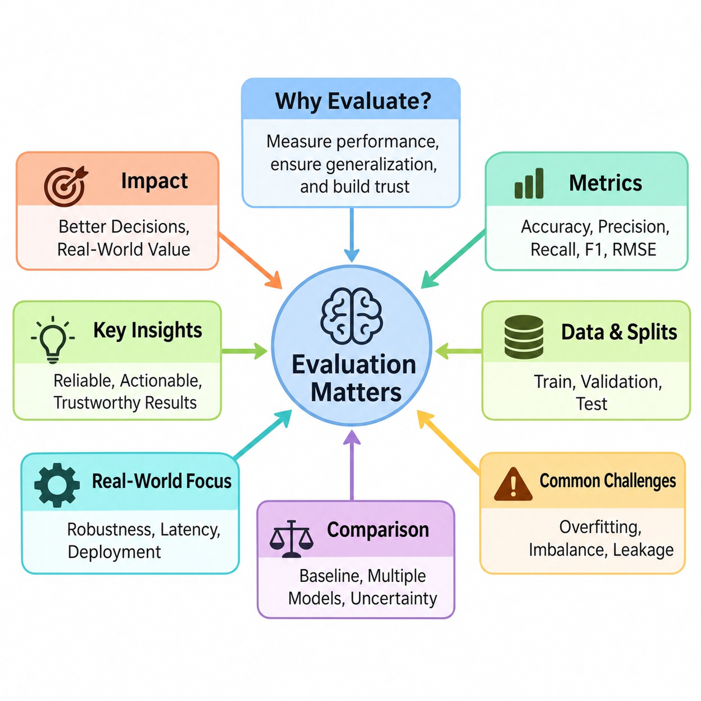{width="7.268055555555556in" height="7.268055555555556in"}

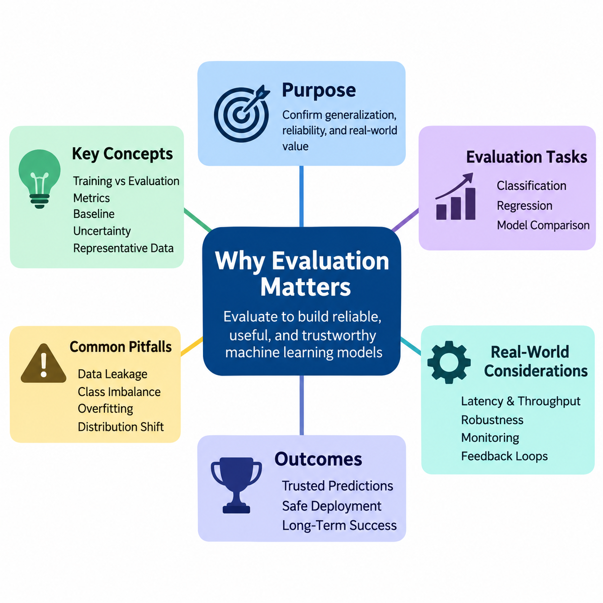{width="7.268055555555556in" height="7.268055555555556in"}

Machine learning evaluation is the systematic process of measuring how effectively a trained model performs a defined task. Training produces a model by optimizing its parameters, but successful optimization does not automatically guarantee useful predictions. Evaluation provides independent evidence about predictive quality, generalization, reliability, and suitability for practical applications.

The primary purpose of evaluation is to determine whether a model has learned patterns that extend beyond its training examples. A model may achieve excellent training performance by memorizing observations rather than discovering meaningful relationships. Evaluating predictions on previously unseen data helps reveal whether the model can generalize to new situations instead of reproducing familiar examples.

Evaluation also establishes a measurable connection between machine learning objectives and real-world requirements. A model is not valuable simply because its mathematical loss becomes small. Its predictions must support the decisions or operations for which it was designed. Appropriate evaluation translates application requirements into measurable performance criteria that can guide development and deployment.

The distinction between training performance and evaluation performance is fundamental. Training performance reflects how closely a model fits the observations used during optimization. Evaluation performance estimates how effectively the resulting model handles independent observations. A substantial difference between these measurements may indicate overfitting, distribution differences, or problems in the experimental procedure.

Reliable evaluation requires careful separation of training, validation, and test data. Training data supports parameter optimization, while validation data guides model selection and hyperparameter tuning. Test data provides a final assessment after development decisions have been completed. Maintaining these boundaries reduces the risk of producing misleading performance estimates through repeated exposure to evaluation examples.

Evaluation metrics convert prediction outcomes into quantitative measurements. Different metrics emphasize different aspects of model behavior, including correctness, error magnitude, ranking quality, and the balance between competing objectives. Selecting an appropriate metric requires understanding the prediction task, the structure of the data, and the practical consequences of incorrect predictions.

Classification problems illustrate why evaluation cannot depend on a single universal measurement. Accuracy describes the proportion of correctly classified examples, but it may hide important weaknesses when classes are imbalanced. Precision, recall, and F1 score provide complementary perspectives by examining different relationships between correct predictions, missed positive cases, and incorrect positive predictions.

Consider a medical screening system in which only a small percentage of patients have a particular condition. A model that predicts every patient as healthy may achieve high accuracy while failing to identify anyone requiring attention. This example demonstrates that numerical performance must be interpreted in relation to class frequencies, error consequences, and the actual purpose of the system.

Regression problems require a different evaluation perspective because predictions represent continuous quantities rather than discrete categories. Metrics such as mean absolute error and mean squared error measure differences between predicted and observed values. Their interpretation depends on the target variable, the scale of measurement, and whether large errors should receive additional penalties.

Evaluation becomes especially important when comparing alternative machine learning models. Different algorithms may achieve similar average performance while exhibiting different error distributions, computational requirements, and sensitivity to unusual observations. A meaningful comparison uses consistent datasets, evaluation procedures, and performance criteria to determine which model best satisfies the intended requirements.

A simple baseline model provides an essential reference point for interpreting evaluation results. Without a baseline, an apparently impressive score may offer little evidence of meaningful learning. Comparing a sophisticated model against majority-class prediction, a simple statistical estimate, or an established conventional method helps determine whether additional complexity produces measurable benefits.

Evaluation should also account for uncertainty in measured performance. A score calculated from a limited sample is an estimate rather than an exact description of future behavior. Different data samples may produce different results, particularly when datasets are small or contain rare events. Repeated evaluation, cross-validation, and confidence intervals can help characterize the stability of performance estimates.

The quality of an evaluation depends strongly on the representativeness of its data. A model tested only on clean, carefully selected examples may perform poorly when exposed to noisy measurements, incomplete inputs, or unfamiliar operating conditions. Evaluation datasets should therefore reflect the important characteristics, variations, and constraints of the environments in which predictions will be used.

Data leakage represents a particularly serious threat to evaluation validity. Leakage occurs when information unavailable during legitimate prediction influences training or model selection. Examples include preprocessing the entire dataset before splitting, introducing future information into historical predictions, or allowing related observations to appear across supposedly independent partitions.

Class imbalance introduces another challenge because overall performance can be dominated by frequently occurring categories. Rare but important cases may contribute little to aggregate scores even when failures have substantial consequences. Evaluating performance separately across classes and examining the tradeoff between precision and recall can reveal weaknesses hidden by a single summary measurement.

Evaluation must distinguish between prediction scores and the decisions derived from those scores. Many classifiers produce probabilities or confidence-like values that are converted into labels using a decision threshold. Changing this threshold can alter the balance between false positives and false negatives without changing the underlying model. Threshold selection should reflect operational requirements and error costs.

Probability quality is another important dimension of model evaluation. A classifier may rank examples correctly while producing poorly calibrated probability estimates. Calibration examines whether predicted probabilities correspond to observed event frequencies. This distinction matters when predictions support risk estimation, resource allocation, or decisions that depend on the estimated likelihood of an outcome.

Evaluation is not limited to average predictive accuracy. Practical systems may require robustness against noisy inputs, stability under changing conditions, fairness across relevant populations, and acceptable computational performance. A model that performs well on a benchmark may still be unsuitable for deployment if its latency, memory consumption, or failure characteristics violate operational constraints.

Real-world machine learning systems frequently operate under changing data distributions. Differences between development data and deployment observations can reduce predictive reliability even when initial test results are strong. Evaluation should therefore consider distribution shift, temporal changes, and differences between data collection environments rather than assuming that historical performance will remain constant.

Error analysis complements numerical metrics by investigating where and why predictions fail. Examining misclassified examples, unusually large regression errors, and performance differences across meaningful subsets can reveal systematic weaknesses. These observations may identify missing features, inconsistent labels, insufficient training coverage, or limitations in the model\'s representation of the problem.

For example, an industrial visual inspection system may classify products accurately under controlled lighting but fail when reflections, camera positions, or surface conditions change. Aggregate test accuracy alone may not reveal these operational weaknesses. Evaluation across lighting conditions, product categories, and defect types provides more useful evidence about readiness for actual manufacturing environments.

Evaluation also supports efficient allocation of development resources. When performance measurements identify a particular weakness, engineers can determine whether improvement requires additional data, better labels, revised preprocessing, different features, or changes to the model architecture. This evidence-based approach reduces unnecessary experimentation and connects optimization efforts to measurable outcomes.

Reproducibility is essential for trustworthy evaluation. Results should be associated with clearly defined datasets, preprocessing procedures, model configurations, random seeds, and metric implementations. Recording these details allows experiments to be repeated and comparisons to be verified. Without reproducibility, apparent improvements may result from uncontrolled experimental differences rather than genuine progress.

Evaluation must also consider the relationship between statistical performance and business or operational value. A small improvement in a metric may have substantial practical significance when applied to millions of decisions. Conversely, a statistically detectable improvement may offer little operational benefit if it introduces excessive computation, maintenance complexity, or unacceptable failure risks.

No single evaluation result can completely characterize a machine learning system. Aggregate metrics, class-specific measurements, error analysis, robustness testing, and operational constraints provide complementary information. Combining these perspectives produces a more comprehensive understanding of model behavior and reduces the risk of selecting a system based on an incomplete performance description.

Evaluation should continue after deployment because real-world conditions can differ from development assumptions. Monitoring prediction quality, data distributions, error patterns, and system behavior helps detect performance degradation. When reliable ground-truth labels become available, observed outcomes can be compared with predictions to determine whether retraining, recalibration, or other corrective actions are necessary.

Ultimately, evaluation is the mechanism that transforms machine learning experimentation into evidence-based engineering. It determines whether a model performs its intended task, whether reported improvements are credible, and whether deployment risks are acceptable. Effective evaluation connects data quality, model development, statistical reasoning, and operational objectives throughout the machine learning lifecycle.

## 04.01 Classification Metrics

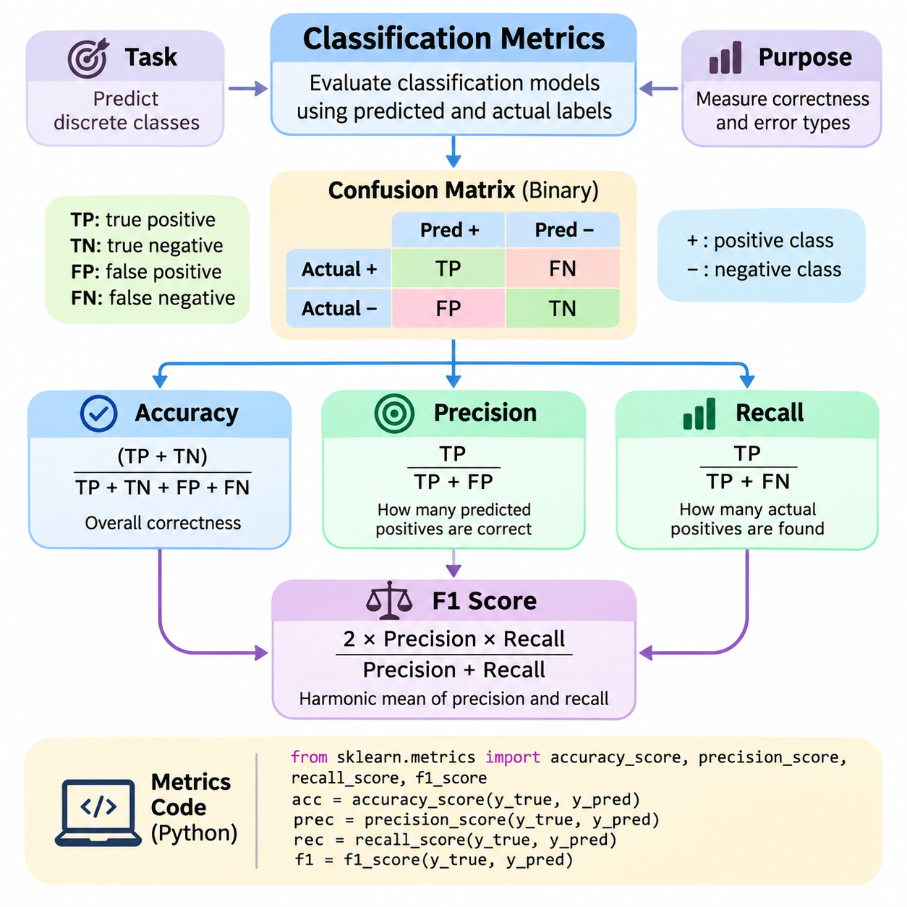{width="7.268055555555556in" height="7.268055555555556in"}

Classification metrics are quantitative measures used to evaluate how accurately a machine learning model assigns observations to predefined categories. Unlike regression, where predictions represent continuous values, classification produces discrete labels or class probabilities. Effective evaluation requires understanding both the number of correct predictions and the types of errors produced by the classifier.

The foundation of classification evaluation is the comparison between predicted labels and actual labels. In binary classification, outcomes are commonly organized into true positives, true negatives, false positives, and false negatives. These four quantities describe whether predictions are correct and how errors are distributed, providing the basis for accuracy, precision, recall, and F1 score.

Accuracy measures the proportion of all predictions that are correct. It is calculated as the number of true positives plus true negatives divided by the total number of observations. Accuracy = (TP + TN) / (TP + TN + FP + FN). This metric is intuitive because it directly expresses overall correctness, making it useful when classes are reasonably balanced and different error types have similar consequences.

For example, consider a classifier that evaluates 1,000 images and correctly identifies 920 of them. Its accuracy is 92%, indicating that most predictions match their reference labels. However, this result does not explain which categories are frequently confused or whether the remaining errors involve important cases. Accuracy therefore provides a useful overview but rarely describes the complete behavior of a classifier.

Accuracy becomes potentially misleading when the dataset contains substantial class imbalance. Suppose 99% of transactions are legitimate and only 1% are fraudulent. A classifier that always predicts legitimate transactions achieves 99% accuracy while detecting no fraud. Although the numerical score appears excellent, the model fails at the application's primary objective, demonstrating why additional metrics are necessary.

Balanced accuracy provides an alternative when class frequencies differ significantly. In binary classification, it is the average of sensitivity and specificity, representing performance across positive and negative classes. Unlike ordinary accuracy, balanced accuracy gives equal importance to both classes. Nevertheless, it should be interpreted alongside other metrics because it does not directly represent the costs of individual prediction errors.

Precision measures the proportion of predicted positive cases that are actually positive. Its formula is Precision = TP / (TP + FP). High precision indicates that positive predictions are generally trustworthy and that relatively few negative observations are incorrectly labeled positive. Precision becomes especially important when false alarms create substantial operational, financial, or human costs.

Consider an automated quality inspection system that identifies defective manufactured products. If the system marks 100 products as defective and 90 are genuinely defective, its precision is 90%. The remaining ten predictions represent false positives, potentially causing unnecessary inspection or disposal. Improving precision reduces these unnecessary interventions, although it may affect the number of actual defects detected.

Recall measures the proportion of actual positive cases that the classifier successfully identifies. It is calculated as Recall = TP / (TP + FN). Recall is also called sensitivity or true positive rate. High recall indicates that relatively few positive observations are missed, making it particularly important when false negatives create serious consequences or when detecting rare events is the primary objective.

In a medical screening application, recall describes how many patients with a particular condition are correctly identified. If 200 patients have the condition and the system detects 180, recall equals 90%. The remaining 20 patients are false negatives. Even when overall accuracy is high, these missed cases may represent substantial clinical risk, emphasizing the importance of evaluating recall separately.

Precision and recall frequently exhibit a tradeoff because changing the classification threshold alters which observations receive positive predictions. Lowering the threshold generally increases recall by identifying more potential positives, but it may reduce precision by introducing additional false positives. Raising the threshold often produces the opposite effect, although the exact relationship depends on the model and dataset.

The appropriate balance between precision and recall depends on application requirements. Fraud detection systems may prioritize recall to identify more suspicious transactions, while automated account suspension systems may require high precision to avoid penalizing legitimate users. Neither metric is universally superior. Their relative importance must be determined by the consequences of false positives and false negatives.

The F1 score combines precision and recall into a single measurement using their harmonic mean. Its formula is F1 = 2 × Precision × Recall / (Precision + Recall), which is equivalent to 2TP / (2TP + FP + FN). The harmonic mean penalizes substantial differences between precision and recall, preventing a high value in one metric from completely compensating for a low value in the other.

For example, if precision is 0.90 and recall is 0.60, the F1 score is 0.72. Although the classifier produces relatively reliable positive predictions, it misses a considerable proportion of actual positive cases. The F1 score reflects this imbalance more clearly than an arithmetic average would, making it useful when both false positives and false negatives matter.

F1 score is particularly useful for imbalanced classification problems, but it is not a universal measure of model quality. It does not incorporate true negatives and therefore cannot fully describe performance on the negative class. A classifier may achieve a favorable F1 score while exhibiting undesirable behavior elsewhere. Consequently, F1 should be interpreted together with class distributions and additional evaluation metrics.

Multiclass classification extends these concepts to problems involving more than two categories. Precision, recall, and F1 can be calculated separately for each class by treating that class as positive and all other classes as negative. This one-versus-rest interpretation enables detailed evaluation of individual categories and helps identify classes that are consistently confused or insufficiently represented.

Macro averaging calculates the arithmetic mean of class-specific metrics, assigning equal weight to every class regardless of frequency. Weighted averaging uses the number of actual observations in each class as its weight. Micro averaging aggregates prediction counts across classes before calculating the metric. These approaches answer different questions and can produce substantially different results on imbalanced datasets.

For single-label multiclass classification, micro-averaged precision, recall, and F1 are equal to overall accuracy when all classes are included. Macro F1, by contrast, highlights performance across categories without allowing large classes to dominate the average. Weighted F1 reflects class prevalence but may conceal weak performance on rare categories. Reporting the averaging method is therefore essential for meaningful interpretation.

Classification metrics can be implemented efficiently using Python and the scikit-learn library. The accuracy_score function calculates overall correctness, while precision_score, recall_score, and f1_score compute their corresponding measures. Each function accepts actual labels and predicted labels, allowing consistent evaluation across models when the same dataset and label definitions are used.

A typical implementation begins by generating predictions with a trained classifier and storing them alongside the reference labels. The evaluation functions then calculate accuracy, precision, recall, and F1 score. For binary classification, the positive label must be defined consistently. For multiclass problems, the average parameter determines whether results are calculated using macro, micro, or weighted aggregation.

The classification_report function provides a convenient summary containing precision, recall, F1 score, and support for individual classes. Support represents the number of actual observations belonging to each category. This report helps reveal whether strong aggregate performance hides weaknesses in minority classes and provides a practical starting point for systematic error analysis.

Metric implementations must also handle cases where mathematical denominators become zero. Precision is undefined when no positive predictions exist, while recall is undefined when no actual positive cases exist. Libraries such as scikit-learn provide configurable zero-division behavior. Explicitly defining this behavior prevents ambiguous results and supports reproducible comparisons across experiments.

Threshold-based evaluation requires additional care because predicted probabilities and predicted labels serve different purposes. Precision, recall, and F1 are generally computed from discrete predictions obtained after applying a decision threshold. Evaluating several thresholds can reveal operational tradeoffs and help select a decision rule that satisfies application-specific requirements without retraining the underlying classifier.

A reproducible evaluation workflow should preserve the test dataset, label encoding, metric definitions, averaging strategy, and classification threshold. Models must be compared using identical evaluation conditions whenever possible. Recording these settings ensures that observed differences reflect model behavior rather than inconsistencies in implementation, preprocessing, or experimental configuration.

Ultimately, accuracy, precision, recall, and F1 score provide complementary perspectives on classification performance. Accuracy measures overall correctness, precision evaluates the reliability of positive predictions, recall measures the ability to detect actual positives, and F1 summarizes their balance. Understanding these distinctions enables more reliable model selection and connects quantitative evaluation with practical decision-making requirements.

## 04.02 Confusion Matrix [w/Code]

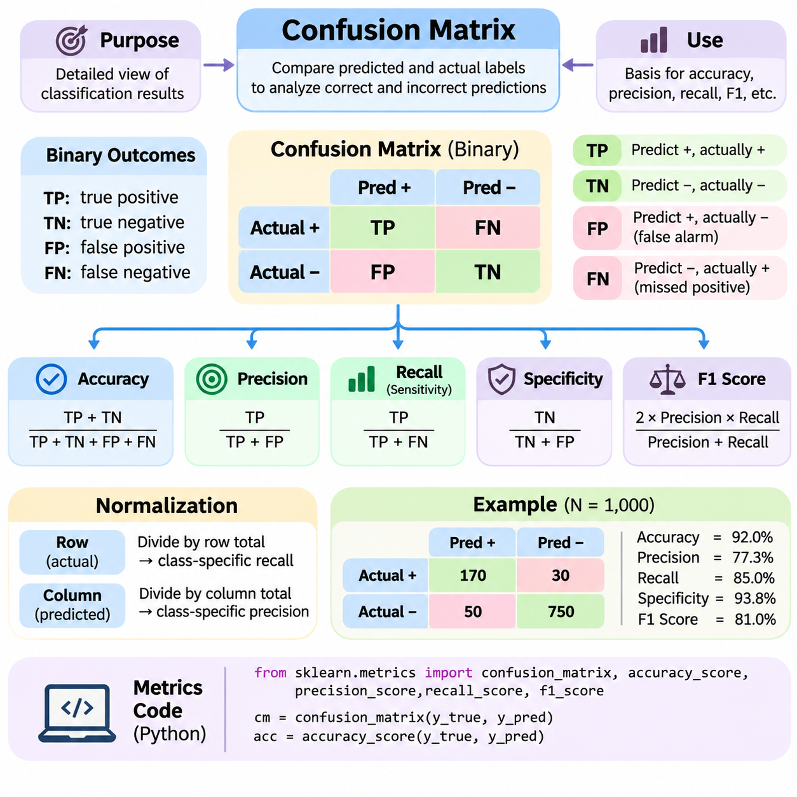{width="7.268055555555556in" height="7.268055555555556in"}

A confusion matrix is a fundamental evaluation tool used to examine the relationship between predicted class labels and actual class labels in a classification problem. Unlike a single performance score, it provides a detailed breakdown of correct and incorrect predictions. By organizing prediction outcomes into a structured matrix, it reveals which categories are recognized successfully and which types of classification errors occur.

In binary classification, a confusion matrix contains four possible outcomes: true positive, true negative, false positive, and false negative. These outcomes are determined by comparing the predicted class with the actual class. Together, they describe the complete distribution of classification decisions and form the mathematical foundation for widely used metrics such as accuracy, precision, recall, specificity, and F1 score.

A true positive, abbreviated TP, occurs when the model predicts the positive class and the actual observation belongs to that class. For example, a medical screening system correctly identifying a patient with a disease produces a true positive. A high number of true positives generally indicates successful detection of the target condition, although the value must be interpreted relative to the total number of actual positive cases.

A true negative, abbreviated TN, occurs when the model predicts the negative class and the actual observation is negative. In fraud detection, correctly identifying a legitimate transaction represents a true negative. True negatives demonstrate the classifier\'s ability to recognize normal or non-target observations and are particularly relevant when evaluating specificity and the frequency of unnecessary positive predictions.

A false positive, abbreviated FP, occurs when the model predicts a positive result for an observation that is actually negative. This error is sometimes called a false alarm. In industrial quality inspection, classifying a properly manufactured product as defective represents a false positive. Such errors can generate unnecessary inspections, wasted resources, and operational disruptions.

A false negative, abbreviated FN, occurs when the model predicts a negative result even though the actual observation belongs to the positive class. In medical diagnosis, failing to identify a patient with a disease represents a false negative. These errors can be especially serious when the objective is to detect rare, dangerous, or costly events that require timely intervention.

The arrangement of a confusion matrix depends on the convention used by the evaluation framework. A common convention places actual classes in rows and predicted classes in columns. Under this arrangement, the binary matrix contains TN and FP in the negative actual-class row, followed by FN and TP in the positive actual-class row. Explicitly identifying axis orientation prevents incorrect interpretation.

Consider a binary classifier evaluated on 1,000 observations, including 200 actual positive cases and 800 actual negative cases. Suppose the model produces 170 true positives, 750 true negatives, 50 false positives, and 30 false negatives. These four counts provide a complete description of the classifier\'s decisions and allow multiple performance measures to be calculated consistently.

From this example, accuracy equals (170 + 750) / 1,000, resulting in 92%. Precision equals 170 / (170 + 50), approximately 77.3%, while recall equals 170 / (170 + 30), or 85%. The F1 score is approximately 81.0%. Although accuracy appears strong, the additional measurements reveal a meaningful number of false alarms and missed positive cases.

The confusion matrix also supports the calculation of specificity, which measures the proportion of actual negative observations correctly classified. Specificity = TN / (TN + FP). In the example, specificity equals 750 / 800, or 93.75%. This metric complements recall by describing how effectively the model avoids incorrectly assigning negative observations to the positive class.

The false positive rate represents the proportion of actual negative cases incorrectly classified as positive. It is calculated as FP / (FP + TN), making it equal to one minus specificity. The false negative rate is FN / (FN + TP), equivalent to one minus recall. These measurements help quantify different error mechanisms and support decisions about acceptable operational risks.

A confusion matrix is especially valuable when classification datasets contain unequal class frequencies. Overall accuracy can be dominated by the majority class, potentially hiding poor detection of rare categories. By exposing individual prediction counts, the matrix makes minority-class failures visible and encourages evaluation based on application requirements rather than a single aggregate score.

Raw confusion matrices contain absolute counts, which are useful for understanding the number of affected observations. However, counts can be difficult to compare when datasets have different sizes or class distributions. Normalized confusion matrices address this limitation by expressing values as proportions, allowing relative classification behavior to be examined across datasets or experimental conditions.

Row normalization divides each matrix entry by the total number of actual observations belonging to its row class. When actual classes occupy rows, the resulting values describe the distribution of predictions for each true category. Diagonal values correspond to class-specific recall, while off-diagonal values indicate the proportions of observations assigned to incorrect categories.

Column normalization divides each entry by the total number of observations predicted as the corresponding class. Under the convention of predicted classes occupying columns, diagonal values represent class-specific precision. This perspective is useful when examining the reliability of predicted categories, particularly when incorrect positive predictions create substantial operational consequences.

Multiclass classification extends the confusion matrix to an N-by-N structure, where N represents the number of classes. Each row corresponds to an actual category, and each column corresponds to a predicted category. Diagonal entries represent correct classifications, while off-diagonal entries identify specific patterns of confusion between different classes.

For example, an image classifier distinguishing cats, dogs, and rabbits may frequently classify rabbits as cats while rarely confusing dogs with rabbits. A single accuracy score cannot clearly describe this relationship. The multiclass confusion matrix exposes these category-specific errors, helping researchers identify visual similarities, insufficient training examples, or weaknesses in learned feature representations.

In multiclass problems, class-specific true positives, false positives, false negatives, and true negatives can be calculated using a one-versus-rest interpretation. One category is treated as positive while all remaining categories are grouped as negative. Repeating this procedure for each category enables precision, recall, and F1 score calculations that are consistent with the underlying confusion matrix.

Confusion matrices can be generated programmatically using Python and the scikit-learn library. The confusion_matrix function accepts actual labels and predicted labels and returns a two-dimensional array of classification counts. The labels parameter can explicitly define class ordering, ensuring that rows and columns remain consistent across different experiments and model comparisons.

A practical implementation begins by obtaining predictions from a trained classifier on an independent test dataset. The predicted labels are compared against the corresponding ground-truth labels using confusion_matrix. The resulting matrix can then be inspected numerically or passed to ConfusionMatrixDisplay for visualization. Consistent label ordering is essential for interpreting each matrix position correctly.

The normalize parameter in scikit-learn supports several normalization strategies. Setting normalize to true normalizes values by actual-class totals, while pred normalizes by predicted-class totals. The all option divides counts by the total number of observations. These alternatives provide complementary perspectives and should be selected according to the intended evaluation question.

Confusion matrices are sensitive to the decision threshold used by probabilistic classifiers. Lowering the threshold for predicting the positive class generally increases true positives and false positives while reducing false negatives and true negatives. Raising the threshold generally produces the opposite pattern. Examining matrices at multiple thresholds helps identify suitable operating points for different applications.

Despite their usefulness, confusion matrices have limitations. They summarize classification outcomes at a particular decision threshold but do not directly describe probability calibration, prediction confidence, or ranking performance across thresholds. They also provide no information about computational latency or deployment cost. Additional evaluation methods are therefore required for comprehensive model assessment.

Reliable confusion matrix analysis requires careful attention to data quality and experimental consistency. Incorrect labels, data leakage, inconsistent class definitions, or evaluation on nonrepresentative samples can produce misleading results. The dataset partition, class ordering, prediction threshold, and normalization method should be documented to support reproducibility and meaningful comparisons.

In practical machine learning workflows, confusion matrices support both quantitative evaluation and diagnostic error analysis. They reveal not only how frequently a classifier succeeds but also which mistakes dominate its behavior. By connecting individual error types to application-specific consequences, confusion matrices provide an essential foundation for model improvement, threshold selection, and reliable deployment decisions.

## 04.03 ROC AUC [w/Code]

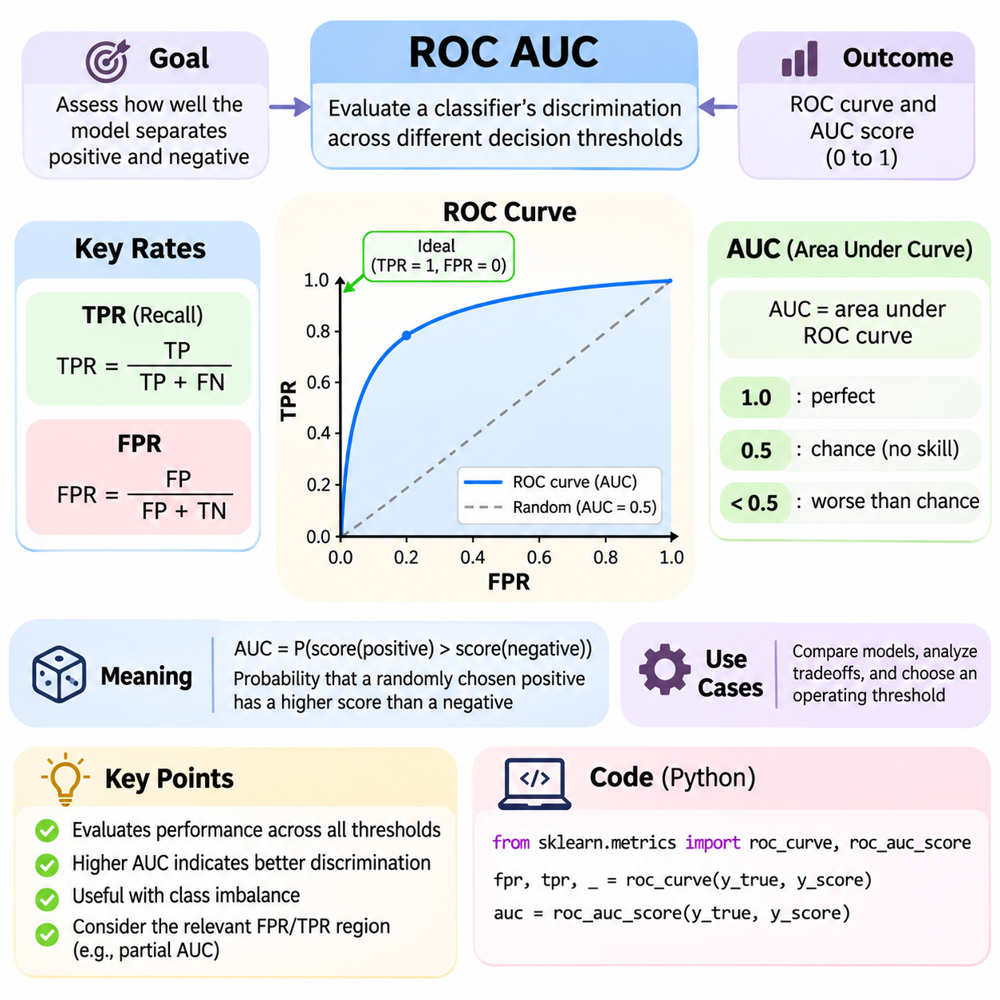{width="7.268055555555556in" height="7.268055555555556in"}

Receiver Operating Characteristic, commonly abbreviated ROC, is an evaluation method used to examine the discrimination capability of binary classification models across different decision thresholds. Instead of measuring performance at a single threshold, ROC analysis describes how the balance between correctly detected positive cases and incorrectly identified negative cases changes as the classification threshold varies.

Many classification models generate continuous prediction scores or estimated probabilities rather than directly producing class labels. A decision threshold converts these scores into positive or negative predictions. Changing the threshold modifies the number of true positives, false positives, true negatives, and false negatives. ROC analysis systematically evaluates these changes to characterize the classifier\'s discrimination performance.

The ROC curve is constructed using the true positive rate and the false positive rate. The true positive rate, also called sensitivity or recall, measures the proportion of actual positive observations correctly identified. It is calculated as TPR = TP / (TP + FN). The false positive rate measures the proportion of actual negative observations incorrectly classified as positive, calculated as FPR = FP / (FP + TN).

Each point on an ROC curve represents a particular decision threshold and its corresponding true positive rate and false positive rate. The horizontal axis represents FPR, while the vertical axis represents TPR. By varying the threshold from a highly restrictive setting to a permissive setting, the curve describes how the classifier trades additional positive detections against additional false alarms.

An ideal classifier would achieve a true positive rate of 1 while maintaining a false positive rate of 0. This corresponds to the upper-left corner of ROC space, indicating complete detection of positive cases without incorrectly labeling negative cases. In contrast, a classifier with no useful ranking discrimination typically produces a curve near the diagonal line connecting the lower-left and upper-right corners.

The diagonal reference line represents the expected ROC behavior of a classifier whose scores do not distinguish positive observations from negative observations. Its true positive rate approximately matches its false positive rate across thresholds. A curve substantially above this line indicates useful discrimination, while a curve below it may suggest that the scoring direction is reversed or that the model performs poorly.

The Area Under the ROC Curve, abbreviated ROC AUC, summarizes the ROC curve into a single numerical value. AUC measures the area beneath the relationship between the true positive rate and false positive rate. Its value ranges from 0 to 1, where 1 represents perfect ranking discrimination, 0.5 corresponds to chance-level ranking, and values below 0.5 indicate systematically unfavorable ranking behavior.

ROC AUC has an important probabilistic interpretation. It represents the probability that a randomly selected positive observation receives a higher prediction score than a randomly selected negative observation, with tied scores receiving half credit. This interpretation emphasizes that AUC evaluates ranking quality rather than the accuracy of probability estimates or the correctness of predictions at one particular threshold.

For example, an ROC AUC of 0.90 indicates that a randomly selected positive-negative pair is correctly ordered approximately 90% of the time, counting ties as half correct. This does not mean that the classifier achieves 90% accuracy or detects 90% of positive cases at every threshold. AUC summarizes discrimination across thresholds and must not be confused with threshold-specific classification metrics.

ROC curves are particularly useful when comparing models that produce different score distributions. Two classifiers may have similar accuracy at a selected threshold but different ROC curves because their ability to separate positive and negative observations differs. Comparing AUC values provides a broad ranking assessment, while examining curve shapes reveals whether one model performs better in operationally important regions.

A model with a higher overall AUC is not necessarily preferable at every decision threshold. ROC curves may intersect, meaning one classifier achieves better sensitivity at low false positive rates while another performs better at higher false positive rates. Model selection should therefore consider the region of the ROC curve relevant to application requirements rather than relying exclusively on the total AUC.

In applications where false positives are expensive, the low-FPR region is particularly important. For example, an industrial defect detection system may need to identify defective products while minimizing unnecessary rejection of acceptable products. A classifier that achieves high recall at a very low false positive rate may be more valuable than one with a slightly higher overall AUC but less favorable operating behavior.

Partial AUC provides a way to evaluate discrimination within a restricted range of false positive rates. Instead of integrating across the entire ROC curve, partial AUC focuses on a selected operating region. This approach is useful when deployment constraints impose a strict maximum false positive rate, although the selected interval and any normalization convention must be documented for meaningful comparison.

ROC AUC is often described as relatively insensitive to class prevalence because its true positive and false positive rates are normalized separately by actual class counts. However, this does not mean ROC analysis is unaffected by dataset composition. Changes in class difficulty, sampling procedures, population characteristics, or score distributions can substantially influence the resulting ROC curve and AUC.

Severe class imbalance can make ROC analysis appear more favorable than operational experience suggests. When negative observations are extremely numerous, a small false positive rate may still correspond to a large number of false alarms. Precision-recall analysis is often more informative when the positive class is rare and the practical objective emphasizes the reliability of positive predictions.

The precision-recall curve evaluates precision against recall as the decision threshold changes. Unlike ROC analysis, precision directly incorporates the proportion of false positives among predicted positive cases and is sensitive to class prevalence. ROC and precision-recall curves therefore provide complementary perspectives, especially in fraud detection, medical screening, and other applications involving rare positive events.

ROC AUC should also be distinguished from probability calibration. A model may achieve excellent AUC while assigning probabilities that do not correspond to observed event frequencies. Any strictly increasing transformation of prediction scores preserves their ranking and therefore preserves ROC AUC. Calibration must be assessed separately when probabilities are used for risk estimation or decision-making.

ROC curves can be calculated efficiently using Python and the scikit-learn library. The roc_curve function accepts ground-truth binary labels and continuous prediction scores, returning arrays of false positive rates, true positive rates, and associated thresholds. The roc_auc_score function calculates the corresponding AUC directly, allowing quantitative comparisons between classifiers evaluated on the same dataset.

A typical implementation begins by obtaining probability estimates or decision scores from a trained model. For a binary classifier supporting predict_proba, the probability assigned to the designated positive class is commonly used. These scores are supplied to roc_curve or roc_auc_score together with actual labels. Using hard class predictions instead of continuous scores discards threshold information and produces a less informative evaluation.

The auc function can also calculate the area beneath a curve from its coordinate arrays. When applied to the false positive rates and true positive rates returned by roc_curve, it provides the ROC AUC through numerical integration. Consistent score orientation, positive-class definition, and dataset selection are essential to ensure that computed results represent the intended classification task.

Multiclass ROC AUC extends binary evaluation through strategies such as one-versus-rest and one-versus-one. One-versus-rest evaluates each class against all remaining classes, while one-versus-one considers pairs of classes. Macro and weighted averaging can summarize these evaluations, but their interpretation depends on the chosen strategy and class frequencies. Reporting these settings is necessary for reproducibility.

AUC estimates are subject to statistical uncertainty because they are calculated from finite evaluation samples. Small datasets, rare positive cases, and correlated observations may produce unstable estimates. Bootstrap resampling and suitable confidence interval methods can help quantify uncertainty. When comparing classifiers, paired evaluation procedures are preferable because both models are assessed using the same observations.

ROC analysis must be performed on data that has not improperly influenced model development. Repeatedly selecting models or thresholds based on test-set ROC results can introduce evaluation bias. Validation data should guide threshold selection and model tuning, while an independent test dataset should provide the final assessment. Data leakage and distribution mismatch can undermine even carefully calculated AUC values.

Ultimately, ROC curves and ROC AUC provide powerful tools for understanding classification discrimination across decision thresholds. ROC curves expose the relationship between positive detection and false alarms, while AUC summarizes overall ranking capability. Their greatest value emerges when combined with confusion matrices, precision-recall analysis, calibration assessment, and application-specific operating requirements.

## 04.04 Regression Metrics

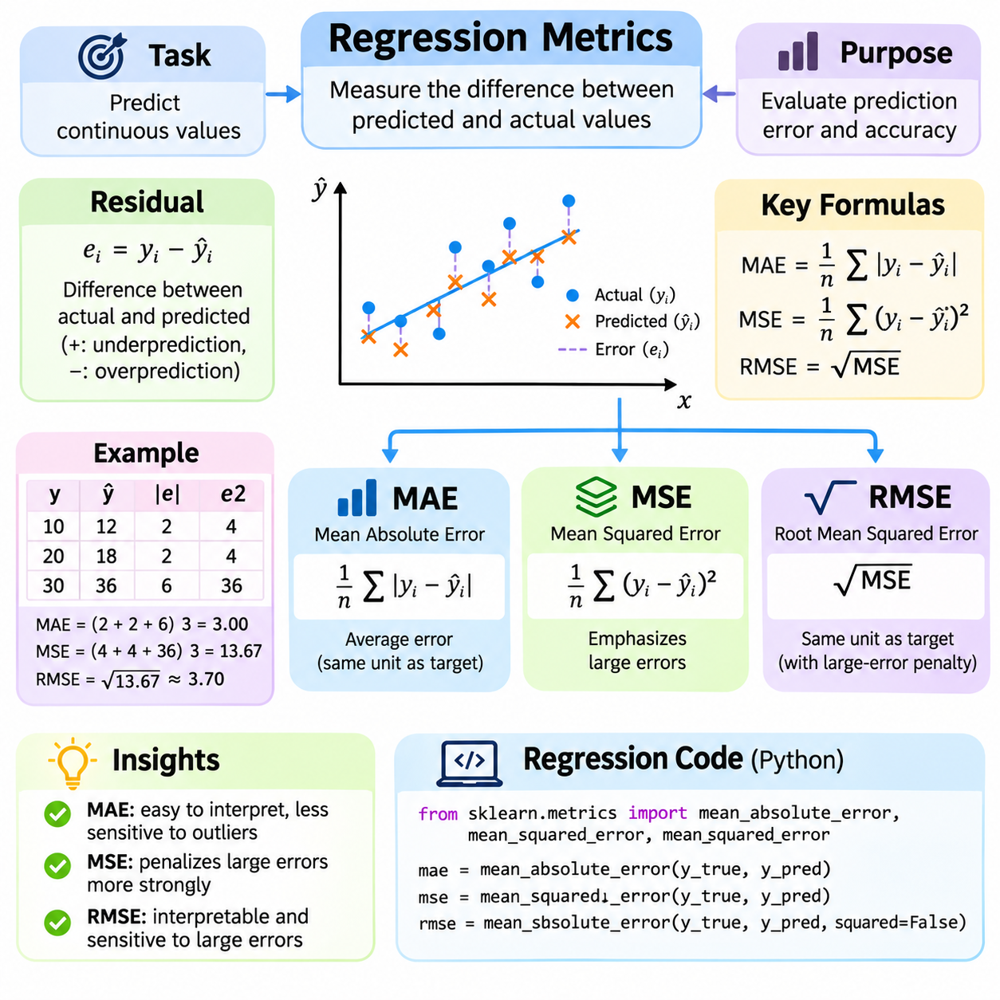{width="7.268055555555556in" height="7.268055555555556in"}

Regression metrics are quantitative measures used to evaluate how accurately machine learning models predict continuous numerical values. Unlike classification metrics, which examine categorical decisions, regression metrics measure differences between predicted and observed quantities. Their purpose is to determine prediction quality, identify systematic errors, and assess whether a model satisfies practical accuracy requirements.

Regression evaluation begins by comparing predicted values with corresponding ground-truth observations. The difference between an observed value and its prediction is called a residual. Residuals describe both the magnitude and direction of prediction errors. Positive residuals indicate underprediction when residuals are defined as actual minus predicted values, while negative residuals indicate overprediction.

Mean Absolute Error, abbreviated MAE, measures the average absolute difference between predicted and actual values. For n observations, MAE = (1/n) × Σ\|yᵢ − ŷᵢ\|, where yᵢ represents the actual value and ŷᵢ represents the prediction. Absolute values prevent positive and negative errors from canceling each other, producing an intuitive measure of typical prediction error.

MAE is expressed in the same units as the target variable, making its interpretation straightforward. If a temperature prediction model achieves an MAE of 2°C, its average absolute prediction error is two degrees Celsius. Similarly, an MAE of 5 millimeters in a distance estimation system indicates an average absolute deviation of five millimeters from measured values.

Mean Squared Error, abbreviated MSE, measures the average squared difference between predicted and actual values. Its formula is MSE = (1/n) × Σ(yᵢ − ŷᵢ)². Squaring eliminates negative signs and assigns disproportionately larger penalties to large errors. Consequently, MSE emphasizes substantial prediction failures more strongly than MAE and is widely used in regression model training.

Consider a regression model producing prediction errors of 1, 2, and 6 units. The MAE equals (1 + 2 + 6) / 3 = 3 units, while the MSE equals (1 + 4 + 36) / 3 ≈ 13.67 squared units. The largest error contributes 36 of the total 41 squared-error units. This example illustrates why MSE is particularly sensitive to occasional large deviations.

The distinction between MAE and MSE is important when selecting an evaluation objective. MAE treats prediction errors proportionally to their absolute magnitude, making it relatively less sensitive to extreme observations. MSE penalizes large errors quadratically, which is valuable when substantial mistakes are especially undesirable. Neither metric is universally superior because their usefulness depends on application requirements.

Outliers can significantly influence regression evaluation. An unusually large prediction error may dominate MSE even when most predictions are accurate. MAE is less affected by such extreme errors, although it is not completely immune to them. Comparing both metrics helps determine whether a model exhibits generally consistent errors or occasionally produces unusually large failures.

Root Mean Squared Error, abbreviated RMSE, is calculated by taking the square root of MSE. Its formula is RMSE = √MSE. Unlike MSE, RMSE is expressed in the original units of the target variable. This makes RMSE easier to interpret while retaining sensitivity to large errors, providing a practical compromise between interpretability and error penalization.

The relationship between RMSE and MAE can reveal characteristics of the error distribution. RMSE is always greater than or equal to MAE when calculated over the same observations. A substantial difference between them often indicates the presence of relatively large errors. However, this relationship alone cannot identify the causes of those errors, so additional residual analysis remains necessary.

Regression metrics should be interpreted relative to the scale of the target variable. An MAE of 10 may be excellent when predicting values around one million but unacceptable when predicting values around 20. Therefore, absolute metric values should be compared against domain requirements, baseline models, and the natural variability of the measured quantity.

The coefficient of determination, commonly called R-squared or R², measures how well model predictions explain variation in the target relative to predicting the evaluation sample\'s mean. It is calculated as R² = 1 − SS_res / SS_tot, where SS_res represents the sum of squared residuals and SS_tot represents the total squared deviation from the observed mean.

An R² value of 1 indicates perfect predictions, while 0 indicates performance equivalent to predicting the evaluation sample mean under the standard definition. Negative R² values are possible when predictions perform worse than this baseline. Although R² provides a useful relative measure, it does not directly describe the magnitude of prediction errors in physical or operational units.

Mean Absolute Percentage Error, abbreviated MAPE, expresses prediction errors as percentages relative to actual values. This can improve interpretability when comparing predictions across different scales. However, MAPE becomes undefined when actual values equal zero and unstable when they approach zero. It can also behave asymmetrically, making it unsuitable for some regression applications.

Residual analysis complements numerical metrics by examining patterns in prediction errors. Ideally, residuals should not exhibit systematic relationships with predicted values, input features, or time. Persistent positive or negative residuals may indicate bias, while increasing error dispersion may suggest heteroscedasticity. These patterns can reveal weaknesses that aggregate MAE or MSE values conceal.

Regression metrics can be implemented efficiently using Python and the scikit-learn library. The mean_absolute_error and mean_squared_error functions accept arrays of actual and predicted values. The root_mean_squared_error function calculates RMSE in supported versions, while r2_score computes the coefficient of determination. Consistent input ordering is essential for meaningful results.

A typical regression evaluation workflow begins by training a model on training data and generating predictions for an independent test dataset. Actual values and predictions are then supplied to the metric functions. MAE, MSE, RMSE, and R² can be recorded together, allowing engineers to examine average error magnitude, sensitivity to large deviations, and performance relative to a baseline.

For example, Python arrays containing actual values of [10, 20, 30, 40] and predicted values of [12, 18, 33, 37] produce absolute errors of [2, 2, 3, 3]. The resulting MAE is 2.5, MSE is 6.5, and RMSE is approximately 2.55. These calculations demonstrate how the same predictions can be summarized using different error functions.

When implementing regression metrics, preprocessing consistency is essential. If a model predicts normalized or standardized target values, predictions and reference values should be transformed back to the original scale before reporting operational error metrics. Otherwise, MAE and MSE may describe transformed units rather than quantities meaningful to users or engineering systems.

Multi-output regression introduces additional evaluation considerations because models may predict several continuous variables simultaneously. Metrics can be calculated independently for each target or aggregated across outputs. When target variables use different units or scales, unweighted aggregation may produce misleading conclusions. Output-specific metrics are often necessary for reliable interpretation.

Evaluation must also account for differences between development data and real-world operating conditions. A model that predicts accurately on randomly sampled test data may perform poorly when sensor conditions, seasonal patterns, or operating environments change. Temporal validation, representative test datasets, and subgroup analysis help determine whether reported regression performance is likely to generalize.

Model comparison requires identical evaluation datasets and consistent metric definitions. A lower MAE or MSE generally indicates better predictive accuracy under the corresponding error criterion, but small numerical improvements may not justify additional computational cost or operational complexity. Statistical uncertainty, inference latency, and deployment constraints should also influence model selection.

In practical applications, acceptable regression error depends on the consequences of inaccurate predictions. A small average error may be insufficient for precision manufacturing if occasional large deviations exceed safety tolerances. Conversely, moderate prediction errors may be acceptable in demand forecasting when uncertainty is inherently high. Evaluation criteria should reflect these domain-specific requirements.

Ultimately, MAE, MSE, RMSE, and R² provide complementary perspectives on regression performance. MAE describes average absolute deviation, MSE emphasizes large errors, RMSE expresses squared-error sensitivity in original units, and R² measures relative explanatory performance. Combining these metrics with residual analysis and application requirements supports reliable regression model development and deployment.

## 04.05 Ranking Metrics

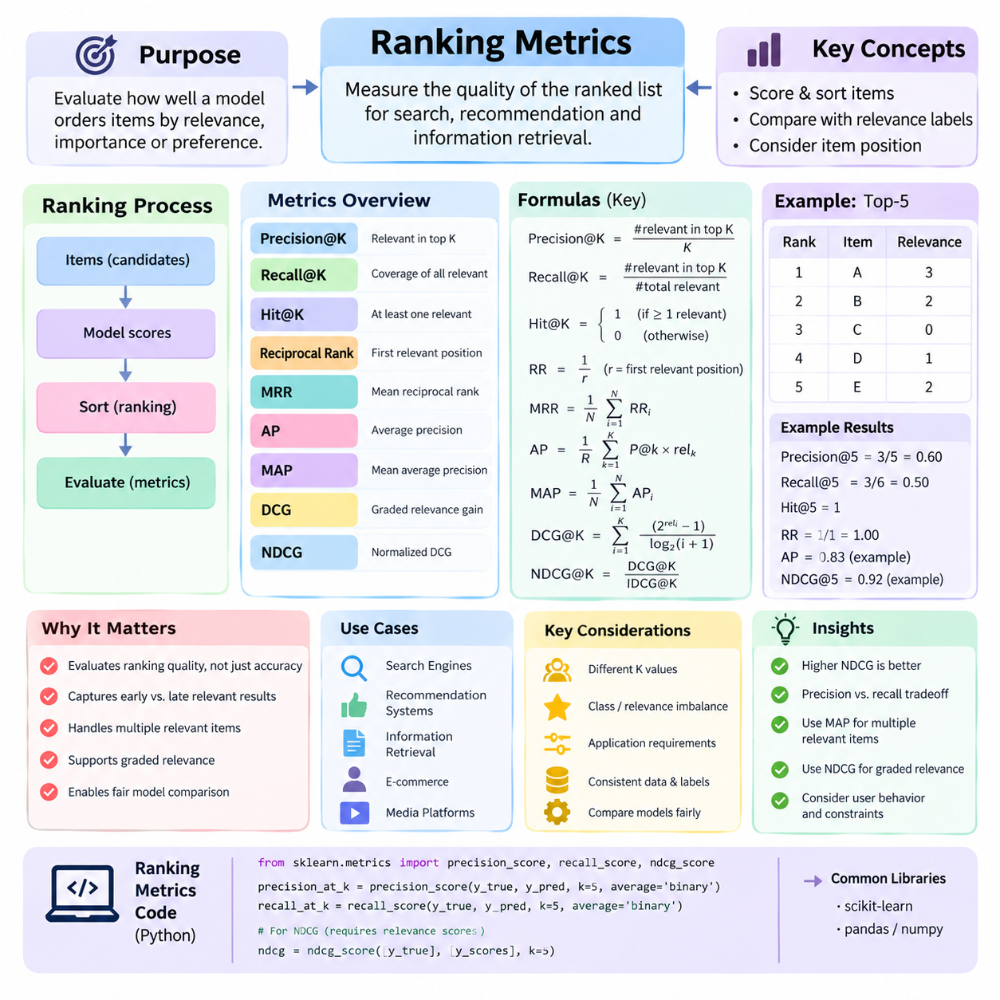{width="7.268055555555556in" height="7.268055555555556in"}

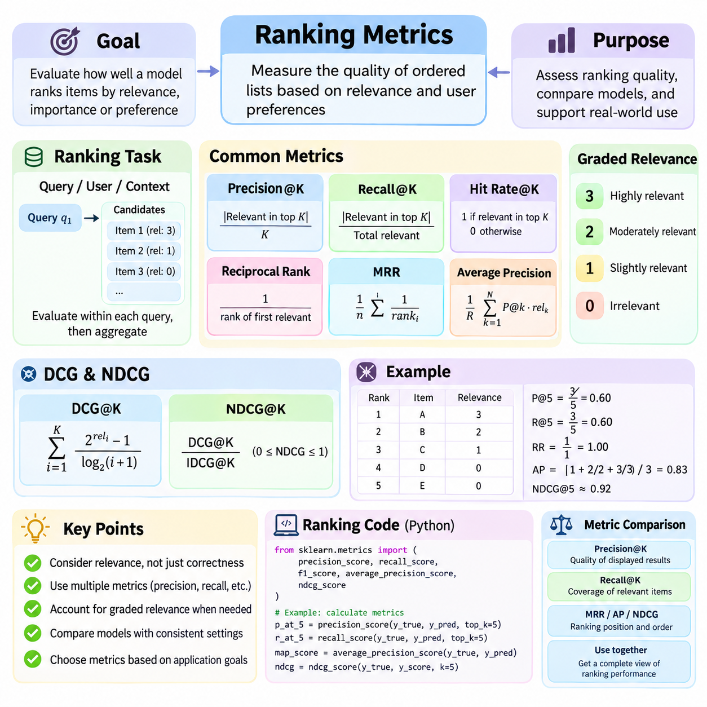{width="7.268055555555556in" height="7.268055555555556in"}

Ranking metrics evaluate how effectively a machine learning system orders items according to relevance, importance, preference, or predicted utility. Unlike classification metrics, which primarily assess categorical correctness, ranking metrics emphasize the relative positions of items in an ordered list. They are essential for search engines, recommendation systems, information retrieval, and applications where users examine only the highest-ranked results.

A ranking model typically assigns a numerical score to each candidate item and sorts the candidates according to those scores. Evaluation compares the resulting order with reference relevance judgments or observed preferences. A model may identify relevant items correctly but place them too far down the list. Ranking evaluation therefore considers not only whether relevant items are retrieved but also where they appear.

Ranking tasks are commonly organized around queries, users, or decision contexts. Each context defines a candidate set containing items with different relevance levels. Evaluation is generally performed within each context before results are aggregated across contexts. This distinction is important because ranking quality depends on comparisons among candidates associated with the same query rather than arbitrary comparisons across unrelated queries.

Precision at K, written Precision\\@K, measures the proportion of relevant items among the first K ranked results. It is calculated by dividing the number of relevant items in the top K positions by K. For example, if three of the first five recommended products are relevant, Precision\\@5 equals 0.60. This metric is useful when users primarily interact with a limited number of visible recommendations.

Recall at K, written Recall\\@K, measures the proportion of all relevant items successfully retrieved within the first K positions. Its denominator is the total number of relevant items associated with the query. If a query has eight relevant documents and five appear among the first ten results, Recall\\@10 equals 0.625. This metric emphasizes coverage rather than the concentration of relevant results.

Precision\\@K and Recall\\@K provide complementary perspectives on ranking performance. Precision\\@K measures the quality of the displayed results, while Recall\\@K measures how completely relevant information is recovered. Increasing K often improves recall but can reduce precision as less relevant items enter the list. The appropriate cutoff depends on interface constraints, user behavior, and application objectives.

Hit Rate at K, commonly written Hit\\@K, indicates whether at least one relevant item appears within the first K results. For an individual query, the result is one when a relevant item is present and zero otherwise. Averaging across queries produces the overall hit rate. This metric is particularly useful when successful retrieval requires finding at least one acceptable answer or recommendation.

Reciprocal Rank evaluates the position of the first relevant result. If the first relevant item appears at position r, its reciprocal rank is 1/r. A relevant item ranked first receives a score of 1, while one ranked fourth receives 0.25. This metric strongly rewards early retrieval and becomes especially meaningful when users usually need only one satisfactory result.

Mean Reciprocal Rank, abbreviated MRR, averages reciprocal ranks across multiple queries. Queries without a relevant retrieved result contribute zero under the usual convention. MRR is widely used in question answering, search, and retrieval systems where identifying the first correct result is important. However, it ignores additional relevant items appearing after the first successful result.

Average Precision, abbreviated AP, evaluates ranking quality by considering precision at positions containing relevant items. For binary relevance, AP is commonly calculated as the sum of Precision\\@k multiplied by the relevance indicator at position k, divided by the total number of relevant items. It rewards systems that place relevant results early while accounting for multiple relevant documents.

Mean Average Precision, abbreviated MAP, is the arithmetic mean of Average Precision across evaluation queries. It provides a comprehensive measure of binary-relevance ranking quality when several relevant results may exist for each query. Unlike MRR, MAP considers the ordering of multiple relevant items. Its interpretation depends on consistent relevance labels and clearly defined candidate sets.

Discounted Cumulative Gain, abbreviated DCG, extends ranking evaluation to graded relevance judgments. Instead of treating every item as simply relevant or irrelevant, DCG assigns different gains to different relevance levels. A common formulation is DCG\\@K = Σ(2\^relᵢ − 1) / log₂(i + 1), summed over positions from 1 through K.

The logarithmic discount in DCG reduces the contribution of items appearing farther down the ranking. Highly relevant items placed near the beginning contribute more than equally relevant items appearing later. This reflects the practical observation that users are more likely to inspect early results. The exponential gain formulation also places greater emphasis on highly relevant items.

Normalized Discounted Cumulative Gain, abbreviated NDCG, compares the observed DCG with the ideal DCG obtained from a perfectly ordered ranking. NDCG\\@K = DCG\\@K / IDCG\\@K when the ideal gain is positive. This normalization produces values between zero and one for nonnegative relevance gains, making ranking quality easier to compare across queries with different relevance distributions.

NDCG is particularly valuable for search engines and recommendation systems because relevance often exists on a graded scale. A document may be highly relevant, moderately relevant, or irrelevant to a query. NDCG captures these distinctions while rewarding appropriate placement. However, its numerical value depends on the gain function, discount convention, and selected cutoff K.

Ranking evaluation also includes pairwise measures that assess whether pairs of items appear in the correct relative order. Pairwise accuracy calculates the proportion of comparable item pairs ordered consistently with their reference preferences. Such measures are useful when training objectives focus on pairwise comparisons rather than predicting absolute relevance scores.

Kendall\'s tau and Spearman\'s rank correlation measure agreement between two orderings. Kendall\'s tau examines concordant and discordant item pairs, while Spearman\'s correlation evaluates relationships between assigned ranks. These statistics are useful when complete or comparable reference rankings are available, although they may be less suitable for retrieval tasks with incomplete relevance judgments.

The choice of ranking metric depends strongly on the application\'s interaction pattern. MRR emphasizes finding the first useful result, MAP rewards retrieving multiple relevant results early, and NDCG handles graded relevance. Precision\\@K and Recall\\@K evaluate top-ranked quality and coverage. Selecting a metric requires identifying what successful ranking means for the intended users.

Ranking metrics can be implemented using Python and libraries such as scikit-learn. The ndcg_score function calculates normalized discounted cumulative gain from relevance labels and prediction scores. The average_precision_score function supports average precision calculations for suitable binary relevance settings. Custom implementations are often used for Precision\\@K, Recall\\@K, MRR, and query-level aggregation.

A reliable implementation first groups candidate items by query or user context, then sorts each group by predicted ranking scores. Reference relevance labels are aligned with the sorted items before calculating the selected metrics. Scores are aggregated across contexts using a clearly specified averaging procedure. Incorrect alignment or inconsistent grouping can invalidate otherwise correct calculations.

Evaluation must account for incomplete relevance judgments and position bias in observed interaction data. Users are more likely to click items displayed near the top, even when lower-ranked items are equally relevant. Consequently, click data does not always provide unbiased relevance labels. Careful experimental design, randomized exposure, or appropriate bias correction may be necessary.

Offline ranking metrics provide useful evidence but cannot fully predict real-world user satisfaction. Online evaluation may examine click-through rate, conversion rate, engagement, or task completion through controlled experiments. These measurements introduce additional considerations involving user behavior, presentation effects, and operational constraints. Combining offline and online evaluation provides a broader assessment.

Ultimately, ranking metrics connect numerical ordering quality with practical retrieval and recommendation objectives. Precision\\@K, Recall\\@K, MRR, MAP, and NDCG emphasize different aspects of relevance and position. Understanding their assumptions and limitations enables meaningful model comparisons, reliable evaluation procedures, and ranking systems that better support real-world information access and decision-making.

## 04.06 Model Comparison

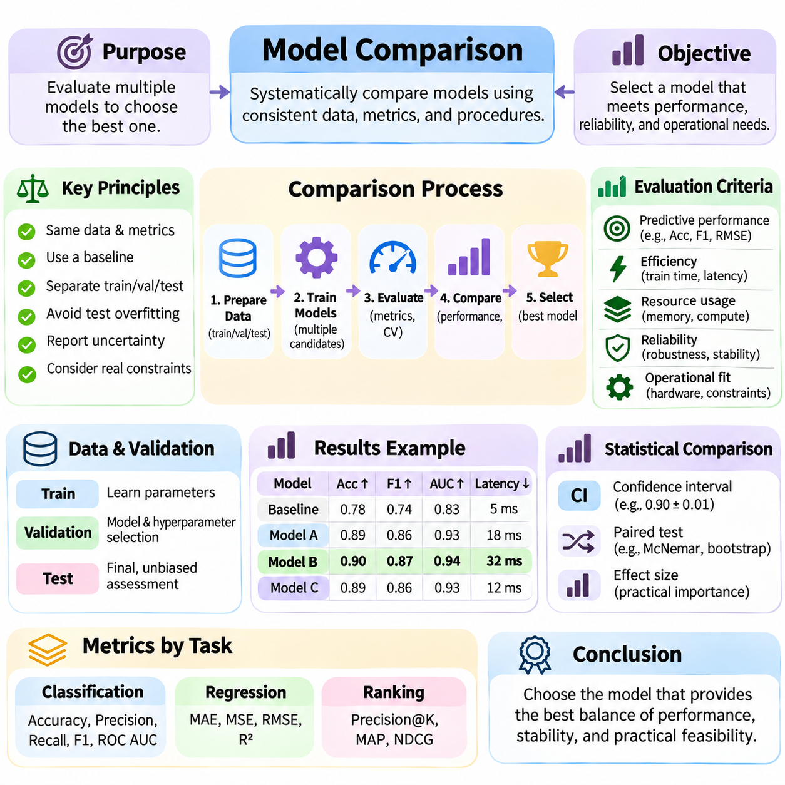{width="7.268055555555556in" height="7.268055555555556in"}

Model comparison is the systematic process of evaluating multiple machine learning models to determine which best satisfies a defined prediction objective. Rather than selecting a model solely because it achieves the highest score, comparison considers predictive performance, reliability, computational efficiency, and operational requirements. A meaningful comparison requires consistent datasets, evaluation procedures, and clearly defined success criteria.

The first step in model comparison is establishing a common evaluation framework. Candidate models must be assessed using compatible input data, target definitions, and performance metrics. Comparing accuracy from one dataset with F1-score from another does not provide a valid basis for selection. Standardized evaluation conditions help ensure that observed differences reflect model behavior rather than inconsistencies in measurement.

Baseline models provide essential reference points for interpreting performance. A classification baseline might predict the majority class, while a regression baseline might predict the training target mean. More sophisticated candidates should demonstrate meaningful improvements over these simple approaches. Without a baseline, an apparently impressive metric may conceal the fact that a substantially simpler model performs almost as well.

Training, validation, and test datasets serve different purposes during model comparison. Training data determines model parameters, while validation data supports model selection and hyperparameter tuning. An independent test dataset estimates final generalization performance. Repeatedly choosing models based on test results introduces selection bias and can make reported performance overly optimistic.

Cross-validation provides a more comprehensive comparison when evaluation data is limited. In K-fold cross-validation, the dataset is divided into K subsets, and each model is trained and evaluated across multiple partitions. Averaging the resulting scores reduces dependence on one particular split. Using identical folds for all candidates supports fairer comparisons and allows differences to be examined across matched evaluations.

Model comparison should consider variability as well as average performance. Two models may achieve similar mean cross-validation scores while exhibiting substantially different variation across folds. A model with slightly lower average performance but more stable results may be preferable in sensitive applications. However, fold-level variability does not automatically provide a complete estimate of uncertainty in deployment.

Metric selection must reflect the structure of the prediction problem. Classification models may require precision, recall, F1-score, ROC AUC, or calibration measures. Regression models may be compared using MAE, MSE, RMSE, and R². Ranking systems may require Precision\\@K, MAP, or NDCG. Different metrics emphasize different error characteristics, so a single metric rarely captures every operational requirement.

Class imbalance introduces additional considerations when comparing classifiers. Accuracy can appear high even when a model fails to identify rare positive cases. Precision, recall, F1-score, and precision-recall curves often reveal differences hidden by overall accuracy. Comparisons should use consistent positive-class definitions, averaging conventions, and decision thresholds to avoid misleading conclusions.

Threshold-dependent metrics require particular care because different thresholds can produce substantially different results from the same model. A classifier may achieve high recall by accepting more false positives, while another threshold prioritizes precision. Thresholds should be selected using validation data and application costs. Final test comparisons should evaluate the previously selected operating configurations.

Statistical uncertainty is an important component of model comparison. Performance scores calculated from finite samples are estimates rather than exact measures of future behavior. Confidence intervals, bootstrap resampling, and appropriate statistical tests can help assess whether observed differences are distinguishable from sampling variation. The chosen method must respect dependencies and the structure of the evaluation data.

Paired comparisons are particularly useful when candidate models are evaluated on the same observations. Because each model encounters identical examples, differences can be analyzed directly rather than treating scores as independent measurements. For classification, McNemar\'s test may be suitable for comparing paired error outcomes, while bootstrap procedures can support comparisons of more general performance metrics.

Statistical significance should not be confused with practical importance. A small improvement may be statistically detectable on a large dataset but provide negligible operational benefit. Conversely, an improvement with uncertain statistical evidence may still warrant further investigation when its potential value is substantial. Model selection should consider effect size, uncertainty, application costs, and deployment consequences together.

Computational efficiency often determines whether a high-performing model is practical. Training time, inference latency, memory consumption, energy requirements, and hardware compatibility can differ considerably between candidates. A complex model may provide slightly better accuracy while requiring substantially more resources. Evaluation should therefore measure predictive quality alongside resource consumption under representative conditions.

Inference performance should be measured using realistic workloads and deployment hardware. Batch size, input dimensions, preprocessing overhead, and concurrent requests can significantly influence latency and throughput. Comparisons conducted on different hardware configurations may produce misleading efficiency conclusions. Consistent benchmarking conditions are necessary to establish meaningful performance and resource tradeoffs.

Model complexity also affects maintainability and interpretability. Simpler models may be easier to debug, explain, retrain, and deploy, while more complex architectures may capture relationships unavailable to simpler alternatives. Interpretability can be particularly important when predictions influence consequential decisions. These considerations should complement quantitative metrics rather than replace objective performance evaluation.

Robustness testing examines whether model performance remains acceptable under realistic variations in input conditions. Noise, missing values, sensor degradation, distribution shifts, and unusual observations can expose weaknesses that ordinary test datasets overlook. A model with the highest benchmark score may not be the most reliable under changing conditions. Stress testing provides additional evidence for deployment decisions.

Subgroup evaluation can reveal performance differences across meaningful segments of the data. A model may achieve strong aggregate accuracy while performing poorly on particular operating conditions, geographic regions, device types, or rare scenarios. Comparing subgroup metrics helps identify hidden weaknesses and uneven reliability. Subgroups should be defined using relevant domain requirements and evaluated with appropriate sample sizes.

Learning curves provide another perspective on candidate models by showing how performance changes with increasing training data. A model that currently performs worse may improve substantially with additional examples, while another may have reached a performance plateau. Comparing learning curves helps determine whether further data collection, architectural changes, or additional tuning is likely to provide useful improvements.

Hyperparameter tuning must be conducted fairly across candidate models. Providing extensive optimization resources to one algorithm while using default settings for another can distort conclusions. Comparable search budgets, consistent validation procedures, and transparent reporting improve fairness. When extensive model selection is performed, nested cross-validation can help estimate performance without reusing selection data for final evaluation.

Reproducibility requires recording the experimental configuration associated with each candidate. Important information includes dataset versions, preprocessing procedures, random seeds, model parameters, hyperparameters, software dependencies, and hardware settings. Experiment tracking systems can organize metrics and artifacts. Repeated runs help determine whether apparent improvements are stable rather than consequences of random initialization.

Multi-objective comparison recognizes that predictive accuracy is only one dimension of model quality. A candidate may offer superior accuracy but higher latency, while another provides lower resource consumption with slightly weaker predictions. Pareto analysis identifies models for which no alternative improves one objective without worsening another. This perspective supports decisions involving competing engineering requirements.

A practical comparison report should document the evaluation dataset, baseline results, candidate configurations, selected metrics, uncertainty estimates, and operational measurements. Results should distinguish validation performance from final test performance. Any limitations involving sample size, distribution mismatch, or incomplete testing should be explicitly stated. Transparent reporting enables others to understand and reproduce the selection process.

Ultimately, model comparison is a decision-making process that integrates statistical evidence with practical constraints. Reliable selection depends on fair experimental conditions, appropriate metrics, uncertainty analysis, robustness testing, and operational feasibility. The preferred model is not necessarily the one with the highest isolated benchmark score, but the one that provides the strongest overall fit for the intended application.

## 04.07 Evaluation Pitfalls

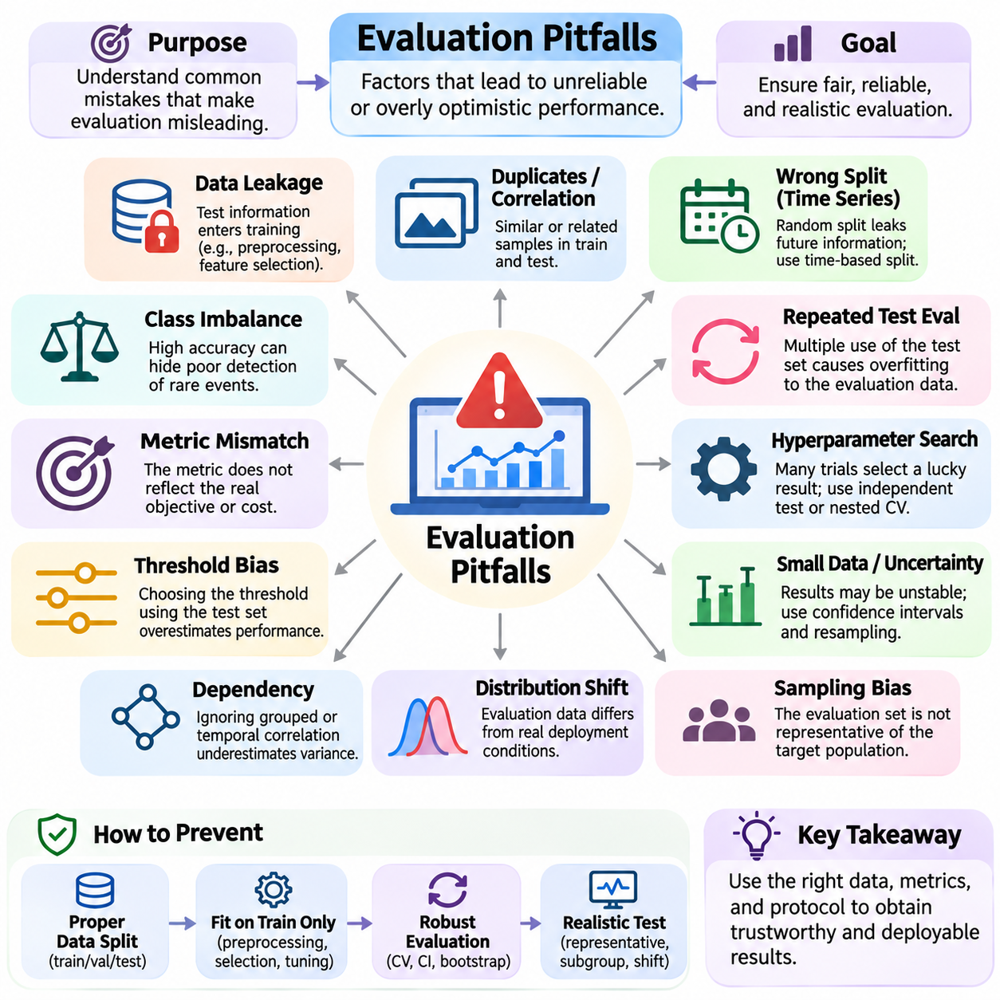{width="7.268055555555556in" height="7.268055555555556in"}

Evaluation pitfalls are methodological mistakes that cause machine learning performance estimates to become misleading, unreliable, or overly optimistic. Even when evaluation metrics are calculated correctly, inappropriate experimental design can produce invalid conclusions. Understanding these pitfalls is essential because model selection, deployment decisions, and claims about generalization depend on trustworthy evaluation procedures.

Data leakage occurs when information unavailable during real-world prediction improperly influences model training or evaluation. Leakage may arise when test observations affect preprocessing, feature selection, or hyperparameter tuning. A model can then achieve excellent evaluation scores without learning relationships that generalize. Preventing leakage requires strict separation of information across development stages.

Preprocessing leakage is particularly common when transformations are fitted before dividing data into training and test sets. For example, calculating normalization statistics using the entire dataset allows test information to influence training. Imputation, feature selection, and dimensionality reduction can introduce similar problems. Such transformations should be fitted on training data and subsequently applied to validation and test observations.

Duplicate and correlated observations can also compromise evaluation. If nearly identical records appear in both training and test datasets, the model may effectively encounter test examples during training. Images from the same recording, measurements from the same patient, or repeated observations from one device can create hidden dependencies. Group-aware splitting helps prevent these forms of contamination.

Random dataset splitting is not appropriate for every prediction problem. Time-series forecasting requires evaluation on observations occurring after the training period to approximate future deployment. Randomly mixing historical and future records can expose information that would not exist at prediction time. Chronological splitting and rolling-window evaluation provide more realistic estimates for temporal applications.

Class imbalance can make common classification metrics deceptive. A classifier predicting only the majority class may achieve high accuracy while completely failing to identify rare but important events. Precision, recall, F1-score, and precision-recall curves can reveal weaknesses hidden by accuracy. Evaluation should consider class prevalence, error consequences, and the practical significance of minority-class detection.

Metric mismatch occurs when the selected evaluation measure does not reflect the actual application objective. Optimizing accuracy may be inappropriate when false negatives are especially costly, while minimizing average regression error may conceal dangerous extreme deviations. Metrics should correspond to operational requirements rather than being selected solely because they are familiar or easy to calculate.

Threshold selection can introduce hidden evaluation bias. Classification models often produce scores that must be converted into decisions using a threshold. Selecting the threshold that maximizes performance on the final test dataset effectively uses test information for optimization. Thresholds should instead be selected using validation data, with final performance measured on untouched test observations.

Repeated test-set evaluation is another common source of optimistic estimates. When developers continually modify models after inspecting test results, the test dataset gradually becomes part of the development process. Even without directly training on test examples, repeated decisions can overfit the evaluation set. A separate final holdout or carefully controlled evaluation protocol helps preserve independence.

Hyperparameter search introduces selection effects because many configurations are evaluated before the best-performing candidate is chosen. The selected validation score may be unusually favorable due to random variation. Reporting this score as an unbiased estimate of future performance is misleading. Independent testing or nested cross-validation can provide more defensible estimates after model selection.

Small evaluation datasets create substantial statistical uncertainty. A model may appear superior because only a few observations determine the measured difference. Rare classes, unusual events, and high-variance outcomes make this problem more severe. Confidence intervals, repeated evaluation, and appropriate resampling methods help distinguish stable improvements from fluctuations caused by limited samples.

Ignoring dependencies between observations can produce invalid uncertainty estimates. Standard bootstrap procedures assume an appropriate sampling structure, but repeated measurements from the same subject or device are not independent. Resampling individual records may underestimate variability. Group-level or block-based resampling should be considered when observations are clustered or temporally correlated.

Distribution shift occurs when deployment data differs from the data used for evaluation. Changes in sensors, environments, customer behavior, operating conditions, or data collection procedures can reduce predictive performance. A model that performs well on a benchmark may fail under unfamiliar conditions. Representative testing, subgroup evaluation, and monitoring help identify generalization weaknesses.

Sampling bias arises when evaluation observations do not adequately represent the intended deployment population. A dataset collected under convenient laboratory conditions may exclude difficult operating scenarios. Similarly, a recommendation benchmark may overrepresent frequently viewed items. Evaluation should document how samples were collected and whether important populations or operating conditions are missing.

Incorrect label quality can distort evaluation even when model predictions are reasonable. Human annotation errors, inconsistent labeling guidelines, ambiguous categories, and outdated reference values can introduce noise into ground-truth data. Such errors may penalize correct predictions or reward incorrect ones. Label audits, agreement analysis, and clear annotation protocols improve evaluation reliability.

Aggregate metrics can conceal serious subgroup failures. A model may achieve strong overall performance while producing poor results for particular environments, devices, rare categories, or operating conditions. Evaluating meaningful subgroups reveals whether performance is distributed consistently. However, subgroup estimates require sufficient samples and appropriate uncertainty reporting.

Confusing ranking quality with probability calibration is another important pitfall. A classifier may achieve high ROC AUC while producing poorly calibrated probability estimates. Conversely, calibration improvements may not change the ordering of predictions. When probabilities guide risk assessment or resource allocation, calibration metrics and reliability analysis should complement discrimination measures.

Regression evaluation can become misleading when target scales or transformations are handled inconsistently. MAE and RMSE calculated on standardized targets cannot be interpreted directly in original physical units. Outliers may dominate MSE, while percentage errors become unstable near zero. Metric selection and inverse transformations must reflect the quantities that matter operationally.

Model comparison is unreliable when candidates receive unequal evaluation conditions. Different test sets, preprocessing pipelines, tuning budgets, or hardware configurations can create artificial advantages. Fair comparison requires consistent protocols and transparent reporting. Improvements should be attributed to model differences only after major experimental confounders have been controlled.

Statistical significance does not automatically imply practical importance. A tiny performance difference may become statistically detectable with enough observations but offer little operational value. Conversely, a potentially meaningful improvement may remain uncertain with limited data. Evaluation should report effect sizes, uncertainty, application costs, and consequences rather than relying exclusively on significance tests.

Offline evaluation can fail to capture how users or physical systems behave after deployment. Recommendation models may change user interactions, while robotic policies may encounter states absent from recorded datasets. Feedback effects can alter the distribution of future observations. Online experiments, controlled pilots, and operational monitoring provide complementary evidence when deployment is feasible and safe.

Reproducibility problems make evaluation results difficult to verify. Missing random seeds, undocumented preprocessing, changing dataset versions, and inconsistent software dependencies can produce unexplained score differences. Reliable experiments should preserve configurations, data partitions, model artifacts, and evaluation code. Repeated runs help identify instability caused by stochastic training procedures.

Ultimately, trustworthy evaluation requires more than computing the correct metrics. It depends on preventing leakage, maintaining independent test data, respecting temporal and group structure, selecting meaningful measures, and quantifying uncertainty. Recognizing evaluation pitfalls helps distinguish genuine generalization from misleading benchmark success and supports safer, more reliable machine learning deployment.

## 04.08 Real World Evaluation [w/Code]

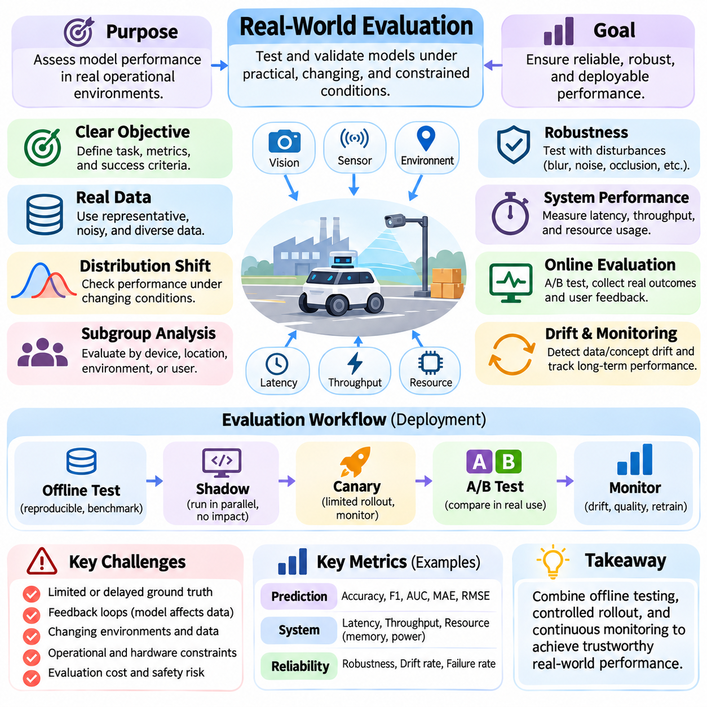{width="7.268055555555556in" height="7.268055555555556in"}

Real-world evaluation examines how machine learning models perform under the practical conditions in which they are deployed. Unlike controlled benchmark testing, it considers changing environments, imperfect inputs, operational constraints, and interactions with users or physical systems. Its purpose is to determine whether laboratory performance translates into dependable outcomes when models encounter realistic workloads and unexpected situations.

A successful real-world evaluation begins with clearly defined operational objectives. Technical metrics such as accuracy, F1-score, and RMSE must be connected to measurable application requirements. For example, a manufacturing inspection system may prioritize missed defects, while a demand forecasting system may emphasize inventory costs. Evaluation criteria should reflect the consequences of model decisions rather than abstract benchmark scores alone.

Representative evaluation data is essential because deployment conditions rarely match idealized training datasets. Real inputs may contain missing values, sensor noise, unusual lighting, changing backgrounds, or unexpected user behavior. Evaluation datasets should include normal operations and difficult scenarios. Sampling procedures must also reflect the frequency and diversity of situations the deployed system is expected to encounter.

Distribution shift is a central concern in real-world evaluation. Input distributions may change because of new devices, environmental conditions, seasonal patterns, or evolving user preferences. A model trained on historical observations may become less accurate as these conditions change. Evaluating performance across time periods, locations, and operating regimes helps identify vulnerabilities before they cause operational failures.

Real-world evaluation should distinguish between average performance and performance under critical conditions. A model may achieve excellent overall accuracy while failing during rare but consequential events. Safety-sensitive applications require explicit evaluation of failure scenarios, extreme inputs, and operational boundaries. Tail-risk analysis and worst-case testing complement average metrics by exposing potentially unacceptable behavior.

Operational latency is often as important as predictive accuracy. A model that produces accurate results too slowly may be unsuitable for real-time applications. Evaluation should measure end-to-end response time, including data acquisition, preprocessing, inference, postprocessing, and communication delays. Average latency alone may conceal occasional delays that violate operational deadlines.

Throughput measures how many predictions or requests a system can process within a given time interval. Real deployments may experience fluctuating workloads, concurrent users, or bursts of sensor data. Stress testing helps determine whether performance remains acceptable as demand increases. Throughput measurements should be interpreted together with latency, resource utilization, and the system\'s expected service capacity.

Hardware constraints influence practical model performance. Edge devices may have limited memory, processing capability, power budgets, and thermal capacity. A model that operates efficiently on a server GPU may perform differently on embedded hardware. Real-world evaluation should therefore use representative deployment devices and measure memory consumption, energy use, sustained throughput, and thermal stability.

Robustness evaluation investigates how predictions respond to realistic disturbances. Camera-based systems may encounter blur, occlusion, reflections, or illumination changes, while industrial sensors may experience drift or intermittent failures. Controlled perturbation tests can reveal sensitivity to these conditions. However, synthetic disturbances should be complemented by observations collected from actual operating environments.

Subgroup evaluation is necessary when model performance varies across operational contexts. Different device models, environmental conditions, product categories, or geographic regions may produce unequal error rates. Aggregate metrics can conceal these differences. Reporting subgroup performance with sample counts and uncertainty estimates helps identify deployment limitations and determine where additional data or model improvements are needed.

Online evaluation measures system behavior during actual operation rather than relying exclusively on stored datasets. Controlled experiments can compare model versions using user engagement, task completion, or operational outcomes. A/B testing randomly assigns eligible traffic to alternative systems to estimate their effects. Experimental design must account for interference, delayed outcomes, and potential risks to users or equipment.

Shadow deployment provides an intermediate evaluation stage before a model influences live decisions. The candidate model receives production inputs and generates predictions, but an existing system continues to control actual outcomes. Comparing predictions, latency, and failure patterns helps identify unexpected behavior. Shadow testing cannot fully measure consequences that would arise if the candidate\'s decisions changed the environment.

Canary deployment gradually introduces a new model to a limited portion of operational traffic or devices. Performance and reliability are monitored before expanding deployment. This approach reduces the exposure associated with immediate system-wide replacement. Rollback criteria should be established in advance so that unacceptable error rates, latency, or safety conditions trigger a return to a previously validated configuration.

Monitoring is essential because model quality can deteriorate after deployment. Input distributions, prediction distributions, missing-value rates, and operational error indicators can reveal emerging problems. When ground-truth labels become available, predictive metrics should be recalculated. Monitoring systems must distinguish changes in data characteristics from confirmed declines in predictive accuracy.

Data drift and concept drift describe different forms of change. Data drift concerns changes in the distribution of model inputs, while concept drift concerns changes in the relationship between inputs and target outcomes. Input monitoring may detect data drift without demonstrating reduced accuracy. Concept drift often requires labeled observations or other outcome evidence to confirm its effect on model performance.

Feedback loops can complicate real-world evaluation because model predictions may influence the data subsequently collected. Recommendation systems affect which items users encounter, while autonomous systems alter the states they visit. Consequently, future observations may not represent an independent sample of the original environment. Evaluation should account for selection effects and changes induced by deployed decisions.

Ground-truth availability presents another practical challenge. Some outcomes become known immediately, while others require human inspection or appear only after long delays. Missing labels can make performance monitoring incomplete or biased. Evaluation pipelines should document label sources, collection delays, and coverage limitations. Human review procedures may be necessary for ambiguous or high-consequence cases.

Real-world regression evaluation must consider operational error tolerances. MAE and RMSE describe typical and large prediction deviations, but they may not reveal whether individual errors exceed acceptable limits. Evaluating threshold exceedance rates and error distributions can provide additional insight. Physical measurement systems should also account for reference sensor uncertainty and calibration quality.

Classification evaluation should connect decision thresholds to the costs of false positives and false negatives. Different operating conditions may require different precision-recall tradeoffs. Thresholds should be selected using representative validation data and verified under deployment constraints. If class prevalence changes, precision and operational alert volumes may change even when sensitivity and specificity remain stable.

Reproducibility supports reliable comparisons between laboratory and deployment results. Evaluation records should preserve dataset versions, model checkpoints, preprocessing settings, software dependencies, hardware configurations, and decision thresholds. Automated evaluation pipelines can reduce inconsistencies and generate repeatable reports. Versioned records also support investigation when unexpected behavior appears after an update.

Real-world evaluation benefits from combining offline testing, controlled deployment, and continuous monitoring. Offline datasets provide repeatable comparisons, pilot deployments expose operational constraints, and monitoring detects changes over time. No single method captures every source of failure. Evidence from multiple evaluation stages supports more reliable decisions about whether a model is ready for broader deployment.

Ultimately, real-world evaluation connects machine learning performance with dependable system behavior. Successful deployment requires acceptable prediction quality, robust operation, manageable resource consumption, and clearly defined responses to failure. By evaluating models under representative conditions and monitoring them throughout their lifecycle, organizations can move beyond benchmark success toward trustworthy operational performance.
