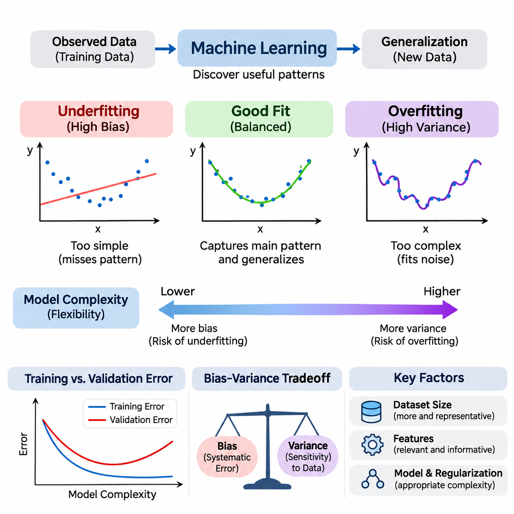
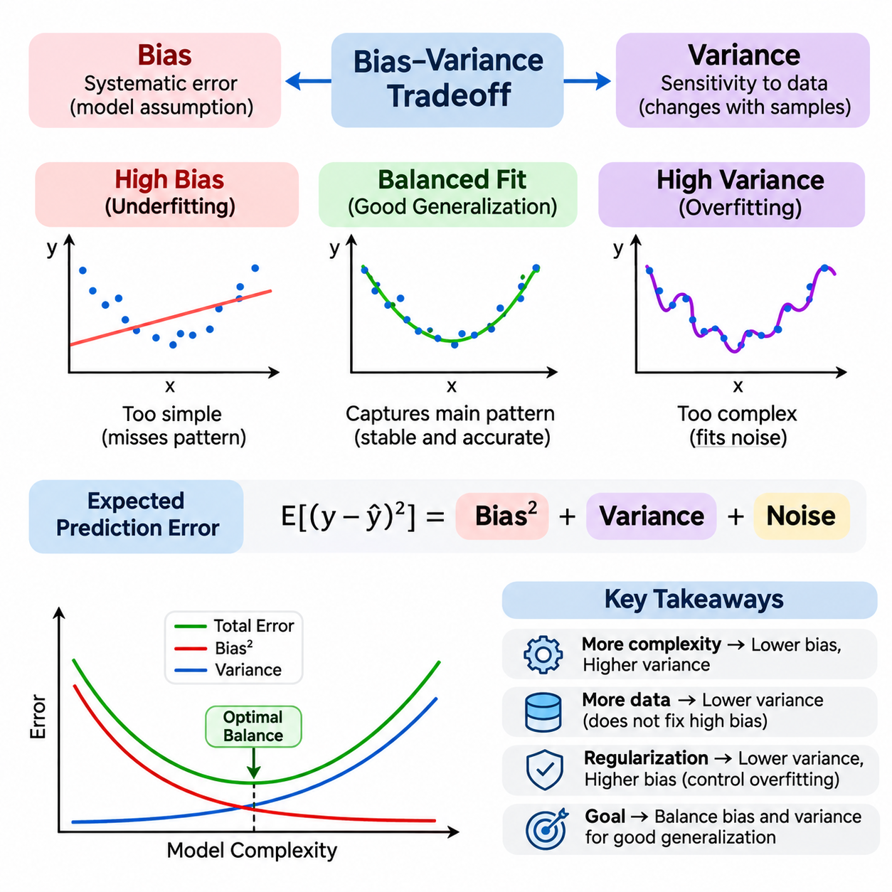
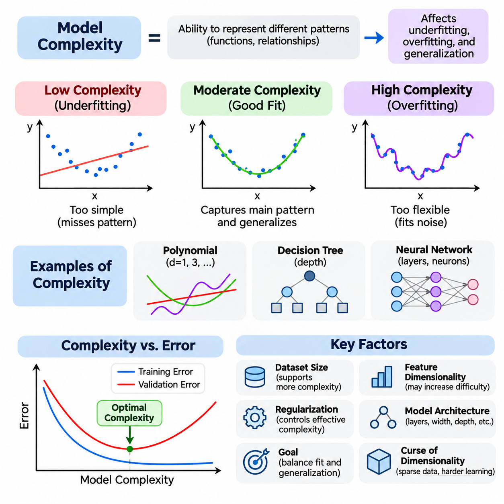
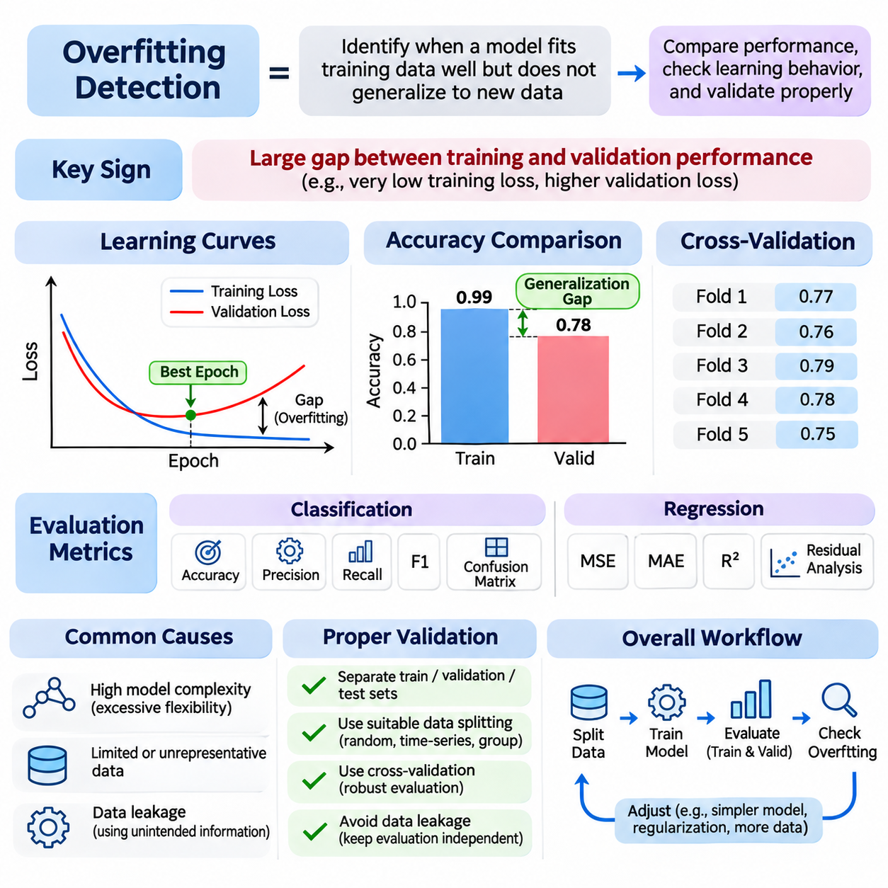
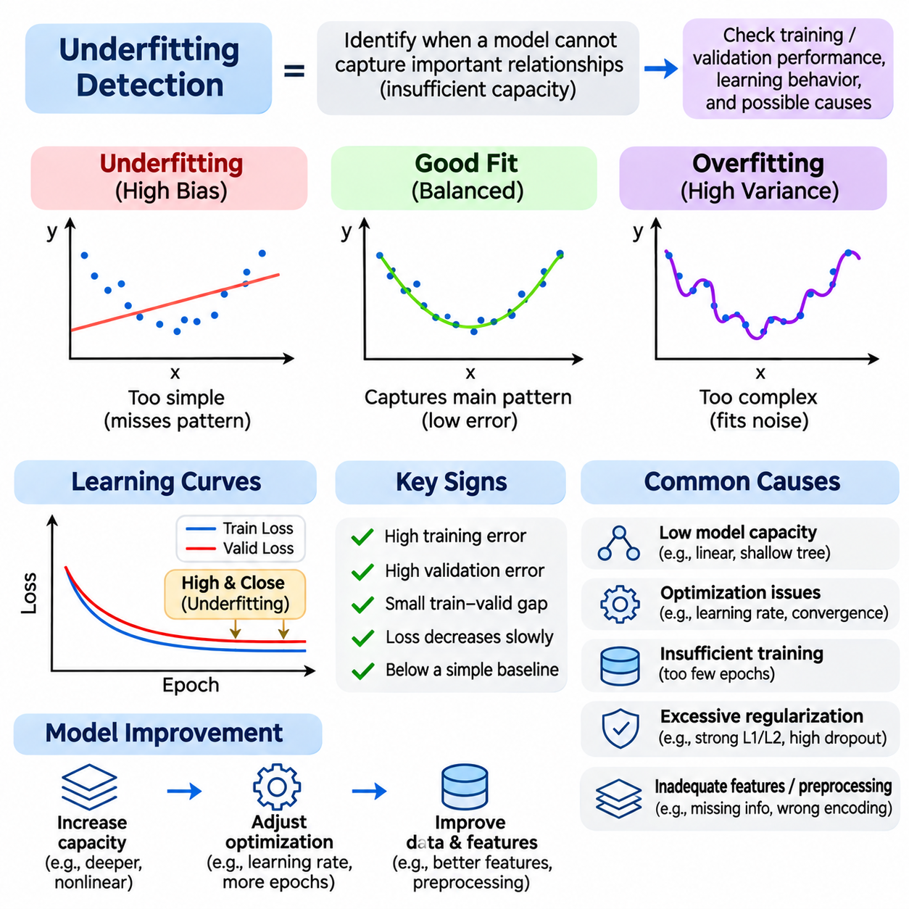
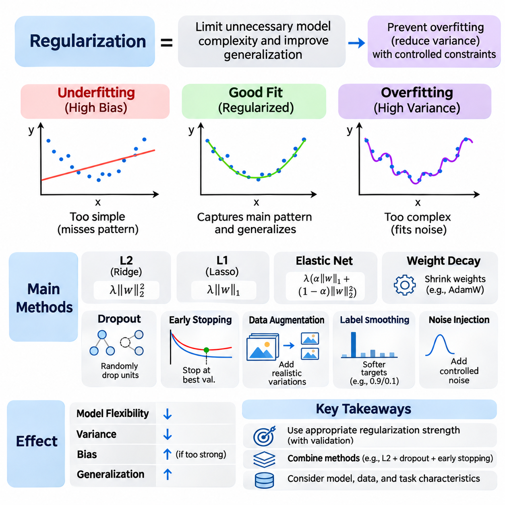
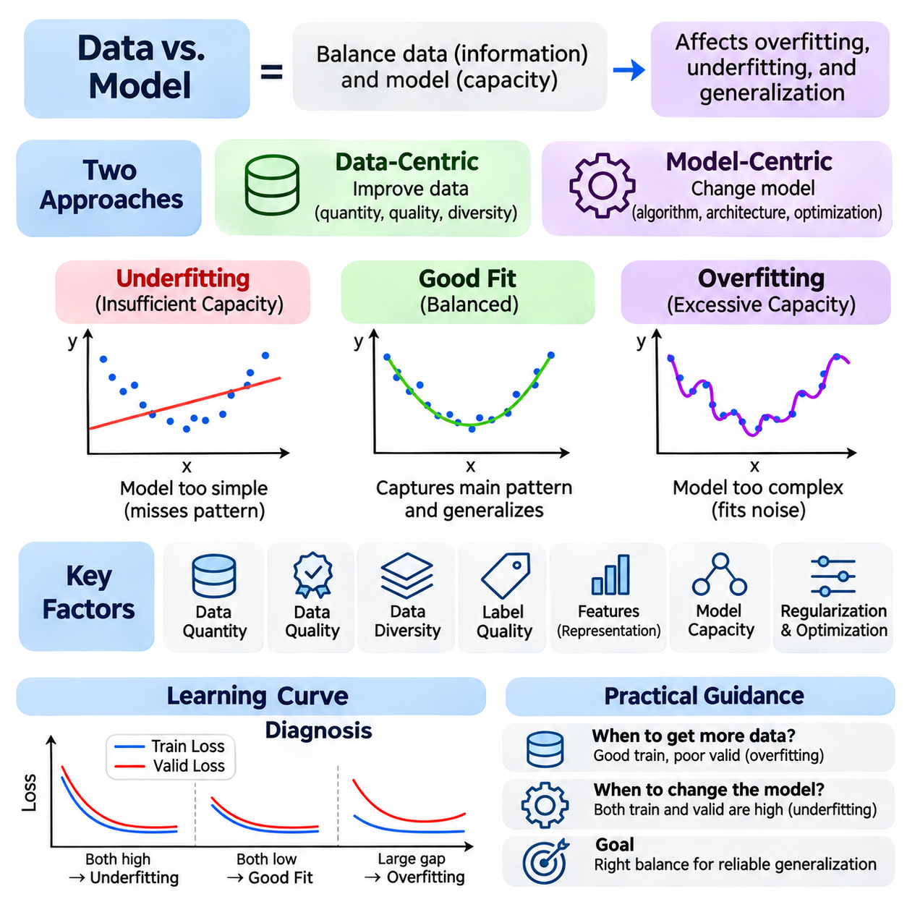
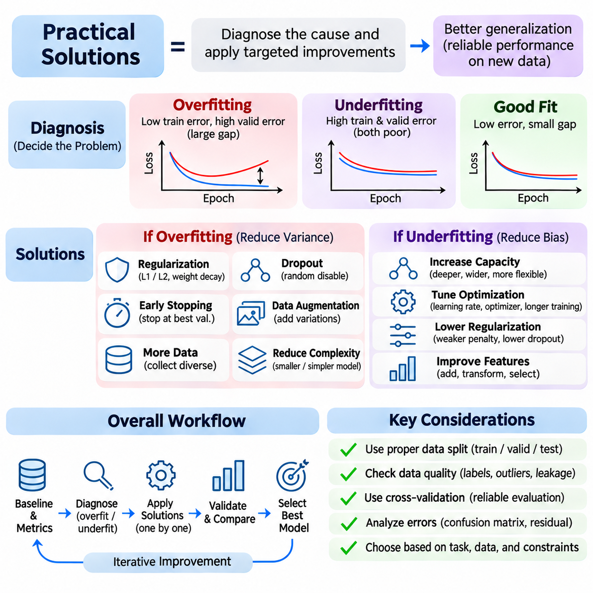

**Volume 07. Machine Learning Fundamentals**


# 05. Overfitting and Underfitting

## 05.00 Concepts

{width="7.268055555555556in" height="7.268055555555556in"}

Machine learning aims to discover patterns from observed data that remain useful when new examples are encountered. A model must learn meaningful relationships without becoming excessively dependent on individual training samples. Two fundamental obstacles to this objective are overfitting and underfitting. Understanding these conditions is essential for developing models that achieve reliable predictive performance beyond their training datasets.

Overfitting occurs when a machine learning model learns the training data too closely, including random fluctuations, measurement noise, and accidental relationships. Such a model may achieve extremely low training error while performing poorly on unseen examples. The central problem is not that the model has learned too much useful information, but that it has captured details that do not represent stable patterns in the underlying data distribution.

Underfitting occurs when a model cannot adequately represent important relationships within the training data. Its predictions remain inaccurate because the learned function is too restrictive, the available features are insufficient, or the training process has not achieved an appropriate solution. Unlike overfitting, underfitting commonly produces poor performance on both training and validation datasets, indicating that the model has failed to capture essential structure.

The distinction between overfitting and underfitting becomes clearer when considering the purpose of statistical learning. A training dataset represents only a finite sample from a broader population or environment. The objective is to estimate relationships that remain valid across other samples drawn from the relevant distribution. Successful learning therefore requires balancing the ability to explain observed examples with the ability to make accurate predictions on previously unseen observations.

Training error measures how well a model performs on examples used during parameter estimation. Validation error measures performance on separate examples that were not used to fit those parameters. Comparing these measurements provides an initial indication of generalization quality. A large difference between low training error and high validation error often suggests overfitting, while consistently high errors may indicate underfitting or other learning difficulties.

A model that generalizes successfully does not necessarily achieve the lowest possible training error. Instead, it learns a representation that captures important relationships while avoiding unnecessary sensitivity to individual observations. Some training errors may remain because the data contain uncertainty, ambiguous labels, or unpredictable variation. Attempting to eliminate every training error can encourage the model to reproduce noise rather than discover reliable predictive relationships.

Model complexity plays an important role in determining how closely a learning algorithm can fit its training observations. Simple models typically represent a restricted family of functions, while more flexible models can describe complicated nonlinear relationships. Greater flexibility can improve learning when the underlying problem is complex, but it may also increase sensitivity to limited or noisy observations. Complexity must therefore be considered relative to the available data and learning objective.

Consider a regression problem in which the relationship between an input variable and its target follows a smooth nonlinear pattern. A straight-line model may fail to represent the curvature and produce systematic prediction errors. A highly flexible polynomial may pass through nearly every training point while oscillating unpredictably between observations. An appropriately constrained model can capture the underlying curve without reproducing every random deviation in the sampled measurements.

Classification problems demonstrate similar behavior. A model with insufficient representational capacity may create an overly simple decision boundary that separates important classes incorrectly. Conversely, an excessively flexible classifier may construct irregular boundaries around isolated training examples. Although these boundaries can improve training accuracy, they may incorrectly classify nearby unseen observations. Effective classification requires boundaries that reflect meaningful distinctions rather than accidental sample arrangements.

The concepts of bias and variance provide a useful framework for interpreting these behaviors. Bias describes systematic error associated with assumptions that prevent a learning method from representing the underlying relationship accurately. Variance describes sensitivity to changes in the training sample. Underfitting is often associated with excessive bias, while overfitting is frequently associated with excessive variance. However, these relationships are tendencies rather than universal diagnostic rules.

The bias-variance tradeoff illustrates why increasing model flexibility does not guarantee better predictive performance. Reducing restrictive assumptions can decrease systematic error, but the resulting model may become more sensitive to sampling variation. Conversely, imposing stronger constraints can improve stability while preventing the model from capturing important patterns. The appropriate balance depends on the problem, dataset, model architecture, and evaluation conditions.

Dataset size significantly influences the risk of overfitting. When only a small number of examples are available, a flexible model may identify relationships that arise by chance. Increasing the quantity of representative training data can help distinguish stable patterns from random variation. Nevertheless, additional data are not automatically beneficial if they contain systematic labeling errors, irrelevant observations, or distributions that do not reflect the intended application environment.

Data quality is equally important because models learn from the information contained in their inputs and targets. Incorrect labels, missing measurements, inconsistent preprocessing, and noisy features can distort the learned relationships. A model may appear to overfit because it memorizes unreliable examples, or appear to underfit because important predictive information is absent. Consequently, diagnosing learning behavior requires examining both the model and the characteristics of its dataset.

Feature representation also affects whether a model can capture meaningful structure. If important variables are omitted, even a sophisticated algorithm may struggle to produce accurate predictions. Conversely, unnecessary or misleading features may create opportunities for learning accidental correlations. Appropriate feature engineering and selection can improve generalization by emphasizing informative relationships while reducing dependence on irrelevant variation.

Training duration introduces another dimension to the problem. During early optimization, a model may perform poorly because its parameters have not yet learned important patterns. As training progresses, both training and validation performance may improve. However, continued optimization can sometimes reduce training error while validation error begins to increase. This behavior suggests that additional training is improving memorization without producing corresponding improvements in generalization.

Learning curves help reveal these changes by tracking performance across training iterations or dataset sizes. When training and validation errors remain high and relatively close, insufficient learning capacity or ineffective optimization may be responsible. When training error becomes much lower than validation error, overfitting becomes a plausible explanation. These patterns provide diagnostic evidence, although they must be interpreted alongside dataset quality, evaluation metrics, and experimental uncertainty.

Regularization refers to techniques that constrain learning to discourage unnecessary complexity or sensitivity. Common approaches include parameter penalties, early stopping, dropout, and data augmentation. These methods influence model behavior in different ways, but their shared objective is to improve performance on unseen observations. Excessive regularization can also cause underfitting by restricting the model so strongly that it cannot represent important relationships.

The training, validation, and test datasets serve different purposes when studying generalization. Training data support parameter estimation, while validation data guide model selection and hyperparameter adjustment. Test data provide a final evaluation after development decisions have been completed. Repeatedly optimizing decisions against test results can indirectly introduce overfitting to the test set, making the reported performance less representative of future deployment conditions.

Generalization must also be understood in relation to the environment where a model will operate. A system may perform well on randomly separated examples but fail when future observations differ in time, location, equipment, or operating conditions. Such failures may involve distribution shift rather than conventional overfitting alone. Appropriate evaluation therefore requires datasets and splitting strategies that reflect the intended prediction scenario and its practical constraints.

In real-world machine learning, neither the most complex model nor the simplest model is inherently preferable. A suitable model must provide enough flexibility to capture relevant patterns while maintaining stability under realistic variation. Computational cost, inference latency, interpretability, and available training resources may also influence the selection. Predictive performance should therefore be considered together with operational requirements rather than evaluated through training accuracy alone.

Recognizing overfitting and underfitting is ultimately a process of understanding how a model learns and why its predictions succeed or fail. Training behavior, validation results, model capacity, data characteristics, and deployment conditions must be examined together. These concepts establish the foundation for analyzing bias and variance, selecting model complexity, detecting learning problems, and applying practical techniques that improve generalization and reliability.

기계학습(Machine Learning)은 관측된 데이터(Observed Data)에서 패턴(Pattern)을 발견하고, 새로운 사례(New Examples)에서도 유용하게 적용할 수 있는 관계를 학습하는 것을 목표로 한다. 모델(Model)은 개별 학습 샘플(Training Samples)에 지나치게 의존하지 않으면서 의미 있는 관계를 학습해야 한다. 이러한 목표를 달성하는 데 중요한 두 가지 장애물이 과적합(Overfitting)과 과소적합(Underfitting)이다. 이 두 개념을 이해하는 것은 학습 데이터셋(Training Dataset)을 넘어 신뢰할 수 있는 예측 성능(Predictive Performance)을 확보하는 데 필수적이다.

과적합(Overfitting)은 기계학습 모델(Machine Learning Model)이 학습 데이터(Training Data)에 지나치게 밀착하여 무작위 변동(Random Fluctuations), 측정 잡음(Measurement Noise), 우연한 관계(Accidental Relationships)까지 학습하는 현상이다. 이러한 모델은 학습 오차(Training Error)가 매우 낮더라도 새로운 데이터에서는 성능이 저하될 수 있다. 핵심 문제는 유용한 정보를 지나치게 많이 학습했다는 것이 아니라, 기초 데이터 분포(Underlying Data Distribution)의 안정적인 패턴을 나타내지 않는 세부 사항까지 학습했다는 점이다.

과소적합(Underfitting)은 모델이 학습 데이터에 존재하는 중요한 관계를 충분히 표현하지 못하는 현상이다. 학습된 함수(Learned Function)가 지나치게 제한적이거나, 사용 가능한 특징(Features)이 부족하거나, 학습 과정(Training Process)이 적절한 해(Solution)에 도달하지 못하면 예측 정확도가 낮아진다. 과적합과 달리 과소적합은 일반적으로 학습 데이터와 검증 데이터(Validation Data) 모두에서 낮은 성능을 나타내며, 모델이 데이터의 핵심 구조(Essential Structure)를 제대로 학습하지 못했음을 의미한다.

과적합과 과소적합의 차이는 통계적 학습(Statistical Learning)의 목적을 고려하면 더욱 명확해진다. 학습 데이터셋은 더 넓은 모집단(Population)이나 환경(Environment)에서 추출한 유한한 표본(Finite Sample)에 불과하다. 학습의 목표는 관련 데이터 분포에서 추출된 다른 표본에도 유효한 관계를 추정하는 것이다. 따라서 성공적인 학습은 관측된 사례를 설명하는 능력과 이전에 관측하지 않은 데이터에 대해 정확하게 예측하는 능력 사이의 균형을 요구한다.

학습 오차(Training Error)는 매개변수 추정(Parameter Estimation)에 사용된 데이터에서 모델이 얼마나 정확하게 작동하는지를 측정한다. 검증 오차(Validation Error)는 매개변수 학습에 사용하지 않은 별도의 데이터에서 성능을 평가한다. 두 측정값을 비교하면 일반화 성능(Generalization Performance)을 초기 단계에서 판단할 수 있다. 학습 오차는 낮지만 검증 오차가 크게 나타나면 과적합을 의심할 수 있으며, 두 오차가 모두 높다면 과소적합이나 다른 학습 문제가 존재할 가능성이 있다.

일반화(Generalization)에 성공한 모델이 반드시 가장 낮은 학습 오차를 달성하는 것은 아니다. 중요한 관계를 포착하면서 개별 관측값에 대한 불필요한 민감도(Sensitivity)를 피하는 표현(Representation)을 학습하는 것이 더 중요하다. 데이터에는 불확실성(Uncertainty), 모호한 레이블(Ambiguous Labels), 예측할 수 없는 변동이 존재할 수 있으므로 일부 학습 오차는 남을 수 있다. 모든 학습 오차를 제거하려는 시도는 안정적인 예측 관계를 발견하기보다 잡음을 재현하도록 모델을 유도할 수 있다.

모델 복잡도(Model Complexity)는 학습 알고리즘(Learning Algorithm)이 학습 데이터를 얼마나 세밀하게 표현할 수 있는지를 결정하는 중요한 요소이다. 단순한 모델은 일반적으로 제한된 함수 집합(Function Family)을 표현하지만, 유연한 모델은 복잡한 비선형 관계(Nonlinear Relationships)를 나타낼 수 있다. 높은 유연성은 복잡한 문제에서 학습 능력을 향상시킬 수 있지만, 제한적이거나 잡음이 많은 관측값에 대한 민감도를 높일 수도 있다. 따라서 모델 복잡도는 데이터의 특성과 학습 목표를 함께 고려하여 결정해야 한다.

입력 변수(Input Variable)와 목표값(Target) 사이에 부드러운 비선형 패턴이 존재하는 회귀 문제(Regression Problem)를 생각해 볼 수 있다. 직선 모델(Linear Model)은 곡률(Curvature)을 표현하지 못하여 체계적인 예측 오차를 발생시킬 수 있다. 반대로 매우 유연한 다항식 모델(Polynomial Model)은 거의 모든 학습점을 통과하면서 관측값 사이에서 불규칙하게 진동할 수 있다. 적절하게 제약된 모델은 표본에 포함된 모든 무작위 편차를 재현하지 않으면서 실제 관계를 나타내는 곡선을 학습할 수 있다.

분류 문제(Classification Problem)에서도 유사한 현상이 나타난다. 표현 능력(Representational Capacity)이 부족한 모델은 지나치게 단순한 결정 경계(Decision Boundary)를 형성하여 중요한 클래스를 잘못 구분할 수 있다. 반대로 지나치게 유연한 분류기(Classifier)는 고립된 학습 사례 주변에 불규칙한 경계를 형성할 수 있다. 이러한 경계는 학습 정확도(Training Accuracy)를 높일 수 있지만, 인접한 새로운 관측값을 잘못 분류할 가능성이 있다. 효과적인 분류는 우연한 표본 배열보다 의미 있는 클래스 간 차이를 반영해야 한다.

편향(Bias)과 분산(Variance)은 이러한 학습 현상을 해석하는 데 유용한 개념적 틀(Conceptual Framework)을 제공한다. 편향은 학습 방법이 실제 관계를 정확하게 표현하지 못하도록 제한하는 가정(Assumptions)과 관련된 체계적 오차(Systematic Error)를 의미한다. 분산은 학습 표본의 변화에 대한 모델의 민감도를 나타낸다. 과소적합은 높은 편향과, 과적합은 높은 분산과 자주 연관된다. 그러나 이러한 관계는 일반적인 경향이며 모든 상황에 적용되는 절대적인 진단 규칙은 아니다.

편향-분산 절충(Bias-Variance Tradeoff)은 모델의 유연성을 높이는 것이 항상 더 나은 예측 성능을 보장하지 않는 이유를 설명한다. 제한적인 가정을 완화하면 체계적 오차를 줄일 수 있지만, 표본 변동(Sampling Variation)에 대한 민감도가 증가할 수 있다. 반대로 강한 제약을 적용하면 안정성(Stability)은 향상되지만 중요한 패턴을 학습하지 못할 수 있다. 적절한 균형은 문제의 특성, 데이터셋, 모델 구조(Model Architecture), 평가 조건(Evaluation Conditions)에 따라 달라진다.

데이터셋 크기(Dataset Size)는 과적합 위험에 상당한 영향을 미친다. 사용 가능한 사례가 적으면 유연한 모델은 우연히 발생한 관계를 실제 패턴으로 학습할 수 있다. 대표성 있는 학습 데이터(Representative Training Data)를 충분히 확보하면 안정적인 패턴과 무작위 변동을 구분하는 데 도움이 된다. 그러나 추가 데이터에 체계적인 레이블 오류(Labeling Errors), 관련성이 낮은 관측값, 실제 적용 환경을 반영하지 못하는 분포가 포함되어 있다면 데이터 증가가 반드시 성능 향상으로 이어지는 것은 아니다.

데이터 품질(Data Quality) 역시 중요하다. 모델은 입력값(Inputs)과 목표값(Targets)에 포함된 정보를 기반으로 학습하기 때문이다. 잘못된 레이블, 누락된 측정값, 일관되지 않은 전처리(Preprocessing), 잡음이 포함된 특징은 학습 관계를 왜곡할 수 있다. 신뢰할 수 없는 사례를 암기하면 과적합처럼 보일 수 있고, 중요한 예측 정보가 누락되면 과소적합처럼 나타날 수 있다. 따라서 학습 문제를 진단할 때는 모델뿐 아니라 데이터셋의 특성도 함께 검토해야 한다.

특징 표현(Feature Representation)도 모델이 의미 있는 구조를 학습할 수 있는지에 영향을 준다. 중요한 변수가 누락되면 정교한 알고리즘조차 정확한 예측을 수행하기 어렵다. 반대로 불필요하거나 오해를 유발하는 특징은 우연한 상관관계(Accidental Correlations)를 학습할 가능성을 높인다. 적절한 특징 공학(Feature Engineering)과 특징 선택(Feature Selection)은 유용한 관계를 강조하고 관련성이 낮은 변동에 대한 의존도를 줄임으로써 일반화 성능을 향상시킬 수 있다.

학습 시간(Training Duration)은 과적합과 과소적합에 영향을 미치는 또 다른 요소이다. 최적화(Optimization) 초기에는 매개변수가 중요한 패턴을 충분히 학습하지 못해 성능이 낮을 수 있다. 학습이 진행되면 학습 성능과 검증 성능이 함께 향상될 수 있다. 그러나 학습을 계속하면서 학습 오차는 감소하는 반면 검증 오차가 증가하기 시작할 수 있다. 이는 추가 학습이 일반화 성능을 향상시키기보다 학습 데이터의 암기(Memorization)를 강화하고 있음을 시사한다.

학습 곡선(Learning Curves)은 학습 반복 횟수(Training Iterations)나 데이터셋 크기에 따른 성능 변화를 추적하여 이러한 현상을 파악하도록 돕는다. 학습 오차와 검증 오차가 모두 높고 서로 비슷하게 유지된다면 학습 능력 부족이나 비효율적인 최적화가 원인일 수 있다. 반대로 학습 오차가 검증 오차보다 훨씬 낮아지면 과적합을 의심할 수 있다. 다만 이러한 패턴은 데이터 품질, 평가 지표(Evaluation Metrics), 실험적 불확실성(Experimental Uncertainty)을 함께 고려하여 해석해야 한다.

정규화(Regularization)는 불필요한 복잡도나 민감도를 억제하도록 학습 과정을 제약하는 기법을 의미한다. 대표적인 방법에는 매개변수 페널티(Parameter Penalties), 조기 종료(Early Stopping), 드롭아웃(Dropout), 데이터 증강(Data Augmentation)이 있다. 각 방법은 서로 다른 방식으로 모델의 학습에 영향을 주지만, 공통적인 목표는 새로운 데이터에서의 성능을 향상시키는 것이다. 반면 지나치게 강한 정규화는 중요한 관계를 표현하지 못하도록 제한하여 과소적합을 유발할 수 있다.

학습 데이터(Training Data), 검증 데이터(Validation Data), 테스트 데이터(Test Data)는 일반화 성능을 평가할 때 서로 다른 역할을 수행한다. 학습 데이터는 매개변수 추정에 사용되고, 검증 데이터는 모델 선택(Model Selection)과 초매개변수 조정(Hyperparameter Tuning)에 활용된다. 테스트 데이터는 개발 과정의 의사결정이 완료된 이후 최종 평가에 사용된다. 테스트 결과를 반복적으로 참고하여 모델을 조정하면 테스트 데이터에 간접적으로 과적합되어 실제 배포 환경에서의 성능을 과대평가할 수 있다.

일반화는 모델이 실제로 작동할 환경과 관련하여 이해해야 한다. 무작위로 분리된 데이터에서는 높은 성능을 보이더라도 미래의 관측값이 시간, 위치, 장비, 운영 조건에서 달라지면 성능이 저하될 수 있다. 이러한 실패는 전통적인 과적합뿐 아니라 분포 이동(Distribution Shift)과 관련될 수 있다. 따라서 적절한 평가는 실제 예측 환경과 운영 제약을 반영하는 데이터셋 및 데이터 분할 전략(Data Splitting Strategy)을 필요로 한다.

실제 기계학습 환경에서는 가장 복잡한 모델이나 가장 단순한 모델이 본질적으로 더 우수한 것은 아니다. 적절한 모델은 관련 패턴을 학습할 만큼 충분한 유연성을 확보하면서 현실적인 변동에도 안정성을 유지해야 한다. 계산 비용(Computational Cost), 추론 지연 시간(Inference Latency), 해석 가능성(Interpretability), 사용 가능한 학습 자원(Training Resources)도 모델 선택에 영향을 미친다. 따라서 예측 성능은 학습 정확도만으로 판단하기보다 운영 요구사항(Operational Requirements)과 함께 평가해야 한다.

과적합과 과소적합을 이해하는 것은 궁극적으로 모델이 어떻게 학습하며, 예측이 성공하거나 실패하는 이유가 무엇인지를 파악하는 과정이다. 학습 동작(Training Behavior), 검증 결과(Validation Results), 모델 용량(Model Capacity), 데이터 특성(Data Characteristics), 배포 조건(Deployment Conditions)을 종합적으로 분석해야 한다. 이러한 개념은 편향과 분산 분석, 모델 복잡도 선택, 학습 문제 탐지, 일반화 성능과 신뢰성(Reliability)을 향상시키는 실용적인 기법을 이해하기 위한 기초를 제공한다.

## 05.01 Bias Variance

{width="7.268055555555556in" height="7.268055555555556in"}

Bias and variance are fundamental concepts for understanding why machine learning models succeed or fail when predicting unseen data. They describe different sources of prediction error that arise from the assumptions and sensitivity of a learning algorithm. Examining their relationship helps explain underfitting, overfitting, and the challenge of selecting models that capture meaningful patterns while maintaining reliable generalization.

Bias represents the systematic difference between the average prediction of a learning procedure and the true relationship being estimated. It reflects limitations introduced by model assumptions, feature representations, and learning constraints. A model with high bias may consistently overlook important relationships, producing similar prediction errors even when trained on different samples from the same underlying population.

Variance describes how much a model\'s predictions change when the training dataset changes. A high-variance learning procedure may produce substantially different prediction functions from different samples of the same population. This sensitivity can arise when a model has considerable flexibility relative to the available information. High variance makes predictions less stable and can contribute to poor performance on previously unseen observations.

The bias-variance tradeoff describes the tension between reducing systematic approximation error and controlling sensitivity to training data. Increasing model flexibility often reduces bias because the model can represent more complicated relationships. However, additional flexibility may increase variance by allowing the model to respond strongly to random sampling differences. The best balance depends on the problem, data distribution, and learning method.

Consider a regression problem in which the true relationship between input and output is nonlinear. A linear model may generate predictions that systematically miss the curvature of the underlying function. This behavior illustrates high bias because the model cannot adequately represent the target relationship. Even with additional training examples, its restrictive functional form may prevent it from achieving sufficiently accurate predictions.

A highly flexible polynomial model provides a contrasting example. It may fit nearly every training observation, including random measurement noise and unusual sample fluctuations. When trained on another dataset, the resulting curve may change considerably. This behavior illustrates high variance because the model depends strongly on the particular observations used during training rather than only on stable relationships.

An intermediate-complexity model may capture the important nonlinear structure without reproducing every fluctuation in the training data. Its predictions can remain relatively stable across different training samples while maintaining acceptable approximation accuracy. This illustrates the practical objective of balancing bias and variance, although the optimal complexity depends on the underlying function and the amount of available information.

For squared-error regression, expected prediction error can be decomposed into squared bias, variance, and irreducible noise under standard statistical assumptions. Squared bias measures the systematic difference between the average prediction and the true conditional mean. Variance measures prediction fluctuations across possible training datasets. Irreducible noise represents uncertainty that cannot be eliminated using the available input information.

This decomposition explains why reducing training error does not necessarily reduce expected prediction error on new observations. A highly flexible model may achieve excellent training performance while exhibiting substantial variance. Conversely, a strongly constrained model may produce stable predictions but retain large systematic errors. Generalization requires controlling the combined effects rather than minimizing one component independently.

Irreducible noise is particularly important because even an ideal predictor cannot perfectly predict outcomes containing inherently unpredictable variation. Measurement uncertainty, unobserved variables, and stochastic processes can contribute to this component. Increasing model complexity cannot eliminate uncertainty that is not explained by the available features. Attempts to fit such variation may instead increase variance and reduce predictive reliability.

Model capacity influences the balance between bias and variance, but the relationship is not universally monotonic. Classical statistical models often exhibit increasing variance as flexibility grows. Modern machine learning systems may behave differently because optimization methods, regularization, architecture, and data structure influence generalization. Consequently, model size alone is insufficient to determine whether a learning procedure has high bias or high variance.

Training dataset size also changes the relationship between bias and variance. With limited observations, flexible models may become highly sensitive to individual samples. Larger representative datasets generally provide more information for estimating stable relationships and can reduce estimation variance. However, additional observations cannot automatically eliminate bias caused by inappropriate assumptions or missing predictive features.

Regularization modifies the effective flexibility of a learning procedure by discouraging unnecessarily complicated solutions. Stronger regularization often reduces variance by limiting sensitivity to training samples, although it can increase bias. Weaker regularization allows greater flexibility but may expose the model to unstable estimates. The appropriate regularization strength should be selected through reliable validation rather than assumptions about complexity alone.

Feature engineering can influence both bias and variance. Missing important features may introduce systematic prediction errors because the model lacks information needed to represent the target relationship. Adding informative features can reduce this limitation. However, introducing many irrelevant or redundant features may increase estimation uncertainty, particularly when the dataset is small relative to the number of variables.

Learning algorithms exhibit different bias-variance characteristics depending on their assumptions and configurations. A shallow decision tree may produce relatively stable predictions while failing to capture complicated interactions. A deep tree can represent detailed relationships but may become sensitive to small changes in training observations. Ensemble methods can combine multiple predictors to improve stability or reduce systematic errors, depending on their construction.

Bagging illustrates how variance can be reduced by averaging predictions from models trained on different resampled datasets. When individual predictors exhibit partially independent errors, averaging can reduce fluctuations without necessarily increasing bias substantially. Random forests extend this principle by introducing additional randomness into tree construction. Their effectiveness depends on predictor diversity, correlation, and the characteristics of the learning problem.

Boosting approaches the problem differently by sequentially constructing models that address errors remaining from previous stages. This process can reduce systematic prediction errors and improve representation of complex relationships. However, excessive model complexity or unsuitable training configurations may still produce overfitting. The resulting bias-variance behavior depends on factors such as learning rate, ensemble size, and base learner complexity.

Learning curves provide practical evidence about possible bias and variance problems. When training and validation errors remain high and relatively close, excessive bias or inadequate optimization may be suspected. When training error is low but validation error remains substantially higher, excessive variance becomes a plausible explanation. These patterns are diagnostic indicators rather than definitive measurements of the theoretical bias and variance components.

Cross-validation helps evaluate model stability by repeatedly training and evaluating models on different partitions of the available data. Variation in validation scores can reveal sensitivity to data selection, while average performance provides evidence about expected generalization. However, score variation across folds is not identical to the variance term in the bias-variance decomposition because evaluation samples and training subsets both change.

Hyperparameter tuning provides a practical mechanism for balancing approximation capability and prediction stability. Parameters such as tree depth, polynomial degree, regularization strength, and neighborhood size influence the effective complexity of a model. Validation procedures help identify configurations that achieve favorable predictive performance. A separate test dataset remains necessary for evaluating the selected configuration without introducing selection bias.

Bias and variance should ultimately be interpreted as properties of a learning procedure under a particular data-generating process rather than fixed labels attached to individual algorithms. Their relationship changes with sample size, feature quality, optimization, and model configuration. Understanding these effects supports systematic model selection and provides a foundation for improving generalization through appropriate complexity, reliable evaluation, and effective training strategies.

편향(Bias)과 분산(Variance)은 기계학습(Machine Learning) 모델이 새로운 데이터(Unseen Data)를 예측할 때 성공하거나 실패하는 이유를 이해하기 위한 핵심 개념이다. 이들은 학습 알고리즘(Learning Algorithm)의 가정(Assumptions)과 민감도(Sensitivity)에서 발생하는 서로 다른 예측 오차(Prediction Error)의 원인을 설명한다. 두 개념의 관계를 분석하면 과소적합(Underfitting), 과적합(Overfitting), 그리고 의미 있는 패턴을 학습하면서 신뢰할 수 있는 일반화(Generalization)를 유지하는 모델 선택의 어려움을 이해할 수 있다.

편향(Bias)은 학습 절차(Learning Procedure)의 평균 예측값(Average Prediction)과 추정하려는 실제 관계(True Relationship) 사이에 존재하는 체계적인 차이를 의미한다. 이는 모델의 가정, 특징 표현(Feature Representation), 학습 제약(Learning Constraints)으로 인해 발생하는 한계를 반영한다. 편향이 높은 모델은 중요한 관계를 지속적으로 놓칠 수 있으며, 동일한 모집단(Population)에서 추출한 서로 다른 표본으로 학습하더라도 유사한 예측 오차를 발생시킬 수 있다.

분산(Variance)은 학습 데이터셋(Training Dataset)이 달라질 때 모델의 예측값이 얼마나 크게 변하는지를 나타낸다. 분산이 높은 학습 절차는 동일한 모집단에서 추출한 서로 다른 표본에 대해 상당히 다른 예측 함수(Prediction Function)를 생성할 수 있다. 이러한 민감도는 사용 가능한 정보에 비해 모델의 유연성(Flexibility)이 지나치게 높을 때 발생할 수 있다. 높은 분산은 예측의 안정성(Stability)을 저하시키고 새로운 관측값에 대한 성능 저하를 유발할 수 있다.

편향-분산 절충(Bias-Variance Tradeoff)은 체계적인 근사 오차(Approximation Error)를 줄이는 것과 학습 데이터에 대한 민감도를 제어하는 것 사이의 상충 관계를 설명한다. 모델의 유연성을 높이면 더 복잡한 관계를 표현할 수 있으므로 편향이 감소하는 경우가 많다. 그러나 추가적인 유연성은 무작위 표본 차이(Random Sampling Differences)에 모델이 강하게 반응하도록 만들어 분산을 증가시킬 수 있다. 최적의 균형은 문제의 특성, 데이터 분포(Data Distribution), 학습 방법에 따라 달라진다.

입력값(Input)과 출력값(Output) 사이의 실제 관계가 비선형(Nonlinear)인 회귀 문제(Regression Problem)를 생각해 볼 수 있다. 선형 모델(Linear Model)은 기초 함수(Underlying Function)의 곡률(Curvature)을 충분히 표현하지 못하여 체계적인 예측 오차를 발생시킬 수 있다. 이는 모델이 목표 관계(Target Relationship)를 적절하게 표현하지 못하는 높은 편향의 사례이다. 학습 데이터를 추가하더라도 제한적인 함수 형태(Functional Form) 때문에 충분한 예측 정확도를 달성하지 못할 수 있다.

매우 유연한 다항식 모델(Polynomial Model)은 이와 대조적인 사례를 제공한다. 이러한 모델은 무작위 측정 잡음(Measurement Noise)과 비정상적인 표본 변동(Sample Fluctuations)을 포함하여 거의 모든 학습 관측값에 맞춰질 수 있다. 그러나 다른 데이터셋으로 학습하면 결과 곡선이 크게 달라질 수 있다. 이는 모델이 안정적인 관계보다 특정 학습 관측값에 강하게 의존하기 때문에 발생하는 높은 분산의 사례이다.

중간 수준의 복잡도(Intermediate Complexity)를 가진 모델은 학습 데이터의 모든 변동을 재현하지 않으면서 중요한 비선형 구조(Nonlinear Structure)를 학습할 수 있다. 이러한 모델은 서로 다른 학습 표본에서도 비교적 안정적인 예측을 유지하면서 허용 가능한 근사 정확도(Approximation Accuracy)를 확보할 수 있다. 이는 편향과 분산 사이의 균형을 추구하는 실용적인 목표를 보여주지만, 최적의 복잡도는 실제 함수와 사용 가능한 정보량에 따라 달라진다.

제곱 오차 회귀(Squared-Error Regression)에서는 표준적인 통계적 가정(Statistical Assumptions) 아래 기대 예측 오차(Expected Prediction Error)를 편향 제곱(Squared Bias), 분산(Variance), 비가역적 잡음(Irreducible Noise)으로 분해할 수 있다. 편향 제곱은 평균 예측값과 실제 조건부 평균(True Conditional Mean) 사이의 체계적인 차이를 측정한다. 분산은 가능한 여러 학습 데이터셋에 따른 예측 변동을 나타내며, 비가역적 잡음은 사용 가능한 입력 정보로 제거할 수 없는 불확실성을 의미한다.

이러한 오차 분해(Error Decomposition)는 학습 오차(Training Error)를 줄이는 것이 반드시 새로운 관측값에 대한 기대 예측 오차를 감소시키지는 않는 이유를 설명한다. 매우 유연한 모델은 우수한 학습 성능을 달성하면서도 상당한 분산을 나타낼 수 있다. 반대로 강하게 제약된 모델은 안정적인 예측을 제공하지만 큰 체계적 오차(Systematic Error)를 유지할 수 있다. 일반화를 위해서는 하나의 요소만 최소화하기보다 여러 오차 요인의 결합된 영향을 제어해야 한다.

비가역적 잡음(Irreducible Noise)은 본질적으로 예측할 수 없는 변동이 포함된 결과를 이상적인 예측기(Ideal Predictor)조차 완벽하게 예측할 수 없다는 점에서 중요하다. 측정 불확실성(Measurement Uncertainty), 관측되지 않은 변수(Unobserved Variables), 확률적 과정(Stochastic Processes)이 이러한 요소에 기여할 수 있다. 모델 복잡도를 높이더라도 사용 가능한 특징으로 설명할 수 없는 불확실성은 제거되지 않는다. 오히려 이러한 변동까지 학습하려는 시도는 분산을 증가시키고 예측 신뢰성(Predictive Reliability)을 저하시킬 수 있다.

모델 용량(Model Capacity)은 편향과 분산의 균형에 영향을 주지만, 그 관계가 항상 단조적(Monotonic)인 것은 아니다. 전통적인 통계 모델(Classical Statistical Models)에서는 유연성이 증가할수록 분산이 커지는 경향이 있다. 그러나 현대 기계학습 시스템(Modern Machine Learning Systems)은 최적화 방법(Optimization Methods), 정규화(Regularization), 모델 구조(Architecture), 데이터 구조(Data Structure)의 영향으로 다른 동작을 보일 수 있다. 따라서 모델 크기만으로 높은 편향이나 높은 분산을 판단하기는 어렵다.

학습 데이터셋 크기(Training Dataset Size)도 편향과 분산의 관계를 변화시킨다. 관측값이 제한적일 때 유연한 모델은 개별 표본에 매우 민감해질 수 있다. 대표성 있는 데이터셋(Representative Dataset)이 커지면 안정적인 관계를 추정하기 위한 정보가 증가하므로 일반적으로 추정 분산(Estimation Variance)을 줄이는 데 도움이 된다. 그러나 추가적인 관측값만으로 부적절한 가정이나 누락된 예측 특징(Missing Predictive Features)에서 발생하는 편향을 자동으로 제거할 수는 없다.

정규화(Regularization)는 불필요하게 복잡한 해(Solution)를 억제하여 학습 절차의 실질적인 유연성을 조절한다. 강한 정규화는 학습 표본에 대한 민감도를 제한하여 분산을 감소시키는 경우가 많지만, 편향을 증가시킬 수도 있다. 약한 정규화는 더 높은 유연성을 허용하지만 불안정한 추정(Estimation)에 모델을 노출시킬 수 있다. 적절한 정규화 강도(Regularization Strength)는 복잡도에 대한 단순한 가정보다 신뢰할 수 있는 검증(Validation)을 통해 선택해야 한다.

특징 공학(Feature Engineering)은 편향과 분산 모두에 영향을 줄 수 있다. 중요한 특징이 누락되면 목표 관계를 표현하는 데 필요한 정보가 부족하여 체계적인 예측 오차가 발생할 수 있다. 유용한 특징을 추가하면 이러한 한계를 줄일 수 있다. 그러나 관련성이 낮거나 중복된 특징(Redundant Features)을 지나치게 많이 도입하면 추정 불확실성(Estimation Uncertainty)이 증가할 수 있으며, 특히 변수 수에 비해 데이터셋이 작은 경우 이러한 문제가 더욱 두드러진다.

학습 알고리즘(Learning Algorithms)은 가정과 설정에 따라 서로 다른 편향-분산 특성(Bias-Variance Characteristics)을 나타낸다. 얕은 결정 트리(Shallow Decision Tree)는 비교적 안정적인 예측을 제공하지만 복잡한 상호작용(Interactions)을 포착하지 못할 수 있다. 깊은 결정 트리(Deep Decision Tree)는 세부적인 관계를 표현할 수 있지만 학습 관측값의 작은 변화에도 민감해질 수 있다. 앙상블 기법(Ensemble Methods)은 구성 방식에 따라 여러 예측기를 결합하여 안정성을 높이거나 체계적인 오차를 줄일 수 있다.

배깅(Bagging)은 서로 다른 재표본추출 데이터셋(Resampled Datasets)으로 학습한 모델들의 예측을 평균화하여 분산을 줄이는 방법을 보여준다. 개별 예측기의 오차가 부분적으로 독립적이라면 평균화는 편향을 크게 증가시키지 않으면서 예측 변동을 감소시킬 수 있다. 랜덤 포레스트(Random Forests)는 트리 생성 과정(Tree Construction)에 추가적인 무작위성을 도입하여 이러한 원리를 확장한다. 효과는 예측기 다양성(Predictor Diversity), 상관관계(Correlation), 학습 문제의 특성에 따라 달라진다.

부스팅(Boosting)은 이전 단계에서 남아 있는 오차를 해결하도록 모델을 순차적으로 구성하는 다른 접근 방식을 사용한다. 이러한 과정은 체계적인 예측 오차를 줄이고 복잡한 관계에 대한 표현 능력을 향상시킬 수 있다. 그러나 지나친 모델 복잡도나 부적절한 학습 설정은 여전히 과적합을 유발할 수 있다. 결과적인 편향-분산 특성은 학습률(Learning Rate), 앙상블 크기(Ensemble Size), 기본 학습기 복잡도(Base Learner Complexity) 등의 요소에 따라 달라진다.

학습 곡선(Learning Curves)은 편향과 분산 문제를 판단하는 데 실용적인 근거를 제공한다. 학습 오차와 검증 오차(Validation Error)가 모두 높고 서로 비슷하게 유지된다면 과도한 편향이나 불충분한 최적화를 의심할 수 있다. 반대로 학습 오차는 낮지만 검증 오차가 상당히 높게 유지된다면 과도한 분산이 원인일 가능성이 있다. 그러나 이러한 패턴은 이론적인 편향과 분산을 직접 측정한 결과가 아니라 진단을 위한 지표(Diagnostic Indicators)로 해석해야 한다.

교차 검증(Cross-Validation)은 사용 가능한 데이터를 서로 다른 부분으로 나누어 모델을 반복적으로 학습하고 평가함으로써 모델 안정성을 분석하는 데 도움을 준다. 검증 점수(Validation Scores)의 변동은 데이터 선택에 대한 민감도를 보여줄 수 있으며, 평균 성능(Average Performance)은 기대 일반화 성능(Expected Generalization Performance)을 판단하는 근거를 제공한다. 다만 폴드(Folds) 간 점수 변동은 평가 표본과 학습 부분집합(Training Subsets)이 모두 달라지므로 편향-분산 분해의 분산 항과 동일하지 않다.

초매개변수 조정(Hyperparameter Tuning)은 근사 능력(Approximation Capability)과 예측 안정성(Prediction Stability)의 균형을 조절하는 실용적인 방법이다. 트리 깊이(Tree Depth), 다항식 차수(Polynomial Degree), 정규화 강도, 이웃 크기(Neighborhood Size)와 같은 매개변수는 모델의 실질적인 복잡도에 영향을 준다. 검증 절차(Validation Procedures)는 유리한 예측 성능을 달성하는 설정을 식별하도록 돕는다. 선택 편향(Selection Bias)을 도입하지 않고 최종 설정을 평가하려면 별도의 테스트 데이터셋(Test Dataset)이 필요하다.

편향과 분산은 개별 알고리즘에 고정된 특성이라기보다 특정 데이터 생성 과정(Data-Generating Process)에서 나타나는 학습 절차의 속성으로 이해해야 한다. 이들의 관계는 표본 크기(Sample Size), 특징 품질(Feature Quality), 최적화, 모델 설정(Model Configuration)에 따라 변화한다. 이러한 영향을 이해하면 체계적인 모델 선택(Systematic Model Selection)이 가능해지며, 적절한 복잡도, 신뢰할 수 있는 평가(Reliable Evaluation), 효과적인 학습 전략(Effective Training Strategies)을 통해 일반화 성능을 개선하기 위한 기초를 마련할 수 있다.

## 05.02 Model Complexity

{width="7.268055555555556in" height="7.268055555555556in"}

Model complexity refers to the ability of a machine learning model to represent different patterns and relationships within data. It determines the range of functions a model can learn and influences how closely predictions can match training observations. Understanding complexity is essential because insufficient flexibility may cause underfitting, while excessive flexibility can increase sensitivity to noise and contribute to overfitting.

A simple model typically relies on restrictive assumptions about the relationship between inputs and outputs. Linear regression, for example, assumes that the predicted target is a linear combination of input features. This structure is computationally efficient and often interpretable, but it may fail to capture complicated nonlinear patterns. Such limitations can introduce systematic prediction errors when the true relationship is more complex.

Complex models can represent a wider variety of relationships by introducing additional parameters, nonlinear transformations, or flexible decision structures. Deep neural networks, high-degree polynomial models, and large decision trees illustrate different forms of increased capacity. These models can capture intricate interactions among features, but their flexibility also creates opportunities to fit accidental relationships in limited training datasets.

Model complexity is closely related to representational capacity, which describes the collection of functions available to a learning algorithm. A model with low capacity can represent only a restricted set of relationships, while a high-capacity model can express more diverse patterns. However, representational capacity does not guarantee successful learning because optimization, regularization, data quality, and training configuration determine which functions are actually learned.

Polynomial regression provides a straightforward example of how complexity affects learning behavior. A first-degree polynomial represents a straight line, while higher-degree polynomials can represent increasingly complicated curves. When the polynomial degree is too low, important curvature may remain unexplained. When the degree becomes excessively high relative to the available observations, the fitted function may oscillate around individual samples and generalize poorly.

Decision trees demonstrate complexity through structural properties such as maximum depth, number of leaves, and minimum samples required for splitting. A shallow tree produces relatively simple decision rules and may overlook important feature interactions. A deep tree can divide the feature space into many small regions, allowing detailed predictions. However, these regions may reflect isolated training examples rather than stable patterns shared by future observations.

Neural network complexity depends on multiple architectural characteristics, including the number of layers, neurons, connections, and trainable parameters. Greater depth can support hierarchical representations, while increased width can expand the range of functions represented. Nevertheless, parameter count alone does not fully describe effective complexity because activation functions, architectural constraints, optimization methods, and regularization influence learning behavior.

The relationship between complexity and training error is often intuitive. When a model family becomes more expressive and optimization is effective, the model can usually fit training observations at least as well as a more restricted alternative. Consequently, training error often decreases as capacity increases. Validation error, however, may initially decrease and later increase when additional flexibility begins to capture sample-specific variation rather than generalizable structure.

This behavior is commonly illustrated by a conceptual U-shaped validation error curve. At low complexity, the model may suffer from high approximation error because it cannot represent important relationships. At intermediate complexity, it may achieve a favorable balance between flexibility and stability. At high complexity, estimation variance may increase, although modern learning systems do not always follow this classical pattern.

Effective model complexity differs from nominal architectural complexity. Two models with identical parameter counts can exhibit different generalization behavior because of their training procedures and structural assumptions. Weight decay, dropout, early stopping, and data augmentation can constrain the functions learned by highly expressive models. These mechanisms allow substantial representational capacity while discouraging unnecessarily sensitive solutions.

Dataset size strongly influences the amount of complexity that can be supported reliably. A model trained on a small dataset may fit individual observations without discovering stable relationships. Larger representative datasets provide additional evidence about recurring patterns and can improve the reliability of parameter estimation. Nevertheless, the required amount of data depends on the task, feature structure, noise level, and inductive assumptions of the learning algorithm.

Feature dimensionality introduces another important aspect of complexity. As the number of input variables increases, a model may require more observations to estimate relationships reliably. High-dimensional datasets can contain irrelevant or redundant features that increase estimation uncertainty. Feature selection, dimensionality reduction, and appropriate regularization can help control this difficulty while preserving information needed for accurate predictions.

The concept of the curse of dimensionality describes several difficulties associated with high-dimensional feature spaces. As dimensionality increases, observations can become sparse relative to the available space, making distance-based comparisons and local estimation more difficult. However, practical effects depend on the intrinsic structure of the data. High-dimensional representations may remain manageable when useful information lies on a lower-dimensional structure.

Statistical learning theory provides formal approaches to studying model complexity. Measures such as VC dimension and Rademacher complexity characterize aspects of the expressive power or data-dependent richness of hypothesis classes. These concepts help explain how model flexibility interacts with sample size and generalization guarantees. Their practical interpretation requires considering assumptions about the learning setting and the resulting bounds.

Complexity can also be understood through the distinction between approximation error and estimation error. Approximation error arises when the available model family cannot adequately represent the target relationship. Estimation error reflects uncertainty introduced by learning from finite samples. Increasing capacity may reduce approximation error while making estimation more difficult, although the precise relationship depends on the learning procedure and data distribution.

Regularization provides a practical method for controlling effective complexity without necessarily changing the underlying model architecture. L1 regularization encourages sparse parameter solutions, while L2 regularization discourages large parameter magnitudes. Early stopping limits the extent of optimization, and dropout introduces stochastic restrictions during neural network training. These approaches can improve generalization when their strengths are appropriately selected.

Hyperparameters frequently determine how much complexity a learning algorithm can express in practice. Polynomial degree, decision tree depth, neural network width, and regularization strength all influence the learned function. Hyperparameter tuning uses validation performance to identify configurations that balance predictive accuracy and stability. Reliable selection requires avoiding repeated adaptation to the final test dataset.

Modern deep learning introduces additional complexity beyond traditional interpretations. Highly overparameterized neural networks can sometimes generalize well despite having enough parameters to fit their training data almost perfectly. Optimization dynamics, implicit regularization, architectural inductive biases, and dataset structure influence this behavior. Therefore, high parameter count should not automatically be interpreted as evidence of overfitting.

Double descent describes a phenomenon in which test error may decrease, increase near an interpolation threshold, and decrease again as model capacity continues growing. This behavior challenges the assumption that validation error must always increase beyond an intermediate complexity level. Double descent does not occur universally, but it demonstrates that generalization depends on interactions among capacity, optimization, noise, and sample characteristics.

Computational complexity should be distinguished from statistical model complexity. A statistically expressive model may require substantial memory, training time, and inference computation, but these properties are not equivalent measures. Some architectures achieve strong predictive performance with efficient computation, while others require extensive resources. Practical model selection must consider both generalization quality and operational constraints.

In real-world applications, appropriate model complexity depends on the reliability requirements of the target system. A small interpretable model may be preferable when data are limited and decisions require explanation. A larger model may be justified when complex relationships, abundant data, and sufficient computational resources are available. The objective is not to maximize complexity but to select a model that provides dependable predictions under realistic conditions.

Model complexity is ultimately a design variable that connects representation, optimization, data availability, and generalization. Excessively restrictive models may overlook essential relationships, while unnecessarily flexible models may become sensitive to sample-specific variation. By evaluating training behavior, validation performance, regularization effects, and deployment constraints, practitioners can select model configurations that balance learning capability with predictive reliability.

모델 복잡도(Model Complexity)는 기계학습(Machine Learning) 모델이 데이터에 존재하는 다양한 패턴(Pattern)과 관계(Relationship)를 표현할 수 있는 능력을 의미한다. 이는 모델이 학습할 수 있는 함수(Function)의 범위를 결정하며, 예측값(Predictions)이 학습 관측값(Training Observations)에 얼마나 가깝게 맞춰질 수 있는지에 영향을 준다. 복잡도를 이해하는 것은 필수적이다. 유연성(Flexibility)이 부족하면 과소적합(Underfitting)이 발생할 수 있고, 지나친 유연성은 잡음(Noise)에 대한 민감도를 높여 과적합(Overfitting)을 유발할 수 있기 때문이다.

단순한 모델(Simple Model)은 일반적으로 입력값(Inputs)과 출력값(Outputs) 사이의 관계에 대해 제한적인 가정(Restrictive Assumptions)을 사용한다. 예를 들어 선형 회귀(Linear Regression)는 예측 목표값(Predicted Target)이 입력 특징(Input Features)의 선형 결합(Linear Combination)으로 표현된다고 가정한다. 이러한 구조는 계산 효율성(Computational Efficiency)이 높고 해석 가능성(Interpretability)이 우수한 경우가 많지만, 복잡한 비선형 패턴(Nonlinear Patterns)을 포착하지 못할 수 있다. 실제 관계가 더 복잡하면 이러한 한계로 인해 체계적인 예측 오차(Systematic Prediction Errors)가 발생할 수 있다.

복잡한 모델(Complex Models)은 추가적인 매개변수(Parameters), 비선형 변환(Nonlinear Transformations), 유연한 결정 구조(Decision Structures)를 도입하여 더 다양한 관계를 표현할 수 있다. 심층 신경망(Deep Neural Networks), 고차 다항식 모델(High-Degree Polynomial Models), 대규모 결정 트리(Large Decision Trees)는 모델 용량(Model Capacity)이 증가하는 서로 다른 형태를 보여준다. 이러한 모델은 특징 사이의 복잡한 상호작용(Feature Interactions)을 포착할 수 있지만, 제한된 학습 데이터셋(Training Datasets)에 존재하는 우연한 관계까지 학습할 가능성도 높아진다.

모델 복잡도는 학습 알고리즘(Learning Algorithm)이 표현할 수 있는 함수의 집합을 설명하는 표현 용량(Representational Capacity)과 밀접하게 관련된다. 낮은 용량(Low Capacity)의 모델은 제한된 관계만 표현할 수 있지만, 높은 용량(High Capacity)의 모델은 더욱 다양한 패턴을 나타낼 수 있다. 그러나 표현 용량이 높다고 해서 성공적인 학습이 보장되는 것은 아니다. 실제로 어떤 함수가 학습되는지는 최적화(Optimization), 정규화(Regularization), 데이터 품질(Data Quality), 학습 설정(Training Configuration)에 따라 결정되기 때문이다.

다항식 회귀(Polynomial Regression)는 복잡도가 학습 동작(Learning Behavior)에 미치는 영향을 보여주는 직관적인 사례이다. 일차 다항식(First-Degree Polynomial)은 직선을 표현하지만, 고차 다항식(Higher-Degree Polynomials)은 점점 더 복잡한 곡선을 나타낼 수 있다. 다항식 차수(Polynomial Degree)가 지나치게 낮으면 중요한 곡률(Curvature)을 설명하지 못할 수 있다. 반대로 관측값 수에 비해 차수가 지나치게 높으면 적합된 함수(Fitted Function)가 개별 표본 주변에서 불규칙하게 진동하여 일반화 성능(Generalization Performance)이 저하될 수 있다.

결정 트리(Decision Trees)는 최대 깊이(Maximum Depth), 리프 노드 수(Number of Leaves), 분할에 필요한 최소 표본 수(Minimum Samples for Splitting)와 같은 구조적 속성(Structural Properties)을 통해 복잡도를 나타낸다. 얕은 트리(Shallow Tree)는 비교적 단순한 결정 규칙(Decision Rules)을 생성하지만 중요한 특징 간 상호작용을 놓칠 수 있다. 깊은 트리(Deep Tree)는 특징 공간(Feature Space)을 여러 작은 영역으로 나누어 세밀한 예측을 수행할 수 있다. 그러나 이러한 영역이 미래 관측값에 공통으로 나타나는 안정적인 패턴보다 고립된 학습 사례를 반영할 수도 있다.

신경망 복잡도(Neural Network Complexity)는 계층 수(Number of Layers), 뉴런 수(Number of Neurons), 연결 수(Number of Connections), 학습 가능한 매개변수(Trainable Parameters) 등 여러 구조적 특성에 따라 달라진다. 깊이(Depth)가 증가하면 계층적 표현(Hierarchical Representations)을 학습하는 데 도움이 되고, 너비(Width)가 증가하면 표현 가능한 함수의 범위가 확장될 수 있다. 그러나 매개변수 수(Parameter Count)만으로 실질적인 복잡도(Effective Complexity)를 완전히 설명할 수는 없다. 활성화 함수(Activation Functions), 구조적 제약(Architectural Constraints), 최적화 방법, 정규화가 학습 동작에 영향을 주기 때문이다.

복잡도와 학습 오차(Training Error)의 관계는 일반적으로 직관적이다. 모델 계열(Model Family)의 표현 능력이 증가하고 최적화가 효과적으로 수행된다면, 모델은 제한적인 대안보다 학습 관측값에 적어도 비슷하거나 더 잘 적합될 수 있다. 따라서 용량이 증가하면 학습 오차가 감소하는 경향이 있다. 그러나 검증 오차(Validation Error)는 초기에는 감소하다가 추가적인 유연성이 일반화 가능한 구조(Generalizable Structure)보다 표본에 특화된 변동(Sample-Specific Variation)을 학습하기 시작하면 다시 증가할 수 있다.

이러한 동작은 일반적으로 U자형 검증 오차 곡선(U-Shaped Validation Error Curve)으로 설명된다. 복잡도가 낮으면 중요한 관계를 표현하지 못하여 근사 오차(Approximation Error)가 높아질 수 있다. 중간 수준의 복잡도에서는 유연성과 안정성(Stability) 사이의 유리한 균형을 달성할 수 있다. 높은 복잡도에서는 추정 분산(Estimation Variance)이 증가할 수 있지만, 현대 기계학습 시스템(Modern Machine Learning Systems)이 항상 이러한 전통적인 패턴을 따르는 것은 아니다.

실질적인 모델 복잡도(Effective Model Complexity)는 명목상의 구조적 복잡도(Nominal Architectural Complexity)와 다르다. 매개변수 수가 동일한 두 모델도 학습 절차(Training Procedures)와 구조적 가정(Structural Assumptions)에 따라 서로 다른 일반화 동작을 보일 수 있다. 가중치 감쇠(Weight Decay), 드롭아웃(Dropout), 조기 종료(Early Stopping), 데이터 증강(Data Augmentation)은 높은 표현 능력을 가진 모델이 학습하는 함수를 제약할 수 있다. 이러한 기법은 상당한 표현 용량을 유지하면서 불필요하게 민감한 해(Solutions)를 억제하도록 돕는다.

데이터셋 크기(Dataset Size)는 안정적으로 활용할 수 있는 모델 복잡도에 큰 영향을 준다. 작은 데이터셋으로 학습한 모델은 안정적인 관계를 발견하지 못하고 개별 관측값에 지나치게 적합될 수 있다. 더 크고 대표성 있는 데이터셋(Representative Datasets)은 반복적으로 나타나는 패턴에 대한 추가적인 근거를 제공하고 매개변수 추정(Parameter Estimation)의 신뢰성을 높일 수 있다. 그러나 필요한 데이터의 양은 작업(Task), 특징 구조(Feature Structure), 잡음 수준(Noise Level), 학습 알고리즘의 귀납적 가정(Inductive Assumptions)에 따라 달라진다.

특징 차원(Feature Dimensionality)은 복잡도와 관련된 또 다른 중요한 요소이다. 입력 변수(Input Variables)의 수가 증가하면 모델이 관계를 안정적으로 추정하기 위해 더 많은 관측값을 필요로 할 수 있다. 고차원 데이터셋(High-Dimensional Datasets)에는 관련성이 낮거나 중복된 특징(Redundant Features)이 포함될 수 있으며, 이는 추정 불확실성(Estimation Uncertainty)을 증가시킨다. 특징 선택(Feature Selection), 차원 축소(Dimensionality Reduction), 적절한 정규화는 정확한 예측에 필요한 정보를 보존하면서 이러한 문제를 제어하는 데 도움이 된다.

차원의 저주(Curse of Dimensionality)는 고차원 특징 공간(High-Dimensional Feature Spaces)에서 발생하는 여러 어려움을 설명하는 개념이다. 차원이 증가하면 관측값이 전체 공간에 비해 희소(Sparse)해질 수 있으며, 거리 기반 비교(Distance-Based Comparisons)와 국소 추정(Local Estimation)이 더욱 어려워질 수 있다. 그러나 실제 영향은 데이터의 내재적 구조(Intrinsic Structure)에 따라 달라진다. 유용한 정보가 저차원 구조(Lower-Dimensional Structure)에 존재한다면 고차원 표현(High-Dimensional Representations)도 효과적으로 처리할 수 있다.

통계적 학습 이론(Statistical Learning Theory)은 모델 복잡도를 연구하기 위한 형식적인 접근 방법을 제공한다. VC 차원(VC Dimension)과 라데마허 복잡도(Rademacher Complexity) 같은 척도는 가설 클래스(Hypothesis Classes)의 표현 능력(Expressive Power)이나 데이터 의존적 풍부함(Data-Dependent Richness)의 특정 측면을 나타낸다. 이러한 개념은 모델 유연성이 표본 크기(Sample Size) 및 일반화 보장(Generalization Guarantees)과 어떻게 상호작용하는지 설명하는 데 도움이 된다. 실제 해석에서는 학습 환경의 가정과 도출된 경계(Bounds)를 함께 고려해야 한다.

복잡도는 근사 오차(Approximation Error)와 추정 오차(Estimation Error)의 차이를 통해서도 이해할 수 있다. 근사 오차는 사용 가능한 모델 계열이 목표 관계(Target Relationship)를 충분히 표현하지 못할 때 발생한다. 추정 오차는 유한한 표본(Finite Samples)으로부터 학습하는 과정에서 발생하는 불확실성을 반영한다. 모델 용량을 높이면 근사 오차를 줄일 수 있지만 추정 과정은 더 어려워질 수 있다. 다만 정확한 관계는 학습 절차와 데이터 분포(Data Distribution)에 따라 달라진다.

정규화(Regularization)는 기본 모델 구조(Model Architecture)를 반드시 변경하지 않으면서 실질적인 복잡도를 제어하는 실용적인 방법이다. L1 정규화(L1 Regularization)는 희소한 매개변수 해(Sparse Parameter Solutions)를 유도하고, L2 정규화(L2 Regularization)는 큰 매개변수 크기(Parameter Magnitudes)를 억제한다. 조기 종료(Early Stopping)는 최적화 진행 정도를 제한하며, 드롭아웃(Dropout)은 신경망 학습 과정에서 확률적 제약(Stochastic Restrictions)을 도입한다. 이러한 방법은 강도를 적절하게 선택했을 때 일반화 성능을 향상시킬 수 있다.

초매개변수(Hyperparameters)는 학습 알고리즘이 실제로 표현할 수 있는 복잡도의 수준을 결정하는 경우가 많다. 다항식 차수(Polynomial Degree), 결정 트리 깊이(Decision Tree Depth), 신경망 너비(Neural Network Width), 정규화 강도(Regularization Strength)는 모두 학습된 함수(Learned Function)에 영향을 준다. 초매개변수 조정(Hyperparameter Tuning)은 검증 성능(Validation Performance)을 활용하여 예측 정확도(Predictive Accuracy)와 안정성 사이의 균형을 달성하는 설정을 식별한다. 신뢰할 수 있는 선택을 위해서는 최종 테스트 데이터셋(Test Dataset)에 반복적으로 적응하는 것을 피해야 한다.

현대 딥러닝(Modern Deep Learning)은 전통적인 해석을 넘어서는 추가적인 복잡성을 보여준다. 고도로 과매개변수화된 신경망(Highly Overparameterized Neural Networks)은 학습 데이터를 거의 완벽하게 적합할 만큼 충분한 매개변수를 가지고 있어도 우수한 일반화 성능을 나타낼 수 있다. 최적화 동역학(Optimization Dynamics), 암묵적 정규화(Implicit Regularization), 구조적 귀납 편향(Architectural Inductive Biases), 데이터셋 구조(Dataset Structure)가 이러한 동작에 영향을 준다. 따라서 매개변수 수가 많다는 사실만으로 과적합의 증거라고 판단해서는 안 된다.

이중 하강(Double Descent)은 모델 용량(Model Capacity)이 증가함에 따라 테스트 오차(Test Error)가 감소하다가 보간 임계점(Interpolation Threshold) 부근에서 증가하고, 이후 용량이 더욱 증가하면 다시 감소할 수 있는 현상을 설명한다. 이러한 동작은 중간 수준의 복잡도를 넘어가면 검증 오차가 반드시 증가한다는 가정에 의문을 제기한다. 이중 하강이 모든 상황에서 발생하는 것은 아니지만, 일반화가 모델 용량, 최적화, 잡음, 표본 특성(Sample Characteristics) 사이의 상호작용에 의존한다는 점을 보여준다.

계산 복잡도(Computational Complexity)는 통계적 모델 복잡도(Statistical Model Complexity)와 구분해야 한다. 통계적으로 표현력이 높은 모델은 상당한 메모리(Memory), 학습 시간(Training Time), 추론 연산(Inference Computation)을 필요로 할 수 있지만, 이러한 속성이 동일한 복잡도 척도는 아니다. 일부 모델 구조는 효율적인 계산으로 우수한 예측 성능을 달성하지만, 다른 구조는 많은 자원을 필요로 한다. 따라서 실용적인 모델 선택(Practical Model Selection)에서는 일반화 품질(Generalization Quality)과 운영 제약(Operational Constraints)을 함께 고려해야 한다.

실제 응용 분야(Real-World Applications)에서 적절한 모델 복잡도는 목표 시스템(Target System)의 신뢰성 요구사항(Reliability Requirements)에 따라 달라진다. 데이터가 제한적이고 의사결정에 대한 설명이 필요한 경우에는 작고 해석 가능한 모델(Interpretable Model)이 더 적합할 수 있다. 반대로 복잡한 관계, 풍부한 데이터, 충분한 계산 자원(Computational Resources)이 존재한다면 더 큰 모델을 사용하는 것이 타당할 수 있다. 목표는 복잡도를 최대화하는 것이 아니라 현실적인 조건에서 신뢰할 수 있는 예측을 제공하는 모델을 선택하는 것이다.

모델 복잡도는 궁극적으로 표현(Representation), 최적화(Optimization), 데이터 가용성(Data Availability), 일반화(Generalization)를 연결하는 설계 변수(Design Variable)이다. 지나치게 제한적인 모델은 핵심 관계를 놓칠 수 있으며, 불필요하게 유연한 모델은 표본에 특화된 변동에 민감해질 수 있다. 학습 동작(Training Behavior), 검증 성능(Validation Performance), 정규화 효과(Regularization Effects), 배포 제약(Deployment Constraints)을 종합적으로 평가하면 학습 능력(Learning Capability)과 예측 신뢰성(Predictive Reliability) 사이의 균형을 달성하는 모델 설정(Model Configurations)을 선택할 수 있다.

## 05.03 Overfitting Detection [w/Code]

{width="7.268055555555556in" height="7.268055555555556in"}

Overfitting detection is the process of identifying when a machine learning model performs well on training data but fails to generalize reliably to unseen observations. It is an essential part of model evaluation because high training accuracy alone does not demonstrate predictive reliability. Effective detection requires comparing performance across datasets, examining learning behavior, and identifying patterns that indicate excessive dependence on training examples.

The most common indication of overfitting is a substantial performance gap between training and validation datasets. A model may achieve very low training loss while maintaining considerably higher validation loss. This difference suggests that the model has learned characteristics specific to its training observations. However, a performance gap alone is not definitive evidence because dataset differences, sampling uncertainty, and evaluation procedures can produce similar patterns.

Training loss and validation loss provide complementary information about model behavior. Training loss measures how closely predictions match examples used during parameter optimization. Validation loss evaluates predictions on observations excluded from parameter fitting. When training loss continues decreasing while validation loss stops improving or begins increasing, the model may be learning sample-specific details that do not contribute to generalization.

Learning curves are particularly useful for detecting overfitting during iterative training. By recording training and validation metrics after each epoch, practitioners can observe how model behavior changes over time. A widening gap between the curves often indicates increasing dependence on training examples. The epoch at which validation performance reaches its best value can provide useful information for selecting an appropriate training duration.

Consider a neural network trained for image classification. During the initial epochs, both training and validation accuracy may increase as the network learns useful visual features. After further training, training accuracy may approach perfection while validation accuracy remains unchanged or decreases. This pattern suggests that the network is increasingly adapting to individual training images rather than improving its ability to recognize new examples.

Overfitting can also be detected by comparing training and validation accuracy directly. For example, a classifier achieving 99 percent training accuracy but only 78 percent validation accuracy exhibits a substantial generalization gap. This difference warrants investigation, although its interpretation depends on class balance, dataset difficulty, and statistical uncertainty. Accuracy should be supplemented with metrics that reflect the actual prediction objective.

For classification problems, precision, recall, F1 score, and confusion matrices can reveal overfitting patterns that accuracy alone may conceal. A model may perform exceptionally well on common training classes while failing to recognize rare classes in validation data. Comparing class-specific errors across datasets helps determine whether apparent training success reflects generalizable discrimination or memorization of frequent patterns.

Regression models require corresponding comparisons using metrics such as mean squared error, mean absolute error, and coefficient of determination. A regression model may fit training observations closely while producing large prediction errors on validation samples. Examining residual distributions can reveal unstable predictions, systematic deviations, or unusually large errors. These findings should be interpreted alongside possible differences between training and validation data.

Cross-validation provides another method for investigating overfitting by evaluating models across multiple training and validation partitions. Consistently poor validation performance relative to training performance suggests limited generalization. Large differences among validation folds may indicate sensitivity to sample selection. However, variation across folds can also arise from small datasets, heterogeneous populations, or differences in evaluation subsets.

A reliable detection procedure requires careful separation of training, validation, and test datasets. Training data are used to estimate model parameters, while validation data support model selection and hyperparameter tuning. Test data should remain independent until final evaluation. Repeatedly modifying a model based on test results can create indirect overfitting to the test dataset and produce overly optimistic estimates of real-world performance.

Data leakage can imitate successful learning and conceal overfitting. Leakage occurs when information unavailable during actual prediction enters the training or evaluation process. Examples include preprocessing the entire dataset before splitting, using future information, or allowing related records to appear in both training and validation partitions. Detection procedures must verify that evaluation data remain independent and that all transformations follow the intended prediction workflow.

Dataset splitting strategies strongly influence the reliability of overfitting detection. Random splitting may be appropriate when observations are independent and identically distributed, but it can be misleading for temporal, grouped, or spatial data. Time-series applications often require chronological validation, while patient-level or device-level datasets may require group-based separation. Appropriate splitting prevents closely related observations from producing artificially favorable evaluation results.

Model complexity provides additional diagnostic context. Highly flexible models can fit detailed relationships and may reproduce noise when training data are limited. Deep decision trees, high-degree polynomial regressors, and large neural networks can exhibit this behavior under unsuitable conditions. Nevertheless, complexity alone does not prove overfitting because regularization, optimization, and dataset structure strongly influence generalization.

Hyperparameter sensitivity can reveal unstable generalization behavior. If small changes in tree depth, regularization strength, learning rate, or model size produce large differences in validation performance, the learning procedure may be sensitive to its configuration. Repeating experiments with controlled settings helps distinguish persistent overfitting from random variation. Reliable conclusions require considering both average performance and experimental variability.

Repeated training with different random seeds provides further evidence about model stability. Different initializations, shuffled datasets, and stochastic optimization paths can produce different fitted models. When training performance remains consistently strong but validation performance varies substantially, the model may depend heavily on incidental training conditions. Multiple independent runs help estimate uncertainty and prevent conclusions based on unusually favorable results.

Prediction confidence can provide supplementary evidence, particularly in classification systems. An overfitted model may assign high confidence to incorrect predictions on unseen data. Reliability diagrams, calibration measurements, and confidence distributions can help identify this behavior. However, poor calibration and overfitting are not equivalent, and a well-calibrated model can still have inadequate predictive accuracy.

Error analysis helps identify whether failures concentrate around particular examples, classes, or operating conditions. A model may perform well on familiar backgrounds while failing when lighting, viewpoint, or object appearance changes. Such patterns can indicate reliance on incidental correlations rather than meaningful features. Nevertheless, these failures may also reflect distribution shift, so overfitting should not be diagnosed without examining the evaluation environment.

Data augmentation experiments can provide additional insight into whether a model relies on superficial training patterns. Applying realistic transformations during training may improve validation performance by exposing the model to meaningful variation. If performance improves substantially, excessive sensitivity to limited training examples may have contributed to the original problem. Augmentation must preserve task-relevant labels and reflect plausible variations in deployment conditions.

Early stopping is closely connected to overfitting detection because it monitors validation performance during training. When validation loss no longer improves for a specified number of epochs, training can be stopped to avoid unnecessary adaptation to training examples. The best checkpoint is commonly selected using validation results. However, early stopping is both a detection mechanism and a regularization strategy, and its effectiveness depends on monitoring choices.

Practical implementation begins by recording training and validation metrics consistently throughout model development. The same metric definitions, preprocessing assumptions, and evaluation conditions should be maintained across comparisons. Experiment logs should include model configuration, dataset version, random seed, training duration, and relevant hyperparameters. These records make it possible to reproduce suspicious behavior and distinguish genuine generalization problems from experimental inconsistencies.

Overfitting detection should ultimately be treated as a systematic diagnostic process rather than a single numerical threshold. Generalization gaps, learning curves, cross-validation results, prediction errors, and model stability provide complementary evidence. By combining these observations with reliable data separation and careful evaluation, practitioners can identify excessive dependence on training data and establish a sound basis for improving predictive reliability.

과적합 탐지(Overfitting Detection)는 기계학습(Machine Learning) 모델이 학습 데이터(Training Data)에서는 우수한 성능을 보이지만, 새로운 관측값(Unseen Observations)에 대해서는 안정적으로 일반화(Generalization)하지 못하는 상황을 식별하는 과정이다. 높은 학습 정확도(Training Accuracy)만으로는 예측 신뢰성(Predictive Reliability)을 입증할 수 없으므로 과적합 탐지는 모델 평가(Model Evaluation)의 필수적인 부분이다. 효과적인 탐지를 위해서는 데이터셋 간 성능을 비교하고, 학습 동작(Learning Behavior)을 분석하며, 학습 사례에 대한 과도한 의존성을 나타내는 패턴을 식별해야 한다.

과적합의 가장 일반적인 징후는 학습 데이터셋(Training Dataset)과 검증 데이터셋(Validation Dataset) 사이에 상당한 성능 차이(Performance Gap)가 나타나는 것이다. 모델은 매우 낮은 학습 손실(Training Loss)을 달성하면서도 검증 손실(Validation Loss)은 상당히 높게 유지할 수 있다. 이러한 차이는 모델이 학습 관측값에 특화된 특성을 학습했을 가능성을 보여준다. 그러나 성능 차이만으로 과적합을 확정할 수는 없다. 데이터셋 간 차이, 표본 추출 불확실성(Sampling Uncertainty), 평가 절차(Evaluation Procedures)도 유사한 패턴을 발생시킬 수 있기 때문이다.

학습 손실(Training Loss)과 검증 손실(Validation Loss)은 모델 동작(Model Behavior)에 대해 상호 보완적인 정보를 제공한다. 학습 손실은 매개변수 최적화(Parameter Optimization)에 사용된 사례와 예측값이 얼마나 일치하는지를 측정한다. 검증 손실은 매개변수 적합(Parameter Fitting)에서 제외된 관측값에 대한 예측을 평가한다. 학습 손실이 지속적으로 감소하는 반면 검증 손실은 개선되지 않거나 증가하기 시작한다면, 모델이 일반화에 기여하지 않는 표본 특화 세부 정보(Sample-Specific Details)를 학습하고 있을 가능성이 있다.

학습 곡선(Learning Curves)은 반복적인 학습(Iterative Training) 과정에서 과적합을 탐지하는 데 특히 유용하다. 각 에포크(Epoch)가 끝날 때 학습 지표(Training Metrics)와 검증 지표(Validation Metrics)를 기록하면 시간에 따른 모델 동작의 변화를 관찰할 수 있다. 두 곡선 사이의 간격이 점차 확대되는 현상은 학습 사례에 대한 의존성이 증가하고 있음을 나타내는 경우가 많다. 검증 성능이 최고 수준에 도달하는 에포크는 적절한 학습 기간(Training Duration)을 선택하는 데 유용한 정보를 제공한다.

이미지 분류(Image Classification)를 위해 학습한 신경망(Neural Network)을 생각해 볼 수 있다. 초기 에포크에서는 신경망이 유용한 시각적 특징(Visual Features)을 학습하면서 학습 정확도와 검증 정확도(Validation Accuracy)가 모두 증가할 수 있다. 그러나 학습이 더 진행되면 학습 정확도는 거의 완벽한 수준에 도달하는 반면 검증 정확도는 정체되거나 감소할 수 있다. 이러한 패턴은 신경망이 새로운 이미지를 인식하는 능력을 향상시키기보다 개별 학습 이미지에 점점 더 적응하고 있음을 시사한다.

학습 정확도(Training Accuracy)와 검증 정확도(Validation Accuracy)를 직접 비교하는 방법으로도 과적합을 탐지할 수 있다. 예를 들어 학습 정확도가 99%이지만 검증 정확도가 78%인 분류기(Classifier)는 상당한 일반화 격차(Generalization Gap)를 나타낸다. 이러한 차이는 추가적인 조사가 필요하지만, 해석할 때는 클래스 균형(Class Balance), 데이터셋 난이도(Dataset Difficulty), 통계적 불확실성(Statistical Uncertainty)을 고려해야 한다. 정확도(Accuracy)는 실제 예측 목표(Prediction Objective)를 반영하는 다른 평가 지표와 함께 사용해야 한다.

분류 문제(Classification Problems)에서는 정밀도(Precision), 재현율(Recall), F1 점수(F1 Score), 혼동 행렬(Confusion Matrix)을 통해 정확도만으로는 확인하기 어려운 과적합 패턴을 발견할 수 있다. 모델이 학습 데이터의 빈도가 높은 클래스(Common Classes)에서는 매우 우수한 성능을 보이지만 검증 데이터의 희귀 클래스(Rare Classes)는 제대로 인식하지 못할 수 있다. 데이터셋 간 클래스별 오차(Class-Specific Errors)를 비교하면 학습 성과가 일반화 가능한 판별 능력(Generalizable Discrimination)을 반영하는지, 빈번한 패턴을 암기(Memorization)한 결과인지 판단하는 데 도움이 된다.

회귀 모델(Regression Models)에서는 평균 제곱 오차(Mean Squared Error), 평균 절대 오차(Mean Absolute Error), 결정계수(Coefficient of Determination)와 같은 지표를 사용하여 대응되는 비교를 수행해야 한다. 회귀 모델은 학습 관측값에 매우 가깝게 적합되면서도 검증 표본에서는 큰 예측 오차(Prediction Errors)를 발생시킬 수 있다. 잔차 분포(Residual Distributions)를 분석하면 불안정한 예측, 체계적인 편차(Systematic Deviations), 비정상적으로 큰 오차를 발견할 수 있다. 이러한 결과는 학습 데이터와 검증 데이터 사이에 존재할 수 있는 차이와 함께 해석해야 한다.

교차 검증(Cross-Validation)은 여러 학습 및 검증 분할(Training and Validation Partitions)에 걸쳐 모델을 평가함으로써 과적합을 조사하는 또 다른 방법이다. 학습 성능에 비해 검증 성능이 일관되게 낮다면 일반화 능력이 제한적일 가능성이 있다. 검증 폴드(Validation Folds) 사이에 큰 성능 차이가 나타나면 표본 선택(Sample Selection)에 대한 민감도를 의미할 수 있다. 그러나 폴드 간 변동은 작은 데이터셋, 이질적인 모집단(Heterogeneous Populations), 평가 부분집합(Evaluation Subsets)의 차이에서도 발생할 수 있다.

신뢰할 수 있는 과적합 탐지 절차를 위해서는 학습 데이터셋, 검증 데이터셋, 테스트 데이터셋(Test Dataset)을 신중하게 분리해야 한다. 학습 데이터는 모델 매개변수(Model Parameters)를 추정하는 데 사용하고, 검증 데이터는 모델 선택(Model Selection)과 초매개변수 조정(Hyperparameter Tuning)에 활용한다. 테스트 데이터는 최종 평가(Final Evaluation)까지 독립적으로 유지해야 한다. 테스트 결과를 바탕으로 모델을 반복적으로 수정하면 테스트 데이터셋에 대한 간접적인 과적합이 발생하여 실제 성능을 지나치게 낙관적으로 추정할 수 있다.

데이터 누출(Data Leakage)은 성공적인 학습처럼 보이는 결과를 만들어 과적합을 감출 수 있다. 데이터 누출은 실제 예측 시점에는 사용할 수 없는 정보가 학습 또는 평가 과정에 유입될 때 발생한다. 대표적인 사례로는 데이터 분할 전에 전체 데이터셋을 전처리(Preprocessing)하거나, 미래 정보(Future Information)를 사용하거나, 서로 관련된 레코드(Related Records)를 학습 및 검증 데이터에 동시에 포함하는 경우가 있다. 탐지 절차에서는 평가 데이터의 독립성을 확인하고 모든 변환(Transformations)이 의도한 예측 작업 흐름(Prediction Workflow)을 따르는지 검증해야 한다.

데이터셋 분할 전략(Dataset Splitting Strategies)은 과적합 탐지의 신뢰성에 큰 영향을 준다. 관측값이 독립적이고 동일한 분포(Independent and Identically Distributed)를 따른다면 무작위 분할(Random Splitting)이 적절할 수 있지만, 시계열 데이터(Temporal Data), 그룹 데이터(Grouped Data), 공간 데이터(Spatial Data)에서는 잘못된 결과를 제공할 수 있다. 시계열 응용에서는 시간순 검증(Chronological Validation)이 필요한 경우가 많으며, 환자 또는 장치 단위의 데이터셋에서는 그룹 기반 분리(Group-Based Separation)가 필요할 수 있다. 적절한 분할은 밀접하게 관련된 관측값으로 인해 평가 결과가 인위적으로 높아지는 현상을 방지한다.

모델 복잡도(Model Complexity)는 과적합을 진단하기 위한 추가적인 맥락을 제공한다. 유연성이 높은 모델(Highly Flexible Models)은 세부적인 관계를 학습할 수 있지만, 학습 데이터가 제한적이면 잡음까지 재현할 수 있다. 깊은 결정 트리(Deep Decision Trees), 고차 다항식 회귀 모델(High-Degree Polynomial Regressors), 대규모 신경망(Large Neural Networks)은 부적절한 조건에서 이러한 동작을 나타낼 수 있다. 그러나 복잡도만으로 과적합을 입증할 수는 없다. 정규화(Regularization), 최적화(Optimization), 데이터셋 구조(Dataset Structure)가 일반화에 큰 영향을 주기 때문이다.

초매개변수 민감도(Hyperparameter Sensitivity)는 불안정한 일반화 동작(Unstable Generalization Behavior)을 드러낼 수 있다. 트리 깊이(Tree Depth), 정규화 강도(Regularization Strength), 학습률(Learning Rate), 모델 크기(Model Size)를 조금만 변경해도 검증 성능에 큰 차이가 발생한다면 학습 절차가 설정에 민감할 가능성이 있다. 통제된 설정(Controlled Settings)에서 실험을 반복하면 지속적인 과적합과 무작위 변동(Random Variation)을 구분하는 데 도움이 된다. 신뢰할 수 있는 결론을 위해서는 평균 성능(Average Performance)과 실험 변동성(Experimental Variability)을 함께 고려해야 한다.

서로 다른 난수 시드(Random Seeds)를 사용한 반복 학습(Repeated Training)은 모델 안정성(Model Stability)에 관한 추가적인 근거를 제공한다. 서로 다른 초기화(Initializations), 섞인 데이터셋(Shuffled Datasets), 확률적 최적화 경로(Stochastic Optimization Paths)는 서로 다른 적합 모델(Fitted Models)을 생성할 수 있다. 학습 성능은 지속적으로 우수하지만 검증 성능이 크게 변한다면 모델이 우연한 학습 조건(Incidental Training Conditions)에 강하게 의존하고 있을 가능성이 있다. 여러 독립적인 실행(Independent Runs)은 불확실성을 추정하고 예외적으로 좋은 결과에 근거한 결론을 방지하는 데 도움이 된다.

예측 신뢰도(Prediction Confidence)는 특히 분류 시스템(Classification Systems)에서 보조적인 근거를 제공할 수 있다. 과적합된 모델은 새로운 데이터에 대해 잘못된 예측을 하면서도 높은 신뢰도를 부여할 수 있다. 신뢰도 다이어그램(Reliability Diagrams), 보정 측정값(Calibration Measurements), 신뢰도 분포(Confidence Distributions)는 이러한 동작을 식별하는 데 도움이 된다. 그러나 불량한 확률 보정(Poor Calibration)과 과적합은 동일한 개념이 아니며, 보정이 잘된 모델(Well-Calibrated Model)도 예측 정확도가 충분하지 않을 수 있다.

오차 분석(Error Analysis)은 예측 실패가 특정 사례, 클래스 또는 운영 조건(Operating Conditions)에 집중되는지 파악하는 데 도움이 된다. 모델은 익숙한 배경(Familiar Backgrounds)에서는 우수한 성능을 보이지만 조명(Lighting), 시점(Viewpoint), 객체 외형(Object Appearance)이 변하면 실패할 수 있다. 이러한 패턴은 의미 있는 특징보다 우연한 상관관계(Incidental Correlations)에 의존하고 있음을 나타낼 수 있다. 그러나 이러한 실패는 분포 이동(Distribution Shift)에서도 발생할 수 있으므로 평가 환경(Evaluation Environment)을 조사하지 않은 상태에서 과적합으로 단정해서는 안 된다.

데이터 증강 실험(Data Augmentation Experiments)은 모델이 표면적인 학습 패턴(Superficial Training Patterns)에 의존하는지 이해하는 데 추가적인 정보를 제공한다. 학습 과정에서 현실적인 변환(Realistic Transformations)을 적용하면 모델이 의미 있는 변동(Meaningful Variation)을 경험하게 되어 검증 성능이 향상될 수 있다. 성능이 크게 개선된다면 제한된 학습 사례에 대한 과도한 민감도가 기존 문제에 기여했을 가능성이 있다. 데이터 증강은 작업과 관련된 레이블(Task-Relevant Labels)을 보존해야 하며 실제 배포 조건(Deployment Conditions)에서 발생할 수 있는 타당한 변화를 반영해야 한다.

조기 종료(Early Stopping)는 학습 과정에서 검증 성능을 감시하므로 과적합 탐지와 밀접하게 관련된다. 검증 손실이 지정된 에포크 수(Number of Epochs) 동안 더 이상 개선되지 않으면 학습을 중단하여 학습 사례에 대한 불필요한 적응을 방지할 수 있다. 일반적으로 검증 결과를 사용하여 최적 체크포인트(Best Checkpoint)를 선택한다. 그러나 조기 종료는 탐지 메커니즘(Detection Mechanism)이면서 동시에 정규화 전략(Regularization Strategy)이므로, 그 효과는 감시 지표(Monitoring Metrics)와 설정에 따라 달라진다.

실용적인 구현(Practical Implementation)은 모델 개발 전반에 걸쳐 학습 지표와 검증 지표를 일관되게 기록하는 것에서 시작한다. 비교 과정에서는 동일한 지표 정의(Metric Definitions), 전처리 가정(Preprocessing Assumptions), 평가 조건(Evaluation Conditions)을 유지해야 한다. 실험 로그(Experiment Logs)에는 모델 설정(Model Configuration), 데이터셋 버전(Dataset Version), 난수 시드, 학습 기간, 관련 초매개변수를 포함해야 한다. 이러한 기록은 의심스러운 동작을 재현하고 실제 일반화 문제와 실험상의 불일치(Experimental Inconsistencies)를 구분하는 데 도움이 된다.

과적합 탐지(Overfitting Detection)는 궁극적으로 하나의 수치적 임계값(Numerical Threshold)에 의존하는 판단이 아니라 체계적인 진단 과정(Systematic Diagnostic Process)으로 다루어야 한다. 일반화 격차(Generalization Gaps), 학습 곡선(Learning Curves), 교차 검증 결과(Cross-Validation Results), 예측 오차(Prediction Errors), 모델 안정성(Model Stability)은 서로 보완적인 근거를 제공한다. 이러한 관측 결과를 신뢰할 수 있는 데이터 분리(Reliable Data Separation)와 신중한 평가(Careful Evaluation)에 결합하면 학습 데이터에 대한 과도한 의존성을 식별하고 예측 신뢰성(Predictive Reliability)을 개선하기 위한 타당한 기반을 마련할 수 있다.

## 05.04 Underfitting Detection [w/Code]

{width="7.268055555555556in" height="7.268055555555556in"}

Underfitting detection is the process of identifying when a machine learning model fails to capture important relationships in the available data. An underfitted model often performs poorly on both training and validation datasets because its learned representation is insufficient for the prediction task. Detecting this condition is essential for distinguishing limitations in model capacity from problems caused by overfitting, data quality, or optimization.

The most common indication of underfitting is consistently high training error accompanied by similarly high validation error. When a model cannot achieve satisfactory performance even on examples used during training, its ability to generalize is naturally limited. A small gap between training and validation performance does not necessarily indicate successful learning because both measurements may reflect inadequate predictive capability.

Training and validation learning curves provide useful evidence for diagnosing underfitting. If both losses remain high and decrease only slightly throughout training, the model may lack sufficient representational capacity or may not be optimizing effectively. When the curves converge at an unsatisfactory performance level, additional investigation is necessary. Their absolute values should be interpreted relative to task requirements and meaningful baselines.

Consider a linear regression model applied to data generated by a strongly nonlinear relationship. The model may consistently underestimate some regions and overestimate others because a straight line cannot represent the underlying curvature. Both training and validation errors may remain substantial even after optimization converges. This pattern suggests structural underfitting caused by restrictive assumptions about the target function.

Classification models can exhibit similar limitations. A linear classifier may fail when different classes are separated by complicated nonlinear boundaries. Even with carefully optimized parameters, the model may misclassify substantial portions of the training data. Examining class-specific accuracy and confusion matrices can reveal recurring errors that indicate insufficient representation of important decision boundaries.

Model capacity is a central factor in underfitting detection. Shallow decision trees, low-degree polynomial models, and narrowly constrained neural networks may lack the flexibility required to represent complex relationships. However, poor training performance does not automatically prove inadequate capacity. Optimization failures, unsuitable features, excessive regularization, and incorrect preprocessing can produce similar symptoms.

Optimization behavior must therefore be examined before concluding that a model is too simple. A learning rate that is excessively high may prevent convergence, while a very small learning rate may produce insufficient progress within the available training time. Poor initialization, unstable gradients, or inappropriate optimizer settings can also limit learning. Monitoring loss trajectories and gradient behavior helps distinguish optimization difficulties from representational limitations.

Insufficient training duration can create the appearance of underfitting even when the model has adequate capacity. A neural network stopped after only a few epochs may not have learned useful feature representations. If training and validation losses continue decreasing steadily, extending training may improve performance. In contrast, persistent high training loss after stable convergence suggests that other limitations require investigation.

Excessive regularization is another common source of underfitting. Strong L1 or L2 penalties can restrict parameter values so severely that important relationships remain unrepresented. High dropout rates may also reduce effective learning capacity, while aggressive early stopping can terminate training prematurely. Comparing training behavior under different regularization strengths helps determine whether excessive constraints are responsible for poor performance.

Feature quality plays an important role in diagnosing underfitting. A model cannot reliably learn relationships that are absent from its input representation. Missing predictive variables, inappropriate feature transformations, and excessive information loss during preprocessing can create systematic errors. Examining feature distributions and testing alternative representations can reveal whether the problem originates from insufficient information rather than model architecture.

Data preprocessing errors may also produce misleading evidence of underfitting. Incorrect normalization, inconsistent feature encoding, mislabeled observations, or unsuitable target transformations can prevent a model from learning effectively. Before increasing complexity, practitioners should verify that preprocessing operations are appropriate and consistently applied. Simple diagnostic checks can often reveal implementation problems that resemble inadequate model capacity.

Baseline comparisons provide an essential reference for evaluating model adequacy. A regression model should generally outperform a reasonable constant predictor, while a classification model should be compared against meaningful majority-class or simple heuristic baselines. If a trained model barely improves upon these references, its learning process requires investigation. Baselines help distinguish genuine predictive progress from apparently acceptable but uninformative metrics.

Residual analysis offers additional evidence for regression underfitting. When prediction errors exhibit systematic patterns across input values, the model may be missing important nonlinear relationships or interactions. For example, residuals that consistently change with a particular feature can indicate an inadequate functional form. However, residual patterns may also arise from omitted variables, distributional assumptions, or data collection problems.

Learning curves constructed across different training dataset sizes can help identify high-bias behavior. If training and validation errors converge to a relatively high level as the dataset grows, the model may have reached a performance limitation that additional data alone cannot resolve. Increasing representational capacity or improving features may be more effective. Nevertheless, conclusions should account for noise, optimization quality, and evaluation uncertainty.

Hyperparameter experiments provide a practical approach to diagnosing insufficient capacity. Increasing tree depth, polynomial degree, network width, or the number of learned features can reveal whether additional flexibility improves training performance. If both training and validation results improve consistently, the original configuration may have been overly restrictive. Changes should be evaluated systematically because greater complexity can eventually introduce overfitting.

Repeated experiments with different random seeds can help determine whether poor performance is persistent. If multiple runs produce similarly high training and validation errors, a systematic limitation becomes more plausible. Large differences among runs may instead indicate optimization instability or sensitivity to initialization. Recording experimental configurations and reporting variability supports reliable diagnosis rather than conclusions based on a single training result.

Class imbalance can complicate underfitting detection in classification tasks. A model may achieve apparently high accuracy by predicting the majority class while failing to learn minority-class patterns. Precision, recall, F1 score, balanced accuracy, and confusion matrices can expose these deficiencies. Evaluation metrics should reflect the actual task objectives so that inadequate learning is not concealed by misleading aggregate performance.

Noise and label uncertainty establish limits on achievable performance. When labels contain errors or target outcomes are inherently unpredictable, even a well-specified model may retain substantial training and validation loss. High error should therefore be compared with estimates of task difficulty and irreducible uncertainty. Without this context, practitioners may incorrectly diagnose underfitting and increase complexity without meaningful benefit.

Practical implementation of underfitting detection begins with consistent metric logging and controlled model comparisons. Training loss, validation loss, learning duration, model configuration, and preprocessing settings should be recorded for each experiment. Simple models can establish initial baselines before more expressive alternatives are introduced. This approach makes it easier to identify whether performance limitations arise from capacity, optimization, features, or data quality.

Underfitting detection should ultimately combine learning curves, baseline comparisons, residual analysis, optimization diagnostics, and controlled complexity experiments. Persistently poor training performance is an important warning sign, but its underlying cause must be established before corrective action. A systematic diagnosis helps practitioners select appropriate improvements and develop models that learn meaningful relationships while maintaining reliable generalization.

과소적합 탐지(Underfitting Detection)는 기계학습(Machine Learning) 모델이 사용 가능한 데이터에 존재하는 중요한 관계(Relationships)를 충분히 학습하지 못하는 상황을 식별하는 과정이다. 과소적합된 모델(Underfitted Model)은 학습된 표현(Learned Representation)이 예측 작업(Prediction Task)에 충분하지 않기 때문에 학습 데이터셋(Training Dataset)과 검증 데이터셋(Validation Dataset) 모두에서 낮은 성능을 보이는 경우가 많다. 이러한 상태를 탐지하는 것은 모델 용량(Model Capacity)의 한계를 과적합(Overfitting), 데이터 품질(Data Quality), 최적화(Optimization) 문제와 구분하는 데 필수적이다.

과소적합의 가장 일반적인 징후는 학습 오차(Training Error)가 지속적으로 높고 검증 오차(Validation Error)도 비슷하게 높은 상태를 유지하는 것이다. 모델이 학습 과정에서 사용한 사례에 대해서도 만족스러운 성능을 달성하지 못한다면 일반화 능력(Generalization Ability) 역시 제한될 수밖에 없다. 학습 성능과 검증 성능 사이의 차이가 작다고 해서 반드시 성공적인 학습을 의미하지는 않는다. 두 측정값 모두 불충분한 예측 능력(Predictive Capability)을 반영할 수 있기 때문이다.

학습 곡선(Learning Curves)과 검증 학습 곡선(Validation Learning Curves)은 과소적합을 진단하는 데 유용한 근거를 제공한다. 두 손실(Loss)이 모두 높은 수준을 유지하면서 학습 과정 전반에 걸쳐 조금만 감소한다면, 모델의 표현 용량(Representational Capacity)이 부족하거나 최적화가 효과적으로 수행되지 않고 있을 수 있다. 두 곡선이 만족스럽지 못한 성능 수준에서 수렴(Convergence)한다면 추가적인 조사가 필요하다. 손실의 절대적인 크기는 작업 요구사항(Task Requirements)과 의미 있는 기준 모델(Baselines)을 고려하여 해석해야 한다.

강한 비선형 관계(Nonlinear Relationship)로 생성된 데이터에 선형 회귀 모델(Linear Regression Model)을 적용하는 상황을 생각해 볼 수 있다. 직선은 실제 관계의 곡률(Curvature)을 표현할 수 없으므로 모델이 일부 영역에서는 지속적으로 과소추정(Underestimation)하고 다른 영역에서는 과대추정(Overestimation)할 수 있다. 최적화가 수렴한 이후에도 학습 오차와 검증 오차가 상당히 높게 유지될 수 있다. 이러한 패턴은 목표 함수(Target Function)에 대한 제한적인 가정으로 인해 발생하는 구조적 과소적합(Structural Underfitting)을 시사한다.

분류 모델(Classification Models)에서도 유사한 한계가 나타날 수 있다. 서로 다른 클래스(Classes)가 복잡한 비선형 결정 경계(Nonlinear Decision Boundaries)로 구분되는 경우 선형 분류기(Linear Classifier)는 이를 제대로 학습하지 못할 수 있다. 매개변수(Parameters)를 신중하게 최적화하더라도 학습 데이터의 상당 부분을 잘못 분류할 수 있다. 클래스별 정확도(Class-Specific Accuracy)와 혼동 행렬(Confusion Matrices)을 분석하면 중요한 결정 경계(Decision Boundaries)를 충분히 표현하지 못하여 반복적으로 발생하는 오류를 확인할 수 있다.

모델 용량(Model Capacity)은 과소적합 탐지의 핵심 요소이다. 얕은 결정 트리(Shallow Decision Trees), 저차 다항식 모델(Low-Degree Polynomial Models), 강하게 제약된 신경망(Narrowly Constrained Neural Networks)은 복잡한 관계를 표현하는 데 필요한 유연성(Flexibility)이 부족할 수 있다. 그러나 낮은 학습 성능이 반드시 모델 용량 부족을 의미하는 것은 아니다. 최적화 실패(Optimization Failures), 부적절한 특징(Unsuitable Features), 과도한 정규화(Excessive Regularization), 잘못된 전처리(Incorrect Preprocessing)도 유사한 증상을 발생시킬 수 있다.

따라서 모델이 지나치게 단순하다고 결론을 내리기 전에 최적화 동작(Optimization Behavior)을 검토해야 한다. 학습률(Learning Rate)이 지나치게 높으면 수렴을 방해할 수 있고, 매우 낮으면 주어진 학습 시간(Training Time) 동안 충분한 진전이 이루어지지 않을 수 있다. 부적절한 초기화(Poor Initialization), 불안정한 기울기(Unstable Gradients), 적합하지 않은 최적화 알고리즘 설정(Optimizer Settings)도 학습을 제한할 수 있다. 손실 변화 추이(Loss Trajectories)와 기울기 동작(Gradient Behavior)을 관찰하면 최적화 문제와 표현 능력의 한계를 구분하는 데 도움이 된다.

불충분한 학습 기간(Insufficient Training Duration)은 모델 용량이 충분하더라도 과소적합처럼 보이는 현상을 발생시킬 수 있다. 몇 번의 에포크(Epochs)만 수행한 뒤 중단된 신경망(Neural Network)은 유용한 특징 표현(Feature Representations)을 아직 학습하지 못했을 수 있다. 학습 손실(Training Loss)과 검증 손실(Validation Loss)이 지속적으로 감소하고 있다면 학습 기간을 연장하여 성능을 개선할 수 있다. 반대로 안정적으로 수렴한 이후에도 학습 손실이 높게 유지된다면 다른 한계를 조사해야 한다.

과도한 정규화(Excessive Regularization)도 과소적합의 일반적인 원인이다. 강한 L1 또는 L2 패널티(Penalties)는 매개변수 값을 지나치게 제한하여 중요한 관계를 표현하지 못하게 할 수 있다. 높은 드롭아웃 비율(Dropout Rates)은 실질적인 학습 용량(Effective Learning Capacity)을 감소시킬 수 있으며, 지나치게 공격적인 조기 종료(Aggressive Early Stopping)는 학습을 너무 일찍 끝낼 수 있다. 서로 다른 정규화 강도(Regularization Strengths)에서 학습 동작을 비교하면 과도한 제약이 낮은 성능의 원인인지 판단하는 데 도움이 된다.

특징 품질(Feature Quality)은 과소적합을 진단하는 데 중요한 역할을 한다. 모델은 입력 표현(Input Representation)에 존재하지 않는 관계를 안정적으로 학습할 수 없다. 중요한 예측 변수(Predictive Variables)의 누락, 부적절한 특징 변환(Feature Transformations), 전처리 과정에서 발생하는 과도한 정보 손실(Information Loss)은 체계적인 오차(Systematic Errors)를 유발할 수 있다. 특징 분포(Feature Distributions)를 분석하고 대안적인 표현(Alternative Representations)을 실험하면 문제가 모델 구조(Model Architecture)보다 정보 부족에서 발생하는지 확인할 수 있다.

데이터 전처리 오류(Data Preprocessing Errors)도 과소적합을 나타내는 것처럼 보이는 잘못된 근거를 만들 수 있다. 잘못된 정규화(Normalization), 일관되지 않은 특징 인코딩(Feature Encoding), 잘못 부여된 레이블(Mislabeled Observations), 부적절한 목표값 변환(Target Transformations)은 모델이 효과적으로 학습하지 못하게 할 수 있다. 복잡도를 증가시키기 전에 전처리 연산(Preprocessing Operations)이 적절하고 일관되게 적용되었는지 확인해야 한다. 간단한 진단 검사(Diagnostic Checks)만으로도 모델 용량 부족과 유사하게 나타나는 구현 문제(Implementation Problems)를 발견할 수 있다.

기준 모델 비교(Baseline Comparisons)는 모델의 적절성(Model Adequacy)을 평가하기 위한 필수적인 기준을 제공한다. 회귀 모델(Regression Model)은 일반적으로 합리적인 상수 예측기(Constant Predictor)보다 우수한 성능을 보여야 하며, 분류 모델(Classification Model)은 의미 있는 다수 클래스 기준 모델(Majority-Class Baseline)이나 단순한 휴리스틱 기준 모델(Heuristic Baselines)과 비교해야 한다. 학습된 모델이 이러한 기준보다 거의 개선되지 않았다면 학습 과정에 대한 조사가 필요하다. 기준 모델은 실제 예측 능력의 향상과 겉으로는 허용 가능하지만 정보가 부족한 평가 지표를 구분하는 데 도움이 된다.

잔차 분석(Residual Analysis)은 회귀 모델의 과소적합에 관한 추가적인 근거를 제공한다. 예측 오차(Prediction Errors)가 입력값에 따라 체계적인 패턴(Systematic Patterns)을 나타낸다면 모델이 중요한 비선형 관계(Nonlinear Relationships)나 상호작용(Interactions)을 놓치고 있을 수 있다. 예를 들어 특정 특징(Feature)에 따라 잔차(Residuals)가 지속적으로 변한다면 함수 형태(Functional Form)가 적절하지 않음을 나타낼 수 있다. 그러나 잔차 패턴은 누락 변수(Omitted Variables), 분포 가정(Distributional Assumptions), 데이터 수집 문제(Data Collection Problems)에서도 발생할 수 있다.

서로 다른 학습 데이터셋 크기(Training Dataset Sizes)에 대해 작성한 학습 곡선(Learning Curves)은 높은 편향(High Bias)을 식별하는 데 도움이 된다. 데이터셋이 커질수록 학습 오차와 검증 오차가 상대적으로 높은 수준에서 수렴한다면, 추가 데이터만으로 해결하기 어려운 성능 한계(Performance Limitation)에 도달했을 수 있다. 이 경우 표현 용량(Representational Capacity)을 높이거나 특징(Features)을 개선하는 것이 더 효과적일 수 있다. 다만 결론을 내릴 때는 잡음(Noise), 최적화 품질(Optimization Quality), 평가 불확실성(Evaluation Uncertainty)을 함께 고려해야 한다.

초매개변수 실험(Hyperparameter Experiments)은 부족한 모델 용량을 진단하기 위한 실용적인 접근 방법을 제공한다. 트리 깊이(Tree Depth), 다항식 차수(Polynomial Degree), 신경망 너비(Network Width), 학습되는 특징 수(Number of Learned Features)를 증가시키면 추가적인 유연성이 학습 성능을 개선하는지 확인할 수 있다. 학습 결과와 검증 결과가 모두 일관되게 개선된다면 기존 설정이 지나치게 제한적이었을 가능성이 있다. 그러나 복잡도가 증가하면 결국 과적합(Overfitting)이 발생할 수 있으므로 변경 사항을 체계적으로 평가해야 한다.

서로 다른 난수 시드(Random Seeds)를 사용한 반복 실험(Repeated Experiments)은 낮은 성능이 지속적으로 발생하는지 확인하는 데 도움이 된다. 여러 번의 실행에서 학습 오차와 검증 오차가 비슷하게 높게 나타난다면 체계적인 한계(Systematic Limitation)가 존재할 가능성이 커진다. 반대로 실행마다 큰 차이가 발생한다면 최적화 불안정성(Optimization Instability)이나 초기화 민감도(Sensitivity to Initialization)를 의미할 수 있다. 실험 설정(Experimental Configurations)을 기록하고 변동성(Variability)을 보고하면 단일 학습 결과에 의존하지 않고 신뢰할 수 있는 진단을 수행할 수 있다.

클래스 불균형(Class Imbalance)은 분류 작업(Classification Tasks)에서 과소적합 탐지를 복잡하게 만들 수 있다. 모델이 다수 클래스(Majority Class)만 예측하여 겉으로는 높은 정확도(Accuracy)를 달성하면서도 소수 클래스(Minority Class)의 패턴을 학습하지 못할 수 있다. 정밀도(Precision), 재현율(Recall), F1 점수(F1 Score), 균형 정확도(Balanced Accuracy), 혼동 행렬(Confusion Matrices)은 이러한 결함을 드러낼 수 있다. 평가 지표(Evaluation Metrics)는 실제 작업 목표(Task Objectives)를 반영해야 하며, 부적절한 집계 성능(Aggregate Performance)이 불충분한 학습을 감추지 않도록 해야 한다.

잡음(Noise)과 레이블 불확실성(Label Uncertainty)은 달성 가능한 성능(Achievable Performance)에 한계를 설정한다. 레이블에 오류가 포함되어 있거나 목표 결과(Target Outcomes)가 본질적으로 예측 불가능하다면, 적절하게 설계된 모델(Well-Specified Model)도 상당한 학습 손실과 검증 손실을 유지할 수 있다. 따라서 높은 오차는 작업 난이도(Task Difficulty)와 비가역적 불확실성(Irreducible Uncertainty)에 대한 추정값을 기준으로 평가해야 한다. 이러한 맥락이 없다면 과소적합을 잘못 진단하고 실질적인 이점 없이 모델 복잡도만 증가시킬 수 있다.

과소적합 탐지의 실용적인 구현(Practical Implementation)은 일관된 평가 지표 기록(Metric Logging)과 통제된 모델 비교(Controlled Model Comparisons)에서 시작한다. 각 실험에 대해 학습 손실, 검증 손실, 학습 기간(Training Duration), 모델 설정(Model Configuration), 전처리 설정(Preprocessing Settings)을 기록해야 한다. 단순한 모델(Simple Models)을 사용하여 초기 기준 성능(Initial Baselines)을 설정한 다음 표현력이 높은 대안(More Expressive Alternatives)을 도입할 수 있다. 이러한 접근 방식은 성능 한계가 모델 용량, 최적화, 특징 또는 데이터 품질 중 어디에서 발생하는지 파악하기 쉽게 만든다.

과소적합 탐지(Underfitting Detection)는 궁극적으로 학습 곡선(Learning Curves), 기준 모델 비교(Baseline Comparisons), 잔차 분석(Residual Analysis), 최적화 진단(Optimization Diagnostics), 통제된 복잡도 실험(Controlled Complexity Experiments)을 결합해야 한다. 지속적으로 낮은 학습 성능은 중요한 경고 신호(Warning Sign)이지만, 개선 조치를 적용하기 전에 근본 원인(Underlying Cause)을 확인해야 한다. 체계적인 진단(Systematic Diagnosis)은 적절한 개선 방법을 선택하고, 의미 있는 관계를 학습하면서 신뢰할 수 있는 일반화(Reliable Generalization)를 유지하는 모델을 개발하는 데 도움이 된다.

## 05.05 Regularization Review

{width="7.268055555555556in" height="7.268055555555556in"}

Regularization is a collection of techniques used to improve machine learning generalization by limiting unnecessary model complexity and reducing sensitivity to training data. It helps prevent overfitting when a model learns noise or sample-specific patterns rather than stable relationships. Regularization does not simply make models smaller; it influences which solutions are preferred during learning and how reliably predictions transfer to unseen observations.

The central principle of regularization is to introduce constraints or preferences that discourage excessively flexible solutions. A model trained only to minimize empirical loss may fit individual observations too closely. Regularization modifies the learning process by penalizing certain parameter configurations, restricting optimization, or introducing controlled variation. These mechanisms can reduce variance, although excessive regularization may increase bias and cause underfitting.

L2 regularization adds a penalty proportional to the sum of squared parameter values to the training objective. This encourages smaller weights and discourages solutions that depend on unusually large coefficients. In linear regression, the corresponding approach is known as ridge regression. L2 regularization often improves numerical stability and reduces sensitivity to training samples, particularly when input features are correlated or the dataset is limited.

L1 regularization penalizes the sum of absolute parameter values and encourages sparse solutions in which some coefficients become exactly zero. In linear regression, this approach is known as lasso regression. Sparsity can simplify interpretation and perform implicit feature selection by removing less useful variables. However, when features are strongly correlated, the selected variables may be unstable, and excessive penalties can eliminate important predictive information.

Elastic Net combines L1 and L2 penalties to balance sparsity and coefficient shrinkage. The L1 component encourages feature selection, while the L2 component can improve stability when predictors are correlated. Its behavior depends on both the overall regularization strength and the relative contribution of each penalty. These hyperparameters should be selected through validation because inappropriate settings may introduce unnecessary bias.

Regularization strength controls the balance between fitting training observations and restricting model flexibility. Weak regularization allows the model to adapt closely to available examples, potentially increasing variance. Strong regularization limits this adaptation but may prevent the model from representing meaningful relationships. Validation curves across different penalty strengths help identify configurations that achieve favorable generalization without excessive underfitting.

Weight decay is commonly used to regularize neural networks by shrinking parameter magnitudes during optimization. Under standard stochastic gradient descent, coupled L2 penalties and weight decay can produce equivalent updates under appropriate conditions. Adaptive optimizers may behave differently, motivating decoupled weight decay methods such as AdamW. The distinction matters because optimizer behavior affects the practical meaning of regularization strength.

Dropout is a stochastic regularization technique that randomly disables selected neural network activations during training. This reduces dependence on particular activation pathways and encourages representations that remain useful under different subnetworks. During inference, dropout is normally disabled and scaling conventions preserve the intended activation behavior. Excessive dropout can disrupt learning and produce underfitting, especially in smaller networks.

Early stopping limits training duration by monitoring performance on a validation dataset. When validation loss stops improving while training loss continues decreasing, further optimization may increase overfitting. Saving the checkpoint with the best validation performance can provide a practical balance between fitting and generalization. The patience parameter determines how long training continues without improvement and should account for noisy validation measurements.

Data augmentation provides regularization by expanding the variation encountered during training without necessarily collecting additional observations. Image transformations such as cropping, flipping, and color adjustments can encourage robustness to realistic appearance changes. Text and audio tasks require transformations appropriate to their structure. Augmentation must preserve the target meaning because invalid transformations can introduce label noise and damage performance.

Noise injection introduces controlled randomness into inputs, activations, or parameters during training. By learning under small perturbations, a model may become less sensitive to incidental variations and develop smoother predictions. The effect depends on the noise distribution and magnitude. Excessive perturbations can destroy informative structure, so noise levels should reflect realistic uncertainty or carefully chosen regularization objectives.

Label smoothing modifies classification targets by assigning a small probability mass to classes other than the correct label. This discourages extreme confidence and can improve generalization or calibration in suitable settings. However, label smoothing does not guarantee accurate uncertainty estimates and may be unsuitable when precise target probabilities are important. Its strength should be validated against both predictive accuracy and task-specific requirements.

Architectural constraints can provide regularization through inductive bias rather than explicit penalty terms. Convolutional neural networks exploit spatial locality and parameter sharing, while other architectures incorporate sequence structure or known relationships. These assumptions restrict the functions learned efficiently and can improve data efficiency. Their effectiveness depends on whether the architectural assumptions match the structure of the problem.

Ensemble methods can reduce prediction instability by combining multiple models. Bagging and random forests often reduce variance through averaging predictions from diverse learners. Although ensembles are not equivalent to parameter penalties, they can improve generalization by limiting the influence of individual model fluctuations. Their effectiveness depends on predictor diversity, error correlation, and the quality of the underlying models.

Regularization interacts with dataset size and quality. Small datasets often require stronger constraints because flexible models can fit limited observations too closely. Larger representative datasets may support more expressive solutions with less explicit regularization. However, noisy labels, irrelevant features, and distribution differences can still create generalization problems. Regularization should complement reliable data preparation rather than substitute for it.

Feature selection and dimensionality reduction can act as forms of complexity control. Removing irrelevant variables reduces opportunities to fit accidental correlations, while lower-dimensional representations may improve estimation stability. Principal component analysis and supervised feature selection provide different approaches to reducing dimensionality. These transformations must be fitted using training data only to prevent information leakage into validation or test evaluation.

The effectiveness of regularization is commonly assessed through training and validation performance. If training error is very low while validation error remains high, stronger regularization may improve generalization. If both errors are high, additional constraints may worsen underfitting. Learning curves and controlled hyperparameter experiments help distinguish these situations. No single regularization technique is universally optimal across tasks and architectures.

Cross-validation provides a systematic method for selecting regularization hyperparameters when data are limited. Candidate strengths can be evaluated across multiple training and validation partitions to estimate generalization performance. The final test dataset should remain independent of this selection process. Repeatedly tuning against test results can produce evaluation overfitting even when the training procedure itself includes strong regularization.

Practical implementation requires careful attention to optimization and reproducibility. Regularization coefficients, dropout probabilities, augmentation policies, and early stopping criteria should be recorded alongside model architecture and optimizer settings. Experiments should change controlled factors while preserving consistent evaluation conditions. This makes it possible to identify whether performance improvements arise from regularization rather than unrelated training differences.

Regularization should ultimately be understood as a strategy for controlling how a model uses its learning capacity. Appropriate constraints encourage stable relationships and reduce unnecessary sensitivity to training examples, while excessive constraints can suppress important information. Combining explicit penalties, architectural assumptions, stochastic techniques, and reliable validation provides a practical foundation for balancing model flexibility, predictive accuracy, and generalization.

정규화(Regularization)는 불필요한 모델 복잡도(Model Complexity)를 제한하고 학습 데이터(Training Data)에 대한 민감도(Sensitivity)를 줄여 기계학습(Machine Learning)의 일반화 성능(Generalization Performance)을 향상시키는 다양한 기법의 집합이다. 정규화는 모델이 안정적인 관계(Stable Relationships)보다 잡음(Noise)이나 표본에 특화된 패턴(Sample-Specific Patterns)을 학습할 때 발생하는 과적합(Overfitting)을 방지하는 데 도움이 된다. 정규화는 단순히 모델을 작게 만드는 것이 아니라 학습 과정에서 어떤 해(Solutions)를 선호할지, 그리고 예측 결과가 새로운 관측값(Unseen Observations)에 얼마나 안정적으로 적용될지를 결정하는 데 영향을 준다.

정규화의 핵심 원리(Central Principle)는 지나치게 유연한 해(Excessively Flexible Solutions)를 억제하는 제약(Constraints)이나 선호 조건(Preferences)을 도입하는 것이다. 경험적 손실(Empirical Loss)만 최소화하도록 학습한 모델은 개별 관측값에 지나치게 밀접하게 적합될 수 있다. 정규화는 특정 매개변수 설정(Parameter Configurations)에 패널티(Penalty)를 부여하거나, 최적화(Optimization)를 제한하거나, 통제된 변동(Controlled Variation)을 도입하여 학습 과정을 수정한다. 이러한 메커니즘은 분산(Variance)을 줄일 수 있지만, 과도한 정규화는 편향(Bias)을 증가시키고 과소적합(Underfitting)을 유발할 수 있다.

L2 정규화(L2 Regularization)는 매개변수 값의 제곱합(Sum of Squared Parameter Values)에 비례하는 패널티를 학습 목적 함수(Training Objective)에 추가한다. 이는 더 작은 가중치(Weights)를 유도하고 비정상적으로 큰 계수(Coefficients)에 의존하는 해를 억제한다. 선형 회귀(Linear Regression)에서는 이러한 접근 방식을 릿지 회귀(Ridge Regression)라고 한다. L2 정규화는 특히 입력 특징(Input Features) 사이에 상관관계(Correlation)가 있거나 데이터셋이 제한적인 경우 수치적 안정성(Numerical Stability)을 개선하고 학습 표본(Training Samples)에 대한 민감도를 줄이는 데 도움이 된다.

L1 정규화(L1 Regularization)는 매개변수 절댓값의 합(Sum of Absolute Parameter Values)에 패널티를 부여하며, 일부 계수가 정확히 0이 되는 희소한 해(Sparse Solutions)를 유도한다. 선형 회귀에서는 이러한 접근 방식을 라쏘 회귀(Lasso Regression)라고 한다. 희소성(Sparsity)은 해석 가능성(Interpretability)을 높이고 유용성이 낮은 변수를 제거하여 암묵적인 특징 선택(Implicit Feature Selection)을 수행할 수 있다. 그러나 특징 사이의 상관관계가 강하면 선택된 변수가 불안정해질 수 있으며, 과도한 패널티는 중요한 예측 정보(Predictive Information)를 제거할 수 있다.

엘라스틱 넷(Elastic Net)은 L1과 L2 패널티를 결합하여 희소성(Sparsity)과 계수 축소(Coefficient Shrinkage) 사이의 균형을 조절한다. L1 요소(Component)는 특징 선택(Feature Selection)을 유도하고, L2 요소는 예측 변수(Predictors) 사이에 상관관계가 있을 때 안정성을 개선할 수 있다. 그 동작은 전체 정규화 강도(Overall Regularization Strength)와 각 패널티의 상대적인 기여도(Relative Contribution)에 따라 달라진다. 부적절한 설정은 불필요한 편향(Bias)을 유발할 수 있으므로 이러한 초매개변수(Hyperparameters)는 검증(Validation)을 통해 선택해야 한다.

정규화 강도(Regularization Strength)는 학습 관측값(Training Observations)에 대한 적합과 모델 유연성(Model Flexibility)의 제한 사이에서 균형을 조절한다. 약한 정규화(Weak Regularization)는 모델이 사용 가능한 사례에 밀접하게 적응하도록 허용하여 분산을 증가시킬 수 있다. 강한 정규화(Strong Regularization)는 이러한 적응을 제한하지만 의미 있는 관계를 표현하지 못하게 할 수 있다. 서로 다른 패널티 강도(Penalty Strengths)에 따른 검증 곡선(Validation Curves)은 과도한 과소적합 없이 유리한 일반화 성능을 달성하는 설정을 식별하는 데 도움이 된다.

가중치 감쇠(Weight Decay)는 최적화 과정에서 매개변수 크기(Parameter Magnitudes)를 줄이는 방식으로 신경망(Neural Networks)을 정규화하는 데 일반적으로 사용된다. 표준 확률적 경사 하강법(Stochastic Gradient Descent)에서는 적절한 조건 아래 결합된 L2 패널티(Coupled L2 Penalties)와 가중치 감쇠가 동일한 갱신(Update)을 생성할 수 있다. 그러나 적응형 최적화 알고리즘(Adaptive Optimizers)은 다르게 동작할 수 있으므로 AdamW와 같은 분리형 가중치 감쇠(Decoupled Weight Decay) 방법이 사용된다. 이러한 차이는 최적화 알고리즘의 동작이 정규화 강도의 실질적인 의미에 영향을 주기 때문에 중요하다.

드롭아웃(Dropout)은 학습 과정에서 선택된 신경망 활성값(Neural Network Activations)을 무작위로 비활성화하는 확률적 정규화 기법(Stochastic Regularization Technique)이다. 이는 특정 활성화 경로(Activation Pathways)에 대한 의존성을 줄이고 서로 다른 부분 신경망(Subnetworks)에서도 유용한 표현(Representations)을 학습하도록 유도한다. 추론(Inference) 과정에서는 일반적으로 드롭아웃을 비활성화하며, 스케일링 규칙(Scaling Conventions)을 통해 의도한 활성값 동작을 유지한다. 지나친 드롭아웃은 특히 작은 신경망에서 학습을 방해하고 과소적합을 유발할 수 있다.

조기 종료(Early Stopping)는 검증 데이터셋(Validation Dataset)의 성능을 관찰하여 학습 기간(Training Duration)을 제한한다. 학습 손실(Training Loss)이 계속 감소하는 동안 검증 손실(Validation Loss)이 더 이상 개선되지 않으면 추가적인 최적화가 과적합을 증가시킬 수 있다. 가장 우수한 검증 성능을 달성한 체크포인트(Checkpoint)를 저장하면 학습 적합도(Fitting)와 일반화 사이의 실용적인 균형을 확보할 수 있다. 인내 매개변수(Patience Parameter)는 개선 없이 학습을 지속하는 기간을 결정하며, 잡음이 포함된 검증 측정값(Noisy Validation Measurements)을 고려하여 설정해야 한다.

데이터 증강(Data Augmentation)은 반드시 추가적인 관측값을 수집하지 않더라도 학습 과정에서 경험하는 변동(Variation)을 확대하여 정규화 효과를 제공한다. 이미지 자르기(Cropping), 뒤집기(Flipping), 색상 조정(Color Adjustments)과 같은 이미지 변환(Image Transformations)은 현실적인 외형 변화(Appearance Changes)에 대한 강건성(Robustness)을 높일 수 있다. 텍스트(Text)와 오디오(Audio) 작업에는 각각의 구조에 적합한 변환이 필요하다. 잘못된 변환은 레이블 잡음(Label Noise)을 도입하고 성능을 저하시킬 수 있으므로 데이터 증강은 목표 의미(Target Meaning)를 보존해야 한다.

잡음 주입(Noise Injection)은 학습 과정에서 입력값(Inputs), 활성값(Activations), 매개변수(Parameters)에 통제된 무작위성(Controlled Randomness)을 도입한다. 작은 교란(Perturbations)이 존재하는 조건에서 학습하면 모델이 우연한 변동(Incidental Variations)에 덜 민감해지고 더 매끄러운 예측(Smoother Predictions)을 생성할 수 있다. 이러한 효과는 잡음 분포(Noise Distribution)와 크기(Magnitude)에 따라 달라진다. 과도한 교란은 유용한 정보 구조(Informative Structure)를 파괴할 수 있으므로 잡음 수준(Noise Levels)은 현실적인 불확실성(Realistic Uncertainty)이나 신중하게 선택한 정규화 목적(Regularization Objectives)을 반영해야 한다.

레이블 스무딩(Label Smoothing)은 정답 클래스(Correct Class) 이외의 클래스에도 작은 확률 질량(Probability Mass)을 할당하여 분류 목표값(Classification Targets)을 수정한다. 이는 극단적인 예측 신뢰도(Extreme Confidence)를 억제하며 적절한 조건에서 일반화나 확률 보정(Calibration)을 개선할 수 있다. 그러나 레이블 스무딩이 정확한 불확실성 추정(Uncertainty Estimates)을 보장하지는 않으며, 정밀한 목표 확률(Target Probabilities)이 중요한 상황에서는 적합하지 않을 수 있다. 그 강도는 예측 정확도(Predictive Accuracy)와 작업별 요구사항(Task-Specific Requirements)을 모두 고려하여 검증해야 한다.

구조적 제약(Architectural Constraints)은 명시적인 패널티 항(Explicit Penalty Terms) 대신 귀납적 편향(Inductive Bias)을 통해 정규화 효과를 제공할 수 있다. 합성곱 신경망(Convolutional Neural Networks)은 공간적 국소성(Spatial Locality)과 매개변수 공유(Parameter Sharing)를 활용하며, 다른 모델 구조는 순차적 구조(Sequence Structure)나 알려진 관계(Known Relationships)를 반영한다. 이러한 가정은 효율적으로 학습할 수 있는 함수의 범위를 제한하고 데이터 효율성(Data Efficiency)을 향상시킬 수 있다. 그 효과는 구조적 가정이 문제의 특성과 얼마나 잘 일치하는지에 따라 달라진다.

앙상블 기법(Ensemble Methods)은 여러 모델을 결합하여 예측 불안정성(Prediction Instability)을 줄일 수 있다. 배깅(Bagging)과 랜덤 포레스트(Random Forests)는 다양한 학습기(Diverse Learners)의 예측을 평균화하여 분산(Variance)을 줄이는 경우가 많다. 앙상블은 매개변수 패널티(Parameter Penalties)와 동일한 방법은 아니지만, 개별 모델의 변동(Model Fluctuations)이 미치는 영향을 제한하여 일반화 성능을 개선할 수 있다. 그 효과는 예측기 다양성(Predictor Diversity), 오차 상관관계(Error Correlation), 기본 모델(Underlying Models)의 품질에 따라 달라진다.

정규화는 데이터셋 크기(Dataset Size) 및 품질(Data Quality)과 상호작용한다. 작은 데이터셋은 유연한 모델이 제한된 관측값에 지나치게 적합될 수 있으므로 더 강한 제약(Constraints)이 필요한 경우가 많다. 더 크고 대표성 있는 데이터셋(Representative Datasets)은 명시적인 정규화(Explicit Regularization)를 적게 사용하면서도 표현력이 높은 해(Expressive Solutions)를 학습하도록 지원할 수 있다. 그러나 잡음이 포함된 레이블(Noisy Labels), 관련성이 낮은 특징(Irrelevant Features), 분포 차이(Distribution Differences)는 여전히 일반화 문제를 발생시킬 수 있다. 정규화는 신뢰할 수 있는 데이터 준비(Data Preparation)를 대체하기보다 보완해야 한다.

특징 선택(Feature Selection)과 차원 축소(Dimensionality Reduction)는 복잡도 제어(Complexity Control)의 한 형태로 작용할 수 있다. 관련성이 낮은 변수를 제거하면 우연한 상관관계(Accidental Correlations)를 학습할 가능성이 감소하고, 저차원 표현(Lower-Dimensional Representations)은 추정 안정성(Estimation Stability)을 개선할 수 있다. 주성분 분석(Principal Component Analysis)과 지도 특징 선택(Supervised Feature Selection)은 차원을 줄이기 위한 서로 다른 접근 방법을 제공한다. 이러한 변환(Transformations)은 검증 또는 테스트 평가(Test Evaluation)에 정보 누출(Information Leakage)이 발생하지 않도록 학습 데이터만 사용하여 적합(Fitting)해야 한다.

정규화의 효과는 일반적으로 학습 성능(Training Performance)과 검증 성능(Validation Performance)을 통해 평가한다. 학습 오차(Training Error)는 매우 낮지만 검증 오차(Validation Error)가 높게 유지된다면 더 강한 정규화가 일반화 성능을 개선할 수 있다. 반대로 두 오차가 모두 높다면 추가적인 제약이 과소적합을 악화시킬 수 있다. 학습 곡선(Learning Curves)과 통제된 초매개변수 실험(Controlled Hyperparameter Experiments)은 이러한 상황을 구분하는 데 도움이 된다. 모든 작업과 모델 구조에 보편적으로 최적인 단일 정규화 기법은 존재하지 않는다.

교차 검증(Cross-Validation)은 데이터가 제한적인 경우 정규화 초매개변수(Regularization Hyperparameters)를 선택하기 위한 체계적인 방법을 제공한다. 여러 후보 강도(Candidate Strengths)를 다양한 학습 및 검증 분할(Training and Validation Partitions)에서 평가하여 일반화 성능을 추정할 수 있다. 최종 테스트 데이터셋(Final Test Dataset)은 이러한 선택 과정과 독립적으로 유지해야 한다. 테스트 결과를 반복적으로 활용하여 조정하면 학습 절차 자체에 강한 정규화가 포함되어 있더라도 평가 과적합(Evaluation Overfitting)이 발생할 수 있다.

실용적인 구현(Practical Implementation)에서는 최적화(Optimization)와 재현성(Reproducibility)에 세심한 주의를 기울여야 한다. 정규화 계수(Regularization Coefficients), 드롭아웃 확률(Dropout Probabilities), 데이터 증강 정책(Augmentation Policies), 조기 종료 기준(Early Stopping Criteria)은 모델 구조(Model Architecture) 및 최적화 알고리즘 설정(Optimizer Settings)과 함께 기록해야 한다. 실험에서는 일관된 평가 조건(Evaluation Conditions)을 유지하면서 통제된 요인(Controlled Factors)만 변경해야 한다. 이를 통해 성능 개선이 정규화에서 비롯된 것인지, 관련 없는 학습 조건의 차이에서 발생한 것인지 식별할 수 있다.

정규화(Regularization)는 궁극적으로 모델이 자신의 학습 용량(Learning Capacity)을 활용하는 방식을 제어하는 전략으로 이해해야 한다. 적절한 제약은 안정적인 관계(Stable Relationships)의 학습을 유도하고 학습 사례(Training Examples)에 대한 불필요한 민감도를 줄이지만, 과도한 제약은 중요한 정보(Important Information)의 학습을 억제할 수 있다. 명시적 패널티(Explicit Penalties), 구조적 가정(Architectural Assumptions), 확률적 기법(Stochastic Techniques), 신뢰할 수 있는 검증(Reliable Validation)을 결합하면 모델 유연성(Model Flexibility), 예측 정확도(Predictive Accuracy), 일반화(Generalization) 사이의 균형을 달성하기 위한 실용적인 기반을 마련할 수 있다.

## 05.06 Data vs Model

{width="7.268055555555556in" height="7.268055555555556in"}

The relationship between data and model design is central to understanding overfitting, underfitting, and generalization in machine learning. Predictive performance depends not only on the complexity of an algorithm but also on the quantity, quality, diversity, and relevance of available data. A sophisticated model cannot compensate for every data limitation, while a simple model trained on representative information may outperform a larger alternative.

Data-centric improvement focuses on enhancing the information available for learning, whereas model-centric improvement focuses on changing the algorithm, architecture, or optimization procedure. Both approaches influence prediction quality, but they address different limitations. Effective machine learning development requires identifying whether poor performance originates primarily from insufficient information, inadequate model capacity, or their interaction.

Training dataset size strongly influences the relationship between data and model complexity. Flexible models can represent detailed patterns but may become sensitive to individual observations when training examples are limited. Increasing the number of representative samples often reduces estimation uncertainty and improves stability. However, additional data may provide little benefit when important features are missing or labels contain systematic errors.

Model capacity determines which relationships can be represented using the available information. A linear model may underfit complicated nonlinear patterns even when trained on a large dataset. A more expressive model can reduce this approximation limitation, but its additional flexibility may require stronger regularization or more informative observations. Selecting capacity therefore requires considering both task complexity and available evidence.

Learning curves help determine whether collecting additional data or modifying the model is more promising. When training performance is strong but validation performance remains substantially worse, additional representative data may reduce overfitting. When both training and validation errors remain high and close together, increasing model capacity or improving optimization may be more useful. These patterns provide guidance rather than definitive diagnoses.

Data quality can be more important than dataset size. Incorrect labels, corrupted measurements, inconsistent preprocessing, and duplicated records can introduce misleading relationships into the learning process. Increasing model complexity may amplify these problems by allowing the algorithm to fit unreliable observations more closely. Data validation, error correction, and consistent preprocessing should therefore precede unnecessary architectural expansion.

Label quality is particularly important in supervised learning because labels define the relationships a model attempts to reproduce. Systematic annotation errors can introduce bias, while inconsistent annotations can increase uncertainty. Reviewing ambiguous examples, establishing annotation guidelines, and measuring agreement among annotators can improve training reliability. A smaller accurately labeled dataset may be more useful than a larger collection of unreliable examples.

Data diversity determines how well training observations represent the conditions encountered during deployment. A model trained on limited environments may learn correlations that disappear when lighting, background, sensor characteristics, or user behavior changes. Collecting examples across realistic operating conditions can improve robustness. However, diversity should reflect the intended target distribution rather than introduce unrelated variation without purpose.

Feature representation connects data quality with model capability. Even a powerful algorithm cannot reliably exploit information that is absent from its inputs. Missing variables, unsuitable encodings, and excessive dimensionality reduction may prevent important relationships from being learned. Conversely, informative features can simplify the prediction problem and allow less complex models to achieve competitive performance with fewer training examples.

Feature engineering and representation learning provide complementary approaches to extracting useful information. Traditional methods often rely on manually designed transformations informed by domain knowledge. Deep learning models can discover hierarchical representations directly from suitable data. The appropriate approach depends on dataset size, computational resources, and task structure. Neither approach eliminates the need for representative and correctly processed observations.

Data augmentation expands the range of examples encountered during training by applying transformations that preserve relevant labels. In computer vision, realistic changes in orientation, brightness, and cropping can improve robustness to appearance variation. Similar principles apply to audio, text, and sensor data when transformations preserve task meaning. Invalid augmentation may instead introduce noise and reduce performance.

The balance between data quantity and model complexity also depends on the intrinsic difficulty of the learning problem. Tasks involving simple relationships may require relatively few examples, while complex visual recognition or sequential prediction may demand extensive data. Noise levels, class overlap, and hidden variables influence achievable accuracy. Consequently, there is no universal dataset size that guarantees reliable training for a particular parameter count.

Class imbalance illustrates how data composition can matter more than total sample count. A dataset may contain many observations while providing very few examples of important minority classes. A model can achieve high aggregate accuracy without learning these rare categories effectively. Targeted data collection, appropriate sampling, and class-sensitive evaluation can address this limitation more directly than simply increasing model capacity.

Distribution shift introduces another challenge when training data differ from deployment observations. Changes in input distributions, relationships between features and labels, or class frequencies can reduce performance even when validation results appear strong. Addressing these problems may require collecting target-domain examples, adapting representations, or revising evaluation procedures. Larger models alone cannot guarantee robustness to unfamiliar conditions.

Regularization influences how effectively a model uses limited data. Weight penalties, dropout, early stopping, and architectural constraints can reduce sensitivity to individual training examples. These methods allow expressive models to operate more reliably when observations are scarce. However, excessive regularization may suppress meaningful patterns, and no regularization method can recover predictive information that was never observed.

Transfer learning provides an alternative when collecting large task-specific datasets is expensive. A model pretrained on related data may already contain useful representations that reduce the amount of additional supervision required. Fine-tuning adapts these representations to the target task. Its effectiveness depends on similarity between source and target domains, and inappropriate transfer can introduce harmful assumptions or negative transfer.

Active learning seeks to improve data efficiency by selecting informative examples for labeling. Rather than collecting observations uniformly, the system identifies cases that may reduce uncertainty or improve decision boundaries. This approach can be valuable when annotation is expensive, although selection strategies must account for sampling bias and coverage. Its purpose is to increase the value of collected data rather than merely its volume.

Controlled experiments help distinguish data limitations from model limitations. Practitioners can compare learning curves across dataset sizes, evaluate architectures with different capacities, and examine the effects of feature improvements. Holding evaluation conditions constant allows changes in performance to be attributed more reliably. Repeated experiments and uncertainty estimates are important because small differences may result from random sampling or optimization variability.

Computational cost also affects the choice between data-centric and model-centric improvement. Larger models require additional memory, training time, and inference resources, while collecting and labeling data introduces acquisition and maintenance costs. The most efficient strategy depends on the expected performance gain relative to these constraints. A carefully improved dataset may offer greater practical value than an expensive architectural change.

Practical model development should therefore treat data and model design as complementary optimization decisions. Persistent training errors may motivate better features or increased capacity, while large generalization gaps may justify improved coverage, additional representative samples, or stronger regularization. Reliable validation helps determine which intervention produces meaningful gains. The objective is to improve predictive reliability rather than maximize dataset size or model complexity independently.

데이터(Data)와 모델 설계(Model Design)의 관계는 기계학습(Machine Learning)에서 과적합(Overfitting), 과소적합(Underfitting), 일반화(Generalization)를 이해하는 데 핵심적인 요소이다. 예측 성능(Predictive Performance)은 알고리즘(Algorithm)의 복잡도뿐만 아니라 사용 가능한 데이터의 양(Quantity), 품질(Quality), 다양성(Diversity), 관련성(Relevance)에 따라 달라진다. 정교한 모델(Sophisticated Model)이라도 모든 데이터의 한계를 보완할 수는 없으며, 대표성 있는 정보(Representative Information)로 학습한 단순한 모델(Simple Model)이 더 큰 모델보다 우수한 성능을 보일 수도 있다.

데이터 중심 개선(Data-Centric Improvement)은 학습에 사용할 수 있는 정보의 품질과 양을 향상시키는 데 초점을 맞추는 반면, 모델 중심 개선(Model-Centric Improvement)은 알고리즘, 모델 구조(Architecture), 최적화 절차(Optimization Procedure)를 변경하는 데 중점을 둔다. 두 접근 방식 모두 예측 품질(Prediction Quality)에 영향을 주지만 서로 다른 한계를 해결한다. 효과적인 기계학습 개발을 위해서는 낮은 성능의 주요 원인이 정보 부족(Insufficient Information), 불충분한 모델 용량(Inadequate Model Capacity), 또는 두 요소의 상호작용(Interaction) 중 어디에 있는지 식별해야 한다.

학습 데이터셋 크기(Training Dataset Size)는 데이터와 모델 복잡도(Model Complexity) 사이의 관계에 큰 영향을 준다. 유연한 모델(Flexible Models)은 세부적인 패턴을 표현할 수 있지만 학습 사례(Training Examples)가 제한적이면 개별 관측값(Individual Observations)에 민감해질 수 있다. 대표성 있는 표본(Representative Samples)의 수를 늘리면 일반적으로 추정 불확실성(Estimation Uncertainty)이 감소하고 안정성(Stability)이 향상된다. 그러나 중요한 특징(Important Features)이 누락되었거나 레이블(Labels)에 체계적인 오류(Systematic Errors)가 포함되어 있다면 데이터를 추가하더라도 얻을 수 있는 이점은 제한적일 수 있다.

모델 용량(Model Capacity)은 사용 가능한 정보를 활용하여 어떤 관계를 표현할 수 있는지를 결정한다. 선형 모델(Linear Model)은 대규모 데이터셋으로 학습하더라도 복잡한 비선형 패턴(Nonlinear Patterns)을 충분히 학습하지 못할 수 있다. 표현력이 높은 모델(More Expressive Model)은 이러한 근사 한계(Approximation Limitation)를 줄일 수 있지만, 추가적인 유연성으로 인해 더 강한 정규화(Regularization)나 정보량이 풍부한 관측값(Informative Observations)이 필요할 수 있다. 따라서 모델 용량을 선택할 때는 작업 복잡도(Task Complexity)와 사용 가능한 학습 근거(Available Evidence)를 함께 고려해야 한다.

학습 곡선(Learning Curves)은 추가적인 데이터를 수집하는 것과 모델을 수정하는 것 중 어떤 방법이 더 유망한지 판단하는 데 도움이 된다. 학습 성능(Training Performance)은 우수하지만 검증 성능(Validation Performance)이 상당히 낮게 유지된다면 대표성 있는 데이터를 추가하여 과적합을 줄일 수 있다. 반대로 학습 오차(Training Error)와 검증 오차(Validation Error)가 모두 높고 서로 비슷하다면 모델 용량을 늘리거나 최적화(Optimization)를 개선하는 것이 더 효과적일 수 있다. 이러한 패턴은 유용한 판단 근거를 제공하지만 확정적인 진단 결과는 아니다.

데이터 품질(Data Quality)은 데이터셋 크기(Dataset Size)보다 더 중요할 수 있다. 잘못된 레이블(Incorrect Labels), 손상된 측정값(Corrupted Measurements), 일관되지 않은 전처리(Inconsistent Preprocessing), 중복 레코드(Duplicated Records)는 학습 과정에 잘못된 관계(Misleading Relationships)를 도입할 수 있다. 모델 복잡도를 증가시키면 알고리즘이 신뢰할 수 없는 관측값에 더 밀접하게 적합되면서 이러한 문제가 확대될 수 있다. 따라서 불필요하게 모델 구조를 확장하기 전에 데이터 검증(Data Validation), 오류 수정(Error Correction), 일관된 전처리(Consistent Preprocessing)를 수행해야 한다.

레이블 품질(Label Quality)은 레이블이 모델이 재현하려는 관계를 정의한다는 점에서 지도학습(Supervised Learning)에 특히 중요하다. 체계적인 주석 오류(Systematic Annotation Errors)는 편향(Bias)을 도입할 수 있으며, 일관되지 않은 주석(Inconsistent Annotations)은 불확실성(Uncertainty)을 증가시킬 수 있다. 모호한 사례(Ambiguous Examples)를 검토하고 주석 지침(Annotation Guidelines)을 수립하며 주석자 간 일치도(Inter-Annotator Agreement)를 측정하면 학습 신뢰성(Training Reliability)을 향상시킬 수 있다. 정확하게 레이블이 부여된 작은 데이터셋이 신뢰성이 낮은 대규모 데이터셋보다 더 유용할 수 있다.

데이터 다양성(Data Diversity)은 학습 관측값이 실제 배포 환경(Deployment Conditions)을 얼마나 잘 대표하는지를 결정한다. 제한된 환경에서 학습한 모델은 조명(Lighting), 배경(Background), 센서 특성(Sensor Characteristics), 사용자 행동(User Behavior)이 변할 때 사라지는 상관관계(Correlations)를 학습할 수 있다. 현실적인 운영 조건(Operating Conditions) 전반에 걸쳐 사례를 수집하면 강건성(Robustness)을 향상시킬 수 있다. 그러나 다양성은 목적 없이 관련 없는 변동을 추가하는 것이 아니라 의도한 목표 분포(Target Distribution)를 반영해야 한다.

특징 표현(Feature Representation)은 데이터 품질과 모델 능력(Model Capability)을 연결한다. 강력한 알고리즘(Powerful Algorithm)이라도 입력값(Inputs)에 존재하지 않는 정보를 안정적으로 활용할 수는 없다. 누락된 변수(Missing Variables), 부적절한 인코딩(Unsuitable Encodings), 과도한 차원 축소(Excessive Dimensionality Reduction)는 중요한 관계를 학습하지 못하게 할 수 있다. 반대로 정보량이 풍부한 특징(Informative Features)은 예측 문제(Prediction Problem)를 단순화하고, 복잡도가 낮은 모델도 적은 학습 사례로 경쟁력 있는 성능을 달성하도록 도울 수 있다.

특징 공학(Feature Engineering)과 표현 학습(Representation Learning)은 유용한 정보를 추출하기 위한 상호 보완적인 접근 방식이다. 전통적인 방법(Traditional Methods)은 도메인 지식(Domain Knowledge)을 바탕으로 수동 설계한 변환(Manually Designed Transformations)에 의존하는 경우가 많다. 딥러닝 모델(Deep Learning Models)은 적절한 데이터에서 계층적 표현(Hierarchical Representations)을 직접 발견할 수 있다. 적절한 접근 방식은 데이터셋 크기, 계산 자원(Computational Resources), 작업 구조(Task Structure)에 따라 달라진다. 어느 방법도 대표성 있고 올바르게 처리된 관측값의 필요성을 없애지는 못한다.

데이터 증강(Data Augmentation)은 관련 레이블(Relevant Labels)을 보존하는 변환(Transformations)을 적용하여 학습 과정에서 경험하는 사례의 범위를 확장한다. 컴퓨터 비전(Computer Vision)에서는 방향(Orientation), 밝기(Brightness), 자르기(Cropping)에 대한 현실적인 변화가 외형 변동(Appearance Variation)에 대한 강건성을 향상시킬 수 있다. 오디오(Audio), 텍스트(Text), 센서 데이터(Sensor Data)에도 변환이 작업의 의미(Task Meaning)를 보존한다면 유사한 원리를 적용할 수 있다. 반대로 부적절한 데이터 증강은 잡음(Noise)을 도입하고 성능을 저하시킬 수 있다.

데이터 양(Data Quantity)과 모델 복잡도 사이의 균형은 학습 문제의 내재적 난이도(Intrinsic Difficulty)에 따라서도 달라진다. 단순한 관계를 다루는 작업은 상대적으로 적은 사례만 필요할 수 있지만, 복잡한 시각 인식(Visual Recognition)이나 순차 예측(Sequential Prediction)은 방대한 데이터를 요구할 수 있다. 잡음 수준(Noise Levels), 클래스 중첩(Class Overlap), 숨겨진 변수(Hidden Variables)는 달성 가능한 정확도(Achievable Accuracy)에 영향을 준다. 따라서 특정 매개변수 수(Parameter Count)를 가진 모델의 안정적인 학습을 보장하는 보편적인 데이터셋 크기는 존재하지 않는다.

클래스 불균형(Class Imbalance)은 전체 표본 수(Total Sample Count)보다 데이터 구성(Data Composition)이 더 중요할 수 있음을 보여준다. 데이터셋에 많은 관측값이 포함되어 있더라도 중요한 소수 클래스(Minority Classes)의 사례는 매우 적을 수 있다. 모델은 이러한 희귀 범주(Rare Categories)를 효과적으로 학습하지 못하면서도 높은 전체 정확도(Aggregate Accuracy)를 달성할 수 있다. 목표 지향적 데이터 수집(Targeted Data Collection), 적절한 표본 추출(Appropriate Sampling), 클래스 민감형 평가(Class-Sensitive Evaluation)는 단순히 모델 용량을 증가시키는 것보다 이러한 한계를 직접적으로 해결할 수 있다.

분포 이동(Distribution Shift)은 학습 데이터(Training Data)와 실제 배포 관측값(Deployment Observations)이 다를 때 발생하는 또 다른 문제이다. 입력 분포(Input Distributions), 특징과 레이블 사이의 관계(Relationships Between Features and Labels), 클래스 빈도(Class Frequencies)가 변하면 검증 결과가 우수하더라도 실제 성능이 저하될 수 있다. 이러한 문제를 해결하려면 목표 도메인 사례(Target-Domain Examples)를 수집하거나 표현(Representations)을 적응시키거나 평가 절차(Evaluation Procedures)를 수정해야 할 수 있다. 모델 크기를 증가시키는 것만으로는 익숙하지 않은 조건에 대한 강건성을 보장할 수 없다.

정규화(Regularization)는 모델이 제한된 데이터를 얼마나 효과적으로 활용하는지에 영향을 준다. 가중치 패널티(Weight Penalties), 드롭아웃(Dropout), 조기 종료(Early Stopping), 구조적 제약(Architectural Constraints)은 개별 학습 사례(Individual Training Examples)에 대한 민감도를 줄일 수 있다. 이러한 방법은 관측값이 부족한 상황에서도 표현력이 높은 모델(Expressive Models)이 더 안정적으로 동작하도록 돕는다. 그러나 과도한 정규화는 의미 있는 패턴을 억제할 수 있으며, 어떤 정규화 방법도 관측되지 않은 예측 정보(Predictive Information)를 복원할 수는 없다.

전이 학습(Transfer Learning)은 작업별 데이터셋(Task-Specific Datasets)을 대규모로 수집하는 데 비용이 많이 드는 경우 활용할 수 있는 대안이다. 관련 데이터로 사전 학습된 모델(Pretrained Model)은 추가적인 지도 정보(Supervision)의 필요성을 줄여주는 유용한 표현을 이미 포함하고 있을 수 있다. 미세 조정(Fine-Tuning)은 이러한 표현을 목표 작업(Target Task)에 맞게 적응시킨다. 그 효과는 원본 도메인(Source Domain)과 목표 도메인(Target Domain)의 유사성에 따라 달라지며, 부적절한 전이는 해로운 가정(Harmful Assumptions)이나 부정적 전이(Negative Transfer)를 유발할 수 있다.

능동 학습(Active Learning)은 레이블을 부여할 정보량이 높은 사례(Informative Examples)를 선택하여 데이터 효율성(Data Efficiency)을 향상시키는 방법이다. 관측값을 균일하게 수집하는 대신 시스템은 불확실성(Uncertainty)을 줄이거나 결정 경계(Decision Boundaries)를 개선할 가능성이 있는 사례를 식별한다. 이 접근 방식은 주석 작업(Annotation)이 비싼 경우 유용하지만, 선택 전략(Selection Strategies)은 표본 추출 편향(Sampling Bias)과 데이터 포괄성(Coverage)을 고려해야 한다. 목적은 단순히 수집 데이터의 양을 늘리는 것이 아니라 데이터의 가치를 높이는 것이다.

통제된 실험(Controlled Experiments)은 데이터의 한계(Data Limitations)와 모델의 한계(Model Limitations)를 구분하는 데 도움이 된다. 개발자는 데이터셋 크기에 따른 학습 곡선(Learning Curves)을 비교하고, 서로 다른 용량(Capacities)을 가진 모델 구조(Architectures)를 평가하며, 특징 개선(Feature Improvements)의 효과를 분석할 수 있다. 평가 조건(Evaluation Conditions)을 일정하게 유지하면 성능 변화의 원인을 더 신뢰성 있게 파악할 수 있다. 작은 성능 차이는 무작위 표본 추출(Random Sampling)이나 최적화 변동성(Optimization Variability)에서 발생할 수 있으므로 반복 실험(Repeated Experiments)과 불확실성 추정(Uncertainty Estimates)이 중요하다.

계산 비용(Computational Cost)도 데이터 중심 개선(Data-Centric Improvement)과 모델 중심 개선(Model-Centric Improvement) 사이의 선택에 영향을 준다. 더 큰 모델은 추가적인 메모리(Memory), 학습 시간(Training Time), 추론 자원(Inference Resources)을 필요로 하며, 데이터 수집과 레이블링(Data Labeling)에는 확보 비용(Acquisition Costs)과 유지관리 비용(Maintenance Costs)이 발생한다. 가장 효율적인 전략(Efficient Strategy)은 이러한 제약에 비해 예상되는 성능 향상(Expected Performance Gain)이 얼마나 큰지에 따라 달라진다. 신중하게 개선된 데이터셋이 비용이 많이 드는 모델 구조 변경(Architectural Change)보다 더 큰 실용적 가치(Practical Value)를 제공할 수 있다.

따라서 실용적인 모델 개발(Practical Model Development)에서는 데이터와 모델 설계를 상호 보완적인 최적화 결정(Complementary Optimization Decisions)으로 다루어야 한다. 지속적인 학습 오차는 더 나은 특징이나 증가된 모델 용량의 필요성을 나타낼 수 있으며, 큰 일반화 격차(Generalization Gaps)는 데이터 포괄성(Data Coverage) 개선, 추가적인 대표 표본(Representative Samples), 더 강한 정규화를 요구할 수 있다. 신뢰할 수 있는 검증(Reliable Validation)은 어떤 개입(Intervention)이 의미 있는 성능 향상을 가져오는지 판단하는 데 도움이 된다. 궁극적인 목표는 데이터셋 크기나 모델 복잡도를 독립적으로 최대화하는 것이 아니라 예측 신뢰성(Predictive Reliability)을 향상시키는 것이다.

## 05.07 Practical Solutions [w/Code]

{width="7.268055555555556in" height="7.268055555555556in"}

Practical solutions to overfitting and underfitting begin with identifying the causes of poor model performance rather than applying adjustments without diagnosis. Training and validation metrics reveal whether a model struggles to learn available patterns or becomes excessively specialized to training examples. Effective improvement requires controlled experiments that separate problems involving model capacity, optimization, regularization, data quality, and distribution differences.

A reliable diagnostic workflow starts by establishing a simple baseline and recording training and validation results. Learning curves show how loss and accuracy evolve across epochs, while comparisons with constant predictors or simple algorithms establish minimum performance expectations. A large training-validation gap suggests possible overfitting, whereas consistently poor results on both datasets may indicate underfitting, optimization failures, or insufficient information.

When overfitting is detected, increasing regularization is often an appropriate initial intervention. L1 and L2 penalties discourage excessively flexible parameter configurations, while weight decay reduces parameter magnitudes during optimization. The regularization coefficient should be tuned using validation data. Excessive penalties can reduce training performance without improving generalization, so stronger constraints are not automatically better.

Dropout provides another practical method for controlling overfitting in neural networks. During training, selected activations are randomly disabled, reducing dependence on particular pathways and encouraging more distributed representations. Moderate dropout can improve robustness, but aggressive settings may disrupt feature learning. Dropout probability should be treated as a tunable hyperparameter rather than a universally effective constant.

Early stopping can prevent unnecessary training after validation performance begins to deteriorate. A practical implementation monitors validation loss, saves the best model checkpoint, and terminates training after a specified number of epochs without improvement. Patience settings should accommodate normal metric fluctuations. Restoring the best checkpoint is important because the final training epoch may not produce the strongest generalization.

Data augmentation addresses overfitting by exposing models to additional realistic variations of training observations. Image classification systems may benefit from appropriate cropping, rotation, or brightness adjustments, while sensor models may use physically plausible perturbations. Transformations must preserve relevant labels and operational meaning. Excessive or unrealistic augmentation can introduce misleading examples and reduce accuracy.

Increasing the amount of representative training data is another effective response to high variance. Additional observations can reduce dependence on individual samples and improve coverage of meaningful patterns. However, randomly collecting more examples may provide limited value when existing data already overrepresent certain conditions. Targeted acquisition of underrepresented environments, classes, and failure cases often produces greater improvements.

Reducing model complexity can also address overfitting. Shallower decision trees, lower polynomial degrees, narrower neural networks, or fewer learned parameters may reduce sensitivity to noise. Complexity reduction should preserve enough capacity to represent important relationships. Comparing training and validation performance across several configurations helps identify a useful balance between flexibility and stability.

Underfitting generally requires a different strategy because the model cannot adequately explain even its training observations. Increasing tree depth, polynomial degree, network width, or architectural expressiveness may reduce approximation error. Such changes should be introduced incrementally and evaluated against validation performance. A more complex model is beneficial only when additional capacity improves meaningful learning rather than memorization.

Optimization problems must be excluded before attributing underfitting to insufficient capacity. Learning rates that are too high can cause unstable updates, while rates that are too low may prevent useful progress within the available training period. Monitoring gradients, loss trajectories, and convergence behavior helps identify these failures. Adjusting optimizer settings or extending training may improve performance without changing architecture.

Excessive regularization can also produce underfitting and should be reduced when both training and validation performance remain poor. Strong weight penalties, high dropout probabilities, and premature early stopping may prevent useful patterns from being learned. Controlled experiments can determine whether relaxing these constraints improves training accuracy. Validation results remain necessary to ensure that improvements do not introduce overfitting.

Feature engineering provides practical improvements when model inputs fail to capture important relationships. Adding relevant variables, transforming nonlinear features, and representing categorical information appropriately can reduce systematic prediction errors. Feature selection may remove distracting or redundant inputs. All transformations should be fitted on training data and applied consistently to validation and test datasets to prevent leakage.

Data cleaning should precede expensive model redesign when labels or measurements are unreliable. Duplicate records, inconsistent annotations, missing values, and corrupted features can distort learning and evaluation. Reviewing failure examples and checking preprocessing pipelines often reveals correctable problems. Improvements in label consistency and measurement reliability may benefit both simple and complex models without increasing computational cost.

Class imbalance requires solutions beyond overall accuracy optimization. A classifier may achieve high accuracy while consistently missing rare but important categories. Class weighting, resampling, targeted data collection, and threshold adjustment can improve minority-class performance. Precision, recall, F1 score, and confusion matrices should guide these decisions because aggregate accuracy can conceal serious operational weaknesses.

Hyperparameter tuning should follow a structured experimental process rather than uncontrolled trial and error. Grid search, random search, and Bayesian optimization can explore learning rates, regularization strengths, model capacities, and other settings. Cross-validation improves reliability when datasets are limited. The test dataset must remain separate from tuning so that final evaluation reflects genuinely unseen observations.

Error analysis connects numerical evaluation with practical corrective actions. Residual plots can reveal systematic regression errors, while confusion matrices identify recurring classification mistakes. Examining failures by class, environment, input range, or data source helps determine whether additional data, better features, or architectural changes are required. Aggregate metrics alone rarely explain why a model fails.

Controlled ablation experiments help establish which interventions actually improve performance. A baseline model can be compared with versions that modify one factor at a time, such as dropout, data augmentation, or feature selection. Recording random seeds, dataset versions, and training configurations supports reproducibility. Repeated runs help distinguish consistent gains from random optimization or sampling variability.

Deployment conditions should influence the selection of practical solutions. A model that performs well on randomly divided datasets may fail when sensors, environments, or input distributions change. Evaluation should include representative operating conditions and relevant distribution shifts. Robustness testing, monitoring, and periodic reassessment help ensure that improvements remain effective beyond the original training environment.

Practical implementation benefits from automated experiment tracking and reproducible evaluation code. Training loss, validation metrics, hyperparameters, checkpoint information, and dataset identifiers should be recorded consistently. Automated checks can detect preprocessing inconsistencies, unexpected metric changes, and data leakage. These practices reduce debugging time and make comparisons between candidate solutions more trustworthy.

The most effective solution is usually an iterative process of diagnosis, targeted intervention, and independent validation. Overfitting may require better data coverage, stronger regularization, or reduced complexity, while underfitting may require improved features, optimization, or increased capacity. Each change should address an identified limitation and be evaluated against task requirements. The ultimate objective is reliable generalization rather than perfect training performance.

과적합(Overfitting)과 과소적합(Underfitting)에 대한 실용적인 해결 방법(Practical Solutions)은 원인을 진단하지 않은 상태에서 조정하는 것이 아니라 모델 성능(Model Performance)이 낮아지는 원인을 식별하는 것에서 시작한다. 학습 및 검증 지표(Training and Validation Metrics)는 모델이 사용 가능한 패턴을 학습하는 데 어려움을 겪는지, 아니면 학습 사례(Training Examples)에 지나치게 특화되는지를 보여준다. 효과적인 성능 개선을 위해서는 모델 용량(Model Capacity), 최적화(Optimization), 정규화(Regularization), 데이터 품질(Data Quality), 분포 차이(Distribution Differences)와 관련된 문제를 구분하는 통제된 실험(Controlled Experiments)이 필요하다.

신뢰할 수 있는 진단 작업 흐름(Diagnostic Workflow)은 단순한 기준 모델(Baseline Model)을 설정하고 학습 및 검증 결과를 기록하는 것에서 시작한다. 학습 곡선(Learning Curves)은 에포크(Epochs)에 따라 손실(Loss)과 정확도(Accuracy)가 어떻게 변화하는지 보여주며, 상수 예측기(Constant Predictors)나 단순한 알고리즘(Simple Algorithms)과의 비교는 최소한의 성능 기대치(Minimum Performance Expectations)를 설정한다. 학습과 검증 사이의 큰 성능 격차(Training-Validation Gap)는 과적합 가능성을 나타내며, 두 데이터셋 모두에서 지속적으로 낮은 성능이 나타나면 과소적합, 최적화 실패(Optimization Failures), 정보 부족(Insufficient Information)을 의심할 수 있다.

과적합이 탐지되면 정규화 강도(Regularization Strength)를 높이는 것이 적절한 초기 개선 방법이 되는 경우가 많다. L1 및 L2 패널티(Penalties)는 지나치게 유연한 매개변수 설정(Parameter Configurations)을 억제하며, 가중치 감쇠(Weight Decay)는 최적화 과정에서 매개변수 크기(Parameter Magnitudes)를 줄인다. 정규화 계수(Regularization Coefficient)는 검증 데이터(Validation Data)를 사용하여 조정해야 한다. 과도한 패널티는 일반화(Generalization)를 개선하지 못하면서 학습 성능만 저하시킬 수 있으므로 제약을 강화하는 것이 항상 더 좋은 것은 아니다.

드롭아웃(Dropout)은 신경망(Neural Networks)의 과적합을 제어하는 또 다른 실용적인 방법이다. 학습 과정에서 선택된 활성값(Activations)을 무작위로 비활성화하여 특정 경로(Pathways)에 대한 의존성을 줄이고 더욱 분산된 표현(Distributed Representations)을 학습하도록 유도한다. 적절한 수준의 드롭아웃은 강건성(Robustness)을 향상시킬 수 있지만 지나치게 높은 설정은 특징 학습(Feature Learning)을 방해할 수 있다. 따라서 드롭아웃 확률(Dropout Probability)은 모든 상황에 적용할 수 있는 고정 상수가 아니라 조정 가능한 초매개변수(Tunable Hyperparameter)로 다루어야 한다.

조기 종료(Early Stopping)는 검증 성능(Validation Performance)이 악화되기 시작한 이후 불필요한 학습이 지속되는 것을 방지할 수 있다. 실용적인 구현(Practical Implementation)에서는 검증 손실(Validation Loss)을 관찰하고 가장 우수한 모델 체크포인트(Model Checkpoint)를 저장하며, 지정된 에포크 수(Epochs) 동안 개선이 없으면 학습을 종료한다. 인내 설정(Patience Settings)은 정상적인 평가 지표 변동(Metric Fluctuations)을 허용할 수 있도록 설정해야 한다. 마지막 학습 에포크가 가장 우수한 일반화 성능을 제공하지 않을 수 있으므로 최적 체크포인트(Best Checkpoint)를 복원하는 것이 중요하다.

데이터 증강(Data Augmentation)은 학습 관측값(Training Observations)에 현실적인 추가 변동(Realistic Variations)을 제공하여 과적합을 완화한다. 이미지 분류 시스템(Image Classification Systems)은 적절한 자르기(Cropping), 회전(Rotation), 밝기 조정(Brightness Adjustments)을 통해 성능을 개선할 수 있으며, 센서 모델(Sensor Models)은 물리적으로 타당한 교란(Physically Plausible Perturbations)을 활용할 수 있다. 변환(Transformations)은 관련 레이블(Relevant Labels)과 실제 운영 의미(Operational Meaning)를 보존해야 한다. 지나치거나 비현실적인 데이터 증강은 잘못된 학습 사례(Misleading Examples)를 생성하여 정확도를 저하시킬 수 있다.

대표성 있는 학습 데이터(Representative Training Data)의 양을 늘리는 것도 높은 분산(High Variance)에 대응하는 효과적인 방법이다. 추가적인 관측값(Additional Observations)은 개별 표본(Individual Samples)에 대한 의존성을 줄이고 의미 있는 패턴(MEANINGFUL Patterns)의 포괄성(Coverage)을 높일 수 있다. 그러나 기존 데이터가 특정 조건을 과도하게 대표하고 있다면 무작위로 사례를 추가하는 것은 제한적인 효과만 제공할 수 있다. 충분히 대표되지 않은 환경(Underrepresented Environments), 클래스(Classes), 실패 사례(Failure Cases)를 대상으로 데이터를 수집하면 더 큰 개선 효과를 얻는 경우가 많다.

모델 복잡도(Model Complexity)를 줄이는 것도 과적합을 해결하는 방법이다. 더 얕은 결정 트리(Shallower Decision Trees), 낮은 다항식 차수(Lower Polynomial Degrees), 더 좁은 신경망(Narrower Neural Networks), 적은 학습 매개변수(Fewer Learned Parameters)는 잡음(Noise)에 대한 민감도를 낮출 수 있다. 복잡도를 줄이더라도 중요한 관계를 표현할 수 있는 충분한 용량(Capacity)은 유지해야 한다. 여러 모델 설정(Configurations)에서 학습 및 검증 성능을 비교하면 유연성(Flexibility)과 안정성(Stability) 사이의 적절한 균형을 찾는 데 도움이 된다.

과소적합은 모델이 학습 관측값조차 충분히 설명하지 못하는 상태이므로 일반적으로 다른 전략이 필요하다. 트리 깊이(Tree Depth), 다항식 차수(Polynomial Degree), 신경망 너비(Network Width), 모델 구조의 표현력(Architectural Expressiveness)을 증가시키면 근사 오차(Approximation Error)를 줄일 수 있다. 이러한 변경은 점진적으로 도입하고 검증 성능을 기준으로 평가해야 한다. 더 복잡한 모델은 추가적인 용량이 단순한 암기(Memorization)가 아니라 의미 있는 학습(Meaningful Learning)을 개선할 때만 유용하다.

과소적합의 원인을 모델 용량 부족(Insufficient Capacity)으로 판단하기 전에 최적화 문제(Optimization Problems)를 배제해야 한다. 지나치게 높은 학습률(Learning Rate)은 불안정한 매개변수 갱신(Unstable Updates)을 유발할 수 있으며, 지나치게 낮은 학습률은 주어진 학습 기간(Training Period) 동안 충분한 진전을 방해할 수 있다. 기울기(Gradients), 손실 변화 추이(Loss Trajectories), 수렴 동작(Convergence Behavior)을 관찰하면 이러한 실패를 식별하는 데 도움이 된다. 최적화 알고리즘 설정(Optimizer Settings)을 조정하거나 학습 기간을 연장하면 모델 구조를 변경하지 않고도 성능을 개선할 수 있다.

과도한 정규화(Excessive Regularization)도 과소적합을 발생시킬 수 있으므로 학습 성능과 검증 성능이 모두 낮게 유지된다면 정규화 강도를 줄이는 방안을 검토해야 한다. 강한 가중치 패널티(Weight Penalties), 높은 드롭아웃 확률(Dropout Probabilities), 지나치게 이른 조기 종료(Premature Early Stopping)는 유용한 패턴의 학습을 방해할 수 있다. 통제된 실험(Controlled Experiments)을 통해 이러한 제약을 완화했을 때 학습 정확도(Training Accuracy)가 개선되는지 확인할 수 있다. 다만 개선 과정에서 과적합이 발생하지 않는지 확인하려면 검증 결과(Validation Results)를 계속 평가해야 한다.

특징 공학(Feature Engineering)은 모델 입력값(Model Inputs)이 중요한 관계를 충분히 표현하지 못할 때 실용적인 개선 방법을 제공한다. 관련 변수(Relevant Variables)를 추가하고 비선형 특징(Nonlinear Features)을 변환하며 범주형 정보(Categorical Information)를 적절하게 표현하면 체계적인 예측 오차(Systematic Prediction Errors)를 줄일 수 있다. 특징 선택(Feature Selection)은 학습을 방해하거나 중복되는 입력값(Distracting or Redundant Inputs)을 제거하는 데 도움이 된다. 정보 누출(Data Leakage)을 방지하기 위해 모든 변환은 학습 데이터에만 적합(Fitting)하고 검증 및 테스트 데이터셋(Validation and Test Datasets)에 일관되게 적용해야 한다.

레이블(Labels)이나 측정값(Measurements)의 신뢰성이 낮다면 비용이 많이 드는 모델 재설계(Model Redesign)보다 데이터 정제(Data Cleaning)를 먼저 수행해야 한다. 중복 레코드(Duplicate Records), 일관되지 않은 주석(Inconsistent Annotations), 결측값(Missing Values), 손상된 특징(Corrupted Features)은 학습과 평가를 왜곡할 수 있다. 실패 사례(Failure Examples)를 검토하고 전처리 파이프라인(Preprocessing Pipelines)을 점검하면 수정 가능한 문제를 발견하는 경우가 많다. 레이블 일관성(Label Consistency)과 측정 신뢰성(Measurement Reliability)을 개선하면 계산 비용(Computational Cost)을 증가시키지 않고도 단순한 모델과 복잡한 모델 모두의 성능을 향상시킬 수 있다.

클래스 불균형(Class Imbalance)은 전체 정확도(Overall Accuracy)를 최적화하는 것 이상의 해결 방법을 요구한다. 분류기(Classifier)는 높은 정확도를 달성하면서도 드물지만 중요한 범주(Rare but Important Categories)를 지속적으로 놓칠 수 있다. 클래스 가중치(Class Weighting), 재표본 추출(Resampling), 목표 지향적 데이터 수집(Targeted Data Collection), 임계값 조정(Threshold Adjustment)은 소수 클래스 성능(Minority-Class Performance)을 개선할 수 있다. 정밀도(Precision), 재현율(Recall), F1 점수(F1 Score), 혼동 행렬(Confusion Matrices)을 기준으로 의사결정을 수행해야 하며, 집계 정확도(Aggregate Accuracy)는 심각한 운영상의 약점(Operational Weaknesses)을 감출 수 있다.

초매개변수 조정(Hyperparameter Tuning)은 통제되지 않은 시행착오(Trial and Error)가 아니라 구조화된 실험 과정(Structured Experimental Process)을 따라야 한다. 격자 탐색(Grid Search), 무작위 탐색(Random Search), 베이지안 최적화(Bayesian Optimization)는 학습률, 정규화 강도, 모델 용량 및 기타 설정을 탐색할 수 있다. 데이터셋이 제한적인 경우 교차 검증(Cross-Validation)은 평가 신뢰성(Reliability)을 향상시킨다. 최종 평가(Final Evaluation)가 실제로 관측되지 않은 데이터(Unseen Observations)에 대한 성능을 반영하도록 테스트 데이터셋(Test Dataset)은 조정 과정에서 독립적으로 유지해야 한다.

오류 분석(Error Analysis)은 수치적 평가(Numerical Evaluation)와 실질적인 개선 조치(Corrective Actions)를 연결한다. 잔차 그래프(Residual Plots)는 회귀 모델(Regression Models)의 체계적인 오차(Systematic Errors)를 드러낼 수 있으며, 혼동 행렬은 반복적으로 발생하는 분류 오류(Classification Mistakes)를 식별한다. 클래스, 환경(Environment), 입력 범위(Input Range), 데이터 출처(Data Source)에 따라 실패 사례를 분석하면 추가 데이터, 더 나은 특징, 모델 구조 변경 중 무엇이 필요한지 판단할 수 있다. 집계 평가 지표(Aggregate Metrics)만으로는 모델이 실패하는 이유를 충분히 설명하기 어렵다.

통제된 제거 실험(Controlled Ablation Experiments)은 어떤 개선 조치가 실제로 성능을 향상시키는지 확인하는 데 도움이 된다. 기준 모델(Baseline Model)을 드롭아웃, 데이터 증강, 특징 선택과 같은 요소를 한 번에 하나씩 변경한 모델과 비교할 수 있다. 난수 시드(Random Seeds), 데이터셋 버전(Dataset Versions), 학습 설정(Training Configurations)을 기록하면 재현성(Reproducibility)을 확보할 수 있다. 반복 실행(Repeated Runs)은 일관된 성능 향상(Consistent Gains)과 무작위 최적화 또는 표본 추출 변동성(Random Optimization or Sampling Variability)을 구분하는 데 도움이 된다.

배포 조건(Deployment Conditions)은 실용적인 해결 방법을 선택하는 데 영향을 주어야 한다. 무작위로 분할된 데이터셋(Randomly Divided Datasets)에서 우수한 성능을 보이는 모델도 센서(Sensors), 환경(Environments), 입력 분포(Input Distributions)가 변경되면 실패할 수 있다. 평가에는 대표성 있는 운영 조건(Representative Operating Conditions)과 관련된 분포 이동(Distribution Shifts)이 포함되어야 한다. 강건성 테스트(Robustness Testing), 모니터링(Monitoring), 주기적인 재평가(Periodic Reassessment)는 개선 효과가 기존 학습 환경을 넘어 실제 운영 환경에서도 유지되도록 돕는다.

실용적인 구현(Practical Implementation)에서는 자동화된 실험 추적(Automated Experiment Tracking)과 재현 가능한 평가 코드(Reproducible Evaluation Code)가 유용하다. 학습 손실(Training Loss), 검증 지표(Validation Metrics), 초매개변수(Hyperparameters), 체크포인트 정보(Checkpoint Information), 데이터셋 식별자(Dataset Identifiers)를 일관되게 기록해야 한다. 자동화 검사(Automated Checks)는 전처리 불일치(Preprocessing Inconsistencies), 예상하지 못한 지표 변화(Unexpected Metric Changes), 데이터 누출(Data Leakage)을 탐지할 수 있다. 이러한 실천 방법은 디버깅 시간(Debugging Time)을 줄이고 후보 해결 방법(Candidate Solutions) 사이의 비교 신뢰성을 높인다.

가장 효과적인 해결 방법은 일반적으로 진단(Diagnosis), 목표 지향적 개선(Targeted Intervention), 독립적인 검증(Independent Validation)을 반복하는 과정이다. 과적합은 더 나은 데이터 포괄성(Data Coverage), 강한 정규화, 낮은 모델 복잡도가 필요할 수 있으며, 과소적합은 개선된 특징(Improved Features), 최적화, 증가된 모델 용량이 필요할 수 있다. 모든 변경은 식별된 한계(Identified Limitation)를 해결하도록 설계하고 작업 요구사항(Task Requirements)에 따라 평가해야 한다. 궁극적인 목표는 완벽한 학습 성능(Perfect Training Performance)이 아니라 신뢰할 수 있는 일반화(Reliable Generalization)를 달성하는 것이다.
