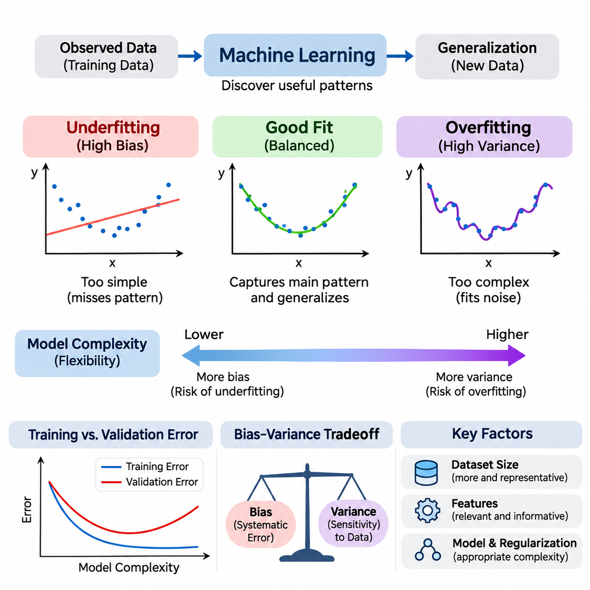
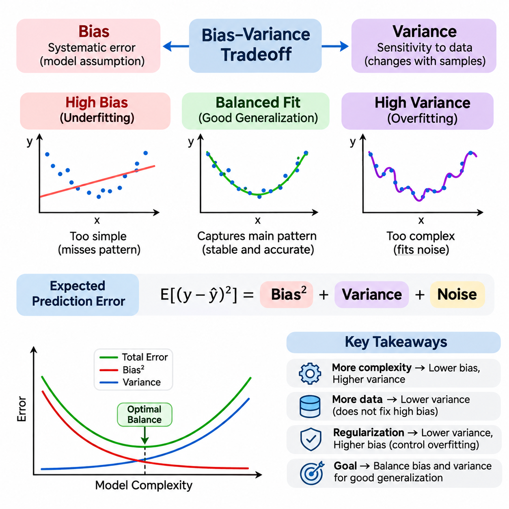
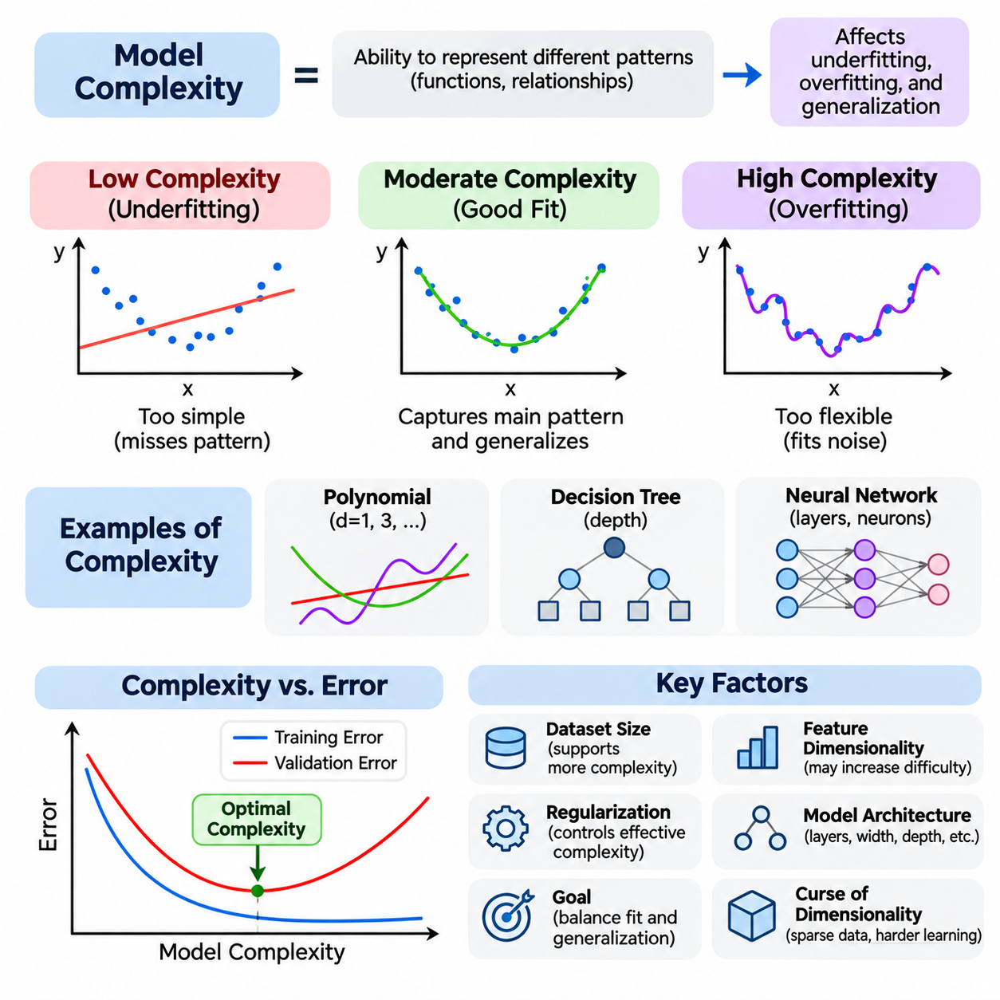
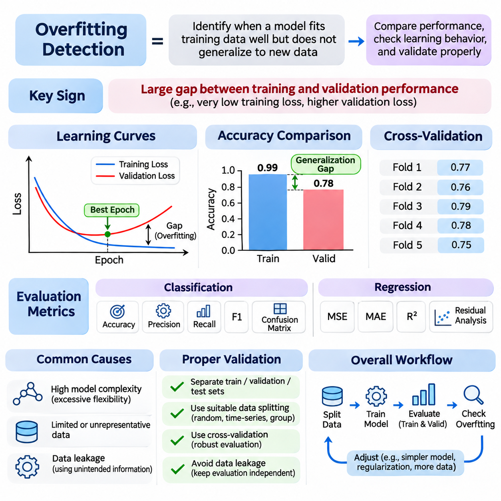
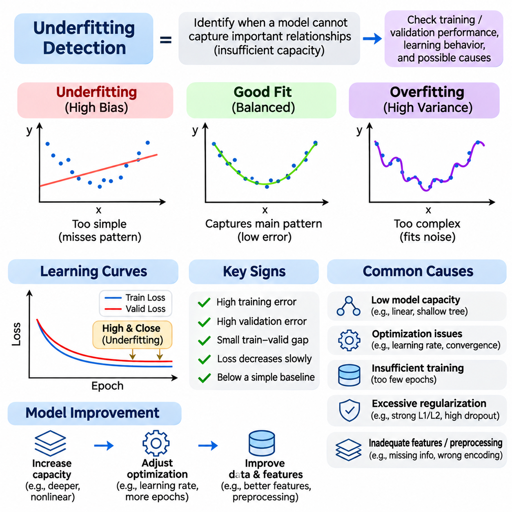
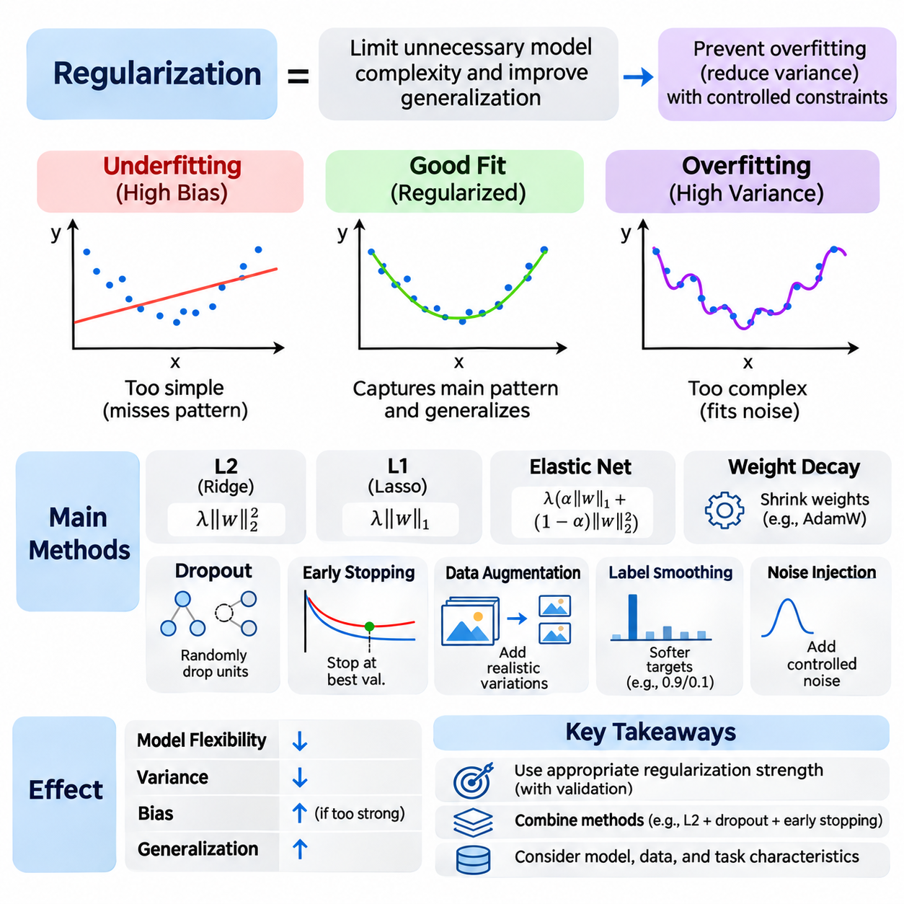
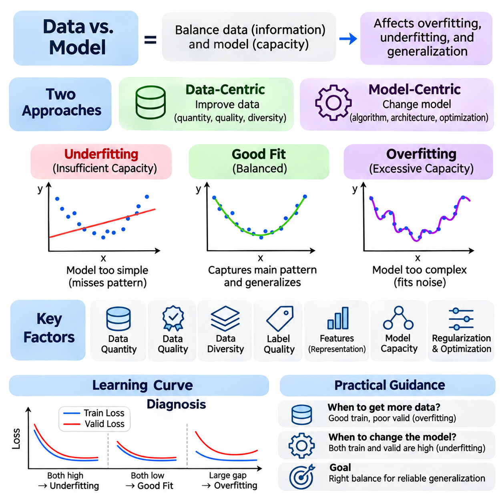
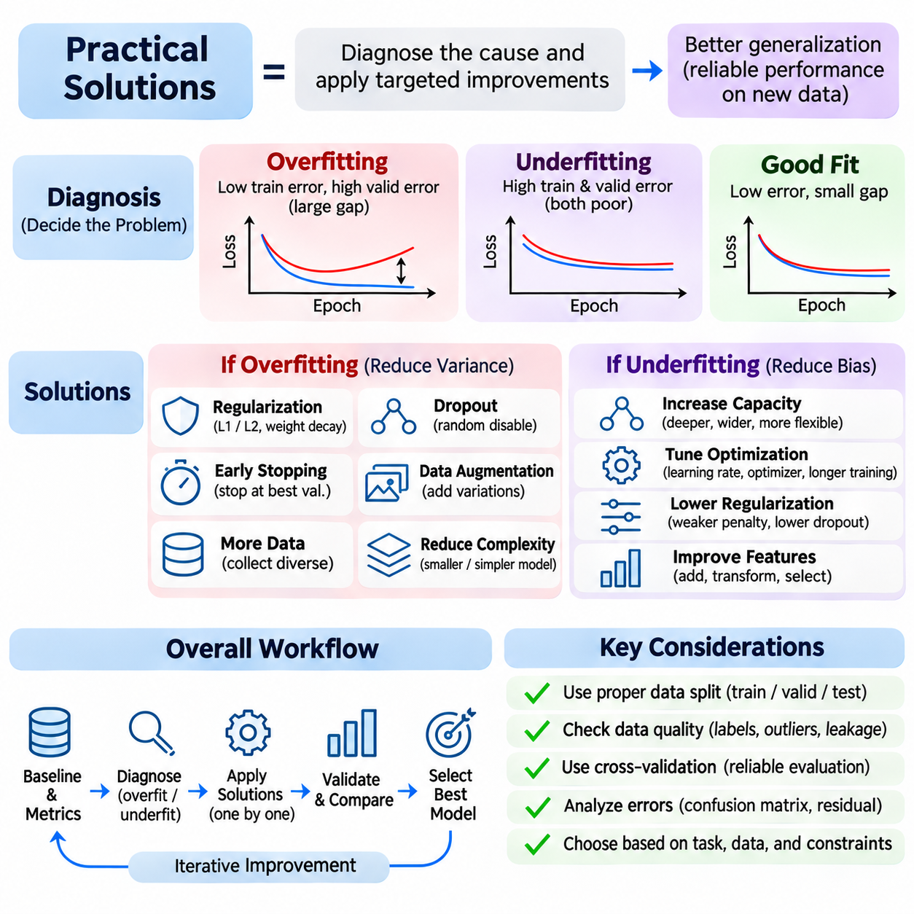

**Volume 07. Machine Learning Fundamentals**

# 05. Overfitting and Underfitting

## 05.00 Concepts

{width="7.268055555555556in" height="7.268055555555556in"}

Machine learning aims to discover patterns from observed data that remain useful when new examples are encountered. A model must learn meaningful relationships without becoming excessively dependent on individual training samples. Two fundamental obstacles to this objective are overfitting and underfitting. Understanding these conditions is essential for developing models that achieve reliable predictive performance beyond their training datasets.

Overfitting occurs when a machine learning model learns the training data too closely, including random fluctuations, measurement noise, and accidental relationships. Such a model may achieve extremely low training error while performing poorly on unseen examples. The central problem is not that the model has learned too much useful information, but that it has captured details that do not represent stable patterns in the underlying data distribution.

Underfitting occurs when a model cannot adequately represent important relationships within the training data. Its predictions remain inaccurate because the learned function is too restrictive, the available features are insufficient, or the training process has not achieved an appropriate solution. Unlike overfitting, underfitting commonly produces poor performance on both training and validation datasets, indicating that the model has failed to capture essential structure.

The distinction between overfitting and underfitting becomes clearer when considering the purpose of statistical learning. A training dataset represents only a finite sample from a broader population or environment. The objective is to estimate relationships that remain valid across other samples drawn from the relevant distribution. Successful learning therefore requires balancing the ability to explain observed examples with the ability to make accurate predictions on previously unseen observations.

Training error measures how well a model performs on examples used during parameter estimation. Validation error measures performance on separate examples that were not used to fit those parameters. Comparing these measurements provides an initial indication of generalization quality. A large difference between low training error and high validation error often suggests overfitting, while consistently high errors may indicate underfitting or other learning difficulties.

A model that generalizes successfully does not necessarily achieve the lowest possible training error. Instead, it learns a representation that captures important relationships while avoiding unnecessary sensitivity to individual observations. Some training errors may remain because the data contain uncertainty, ambiguous labels, or unpredictable variation. Attempting to eliminate every training error can encourage the model to reproduce noise rather than discover reliable predictive relationships.

Model complexity plays an important role in determining how closely a learning algorithm can fit its training observations. Simple models typically represent a restricted family of functions, while more flexible models can describe complicated nonlinear relationships. Greater flexibility can improve learning when the underlying problem is complex, but it may also increase sensitivity to limited or noisy observations. Complexity must therefore be considered relative to the available data and learning objective.

Consider a regression problem in which the relationship between an input variable and its target follows a smooth nonlinear pattern. A straight-line model may fail to represent the curvature and produce systematic prediction errors. A highly flexible polynomial may pass through nearly every training point while oscillating unpredictably between observations. An appropriately constrained model can capture the underlying curve without reproducing every random deviation in the sampled measurements.

Classification problems demonstrate similar behavior. A model with insufficient representational capacity may create an overly simple decision boundary that separates important classes incorrectly. Conversely, an excessively flexible classifier may construct irregular boundaries around isolated training examples. Although these boundaries can improve training accuracy, they may incorrectly classify nearby unseen observations. Effective classification requires boundaries that reflect meaningful distinctions rather than accidental sample arrangements.

The concepts of bias and variance provide a useful framework for interpreting these behaviors. Bias describes systematic error associated with assumptions that prevent a learning method from representing the underlying relationship accurately. Variance describes sensitivity to changes in the training sample. Underfitting is often associated with excessive bias, while overfitting is frequently associated with excessive variance. However, these relationships are tendencies rather than universal diagnostic rules.

The bias-variance tradeoff illustrates why increasing model flexibility does not guarantee better predictive performance. Reducing restrictive assumptions can decrease systematic error, but the resulting model may become more sensitive to sampling variation. Conversely, imposing stronger constraints can improve stability while preventing the model from capturing important patterns. The appropriate balance depends on the problem, dataset, model architecture, and evaluation conditions.

Dataset size significantly influences the risk of overfitting. When only a small number of examples are available, a flexible model may identify relationships that arise by chance. Increasing the quantity of representative training data can help distinguish stable patterns from random variation. Nevertheless, additional data are not automatically beneficial if they contain systematic labeling errors, irrelevant observations, or distributions that do not reflect the intended application environment.

Data quality is equally important because models learn from the information contained in their inputs and targets. Incorrect labels, missing measurements, inconsistent preprocessing, and noisy features can distort the learned relationships. A model may appear to overfit because it memorizes unreliable examples, or appear to underfit because important predictive information is absent. Consequently, diagnosing learning behavior requires examining both the model and the characteristics of its dataset.

Feature representation also affects whether a model can capture meaningful structure. If important variables are omitted, even a sophisticated algorithm may struggle to produce accurate predictions. Conversely, unnecessary or misleading features may create opportunities for learning accidental correlations. Appropriate feature engineering and selection can improve generalization by emphasizing informative relationships while reducing dependence on irrelevant variation.

Training duration introduces another dimension to the problem. During early optimization, a model may perform poorly because its parameters have not yet learned important patterns. As training progresses, both training and validation performance may improve. However, continued optimization can sometimes reduce training error while validation error begins to increase. This behavior suggests that additional training is improving memorization without producing corresponding improvements in generalization.

Learning curves help reveal these changes by tracking performance across training iterations or dataset sizes. When training and validation errors remain high and relatively close, insufficient learning capacity or ineffective optimization may be responsible. When training error becomes much lower than validation error, overfitting becomes a plausible explanation. These patterns provide diagnostic evidence, although they must be interpreted alongside dataset quality, evaluation metrics, and experimental uncertainty.

Regularization refers to techniques that constrain learning to discourage unnecessary complexity or sensitivity. Common approaches include parameter penalties, early stopping, dropout, and data augmentation. These methods influence model behavior in different ways, but their shared objective is to improve performance on unseen observations. Excessive regularization can also cause underfitting by restricting the model so strongly that it cannot represent important relationships.

The training, validation, and test datasets serve different purposes when studying generalization. Training data support parameter estimation, while validation data guide model selection and hyperparameter adjustment. Test data provide a final evaluation after development decisions have been completed. Repeatedly optimizing decisions against test results can indirectly introduce overfitting to the test set, making the reported performance less representative of future deployment conditions.

Generalization must also be understood in relation to the environment where a model will operate. A system may perform well on randomly separated examples but fail when future observations differ in time, location, equipment, or operating conditions. Such failures may involve distribution shift rather than conventional overfitting alone. Appropriate evaluation therefore requires datasets and splitting strategies that reflect the intended prediction scenario and its practical constraints.

In real-world machine learning, neither the most complex model nor the simplest model is inherently preferable. A suitable model must provide enough flexibility to capture relevant patterns while maintaining stability under realistic variation. Computational cost, inference latency, interpretability, and available training resources may also influence the selection. Predictive performance should therefore be considered together with operational requirements rather than evaluated through training accuracy alone.

Recognizing overfitting and underfitting is ultimately a process of understanding how a model learns and why its predictions succeed or fail. Training behavior, validation results, model capacity, data characteristics, and deployment conditions must be examined together. These concepts establish the foundation for analyzing bias and variance, selecting model complexity, detecting learning problems, and applying practical techniques that improve generalization and reliability.

## 05.01 Bias Variance

{width="7.268055555555556in" height="7.268055555555556in"}

Bias and variance are fundamental concepts for understanding why machine learning models succeed or fail when predicting unseen data. They describe different sources of prediction error that arise from the assumptions and sensitivity of a learning algorithm. Examining their relationship helps explain underfitting, overfitting, and the challenge of selecting models that capture meaningful patterns while maintaining reliable generalization.

Bias represents the systematic difference between the average prediction of a learning procedure and the true relationship being estimated. It reflects limitations introduced by model assumptions, feature representations, and learning constraints. A model with high bias may consistently overlook important relationships, producing similar prediction errors even when trained on different samples from the same underlying population.

Variance describes how much a model\'s predictions change when the training dataset changes. A high-variance learning procedure may produce substantially different prediction functions from different samples of the same population. This sensitivity can arise when a model has considerable flexibility relative to the available information. High variance makes predictions less stable and can contribute to poor performance on previously unseen observations.

The bias-variance tradeoff describes the tension between reducing systematic approximation error and controlling sensitivity to training data. Increasing model flexibility often reduces bias because the model can represent more complicated relationships. However, additional flexibility may increase variance by allowing the model to respond strongly to random sampling differences. The best balance depends on the problem, data distribution, and learning method.

Consider a regression problem in which the true relationship between input and output is nonlinear. A linear model may generate predictions that systematically miss the curvature of the underlying function. This behavior illustrates high bias because the model cannot adequately represent the target relationship. Even with additional training examples, its restrictive functional form may prevent it from achieving sufficiently accurate predictions.

A highly flexible polynomial model provides a contrasting example. It may fit nearly every training observation, including random measurement noise and unusual sample fluctuations. When trained on another dataset, the resulting curve may change considerably. This behavior illustrates high variance because the model depends strongly on the particular observations used during training rather than only on stable relationships.

An intermediate-complexity model may capture the important nonlinear structure without reproducing every fluctuation in the training data. Its predictions can remain relatively stable across different training samples while maintaining acceptable approximation accuracy. This illustrates the practical objective of balancing bias and variance, although the optimal complexity depends on the underlying function and the amount of available information.

For squared-error regression, expected prediction error can be decomposed into squared bias, variance, and irreducible noise under standard statistical assumptions. Squared bias measures the systematic difference between the average prediction and the true conditional mean. Variance measures prediction fluctuations across possible training datasets. Irreducible noise represents uncertainty that cannot be eliminated using the available input information.

This decomposition explains why reducing training error does not necessarily reduce expected prediction error on new observations. A highly flexible model may achieve excellent training performance while exhibiting substantial variance. Conversely, a strongly constrained model may produce stable predictions but retain large systematic errors. Generalization requires controlling the combined effects rather than minimizing one component independently.

Irreducible noise is particularly important because even an ideal predictor cannot perfectly predict outcomes containing inherently unpredictable variation. Measurement uncertainty, unobserved variables, and stochastic processes can contribute to this component. Increasing model complexity cannot eliminate uncertainty that is not explained by the available features. Attempts to fit such variation may instead increase variance and reduce predictive reliability.

Model capacity influences the balance between bias and variance, but the relationship is not universally monotonic. Classical statistical models often exhibit increasing variance as flexibility grows. Modern machine learning systems may behave differently because optimization methods, regularization, architecture, and data structure influence generalization. Consequently, model size alone is insufficient to determine whether a learning procedure has high bias or high variance.

Training dataset size also changes the relationship between bias and variance. With limited observations, flexible models may become highly sensitive to individual samples. Larger representative datasets generally provide more information for estimating stable relationships and can reduce estimation variance. However, additional observations cannot automatically eliminate bias caused by inappropriate assumptions or missing predictive features.

Regularization modifies the effective flexibility of a learning procedure by discouraging unnecessarily complicated solutions. Stronger regularization often reduces variance by limiting sensitivity to training samples, although it can increase bias. Weaker regularization allows greater flexibility but may expose the model to unstable estimates. The appropriate regularization strength should be selected through reliable validation rather than assumptions about complexity alone.

Feature engineering can influence both bias and variance. Missing important features may introduce systematic prediction errors because the model lacks information needed to represent the target relationship. Adding informative features can reduce this limitation. However, introducing many irrelevant or redundant features may increase estimation uncertainty, particularly when the dataset is small relative to the number of variables.

Learning algorithms exhibit different bias-variance characteristics depending on their assumptions and configurations. A shallow decision tree may produce relatively stable predictions while failing to capture complicated interactions. A deep tree can represent detailed relationships but may become sensitive to small changes in training observations. Ensemble methods can combine multiple predictors to improve stability or reduce systematic errors, depending on their construction.

Bagging illustrates how variance can be reduced by averaging predictions from models trained on different resampled datasets. When individual predictors exhibit partially independent errors, averaging can reduce fluctuations without necessarily increasing bias substantially. Random forests extend this principle by introducing additional randomness into tree construction. Their effectiveness depends on predictor diversity, correlation, and the characteristics of the learning problem.

Boosting approaches the problem differently by sequentially constructing models that address errors remaining from previous stages. This process can reduce systematic prediction errors and improve representation of complex relationships. However, excessive model complexity or unsuitable training configurations may still produce overfitting. The resulting bias-variance behavior depends on factors such as learning rate, ensemble size, and base learner complexity.

Learning curves provide practical evidence about possible bias and variance problems. When training and validation errors remain high and relatively close, excessive bias or inadequate optimization may be suspected. When training error is low but validation error remains substantially higher, excessive variance becomes a plausible explanation. These patterns are diagnostic indicators rather than definitive measurements of the theoretical bias and variance components.

Cross-validation helps evaluate model stability by repeatedly training and evaluating models on different partitions of the available data. Variation in validation scores can reveal sensitivity to data selection, while average performance provides evidence about expected generalization. However, score variation across folds is not identical to the variance term in the bias-variance decomposition because evaluation samples and training subsets both change.

Hyperparameter tuning provides a practical mechanism for balancing approximation capability and prediction stability. Parameters such as tree depth, polynomial degree, regularization strength, and neighborhood size influence the effective complexity of a model. Validation procedures help identify configurations that achieve favorable predictive performance. A separate test dataset remains necessary for evaluating the selected configuration without introducing selection bias.

Bias and variance should ultimately be interpreted as properties of a learning procedure under a particular data-generating process rather than fixed labels attached to individual algorithms. Their relationship changes with sample size, feature quality, optimization, and model configuration. Understanding these effects supports systematic model selection and provides a foundation for improving generalization through appropriate complexity, reliable evaluation, and effective training strategies.

## 05.02 Model Complexity

{width="7.268055555555556in" height="7.268055555555556in"}

Model complexity refers to the ability of a machine learning model to represent different patterns and relationships within data. It determines the range of functions a model can learn and influences how closely predictions can match training observations. Understanding complexity is essential because insufficient flexibility may cause underfitting, while excessive flexibility can increase sensitivity to noise and contribute to overfitting.

A simple model typically relies on restrictive assumptions about the relationship between inputs and outputs. Linear regression, for example, assumes that the predicted target is a linear combination of input features. This structure is computationally efficient and often interpretable, but it may fail to capture complicated nonlinear patterns. Such limitations can introduce systematic prediction errors when the true relationship is more complex.

Complex models can represent a wider variety of relationships by introducing additional parameters, nonlinear transformations, or flexible decision structures. Deep neural networks, high-degree polynomial models, and large decision trees illustrate different forms of increased capacity. These models can capture intricate interactions among features, but their flexibility also creates opportunities to fit accidental relationships in limited training datasets.

Model complexity is closely related to representational capacity, which describes the collection of functions available to a learning algorithm. A model with low capacity can represent only a restricted set of relationships, while a high-capacity model can express more diverse patterns. However, representational capacity does not guarantee successful learning because optimization, regularization, data quality, and training configuration determine which functions are actually learned.

Polynomial regression provides a straightforward example of how complexity affects learning behavior. A first-degree polynomial represents a straight line, while higher-degree polynomials can represent increasingly complicated curves. When the polynomial degree is too low, important curvature may remain unexplained. When the degree becomes excessively high relative to the available observations, the fitted function may oscillate around individual samples and generalize poorly.

Decision trees demonstrate complexity through structural properties such as maximum depth, number of leaves, and minimum samples required for splitting. A shallow tree produces relatively simple decision rules and may overlook important feature interactions. A deep tree can divide the feature space into many small regions, allowing detailed predictions. However, these regions may reflect isolated training examples rather than stable patterns shared by future observations.

Neural network complexity depends on multiple architectural characteristics, including the number of layers, neurons, connections, and trainable parameters. Greater depth can support hierarchical representations, while increased width can expand the range of functions represented. Nevertheless, parameter count alone does not fully describe effective complexity because activation functions, architectural constraints, optimization methods, and regularization influence learning behavior.

The relationship between complexity and training error is often intuitive. When a model family becomes more expressive and optimization is effective, the model can usually fit training observations at least as well as a more restricted alternative. Consequently, training error often decreases as capacity increases. Validation error, however, may initially decrease and later increase when additional flexibility begins to capture sample-specific variation rather than generalizable structure.

This behavior is commonly illustrated by a conceptual U-shaped validation error curve. At low complexity, the model may suffer from high approximation error because it cannot represent important relationships. At intermediate complexity, it may achieve a favorable balance between flexibility and stability. At high complexity, estimation variance may increase, although modern learning systems do not always follow this classical pattern.

Effective model complexity differs from nominal architectural complexity. Two models with identical parameter counts can exhibit different generalization behavior because of their training procedures and structural assumptions. Weight decay, dropout, early stopping, and data augmentation can constrain the functions learned by highly expressive models. These mechanisms allow substantial representational capacity while discouraging unnecessarily sensitive solutions.

Dataset size strongly influences the amount of complexity that can be supported reliably. A model trained on a small dataset may fit individual observations without discovering stable relationships. Larger representative datasets provide additional evidence about recurring patterns and can improve the reliability of parameter estimation. Nevertheless, the required amount of data depends on the task, feature structure, noise level, and inductive assumptions of the learning algorithm.

Feature dimensionality introduces another important aspect of complexity. As the number of input variables increases, a model may require more observations to estimate relationships reliably. High-dimensional datasets can contain irrelevant or redundant features that increase estimation uncertainty. Feature selection, dimensionality reduction, and appropriate regularization can help control this difficulty while preserving information needed for accurate predictions.

The concept of the curse of dimensionality describes several difficulties associated with high-dimensional feature spaces. As dimensionality increases, observations can become sparse relative to the available space, making distance-based comparisons and local estimation more difficult. However, practical effects depend on the intrinsic structure of the data. High-dimensional representations may remain manageable when useful information lies on a lower-dimensional structure.

Statistical learning theory provides formal approaches to studying model complexity. Measures such as VC dimension and Rademacher complexity characterize aspects of the expressive power or data-dependent richness of hypothesis classes. These concepts help explain how model flexibility interacts with sample size and generalization guarantees. Their practical interpretation requires considering assumptions about the learning setting and the resulting bounds.

Complexity can also be understood through the distinction between approximation error and estimation error. Approximation error arises when the available model family cannot adequately represent the target relationship. Estimation error reflects uncertainty introduced by learning from finite samples. Increasing capacity may reduce approximation error while making estimation more difficult, although the precise relationship depends on the learning procedure and data distribution.

Regularization provides a practical method for controlling effective complexity without necessarily changing the underlying model architecture. L1 regularization encourages sparse parameter solutions, while L2 regularization discourages large parameter magnitudes. Early stopping limits the extent of optimization, and dropout introduces stochastic restrictions during neural network training. These approaches can improve generalization when their strengths are appropriately selected.

Hyperparameters frequently determine how much complexity a learning algorithm can express in practice. Polynomial degree, decision tree depth, neural network width, and regularization strength all influence the learned function. Hyperparameter tuning uses validation performance to identify configurations that balance predictive accuracy and stability. Reliable selection requires avoiding repeated adaptation to the final test dataset.

Modern deep learning introduces additional complexity beyond traditional interpretations. Highly overparameterized neural networks can sometimes generalize well despite having enough parameters to fit their training data almost perfectly. Optimization dynamics, implicit regularization, architectural inductive biases, and dataset structure influence this behavior. Therefore, high parameter count should not automatically be interpreted as evidence of overfitting.

Double descent describes a phenomenon in which test error may decrease, increase near an interpolation threshold, and decrease again as model capacity continues growing. This behavior challenges the assumption that validation error must always increase beyond an intermediate complexity level. Double descent does not occur universally, but it demonstrates that generalization depends on interactions among capacity, optimization, noise, and sample characteristics.

Computational complexity should be distinguished from statistical model complexity. A statistically expressive model may require substantial memory, training time, and inference computation, but these properties are not equivalent measures. Some architectures achieve strong predictive performance with efficient computation, while others require extensive resources. Practical model selection must consider both generalization quality and operational constraints.

In real-world applications, appropriate model complexity depends on the reliability requirements of the target system. A small interpretable model may be preferable when data are limited and decisions require explanation. A larger model may be justified when complex relationships, abundant data, and sufficient computational resources are available. The objective is not to maximize complexity but to select a model that provides dependable predictions under realistic conditions.

Model complexity is ultimately a design variable that connects representation, optimization, data availability, and generalization. Excessively restrictive models may overlook essential relationships, while unnecessarily flexible models may become sensitive to sample-specific variation. By evaluating training behavior, validation performance, regularization effects, and deployment constraints, practitioners can select model configurations that balance learning capability with predictive reliability.

## 05.03 Overfitting Detection [w/Code]

{width="7.268055555555556in" height="7.268055555555556in"}

Overfitting detection is the process of identifying when a machine learning model performs well on training data but fails to generalize reliably to unseen observations. It is an essential part of model evaluation because high training accuracy alone does not demonstrate predictive reliability. Effective detection requires comparing performance across datasets, examining learning behavior, and identifying patterns that indicate excessive dependence on training examples.

The most common indication of overfitting is a substantial performance gap between training and validation datasets. A model may achieve very low training loss while maintaining considerably higher validation loss. This difference suggests that the model has learned characteristics specific to its training observations. However, a performance gap alone is not definitive evidence because dataset differences, sampling uncertainty, and evaluation procedures can produce similar patterns.

Training loss and validation loss provide complementary information about model behavior. Training loss measures how closely predictions match examples used during parameter optimization. Validation loss evaluates predictions on observations excluded from parameter fitting. When training loss continues decreasing while validation loss stops improving or begins increasing, the model may be learning sample-specific details that do not contribute to generalization.

Learning curves are particularly useful for detecting overfitting during iterative training. By recording training and validation metrics after each epoch, practitioners can observe how model behavior changes over time. A widening gap between the curves often indicates increasing dependence on training examples. The epoch at which validation performance reaches its best value can provide useful information for selecting an appropriate training duration.

Consider a neural network trained for image classification. During the initial epochs, both training and validation accuracy may increase as the network learns useful visual features. After further training, training accuracy may approach perfection while validation accuracy remains unchanged or decreases. This pattern suggests that the network is increasingly adapting to individual training images rather than improving its ability to recognize new examples.

Overfitting can also be detected by comparing training and validation accuracy directly. For example, a classifier achieving 99 percent training accuracy but only 78 percent validation accuracy exhibits a substantial generalization gap. This difference warrants investigation, although its interpretation depends on class balance, dataset difficulty, and statistical uncertainty. Accuracy should be supplemented with metrics that reflect the actual prediction objective.

For classification problems, precision, recall, F1 score, and confusion matrices can reveal overfitting patterns that accuracy alone may conceal. A model may perform exceptionally well on common training classes while failing to recognize rare classes in validation data. Comparing class-specific errors across datasets helps determine whether apparent training success reflects generalizable discrimination or memorization of frequent patterns.

Regression models require corresponding comparisons using metrics such as mean squared error, mean absolute error, and coefficient of determination. A regression model may fit training observations closely while producing large prediction errors on validation samples. Examining residual distributions can reveal unstable predictions, systematic deviations, or unusually large errors. These findings should be interpreted alongside possible differences between training and validation data.

Cross-validation provides another method for investigating overfitting by evaluating models across multiple training and validation partitions. Consistently poor validation performance relative to training performance suggests limited generalization. Large differences among validation folds may indicate sensitivity to sample selection. However, variation across folds can also arise from small datasets, heterogeneous populations, or differences in evaluation subsets.

A reliable detection procedure requires careful separation of training, validation, and test datasets. Training data are used to estimate model parameters, while validation data support model selection and hyperparameter tuning. Test data should remain independent until final evaluation. Repeatedly modifying a model based on test results can create indirect overfitting to the test dataset and produce overly optimistic estimates of real-world performance.

Data leakage can imitate successful learning and conceal overfitting. Leakage occurs when information unavailable during actual prediction enters the training or evaluation process. Examples include preprocessing the entire dataset before splitting, using future information, or allowing related records to appear in both training and validation partitions. Detection procedures must verify that evaluation data remain independent and that all transformations follow the intended prediction workflow.

Dataset splitting strategies strongly influence the reliability of overfitting detection. Random splitting may be appropriate when observations are independent and identically distributed, but it can be misleading for temporal, grouped, or spatial data. Time-series applications often require chronological validation, while patient-level or device-level datasets may require group-based separation. Appropriate splitting prevents closely related observations from producing artificially favorable evaluation results.

Model complexity provides additional diagnostic context. Highly flexible models can fit detailed relationships and may reproduce noise when training data are limited. Deep decision trees, high-degree polynomial regressors, and large neural networks can exhibit this behavior under unsuitable conditions. Nevertheless, complexity alone does not prove overfitting because regularization, optimization, and dataset structure strongly influence generalization.

Hyperparameter sensitivity can reveal unstable generalization behavior. If small changes in tree depth, regularization strength, learning rate, or model size produce large differences in validation performance, the learning procedure may be sensitive to its configuration. Repeating experiments with controlled settings helps distinguish persistent overfitting from random variation. Reliable conclusions require considering both average performance and experimental variability.

Repeated training with different random seeds provides further evidence about model stability. Different initializations, shuffled datasets, and stochastic optimization paths can produce different fitted models. When training performance remains consistently strong but validation performance varies substantially, the model may depend heavily on incidental training conditions. Multiple independent runs help estimate uncertainty and prevent conclusions based on unusually favorable results.

Prediction confidence can provide supplementary evidence, particularly in classification systems. An overfitted model may assign high confidence to incorrect predictions on unseen data. Reliability diagrams, calibration measurements, and confidence distributions can help identify this behavior. However, poor calibration and overfitting are not equivalent, and a well-calibrated model can still have inadequate predictive accuracy.

Error analysis helps identify whether failures concentrate around particular examples, classes, or operating conditions. A model may perform well on familiar backgrounds while failing when lighting, viewpoint, or object appearance changes. Such patterns can indicate reliance on incidental correlations rather than meaningful features. Nevertheless, these failures may also reflect distribution shift, so overfitting should not be diagnosed without examining the evaluation environment.

Data augmentation experiments can provide additional insight into whether a model relies on superficial training patterns. Applying realistic transformations during training may improve validation performance by exposing the model to meaningful variation. If performance improves substantially, excessive sensitivity to limited training examples may have contributed to the original problem. Augmentation must preserve task-relevant labels and reflect plausible variations in deployment conditions.

Early stopping is closely connected to overfitting detection because it monitors validation performance during training. When validation loss no longer improves for a specified number of epochs, training can be stopped to avoid unnecessary adaptation to training examples. The best checkpoint is commonly selected using validation results. However, early stopping is both a detection mechanism and a regularization strategy, and its effectiveness depends on monitoring choices.

Practical implementation begins by recording training and validation metrics consistently throughout model development. The same metric definitions, preprocessing assumptions, and evaluation conditions should be maintained across comparisons. Experiment logs should include model configuration, dataset version, random seed, training duration, and relevant hyperparameters. These records make it possible to reproduce suspicious behavior and distinguish genuine generalization problems from experimental inconsistencies.

Overfitting detection should ultimately be treated as a systematic diagnostic process rather than a single numerical threshold. Generalization gaps, learning curves, cross-validation results, prediction errors, and model stability provide complementary evidence. By combining these observations with reliable data separation and careful evaluation, practitioners can identify excessive dependence on training data and establish a sound basis for improving predictive reliability.

## 05.04 Underfitting Detection [w/Code]

{width="7.268055555555556in" height="7.268055555555556in"}

Underfitting detection is the process of identifying when a machine learning model fails to capture important relationships in the available data. An underfitted model often performs poorly on both training and validation datasets because its learned representation is insufficient for the prediction task. Detecting this condition is essential for distinguishing limitations in model capacity from problems caused by overfitting, data quality, or optimization.

The most common indication of underfitting is consistently high training error accompanied by similarly high validation error. When a model cannot achieve satisfactory performance even on examples used during training, its ability to generalize is naturally limited. A small gap between training and validation performance does not necessarily indicate successful learning because both measurements may reflect inadequate predictive capability.

Training and validation learning curves provide useful evidence for diagnosing underfitting. If both losses remain high and decrease only slightly throughout training, the model may lack sufficient representational capacity or may not be optimizing effectively. When the curves converge at an unsatisfactory performance level, additional investigation is necessary. Their absolute values should be interpreted relative to task requirements and meaningful baselines.

Consider a linear regression model applied to data generated by a strongly nonlinear relationship. The model may consistently underestimate some regions and overestimate others because a straight line cannot represent the underlying curvature. Both training and validation errors may remain substantial even after optimization converges. This pattern suggests structural underfitting caused by restrictive assumptions about the target function.

Classification models can exhibit similar limitations. A linear classifier may fail when different classes are separated by complicated nonlinear boundaries. Even with carefully optimized parameters, the model may misclassify substantial portions of the training data. Examining class-specific accuracy and confusion matrices can reveal recurring errors that indicate insufficient representation of important decision boundaries.

Model capacity is a central factor in underfitting detection. Shallow decision trees, low-degree polynomial models, and narrowly constrained neural networks may lack the flexibility required to represent complex relationships. However, poor training performance does not automatically prove inadequate capacity. Optimization failures, unsuitable features, excessive regularization, and incorrect preprocessing can produce similar symptoms.

Optimization behavior must therefore be examined before concluding that a model is too simple. A learning rate that is excessively high may prevent convergence, while a very small learning rate may produce insufficient progress within the available training time. Poor initialization, unstable gradients, or inappropriate optimizer settings can also limit learning. Monitoring loss trajectories and gradient behavior helps distinguish optimization difficulties from representational limitations.

Insufficient training duration can create the appearance of underfitting even when the model has adequate capacity. A neural network stopped after only a few epochs may not have learned useful feature representations. If training and validation losses continue decreasing steadily, extending training may improve performance. In contrast, persistent high training loss after stable convergence suggests that other limitations require investigation.

Excessive regularization is another common source of underfitting. Strong L1 or L2 penalties can restrict parameter values so severely that important relationships remain unrepresented. High dropout rates may also reduce effective learning capacity, while aggressive early stopping can terminate training prematurely. Comparing training behavior under different regularization strengths helps determine whether excessive constraints are responsible for poor performance.

Feature quality plays an important role in diagnosing underfitting. A model cannot reliably learn relationships that are absent from its input representation. Missing predictive variables, inappropriate feature transformations, and excessive information loss during preprocessing can create systematic errors. Examining feature distributions and testing alternative representations can reveal whether the problem originates from insufficient information rather than model architecture.

Data preprocessing errors may also produce misleading evidence of underfitting. Incorrect normalization, inconsistent feature encoding, mislabeled observations, or unsuitable target transformations can prevent a model from learning effectively. Before increasing complexity, practitioners should verify that preprocessing operations are appropriate and consistently applied. Simple diagnostic checks can often reveal implementation problems that resemble inadequate model capacity.

Baseline comparisons provide an essential reference for evaluating model adequacy. A regression model should generally outperform a reasonable constant predictor, while a classification model should be compared against meaningful majority-class or simple heuristic baselines. If a trained model barely improves upon these references, its learning process requires investigation. Baselines help distinguish genuine predictive progress from apparently acceptable but uninformative metrics.

Residual analysis offers additional evidence for regression underfitting. When prediction errors exhibit systematic patterns across input values, the model may be missing important nonlinear relationships or interactions. For example, residuals that consistently change with a particular feature can indicate an inadequate functional form. However, residual patterns may also arise from omitted variables, distributional assumptions, or data collection problems.

Learning curves constructed across different training dataset sizes can help identify high-bias behavior. If training and validation errors converge to a relatively high level as the dataset grows, the model may have reached a performance limitation that additional data alone cannot resolve. Increasing representational capacity or improving features may be more effective. Nevertheless, conclusions should account for noise, optimization quality, and evaluation uncertainty.

Hyperparameter experiments provide a practical approach to diagnosing insufficient capacity. Increasing tree depth, polynomial degree, network width, or the number of learned features can reveal whether additional flexibility improves training performance. If both training and validation results improve consistently, the original configuration may have been overly restrictive. Changes should be evaluated systematically because greater complexity can eventually introduce overfitting.

Repeated experiments with different random seeds can help determine whether poor performance is persistent. If multiple runs produce similarly high training and validation errors, a systematic limitation becomes more plausible. Large differences among runs may instead indicate optimization instability or sensitivity to initialization. Recording experimental configurations and reporting variability supports reliable diagnosis rather than conclusions based on a single training result.

Class imbalance can complicate underfitting detection in classification tasks. A model may achieve apparently high accuracy by predicting the majority class while failing to learn minority-class patterns. Precision, recall, F1 score, balanced accuracy, and confusion matrices can expose these deficiencies. Evaluation metrics should reflect the actual task objectives so that inadequate learning is not concealed by misleading aggregate performance.

Noise and label uncertainty establish limits on achievable performance. When labels contain errors or target outcomes are inherently unpredictable, even a well-specified model may retain substantial training and validation loss. High error should therefore be compared with estimates of task difficulty and irreducible uncertainty. Without this context, practitioners may incorrectly diagnose underfitting and increase complexity without meaningful benefit.

Practical implementation of underfitting detection begins with consistent metric logging and controlled model comparisons. Training loss, validation loss, learning duration, model configuration, and preprocessing settings should be recorded for each experiment. Simple models can establish initial baselines before more expressive alternatives are introduced. This approach makes it easier to identify whether performance limitations arise from capacity, optimization, features, or data quality.

Underfitting detection should ultimately combine learning curves, baseline comparisons, residual analysis, optimization diagnostics, and controlled complexity experiments. Persistently poor training performance is an important warning sign, but its underlying cause must be established before corrective action. A systematic diagnosis helps practitioners select appropriate improvements and develop models that learn meaningful relationships while maintaining reliable generalization.

## 05.05 Regularization Review

{width="7.268055555555556in" height="7.268055555555556in"}

Regularization is a collection of techniques used to improve machine learning generalization by limiting unnecessary model complexity and reducing sensitivity to training data. It helps prevent overfitting when a model learns noise or sample-specific patterns rather than stable relationships. Regularization does not simply make models smaller; it influences which solutions are preferred during learning and how reliably predictions transfer to unseen observations.

The central principle of regularization is to introduce constraints or preferences that discourage excessively flexible solutions. A model trained only to minimize empirical loss may fit individual observations too closely. Regularization modifies the learning process by penalizing certain parameter configurations, restricting optimization, or introducing controlled variation. These mechanisms can reduce variance, although excessive regularization may increase bias and cause underfitting.

L2 regularization adds a penalty proportional to the sum of squared parameter values to the training objective. This encourages smaller weights and discourages solutions that depend on unusually large coefficients. In linear regression, the corresponding approach is known as ridge regression. L2 regularization often improves numerical stability and reduces sensitivity to training samples, particularly when input features are correlated or the dataset is limited.

L1 regularization penalizes the sum of absolute parameter values and encourages sparse solutions in which some coefficients become exactly zero. In linear regression, this approach is known as lasso regression. Sparsity can simplify interpretation and perform implicit feature selection by removing less useful variables. However, when features are strongly correlated, the selected variables may be unstable, and excessive penalties can eliminate important predictive information.

Elastic Net combines L1 and L2 penalties to balance sparsity and coefficient shrinkage. The L1 component encourages feature selection, while the L2 component can improve stability when predictors are correlated. Its behavior depends on both the overall regularization strength and the relative contribution of each penalty. These hyperparameters should be selected through validation because inappropriate settings may introduce unnecessary bias.

Regularization strength controls the balance between fitting training observations and restricting model flexibility. Weak regularization allows the model to adapt closely to available examples, potentially increasing variance. Strong regularization limits this adaptation but may prevent the model from representing meaningful relationships. Validation curves across different penalty strengths help identify configurations that achieve favorable generalization without excessive underfitting.

Weight decay is commonly used to regularize neural networks by shrinking parameter magnitudes during optimization. Under standard stochastic gradient descent, coupled L2 penalties and weight decay can produce equivalent updates under appropriate conditions. Adaptive optimizers may behave differently, motivating decoupled weight decay methods such as AdamW. The distinction matters because optimizer behavior affects the practical meaning of regularization strength.

Dropout is a stochastic regularization technique that randomly disables selected neural network activations during training. This reduces dependence on particular activation pathways and encourages representations that remain useful under different subnetworks. During inference, dropout is normally disabled and scaling conventions preserve the intended activation behavior. Excessive dropout can disrupt learning and produce underfitting, especially in smaller networks.

Early stopping limits training duration by monitoring performance on a validation dataset. When validation loss stops improving while training loss continues decreasing, further optimization may increase overfitting. Saving the checkpoint with the best validation performance can provide a practical balance between fitting and generalization. The patience parameter determines how long training continues without improvement and should account for noisy validation measurements.

Data augmentation provides regularization by expanding the variation encountered during training without necessarily collecting additional observations. Image transformations such as cropping, flipping, and color adjustments can encourage robustness to realistic appearance changes. Text and audio tasks require transformations appropriate to their structure. Augmentation must preserve the target meaning because invalid transformations can introduce label noise and damage performance.

Noise injection introduces controlled randomness into inputs, activations, or parameters during training. By learning under small perturbations, a model may become less sensitive to incidental variations and develop smoother predictions. The effect depends on the noise distribution and magnitude. Excessive perturbations can destroy informative structure, so noise levels should reflect realistic uncertainty or carefully chosen regularization objectives.

Label smoothing modifies classification targets by assigning a small probability mass to classes other than the correct label. This discourages extreme confidence and can improve generalization or calibration in suitable settings. However, label smoothing does not guarantee accurate uncertainty estimates and may be unsuitable when precise target probabilities are important. Its strength should be validated against both predictive accuracy and task-specific requirements.

Architectural constraints can provide regularization through inductive bias rather than explicit penalty terms. Convolutional neural networks exploit spatial locality and parameter sharing, while other architectures incorporate sequence structure or known relationships. These assumptions restrict the functions learned efficiently and can improve data efficiency. Their effectiveness depends on whether the architectural assumptions match the structure of the problem.

Ensemble methods can reduce prediction instability by combining multiple models. Bagging and random forests often reduce variance through averaging predictions from diverse learners. Although ensembles are not equivalent to parameter penalties, they can improve generalization by limiting the influence of individual model fluctuations. Their effectiveness depends on predictor diversity, error correlation, and the quality of the underlying models.

Regularization interacts with dataset size and quality. Small datasets often require stronger constraints because flexible models can fit limited observations too closely. Larger representative datasets may support more expressive solutions with less explicit regularization. However, noisy labels, irrelevant features, and distribution differences can still create generalization problems. Regularization should complement reliable data preparation rather than substitute for it.

Feature selection and dimensionality reduction can act as forms of complexity control. Removing irrelevant variables reduces opportunities to fit accidental correlations, while lower-dimensional representations may improve estimation stability. Principal component analysis and supervised feature selection provide different approaches to reducing dimensionality. These transformations must be fitted using training data only to prevent information leakage into validation or test evaluation.

The effectiveness of regularization is commonly assessed through training and validation performance. If training error is very low while validation error remains high, stronger regularization may improve generalization. If both errors are high, additional constraints may worsen underfitting. Learning curves and controlled hyperparameter experiments help distinguish these situations. No single regularization technique is universally optimal across tasks and architectures.

Cross-validation provides a systematic method for selecting regularization hyperparameters when data are limited. Candidate strengths can be evaluated across multiple training and validation partitions to estimate generalization performance. The final test dataset should remain independent of this selection process. Repeatedly tuning against test results can produce evaluation overfitting even when the training procedure itself includes strong regularization.

Practical implementation requires careful attention to optimization and reproducibility. Regularization coefficients, dropout probabilities, augmentation policies, and early stopping criteria should be recorded alongside model architecture and optimizer settings. Experiments should change controlled factors while preserving consistent evaluation conditions. This makes it possible to identify whether performance improvements arise from regularization rather than unrelated training differences.

Regularization should ultimately be understood as a strategy for controlling how a model uses its learning capacity. Appropriate constraints encourage stable relationships and reduce unnecessary sensitivity to training examples, while excessive constraints can suppress important information. Combining explicit penalties, architectural assumptions, stochastic techniques, and reliable validation provides a practical foundation for balancing model flexibility, predictive accuracy, and generalization.

## 05.06 Data vs Model

{width="7.268055555555556in" height="7.268055555555556in"}

The relationship between data and model design is central to understanding overfitting, underfitting, and generalization in machine learning. Predictive performance depends not only on the complexity of an algorithm but also on the quantity, quality, diversity, and relevance of available data. A sophisticated model cannot compensate for every data limitation, while a simple model trained on representative information may outperform a larger alternative.

Data-centric improvement focuses on enhancing the information available for learning, whereas model-centric improvement focuses on changing the algorithm, architecture, or optimization procedure. Both approaches influence prediction quality, but they address different limitations. Effective machine learning development requires identifying whether poor performance originates primarily from insufficient information, inadequate model capacity, or their interaction.

Training dataset size strongly influences the relationship between data and model complexity. Flexible models can represent detailed patterns but may become sensitive to individual observations when training examples are limited. Increasing the number of representative samples often reduces estimation uncertainty and improves stability. However, additional data may provide little benefit when important features are missing or labels contain systematic errors.

Model capacity determines which relationships can be represented using the available information. A linear model may underfit complicated nonlinear patterns even when trained on a large dataset. A more expressive model can reduce this approximation limitation, but its additional flexibility may require stronger regularization or more informative observations. Selecting capacity therefore requires considering both task complexity and available evidence.

Learning curves help determine whether collecting additional data or modifying the model is more promising. When training performance is strong but validation performance remains substantially worse, additional representative data may reduce overfitting. When both training and validation errors remain high and close together, increasing model capacity or improving optimization may be more useful. These patterns provide guidance rather than definitive diagnoses.

Data quality can be more important than dataset size. Incorrect labels, corrupted measurements, inconsistent preprocessing, and duplicated records can introduce misleading relationships into the learning process. Increasing model complexity may amplify these problems by allowing the algorithm to fit unreliable observations more closely. Data validation, error correction, and consistent preprocessing should therefore precede unnecessary architectural expansion.

Label quality is particularly important in supervised learning because labels define the relationships a model attempts to reproduce. Systematic annotation errors can introduce bias, while inconsistent annotations can increase uncertainty. Reviewing ambiguous examples, establishing annotation guidelines, and measuring agreement among annotators can improve training reliability. A smaller accurately labeled dataset may be more useful than a larger collection of unreliable examples.

Data diversity determines how well training observations represent the conditions encountered during deployment. A model trained on limited environments may learn correlations that disappear when lighting, background, sensor characteristics, or user behavior changes. Collecting examples across realistic operating conditions can improve robustness. However, diversity should reflect the intended target distribution rather than introduce unrelated variation without purpose.

Feature representation connects data quality with model capability. Even a powerful algorithm cannot reliably exploit information that is absent from its inputs. Missing variables, unsuitable encodings, and excessive dimensionality reduction may prevent important relationships from being learned. Conversely, informative features can simplify the prediction problem and allow less complex models to achieve competitive performance with fewer training examples.

Feature engineering and representation learning provide complementary approaches to extracting useful information. Traditional methods often rely on manually designed transformations informed by domain knowledge. Deep learning models can discover hierarchical representations directly from suitable data. The appropriate approach depends on dataset size, computational resources, and task structure. Neither approach eliminates the need for representative and correctly processed observations.

Data augmentation expands the range of examples encountered during training by applying transformations that preserve relevant labels. In computer vision, realistic changes in orientation, brightness, and cropping can improve robustness to appearance variation. Similar principles apply to audio, text, and sensor data when transformations preserve task meaning. Invalid augmentation may instead introduce noise and reduce performance.

The balance between data quantity and model complexity also depends on the intrinsic difficulty of the learning problem. Tasks involving simple relationships may require relatively few examples, while complex visual recognition or sequential prediction may demand extensive data. Noise levels, class overlap, and hidden variables influence achievable accuracy. Consequently, there is no universal dataset size that guarantees reliable training for a particular parameter count.

Class imbalance illustrates how data composition can matter more than total sample count. A dataset may contain many observations while providing very few examples of important minority classes. A model can achieve high aggregate accuracy without learning these rare categories effectively. Targeted data collection, appropriate sampling, and class-sensitive evaluation can address this limitation more directly than simply increasing model capacity.

Distribution shift introduces another challenge when training data differ from deployment observations. Changes in input distributions, relationships between features and labels, or class frequencies can reduce performance even when validation results appear strong. Addressing these problems may require collecting target-domain examples, adapting representations, or revising evaluation procedures. Larger models alone cannot guarantee robustness to unfamiliar conditions.

Regularization influences how effectively a model uses limited data. Weight penalties, dropout, early stopping, and architectural constraints can reduce sensitivity to individual training examples. These methods allow expressive models to operate more reliably when observations are scarce. However, excessive regularization may suppress meaningful patterns, and no regularization method can recover predictive information that was never observed.

Transfer learning provides an alternative when collecting large task-specific datasets is expensive. A model pretrained on related data may already contain useful representations that reduce the amount of additional supervision required. Fine-tuning adapts these representations to the target task. Its effectiveness depends on similarity between source and target domains, and inappropriate transfer can introduce harmful assumptions or negative transfer.

Active learning seeks to improve data efficiency by selecting informative examples for labeling. Rather than collecting observations uniformly, the system identifies cases that may reduce uncertainty or improve decision boundaries. This approach can be valuable when annotation is expensive, although selection strategies must account for sampling bias and coverage. Its purpose is to increase the value of collected data rather than merely its volume.

Controlled experiments help distinguish data limitations from model limitations. Practitioners can compare learning curves across dataset sizes, evaluate architectures with different capacities, and examine the effects of feature improvements. Holding evaluation conditions constant allows changes in performance to be attributed more reliably. Repeated experiments and uncertainty estimates are important because small differences may result from random sampling or optimization variability.

Computational cost also affects the choice between data-centric and model-centric improvement. Larger models require additional memory, training time, and inference resources, while collecting and labeling data introduces acquisition and maintenance costs. The most efficient strategy depends on the expected performance gain relative to these constraints. A carefully improved dataset may offer greater practical value than an expensive architectural change.

Practical model development should therefore treat data and model design as complementary optimization decisions. Persistent training errors may motivate better features or increased capacity, while large generalization gaps may justify improved coverage, additional representative samples, or stronger regularization. Reliable validation helps determine which intervention produces meaningful gains. The objective is to improve predictive reliability rather than maximize dataset size or model complexity independently.

## 05.07 Practical Solutions [w/Code]

{width="7.268055555555556in" height="7.268055555555556in"}

Practical solutions to overfitting and underfitting begin with identifying the causes of poor model performance rather than applying adjustments without diagnosis. Training and validation metrics reveal whether a model struggles to learn available patterns or becomes excessively specialized to training examples. Effective improvement requires controlled experiments that separate problems involving model capacity, optimization, regularization, data quality, and distribution differences.

A reliable diagnostic workflow starts by establishing a simple baseline and recording training and validation results. Learning curves show how loss and accuracy evolve across epochs, while comparisons with constant predictors or simple algorithms establish minimum performance expectations. A large training-validation gap suggests possible overfitting, whereas consistently poor results on both datasets may indicate underfitting, optimization failures, or insufficient information.

When overfitting is detected, increasing regularization is often an appropriate initial intervention. L1 and L2 penalties discourage excessively flexible parameter configurations, while weight decay reduces parameter magnitudes during optimization. The regularization coefficient should be tuned using validation data. Excessive penalties can reduce training performance without improving generalization, so stronger constraints are not automatically better.

Dropout provides another practical method for controlling overfitting in neural networks. During training, selected activations are randomly disabled, reducing dependence on particular pathways and encouraging more distributed representations. Moderate dropout can improve robustness, but aggressive settings may disrupt feature learning. Dropout probability should be treated as a tunable hyperparameter rather than a universally effective constant.

Early stopping can prevent unnecessary training after validation performance begins to deteriorate. A practical implementation monitors validation loss, saves the best model checkpoint, and terminates training after a specified number of epochs without improvement. Patience settings should accommodate normal metric fluctuations. Restoring the best checkpoint is important because the final training epoch may not produce the strongest generalization.

Data augmentation addresses overfitting by exposing models to additional realistic variations of training observations. Image classification systems may benefit from appropriate cropping, rotation, or brightness adjustments, while sensor models may use physically plausible perturbations. Transformations must preserve relevant labels and operational meaning. Excessive or unrealistic augmentation can introduce misleading examples and reduce accuracy.

Increasing the amount of representative training data is another effective response to high variance. Additional observations can reduce dependence on individual samples and improve coverage of meaningful patterns. However, randomly collecting more examples may provide limited value when existing data already overrepresent certain conditions. Targeted acquisition of underrepresented environments, classes, and failure cases often produces greater improvements.

Reducing model complexity can also address overfitting. Shallower decision trees, lower polynomial degrees, narrower neural networks, or fewer learned parameters may reduce sensitivity to noise. Complexity reduction should preserve enough capacity to represent important relationships. Comparing training and validation performance across several configurations helps identify a useful balance between flexibility and stability.

Underfitting generally requires a different strategy because the model cannot adequately explain even its training observations. Increasing tree depth, polynomial degree, network width, or architectural expressiveness may reduce approximation error. Such changes should be introduced incrementally and evaluated against validation performance. A more complex model is beneficial only when additional capacity improves meaningful learning rather than memorization.

Optimization problems must be excluded before attributing underfitting to insufficient capacity. Learning rates that are too high can cause unstable updates, while rates that are too low may prevent useful progress within the available training period. Monitoring gradients, loss trajectories, and convergence behavior helps identify these failures. Adjusting optimizer settings or extending training may improve performance without changing architecture.

Excessive regularization can also produce underfitting and should be reduced when both training and validation performance remain poor. Strong weight penalties, high dropout probabilities, and premature early stopping may prevent useful patterns from being learned. Controlled experiments can determine whether relaxing these constraints improves training accuracy. Validation results remain necessary to ensure that improvements do not introduce overfitting.

Feature engineering provides practical improvements when model inputs fail to capture important relationships. Adding relevant variables, transforming nonlinear features, and representing categorical information appropriately can reduce systematic prediction errors. Feature selection may remove distracting or redundant inputs. All transformations should be fitted on training data and applied consistently to validation and test datasets to prevent leakage.

Data cleaning should precede expensive model redesign when labels or measurements are unreliable. Duplicate records, inconsistent annotations, missing values, and corrupted features can distort learning and evaluation. Reviewing failure examples and checking preprocessing pipelines often reveals correctable problems. Improvements in label consistency and measurement reliability may benefit both simple and complex models without increasing computational cost.

Class imbalance requires solutions beyond overall accuracy optimization. A classifier may achieve high accuracy while consistently missing rare but important categories. Class weighting, resampling, targeted data collection, and threshold adjustment can improve minority-class performance. Precision, recall, F1 score, and confusion matrices should guide these decisions because aggregate accuracy can conceal serious operational weaknesses.

Hyperparameter tuning should follow a structured experimental process rather than uncontrolled trial and error. Grid search, random search, and Bayesian optimization can explore learning rates, regularization strengths, model capacities, and other settings. Cross-validation improves reliability when datasets are limited. The test dataset must remain separate from tuning so that final evaluation reflects genuinely unseen observations.

Error analysis connects numerical evaluation with practical corrective actions. Residual plots can reveal systematic regression errors, while confusion matrices identify recurring classification mistakes. Examining failures by class, environment, input range, or data source helps determine whether additional data, better features, or architectural changes are required. Aggregate metrics alone rarely explain why a model fails.

Controlled ablation experiments help establish which interventions actually improve performance. A baseline model can be compared with versions that modify one factor at a time, such as dropout, data augmentation, or feature selection. Recording random seeds, dataset versions, and training configurations supports reproducibility. Repeated runs help distinguish consistent gains from random optimization or sampling variability.

Deployment conditions should influence the selection of practical solutions. A model that performs well on randomly divided datasets may fail when sensors, environments, or input distributions change. Evaluation should include representative operating conditions and relevant distribution shifts. Robustness testing, monitoring, and periodic reassessment help ensure that improvements remain effective beyond the original training environment.

Practical implementation benefits from automated experiment tracking and reproducible evaluation code. Training loss, validation metrics, hyperparameters, checkpoint information, and dataset identifiers should be recorded consistently. Automated checks can detect preprocessing inconsistencies, unexpected metric changes, and data leakage. These practices reduce debugging time and make comparisons between candidate solutions more trustworthy.

The most effective solution is usually an iterative process of diagnosis, targeted intervention, and independent validation. Overfitting may require better data coverage, stronger regularization, or reduced complexity, while underfitting may require improved features, optimization, or increased capacity. Each change should address an identified limitation and be evaluated against task requirements. The ultimate objective is reliable generalization rather than perfect training performance.
