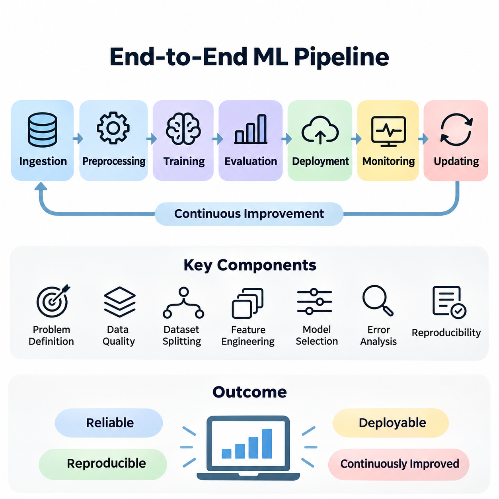
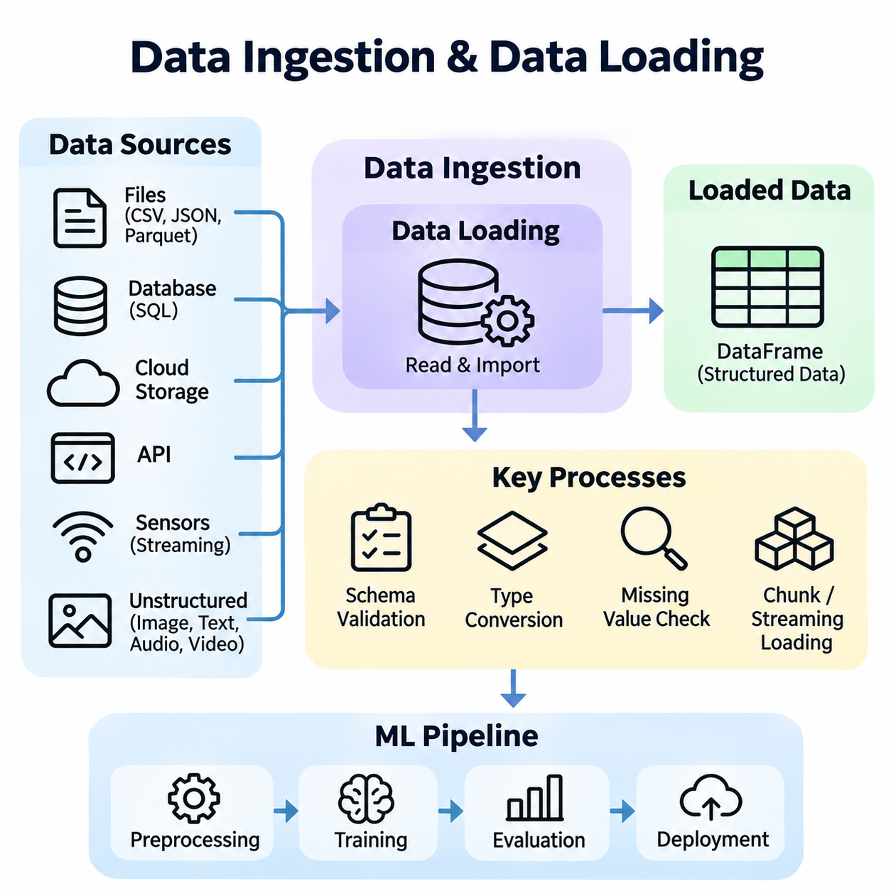
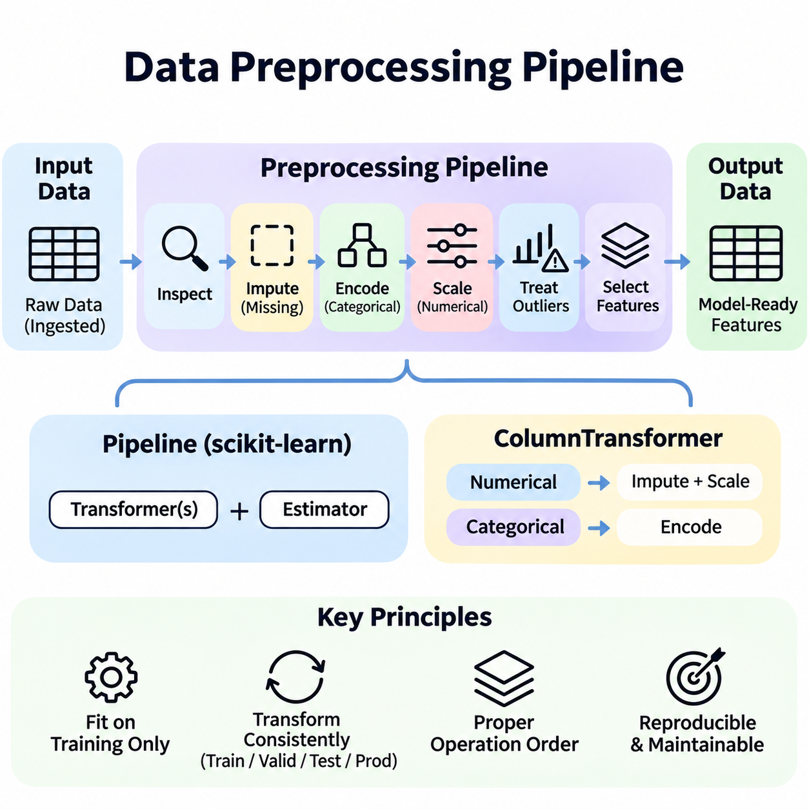
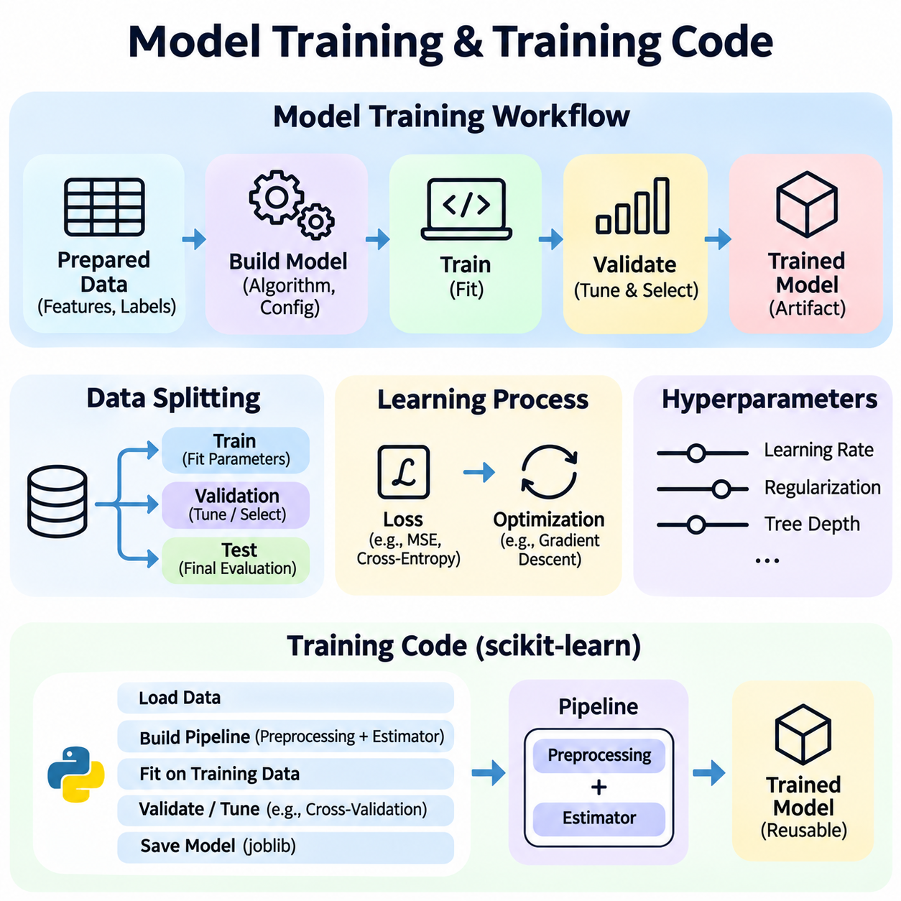
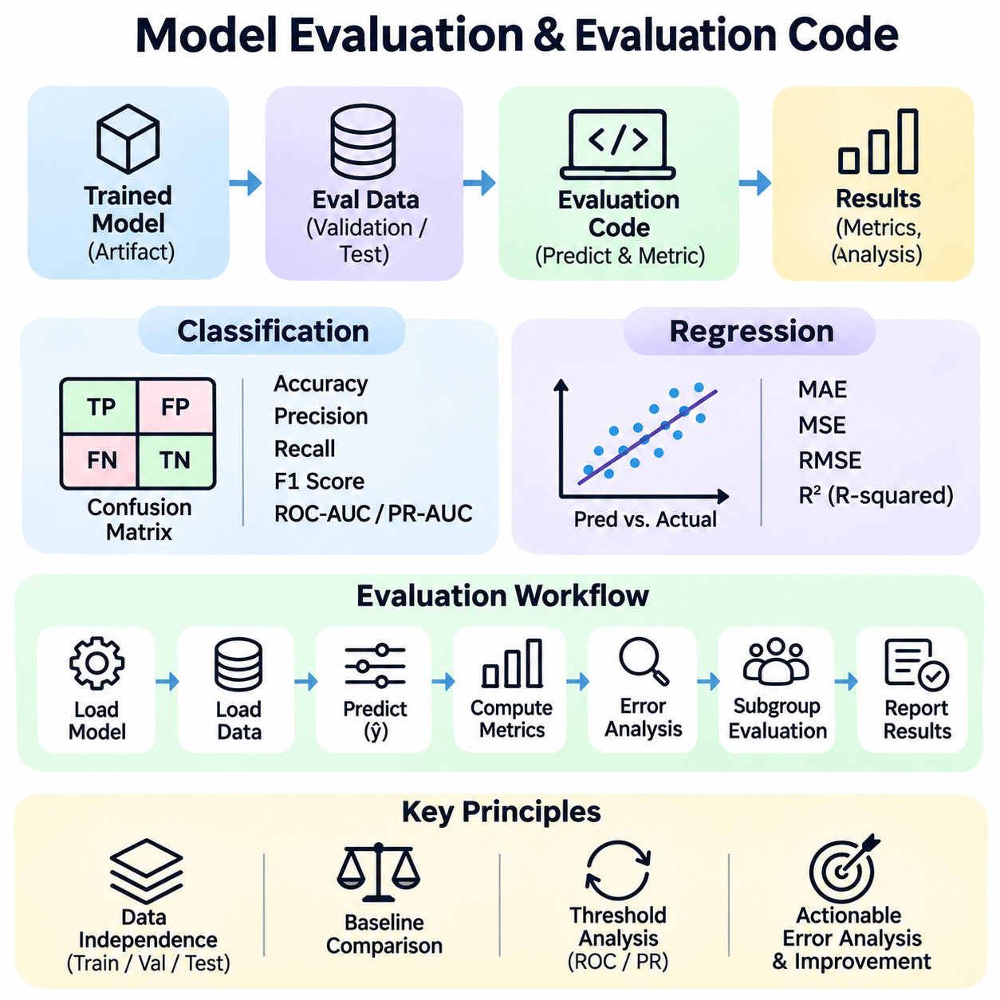
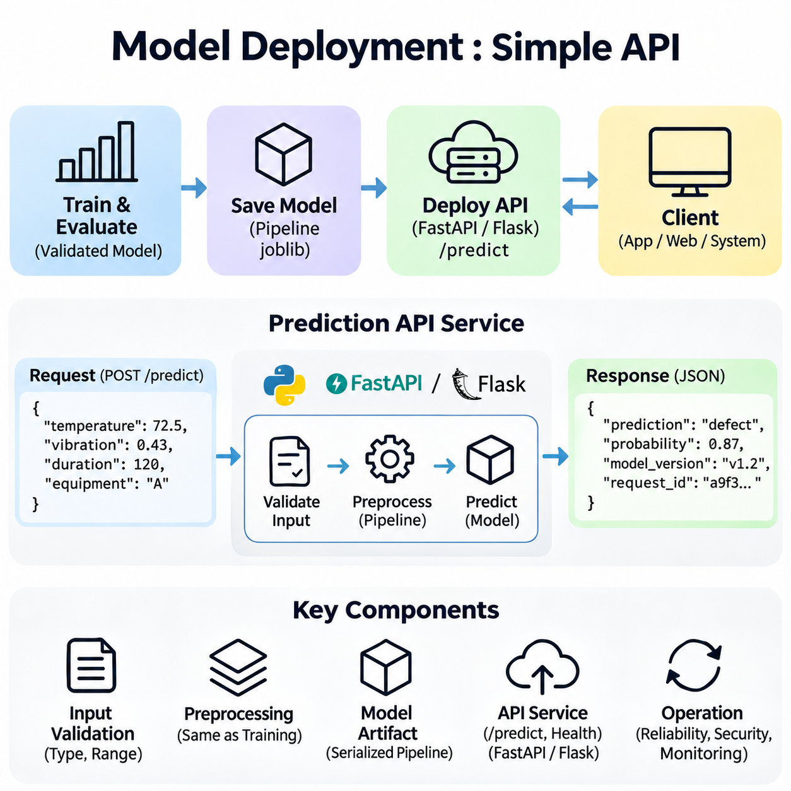
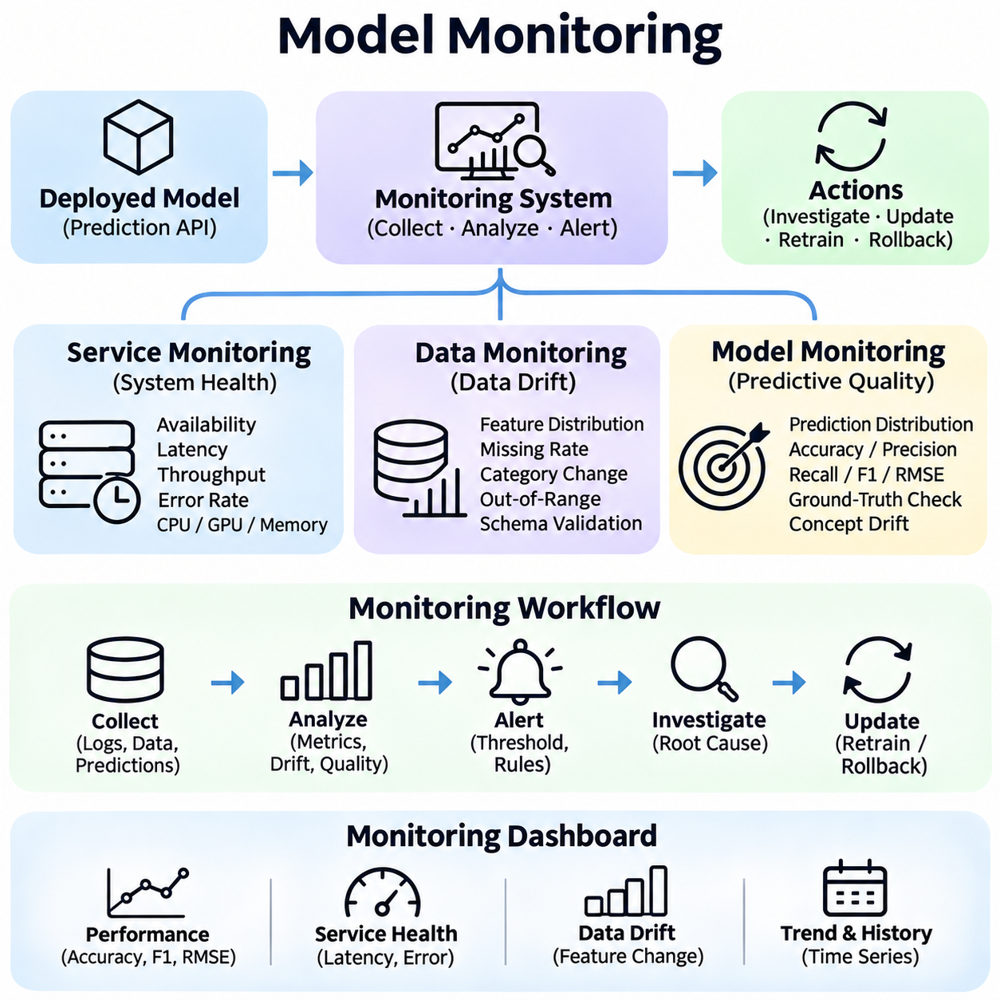
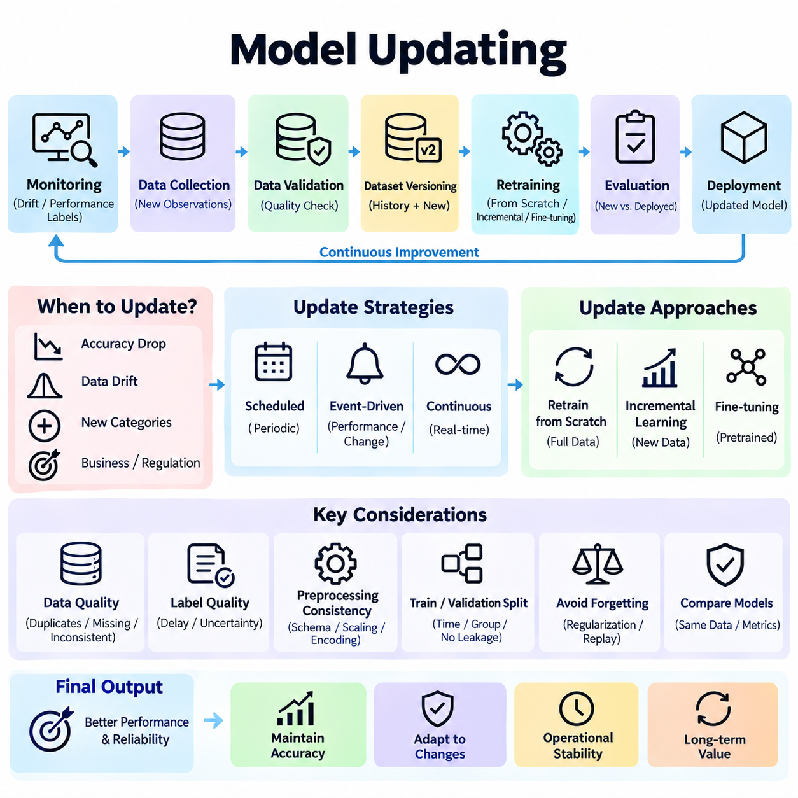
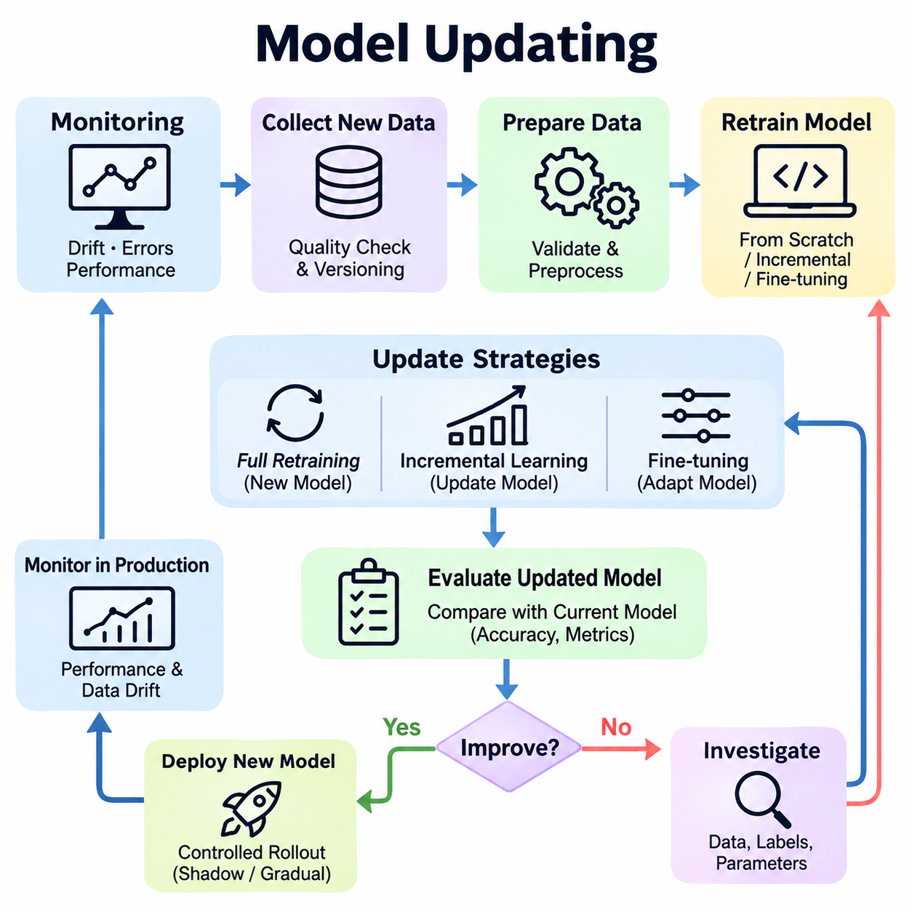
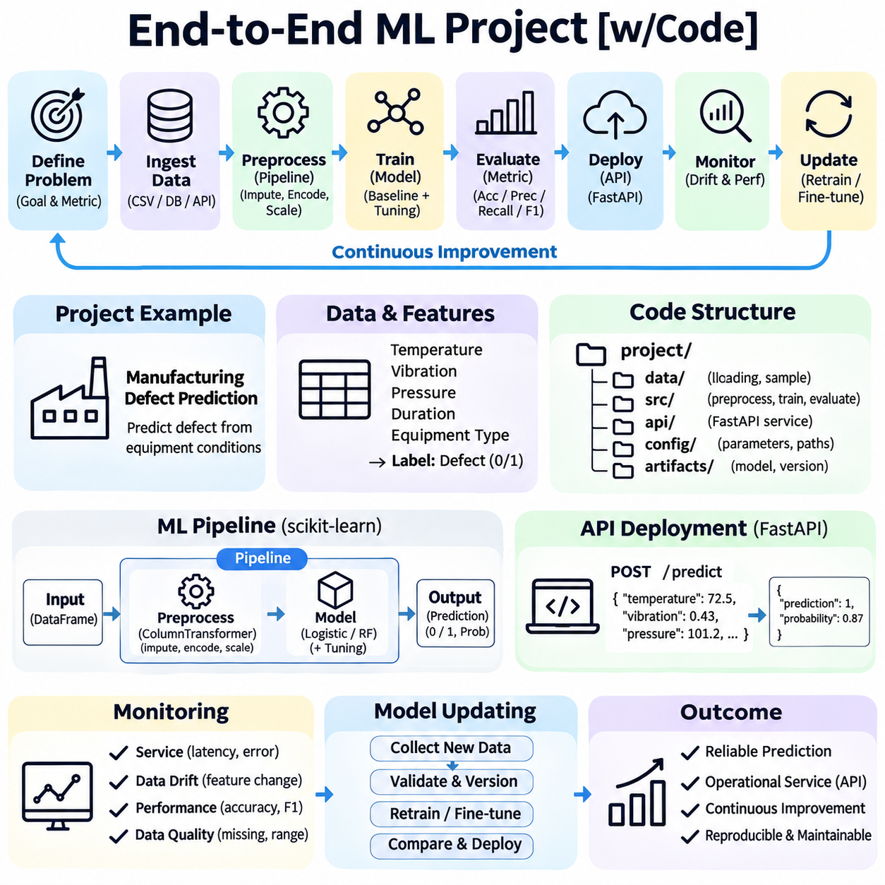

**Volume 07. Machine Learning Fundamentals**


# 06. End to End ML Workflow

## 06.00 ML Pipeline Overview

{width="7.268055555555556in" height="7.268055555555556in"}

An end-to-end machine learning pipeline is a structured workflow that transforms raw data into a deployed predictive system. It connects data ingestion, preprocessing, model training, evaluation, deployment, monitoring, and updating. Rather than treating model development as an isolated experiment, the pipeline organizes these activities into a coordinated process that supports reliability, reproducibility, and continuous improvement.

The primary purpose of an ML pipeline is to ensure that every stage produces outputs that can be consistently consumed by the next stage. Raw observations must become validated datasets, datasets must become suitable model inputs, and trained models must become usable prediction services. Each transformation introduces assumptions, dependencies, and potential errors that must be controlled throughout the system lifecycle.

A machine learning workflow begins with a clearly defined problem and measurable objectives. Developers identify the prediction target, expected inputs, operational constraints, and acceptable performance levels. For example, a manufacturing system may predict defective products from sensor measurements, while a financial application may estimate transaction risk. These requirements determine how the subsequent pipeline stages should operate.

Data ingestion is the process of acquiring information from sources such as databases, files, sensors, application interfaces, and streaming platforms. The ingestion component must handle different formats, collection frequencies, and data volumes. Reliable ingestion also requires schema validation, source identification, timestamp management, and mechanisms for detecting incomplete or corrupted records before downstream processing begins.

After ingestion, raw data typically requires preprocessing to become suitable for machine learning algorithms. Common operations include handling missing values, correcting inconsistent records, encoding categorical variables, scaling numerical features, and removing invalid observations. These transformations should be defined systematically so that training and inference apply compatible processing rules.

Data quality directly influences the reliability of the entire pipeline. Missing measurements, duplicated samples, incorrect labels, and inconsistent feature definitions can produce misleading patterns during training. A well-designed workflow therefore includes explicit quality checks and validation criteria. Detecting data problems early is generally more efficient than attempting to compensate for them through increasingly complex models.

Dataset partitioning establishes the separation between model development and independent performance assessment. Training data supports parameter estimation, validation data supports model selection and tuning, and test data provides a final evaluation. Splitting strategies must reflect the application, particularly when observations contain temporal relationships, repeated entities, or dependencies that could introduce data leakage.

Feature engineering converts available information into representations that learning algorithms can use effectively. Numerical transformations, categorical encoding, aggregation, and domain-specific feature construction may improve predictive performance. Feature selection can also reduce unnecessary complexity. Importantly, feature transformations learned from data must be fitted only on permitted training partitions to preserve evaluation integrity.

Model training uses prepared examples to estimate parameters that minimize a selected objective function. Depending on the problem, the algorithm may perform classification, regression, clustering, or another learning task. Training procedures can involve iterative optimization, regularization, and repeated experiments. The resulting model represents learned relationships rather than a complete production-ready application.

Model selection determines which candidate offers the most appropriate balance of predictive accuracy, complexity, interpretability, and computational requirements. A simple linear model may be preferable when transparency and efficiency are essential, while more expressive models may capture complicated relationships. Validation results guide these decisions without exposing the final test dataset to repeated optimization.

Hyperparameter tuning improves model behavior by adjusting configuration choices such as learning rates, regularization strengths, tree depths, or network dimensions. Grid search, random search, and Bayesian optimization provide different approaches to exploring candidate configurations. Effective tuning requires controlled validation procedures and experiment records so that improvements can be distinguished from random variation.

Model evaluation determines whether a trained system satisfies its intended objectives. Classification applications may use precision, recall, F1 score, or ROC-AUC, while regression applications may use mean absolute error or mean squared error. Metric selection must reflect the consequences of different mistakes. A model with strong aggregate performance may still fail on important minority classes or unusual operating conditions.

Error analysis extends evaluation by examining where and why predictions fail. Developers may investigate incorrect predictions across data sources, operating conditions, demographic groups, or feature ranges. This analysis helps distinguish data-quality problems from modeling limitations. The findings can motivate better labels, additional training examples, revised features, or changes to the selected learning algorithm.

Reproducibility is an essential property of a reliable ML pipeline. Repeated experiments should produce consistent or explainably different results when their inputs and configurations are controlled. Dataset versions, preprocessing definitions, model parameters, random seeds, software dependencies, and evaluation procedures should therefore be recorded. Reproducibility supports debugging, collaboration, auditing, and reliable model updates.

Pipeline automation reduces repetitive manual work and improves consistency between experiments. Automated workflows can execute ingestion, validation, preprocessing, training, and evaluation in a predefined order. Each stage can expose explicit inputs, outputs, and completion conditions. This modular organization makes failures easier to isolate and allows individual components to be improved without rebuilding the entire system.

Model deployment converts an evaluated model into a component accessible to real applications. Deployment may involve a web API, batch prediction service, embedded device, or local inference application. The deployment package must include the trained model and compatible preprocessing logic. Operational requirements such as prediction latency, memory consumption, throughput, and availability influence the deployment architecture.

The distinction between training and inference is particularly important in production systems. Training typically uses historical datasets and may consume substantial computational resources, whereas inference processes new observations under operational constraints. Both environments must maintain compatible feature definitions and transformations. Differences between their processing logic can cause training-serving skew and reduce prediction reliability.

Deployment validation confirms that the integrated application behaves correctly beyond offline model evaluation. Tests may examine input schemas, prediction consistency, response times, error handling, and resource consumption. Integration testing also verifies that data preprocessing and model inference operate together correctly. A successful training experiment does not automatically guarantee that the deployed system will function reliably.

Monitoring begins when the model enters operational use. Production systems should observe service availability, prediction latency, resource utilization, input quality, and prediction distributions. When trustworthy labels become available, monitoring can also measure predictive performance. These observations reveal whether the deployed model continues to satisfy its original requirements under changing real-world conditions.

Data drift occurs when the statistical properties of incoming observations differ from those encountered during development. Concept drift occurs when relationships between inputs and prediction targets change. Both can affect model reliability, although drift does not always imply performance degradation. Monitoring systems should distinguish meaningful distribution changes from ordinary variation and investigate their operational consequences.

Model updating addresses performance degradation, new requirements, or changes in available data. Updates may involve retraining with recent observations, modifying preprocessing rules, selecting alternative algorithms, or revising feature definitions. Every candidate update should undergo appropriate validation before release. Maintaining previous model versions allows controlled comparison and supports rollback when unexpected behavior occurs.

A feedback loop connects production observations to future model development. Prediction errors, newly labeled examples, user feedback, and monitoring results can reveal weaknesses that were not visible during initial training. These findings inform subsequent data collection and experimentation. The pipeline therefore becomes an iterative learning process rather than a sequence that permanently ends after deployment.

Pipeline reliability also depends on clear interfaces between components. Each stage should specify expected input formats, output schemas, validation requirements, and failure conditions. For example, a preprocessing component should not silently accept unexpected feature columns or incompatible data types. Explicit interface contracts reduce hidden dependencies and make the workflow easier to test, maintain, and extend.

Security and governance considerations apply throughout the workflow. Data access controls, sensitive-information handling, model artifact integrity, and operational logging help protect the system. Organizations may also require documentation of dataset origins, model limitations, and deployment decisions. These controls should be integrated into the pipeline rather than introduced only after a model reaches production.

A practical end-to-end project demonstrates how individual components operate as one system. A product-quality prediction application might ingest sensor records, validate measurements, preprocess features, train a classifier, evaluate detection performance, expose predictions through an API, and monitor incoming data. Each stage contributes to the final outcome, and weaknesses in one component can affect the entire application.

The central principle of end-to-end machine learning is that successful predictive systems require more than accurate algorithms. Data quality, reproducible experiments, appropriate evaluation, dependable deployment, and continuous monitoring are equally important. By treating the pipeline as an integrated lifecycle, developers can build machine learning applications that remain maintainable, measurable, and adaptable as real-world requirements evolve.

종단 간 머신러닝 파이프라인(End-to-End Machine Learning Pipeline)은 원시 데이터(Raw Data)를 실제 운영 환경에서 활용할 수 있는 예측 시스템(Predictive System)으로 변환하는 체계적인 작업 흐름(Workflow)이다. 데이터 수집(Data Ingestion), 전처리(Preprocessing), 모델 학습(Model Training), 평가(Evaluation), 배포(Deployment), 모니터링(Monitoring), 업데이트(Updating)를 연결한다. 모델 개발을 독립적인 실험으로 취급하지 않고, 신뢰성(Reliability), 재현성(Reproducibility), 지속적 개선(Continuous Improvement)을 지원하는 통합 프로세스로 구성한다.

머신러닝 파이프라인(ML Pipeline)의 주요 목적은 각 단계에서 생성된 출력(Output)이 다음 단계의 입력(Input)으로 일관되게 전달되도록 보장하는 것이다. 원시 관측 데이터(Raw Observations)는 검증된 데이터셋(Validated Dataset)으로 변환되고, 데이터셋은 모델 입력(Model Input)으로 가공되며, 학습된 모델(Trained Model)은 실제 사용 가능한 예측 서비스(Prediction Service)로 전환되어야 한다. 각 변환 과정에서 발생하는 가정(Assumptions), 의존성(Dependencies), 잠재적 오류(Potential Errors)는 전체 시스템 생명주기(System Lifecycle)에 걸쳐 관리되어야 한다.

머신러닝 작업 흐름(Machine Learning Workflow)은 명확하게 정의된 문제(Problem)와 측정 가능한 목표(Measurable Objectives)에서 시작한다. 개발자는 예측 대상(Prediction Target), 예상 입력(Expected Inputs), 운영 제약조건(Operational Constraints), 허용 가능한 성능 수준(Acceptable Performance Levels)을 식별한다. 예를 들어 제조 시스템(Manufacturing System)은 센서 측정값으로 불량품을 예측하고, 금융 애플리케이션(Financial Application)은 거래 위험(Transaction Risk)을 추정할 수 있다. 이러한 요구사항은 이후 파이프라인 단계의 운영 방식을 결정한다.

데이터 수집(Data Ingestion)은 데이터베이스(Database), 파일(File), 센서(Sensor), 애플리케이션 인터페이스(Application Interface), 스트리밍 플랫폼(Streaming Platform) 등의 원천에서 정보를 확보하는 과정이다. 데이터 수집 구성요소(Ingestion Component)는 서로 다른 형식(Formats), 수집 주기(Collection Frequencies), 데이터 규모(Data Volumes)를 처리해야 한다. 안정적인 데이터 수집을 위해서는 스키마 검증(Schema Validation), 데이터 출처 식별(Source Identification), 타임스탬프 관리(Timestamp Management), 불완전하거나 손상된 레코드(Records)를 탐지하는 메커니즘이 필요하다.

데이터 수집 이후 원시 데이터(Raw Data)는 일반적으로 머신러닝 알고리즘(Machine Learning Algorithm)에 적합하도록 전처리(Preprocessing)를 수행해야 한다. 주요 작업에는 결측값 처리(Missing Value Handling), 불일치 레코드 수정(Inconsistent Record Correction), 범주형 변수 인코딩(Categorical Encoding), 수치형 특성 스케일링(Numerical Feature Scaling), 유효하지 않은 관측값 제거(Invalid Observation Removal)가 포함된다. 이러한 변환은 학습(Training)과 추론(Inference)에서 호환 가능한 처리 규칙이 적용되도록 체계적으로 정의되어야 한다.

데이터 품질(Data Quality)은 전체 파이프라인의 신뢰성(Reliability)에 직접적인 영향을 미친다. 누락된 측정값(Missing Measurements), 중복 샘플(Duplicated Samples), 잘못된 레이블(Incorrect Labels), 일관되지 않은 특성 정의(Inconsistent Feature Definitions)는 학습 과정에서 잘못된 패턴을 형성할 수 있다. 따라서 잘 설계된 작업 흐름에는 명시적인 품질 검사(Quality Checks)와 검증 기준(Validation Criteria)이 포함된다. 데이터 문제를 초기 단계에서 발견하는 것이 복잡한 모델로 문제를 보완하려는 것보다 일반적으로 효율적이다.

데이터셋 분할(Dataset Partitioning)은 모델 개발(Model Development)과 독립적인 성능 평가(Independent Performance Assessment)를 분리한다. 학습 데이터(Training Data)는 매개변수 추정(Parameter Estimation)에 사용되고, 검증 데이터(Validation Data)는 모델 선택(Model Selection)과 튜닝(Tuning)에 활용되며, 테스트 데이터(Test Data)는 최종 평가(Final Evaluation)에 사용된다. 특히 관측값 사이에 시간적 관계(Temporal Relationships), 반복 개체(Repeated Entities), 의존성(Dependencies)이 존재하는 경우 데이터 누출(Data Leakage)을 방지하도록 분할 전략(Splitting Strategy)을 설계해야 한다.

특성 공학(Feature Engineering)은 사용 가능한 정보를 학습 알고리즘(Learning Algorithm)이 효과적으로 활용할 수 있는 표현(Representation)으로 변환한다. 수치 변환(Numerical Transformation), 범주형 인코딩(Categorical Encoding), 집계(Aggregation), 도메인 특화 특성 생성(Domain-Specific Feature Construction)은 예측 성능을 개선할 수 있다. 특성 선택(Feature Selection)은 불필요한 복잡성을 줄이는 데 기여한다. 특히 데이터로부터 학습되는 특성 변환은 평가의 무결성(Evaluation Integrity)을 유지하기 위해 허용된 학습 데이터 분할에서만 적합(Fitting)되어야 한다.

모델 학습(Model Training)은 준비된 학습 예제(Training Examples)를 사용하여 선택한 목적함수(Objective Function)를 최소화하는 매개변수(Parameters)를 추정하는 과정이다. 문제 유형에 따라 분류(Classification), 회귀(Regression), 군집화(Clustering) 또는 다른 학습 작업을 수행할 수 있다. 학습 과정에는 반복적 최적화(Iterative Optimization), 정규화(Regularization), 반복 실험(Repeated Experiments)이 포함될 수 있다. 학습 결과로 생성된 모델은 학습된 관계(Learned Relationships)를 나타내지만, 그 자체로 완성된 운영 애플리케이션(Production-Ready Application)은 아니다.

모델 선택(Model Selection)은 예측 정확도(Predictive Accuracy), 복잡성(Complexity), 해석 가능성(Interpretability), 계산 요구사항(Computational Requirements) 사이에서 가장 적절한 균형을 제공하는 후보 모델을 결정한다. 투명성과 효율성이 중요하다면 단순한 선형 모델(Linear Model)이 적합할 수 있으며, 복잡한 관계를 표현해야 한다면 표현력이 높은 모델(Expressive Model)이 필요할 수 있다. 이러한 결정은 최종 테스트 데이터셋을 반복적인 최적화에 노출하지 않고 검증 결과(Validation Results)를 기반으로 수행해야 한다.

초매개변수 튜닝(Hyperparameter Tuning)은 학습률(Learning Rate), 정규화 강도(Regularization Strength), 트리 깊이(Tree Depth), 신경망 차원(Network Dimensions)과 같은 설정값을 조정하여 모델의 동작을 개선한다. 격자 탐색(Grid Search), 무작위 탐색(Random Search), 베이지안 최적화(Bayesian Optimization)는 후보 설정을 탐색하는 서로 다른 방법이다. 효과적인 튜닝을 위해서는 통제된 검증 절차(Controlled Validation Procedures)와 실험 기록(Experiment Records)이 필요하며, 이를 통해 실제 개선과 무작위 변동(Random Variation)을 구별할 수 있다.

모델 평가(Model Evaluation)는 학습된 시스템이 의도한 목표를 충족하는지 판단하는 과정이다. 분류(Classification)에서는 정밀도(Precision), 재현율(Recall), F1 점수(F1 Score), ROC-AUC 등을 사용할 수 있으며, 회귀(Regression)에서는 평균절대오차(Mean Absolute Error)와 평균제곱오차(Mean Squared Error)를 활용할 수 있다. 평가 지표(Evaluation Metric)는 오류 유형별 결과를 반영해야 한다. 전체 성능이 우수한 모델이라도 중요한 소수 클래스(Minority Classes)나 비정상적인 운영 조건(Unusual Operating Conditions)에서는 실패할 수 있다.

오류 분석(Error Analysis)은 예측이 어디에서, 왜 실패하는지 조사하여 모델 평가를 확장한다. 개발자는 데이터 출처(Data Sources), 운영 조건(Operating Conditions), 인구통계학적 집단(Demographic Groups), 특성 범위(Feature Ranges)에 따른 잘못된 예측을 분석할 수 있다. 이를 통해 데이터 품질 문제(Data Quality Problems)와 모델링 한계(Modeling Limitations)를 구분할 수 있다. 분석 결과는 레이블 개선(Label Improvement), 추가 학습 데이터 확보(Additional Training Examples), 특성 수정(Feature Revision), 학습 알고리즘 변경(Algorithm Modification)으로 이어질 수 있다.

재현성(Reproducibility)은 신뢰할 수 있는 머신러닝 파이프라인의 핵심 속성이다. 입력과 설정이 통제된 상태에서 반복된 실험은 일관된 결과 또는 설명 가능한 차이를 생성해야 한다. 이를 위해 데이터셋 버전(Dataset Version), 전처리 정의(Preprocessing Definition), 모델 매개변수(Model Parameters), 난수 시드(Random Seeds), 소프트웨어 의존성(Software Dependencies), 평가 절차(Evaluation Procedures)를 기록해야 한다. 재현성은 디버깅(Debugging), 협업(Collaboration), 감사(Auditing), 안정적인 모델 업데이트(Model Updating)를 지원한다.

파이프라인 자동화(Pipeline Automation)는 반복적인 수작업을 줄이고 실험 간 일관성(Consistency)을 개선한다. 자동화된 작업 흐름(Automated Workflow)은 데이터 수집, 검증, 전처리, 학습, 평가를 미리 정의된 순서로 실행할 수 있다. 각 단계는 명시적인 입력(Inputs), 출력(Outputs), 완료 조건(Completion Conditions)을 제공할 수 있다. 이러한 모듈식 구성(Modular Organization)은 장애 원인을 쉽게 분리하고 전체 시스템을 다시 구축하지 않고도 개별 구성요소를 개선할 수 있도록 한다.

모델 배포(Model Deployment)는 평가를 완료한 모델을 실제 애플리케이션에서 접근할 수 있는 구성요소로 전환한다. 배포 방식에는 웹 API(Web API), 배치 예측 서비스(Batch Prediction Service), 임베디드 장치(Embedded Device), 로컬 추론 애플리케이션(Local Inference Application) 등이 있다. 배포 패키지(Deployment Package)에는 학습된 모델과 호환 가능한 전처리 로직(Preprocessing Logic)이 포함되어야 한다. 예측 지연시간(Prediction Latency), 메모리 사용량(Memory Consumption), 처리량(Throughput), 가용성(Availability) 등의 운영 요구사항이 배포 아키텍처(Deployment Architecture)를 결정한다.

학습(Training)과 추론(Inference)의 차이는 운영 시스템에서 특히 중요하다. 학습은 일반적으로 과거 데이터셋(Historical Dataset)을 사용하며 상당한 계산 자원(Computational Resources)을 소비할 수 있지만, 추론은 운영 제약조건(Operational Constraints) 아래에서 새로운 관측값을 처리한다. 두 환경은 호환 가능한 특성 정의(Feature Definitions)와 변환(Transformations)을 유지해야 한다. 처리 로직의 차이는 학습-서빙 불일치(Training-Serving Skew)를 발생시켜 예측 신뢰성을 저하시킬 수 있다.

배포 검증(Deployment Validation)은 통합 애플리케이션이 오프라인 모델 평가(Offline Model Evaluation)를 넘어 올바르게 동작하는지 확인한다. 테스트에서는 입력 스키마(Input Schema), 예측 일관성(Prediction Consistency), 응답 시간(Response Time), 오류 처리(Error Handling), 자원 소비(Resource Consumption)를 검사할 수 있다. 통합 테스트(Integration Testing)는 데이터 전처리와 모델 추론이 함께 정확하게 동작하는지도 검증한다. 학습 실험의 성공이 배포 시스템의 안정적인 동작을 자동으로 보장하지는 않는다.

모니터링(Monitoring)은 모델이 실제 운영 환경에 도입되면서 시작된다. 운영 시스템은 서비스 가용성(Service Availability), 예측 지연시간(Prediction Latency), 자원 활용률(Resource Utilization), 입력 데이터 품질(Input Data Quality), 예측 분포(Prediction Distribution)를 관찰해야 한다. 신뢰할 수 있는 레이블(Trustworthy Labels)이 확보되면 예측 성능(Predictive Performance)도 측정할 수 있다. 이러한 관측은 변화하는 실제 환경에서도 배포된 모델이 초기 요구사항을 계속 충족하는지 판단하는 데 활용된다.

데이터 드리프트(Data Drift)는 새롭게 입력되는 관측값의 통계적 특성(Statistical Properties)이 개발 과정에서 사용된 데이터와 달라지는 현상이다. 개념 드리프트(Concept Drift)는 입력과 예측 대상 사이의 관계가 변화하는 현상이다. 두 현상 모두 모델 신뢰성에 영향을 줄 수 있지만, 드리프트가 항상 성능 저하를 의미하지는 않는다. 모니터링 시스템은 의미 있는 분포 변화(Distribution Changes)와 일반적인 변동(Ordinary Variation)을 구별하고 운영상 영향을 조사해야 한다.

모델 업데이트(Model Updating)는 성능 저하(Performance Degradation), 새로운 요구사항(New Requirements), 사용 가능한 데이터의 변화(Data Changes)에 대응한다. 업데이트에는 최근 관측값을 활용한 재학습(Retraining), 전처리 규칙 수정(Preprocessing Rule Modification), 대체 알고리즘 선택(Alternative Algorithm Selection), 특성 정의 변경(Feature Definition Revision)이 포함될 수 있다. 모든 업데이트 후보는 배포 전에 적절한 검증을 거쳐야 한다. 이전 모델 버전(Previous Model Versions)을 유지하면 통제된 비교와 예상치 못한 문제 발생 시 롤백(Rollback)이 가능하다.

피드백 루프(Feedback Loop)는 운영 환경에서 수집된 관측 결과를 향후 모델 개발과 연결한다. 예측 오류(Prediction Errors), 새롭게 레이블이 부여된 예제(Newly Labeled Examples), 사용자 피드백(User Feedback), 모니터링 결과(Monitoring Results)는 초기 학습에서 발견하지 못한 약점을 드러낼 수 있다. 이러한 결과는 후속 데이터 수집(Data Collection)과 실험(Experimentation)에 반영된다. 따라서 파이프라인은 배포 이후 영구적으로 종료되는 순차적 절차가 아니라 반복적인 학습 프로세스(Iterative Learning Process)가 된다.

파이프라인 신뢰성(Pipeline Reliability)은 구성요소 사이의 명확한 인터페이스(Interfaces)에도 의존한다. 각 단계는 예상 입력 형식(Input Formats), 출력 스키마(Output Schemas), 검증 요구사항(Validation Requirements), 실패 조건(Failure Conditions)을 정의해야 한다. 예를 들어 전처리 구성요소(Preprocessing Component)는 예상하지 못한 특성 열(Feature Columns)이나 호환되지 않는 데이터 유형(Data Types)을 경고 없이 허용해서는 안 된다. 명시적인 인터페이스 계약(Interface Contracts)은 숨겨진 의존성을 줄이고 작업 흐름의 테스트, 유지보수, 확장을 용이하게 한다.

보안(Security)과 거버넌스(Governance)는 전체 작업 흐름에 걸쳐 적용되어야 한다. 데이터 접근 제어(Data Access Controls), 민감정보 처리(Sensitive Information Handling), 모델 산출물 무결성(Model Artifact Integrity), 운영 로깅(Operational Logging)은 시스템 보호에 기여한다. 조직에서는 데이터셋 출처(Dataset Origins), 모델 한계(Model Limitations), 배포 결정(Deployment Decisions)에 대한 문서화를 요구할 수도 있다. 이러한 통제는 모델이 운영 환경에 도달한 이후가 아니라 파이프라인 설계 단계부터 통합되어야 한다.

실용적인 종단 간 프로젝트(End-to-End Project)는 개별 구성요소가 하나의 시스템으로 동작하는 방식을 보여준다. 예를 들어 제품 품질 예측 애플리케이션(Product Quality Prediction Application)은 센서 레코드를 수집하고, 측정값을 검증하고, 특성을 전처리하고, 분류기(Classifier)를 학습시키고, 탐지 성능(Detection Performance)을 평가하고, API를 통해 예측 결과를 제공하며, 입력 데이터를 모니터링할 수 있다. 각 단계는 최종 결과에 기여하며, 하나의 구성요소에서 발생한 약점이 전체 애플리케이션에 영향을 미칠 수 있다.

종단 간 머신러닝(End-to-End Machine Learning)의 핵심 원칙은 성공적인 예측 시스템(Predictive System)을 구축하기 위해 정확한 알고리즘(Accurate Algorithm) 이상의 요소가 필요하다는 것이다. 데이터 품질(Data Quality), 재현 가능한 실험(Reproducible Experiments), 적절한 평가(Appropriate Evaluation), 안정적인 배포(Dependable Deployment), 지속적인 모니터링(Continuous Monitoring)은 모두 중요하다. 파이프라인을 통합 생명주기(Integrated Lifecycle)로 관리하면 실제 요구사항이 변화하더라도 유지보수 가능성(Maintainability), 측정 가능성(Measurability), 적응성(Adaptability)을 갖춘 머신러닝 애플리케이션을 구축할 수 있다.

## 06.01 Data Ingestion

{width="7.268055555555556in" height="7.268055555555556in"}

Data ingestion is the process of acquiring information from external sources and making it available for machine learning workflows. Data loading is a fundamental operation within this process, responsible for reading datasets into memory or processing environments. Reliable ingestion ensures that information is accessible, correctly interpreted, and suitable for subsequent preprocessing, training, and evaluation stages.

Machine learning applications obtain data from diverse sources, including local files, relational databases, cloud storage, application programming interfaces, and physical sensors. Each source provides different formats, access methods, and update frequencies. A robust data loading component must accommodate these differences while presenting information through consistent structures that downstream algorithms can process efficiently.

Structured data is commonly stored in formats such as CSV, JSON, Parquet, and database tables. CSV files represent tabular information using delimited records, while JSON supports nested objects and flexible attributes. Parquet provides column-oriented storage with compression and efficient analytical access. Selecting an appropriate format depends on dataset size, schema complexity, interoperability, and expected processing operations.

Unstructured and semi-structured data require specialized loading procedures. Images may be stored as JPEG or PNG files, text may originate from documents or logs, and sensor measurements may arrive as timestamped messages. Audio and video introduce additional decoding requirements. The loading process must preserve essential information such as dimensions, encoding, timestamps, and metadata needed for later processing.

Python provides widely used tools for implementing data loading operations. The pandas library supports reading CSV, JSON, and Parquet datasets into DataFrame objects, while NumPy provides efficient array representations. Database connectors enable SQL queries, and specialized libraries handle images, audio, and tensors. These tools simplify data access but still require careful validation of loaded content.

A basic tabular loading workflow begins by identifying the source location and selecting an appropriate reader. For example, pandas.read_csv can load a CSV file into a DataFrame, automatically interpreting columns and inferring data types. Developers should inspect the resulting dimensions, column names, sample records, and inferred types because automatic interpretation may not always match the intended schema.

File paths and storage locations should be managed through configuration rather than embedded directly throughout application code. Relative paths support portable projects, while absolute paths identify specific locations within an environment. Environment variables and configuration files can define dataset roots. Consistent path management improves reproducibility when workflows move between development machines, servers, and cloud infrastructure.

Schema validation verifies that loaded data follows the expected structural definition. A schema may specify required columns, data types, allowable categories, and numerical constraints. Unexpected changes, such as a missing feature or a numeric field becoming textual, can disrupt model training. Validating schemas immediately after loading helps prevent corrupted or incompatible data from propagating through the pipeline.

Data type management is particularly important when reading information from heterogeneous sources. Numeric values may be interpreted as strings, dates may use inconsistent formats, and categorical identifiers may lose leading zeros. Explicit type conversion reduces ambiguity and prevents incorrect calculations. Timestamp fields should also preserve timezone information when temporal relationships are relevant to the application.

Missing values may appear during loading because of incomplete records, unavailable measurements, or inconsistent file representations. Libraries commonly represent missing information using special values such as NaN or null. The ingestion stage should identify and report missing entries without automatically assuming how they should be corrected. Decisions about imputation, exclusion, or special encoding generally belong to subsequent preprocessing stages.

Large datasets introduce memory and performance constraints that make full in-memory loading impractical. Chunk-based loading processes records in manageable portions rather than reading an entire file at once. Streaming approaches handle continuously arriving observations, while memory mapping can support efficient access to selected data regions. These strategies reduce memory pressure and enable processing beyond available system RAM.

Batch loading and streaming ingestion address different operational requirements. Batch loading retrieves bounded datasets at scheduled intervals or during training preparation. Streaming ingestion continuously processes incoming events from applications, sensors, or message brokers. The appropriate approach depends on data arrival patterns, latency requirements, storage capacity, and whether the application needs immediate or periodic updates.

Database ingestion commonly uses queries to retrieve relevant observations from structured storage systems. SQL queries can filter records, select columns, and perform aggregations before transferring data into the machine learning environment. Query efficiency matters because unnecessarily large transfers increase processing time and resource consumption. Database connections should also be managed securely and released after use.

Application programming interfaces provide another mechanism for obtaining external datasets. API-based ingestion may require authentication, pagination, request parameters, and response parsing. Network interruptions, rate limits, and temporary service failures must be considered. Reliable implementations use controlled retries, timeouts, and validation of returned records to prevent incomplete downloads from silently entering the training pipeline.

Data ingestion should preserve provenance information describing where observations originated and how they were collected. Source identifiers, collection timestamps, dataset versions, and processing records support traceability. Provenance becomes particularly valuable when multiple sources are combined or when unexpected model behavior requires investigation. Without this information, reproducing earlier experiments may become difficult.

Data integrity checks help confirm that loaded information has not been unintentionally altered or truncated. File sizes, record counts, checksums, and expected value ranges provide useful validation signals. For distributed datasets, integrity verification may also examine missing partitions or duplicate files. These checks establish confidence that the data entering preprocessing corresponds to the intended dataset.

Duplicate records can arise from repeated downloads, overlapping database queries, or message delivery retries. Such duplicates may distort training distributions or create misleading evaluation results. Ingestion systems should detect potentially repeated observations using stable identifiers or defined comparison rules. Whether duplicates should be removed depends on their meaning and the requirements of the learning problem.

Combining multiple datasets requires attention to identifiers, schemas, units, and temporal alignment. Two sources may describe the same entity using different naming conventions or measurement units. Joining records without verifying relationships can introduce incorrect associations. A reliable ingestion workflow therefore documents source compatibility and performs controlled integration before producing a unified dataset.

Data loading should maintain a clear distinction between raw information and transformed features. The ingestion stage primarily retrieves, decodes, and validates observations, while preprocessing performs operations such as normalization, encoding, and feature construction. Separating these responsibilities improves modularity and makes errors easier to locate. It also allows raw datasets to be reused with alternative preprocessing strategies.

Error handling is essential because external data sources are not always available or consistent. Loading operations may fail because of missing files, permission restrictions, malformed records, incompatible encodings, or interrupted connections. Robust implementations distinguish recoverable failures from critical errors. Informative logs and explicit failure conditions prevent incomplete datasets from being mistaken for successful ingestion results.

Reproducible ingestion requires recording the source dataset, loading configuration, software environment, and execution conditions. Dataset snapshots or immutable versions can prevent later source changes from altering previous experiments. Deterministic ordering may also matter when downstream operations depend on record sequences. These practices allow developers to reconstruct the exact data inputs used during model development.

Security considerations apply whenever ingestion accesses external systems or sensitive information. Credentials should be protected through secure configuration mechanisms rather than stored directly in source code. Access permissions should follow the principle of least privilege, and data transfers may require encryption. Sensitive records must be handled according to applicable privacy requirements and organizational policies.

An effective ingestion component should expose a consistent interface regardless of the underlying storage technology. For example, a training workflow may receive a validated DataFrame or dataset object whether its records originated from CSV files or database queries. This abstraction reduces coupling between data sources and learning algorithms. It also simplifies testing and future migration to alternative storage systems.

Consider a manufacturing quality prediction application that collects measurements from production equipment. Historical sensor records may be stored in CSV files, while recent observations arrive through a database or streaming service. The ingestion component loads these records, validates measurement fields, checks timestamps, and preserves equipment identifiers. The resulting dataset becomes the foundation for feature preparation and predictive modeling.

Data loading is therefore more than a simple file-reading operation. It establishes the reliability, consistency, and traceability of information entering the machine learning lifecycle. By combining appropriate loading tools, schema validation, integrity checks, scalable processing, and reproducible configurations, developers create a dependable foundation for preprocessing, model training, evaluation, deployment, and continuous improvement.

데이터 수집(Data Ingestion)은 외부 데이터 원천(External Data Sources)에서 정보를 확보하고 이를 머신러닝 작업 흐름(Machine Learning Workflow)에서 사용할 수 있도록 만드는 과정이다. 데이터 로딩(Data Loading)은 이러한 과정의 핵심 작업으로, 데이터셋(Dataset)을 메모리(Memory) 또는 처리 환경(Processing Environment)으로 읽어들이는 역할을 한다. 신뢰할 수 있는 데이터 수집은 정보의 접근성(Accessibility), 정확한 해석(Correct Interpretation), 후속 전처리(Preprocessing), 학습(Training), 평가(Evaluation) 단계에 대한 적합성을 보장한다.

머신러닝 애플리케이션(Machine Learning Application)은 로컬 파일(Local Files), 관계형 데이터베이스(Relational Databases), 클라우드 저장소(Cloud Storage), 애플리케이션 프로그래밍 인터페이스(Application Programming Interfaces), 물리적 센서(Physical Sensors) 등 다양한 원천에서 데이터를 확보한다. 각 원천은 서로 다른 데이터 형식(Data Formats), 접근 방식(Access Methods), 갱신 주기(Update Frequencies)를 제공한다. 견고한 데이터 로딩 구성요소(Data Loading Component)는 이러한 차이를 수용하면서 후속 알고리즘이 효율적으로 처리할 수 있는 일관된 데이터 구조(Data Structures)를 제공해야 한다.

정형 데이터(Structured Data)는 일반적으로 CSV, JSON, Parquet, 데이터베이스 테이블(Database Tables)과 같은 형식으로 저장된다. CSV 파일은 구분자로 분리된 레코드(Delimited Records)를 사용하여 표 형식 정보를 표현하고, JSON은 중첩 객체(Nested Objects)와 유연한 속성(Attributes)을 지원한다. Parquet는 압축(Compression)과 효율적인 분석 접근(Analytical Access)을 제공하는 열 지향 저장 방식(Column-Oriented Storage)을 사용한다. 적절한 형식의 선택은 데이터셋 크기(Dataset Size), 스키마 복잡성(Schema Complexity), 상호운용성(Interoperability), 예상 처리 작업(Processing Operations)에 따라 달라진다.

비정형 데이터(Unstructured Data)와 반정형 데이터(Semi-Structured Data)는 특수한 로딩 절차(Loading Procedures)를 필요로 한다. 이미지는 JPEG 또는 PNG 파일로 저장될 수 있고, 텍스트는 문서(Documents)나 로그(Logs)에서 생성될 수 있으며, 센서 측정값(Sensor Measurements)은 타임스탬프가 포함된 메시지(Timestamped Messages)로 전달될 수 있다. 오디오(Audio)와 비디오(Video)는 추가적인 디코딩(Decoding) 과정이 필요하다. 로딩 과정에서는 이후 처리에 필요한 차원(Dimensions), 인코딩(Encoding), 타임스탬프(Timestamps), 메타데이터(Metadata)와 같은 필수 정보를 보존해야 한다.

파이썬(Python)은 데이터 로딩 작업(Data Loading Operations)을 구현하기 위한 다양한 도구를 제공한다. 판다스(pandas) 라이브러리는 CSV, JSON, Parquet 데이터셋을 데이터프레임(DataFrame) 객체로 읽어들이는 기능을 지원하며, 넘파이(NumPy)는 효율적인 배열 표현(Array Representation)을 제공한다. 데이터베이스 연결 도구(Database Connectors)는 SQL 질의를 지원하고, 특수 라이브러리(Specialized Libraries)는 이미지, 오디오, 텐서(Tensors)를 처리한다. 이러한 도구는 데이터 접근을 단순화하지만, 로딩된 내용에 대한 신중한 검증이 여전히 필요하다.

기본적인 표 형식 데이터 로딩 작업 흐름(Tabular Data Loading Workflow)은 데이터 원천의 위치(Source Location)를 식별하고 적절한 읽기 도구(Reader)를 선택하는 것에서 시작한다. 예를 들어 pandas.read_csv는 CSV 파일을 데이터프레임(DataFrame)으로 읽어들이면서 열(Column)을 자동으로 해석하고 데이터 유형(Data Types)을 추론한다. 그러나 자동 해석이 의도한 스키마(Schema)와 항상 일치하는 것은 아니므로 개발자는 결과 데이터의 차원(Dimensions), 열 이름(Column Names), 샘플 레코드(Sample Records), 추론된 데이터 유형(Inferred Types)을 확인해야 한다.

파일 경로(File Paths)와 저장 위치(Storage Locations)는 애플리케이션 코드(Application Code) 전체에 직접 삽입하기보다 설정(Configuration)을 통해 관리해야 한다. 상대 경로(Relative Paths)는 프로젝트의 이식성(Portability)을 지원하며, 절대 경로(Absolute Paths)는 특정 환경의 정확한 위치를 지정한다. 환경 변수(Environment Variables)와 설정 파일(Configuration Files)을 사용하여 데이터셋 루트(Dataset Roots)를 정의할 수 있다. 일관된 경로 관리(Path Management)는 개발 컴퓨터(Development Machines), 서버(Servers), 클라우드 인프라(Cloud Infrastructure) 사이에서 작업 흐름을 이동할 때 재현성(Reproducibility)을 향상시킨다.

스키마 검증(Schema Validation)은 로딩된 데이터가 예상한 구조적 정의(Structural Definition)를 따르는지 확인한다. 스키마는 필수 열(Required Columns), 데이터 유형(Data Types), 허용 가능한 범주(Allowable Categories), 수치 제약조건(Numerical Constraints)을 지정할 수 있다. 특성(Feature)이 누락되거나 수치 필드(Numeric Field)가 텍스트로 변경되는 등의 예상하지 못한 변화는 모델 학습(Model Training)을 방해할 수 있다. 로딩 직후 스키마를 검증하면 손상되거나 호환되지 않는 데이터가 파이프라인 전체로 전파되는 것을 방지할 수 있다.

데이터 유형 관리(Data Type Management)는 서로 다른 데이터 원천(Heterogeneous Sources)에서 정보를 읽어들일 때 특히 중요하다. 수치값(Numeric Values)이 문자열(Strings)로 해석되거나, 날짜(Date)가 일관되지 않은 형식을 사용하거나, 범주형 식별자(Categorical Identifiers)의 앞자리 0이 손실될 수 있다. 명시적인 유형 변환(Explicit Type Conversion)은 모호성을 줄이고 잘못된 계산을 방지한다. 시간적 관계(Temporal Relationships)가 중요한 애플리케이션에서는 타임스탬프 필드(Timestamp Fields)의 시간대 정보(Timezone Information)도 보존해야 한다.

결측값(Missing Values)은 불완전한 레코드(Incomplete Records), 사용할 수 없는 측정값(Unavailable Measurements), 일관되지 않은 파일 표현(Inconsistent File Representations) 때문에 데이터 로딩 과정에서 나타날 수 있다. 라이브러리는 일반적으로 NaN이나 null과 같은 특수값(Special Values)을 사용하여 누락된 정보를 표현한다. 데이터 수집 단계에서는 결측 항목(Missing Entries)을 식별하고 보고해야 하지만, 이를 어떻게 수정할지 자동으로 가정해서는 안 된다. 결측값 대체(Imputation), 제외(Exclusion), 특수 인코딩(Special Encoding)에 관한 결정은 일반적으로 후속 전처리 단계에서 수행한다.

대규모 데이터셋(Large Datasets)은 메모리(Memory)와 성능(Performance) 제약을 발생시켜 전체 데이터를 한 번에 메모리로 읽어들이는 방식을 비현실적으로 만들 수 있다. 청크 기반 로딩(Chunk-Based Loading)은 전체 파일을 한 번에 읽는 대신 관리 가능한 크기의 부분으로 나누어 레코드를 처리한다. 스트리밍 방식(Streaming Approaches)은 지속적으로 도착하는 관측값을 처리하며, 메모리 매핑(Memory Mapping)은 선택한 데이터 영역에 효율적으로 접근하도록 지원한다. 이러한 전략은 메모리 부담을 줄이고 사용 가능한 시스템 RAM을 초과하는 데이터도 처리할 수 있도록 한다.

배치 로딩(Batch Loading)과 스트리밍 수집(Streaming Ingestion)은 서로 다른 운영 요구사항(Operational Requirements)을 해결한다. 배치 로딩은 예약된 주기(Scheduled Intervals) 또는 학습 준비 과정에서 범위가 정해진 데이터셋(Bounded Datasets)을 가져온다. 스트리밍 수집은 애플리케이션(Applications), 센서(Sensors), 메시지 브로커(Message Brokers)에서 지속적으로 발생하는 이벤트(Events)를 처리한다. 적절한 방식은 데이터 도착 패턴(Data Arrival Patterns), 지연시간 요구사항(Latency Requirements), 저장 용량(Storage Capacity), 즉각적인 갱신 또는 주기적인 갱신의 필요성에 따라 결정된다.

데이터베이스 수집(Database Ingestion)은 일반적으로 질의(Queries)를 사용하여 구조화된 저장 시스템(Structured Storage Systems)에서 관련 관측값을 가져온다. SQL 질의는 머신러닝 환경으로 데이터를 전송하기 전에 레코드를 필터링(Filtering)하고, 열을 선택(Selection)하며, 집계(Aggregation)를 수행할 수 있다. 불필요하게 큰 데이터 전송은 처리 시간(Processing Time)과 자원 소비(Resource Consumption)를 증가시키므로 질의 효율성(Query Efficiency)이 중요하다. 데이터베이스 연결(Database Connections)도 안전하게 관리하고 사용 후 해제해야 한다.

애플리케이션 프로그래밍 인터페이스(Application Programming Interface, API)는 외부 데이터셋을 확보하는 또 다른 방법이다. API 기반 데이터 수집(API-Based Ingestion)에는 인증(Authentication), 페이지네이션(Pagination), 요청 매개변수(Request Parameters), 응답 파싱(Response Parsing)이 필요할 수 있다. 네트워크 중단(Network Interruptions), 요청 속도 제한(Rate Limits), 일시적인 서비스 장애(Temporary Service Failures)도 고려해야 한다. 신뢰할 수 있는 구현은 제어된 재시도(Controlled Retries), 타임아웃(Timeouts), 반환 레코드 검증(Returned Record Validation)을 사용하여 불완전한 다운로드가 학습 파이프라인에 조용히 유입되는 것을 방지한다.

데이터 수집은 관측값이 어디에서 생성되었고 어떻게 수집되었는지를 설명하는 데이터 출처 정보(Data Provenance)를 보존해야 한다. 원천 식별자(Source Identifiers), 수집 타임스탬프(Collection Timestamps), 데이터셋 버전(Dataset Versions), 처리 기록(Processing Records)은 추적 가능성(Traceability)을 지원한다. 데이터 출처 정보는 여러 원천을 결합하거나 예상하지 못한 모델 동작(Model Behavior)을 조사할 때 특히 유용하다. 이러한 정보가 없다면 이전 실험을 재현하는 것이 어려워질 수 있다.

데이터 무결성 검사(Data Integrity Checks)는 로딩된 정보가 의도하지 않게 변경되거나 잘리지 않았는지 확인하는 데 도움을 준다. 파일 크기(File Sizes), 레코드 수(Record Counts), 체크섬(Checksums), 예상 값 범위(Expected Value Ranges)는 유용한 검증 신호(Validation Signals)를 제공한다. 분산 데이터셋(Distributed Datasets)의 경우 누락된 파티션(Missing Partitions)이나 중복 파일(Duplicate Files)도 검사할 수 있다. 이러한 검사는 전처리 단계로 전달되는 데이터가 의도한 데이터셋과 일치한다는 신뢰를 형성한다.

중복 레코드(Duplicate Records)는 반복 다운로드(Repeated Downloads), 중첩된 데이터베이스 질의(Overlapping Database Queries), 메시지 전달 재시도(Message Delivery Retries)로 인해 발생할 수 있다. 이러한 중복은 학습 분포(Training Distributions)를 왜곡하거나 잘못된 평가 결과(Misleading Evaluation Results)를 생성할 수 있다. 데이터 수집 시스템은 안정적인 식별자(Stable Identifiers) 또는 정의된 비교 규칙(Comparison Rules)을 사용하여 반복된 관측값을 탐지해야 한다. 중복 제거(Deduplication) 여부는 해당 데이터의 의미와 학습 문제(Learning Problem)의 요구사항에 따라 결정된다.

여러 데이터셋을 결합할 때는 식별자(Identifiers), 스키마(Schemas), 측정 단위(Units), 시간적 정렬(Temporal Alignment)에 주의해야 한다. 두 데이터 원천은 동일한 개체(Entity)를 서로 다른 명명 규칙(Naming Conventions)이나 측정 단위(Measurement Units)로 표현할 수 있다. 관계를 검증하지 않고 레코드를 결합(Joining)하면 잘못된 연관 관계(Incorrect Associations)가 발생할 수 있다. 따라서 신뢰할 수 있는 데이터 수집 작업 흐름은 데이터 원천의 호환성(Source Compatibility)을 문서화하고, 통합 데이터셋(Unified Dataset)을 생성하기 전에 통제된 데이터 통합(Controlled Integration)을 수행한다.

데이터 로딩은 원시 정보(Raw Information)와 변환된 특성(Transformed Features)을 명확하게 구분해야 한다. 데이터 수집 단계는 주로 관측값을 가져오고, 디코딩(Decoding)하고, 검증(Validation)하는 역할을 수행하며, 전처리 단계는 정규화(Normalization), 인코딩(Encoding), 특성 생성(Feature Construction) 등의 작업을 수행한다. 이러한 책임 분리(Separation of Responsibilities)는 모듈성(Modularity)을 개선하고 오류 위치를 쉽게 파악하도록 한다. 또한 원시 데이터셋을 서로 다른 전처리 전략(Preprocessing Strategies)에 재사용할 수 있도록 한다.

오류 처리(Error Handling)는 외부 데이터 원천이 항상 사용 가능하거나 일관된 상태를 유지하지는 않기 때문에 필수적이다. 데이터 로딩은 파일 누락(Missing Files), 접근 권한 제한(Permission Restrictions), 잘못된 형식의 레코드(Malformed Records), 호환되지 않는 인코딩(Incompatible Encodings), 연결 중단(Interrupted Connections)으로 실패할 수 있다. 견고한 구현은 복구 가능한 오류(Recoverable Failures)와 치명적인 오류(Critical Errors)를 구분한다. 유용한 로그(Informative Logs)와 명시적인 실패 조건(Explicit Failure Conditions)은 불완전한 데이터셋이 성공적으로 수집된 것으로 잘못 판단되는 상황을 방지한다.

재현 가능한 데이터 수집(Reproducible Ingestion)을 위해서는 원본 데이터셋(Source Dataset), 로딩 설정(Loading Configuration), 소프트웨어 환경(Software Environment), 실행 조건(Execution Conditions)을 기록해야 한다. 데이터셋 스냅샷(Dataset Snapshots)이나 불변 버전(Immutable Versions)은 이후 원본 데이터의 변경이 이전 실험에 영향을 미치는 것을 방지할 수 있다. 후속 작업이 레코드 순서(Record Sequences)에 의존하는 경우 결정적 순서(Deterministic Ordering)도 중요하다. 이러한 방법은 개발자가 모델 개발에 사용된 정확한 데이터 입력을 재구성할 수 있도록 한다.

보안 고려사항(Security Considerations)은 데이터 수집이 외부 시스템이나 민감정보(Sensitive Information)에 접근할 때 적용된다. 인증정보(Credentials)는 소스 코드(Source Code)에 직접 저장하지 않고 안전한 설정 메커니즘(Secure Configuration Mechanisms)을 통해 보호해야 한다. 접근 권한(Access Permissions)은 최소 권한 원칙(Principle of Least Privilege)을 따라야 하며, 데이터 전송(Data Transfers)에는 암호화(Encryption)가 필요할 수 있다. 민감한 레코드는 관련 개인정보 보호 요구사항(Privacy Requirements)과 조직 정책(Organizational Policies)에 따라 처리해야 한다.

효과적인 데이터 수집 구성요소(Ingestion Component)는 기반 저장 기술(Underlying Storage Technology)과 관계없이 일관된 인터페이스(Consistent Interface)를 제공해야 한다. 예를 들어 학습 작업 흐름(Training Workflow)은 레코드가 CSV 파일에서 생성되었는지 데이터베이스 질의에서 생성되었는지와 관계없이 검증된 데이터프레임(Validated DataFrame)이나 데이터셋 객체(Dataset Object)를 전달받을 수 있다. 이러한 추상화(Abstraction)는 데이터 원천과 학습 알고리즘 사이의 결합도(Coupling)를 줄이고, 테스트와 다른 저장 시스템으로의 마이그레이션(Migration)을 단순화한다.

제조 품질 예측 애플리케이션(Manufacturing Quality Prediction Application)이 생산 설비(Production Equipment)에서 측정값을 수집하는 상황을 고려할 수 있다. 과거 센서 레코드(Historical Sensor Records)는 CSV 파일에 저장되고, 최근 관측값(Recent Observations)은 데이터베이스나 스트리밍 서비스(Streaming Service)를 통해 전달될 수 있다. 데이터 수집 구성요소는 이러한 레코드를 로딩하고, 측정 필드(Measurement Fields)를 검증하며, 타임스탬프(Timestamps)를 확인하고, 설비 식별자(Equipment Identifiers)를 보존한다. 이렇게 생성된 데이터셋은 특성 준비(Feature Preparation)와 예측 모델링(Predictive Modeling)의 기반이 된다.

따라서 데이터 로딩(Data Loading)은 단순히 파일을 읽어들이는 작업 이상의 의미를 갖는다. 데이터 로딩은 머신러닝 생명주기(Machine Learning Lifecycle)에 입력되는 정보의 신뢰성(Reliability), 일관성(Consistency), 추적 가능성(Traceability)을 확립한다. 적절한 로딩 도구(Loading Tools), 스키마 검증(Schema Validation), 무결성 검사(Integrity Checks), 확장 가능한 처리(Scalable Processing), 재현 가능한 설정(Reproducible Configurations)을 결합하면 전처리(Preprocessing), 모델 학습(Model Training), 평가(Evaluation), 배포(Deployment), 지속적 개선(Continuous Improvement)을 위한 안정적인 기반을 구축할 수 있다.

## 06.02 Data Preprocessing

{width="7.268055555555556in" height="7.268055555555556in"}

Data preprocessing is the process of transforming raw observations into consistent, reliable, and model-ready representations. It connects data ingestion with model training by correcting data quality problems and preparing features for learning algorithms. A preprocessing pipeline organizes these transformations into a reproducible sequence, ensuring that identical rules can be applied during training, validation, testing, and production inference.

A preprocessing pipeline consists of connected operations that transform an input dataset into a structured output. Typical operations include missing-value handling, categorical encoding, numerical scaling, outlier treatment, and feature selection. Each operation performs a defined transformation, and its output becomes the input of the next operation. This modular structure improves consistency, maintainability, and experimental reproducibility.

The first responsibility of preprocessing is to inspect the characteristics of incoming data. Developers examine feature types, missing-value distributions, numerical ranges, categorical frequencies, and unexpected records. This initial assessment identifies transformations required by the selected learning algorithm. It also reveals potential data quality problems that could otherwise produce misleading patterns during training.

Missing-value handling addresses incomplete observations caused by sensor failures, unavailable information, or inconsistent collection procedures. Numerical features may be filled using training-set means or medians, while categorical features may use the most frequent category or an explicit missing indicator. The appropriate strategy depends on the meaning of missingness and the assumptions of the learning problem.

Categorical encoding converts symbolic values into numerical representations that machine learning algorithms can process. One-hot encoding creates binary indicators for categories, while ordinal encoding assigns numerical identifiers. Ordinal values should not imply meaningful ordering unless such relationships exist. Encoding rules must also define how previously unseen categories are handled during validation and production inference.

Numerical scaling adjusts feature magnitudes to improve compatibility with algorithms sensitive to measurement scales. Standardization transforms values using a mean and standard deviation, while min-max scaling maps values into a specified range. Scaling is especially relevant for distance-based methods and regularized optimization. Tree-based algorithms generally require less scaling because their splits depend primarily on feature ordering.

Outlier treatment addresses observations that differ substantially from typical data patterns. Extreme values may represent measurement errors, rare but valid events, or important anomalies. Possible treatments include clipping, robust scaling, transformation, and exclusion when justified. Removing unusual observations without understanding their origin can eliminate valuable information and reduce the model\'s ability to handle rare operating conditions.

Feature transformation can improve the representation of complex relationships within data. Logarithmic transformations may reduce positive skew, polynomial features can express nonlinear interactions, and aggregation can summarize repeated observations. Domain-specific transformations may incorporate physical units, temporal patterns, or operational knowledge. Every transformation should preserve the intended meaning of the underlying information.

Feature selection reduces the number of inputs by removing irrelevant, redundant, or unstable variables. Statistical filtering, model-based importance measures, and recursive selection are common approaches. Reducing unnecessary features may improve computational efficiency and generalization. However, feature selection must be performed within the training procedure rather than using information from independent evaluation datasets.

The order of preprocessing operations can influence the resulting feature representation. For example, missing values often need to be handled before scaling, while categorical encoding may expand a single input column into multiple numerical features. Some transformations can operate independently, whereas others require specific preceding steps. Pipeline design should make these dependencies explicit and test their compatibility.

A critical principle is that preprocessing parameters must be learned exclusively from the appropriate training data. Means, standard deviations, category vocabularies, and selected features are examples of fitted preprocessing state. Applying statistics calculated from validation or test data introduces data leakage. Such leakage can produce artificially optimistic evaluation results that do not reflect performance on unseen observations.

The distinction between fitting and transforming is central to reusable preprocessing pipelines. Fitting estimates transformation parameters from training observations, while transforming applies those parameters to a dataset. During validation and testing, the pipeline should transform data using previously fitted parameters without recalculating them. Production inference must follow the same principle to maintain consistency.

Scikit-learn provides the Pipeline abstraction for combining preprocessing operations and estimators into a unified workflow. Each intermediate component typically implements fit and transform methods, while the final estimator performs learning or prediction. A pipeline can therefore be trained and evaluated as a single object. This design reduces manual processing errors and supports reproducible experimentation.

ColumnTransformer extends pipeline construction by applying different transformations to selected feature groups. Numerical columns may receive imputation and standardization, while categorical columns receive imputation and one-hot encoding. Their transformed outputs are combined into a single feature representation. This approach is particularly useful for tabular datasets containing heterogeneous feature types.

For example, a manufacturing dataset may contain temperature, vibration, equipment type, and operating duration. A preprocessing pipeline could replace missing numerical measurements with medians, standardize continuous variables, and encode equipment categories. The resulting feature matrix becomes suitable for a classification model predicting product defects. The same transformations must be applied to future production measurements.

Pipeline integration simplifies model comparison because different estimators can share a consistent preprocessing procedure. Logistic regression, support vector machines, and ensemble models can be evaluated using compatible feature definitions. However, preprocessing requirements may differ across algorithms. A well-designed experiment therefore allows appropriate transformations to vary while preserving fair evaluation conditions.

Cross-validation requires special attention because preprocessing must be fitted separately within each training fold. If scaling, imputation, or feature selection is performed before splitting the complete dataset into folds, information may leak across evaluation boundaries. Encapsulating transformations inside a pipeline allows cross-validation tools to refit preprocessing correctly for each fold.

Hyperparameter optimization can include preprocessing choices alongside model parameters. Developers may compare scaling methods, imputation strategies, feature selection thresholds, and estimator configurations. Grid search and randomized search can evaluate these combinations through validation procedures. Treating preprocessing as part of the model configuration encourages systematic experimentation rather than arbitrary manual adjustments.

Preprocessing pipelines should also validate input schemas before applying transformations. Required feature names, expected data types, allowable ranges, and categorical values should be checked. Unexpected changes may indicate upstream ingestion problems or modifications to the production environment. Explicit validation prevents incompatible inputs from silently producing unreliable predictions.

Reproducibility requires preserving both the fitted preprocessing components and their configuration. A trained model depends on the transformations used to construct its feature representation. Saving only the estimator without its associated preprocessing state can make predictions inconsistent or impossible. Versioned pipeline artifacts should therefore include transformation parameters, feature ordering, and relevant software dependencies.

Efficiency becomes important when preprocessing large datasets or serving predictions under latency constraints. Vectorized operations, sparse representations, batch processing, and caching can reduce computational overhead. Expensive transformations may be performed during dataset preparation when appropriate. Production pipelines should balance transformation complexity against memory usage, throughput, and response-time requirements.

Monitoring preprocessing behavior helps identify changes in incoming data. Increasing missing-value rates, unseen categories, abnormal numerical ranges, or schema modifications may indicate data drift or upstream failures. Monitoring should distinguish legitimate environmental changes from corrupted observations. These signals can trigger investigation, data collection improvements, or controlled pipeline updates.

Error handling is necessary because preprocessing assumptions may fail when encountering unexpected inputs. A categorical encoder may receive unknown values, a numerical transformer may encounter invalid strings, or a required feature may be absent. Robust pipelines define explicit responses such as controlled fallback behavior, validation errors, or rejection of incompatible records rather than silently generating incorrect features.

A complete preprocessing pipeline establishes a dependable interface between raw datasets and learning algorithms. It transforms heterogeneous observations into consistent feature representations while controlling data leakage and preserving fitted parameters. By integrating validation, modular transformations, reproducibility, and operational monitoring, preprocessing becomes a reusable component supporting reliable training, evaluation, deployment, and model updating.

데이터 전처리(Data Preprocessing)는 원시 관측값(Raw Observations)을 일관되고 신뢰할 수 있으며 모델에 적합한 표현(Model-Ready Representations)으로 변환하는 과정이다. 데이터 수집(Data Ingestion)과 모델 학습(Model Training)을 연결하면서 데이터 품질 문제(Data Quality Problems)를 수정하고 학습 알고리즘(Learning Algorithms)에 필요한 특성(Features)을 준비한다. 전처리 파이프라인(Preprocessing Pipeline)은 이러한 변환을 재현 가능한 순서(Reproducible Sequence)로 구성하여 학습(Training), 검증(Validation), 테스트(Testing), 운영 추론(Production Inference)에서 동일한 규칙이 적용되도록 보장한다.

전처리 파이프라인(Preprocessing Pipeline)은 입력 데이터셋(Input Dataset)을 구조화된 출력(Structured Output)으로 변환하는 연결된 작업들로 구성된다. 일반적인 작업에는 결측값 처리(Missing-Value Handling), 범주형 인코딩(Categorical Encoding), 수치형 스케일링(Numerical Scaling), 이상치 처리(Outlier Treatment), 특성 선택(Feature Selection)이 포함된다. 각 작업은 정의된 변환(Transformation)을 수행하며, 그 출력은 다음 작업의 입력이 된다. 이러한 모듈식 구조(Modular Structure)는 일관성(Consistency), 유지보수성(Maintainability), 실험 재현성(Experimental Reproducibility)을 향상시킨다.

전처리의 첫 번째 책임은 입력 데이터(Incoming Data)의 특성을 조사하는 것이다. 개발자는 특성 유형(Feature Types), 결측값 분포(Missing-Value Distributions), 수치 범위(Numerical Ranges), 범주별 빈도(Categorical Frequencies), 예상하지 못한 레코드(Unexpected Records)를 분석한다. 이러한 초기 평가(Initial Assessment)는 선택한 학습 알고리즘에 필요한 변환을 식별한다. 또한 학습 과정에서 잘못된 패턴(Misleading Patterns)을 생성할 수 있는 잠재적인 데이터 품질 문제(Data Quality Problems)를 발견하는 데 도움을 준다.

결측값 처리(Missing-Value Handling)는 센서 장애(Sensor Failures), 정보 부재(Unavailable Information), 일관되지 않은 수집 절차(Inconsistent Collection Procedures)로 인해 발생하는 불완전한 관측값(Incomplete Observations)을 다룬다. 수치형 특성(Numerical Features)은 학습 데이터의 평균(Mean)이나 중앙값(Median)으로 대체할 수 있으며, 범주형 특성(Categorical Features)은 최빈 범주(Most Frequent Category) 또는 명시적인 결측 표시자(Missing Indicator)를 사용할 수 있다. 적절한 전략은 결측의 의미(Meaning of Missingness)와 학습 문제의 가정(Assumptions)에 따라 결정된다.

범주형 인코딩(Categorical Encoding)은 기호형 값(Symbolic Values)을 머신러닝 알고리즘이 처리할 수 있는 수치 표현(Numerical Representations)으로 변환한다. 원-핫 인코딩(One-Hot Encoding)은 범주별 이진 표시자(Binary Indicators)를 생성하며, 순서형 인코딩(Ordinal Encoding)은 수치 식별자(Numerical Identifiers)를 할당한다. 실제로 순서 관계가 존재하지 않는다면 순서형 값이 의미 있는 순서를 암시해서는 안 된다. 또한 인코딩 규칙은 검증 및 운영 추론 과정에서 이전에 관측되지 않은 범주(Unseen Categories)를 처리하는 방법을 정의해야 한다.

수치형 스케일링(Numerical Scaling)은 측정 척도(Measurement Scales)에 민감한 알고리즘과의 호환성을 높이기 위해 특성값의 크기를 조정한다. 표준화(Standardization)는 평균(Mean)과 표준편차(Standard Deviation)를 사용하여 값을 변환하며, 최소-최대 스케일링(Min-Max Scaling)은 값을 지정된 범위(Specified Range)로 변환한다. 스케일링은 거리 기반 방법(Distance-Based Methods)과 정규화된 최적화(Regularized Optimization)에서 특히 중요하다. 트리 기반 알고리즘(Tree-Based Algorithms)은 분할이 주로 특성값의 순서(Feature Ordering)에 의존하므로 일반적으로 스케일링의 필요성이 낮다.

이상치 처리(Outlier Treatment)는 일반적인 데이터 패턴(Typical Data Patterns)과 크게 다른 관측값을 다룬다. 극단값(Extreme Values)은 측정 오류(Measurement Errors), 드물지만 유효한 사건(Rare but Valid Events), 중요한 이상 현상(Important Anomalies)을 나타낼 수 있다. 가능한 처리 방법에는 값 제한(Clipping), 강건한 스케일링(Robust Scaling), 변환(Transformation), 정당한 근거가 있는 경우의 제외(Exclusion)가 포함된다. 발생 원인을 이해하지 않고 비정상적인 관측값을 제거하면 중요한 정보가 손실되고 드문 운영 조건에 대한 모델의 대응 능력이 감소할 수 있다.

특성 변환(Feature Transformation)은 데이터에 존재하는 복잡한 관계(Complex Relationships)의 표현을 개선할 수 있다. 로그 변환(Logarithmic Transformation)은 양의 왜도(Positive Skew)를 줄일 수 있고, 다항 특성(Polynomial Features)은 비선형 상호작용(Nonlinear Interactions)을 표현할 수 있으며, 집계(Aggregation)는 반복된 관측값(Repeated Observations)을 요약할 수 있다. 도메인 특화 변환(Domain-Specific Transformations)은 물리적 단위(Physical Units), 시간적 패턴(Temporal Patterns), 운영 지식(Operational Knowledge)을 반영할 수 있다. 모든 변환은 원본 정보의 의도된 의미를 보존해야 한다.

특성 선택(Feature Selection)은 관련성이 낮거나 중복되거나 불안정한 변수(Irrelevant, Redundant, or Unstable Variables)를 제거하여 입력 수를 줄인다. 통계적 필터링(Statistical Filtering), 모델 기반 중요도 측정(Model-Based Importance Measures), 재귀적 특성 선택(Recursive Feature Selection)은 일반적인 접근법이다. 불필요한 특성을 줄이면 계산 효율성(Computational Efficiency)과 일반화 성능(Generalization)을 개선할 수 있다. 그러나 특성 선택은 독립적인 평가 데이터셋(Independent Evaluation Datasets)의 정보를 사용하지 않고 학습 절차 내부에서 수행해야 한다.

전처리 작업의 순서(Order of Preprocessing Operations)는 최종 특성 표현(Feature Representation)에 영향을 줄 수 있다. 예를 들어 결측값은 스케일링 전에 처리해야 하는 경우가 많으며, 범주형 인코딩은 하나의 입력 열(Input Column)을 여러 수치형 특성으로 확장할 수 있다. 일부 변환은 독립적으로 수행할 수 있지만, 다른 변환은 특정 선행 단계(Preceding Steps)를 필요로 한다. 파이프라인 설계(Pipeline Design)는 이러한 의존성(Dependencies)을 명확하게 정의하고 구성요소 간 호환성(Compatibility)을 검증해야 한다.

핵심 원칙은 전처리 매개변수(Preprocessing Parameters)를 적절한 학습 데이터(Training Data)에서만 학습해야 한다는 것이다. 평균(Means), 표준편차(Standard Deviations), 범주 어휘집(Category Vocabularies), 선택된 특성(Selected Features)은 학습을 통해 결정되는 전처리 상태(Fitted Preprocessing State)의 예이다. 검증 데이터(Validation Data)나 테스트 데이터(Test Data)에서 계산한 통계값을 사용하면 데이터 누출(Data Leakage)이 발생한다. 이러한 누출은 실제 미관측 데이터(Unseen Observations)에 대한 성능을 반영하지 못하는 과도하게 낙관적인 평가 결과(Artificially Optimistic Evaluation Results)를 생성할 수 있다.

적합(Fitting)과 변환(Transforming)의 구분은 재사용 가능한 전처리 파이프라인(Reusable Preprocessing Pipeline)의 핵심이다. 적합은 학습 관측값(Training Observations)으로부터 변환 매개변수(Transformation Parameters)를 추정하는 과정이며, 변환은 해당 매개변수를 데이터셋에 적용하는 과정이다. 검증과 테스트에서는 매개변수를 다시 계산하지 않고 이전에 적합된 매개변수를 사용하여 데이터를 변환해야 한다. 운영 추론(Production Inference)에서도 일관성을 유지하기 위해 동일한 원칙을 적용해야 한다.

사이킷런(Scikit-learn)은 전처리 작업과 추정기(Estimators)를 하나의 작업 흐름으로 결합하기 위한 파이프라인 추상화(Pipeline Abstraction)를 제공한다. 각 중간 구성요소(Intermediate Component)는 일반적으로 fit 및 transform 메서드(Methods)를 구현하며, 최종 추정기(Final Estimator)는 학습 또는 예측을 수행한다. 따라서 파이프라인 전체를 하나의 객체(Object)로 학습하고 평가할 수 있다. 이러한 설계는 수동 처리 오류(Manual Processing Errors)를 줄이고 재현 가능한 실험(Reproducible Experimentation)을 지원한다.

열 변환기(ColumnTransformer)는 선택된 특성 그룹(Feature Groups)에 서로 다른 변환을 적용하여 파이프라인 구성을 확장한다. 수치형 열(Numerical Columns)에는 결측값 대체(Imputation)와 표준화(Standardization)를 적용하고, 범주형 열(Categorical Columns)에는 결측값 대체와 원-핫 인코딩(One-Hot Encoding)을 적용할 수 있다. 변환된 출력은 하나의 특성 표현(Feature Representation)으로 결합된다. 이러한 접근법은 서로 다른 특성 유형(Heterogeneous Feature Types)이 포함된 표 형식 데이터셋(Tabular Datasets)에서 특히 유용하다.

예를 들어 제조 데이터셋(Manufacturing Dataset)에는 온도(Temperature), 진동(Vibration), 설비 유형(Equipment Type), 작동 시간(Operating Duration)이 포함될 수 있다. 전처리 파이프라인은 누락된 수치 측정값을 중앙값(Median)으로 대체하고, 연속형 변수(Continuous Variables)를 표준화하며, 설비 범주(Equipment Categories)를 인코딩할 수 있다. 결과 특성 행렬(Feature Matrix)은 제품 불량(Product Defects)을 예측하는 분류 모델(Classification Model)에 적합한 입력이 된다. 동일한 변환은 향후 생산 현장에서 수집되는 측정값에도 적용되어야 한다.

파이프라인 통합(Pipeline Integration)은 서로 다른 추정기(Estimators)가 일관된 전처리 절차(Preprocessing Procedure)를 공유할 수 있으므로 모델 비교(Model Comparison)를 단순화한다. 로지스틱 회귀(Logistic Regression), 서포트 벡터 머신(Support Vector Machines), 앙상블 모델(Ensemble Models)은 호환 가능한 특성 정의(Feature Definitions)를 사용하여 평가할 수 있다. 그러나 알고리즘마다 전처리 요구사항(Preprocessing Requirements)은 다를 수 있다. 따라서 잘 설계된 실험은 공정한 평가 조건(Fair Evaluation Conditions)을 유지하면서 적절한 변환을 변경할 수 있도록 구성해야 한다.

교차 검증(Cross-Validation)에서는 각 학습 폴드(Training Fold) 내부에서 전처리를 별도로 적합해야 하므로 특별한 주의가 필요하다. 전체 데이터셋을 폴드(Folds)로 분할하기 전에 스케일링(Scaling), 결측값 대체(Imputation), 특성 선택(Feature Selection)을 수행하면 평가 경계(Evaluation Boundaries)를 넘어 정보가 누출될 수 있다. 변환을 파이프라인 내부에 캡슐화(Encapsulation)하면 교차 검증 도구(Cross-Validation Tools)가 각 폴드에 대해 전처리를 올바르게 다시 적합할 수 있다.

초매개변수 최적화(Hyperparameter Optimization)는 모델 매개변수(Model Parameters)뿐 아니라 전처리 선택(Preprocessing Choices)도 포함할 수 있다. 개발자는 스케일링 방법(Scaling Methods), 결측값 대체 전략(Imputation Strategies), 특성 선택 임계값(Feature Selection Thresholds), 추정기 설정(Estimator Configurations)을 비교할 수 있다. 격자 탐색(Grid Search)과 무작위 탐색(Randomized Search)은 검증 절차(Validation Procedures)를 통해 이러한 조합을 평가할 수 있다. 전처리를 모델 설정(Model Configuration)의 일부로 취급하면 임의적인 수동 조정보다 체계적인 실험(Systematic Experimentation)을 수행할 수 있다.

전처리 파이프라인은 변환을 적용하기 전에 입력 스키마(Input Schemas)도 검증해야 한다. 필수 특성 이름(Required Feature Names), 예상 데이터 유형(Expected Data Types), 허용 범위(Allowable Ranges), 범주형 값(Categorical Values)을 확인해야 한다. 예상하지 못한 변화는 상위 데이터 수집 과정(Upstream Ingestion)의 문제나 운영 환경(Production Environment)의 변경을 나타낼 수 있다. 명시적인 검증(Explicit Validation)은 호환되지 않는 입력이 감지되지 않은 상태에서 신뢰할 수 없는 예측을 생성하는 것을 방지한다.

재현성(Reproducibility)을 확보하려면 적합된 전처리 구성요소(Fitted Preprocessing Components)와 해당 설정(Configuration)을 모두 보존해야 한다. 학습된 모델(Trained Model)은 특성 표현(Feature Representation)을 생성하는 데 사용된 변환에 의존한다. 관련 전처리 상태(Preprocessing State)를 제외하고 추정기(Estimator)만 저장하면 예측이 일관되지 않거나 불가능해질 수 있다. 따라서 버전이 관리되는 파이프라인 산출물(Versioned Pipeline Artifacts)에는 변환 매개변수(Transformation Parameters), 특성 순서(Feature Ordering), 관련 소프트웨어 의존성(Software Dependencies)이 포함되어야 한다.

대규모 데이터셋(Large Datasets)을 전처리하거나 지연시간 제약(Latency Constraints) 아래에서 예측 서비스를 제공할 때는 효율성(Efficiency)이 중요해진다. 벡터화 연산(Vectorized Operations), 희소 표현(Sparse Representations), 배치 처리(Batch Processing), 캐싱(Caching)은 계산 오버헤드(Computational Overhead)를 줄일 수 있다. 비용이 큰 변환(Expensive Transformations)은 적절한 경우 데이터셋 준비 단계(Dataset Preparation)에서 수행할 수 있다. 운영 파이프라인(Production Pipeline)은 변환 복잡성(Transformation Complexity), 메모리 사용량(Memory Usage), 처리량(Throughput), 응답 시간 요구사항(Response-Time Requirements) 사이의 균형을 고려해야 한다.

전처리 동작 모니터링(Monitoring Preprocessing Behavior)은 입력 데이터(Incoming Data)의 변화를 식별하는 데 도움을 준다. 결측값 비율(Missing-Value Rates)의 증가, 이전에 관측되지 않은 범주(Unseen Categories), 비정상적인 수치 범위(Abnormal Numerical Ranges), 스키마 변경(Schema Modifications)은 데이터 드리프트(Data Drift) 또는 상위 시스템 장애(Upstream Failures)를 나타낼 수 있다. 모니터링은 정상적인 환경 변화(Legitimate Environmental Changes)와 손상된 관측값(Corrupted Observations)을 구분해야 한다. 이러한 신호는 조사(Investigation), 데이터 수집 개선(Data Collection Improvements), 통제된 파이프라인 업데이트(Controlled Pipeline Updates)를 유도할 수 있다.

전처리 가정(Preprocessing Assumptions)은 예상하지 못한 입력을 처리할 때 실패할 수 있으므로 오류 처리(Error Handling)가 필요하다. 범주형 인코더(Categorical Encoder)는 알 수 없는 값(Unknown Values)을 입력받을 수 있고, 수치 변환기(Numerical Transformer)는 유효하지 않은 문자열(Invalid Strings)을 처리해야 할 수 있으며, 필수 특성(Required Feature)이 누락될 수도 있다. 견고한 파이프라인(Robust Pipeline)은 잘못된 특성을 조용히 생성하는 대신 통제된 대체 동작(Controlled Fallback Behavior), 검증 오류(Validation Errors), 호환되지 않는 레코드의 거부(Rejection of Incompatible Records)와 같은 명시적인 대응을 정의한다.

완전한 전처리 파이프라인(Complete Preprocessing Pipeline)은 원시 데이터셋(Raw Datasets)과 학습 알고리즘(Learning Algorithms) 사이에 신뢰할 수 있는 인터페이스(Dependable Interface)를 구축한다. 데이터 누출(Data Leakage)을 통제하고 적합된 매개변수(Fitted Parameters)를 보존하면서 서로 다른 형태의 관측값(Heterogeneous Observations)을 일관된 특성 표현(Consistent Feature Representations)으로 변환한다. 검증(Validation), 모듈식 변환(Modular Transformations), 재현성(Reproducibility), 운영 모니터링(Operational Monitoring)을 통합함으로써 전처리는 신뢰할 수 있는 학습(Training), 평가(Evaluation), 배포(Deployment), 모델 업데이트(Model Updating)를 지원하는 재사용 가능한 구성요소(Reusable Component)가 된다.

## 06.03 Model Training

{width="7.268055555555556in" height="7.268055555555556in"}

Model training is the process of learning patterns from prepared data by adjusting model parameters to minimize a defined loss function. It transforms a selected algorithm into a fitted predictive model capable of processing previously unseen observations. Within an end-to-end machine learning workflow, training code connects preprocessed datasets, optimization procedures, validation strategies, and reproducible model artifacts.

A training workflow begins with clearly defined inputs and outputs. Inputs typically include feature matrices, target labels, model configurations, and training parameters. The output is a fitted estimator together with information describing its training conditions. Well-structured training code separates data preparation, model construction, parameter estimation, evaluation, and artifact storage into identifiable responsibilities.

Training data must be separated from validation and test datasets before model fitting begins. The training partition supplies observations used to estimate model parameters, while validation data supports model selection and hyperparameter tuning. Test data remains isolated until final evaluation. Maintaining these boundaries prevents information leakage and produces more trustworthy estimates of performance on unseen examples.

The training process depends on the learning problem and selected algorithm. Classification models learn to assign categories, regression models estimate continuous values, and clustering algorithms identify patterns without predefined labels. Each algorithm introduces assumptions about relationships within the data. Training code should make the problem type explicit and ensure that the selected estimator matches the target representation.

Scikit-learn provides a convenient interface for conventional machine learning training. Estimators generally expose a fit method that receives feature data and, for supervised learning, target labels. After fitting, prediction methods generate outputs for new observations. This consistent interface allows developers to compare algorithms while maintaining similar training procedures and reducing unnecessary implementation complexity.

A basic training implementation loads prepared data, constructs an estimator, and calls its fitting procedure. For example, logistic regression can learn a classification boundary, while random forests combine multiple decision trees. The training code should specify important configuration parameters rather than relying entirely on defaults. Explicit configurations improve reproducibility and make experimental results easier to interpret.

Training parameters and hyperparameters serve different purposes. Model parameters, such as regression coefficients or neural network weights, are estimated from training observations. Hyperparameters, including regularization strength, maximum tree depth, and learning rate, are selected before or during training configuration. Understanding this distinction helps developers organize optimization procedures and avoid confusing learned values with design choices.

Loss functions quantify disagreement between model predictions and desired outcomes. Mean squared error is commonly used for regression, while cross-entropy supports many classification tasks. The optimization procedure attempts to reduce the selected loss by updating model parameters. The choice of objective influences what the model learns, so it should reflect the prediction problem and the relative importance of different errors.

Gradient-based training updates model parameters using derivatives of the loss function. Gradient descent and its variants iteratively move parameters toward configurations with lower loss. Learning rate determines the size of parameter updates, while batch size controls how many observations contribute to each update. Poor settings can cause unstable optimization, slow convergence, or inadequate learning.

Training neural networks typically involves repeated passes through the dataset, known as epochs. During each epoch, batches of examples are processed, predictions are generated, losses are calculated, and gradients are propagated backward. An optimizer updates model weights based on these gradients. Training code must coordinate these operations while monitoring numerical stability and computational resource usage.

Conventional machine learning estimators often encapsulate their optimization procedures within a single fitting call. Neural network frameworks such as PyTorch provide greater control over training loops, gradient computation, and optimizer updates. The appropriate abstraction depends on the complexity of the model and experimental requirements. Simpler interfaces reduce development effort, while explicit loops enable specialized training behavior.

Reproducibility requires controlling random operations that influence training outcomes. Random seeds affect data shuffling, parameter initialization, sampling, and some algorithmic decisions. Recording seeds, software versions, dataset versions, and model configurations helps reproduce experiments. However, exact numerical reproducibility may still depend on hardware, parallel execution, and nondeterministic computational operations.

Training code should integrate preprocessing without introducing data leakage. Scaling parameters, imputation statistics, and feature selection rules must be fitted using the training partition only. A combined preprocessing and estimator pipeline ensures consistent transformations during fitting and prediction. This design also simplifies cross-validation because each training fold receives independently fitted preprocessing operations.

Validation provides feedback about model behavior beyond the training examples. Training performance alone cannot establish generalization because a model may memorize observations or learn irrelevant patterns. Validation metrics reveal whether improvements in training loss correspond to better predictions on held-out data. Monitoring both training and validation results helps identify overfitting, underfitting, and unstable optimization.

Early stopping can prevent unnecessary training when validation performance stops improving. During iterative optimization, the system periodically evaluates a validation metric and tracks the best observed result. Training may terminate after a predefined period without meaningful improvement. The final model should restore or preserve the selected checkpoint when required, rather than automatically using the last parameter state.

Hyperparameter tuning systematically compares alternative training configurations. Grid search evaluates predefined combinations, while randomized search samples from specified distributions. More advanced optimization methods adapt future trials using previous results. Each candidate must be assessed through an appropriate validation procedure. The final test dataset should not guide repeated tuning decisions because doing so compromises independent evaluation.

Cross-validation estimates model stability across multiple training and validation partitions. In each fold, the estimator and any fitted preprocessing components are trained using only the corresponding training subset. Validation results are then aggregated to summarize performance variability. Cross-validation is especially useful when available labeled data is limited, although it increases computational cost.

Class imbalance can complicate training when some target categories appear much less frequently than others. A model may achieve high overall accuracy while performing poorly on important minority classes. Training strategies include class weighting, controlled resampling, and suitable loss functions. Resampling must occur only within the training data or individual cross-validation folds to avoid contaminating evaluation results.

Regularization controls model complexity and can improve generalization. L1 and L2 penalties discourage excessively large parameter values, while tree constraints limit the complexity of decision structures. Neural networks may use dropout, weight decay, or other regularization methods. Training code should expose these settings explicitly so their effects can be examined through controlled experiments.

Computational efficiency becomes important when datasets or models grow. Batch processing, parallel execution, hardware acceleration, and appropriate data representations can reduce training time. Memory usage must be considered when loading feature matrices or intermediate tensors. Efficient implementations balance computational throughput with numerical stability, reproducibility, and the need for reliable experimental comparisons.

Experiment tracking records the conditions and outcomes of individual training runs. Useful records include dataset identifiers, preprocessing versions, hyperparameters, random seeds, training duration, and validation metrics. Structured logs make it easier to compare models and identify regressions. Tracking also supports collaboration by allowing different developers to understand how a particular model artifact was produced.

Model checkpointing preserves intermediate or final training states. A checkpoint may contain model parameters, optimizer state, training progress, and configuration information. Checkpoints enable recovery after interrupted training and support selection of the best validated model. Saved artifacts should be versioned and associated with the exact preprocessing configuration required to reproduce predictions.

Error handling is essential for dependable training automation. Invalid labels, incompatible feature dimensions, numerical overflow, insufficient memory, and unavailable hardware can interrupt execution. Training code should validate assumptions before expensive computation and report failures clearly. Controlled recovery procedures may resume interrupted runs, but they must not silently alter experimental conditions or compromise result integrity.

A practical training module should expose a consistent interface for receiving prepared datasets and producing trained model artifacts. Configuration-driven design allows algorithms and hyperparameters to change without rewriting the complete workflow. Automated checks can verify input dimensions, label compatibility, and successful artifact creation. This modular approach supports repeated experimentation and integration with downstream evaluation and deployment stages.

Model training is therefore both an optimization process and a software engineering responsibility. Reliable training code combines appropriate algorithms, controlled data boundaries, reproducible configurations, validation procedures, experiment tracking, and artifact management. When these elements are integrated systematically, the resulting models become easier to evaluate, compare, deploy, monitor, and update throughout the machine learning lifecycle.

모델 학습(Model Training)은 정의된 손실 함수(Loss Function)를 최소화하도록 모델 매개변수(Model Parameters)를 조정하면서 준비된 데이터에서 패턴을 학습하는 과정이다. 이 과정은 선택된 알고리즘(Algorithm)을 이전에 관측하지 않은 데이터(Unseen Observations)를 처리할 수 있는 학습된 예측 모델(Fitted Predictive Model)로 변환한다. 종단 간 머신러닝 작업 흐름(End-to-End Machine Learning Workflow)에서 학습 코드(Training Code)는 전처리된 데이터셋(Preprocessed Datasets), 최적화 절차(Optimization Procedures), 검증 전략(Validation Strategies), 재현 가능한 모델 산출물(Reproducible Model Artifacts)을 연결한다.

학습 작업 흐름(Training Workflow)은 명확하게 정의된 입력(Inputs)과 출력(Outputs)에서 시작한다. 입력에는 일반적으로 특성 행렬(Feature Matrices), 목표 레이블(Target Labels), 모델 설정(Model Configurations), 학습 매개변수(Training Parameters)가 포함된다. 출력은 학습된 추정기(Fitted Estimator)와 해당 학습 조건(Training Conditions)을 설명하는 정보로 구성된다. 잘 구조화된 학습 코드는 데이터 준비(Data Preparation), 모델 구성(Model Construction), 매개변수 추정(Parameter Estimation), 평가(Evaluation), 산출물 저장(Artifact Storage)을 명확한 책임 단위로 분리한다.

모델 적합(Model Fitting)을 시작하기 전에 학습 데이터(Training Data)를 검증 데이터(Validation Data) 및 테스트 데이터(Test Data)와 분리해야 한다. 학습 데이터 분할(Training Partition)은 모델 매개변수를 추정하는 데 사용되는 관측값을 제공하며, 검증 데이터는 모델 선택(Model Selection)과 초매개변수 튜닝(Hyperparameter Tuning)을 지원한다. 테스트 데이터는 최종 평가(Final Evaluation)까지 독립적으로 유지한다. 이러한 경계를 유지하면 정보 누출(Information Leakage)을 방지하고 미관측 예제(Unseen Examples)에 대한 성능을 더욱 신뢰성 있게 추정할 수 있다.

학습 과정(Training Process)은 학습 문제(Learning Problem)와 선택된 알고리즘(Selected Algorithm)에 따라 달라진다. 분류 모델(Classification Models)은 범주를 할당하는 방법을 학습하고, 회귀 모델(Regression Models)은 연속적인 값을 추정하며, 군집화 알고리즘(Clustering Algorithms)은 사전에 정의된 레이블 없이 패턴을 식별한다. 각 알고리즘은 데이터 내부의 관계(Relationships)에 대한 특정 가정(Assumptions)을 포함한다. 학습 코드는 문제 유형(Problem Type)을 명확하게 정의하고 선택된 추정기(Estimator)가 목표 표현(Target Representation)에 적합한지 확인해야 한다.

사이킷런(Scikit-learn)은 전통적인 머신러닝(Conventional Machine Learning) 학습을 위한 편리한 인터페이스(Interface)를 제공한다. 추정기(Estimators)는 일반적으로 특성 데이터(Feature Data)와 지도학습(Supervised Learning)의 경우 목표 레이블(Target Labels)을 입력받는 fit 메서드(Method)를 제공한다. 적합 이후 예측 메서드(Prediction Methods)는 새로운 관측값에 대한 출력을 생성한다. 이러한 일관된 인터페이스는 개발자가 유사한 학습 절차를 유지하면서 알고리즘을 비교하고 불필요한 구현 복잡성(Implementation Complexity)을 줄일 수 있도록 한다.

기본적인 학습 구현(Basic Training Implementation)은 준비된 데이터를 로딩하고, 추정기(Estimator)를 구성한 다음, 적합 절차(Fitting Procedure)를 호출한다. 예를 들어 로지스틱 회귀(Logistic Regression)는 분류 경계(Classification Boundary)를 학습할 수 있으며, 랜덤 포레스트(Random Forests)는 여러 의사결정 트리(Decision Trees)를 결합한다. 학습 코드는 기본 설정(Default Settings)에 전적으로 의존하기보다 중요한 설정 매개변수(Configuration Parameters)를 명시해야 한다. 명시적인 설정(Explicit Configurations)은 재현성(Reproducibility)을 높이고 실험 결과(Experimental Results)를 쉽게 해석할 수 있도록 한다.

모델 매개변수(Model Parameters)와 초매개변수(Hyperparameters)는 서로 다른 역할을 수행한다. 회귀 계수(Regression Coefficients)나 신경망 가중치(Neural Network Weights)와 같은 모델 매개변수는 학습 관측값(Training Observations)으로부터 추정된다. 정규화 강도(Regularization Strength), 최대 트리 깊이(Maximum Tree Depth), 학습률(Learning Rate) 등의 초매개변수는 학습 이전 또는 학습 설정 과정에서 선택된다. 이러한 차이를 이해하면 개발자가 최적화 절차(Optimization Procedures)를 체계적으로 구성하고 학습된 값(Learned Values)과 설계 선택(Design Choices)을 혼동하지 않을 수 있다.

손실 함수(Loss Functions)는 모델 예측(Model Predictions)과 원하는 결과(Desired Outcomes) 사이의 불일치를 정량화한다. 평균제곱오차(Mean Squared Error)는 일반적으로 회귀(Regression)에 사용되며, 교차 엔트로피(Cross-Entropy)는 다양한 분류 작업(Classification Tasks)을 지원한다. 최적화 절차(Optimization Procedure)는 모델 매개변수를 갱신하여 선택된 손실을 줄이려고 한다. 목적함수(Objective Function)의 선택은 모델이 학습하는 내용에 영향을 미치므로 예측 문제(Prediction Problem)와 서로 다른 오류의 상대적 중요성(Relative Importance)을 반영해야 한다.

경사 기반 학습(Gradient-Based Training)은 손실 함수의 미분값(Derivatives)을 사용하여 모델 매개변수를 갱신한다. 경사하강법(Gradient Descent)과 그 변형 알고리즘(Variants)은 손실이 더 낮은 매개변수 구성(Parameter Configurations)을 향해 반복적으로 이동한다. 학습률(Learning Rate)은 매개변수 갱신 크기(Update Size)를 결정하며, 배치 크기(Batch Size)는 각 갱신에 기여하는 관측값의 수를 제어한다. 부적절한 설정은 불안정한 최적화(Unstable Optimization), 느린 수렴(Slow Convergence), 불충분한 학습(Inadequate Learning)을 발생시킬 수 있다.

신경망 학습(Neural Network Training)은 일반적으로 에포크(Epochs)라고 하는 데이터셋의 반복적인 전체 순회를 포함한다. 각 에포크 동안 예제 배치(Batches of Examples)를 처리하고, 예측을 생성하며, 손실을 계산하고, 기울기(Gradients)를 역방향으로 전파한다. 최적화기(Optimizer)는 이러한 기울기를 기반으로 모델 가중치(Model Weights)를 갱신한다. 학습 코드는 이러한 작업을 조정하면서 수치적 안정성(Numerical Stability)과 계산 자원 사용량(Computational Resource Usage)을 모니터링해야 한다.

전통적인 머신러닝 추정기(Conventional Machine Learning Estimators)는 일반적으로 단일 적합 호출(Single Fitting Call) 내부에 최적화 절차(Optimization Procedures)를 포함한다. 파이토치(PyTorch)와 같은 신경망 프레임워크(Neural Network Frameworks)는 학습 루프(Training Loops), 기울기 계산(Gradient Computation), 최적화기 갱신(Optimizer Updates)에 대한 더 높은 제어 수준을 제공한다. 적절한 추상화(Abstraction)는 모델의 복잡성과 실험 요구사항(Experimental Requirements)에 따라 달라진다. 단순한 인터페이스는 개발 노력을 줄이는 반면, 명시적인 학습 루프(Explicit Training Loops)는 특수한 학습 동작(Specialized Training Behavior)을 구현할 수 있도록 한다.

재현성(Reproducibility)을 확보하려면 학습 결과에 영향을 미치는 무작위 연산(Random Operations)을 제어해야 한다. 난수 시드(Random Seeds)는 데이터 셔플링(Data Shuffling), 매개변수 초기화(Parameter Initialization), 샘플링(Sampling), 일부 알고리즘의 의사결정(Algorithmic Decisions)에 영향을 준다. 시드, 소프트웨어 버전(Software Versions), 데이터셋 버전(Dataset Versions), 모델 설정(Model Configurations)을 기록하면 실험 재현에 도움이 된다. 그러나 정확한 수치적 재현성(Exact Numerical Reproducibility)은 하드웨어(Hardware), 병렬 실행(Parallel Execution), 비결정적 계산 연산(Nondeterministic Computational Operations)의 영향을 받을 수 있다.

학습 코드는 데이터 누출(Data Leakage)을 발생시키지 않으면서 전처리(Preprocessing)를 통합해야 한다. 스케일링 매개변수(Scaling Parameters), 결측값 대체 통계(Imputation Statistics), 특성 선택 규칙(Feature Selection Rules)은 학습 데이터 분할(Training Partition)만을 사용하여 적합해야 한다. 전처리와 추정기를 결합한 파이프라인(Combined Preprocessing and Estimator Pipeline)은 적합과 예측 과정에서 일관된 변환을 보장한다. 또한 이러한 설계는 각 학습 폴드(Training Fold)에 독립적으로 적합된 전처리 작업이 적용되므로 교차 검증(Cross-Validation)을 단순화한다.

검증(Validation)은 학습 예제(Training Examples)를 넘어서는 모델 동작(Model Behavior)에 대한 피드백(Feedback)을 제공한다. 모델이 관측값을 암기(Memorization)하거나 관련성이 낮은 패턴(Irrelevant Patterns)을 학습할 수 있으므로 학습 성능(Training Performance)만으로는 일반화(Generalization)를 입증할 수 없다. 검증 지표(Validation Metrics)는 학습 손실(Training Loss)의 개선이 보류된 데이터(Held-Out Data)에 대한 예측 향상으로 이어지는지 보여준다. 학습 결과와 검증 결과를 함께 모니터링하면 과적합(Overfitting), 과소적합(Underfitting), 불안정한 최적화(Unstable Optimization)를 식별하는 데 도움이 된다.

조기 종료(Early Stopping)는 검증 성능(Validation Performance)이 더 이상 개선되지 않을 때 불필요한 학습을 방지할 수 있다. 반복적 최적화(Iterative Optimization) 과정에서 시스템은 주기적으로 검증 지표(Validation Metric)를 평가하고 관측된 최상의 결과(Best Observed Result)를 추적한다. 미리 정의된 기간 동안 의미 있는 개선이 없으면 학습을 종료할 수 있다. 최종 모델은 마지막 매개변수 상태(Last Parameter State)를 자동으로 사용하는 대신 필요한 경우 선택된 체크포인트(Selected Checkpoint)를 복원하거나 보존해야 한다.

초매개변수 튜닝(Hyperparameter Tuning)은 서로 다른 학습 설정(Training Configurations)을 체계적으로 비교한다. 격자 탐색(Grid Search)은 사전에 정의된 조합(Predefined Combinations)을 평가하며, 무작위 탐색(Randomized Search)은 지정된 분포(Specified Distributions)에서 설정값을 추출한다. 더욱 발전된 최적화 방법(Advanced Optimization Methods)은 이전 결과를 사용하여 이후 실험(Trials)을 조정한다. 각 후보는 적절한 검증 절차(Validation Procedure)를 통해 평가해야 한다. 최종 테스트 데이터셋(Final Test Dataset)을 반복적인 튜닝 결정에 사용하면 독립적인 평가(Independent Evaluation)의 신뢰성이 훼손되므로 이를 피해야 한다.

교차 검증(Cross-Validation)은 여러 학습 및 검증 분할(Training and Validation Partitions)에 걸쳐 모델의 안정성(Model Stability)을 추정한다. 각 폴드(Fold)에서는 해당 학습 부분집합(Training Subset)만을 사용하여 추정기(Estimator)와 적합이 필요한 전처리 구성요소(Fitted Preprocessing Components)를 학습한다. 이후 검증 결과(Validation Results)를 집계하여 성능 변동성(Performance Variability)을 요약한다. 교차 검증은 사용 가능한 레이블 데이터(Labeled Data)가 제한적인 경우 특히 유용하지만 계산 비용(Computational Cost)을 증가시킨다.

클래스 불균형(Class Imbalance)은 일부 목표 범주(Target Categories)가 다른 범주보다 훨씬 적게 나타날 때 학습을 복잡하게 만들 수 있다. 모델은 전체 정확도(Overall Accuracy)가 높더라도 중요한 소수 클래스(Minority Classes)에 대해서는 낮은 성능을 보일 수 있다. 학습 전략에는 클래스 가중치(Class Weighting), 통제된 재표본추출(Controlled Resampling), 적절한 손실 함수(Suitable Loss Functions)가 포함된다. 재표본추출은 평가 결과의 오염(Evaluation Contamination)을 방지하기 위해 학습 데이터 또는 개별 교차 검증 폴드 내부에서만 수행해야 한다.

정규화(Regularization)는 모델 복잡성(Model Complexity)을 제어하고 일반화(Generalization)를 개선할 수 있다. L1 및 L2 패널티(Penalties)는 지나치게 큰 매개변수 값을 억제하며, 트리 제약조건(Tree Constraints)은 의사결정 구조(Decision Structures)의 복잡성을 제한한다. 신경망(Neural Networks)은 드롭아웃(Dropout), 가중치 감쇠(Weight Decay), 기타 정규화 방법(Regularization Methods)을 사용할 수 있다. 학습 코드는 이러한 설정을 명시적으로 제공하여 통제된 실험(Controlled Experiments)을 통해 효과를 분석할 수 있도록 해야 한다.

데이터셋(Datasets)이나 모델(Models)의 규모가 커지면 계산 효율성(Computational Efficiency)이 중요해진다. 배치 처리(Batch Processing), 병렬 실행(Parallel Execution), 하드웨어 가속(Hardware Acceleration), 적절한 데이터 표현(Data Representations)은 학습 시간을 줄일 수 있다. 특성 행렬(Feature Matrices)이나 중간 텐서(Intermediate Tensors)를 로딩할 때는 메모리 사용량(Memory Usage)을 고려해야 한다. 효율적인 구현은 계산 처리량(Computational Throughput), 수치적 안정성(Numerical Stability), 재현성(Reproducibility), 신뢰할 수 있는 실험 비교(Reliable Experimental Comparisons) 사이의 균형을 유지해야 한다.

실험 추적(Experiment Tracking)은 개별 학습 실행(Training Runs)의 조건과 결과를 기록한다. 유용한 기록에는 데이터셋 식별자(Dataset Identifiers), 전처리 버전(Preprocessing Versions), 초매개변수(Hyperparameters), 난수 시드(Random Seeds), 학습 시간(Training Duration), 검증 지표(Validation Metrics)가 포함된다. 구조화된 로그(Structured Logs)는 모델 비교와 성능 회귀(Performance Regressions) 식별을 쉽게 만든다. 또한 특정 모델 산출물(Model Artifact)이 어떻게 생성되었는지 서로 다른 개발자가 이해할 수 있도록 하여 협업(Collaboration)을 지원한다.

모델 체크포인트 저장(Model Checkpointing)은 중간 또는 최종 학습 상태(Training States)를 보존한다. 체크포인트(Checkpoint)에는 모델 매개변수(Model Parameters), 최적화기 상태(Optimizer State), 학습 진행 상태(Training Progress), 설정 정보(Configuration Information)가 포함될 수 있다. 체크포인트는 중단된 학습(Interrupted Training)의 복구를 지원하고 가장 우수한 검증 모델(Best Validated Model)을 선택할 수 있도록 한다. 저장된 산출물(Saved Artifacts)은 버전 관리(Versioning)를 수행하고 예측을 재현하는 데 필요한 정확한 전처리 설정(Preprocessing Configuration)과 연결되어야 한다.

신뢰할 수 있는 학습 자동화(Dependable Training Automation)를 위해서는 오류 처리(Error Handling)가 필수적이다. 유효하지 않은 레이블(Invalid Labels), 호환되지 않는 특성 차원(Incompatible Feature Dimensions), 수치 오버플로(Numerical Overflow), 메모리 부족(Insufficient Memory), 사용 불가능한 하드웨어(Unavailable Hardware)는 실행을 중단시킬 수 있다. 학습 코드는 비용이 큰 계산을 시작하기 전에 가정(Assumptions)을 검증하고 실패 원인을 명확하게 보고해야 한다. 통제된 복구 절차(Controlled Recovery Procedures)는 중단된 실행을 재개할 수 있지만 실험 조건(Experimental Conditions)을 조용히 변경하거나 결과 무결성(Result Integrity)을 훼손해서는 안 된다.

실용적인 학습 모듈(Practical Training Module)은 준비된 데이터셋(Prepared Datasets)을 입력받고 학습된 모델 산출물(Trained Model Artifacts)을 생성하기 위한 일관된 인터페이스(Consistent Interface)를 제공해야 한다. 설정 기반 설계(Configuration-Driven Design)는 전체 작업 흐름을 다시 작성하지 않고 알고리즘과 초매개변수를 변경할 수 있도록 한다. 자동화된 검사(Automated Checks)는 입력 차원(Input Dimensions), 레이블 호환성(Label Compatibility), 산출물 생성 성공 여부(Successful Artifact Creation)를 검증할 수 있다. 이러한 모듈식 접근법(Modular Approach)은 반복적인 실험과 후속 평가 및 배포 단계(Downstream Evaluation and Deployment Stages)와의 통합을 지원한다.

따라서 모델 학습(Model Training)은 최적화 과정(Optimization Process)이면서 동시에 소프트웨어 공학(Software Engineering)의 책임 영역이다. 신뢰할 수 있는 학습 코드(Reliable Training Code)는 적절한 알고리즘(Appropriate Algorithms), 통제된 데이터 경계(Controlled Data Boundaries), 재현 가능한 설정(Reproducible Configurations), 검증 절차(Validation Procedures), 실험 추적(Experiment Tracking), 산출물 관리(Artifact Management)를 결합한다. 이러한 요소를 체계적으로 통합하면 생성된 모델을 머신러닝 생명주기(Machine Learning Lifecycle) 전반에서 더욱 쉽게 평가(Evaluate), 비교(Compare), 배포(Deploy), 모니터링(Monitor), 업데이트(Update)할 수 있다.

## 06.04 Model Evaluation

{width="7.268055555555556in" height="7.268055555555556in"}

Model evaluation is the process of measuring how effectively a trained machine learning model performs on data that was not used to fit its parameters. It determines whether the model satisfies predictive objectives and can generalize beyond training observations. Within an end-to-end workflow, evaluation code connects model artifacts, independent datasets, performance metrics, and deployment decisions.

A reliable evaluation workflow begins with a clear definition of the prediction task and its success criteria. Classification, regression, and other learning problems require different evaluation methods. The selected metrics should reflect operational objectives rather than mathematical convenience alone. Evaluation code must therefore establish what constitutes a correct prediction and which errors have the greatest practical consequences.

Dataset independence is fundamental to trustworthy evaluation. Training data estimates model parameters, validation data supports development decisions, and test data provides a final assessment. Repeatedly modifying a model based on test results compromises this independence. Evaluation implementations should preserve dataset boundaries and prevent information from test observations from influencing training or preprocessing.

Evaluation code typically loads a trained model, retrieves an appropriate dataset, generates predictions, and compares them with reference targets. The procedure should reuse the exact preprocessing transformations associated with the trained model. Differences in feature ordering, scaling, or categorical encoding can invalidate comparisons. A unified model pipeline reduces these risks and improves evaluation consistency.

Classification evaluation examines how accurately a model assigns observations to discrete categories. Accuracy measures the proportion of correct predictions, but it may be misleading when classes are imbalanced. Precision measures the reliability of positive predictions, while recall measures the proportion of actual positives detected. These metrics reveal different error patterns and should be interpreted together.

The F1 score combines precision and recall through their harmonic mean. It is useful when both false positives and false negatives matter, although it does not incorporate true negatives directly. In multiclass classification, macro averaging treats classes equally, while weighted averaging accounts for their support. Evaluation code should specify the averaging method to avoid ambiguous performance reports.

A confusion matrix summarizes relationships between predicted and actual classes. In binary classification, it identifies true positives, true negatives, false positives, and false negatives. These counts reveal which mistakes dominate model behavior. For multiclass problems, the matrix extends across all categories. Examining individual entries often provides more actionable information than a single aggregate score.

Threshold-dependent evaluation is important when classifiers produce probabilities or continuous decision scores. A classification threshold determines how scores become discrete predictions. Changing this threshold alters the balance between precision and recall. Precision-recall curves and receiver operating characteristic curves illustrate performance across thresholds, supporting decisions based on application-specific error costs.

ROC-AUC summarizes ranking performance across classification thresholds, while average precision summarizes the precision-recall relationship. These measures evaluate different aspects of classifier behavior and should not be treated as interchangeable. Precision-recall analysis is often especially informative for rare positive classes. Evaluation code should use probability estimates or decision scores rather than hard class labels when calculating ranking metrics.

Regression evaluation measures differences between predicted numerical values and reference measurements. Mean absolute error summarizes average absolute deviations, while mean squared error emphasizes larger mistakes through squaring. Root mean squared error expresses error in the target variable\'s original units. The appropriate metric depends on whether typical deviations or occasional large errors are more consequential.

The coefficient of determination, commonly called R-squared, compares regression errors with a baseline based on the target mean. Higher values generally indicate better explanatory performance on the evaluated dataset, but negative values are possible. R-squared does not establish causality or guarantee useful predictions. It should be interpreted alongside absolute error measures and the operational meaning of the target.

Baseline comparisons establish whether a trained model provides meaningful improvement over simple alternatives. Classification baselines may predict the majority class, while regression baselines may predict a constant mean or median. A sophisticated model that fails to outperform an appropriate baseline may offer little practical value. Evaluation code should calculate baseline metrics using the same data partitions and evaluation rules.

Error analysis investigates where predictions fail rather than reporting only average performance. Developers can examine incorrect classifications, large regression residuals, and performance across feature ranges or operating conditions. Repeated failures may indicate inadequate training coverage, incorrect labels, or unsuitable model assumptions. Such analysis guides future improvements without treating test observations as unrestricted tuning data.

Subgroup evaluation measures performance across meaningful subsets of the dataset. These may represent equipment types, environmental conditions, geographic regions, or other relevant categories. Strong overall metrics can conceal poor performance in smaller groups. Reporting subgroup sample sizes is important because estimates from limited observations may be unstable. Evaluation should also consider whether subgroup analysis introduces privacy or fairness concerns.

Cross-validation provides repeated estimates of model performance using different training and validation partitions. Each fold trains the model independently and evaluates it on held-out observations. Aggregating results reveals variability across partitions. Cross-validation is useful for model selection and uncertainty assessment, but final test evaluation should remain separate from repeated development decisions.

Confidence intervals and repeated experiments help characterize uncertainty in evaluation results. Bootstrap resampling can estimate variability in selected metrics, provided the sampling procedure respects relevant dependencies. Random-seed variation may reveal training instability. Small differences between models should not automatically be interpreted as meaningful improvements without considering uncertainty, dataset size, and practical significance.

Probability calibration evaluates whether predicted probabilities correspond to observed event frequencies. A well-calibrated classifier assigning approximately 0.8 probability to comparable events should observe positive outcomes near 80 percent of the time. Calibration curves and proper scoring rules, such as the Brier score, help assess this property. Strong classification accuracy does not necessarily imply reliable probability estimates.

Evaluation code should also measure operational characteristics beyond predictive quality. Inference latency, throughput, memory consumption, and computational requirements affect deployment feasibility. A highly accurate model may be unsuitable when predictions must meet strict response-time constraints. Measuring performance under representative workloads helps determine whether the model satisfies both statistical and engineering requirements.

Robustness evaluation examines model behavior under realistic variation in input conditions. Missing features, measurement noise, distribution shifts, and unusual operating scenarios may expose weaknesses absent from standard test datasets. Controlled stress tests can identify sensitivity to these changes. However, synthetic perturbations should reflect plausible conditions rather than being interpreted automatically as evidence of real-world reliability.

Reproducible evaluation requires consistent datasets, metric definitions, preprocessing configurations, and software versions. Random seeds and sampling procedures should be recorded when they influence results. Structured evaluation reports can preserve model identifiers, dataset versions, prediction summaries, and metric values. These records support comparisons between model releases and investigations of unexpected performance changes.

Scikit-learn provides evaluation utilities such as accuracy_score, precision_score, recall_score, f1_score, confusion_matrix, and mean_squared_error. These functions simplify metric computation but require correct inputs and configuration. Developers must verify class labels, averaging conventions, score types, and handling of undefined metrics. Automated checks help prevent technically valid calculations from producing misleading conclusions.

An evaluation module should expose a consistent interface that accepts a fitted model, an evaluation dataset, and metric configurations. It can return structured results for reporting, experiment tracking, and deployment gates. Clear separation between prediction generation and metric computation improves testing. This modular architecture also allows new metrics to be introduced without rewriting the entire machine learning workflow.

Deployment decisions should use predefined acceptance criteria rather than selecting whichever metric appears most favorable. A model may need to exceed baseline performance, satisfy minimum recall, and remain within latency or memory limits. Failure to meet a critical requirement should trigger investigation or further development. Evaluation results provide evidence for decisions but cannot eliminate uncertainty about future operating conditions.

Model evaluation is therefore both a statistical assessment and a quality-control mechanism within the machine learning lifecycle. Reliable evaluation code combines independent datasets, suitable metrics, error analysis, uncertainty assessment, operational testing, and reproducible reporting. By treating evaluation as a systematic process, developers can make informed deployment decisions and establish measurable foundations for future model monitoring and improvement.

모델 평가(Model Evaluation)는 학습된 머신러닝 모델(Trained Machine Learning Model)이 매개변수 적합(Parameter Fitting)에 사용되지 않은 데이터에서 얼마나 효과적으로 작동하는지 측정하는 과정이다. 이를 통해 모델이 예측 목표(Predictive Objectives)를 충족하고 학습 관측값(Training Observations)을 넘어 일반화(Generalization)할 수 있는지 판단한다. 종단 간 작업 흐름(End-to-End Workflow)에서 평가 코드(Evaluation Code)는 모델 산출물(Model Artifacts), 독립적인 데이터셋(Independent Datasets), 성능 지표(Performance Metrics), 배포 결정(Deployment Decisions)을 연결한다.

신뢰할 수 있는 평가 작업 흐름(Evaluation Workflow)은 예측 작업(Prediction Task)과 성공 기준(Success Criteria)을 명확하게 정의하는 것에서 시작한다. 분류(Classification), 회귀(Regression), 기타 학습 문제(Learning Problems)는 서로 다른 평가 방법(Evaluation Methods)을 필요로 한다. 선택한 평가 지표(Evaluation Metrics)는 단순한 수학적 편의성(Mathematical Convenience)이 아니라 운영 목표(Operational Objectives)를 반영해야 한다. 따라서 평가 코드는 올바른 예측(Correct Prediction)의 기준과 실제로 가장 큰 영향을 미치는 오류 유형(Error Types)을 명확하게 정의해야 한다.

데이터셋 독립성(Dataset Independence)은 신뢰할 수 있는 평가의 기본 원칙이다. 학습 데이터(Training Data)는 모델 매개변수(Model Parameters)를 추정하고, 검증 데이터(Validation Data)는 개발 과정의 의사결정(Development Decisions)을 지원하며, 테스트 데이터(Test Data)는 최종 평가(Final Assessment)를 제공한다. 테스트 결과를 기반으로 모델을 반복적으로 수정하면 이러한 독립성이 훼손된다. 평가 구현(Evaluation Implementation)은 데이터셋 경계(Dataset Boundaries)를 유지하고 테스트 관측값(Test Observations)의 정보가 학습이나 전처리에 영향을 미치지 않도록 해야 한다.

평가 코드(Evaluation Code)는 일반적으로 학습된 모델(Trained Model)을 불러오고, 적절한 데이터셋(Dataset)을 가져오며, 예측값(Predictions)을 생성한 다음, 이를 참조 목표값(Reference Targets)과 비교한다. 이 과정에서는 학습된 모델과 연결된 정확히 동일한 전처리 변환(Preprocessing Transformations)을 재사용해야 한다. 특성 순서(Feature Ordering), 스케일링(Scaling), 범주형 인코딩(Categorical Encoding)의 차이는 비교 결과를 무효화할 수 있다. 통합 모델 파이프라인(Unified Model Pipeline)은 이러한 위험을 줄이고 평가 일관성(Evaluation Consistency)을 향상시킨다.

분류 평가(Classification Evaluation)는 모델이 관측값을 이산적인 범주(Discrete Categories)에 얼마나 정확하게 할당하는지 분석한다. 정확도(Accuracy)는 올바른 예측의 비율을 측정하지만 클래스 불균형(Class Imbalance)이 존재하면 잘못된 판단을 유도할 수 있다. 정밀도(Precision)는 양성 예측(Positive Predictions)의 신뢰성을 측정하며, 재현율(Recall)은 실제 양성(Actual Positives) 중 탐지된 비율을 측정한다. 이러한 지표는 서로 다른 오류 패턴(Error Patterns)을 보여주므로 함께 해석해야 한다.

F1 점수(F1 Score)는 정밀도(Precision)와 재현율(Recall)을 조화평균(Harmonic Mean)으로 결합한다. 이 지표는 거짓 양성(False Positives)과 거짓 음성(False Negatives)이 모두 중요한 경우 유용하지만 참 음성(True Negatives)을 직접 반영하지는 않는다. 다중 클래스 분류(Multiclass Classification)에서 매크로 평균(Macro Averaging)은 각 클래스를 동일하게 취급하며, 가중 평균(Weighted Averaging)은 클래스별 표본 수(Support)를 반영한다. 평가 코드는 성능 보고서(Performance Reports)의 모호성을 방지하기 위해 평균 계산 방식(Averaging Method)을 명시해야 한다.

혼동 행렬(Confusion Matrix)은 예측 클래스(Predicted Classes)와 실제 클래스(Actual Classes) 사이의 관계를 요약한다. 이진 분류(Binary Classification)에서는 참 양성(True Positives), 참 음성(True Negatives), 거짓 양성(False Positives), 거짓 음성(False Negatives)을 구분한다. 이러한 개수는 모델 동작(Model Behavior)에서 어떤 오류가 지배적인지 보여준다. 다중 클래스 문제(Multiclass Problems)에서는 행렬이 모든 범주로 확장된다. 개별 항목(Individual Entries)을 분석하면 단일 종합 점수(Aggregate Score)보다 실질적인 개선 방향을 파악하는 데 도움이 되는 경우가 많다.

임계값 의존 평가(Threshold-Dependent Evaluation)는 분류기가 확률(Probabilities)이나 연속적인 결정 점수(Continuous Decision Scores)를 생성할 때 중요하다. 분류 임계값(Classification Threshold)은 이러한 점수를 이산적인 예측(Discrete Predictions)으로 변환하는 기준을 결정한다. 임계값을 변경하면 정밀도(Precision)와 재현율(Recall) 사이의 균형이 달라진다. 정밀도-재현율 곡선(Precision-Recall Curves)과 수신자 조작 특성 곡선(Receiver Operating Characteristic Curves)은 다양한 임계값에서의 성능을 보여주며, 애플리케이션별 오류 비용(Application-Specific Error Costs)에 따른 의사결정을 지원한다.

ROC-AUC는 다양한 분류 임계값(Classification Thresholds)에 걸친 순위 성능(Ranking Performance)을 요약하며, 평균 정밀도(Average Precision)는 정밀도-재현율 관계(Precision-Recall Relationship)를 요약한다. 이러한 지표는 분류기 동작(Classifier Behavior)의 서로 다른 측면을 평가하므로 동일한 것으로 취급해서는 안 된다. 정밀도-재현율 분석(Precision-Recall Analysis)은 드문 양성 클래스(Rare Positive Classes)에서 특히 유용한 경우가 많다. 평가 코드는 순위 기반 지표(Ranking Metrics)를 계산할 때 확정된 클래스 레이블(Hard Class Labels)이 아니라 확률 추정값(Probability Estimates)이나 결정 점수(Decision Scores)를 사용해야 한다.

회귀 평가(Regression Evaluation)는 예측된 수치값(Predicted Numerical Values)과 참조 측정값(Reference Measurements) 사이의 차이를 측정한다. 평균절대오차(Mean Absolute Error)는 절대 편차(Absolute Deviations)의 평균을 요약하며, 평균제곱오차(Mean Squared Error)는 오차를 제곱하여 큰 오류에 더 높은 비중을 부여한다. 평균제곱근오차(Root Mean Squared Error)는 목표 변수(Target Variable)의 원래 단위로 오차를 표현한다. 적절한 지표는 일반적인 편차(Typical Deviations)와 드물게 발생하는 큰 오류(Occasional Large Errors) 중 무엇이 더 중요한지에 따라 달라진다.

일반적으로 결정계수(R-squared)라고 하는 지표는 회귀 오차(Regression Errors)를 목표값 평균(Target Mean)에 기반한 기준 모델(Baseline)과 비교한다. 값이 높을수록 일반적으로 평가 데이터셋(Evaluation Dataset)에서 더 나은 설명 성능(Explanatory Performance)을 나타내지만 음수 값(Negative Values)도 가능하다. 결정계수는 인과관계(Causality)를 입증하거나 유용한 예측을 보장하지 않는다. 따라서 절대 오차 지표(Absolute Error Measures)와 목표 변수의 운영상 의미(Operational Meaning)를 함께 고려하여 해석해야 한다.

기준 모델 비교(Baseline Comparison)는 학습된 모델이 단순한 대안(Simple Alternatives)보다 의미 있는 개선을 제공하는지 확인한다. 분류 기준 모델(Classification Baseline)은 다수 클래스(Majority Class)를 예측할 수 있으며, 회귀 기준 모델(Regression Baseline)은 일정한 평균(Mean)이나 중앙값(Median)을 예측할 수 있다. 적절한 기준 모델보다 성능이 낮은 복잡한 모델(Sophisticated Model)은 실질적인 가치가 제한적일 수 있다. 평가 코드는 동일한 데이터 분할(Data Partitions)과 평가 규칙(Evaluation Rules)을 사용하여 기준 성능 지표(Baseline Metrics)를 계산해야 한다.

오류 분석(Error Analysis)은 평균 성능(Average Performance)만 보고하는 대신 예측이 실패하는 위치와 원인을 조사한다. 개발자는 잘못된 분류(Incorrect Classifications), 큰 회귀 잔차(Large Regression Residuals), 특성 범위(Feature Ranges) 또는 운영 조건(Operating Conditions)에 따른 성능을 분석할 수 있다. 반복적인 실패는 불충분한 학습 데이터 범위(Inadequate Training Coverage), 잘못된 레이블(Incorrect Labels), 부적절한 모델 가정(Unsuitable Model Assumptions)을 나타낼 수 있다. 이러한 분석은 테스트 관측값을 제한 없는 튜닝 데이터로 사용하지 않으면서 향후 개선 방향을 제시한다.

하위 집단 평가(Subgroup Evaluation)는 데이터셋 내에서 의미 있는 부분집합(Meaningful Subsets)의 성능을 측정한다. 이러한 부분집합은 설비 유형(Equipment Types), 환경 조건(Environmental Conditions), 지리적 지역(Geographic Regions), 기타 관련 범주(Relevant Categories)를 나타낼 수 있다. 전체 성능 지표(Overall Metrics)가 우수하더라도 소규모 집단(Smaller Groups)의 낮은 성능이 감춰질 수 있다. 제한된 관측값에서 계산한 추정치는 불안정할 수 있으므로 하위 집단별 표본 수(Subgroup Sample Sizes)를 보고하는 것이 중요하다. 또한 하위 집단 분석이 개인정보 보호(Privacy)나 공정성(Fairness) 문제를 발생시키는지도 고려해야 한다.

교차 검증(Cross-Validation)은 서로 다른 학습 및 검증 분할(Training and Validation Partitions)을 사용하여 모델 성능(Model Performance)을 반복적으로 추정한다. 각 폴드(Fold)는 모델을 독립적으로 학습하고 보류된 관측값(Held-Out Observations)에서 평가한다. 결과를 집계(Aggregation)하면 분할에 따른 변동성(Variability)을 확인할 수 있다. 교차 검증은 모델 선택(Model Selection)과 불확실성 평가(Uncertainty Assessment)에 유용하지만 최종 테스트 평가(Final Test Evaluation)는 반복적인 개발 의사결정과 분리하여 유지해야 한다.

신뢰구간(Confidence Intervals)과 반복 실험(Repeated Experiments)은 평가 결과의 불확실성(Uncertainty)을 파악하는 데 도움을 준다. 부트스트랩 재표본추출(Bootstrap Resampling)은 표본추출 절차(Sampling Procedure)가 관련 의존성(Dependencies)을 적절하게 반영한다는 조건에서 선택한 지표의 변동성을 추정할 수 있다. 난수 시드 변동(Random-Seed Variation)은 학습 불안정성(Training Instability)을 드러낼 수 있다. 모델 간 작은 성능 차이(Small Performance Differences)는 불확실성, 데이터셋 크기(Dataset Size), 실질적 중요성(Practical Significance)을 고려하지 않고 의미 있는 개선으로 해석해서는 안 된다.

확률 보정(Probability Calibration)은 예측 확률(Predicted Probabilities)이 실제 관측된 사건 빈도(Observed Event Frequencies)와 일치하는지 평가한다. 잘 보정된 분류기(Well-Calibrated Classifier)가 유사한 사건에 약 0.8의 확률을 할당한다면 실제 양성 결과(Positive Outcomes)는 약 80%의 빈도로 관측되어야 한다. 보정 곡선(Calibration Curves)과 브라이어 점수(Brier Score)와 같은 적정 점수 규칙(Proper Scoring Rules)은 이러한 특성을 평가하는 데 도움을 준다. 높은 분류 정확도(Classification Accuracy)가 반드시 신뢰할 수 있는 확률 추정(Probability Estimates)을 의미하지는 않는다.

평가 코드는 예측 품질(Predictive Quality) 외에도 운영 특성(Operational Characteristics)을 측정해야 한다. 추론 지연시간(Inference Latency), 처리량(Throughput), 메모리 소비(Memory Consumption), 계산 요구사항(Computational Requirements)은 배포 가능성(Deployment Feasibility)에 영향을 미친다. 정확도가 매우 높은 모델이라도 엄격한 응답 시간 제약(Response-Time Constraints)을 충족해야 하는 경우에는 적합하지 않을 수 있다. 실제 환경을 대표하는 작업 부하(Representative Workloads)에서 성능을 측정하면 모델이 통계적 요구사항(Statistical Requirements)과 공학적 요구사항(Engineering Requirements)을 모두 충족하는지 판단할 수 있다.

강건성 평가(Robustness Evaluation)는 입력 조건(Input Conditions)의 현실적인 변화에 대한 모델 동작(Model Behavior)을 조사한다. 누락된 특성(Missing Features), 측정 잡음(Measurement Noise), 분포 변화(Distribution Shifts), 비정상적인 운영 시나리오(Unusual Operating Scenarios)는 표준 테스트 데이터셋(Standard Test Datasets)에서 발견되지 않은 약점을 드러낼 수 있다. 통제된 스트레스 테스트(Controlled Stress Tests)는 이러한 변화에 대한 민감도(Sensitivity)를 식별할 수 있다. 그러나 합성 교란(Synthetic Perturbations)은 현실적으로 발생 가능한 조건을 반영해야 하며, 그 결과를 실제 환경의 신뢰성(Real-World Reliability)에 대한 직접적인 증거로 자동 해석해서는 안 된다.

재현 가능한 평가(Reproducible Evaluation)를 위해서는 일관된 데이터셋(Datasets), 지표 정의(Metric Definitions), 전처리 설정(Preprocessing Configurations), 소프트웨어 버전(Software Versions)이 필요하다. 결과에 영향을 미치는 경우 난수 시드(Random Seeds)와 표본추출 절차(Sampling Procedures)도 기록해야 한다. 구조화된 평가 보고서(Structured Evaluation Reports)는 모델 식별자(Model Identifiers), 데이터셋 버전(Dataset Versions), 예측 요약(Prediction Summaries), 지표 값(Metric Values)을 보존할 수 있다. 이러한 기록은 모델 릴리스(Model Releases) 간 비교와 예상하지 못한 성능 변화(Performance Changes)에 대한 조사를 지원한다.

사이킷런(Scikit-learn)은 accuracy_score, precision_score, recall_score, f1_score, confusion_matrix, mean_squared_error와 같은 평가 유틸리티(Evaluation Utilities)를 제공한다. 이러한 함수는 지표 계산(Metric Computation)을 단순화하지만 올바른 입력과 설정(Correct Inputs and Configuration)이 필요하다. 개발자는 클래스 레이블(Class Labels), 평균 계산 규칙(Averaging Conventions), 점수 유형(Score Types), 정의되지 않은 지표(Undefined Metrics)의 처리 방식을 확인해야 한다. 자동화된 검사(Automated Checks)는 기술적으로 유효한 계산이 잘못된 결론(Misleading Conclusions)을 생성하는 것을 방지하는 데 도움을 준다.

평가 모듈(Evaluation Module)은 적합된 모델(Fitted Model), 평가 데이터셋(Evaluation Dataset), 지표 설정(Metric Configurations)을 입력받는 일관된 인터페이스(Consistent Interface)를 제공해야 한다. 이 모듈은 보고(Reporting), 실험 추적(Experiment Tracking), 배포 승인 기준(Deployment Gates)에 활용할 구조화된 결과(Structured Results)를 반환할 수 있다. 예측 생성(Prediction Generation)과 지표 계산(Metric Computation)을 명확하게 분리하면 테스트가 쉬워진다. 이러한 모듈식 아키텍처(Modular Architecture)는 전체 머신러닝 작업 흐름을 다시 작성하지 않고 새로운 지표를 추가할 수 있도록 한다.

배포 결정(Deployment Decisions)은 가장 유리하게 보이는 지표를 선택하는 방식이 아니라 사전에 정의된 승인 기준(Predefined Acceptance Criteria)을 사용해야 한다. 모델은 기준 성능(Baseline Performance)을 초과하고, 최소 재현율(Minimum Recall)을 충족하며, 지연시간(Latency)이나 메모리 제한(Memory Limits) 이내에서 작동해야 할 수 있다. 중요한 요구사항(Critical Requirement)을 충족하지 못하면 조사(Investigation)나 추가 개발(Further Development)이 필요하다. 평가 결과는 의사결정의 근거(Evidence)를 제공하지만 미래 운영 조건(Future Operating Conditions)에 대한 불확실성을 완전히 제거할 수는 없다.

따라서 모델 평가(Model Evaluation)는 머신러닝 생명주기(Machine Learning Lifecycle)에서 통계적 평가(Statistical Assessment)이자 품질 관리 메커니즘(Quality-Control Mechanism)의 역할을 수행한다. 신뢰할 수 있는 평가 코드(Reliable Evaluation Code)는 독립적인 데이터셋(Independent Datasets), 적절한 지표(Suitable Metrics), 오류 분석(Error Analysis), 불확실성 평가(Uncertainty Assessment), 운영 테스트(Operational Testing), 재현 가능한 보고(Reproducible Reporting)를 결합한다. 평가를 체계적인 프로세스(Systematic Process)로 관리하면 개발자는 근거에 기반한 배포 결정(Informed Deployment Decisions)을 내리고 향후 모델 모니터링(Model Monitoring)과 개선(Improvement)을 위한 측정 가능한 기반(Measurable Foundations)을 구축할 수 있다.

## 06.05 Model Deployment

{width="7.268055555555556in" height="7.268055555555556in"}

Model deployment is the process of making a trained machine learning model available for practical use outside the training environment. It transforms a validated model artifact into an accessible prediction service that applications can invoke. Within an end-to-end workflow, deployment connects model training and evaluation with operational requirements such as reliability, response time, security, and maintainability.

A simple application programming interface, or API, provides a practical mechanism for exposing machine learning predictions. An API defines how external clients submit input data and receive model outputs. Instead of embedding the model directly into every application, a centralized prediction service processes requests through a consistent interface. This separation simplifies integration and model maintenance.

A typical prediction API follows a request-response architecture. A client sends an HTTP request containing feature values, and the server validates the input before invoking the trained model. The resulting prediction is converted into a structured response, commonly using JSON. This interaction allows web applications, desktop software, and other services to access machine learning functionality without implementing the underlying algorithm.

REST-style APIs commonly expose prediction functionality through endpoints such as /predict. A POST request is appropriate when the client submits structured feature data for processing. The request body may contain numerical measurements, categorical attributes, or other model inputs. The endpoint returns predictions, confidence estimates when supported, and relevant metadata describing the model or response.

Python provides several frameworks for implementing prediction services. FastAPI supports typed request validation, asynchronous web interfaces, and automatic API documentation. Flask offers a lightweight approach to defining HTTP routes and handling requests. Either framework can expose a trained scikit-learn model through a simple service. The framework choice depends on application complexity, deployment constraints, and integration requirements.

A deployment workflow begins by saving the trained model and its associated preprocessing components. Serialization tools such as joblib can preserve compatible scikit-learn pipelines for later loading. The saved artifact must contain the transformations required to reproduce the expected feature representation. Loading a model without its fitted preprocessing state can produce incorrect predictions or incompatible input dimensions.

The API application should load the model artifact during service initialization rather than reloading it for every prediction request. Repeated loading increases latency and wastes computational resources. Initialization should verify that the artifact exists, is compatible with the runtime environment, and can perform a basic prediction. Startup failures should be reported clearly rather than allowing a partially functional service to accept requests.

Input validation is essential because external clients may submit incomplete or incorrectly formatted data. A prediction endpoint should define required fields, expected data types, allowable ranges, and accepted categorical values. Validation prevents malformed requests from reaching the model. Clear error responses help clients identify missing features, invalid measurements, or incompatible input structures before inference begins.

Schema definitions establish a stable contract between the API and its clients. For example, a manufacturing prediction service may require temperature, vibration, operating duration, and equipment type. Each field should have an explicit meaning and expected representation. Maintaining consistent feature names and ordering prevents mismatches between incoming requests and the model\'s training configuration.

Preprocessing consistency is a central requirement of reliable deployment. Numerical scaling, missing-value imputation, and categorical encoding must follow the transformations fitted during training. Recalculating preprocessing statistics from individual requests introduces inconsistencies. A serialized pipeline containing both preprocessing and the estimator allows the service to apply the correct transformations automatically.

Prediction execution generally involves converting validated request data into the representation expected by the trained pipeline. For tabular models, this may involve constructing a DataFrame with the required feature names. The service then calls the model\'s prediction method and converts the result into a JSON-compatible value. This process should remain deterministic for identical inputs when the model and runtime are deterministic.

Some classification models can provide probability estimates through methods such as predict_proba. These outputs may support threshold selection or downstream decision-making. However, predicted probabilities should not automatically be interpreted as calibrated confidence. The API should distinguish class predictions, probability estimates, and decision scores, while documenting their meaning and limitations.

Response design affects the usability of a prediction service. A response may contain the predicted class, numerical output, model version, and request identifier. Consistent field names simplify client integration and automated testing. The API should avoid exposing unnecessary internal details or sensitive information. Responses should remain compact enough to support efficient communication under expected workloads.

Error handling must distinguish invalid client requests from server-side failures. Missing fields or unsupported values should produce informative validation errors, while unavailable model artifacts or unexpected inference failures require appropriate server error responses. Internal exception details should be logged securely rather than exposed to clients. Predictable failure behavior improves operational reliability and troubleshooting.

A simple API should provide a health-check endpoint that reports whether the service is running. More comprehensive readiness checks can confirm that the model artifact is loaded and essential dependencies are available. These checks support deployment automation and service monitoring. Health status should reflect actual service readiness rather than merely confirming that the web server process exists.

API testing should cover both functional correctness and interface behavior. Developers can submit valid examples, missing fields, incorrect data types, and boundary values to verify expected responses. Integration tests should confirm that API predictions match direct predictions from the saved pipeline. Such tests help detect serialization problems, preprocessing mismatches, and unexpected changes in response formatting.

Performance evaluation measures whether the deployed service satisfies operational constraints. Inference latency describes the time required to produce a prediction, while throughput measures the number of requests processed over time. Memory consumption and CPU or GPU utilization affect infrastructure requirements. Performance tests should use representative request sizes and concurrency levels rather than relying only on isolated examples.

Batch prediction can improve efficiency when clients need results for multiple observations. Instead of sending individual requests for every record, a batch endpoint accepts a collection of feature objects and returns corresponding predictions. Batch size should be constrained to protect memory and response time. The API must preserve the association between each input record and its output.

Security is necessary even for a simple prediction service. Authentication and authorization can restrict access to approved clients, while HTTPS protects data during transmission. Input size limits and request rate controls help reduce misuse and resource exhaustion. Secrets should be stored through secure configuration mechanisms rather than embedded in source code. Access logs must avoid unnecessary exposure of sensitive inputs.

Deployment environments may differ from development machines in operating systems, package versions, and available hardware. Dependency management is therefore important for reliable model loading and inference. Virtual environments and container technologies can package application requirements consistently. Versioned configurations help reproduce the runtime and reduce compatibility failures during deployment.

Containerization provides a convenient way to package the API application, model artifacts, and software dependencies. A container image can be tested locally before deployment to a server or cloud platform. Containers improve portability but do not automatically guarantee security or reproducibility. Image versions, dependency updates, resource limits, and runtime permissions still require explicit management.

Logging and monitoring provide visibility into production behavior. Useful measurements include request counts, response latency, validation failures, inference errors, and resource utilization. Model-related monitoring may also track input distributions and prediction frequencies. Sensitive data should be excluded or protected according to policy. These records help identify operational failures and emerging model performance risks.

Model versioning allows developers to distinguish deployed artifacts and manage controlled updates. A service may expose a model version in response metadata or operational logs. New versions should undergo compatibility testing before replacing existing models. Rollback procedures allow an earlier validated artifact to be restored if deployment introduces unexpected failures. Stable API contracts reduce disruption to client applications.

A practical example is a manufacturing defect prediction service built using FastAPI and a saved scikit-learn pipeline. A client submits equipment measurements through a POST request to /predict. The service validates the fields, applies the fitted preprocessing transformations, and returns a predicted defect category. A separate health endpoint supports service checks, while logs record operational errors and response times.

A simple prediction API demonstrates how machine learning models become usable software components. Successful deployment requires more than exposing a prediction method through HTTP. It combines artifact management, input validation, preprocessing consistency, error handling, security, testing, and monitoring. These practices establish a dependable foundation for integrating machine learning into real applications and supporting future model updates.

모델 배포(Model Deployment)는 학습된 머신러닝 모델(Trained Machine Learning Model)을 학습 환경(Training Environment) 외부에서 실제로 사용할 수 있도록 만드는 과정이다. 이 과정은 검증된 모델 산출물(Validated Model Artifact)을 애플리케이션이 호출할 수 있는 예측 서비스(Prediction Service)로 전환한다. 종단 간 작업 흐름(End-to-End Workflow)에서 배포는 모델 학습(Model Training)과 평가(Evaluation)를 신뢰성(Reliability), 응답 시간(Response Time), 보안(Security), 유지보수성(Maintainability) 등의 운영 요구사항(Operational Requirements)과 연결한다.

간단한 응용 프로그래밍 인터페이스(Application Programming Interface, API)는 머신러닝 예측(Machine Learning Predictions)을 외부에 제공하는 실용적인 메커니즘을 제공한다. API는 외부 클라이언트(External Clients)가 입력 데이터(Input Data)를 제출하고 모델 출력(Model Outputs)을 수신하는 방식을 정의한다. 모델을 모든 애플리케이션에 직접 포함하는 대신 중앙 집중식 예측 서비스(Centralized Prediction Service)가 일관된 인터페이스(Consistent Interface)를 통해 요청을 처리한다. 이러한 분리는 시스템 통합(Integration)과 모델 유지보수(Model Maintenance)를 단순화한다.

일반적인 예측 API(Prediction API)는 요청-응답 아키텍처(Request-Response Architecture)를 따른다. 클라이언트(Client)는 특성값(Feature Values)이 포함된 HTTP 요청(HTTP Request)을 전송하고, 서버(Server)는 학습된 모델을 호출하기 전에 입력을 검증한다. 생성된 예측 결과(Prediction Result)는 일반적으로 JSON을 사용하여 구조화된 응답(Structured Response)으로 변환된다. 이러한 상호작용을 통해 웹 애플리케이션(Web Applications), 데스크톱 소프트웨어(Desktop Software), 기타 서비스(Other Services)는 내부 알고리즘을 직접 구현하지 않고도 머신러닝 기능에 접근할 수 있다.

REST 방식 API(REST-Style API)는 일반적으로 /predict와 같은 엔드포인트(Endpoint)를 통해 예측 기능을 제공한다. 클라이언트가 구조화된 특성 데이터(Structured Feature Data)를 제출하는 경우 POST 요청(POST Request)이 적절하다. 요청 본문(Request Body)에는 수치 측정값(Numerical Measurements), 범주형 속성(Categorical Attributes), 기타 모델 입력(Model Inputs)이 포함될 수 있다. 엔드포인트는 예측값(Predictions), 지원되는 경우 신뢰도 추정값(Confidence Estimates), 모델이나 응답을 설명하는 관련 메타데이터(Metadata)를 반환한다.

파이썬(Python)은 예측 서비스(Prediction Services)를 구현하기 위한 여러 프레임워크(Frameworks)를 제공한다. 패스트API(FastAPI)는 자료형 기반 요청 검증(Typed Request Validation), 비동기 웹 인터페이스(Asynchronous Web Interfaces), 자동 API 문서화(Automatic API Documentation)를 지원한다. 플라스크(Flask)는 HTTP 경로(HTTP Routes)를 정의하고 요청을 처리하는 경량 접근법(Lightweight Approach)을 제공한다. 두 프레임워크 모두 학습된 사이킷런(Scikit-learn) 모델을 간단한 서비스로 제공할 수 있다. 프레임워크 선택은 애플리케이션 복잡성(Application Complexity), 배포 제약조건(Deployment Constraints), 통합 요구사항(Integration Requirements)에 따라 달라진다.

배포 작업 흐름(Deployment Workflow)은 학습된 모델(Trained Model)과 관련 전처리 구성요소(Preprocessing Components)를 저장하는 것에서 시작한다. joblib과 같은 직렬화 도구(Serialization Tools)는 호환되는 사이킷런 파이프라인(Scikit-learn Pipelines)을 보존하여 나중에 다시 불러올 수 있도록 한다. 저장된 산출물(Saved Artifact)에는 예상되는 특성 표현(Expected Feature Representation)을 재현하는 데 필요한 변환(Transformations)이 포함되어야 한다. 적합된 전처리 상태(Fitted Preprocessing State) 없이 모델을 불러오면 잘못된 예측(Incorrect Predictions)이나 호환되지 않는 입력 차원(Incompatible Input Dimensions)이 발생할 수 있다.

API 애플리케이션(API Application)은 모든 예측 요청(Prediction Request)마다 모델을 다시 불러오는 대신 서비스 초기화(Service Initialization) 과정에서 모델 산출물(Model Artifact)을 로딩해야 한다. 반복적인 로딩(Repeated Loading)은 지연시간(Latency)을 증가시키고 계산 자원(Computational Resources)을 낭비한다. 초기화 과정에서는 산출물의 존재 여부(Artifact Existence), 실행 환경과의 호환성(Runtime Compatibility), 기본적인 예측 수행 가능 여부(Basic Prediction Capability)를 확인해야 한다. 시작 단계의 실패(Startup Failures)는 부분적으로만 작동하는 서비스가 요청을 수락하도록 방치하지 않고 명확하게 보고해야 한다.

입력 검증(Input Validation)은 외부 클라이언트(External Clients)가 불완전하거나 잘못된 형식의 데이터(Incorrectly Formatted Data)를 제출할 수 있으므로 필수적이다. 예측 엔드포인트(Prediction Endpoint)는 필수 필드(Required Fields), 예상 데이터 유형(Expected Data Types), 허용 범위(Allowable Ranges), 허용되는 범주값(Accepted Categorical Values)을 정의해야 한다. 검증은 잘못 구성된 요청(Malformed Requests)이 모델에 전달되는 것을 방지한다. 명확한 오류 응답(Error Responses)은 클라이언트가 추론(Inference)을 시작하기 전에 누락된 특성(Missing Features), 유효하지 않은 측정값(Invalid Measurements), 호환되지 않는 입력 구조(Incompatible Input Structures)를 식별하도록 돕는다.

스키마 정의(Schema Definitions)는 API와 클라이언트 사이에 안정적인 계약(Stable Contract)을 수립한다. 예를 들어 제조 예측 서비스(Manufacturing Prediction Service)는 온도(Temperature), 진동(Vibration), 작동 시간(Operating Duration), 장비 유형(Equipment Type)을 요구할 수 있다. 각 필드는 명확한 의미(Explicit Meaning)와 예상 표현(Expected Representation)을 가져야 한다. 일관된 특성 이름(Feature Names)과 순서(Ordering)를 유지하면 입력 요청(Incoming Requests)과 모델 학습 설정(Model Training Configuration) 사이의 불일치를 방지할 수 있다.

전처리 일관성(Preprocessing Consistency)은 신뢰할 수 있는 배포(Reliable Deployment)의 핵심 요구사항이다. 수치 스케일링(Numerical Scaling), 결측값 대체(Missing-Value Imputation), 범주형 인코딩(Categorical Encoding)은 학습 과정에서 적합된 변환(Fitted Transformations)을 따라야 한다. 개별 요청(Individual Requests)에서 전처리 통계(Preprocessing Statistics)를 다시 계산하면 불일치가 발생한다. 전처리와 추정기(Estimator)를 모두 포함하는 직렬화된 파이프라인(Serialized Pipeline)을 사용하면 서비스가 올바른 변환을 자동으로 적용할 수 있다.

예측 실행(Prediction Execution)은 일반적으로 검증된 요청 데이터(Validated Request Data)를 학습된 파이프라인(Trained Pipeline)이 기대하는 표현으로 변환하는 과정을 포함한다. 테이블형 모델(Tabular Models)의 경우 필요한 특성 이름(Feature Names)을 포함하는 데이터프레임(DataFrame)을 구성할 수 있다. 이후 서비스는 모델의 예측 메서드(Prediction Method)를 호출하고 결과를 JSON 호환 값(JSON-Compatible Value)으로 변환한다. 모델과 실행 환경이 결정적(Deterministic)인 경우 동일한 입력에 대해 이 과정도 결정적인 결과를 유지해야 한다.

일부 분류 모델(Classification Models)은 predict_proba와 같은 메서드를 통해 확률 추정값(Probability Estimates)을 제공할 수 있다. 이러한 출력은 임계값 선택(Threshold Selection)이나 후속 의사결정(Downstream Decision-Making)을 지원할 수 있다. 그러나 예측 확률(Predicted Probabilities)을 자동으로 보정된 신뢰도(Calibrated Confidence)로 해석해서는 안 된다. API는 클래스 예측(Class Predictions), 확률 추정값(Probability Estimates), 결정 점수(Decision Scores)를 구분하고 각각의 의미와 한계(Limitations)를 문서화해야 한다.

응답 설계(Response Design)는 예측 서비스(Prediction Service)의 사용성(Usability)에 영향을 미친다. 응답에는 예측 클래스(Predicted Class), 수치 출력(Numerical Output), 모델 버전(Model Version), 요청 식별자(Request Identifier)가 포함될 수 있다. 일관된 필드 이름(Consistent Field Names)은 클라이언트 통합(Client Integration)과 자동화된 테스트(Automated Testing)를 단순화한다. API는 불필요한 내부 세부정보(Internal Details)나 민감한 정보(Sensitive Information)를 노출하지 않아야 한다. 응답은 예상 작업 부하(Expected Workloads)에서 효율적인 통신을 지원할 수 있도록 충분히 간결하게 유지해야 한다.

오류 처리(Error Handling)는 유효하지 않은 클라이언트 요청(Invalid Client Requests)과 서버 측 실패(Server-Side Failures)를 구분해야 한다. 누락된 필드(Missing Fields)나 지원되지 않는 값(Unsupported Values)은 이해하기 쉬운 검증 오류(Validation Errors)를 반환해야 하며, 사용할 수 없는 모델 산출물(Unavailable Model Artifacts)이나 예상하지 못한 추론 실패(Unexpected Inference Failures)는 적절한 서버 오류 응답(Server Error Responses)을 필요로 한다. 내부 예외 정보(Internal Exception Details)는 클라이언트에 노출하지 않고 안전하게 기록해야 한다. 예측 가능한 실패 동작(Predictable Failure Behavior)은 운영 신뢰성(Operational Reliability)과 문제 해결(Troubleshooting)을 향상시킨다.

간단한 API(Simple API)는 서비스가 실행 중인지 보고하는 상태 확인 엔드포인트(Health-Check Endpoint)를 제공해야 한다. 보다 포괄적인 준비 상태 검사(Readiness Checks)는 모델 산출물(Model Artifact)이 로딩되었는지와 필수 의존성(Essential Dependencies)을 사용할 수 있는지 확인할 수 있다. 이러한 검사는 배포 자동화(Deployment Automation)와 서비스 모니터링(Service Monitoring)을 지원한다. 상태 정보(Health Status)는 웹 서버 프로세스(Web Server Process)가 존재한다는 사실만 확인하는 것이 아니라 실제 서비스 준비 상태(Actual Service Readiness)를 반영해야 한다.

API 테스트(API Testing)는 기능적 정확성(Functional Correctness)과 인터페이스 동작(Interface Behavior)을 모두 다루어야 한다. 개발자는 유효한 예제(Valid Examples), 누락된 필드(Missing Fields), 잘못된 데이터 유형(Incorrect Data Types), 경계값(Boundary Values)을 제출하여 예상 응답(Expected Responses)을 검증할 수 있다. 통합 테스트(Integration Tests)는 API 예측값(API Predictions)이 저장된 파이프라인(Saved Pipeline)에서 직접 생성한 예측값과 일치하는지 확인해야 한다. 이러한 테스트는 직렬화 문제(Serialization Problems), 전처리 불일치(Preprocessing Mismatches), 응답 형식(Response Formatting)의 예상하지 못한 변화를 탐지하는 데 도움이 된다.

성능 평가(Performance Evaluation)는 배포된 서비스(Deployed Service)가 운영 제약조건(Operational Constraints)을 충족하는지 측정한다. 추론 지연시간(Inference Latency)은 예측을 생성하는 데 필요한 시간을 나타내며, 처리량(Throughput)은 일정 시간 동안 처리한 요청 수를 측정한다. 메모리 소비(Memory Consumption)와 CPU 또는 GPU 사용률(Utilization)은 인프라 요구사항(Infrastructure Requirements)에 영향을 미친다. 성능 테스트(Performance Tests)는 개별 예제(Isolated Examples)에만 의존하지 않고 실제 환경을 대표하는 요청 크기(Representative Request Sizes)와 동시성 수준(Concurrency Levels)을 사용해야 한다.

배치 예측(Batch Prediction)은 클라이언트가 여러 관측값(Multiple Observations)에 대한 결과를 필요로 할 때 효율성을 높일 수 있다. 모든 레코드(Record)에 대해 개별 요청(Individual Requests)을 전송하는 대신 배치 엔드포인트(Batch Endpoint)는 특성 객체(Feature Objects)의 집합을 입력받고 이에 대응하는 예측값(Corresponding Predictions)을 반환한다. 메모리와 응답 시간을 보호하기 위해 배치 크기(Batch Size)를 제한해야 한다. API는 각 입력 레코드(Input Record)와 출력(Output) 사이의 대응 관계(Association)를 유지해야 한다.

간단한 예측 서비스(Simple Prediction Service)에서도 보안(Security)은 필수적이다. 인증(Authentication)과 인가(Authorization)는 승인된 클라이언트(Approved Clients)로 접근을 제한할 수 있으며, HTTPS는 전송 중 데이터(Data in Transmission)를 보호한다. 입력 크기 제한(Input Size Limits)과 요청 속도 제어(Request Rate Controls)는 오용(Misuse)과 자원 고갈(Resource Exhaustion)을 줄이는 데 도움이 된다. 비밀정보(Secrets)는 소스 코드(Source Code)에 직접 포함하지 않고 안전한 설정 메커니즘(Secure Configuration Mechanisms)을 통해 저장해야 한다. 접근 로그(Access Logs)는 민감한 입력(Sensitive Inputs)을 불필요하게 노출하지 않아야 한다.

배포 환경(Deployment Environments)은 운영체제(Operating Systems), 패키지 버전(Package Versions), 사용 가능한 하드웨어(Available Hardware) 측면에서 개발 환경(Development Machines)과 다를 수 있다. 따라서 의존성 관리(Dependency Management)는 신뢰할 수 있는 모델 로딩(Model Loading)과 추론(Inference)을 위해 중요하다. 가상 환경(Virtual Environments)과 컨테이너 기술(Container Technologies)은 애플리케이션 요구사항(Application Requirements)을 일관되게 패키징할 수 있다. 버전이 관리되는 설정(Versioned Configurations)은 실행 환경(Runtime Environment)을 재현하고 배포 중 호환성 실패(Compatibility Failures)를 줄이는 데 도움이 된다.

컨테이너화(Containerization)는 API 애플리케이션(API Application), 모델 산출물(Model Artifacts), 소프트웨어 의존성(Software Dependencies)을 패키징하는 편리한 방법을 제공한다. 컨테이너 이미지(Container Image)는 서버(Server)나 클라우드 플랫폼(Cloud Platform)에 배포하기 전에 로컬 환경에서 테스트할 수 있다. 컨테이너는 이식성(Portability)을 향상시키지만 보안(Security)이나 재현성(Reproducibility)을 자동으로 보장하지는 않는다. 이미지 버전(Image Versions), 의존성 업데이트(Dependency Updates), 자원 제한(Resource Limits), 실행 권한(Runtime Permissions)은 여전히 명시적인 관리가 필요하다.

로깅(Logging)과 모니터링(Monitoring)은 운영 환경(Production Environment)에서의 동작을 파악할 수 있도록 한다. 유용한 측정값에는 요청 수(Request Counts), 응답 지연시간(Response Latency), 검증 실패(Validation Failures), 추론 오류(Inference Errors), 자원 사용률(Resource Utilization)이 포함된다. 모델 관련 모니터링(Model-Related Monitoring)은 입력 분포(Input Distributions)와 예측 빈도(Prediction Frequencies)를 추적할 수도 있다. 민감한 데이터(Sensitive Data)는 정책(Policy)에 따라 제외하거나 보호해야 한다. 이러한 기록은 운영 장애(Operational Failures)와 새롭게 나타나는 모델 성능 위험(Model Performance Risks)을 식별하는 데 도움이 된다.

모델 버전 관리(Model Versioning)를 통해 개발자는 배포된 산출물(Deployed Artifacts)을 구분하고 통제된 업데이트(Controlled Updates)를 관리할 수 있다. 서비스는 응답 메타데이터(Response Metadata)나 운영 로그(Operational Logs)에 모델 버전(Model Version)을 포함할 수 있다. 새로운 버전(New Versions)은 기존 모델을 교체하기 전에 호환성 테스트(Compatibility Testing)를 거쳐야 한다. 롤백 절차(Rollback Procedures)를 사용하면 배포 후 예상하지 못한 실패가 발생했을 때 이전에 검증된 산출물(Previously Validated Artifact)을 복원할 수 있다. 안정적인 API 계약(Stable API Contracts)은 클라이언트 애플리케이션(Client Applications)에 미치는 영향을 줄인다.

실용적인 예제(Practical Example)로 패스트API(FastAPI)와 저장된 사이킷런 파이프라인(Saved Scikit-learn Pipeline)을 사용하여 구축한 제조 결함 예측 서비스(Manufacturing Defect Prediction Service)를 들 수 있다. 클라이언트는 /predict에 POST 요청(POST Request)을 전송하여 장비 측정값(Equipment Measurements)을 제출한다. 서비스는 필드를 검증하고 적합된 전처리 변환(Fitted Preprocessing Transformations)을 적용한 다음 예측된 결함 범주(Predicted Defect Category)를 반환한다. 별도의 상태 확인 엔드포인트(Health Endpoint)는 서비스 점검을 지원하며, 로그(Logs)는 운영 오류(Operational Errors)와 응답 시간(Response Times)을 기록한다.

간단한 예측 API(Simple Prediction API)는 머신러닝 모델(Machine Learning Models)이 실제로 사용할 수 있는 소프트웨어 구성요소(Software Components)로 전환되는 방식을 보여준다. 성공적인 배포(Successful Deployment)를 위해서는 HTTP를 통해 예측 메서드(Prediction Method)를 제공하는 것 이상의 작업이 필요하다. 여기에는 산출물 관리(Artifact Management), 입력 검증(Input Validation), 전처리 일관성(Preprocessing Consistency), 오류 처리(Error Handling), 보안(Security), 테스트(Testing), 모니터링(Monitoring)이 결합된다. 이러한 실천 방법은 머신러닝을 실제 애플리케이션(Real Applications)에 통합하고 향후 모델 업데이트(Model Updates)를 지원하기 위한 신뢰할 수 있는 기반(Dependable Foundation)을 구축한다.

## 06.06 Monitoring

{width="7.268055555555556in" height="7.268055555555556in"}

Model monitoring is the continuous process of observing a deployed machine learning system to determine whether it remains reliable, accurate, and operationally effective. Unlike evaluation performed before deployment, monitoring examines behavior under real operating conditions. It connects prediction services with operational feedback, enabling teams to detect failures, changing data patterns, and declining model performance.

A monitoring system should distinguish between service health and predictive quality. Service health concerns availability, response latency, error rates, and resource utilization. Predictive quality concerns whether model outputs remain appropriate for incoming observations. A prediction API may operate without technical errors while producing increasingly inaccurate results. Both dimensions therefore require independent monitoring mechanisms.

Operational monitoring begins with collecting measurable signals from the deployed prediction service. Request counts, response times, failure rates, CPU utilization, GPU utilization, and memory consumption provide information about system behavior. These measurements help identify overloaded infrastructure, unstable dependencies, and unexpected traffic patterns. Monitoring should establish normal operating ranges before defining alert conditions.

Latency monitoring measures the time required to process prediction requests. Average latency provides a general summary, while percentile measurements reveal slower responses experienced by portions of the workload. Throughput monitoring measures the number of predictions completed within a given interval. Together, these metrics indicate whether the deployed system satisfies performance requirements under changing traffic conditions.

Error monitoring identifies failures occurring during input validation, preprocessing, model inference, and response generation. Different failure categories should be recorded separately because they require different corrective actions. Invalid client requests may indicate integration problems, while inference exceptions may indicate software defects or incompatible data. Structured error logs simplify diagnosis and reduce recovery time.

Data monitoring examines whether incoming observations resemble the data used during model development. Changes in feature distributions, missing-value frequencies, categorical values, and numerical ranges may affect prediction reliability. These changes are commonly described as data drift. Monitoring code can compare recent production observations with reference datasets using appropriate statistical summaries and distance measures.

Data drift does not necessarily imply that model predictions have become inaccurate. Some distribution changes have little influence on the learned relationship between inputs and outputs. Other changes may move observations into regions poorly represented during training. Drift indicators should therefore trigger investigation rather than automatically establish model failure. Their significance depends on feature importance and application context.

Concept drift occurs when the relationship between input features and target outcomes changes over time. A model trained under earlier conditions may become less accurate even when input distributions appear relatively stable. Changes in customer behavior, manufacturing processes, environmental conditions, or equipment characteristics can produce this effect. Detecting concept drift generally requires new labeled outcomes or suitable indirect evidence.

Prediction monitoring tracks the distribution and frequency of model outputs. Unexpected increases in a particular predicted class or substantial changes in numerical predictions may indicate altered operating conditions. Prediction distributions should be interpreted alongside input characteristics and service context. Changes may reflect legitimate real-world events rather than model defects, making investigation essential.

Ground-truth monitoring becomes possible when actual outcomes are eventually observed. Predictions can then be matched with verified labels or measurements to calculate production accuracy, precision, recall, or regression errors. Some applications receive outcomes immediately, while others experience delays of days or months. Monitoring systems must preserve prediction identifiers and timestamps to support reliable matching.

Delayed labels create challenges because recent predictions may not yet have corresponding outcomes. Calculating performance only from available labels can introduce bias when outcomes arrive at different rates. Monitoring should distinguish unlabeled predictions from verified results and report label coverage. Evaluation windows must account for outcome delays to avoid presenting incomplete observations as representative performance estimates.

Data quality monitoring checks whether incoming records satisfy expected structural and semantic requirements. Schema violations, unexpected null values, duplicate records, invalid units, and out-of-range measurements can degrade predictions. Automated validation can reject malformed inputs or flag suspicious observations. Monitoring these failures also helps identify upstream sensor, database, or application integration problems.

Monitoring thresholds define conditions that require attention. Static thresholds can detect clear violations of service requirements, while adaptive thresholds may accommodate predictable variations in workload. Alert rules should consider measurement variability and operational consequences. Excessively sensitive thresholds create alert fatigue, whereas insensitive thresholds allow important problems to remain undetected.

Monitoring dashboards provide a consolidated view of system health, data behavior, and model performance. Time-series displays help operators identify gradual degradation, sudden anomalies, and recurring patterns. Metrics should be grouped according to their operational meaning rather than displayed without context. Effective dashboards connect observed changes with model versions, deployment events, and relevant infrastructure conditions.

Structured logging supports monitoring by preserving information about prediction requests and system events. Useful fields include timestamps, request identifiers, model versions, processing duration, and error categories. Input features and prediction outputs may be recorded when necessary and permitted. Logging policies should minimize sensitive information, enforce retention limits, and provide appropriate access controls.

Monitoring must account for the possibility that different user groups or operating conditions experience different model performance. Aggregate metrics may conceal failures affecting specific equipment types, environments, or application segments. Subgroup monitoring can reveal these differences when sufficient observations are available. Results should be interpreted carefully because small samples can produce unstable estimates.

Model confidence monitoring examines changes in probability estimates or decision scores. A growing frequency of uncertain predictions may indicate that incoming observations differ from familiar training examples. However, high confidence does not guarantee correctness, especially when probabilities are poorly calibrated. Confidence trends should complement data quality, drift, and observed performance measurements.

Monitoring infrastructure should be designed to avoid interfering with prediction execution. Excessive synchronous logging or expensive statistical calculations can increase inference latency. Asynchronous collection, sampling, aggregation, and scheduled analysis can reduce overhead. Monitoring pipelines should also handle temporary failures without causing the prediction service to stop unnecessarily.

A practical monitoring implementation may use Python logging, structured metrics, and periodic analysis scripts. A FastAPI prediction service can record request duration, validation failures, and model identifiers. Separate processes can examine feature distributions and compare recent observations with training references. This separation keeps real-time inference responsive while supporting more computationally demanding analysis.

Monitoring records should support reproducibility and incident investigation. Each observation should be associated with the relevant model version, preprocessing configuration, and deployment environment when feasible. Version-aware records allow engineers to determine whether performance changes followed a model update or an external operational event. Reliable timestamps and consistent metric definitions are essential for meaningful comparisons.

When monitoring detects a problem, the response should depend on its severity and cause. Infrastructure failures may require restarting services or increasing resources, while data quality failures may require repairing upstream pipelines. Confirmed model degradation may justify additional evaluation or retraining. Automated responses should be limited to actions with well-understood consequences and appropriate safeguards.

Monitoring also provides evidence for deciding when a model should be updated. Persistent drift, declining predictive performance, and changing operational requirements can indicate that the existing model no longer satisfies expectations. However, retraining should not be triggered solely by isolated anomalies. Teams should examine data quality, label reliability, and the likely causes of observed changes before initiating updates.

A manufacturing prediction system illustrates the importance of integrated monitoring. Sensor readings may gradually change as equipment ages, while new operating procedures may alter defect patterns. Monitoring can track input distributions, prediction frequencies, inference latency, and confirmed defect outcomes. Combining these signals helps distinguish sensor failures, process changes, and genuine model degradation.

Model monitoring completes the operational feedback loop of an end-to-end machine learning workflow. It transforms production observations into evidence for maintenance, evaluation, and future model improvement. Reliable monitoring combines service metrics, data quality checks, drift detection, prediction analysis, outcome tracking, and controlled alerting. These capabilities help maintain trustworthy machine learning systems as real-world conditions evolve.

모델 모니터링(Model Monitoring)은 배포된 머신러닝 시스템(Deployed Machine Learning System)이 지속적으로 신뢰성(Reliability), 정확성(Accuracy), 운영 효과성(Operational Effectiveness)을 유지하는지 확인하기 위해 관찰하는 연속적인 과정이다. 배포 이전에 수행하는 평가(Evaluation)와 달리 모니터링은 실제 운영 조건(Real Operating Conditions)에서의 동작을 분석한다. 이는 예측 서비스(Prediction Services)를 운영 피드백(Operational Feedback)과 연결하여 장애(Failures), 데이터 패턴 변화(Changing Data Patterns), 모델 성능 저하(Declining Model Performance)를 탐지할 수 있도록 한다.

모니터링 시스템(Monitoring System)은 서비스 상태(Service Health)와 예측 품질(Predictive Quality)을 구분해야 한다. 서비스 상태는 가용성(Availability), 응답 지연시간(Response Latency), 오류율(Error Rates), 자원 사용률(Resource Utilization)과 관련된다. 예측 품질은 모델 출력(Model Outputs)이 입력되는 관측값(Incoming Observations)에 계속 적합한지를 의미한다. 예측 API(Prediction API)는 기술적 오류 없이 작동하면서도 점차 부정확한 결과를 생성할 수 있다. 따라서 두 영역 모두 독립적인 모니터링 메커니즘(Independent Monitoring Mechanisms)이 필요하다.

운영 모니터링(Operational Monitoring)은 배포된 예측 서비스(Deployed Prediction Service)에서 측정 가능한 신호(Measurable Signals)를 수집하는 것으로 시작한다. 요청 수(Request Counts), 응답 시간(Response Times), 실패율(Failure Rates), CPU 사용률(CPU Utilization), GPU 사용률(GPU Utilization), 메모리 소비(Memory Consumption)는 시스템 동작(System Behavior)에 관한 정보를 제공한다. 이러한 측정값은 과부하된 인프라(Overloaded Infrastructure), 불안정한 의존성(Unstable Dependencies), 예상하지 못한 트래픽 패턴(Unexpected Traffic Patterns)을 식별하는 데 도움이 된다. 모니터링은 경고 조건(Alert Conditions)을 정의하기 전에 정상 운영 범위(Normal Operating Ranges)를 설정해야 한다.

지연시간 모니터링(Latency Monitoring)은 예측 요청(Prediction Requests)을 처리하는 데 필요한 시간을 측정한다. 평균 지연시간(Average Latency)은 전반적인 요약 정보를 제공하며, 백분위수 측정값(Percentile Measurements)은 일부 작업 부하(Workload)에서 발생하는 느린 응답을 보여준다. 처리량 모니터링(Throughput Monitoring)은 일정한 시간 간격(Given Interval) 동안 완료된 예측 수를 측정한다. 이러한 지표를 함께 사용하면 트래픽 조건(Traffic Conditions)이 변화하는 상황에서도 배포된 시스템이 성능 요구사항(Performance Requirements)을 충족하는지 판단할 수 있다.

오류 모니터링(Error Monitoring)은 입력 검증(Input Validation), 전처리(Preprocessing), 모델 추론(Model Inference), 응답 생성(Response Generation) 과정에서 발생하는 실패를 식별한다. 서로 다른 실패 범주(Failure Categories)는 필요한 수정 조치(Corrective Actions)가 다르므로 별도로 기록해야 한다. 유효하지 않은 클라이언트 요청(Invalid Client Requests)은 통합 문제(Integration Problems)를 나타낼 수 있으며, 추론 예외(Inference Exceptions)는 소프트웨어 결함(Software Defects)이나 호환되지 않는 데이터(Incompatible Data)를 나타낼 수 있다. 구조화된 오류 로그(Structured Error Logs)는 진단(Diagnosis)을 단순화하고 복구 시간(Recovery Time)을 줄인다.

데이터 모니터링(Data Monitoring)은 입력되는 관측값(Incoming Observations)이 모델 개발(Model Development)에 사용된 데이터와 유사한지 조사한다. 특성 분포(Feature Distributions), 결측값 빈도(Missing-Value Frequencies), 범주형 값(Categorical Values), 수치 범위(Numerical Ranges)의 변화는 예측 신뢰성(Prediction Reliability)에 영향을 미칠 수 있다. 이러한 변화는 일반적으로 데이터 드리프트(Data Drift)라고 한다. 모니터링 코드는 적절한 통계적 요약(Statistical Summaries)과 거리 측도(Distance Measures)를 사용하여 최근 운영 관측값(Recent Production Observations)을 참조 데이터셋(Reference Datasets)과 비교할 수 있다.

데이터 드리프트(Data Drift)가 반드시 모델 예측(Model Predictions)의 정확도 저하를 의미하는 것은 아니다. 일부 분포 변화(Distribution Changes)는 입력과 출력 사이에서 학습된 관계(Learned Relationship)에 거의 영향을 미치지 않는다. 반면 다른 변화는 관측값을 학습 데이터에서 충분히 표현되지 않은 영역(Poorly Represented Regions)으로 이동시킬 수 있다. 따라서 드리프트 지표(Drift Indicators)는 모델 실패(Model Failure)를 자동으로 확정하기보다 추가 조사(Investigation)를 유도해야 한다. 그 중요성은 특성 중요도(Feature Importance)와 애플리케이션 맥락(Application Context)에 따라 달라진다.

개념 드리프트(Concept Drift)는 입력 특성(Input Features)과 목표 결과(Target Outcomes) 사이의 관계가 시간에 따라 변화할 때 발생한다. 이전 조건에서 학습된 모델은 입력 분포(Input Distributions)가 비교적 안정적으로 보이더라도 정확도가 낮아질 수 있다. 고객 행동(Customer Behavior), 제조 공정(Manufacturing Processes), 환경 조건(Environmental Conditions), 장비 특성(Equipment Characteristics)의 변화가 이러한 현상을 발생시킬 수 있다. 개념 드리프트를 탐지하려면 일반적으로 새로운 레이블 결과(Labeled Outcomes)나 적절한 간접 증거(Indirect Evidence)가 필요하다.

예측 모니터링(Prediction Monitoring)은 모델 출력(Model Outputs)의 분포와 빈도를 추적한다. 특정 예측 클래스(Predicted Class)가 예상하지 못하게 증가하거나 수치 예측(Numerical Predictions)이 크게 변화하면 운영 조건(Operating Conditions)이 달라졌음을 나타낼 수 있다. 예측 분포(Prediction Distributions)는 입력 특성(Input Characteristics)과 서비스 맥락(Service Context)을 함께 고려하여 해석해야 한다. 이러한 변화는 모델 결함(Model Defects)이 아니라 실제 환경에서 발생한 정당한 사건(Legitimate Real-World Events)을 반영할 수 있으므로 조사가 필수적이다.

정답 데이터 모니터링(Ground-Truth Monitoring)은 실제 결과(Actual Outcomes)가 최종적으로 관측될 때 가능해진다. 이후 예측값(Predictions)을 검증된 레이블(Verified Labels)이나 측정값(Measurements)과 연결하여 운영 정확도(Production Accuracy), 정밀도(Precision), 재현율(Recall), 회귀 오차(Regression Errors)를 계산할 수 있다. 일부 애플리케이션은 결과를 즉시 수신하지만 다른 애플리케이션은 며칠 또는 몇 개월의 지연이 발생한다. 모니터링 시스템은 신뢰할 수 있는 대응 관계(Matching)를 지원하기 위해 예측 식별자(Prediction Identifiers)와 타임스탬프(Timestamps)를 보존해야 한다.

지연된 레이블(Delayed Labels)은 최근 예측값(Recent Predictions)에 아직 대응하는 실제 결과(Corresponding Outcomes)가 없을 수 있기 때문에 문제를 발생시킨다. 사용 가능한 레이블(Available Labels)만으로 성능을 계산하면 결과 도착 속도(Outcome Arrival Rates)가 서로 다를 때 편향(Bias)이 발생할 수 있다. 모니터링은 레이블이 없는 예측(Unlabeled Predictions)과 검증된 결과(Verified Results)를 구분하고 레이블 확보율(Label Coverage)을 보고해야 한다. 평가 기간(Evaluation Windows)은 불완전한 관측값(Incomplete Observations)을 대표적인 성능 추정치(Representative Performance Estimates)로 제시하지 않도록 결과 지연(Outcome Delays)을 고려해야 한다.

데이터 품질 모니터링(Data Quality Monitoring)은 입력 레코드(Incoming Records)가 예상되는 구조적 및 의미적 요구사항(Structural and Semantic Requirements)을 충족하는지 확인한다. 스키마 위반(Schema Violations), 예상하지 못한 널값(Unexpected Null Values), 중복 레코드(Duplicate Records), 잘못된 단위(Invalid Units), 허용 범위를 벗어난 측정값(Out-of-Range Measurements)은 예측 성능을 저하시킬 수 있다. 자동화된 검증(Automated Validation)은 잘못 구성된 입력(Malformed Inputs)을 거부하거나 의심스러운 관측값(Suspicious Observations)을 표시할 수 있다. 이러한 실패를 모니터링하면 상위 단계의 센서(Sensors), 데이터베이스(Databases), 애플리케이션 통합(Application Integration) 문제를 식별하는 데도 도움이 된다.

모니터링 임계값(Monitoring Thresholds)은 주의가 필요한 조건을 정의한다. 고정 임계값(Static Thresholds)은 서비스 요구사항(Service Requirements)의 명확한 위반을 탐지할 수 있으며, 적응형 임계값(Adaptive Thresholds)은 예측 가능한 작업 부하 변동(Predictable Workload Variations)을 수용할 수 있다. 경고 규칙(Alert Rules)은 측정값의 변동성(Measurement Variability)과 운영상 결과(Operational Consequences)를 고려해야 한다. 지나치게 민감한 임계값은 경고 피로(Alert Fatigue)를 발생시키고, 둔감한 임계값은 중요한 문제가 탐지되지 않은 상태로 남게 만든다.

모니터링 대시보드(Monitoring Dashboards)는 시스템 상태(System Health), 데이터 동작(Data Behavior), 모델 성능(Model Performance)을 통합적으로 보여준다. 시계열 표시(Time-Series Displays)는 운영자가 점진적인 성능 저하(Gradual Degradation), 갑작스러운 이상(Unexpected Anomalies), 반복적인 패턴(Recurring Patterns)을 식별하도록 돕는다. 지표는 맥락 없이 표시하기보다 운영상 의미(Operational Meaning)에 따라 그룹화해야 한다. 효과적인 대시보드는 관측된 변화(Observed Changes)를 모델 버전(Model Versions), 배포 이벤트(Deployment Events), 관련 인프라 조건(Infrastructure Conditions)과 연결한다.

구조화된 로깅(Structured Logging)은 예측 요청(Prediction Requests)과 시스템 이벤트(System Events)에 관한 정보를 보존하여 모니터링을 지원한다. 유용한 필드에는 타임스탬프(Timestamps), 요청 식별자(Request Identifiers), 모델 버전(Model Versions), 처리 시간(Processing Duration), 오류 범주(Error Categories)가 포함된다. 필요한 경우와 허용되는 경우에는 입력 특성(Input Features)과 예측 출력(Prediction Outputs)도 기록할 수 있다. 로깅 정책(Logging Policies)은 민감한 정보(Sensitive Information)를 최소화하고 보존 기간 제한(Retention Limits)을 적용하며 적절한 접근 제어(Access Controls)를 제공해야 한다.

모니터링은 서로 다른 사용자 집단(User Groups)이나 운영 조건(Operating Conditions)에서 모델 성능(Model Performance)이 다르게 나타날 가능성을 고려해야 한다. 종합 지표(Aggregate Metrics)는 특정 장비 유형(Equipment Types), 환경(Environments), 애플리케이션 세그먼트(Application Segments)에 영향을 미치는 실패를 감출 수 있다. 하위 집단 모니터링(Subgroup Monitoring)은 충분한 관측값(Sufficient Observations)이 확보되면 이러한 차이를 드러낼 수 있다. 작은 표본(Small Samples)은 불안정한 추정치(Unstable Estimates)를 생성할 수 있으므로 결과를 신중하게 해석해야 한다.

모델 신뢰도 모니터링(Model Confidence Monitoring)은 확률 추정값(Probability Estimates)이나 결정 점수(Decision Scores)의 변화를 분석한다. 불확실한 예측(Uncertain Predictions)의 빈도가 증가하면 입력되는 관측값(Incoming Observations)이 익숙한 학습 예제(Familiar Training Examples)와 달라졌음을 나타낼 수 있다. 그러나 높은 신뢰도(High Confidence)가 반드시 정확성을 보장하는 것은 아니며, 특히 확률 보정(Probability Calibration)이 부정확한 경우 더욱 그렇다. 신뢰도 추세(Confidence Trends)는 데이터 품질(Data Quality), 드리프트(Drift), 관측된 성능(Observed Performance) 측정값을 보완하는 역할을 해야 한다.

모니터링 인프라(Monitoring Infrastructure)는 예측 실행(Prediction Execution)을 방해하지 않도록 설계해야 한다. 과도한 동기식 로깅(Synchronous Logging)이나 계산 비용이 높은 통계 분석(Expensive Statistical Calculations)은 추론 지연시간(Inference Latency)을 증가시킬 수 있다. 비동기 수집(Asynchronous Collection), 샘플링(Sampling), 집계(Aggregation), 예약 분석(Scheduled Analysis)은 이러한 부담을 줄일 수 있다. 모니터링 파이프라인(Monitoring Pipelines)은 일시적인 장애(Temporary Failures)가 발생하더라도 예측 서비스가 불필요하게 중단되지 않도록 처리해야 한다.

실용적인 모니터링 구현(Practical Monitoring Implementation)은 파이썬 로깅(Python Logging), 구조화된 지표(Structured Metrics), 주기적인 분석 스크립트(Periodic Analysis Scripts)를 사용할 수 있다. 패스트API(FastAPI) 예측 서비스는 요청 처리 시간(Request Duration), 검증 실패(Validation Failures), 모델 식별자(Model Identifiers)를 기록할 수 있다. 별도의 프로세스(Separate Processes)는 특성 분포(Feature Distributions)를 분석하고 최근 관측값(Recent Observations)을 학습 참조 데이터(Training References)와 비교할 수 있다. 이러한 분리는 실시간 추론(Real-Time Inference)의 응답성을 유지하면서 계산 비용이 높은 분석을 지원한다.

모니터링 기록(Monitoring Records)은 재현성(Reproducibility)과 사고 조사(Incident Investigation)를 지원해야 한다. 가능한 경우 각 관측값(Observation)은 관련 모델 버전(Model Version), 전처리 설정(Preprocessing Configuration), 배포 환경(Deployment Environment)과 연결되어야 한다. 버전을 인식하는 기록(Version-Aware Records)을 통해 엔지니어는 성능 변화(Performance Changes)가 모델 업데이트(Model Update) 이후에 발생했는지 또는 외부 운영 이벤트(External Operational Event)에 의해 발생했는지 판단할 수 있다. 신뢰할 수 있는 타임스탬프(Reliable Timestamps)와 일관된 지표 정의(Consistent Metric Definitions)는 의미 있는 비교에 필수적이다.

모니터링에서 문제가 탐지되면 대응 방식(Response)은 문제의 심각도(Severity)와 원인(Cause)에 따라 달라져야 한다. 인프라 장애(Infrastructure Failures)는 서비스 재시작(Restarting Services)이나 자원 증설(Increasing Resources)이 필요할 수 있으며, 데이터 품질 문제(Data Quality Failures)는 상위 데이터 파이프라인(Upstream Pipelines)의 복구가 필요할 수 있다. 확인된 모델 성능 저하(Confirmed Model Degradation)는 추가 평가(Additional Evaluation)나 재학습(Retraining)의 근거가 될 수 있다. 자동화된 대응(Automated Responses)은 결과가 충분히 이해되고 적절한 보호 장치(Appropriate Safeguards)가 마련된 작업으로 제한해야 한다.

모니터링은 모델 업데이트(Model Updating) 시점을 결정하기 위한 근거도 제공한다. 지속적인 드리프트(Persistent Drift), 예측 성능 저하(Declining Predictive Performance), 변화하는 운영 요구사항(Changing Operational Requirements)은 기존 모델이 더 이상 기대 수준을 충족하지 못한다는 신호일 수 있다. 그러나 일시적인 이상(Isolated Anomalies)만으로 재학습(Retraining)을 시작해서는 안 된다. 팀은 업데이트를 시작하기 전에 데이터 품질(Data Quality), 레이블 신뢰성(Label Reliability), 관측된 변화의 가능한 원인(Likely Causes)을 조사해야 한다.

제조 예측 시스템(Manufacturing Prediction System)은 통합 모니터링(Integrated Monitoring)의 중요성을 보여준다. 장비가 노후화되면서 센서 측정값(Sensor Readings)이 점진적으로 변화할 수 있으며, 새로운 운영 절차(Operating Procedures)는 결함 패턴(Defect Patterns)을 바꿀 수 있다. 모니터링은 입력 분포(Input Distributions), 예측 빈도(Prediction Frequencies), 추론 지연시간(Inference Latency), 확인된 결함 결과(Confirmed Defect Outcomes)를 추적할 수 있다. 이러한 신호를 결합하면 센서 장애(Sensor Failures), 공정 변화(Process Changes), 실제 모델 성능 저하(Genuine Model Degradation)를 구분하는 데 도움이 된다.

모델 모니터링(Model Monitoring)은 종단 간 머신러닝 작업 흐름(End-to-End Machine Learning Workflow)의 운영 피드백 루프(Operational Feedback Loop)를 완성한다. 이는 운영 환경의 관측값(Production Observations)을 유지보수(Maintenance), 평가(Evaluation), 향후 모델 개선(Future Model Improvement)을 위한 근거로 전환한다. 신뢰할 수 있는 모니터링(Reliable Monitoring)은 서비스 지표(Service Metrics), 데이터 품질 검사(Data Quality Checks), 드리프트 탐지(Drift Detection), 예측 분석(Prediction Analysis), 결과 추적(Outcome Tracking), 통제된 경고(Controlled Alerting)를 결합한다. 이러한 기능은 실제 환경 조건(Real-World Conditions)이 변화하더라도 신뢰할 수 있는 머신러닝 시스템(Trustworthy Machine Learning Systems)을 유지하는 데 도움이 된다.

## 06.07 Model Updating

{width="7.268055555555556in" height="7.268055555555556in"}

{width="7.268055555555556in" height="7.268055555555556in"}

Model updating is the process of modifying or replacing a deployed machine learning model to maintain predictive performance as data, operating conditions, and application requirements change. Unlike initial training, updating begins with an existing model and evidence collected during production. It connects monitoring, data collection, retraining, evaluation, and deployment into a controlled improvement cycle.

A model may require updating when prediction accuracy declines, input distributions shift, or new categories appear in operational data. Changes in business objectives, sensor configurations, and regulatory requirements may also justify revisions. However, not every detected anomaly requires retraining. Updating decisions should distinguish temporary disturbances from persistent changes that materially affect model usefulness.

Monitoring provides the primary evidence for initiating model updates. Data drift indicators, prediction distributions, error rates, and newly available ground-truth labels reveal changes in model behavior. These signals should be examined together because distribution shifts do not always imply reduced accuracy. A reliable updating process uses predefined investigation criteria rather than reacting automatically to every alert.

Model updates can follow scheduled, event-driven, or continuous strategies. Scheduled updates retrain models at regular intervals, while event-driven updates respond to confirmed performance degradation or significant environmental changes. Continuous learning incorporates new observations more frequently. The appropriate strategy depends on data availability, operational risk, computational resources, and the stability of the application.

Data collection is a critical component of updating because newly observed examples may represent conditions absent from the original training dataset. Production records can provide additional feature values, operating contexts, and verified outcomes. However, collected data must undergo quality checks before training. Incorrect labels, duplicated records, inconsistent units, and incomplete observations can reduce the effectiveness of an updated model.

Dataset versioning ensures that every model update can be associated with the exact observations used during training. A new dataset version may combine historical records with recently collected examples. The composition should reflect current operating conditions without unnecessarily discarding useful historical patterns. Maintaining dataset identifiers, collection periods, and transformation rules supports reproducibility and auditing.

Retraining from scratch constructs a new model using an updated dataset and a defined training configuration. This approach can incorporate substantial changes in the data distribution and avoid dependence on earlier parameter states. However, complete retraining may require significant computation. It is often appropriate when model architectures, feature representations, or optimization requirements have changed substantially.

Incremental learning updates an existing model using newly available observations without repeating the entire training process. Algorithms supporting partial fitting or online optimization can adjust parameters as data arrives. Incremental learning reduces computational overhead in suitable applications. Nevertheless, it requires careful control because repeated updates may amplify noise, introduce bias, or weaken previously learned relationships.

Fine-tuning provides another updating strategy, particularly for neural networks and pretrained models. Instead of initializing all parameters randomly, training continues from an existing parameter configuration. Selected layers may remain frozen while others adapt to new examples. Fine-tuning can reduce training costs and preserve useful representations, but inappropriate settings may cause overfitting or catastrophic forgetting.

Catastrophic forgetting occurs when a model loses previously learned capabilities while adapting to new data. This problem is especially relevant to sequential and continual learning systems. Combining historical and recent examples, applying regularization, or using rehearsal strategies can reduce forgetting. Updating procedures should evaluate both new operating conditions and previously supported scenarios.

Preprocessing must remain consistent throughout the updating workflow. New data should be validated against the expected feature schema before model training begins. If scaling statistics, categorical encoders, or feature selection rules are refitted, they must be saved with the updated model. Changes in preprocessing can alter model behavior even when the learning algorithm remains unchanged.

Label quality is particularly important when production outcomes are collected automatically or through human annotation. Delayed feedback, inconsistent labeling standards, and uncertain observations may introduce errors. Quality assurance procedures should verify representative samples and identify ambiguous cases. An updated model trained on unreliable labels may perform worse despite having access to a larger dataset.

Training and validation partitions must be designed to reflect the intended deployment environment. Random splitting may be inappropriate when observations are time-dependent or grouped by equipment, users, or operating sessions. Temporal validation evaluates performance on later observations and can better approximate future conditions. Proper separation prevents leakage and produces more meaningful estimates of updated model performance.

An updated model should be evaluated against the currently deployed model before replacement. Both models should use comparable datasets, metrics, and preprocessing assumptions. The candidate should demonstrate meaningful improvements without unacceptable regressions in critical scenarios. Evaluation must include previously important operating conditions so that improvements on recent data do not conceal losses elsewhere.

Regression testing verifies that an update does not unintentionally damage established functionality. Tests may examine prediction consistency, feature compatibility, API response formats, and behavior on representative historical examples. Statistical performance regression should be distinguished from software regression. Both forms of testing are necessary because a model can improve predictive metrics while breaking integration requirements.

Model selection should account for operational constraints as well as statistical accuracy. A new model may achieve better predictive performance but require substantially more memory or inference time. Deployment decisions should consider latency, throughput, hardware compatibility, and maintenance costs. Predefined acceptance criteria help prevent subjective promotion decisions based on isolated improvements.

Model registries provide a structured mechanism for managing candidate, approved, and deployed model versions. Each version can be associated with training datasets, configurations, evaluation results, and artifact locations. This traceability supports reproducibility and controlled promotion. Registry metadata should identify which model is active and which earlier versions remain available for recovery.

Automated updating pipelines can coordinate data validation, preprocessing, training, evaluation, and artifact registration. Continuous integration and continuous delivery practices can test software and model compatibility before deployment. However, automated retraining should not imply automatic production replacement. High-risk applications may require human review and explicit approval before a new model becomes active.

Safe deployment strategies reduce the consequences of unexpected model behavior. Shadow deployment evaluates a candidate using production inputs without allowing its predictions to control operational decisions. Canary deployment directs a limited portion of traffic to the new version. These strategies provide additional evidence under realistic conditions before broader adoption, provided privacy and operational constraints are respected.

Rollback mechanisms allow a previous validated model to be restored when an update causes unacceptable behavior. Reliable rollback requires preserving model artifacts, preprocessing configurations, API compatibility, and deployment settings. Monitoring should identify failures quickly enough to support timely intervention. Recovery procedures should be tested before they are needed during an operational incident.

Update frequency should reflect the rate of environmental change rather than following an arbitrary schedule. Rapidly changing applications may benefit from frequent retraining, while stable industrial processes may require only occasional updates. Excessive updating increases computational costs and operational complexity. Insufficient updating can allow performance degradation to persist, making evidence-based scheduling essential.

A manufacturing defect prediction system illustrates a practical updating workflow. Monitoring may detect changes in vibration measurements after equipment maintenance or altered defect frequencies following process adjustments. Engineers collect verified production outcomes, validate the new dataset, and train a candidate model. The candidate is compared with the deployed version before controlled release and continued monitoring.

Documentation and governance help maintain accountability across model updates. Each release should record the reason for updating, dataset changes, training configuration, evaluation results, approval decisions, and deployment history. These records support debugging, auditing, and collaboration. Clear ownership ensures that performance degradation, failed updates, and unexpected operational behavior receive appropriate responses.

Model updating completes the feedback-driven lifecycle of an end-to-end machine learning system. It transforms monitoring evidence and newly collected data into carefully validated improvements. Reliable updating combines data quality management, reproducible training, comparative evaluation, version control, controlled deployment, and rollback capabilities. This disciplined approach allows machine learning systems to adapt while preserving operational stability and trustworthiness.

모델 업데이트(Model Updating)는 데이터(Data), 운영 조건(Operating Conditions), 애플리케이션 요구사항(Application Requirements)이 변화함에 따라 예측 성능(Predictive Performance)을 유지하기 위해 배포된 머신러닝 모델(Deployed Machine Learning Model)을 수정하거나 교체하는 과정이다. 초기 학습(Initial Training)과 달리 업데이트는 기존 모델(Existing Model)과 운영 환경(Production Environment)에서 수집된 근거(Evidence)를 기반으로 시작한다. 이는 모니터링(Monitoring), 데이터 수집(Data Collection), 재학습(Retraining), 평가(Evaluation), 배포(Deployment)를 통제된 개선 주기(Controlled Improvement Cycle)로 연결한다.

예측 정확도(Prediction Accuracy)가 저하되거나 입력 분포(Input Distributions)가 변화하거나 운영 데이터(Operational Data)에 새로운 범주(New Categories)가 나타나면 모델 업데이트가 필요할 수 있다. 비즈니스 목표(Business Objectives), 센서 구성(Sensor Configurations), 규제 요구사항(Regulatory Requirements)의 변화도 모델 수정의 근거가 될 수 있다. 그러나 탐지된 모든 이상(Anomaly)이 재학습을 필요로 하는 것은 아니다. 업데이트 결정(Updating Decisions)은 일시적인 교란(Temporary Disturbances)과 모델의 유용성(Model Usefulness)에 실질적인 영향을 미치는 지속적인 변화(Persistent Changes)를 구분해야 한다.

모니터링(Monitoring)은 모델 업데이트를 시작하기 위한 주요 근거(Primary Evidence)를 제공한다. 데이터 드리프트 지표(Data Drift Indicators), 예측 분포(Prediction Distributions), 오류율(Error Rates), 새롭게 확보된 정답 레이블(Ground-Truth Labels)은 모델 동작(Model Behavior)의 변화를 보여준다. 분포 변화(Distribution Shifts)가 항상 정확도 저하(Reduced Accuracy)를 의미하는 것은 아니므로 이러한 신호를 함께 분석해야 한다. 신뢰할 수 있는 업데이트 프로세스(Reliable Updating Process)는 모든 경고(Alert)에 자동으로 반응하기보다 사전에 정의된 조사 기준(Predefined Investigation Criteria)을 사용한다.

모델 업데이트(Model Updates)는 정기적(Scheduled), 이벤트 기반(Event-Driven), 연속적(Continuous) 전략을 따를 수 있다. 정기 업데이트(Scheduled Updates)는 일정한 간격으로 모델을 재학습하며, 이벤트 기반 업데이트(Event-Driven Updates)는 확인된 성능 저하(Confirmed Performance Degradation)나 중요한 환경 변화(Significant Environmental Changes)에 대응한다. 연속 학습(Continuous Learning)은 새로운 관측값(New Observations)을 더욱 빈번하게 반영한다. 적절한 전략은 데이터 가용성(Data Availability), 운영 위험(Operational Risk), 계산 자원(Computational Resources), 애플리케이션 안정성(Application Stability)에 따라 달라진다.

데이터 수집(Data Collection)은 새롭게 관측된 예제(Newly Observed Examples)가 기존 학습 데이터셋(Original Training Dataset)에 포함되지 않았던 조건을 나타낼 수 있으므로 업데이트의 핵심 구성요소(Critical Component)이다. 운영 기록(Production Records)은 추가적인 특성값(Feature Values), 운영 맥락(Operating Contexts), 검증된 결과(Verified Outcomes)를 제공할 수 있다. 그러나 수집된 데이터는 학습 전에 품질 검사(Quality Checks)를 거쳐야 한다. 잘못된 레이블(Incorrect Labels), 중복 레코드(Duplicated Records), 일관되지 않은 단위(Inconsistent Units), 불완전한 관측값(Incomplete Observations)은 업데이트된 모델(Updated Model)의 효과를 감소시킬 수 있다.

데이터셋 버전 관리(Dataset Versioning)는 모든 모델 업데이트를 학습에 사용된 정확한 관측값(Exact Observations)과 연결할 수 있도록 한다. 새로운 데이터셋 버전(New Dataset Version)은 과거 기록(Historical Records)과 최근 수집된 예제(Recently Collected Examples)를 결합할 수 있다. 데이터 구성(Dataset Composition)은 유용한 과거 패턴(Historical Patterns)을 불필요하게 제거하지 않으면서 현재 운영 조건(Current Operating Conditions)을 반영해야 한다. 데이터셋 식별자(Dataset Identifiers), 수집 기간(Collection Periods), 변환 규칙(Transformation Rules)을 유지하면 재현성(Reproducibility)과 감사(Auditing)를 지원할 수 있다.

처음부터 다시 학습하는 방식(Retraining from Scratch)은 업데이트된 데이터셋(Updated Dataset)과 정의된 학습 설정(Training Configuration)을 사용하여 새로운 모델을 구성한다. 이 접근법은 데이터 분포(Data Distribution)의 상당한 변화를 반영하고 이전 매개변수 상태(Earlier Parameter States)에 대한 의존성을 피할 수 있다. 그러나 전체 재학습(Complete Retraining)은 상당한 계산 자원(Computation)을 필요로 할 수 있다. 모델 아키텍처(Model Architectures), 특성 표현(Feature Representations), 최적화 요구사항(Optimization Requirements)이 크게 변경된 경우에 적합한 경우가 많다.

점진적 학습(Incremental Learning)은 전체 학습 과정을 반복하지 않고 새롭게 확보된 관측값(Newly Available Observations)을 사용하여 기존 모델(Existing Model)을 업데이트한다. 부분 적합(Partial Fitting)이나 온라인 최적화(Online Optimization)를 지원하는 알고리즘은 데이터가 도착함에 따라 매개변수를 조정할 수 있다. 점진적 학습은 적절한 애플리케이션에서 계산 부담(Computational Overhead)을 줄인다. 그러나 반복적인 업데이트는 잡음(Noise)을 증폭하거나 편향(Bias)을 도입하거나 이전에 학습한 관계(Previously Learned Relationships)를 약화시킬 수 있으므로 신중한 제어가 필요하다.

미세조정(Fine-Tuning)은 특히 신경망(Neural Networks)과 사전학습 모델(Pretrained Models)에 적용되는 또 다른 업데이트 전략이다. 모든 매개변수를 무작위로 초기화(Random Initialization)하는 대신 기존 매개변수 구성(Existing Parameter Configuration)에서 학습을 계속한다. 일부 계층(Selected Layers)은 동결(Frozen)하고 다른 계층은 새로운 예제(New Examples)에 적응하도록 할 수 있다. 미세조정은 학습 비용(Training Costs)을 줄이고 유용한 표현(Useful Representations)을 보존할 수 있지만, 부적절한 설정은 과적합(Overfitting)이나 파국적 망각(Catastrophic Forgetting)을 발생시킬 수 있다.

파국적 망각(Catastrophic Forgetting)은 모델이 새로운 데이터에 적응하는 과정에서 이전에 학습한 능력(Previously Learned Capabilities)을 잃는 현상이다. 이 문제는 순차 학습(Sequential Learning)과 지속 학습 시스템(Continual Learning Systems)에서 특히 중요하다. 과거 예제(Historical Examples)와 최근 예제(Recent Examples)를 결합하거나 정규화(Regularization)를 적용하거나 리허설 전략(Rehearsal Strategies)을 사용하면 망각을 줄일 수 있다. 업데이트 절차(Updating Procedures)는 새로운 운영 조건(New Operating Conditions)과 이전에 지원하던 시나리오(Previously Supported Scenarios)를 모두 평가해야 한다.

전처리(Preprocessing)는 업데이트 작업 흐름(Updating Workflow) 전체에서 일관성을 유지해야 한다. 새로운 데이터(New Data)는 모델 학습을 시작하기 전에 예상되는 특성 스키마(Expected Feature Schema)에 따라 검증해야 한다. 스케일링 통계(Scaling Statistics), 범주형 인코더(Categorical Encoders), 특성 선택 규칙(Feature Selection Rules)을 다시 적합하는 경우 업데이트된 모델(Updated Model)과 함께 저장해야 한다. 전처리 변경(Preprocessing Changes)은 학습 알고리즘(Learning Algorithm)이 동일하게 유지되더라도 모델 동작(Model Behavior)을 변화시킬 수 있다.

레이블 품질(Label Quality)은 운영 결과(Production Outcomes)가 자동으로 수집되거나 사람의 주석 작업(Human Annotation)을 통해 확보되는 경우 특히 중요하다. 지연된 피드백(Delayed Feedback), 일관되지 않은 레이블링 기준(Inconsistent Labeling Standards), 불확실한 관측값(Uncertain Observations)은 오류를 도입할 수 있다. 품질 보증 절차(Quality Assurance Procedures)는 대표 표본(Representative Samples)을 검증하고 모호한 사례(Ambiguous Cases)를 식별해야 한다. 신뢰할 수 없는 레이블(Unreliable Labels)로 학습된 업데이트 모델은 더 큰 데이터셋을 사용하더라도 이전보다 성능이 저하될 수 있다.

학습 및 검증 분할(Training and Validation Partitions)은 목표 배포 환경(Intended Deployment Environment)을 반영하도록 설계해야 한다. 관측값이 시간에 의존하거나 장비(Equipment), 사용자(Users), 운영 세션(Operating Sessions)별로 그룹화되어 있다면 무작위 분할(Random Splitting)이 적절하지 않을 수 있다. 시간 기반 검증(Temporal Validation)은 이후 시점의 관측값(Later Observations)에 대한 성능을 평가하며 미래 조건(Future Conditions)을 더 잘 근사할 수 있다. 적절한 분리(Proper Separation)는 데이터 누출(Data Leakage)을 방지하고 업데이트된 모델 성능(Updated Model Performance)에 대한 더욱 의미 있는 추정치를 제공한다.

업데이트된 모델(Updated Model)은 교체 전에 현재 배포된 모델(Currently Deployed Model)과 비교 평가해야 한다. 두 모델은 비교 가능한 데이터셋(Comparable Datasets), 지표(Metrics), 전처리 가정(Preprocessing Assumptions)을 사용해야 한다. 후보 모델(Candidate Model)은 중요한 시나리오(Critical Scenarios)에서 허용할 수 없는 성능 회귀(Unacceptable Regressions)를 발생시키지 않으면서 의미 있는 개선(Meaningful Improvements)을 입증해야 한다. 최근 데이터(Recent Data)에서의 개선이 다른 영역의 성능 손실(Performance Losses)을 감추지 않도록 이전부터 중요했던 운영 조건(Previously Important Operating Conditions)도 평가에 포함해야 한다.

회귀 테스트(Regression Testing)는 업데이트가 기존 기능(Established Functionality)을 의도하지 않게 손상시키지 않는지 검증한다. 테스트는 예측 일관성(Prediction Consistency), 특성 호환성(Feature Compatibility), API 응답 형식(API Response Formats), 대표적인 과거 예제(Representative Historical Examples)에 대한 동작을 검사할 수 있다. 통계적 성능 회귀(Statistical Performance Regression)는 소프트웨어 회귀(Software Regression)와 구분해야 한다. 모델이 예측 지표(Predictive Metrics)를 개선하면서도 통합 요구사항(Integration Requirements)을 위반할 수 있으므로 두 가지 테스트 모두 필요하다.

모델 선택(Model Selection)은 통계적 정확도(Statistical Accuracy)뿐 아니라 운영 제약조건(Operational Constraints)도 고려해야 한다. 새로운 모델(New Model)은 예측 성능(Predictive Performance)이 더 우수하더라도 훨씬 많은 메모리(Memory)나 추론 시간(Inference Time)을 요구할 수 있다. 배포 결정(Deployment Decisions)은 지연시간(Latency), 처리량(Throughput), 하드웨어 호환성(Hardware Compatibility), 유지보수 비용(Maintenance Costs)을 고려해야 한다. 사전에 정의된 승인 기준(Predefined Acceptance Criteria)은 일부 성능 개선(Isolated Improvements)만을 근거로 주관적인 모델 승격 결정(Subjective Promotion Decisions)을 내리는 것을 방지한다.

모델 레지스트리(Model Registries)는 후보 모델(Candidate Models), 승인된 모델(Approved Models), 배포된 모델(Deployed Models)의 버전을 관리하기 위한 구조화된 메커니즘(Structured Mechanism)을 제공한다. 각 버전은 학습 데이터셋(Training Datasets), 설정(Configurations), 평가 결과(Evaluation Results), 산출물 위치(Artifact Locations)와 연결될 수 있다. 이러한 추적 가능성(Traceability)은 재현성(Reproducibility)과 통제된 승격(Controlled Promotion)을 지원한다. 레지스트리 메타데이터(Registry Metadata)는 현재 활성화된 모델(Active Model)과 복구를 위해 유지되는 이전 버전(Earlier Versions)을 식별해야 한다.

자동화된 업데이트 파이프라인(Automated Updating Pipelines)은 데이터 검증(Data Validation), 전처리(Preprocessing), 학습(Training), 평가(Evaluation), 산출물 등록(Artifact Registration)을 조정할 수 있다. 지속적 통합(Continuous Integration)과 지속적 배포(Continuous Delivery) 방식은 배포 전에 소프트웨어와 모델의 호환성(Compatibility)을 테스트할 수 있다. 그러나 자동화된 재학습(Automated Retraining)이 자동적인 운영 모델 교체(Automatic Production Replacement)를 의미해서는 안 된다. 고위험 애플리케이션(High-Risk Applications)은 새로운 모델이 활성화되기 전에 사람의 검토(Human Review)와 명시적인 승인(Explicit Approval)을 필요로 할 수 있다.

안전한 배포 전략(Safe Deployment Strategies)은 예상하지 못한 모델 동작(Unexpected Model Behavior)의 영향을 줄인다. 섀도 배포(Shadow Deployment)는 후보 모델(Candidate Model)이 운영 입력(Production Inputs)을 사용하여 평가되지만 그 예측이 운영 의사결정(Operational Decisions)을 제어하지 않도록 한다. 카나리 배포(Canary Deployment)는 제한된 일부 트래픽(Limited Portion of Traffic)을 새로운 버전(New Version)으로 전달한다. 이러한 전략은 개인정보 보호(Privacy)와 운영 제약조건(Operational Constraints)을 준수하면서 전체 적용(Broader Adoption) 전에 실제 조건(Realistic Conditions)에서 추가적인 근거를 확보할 수 있도록 한다.

롤백 메커니즘(Rollback Mechanisms)은 업데이트로 인해 허용할 수 없는 동작(Unacceptable Behavior)이 발생했을 때 이전에 검증된 모델(Previous Validated Model)을 복원할 수 있도록 한다. 신뢰할 수 있는 롤백(Reliable Rollback)을 위해서는 모델 산출물(Model Artifacts), 전처리 설정(Preprocessing Configurations), API 호환성(API Compatibility), 배포 설정(Deployment Settings)을 보존해야 한다. 모니터링(Monitoring)은 적시에 개입(Timely Intervention)할 수 있도록 장애를 신속하게 식별해야 한다. 복구 절차(Recovery Procedures)는 운영 사고(Operational Incident)가 발생하여 실제로 필요해지기 전에 테스트해야 한다.

업데이트 빈도(Update Frequency)는 임의의 일정(Arbitrary Schedule)이 아니라 환경 변화 속도(Rate of Environmental Change)를 반영해야 한다. 빠르게 변화하는 애플리케이션(Rapidly Changing Applications)은 빈번한 재학습(Frequent Retraining)의 이점을 얻을 수 있지만, 안정적인 산업 공정(Stable Industrial Processes)은 가끔씩 업데이트하는 것으로 충분할 수 있다. 과도한 업데이트(Excessive Updating)는 계산 비용(Computational Costs)과 운영 복잡성(Operational Complexity)을 증가시킨다. 반면 불충분한 업데이트(Insufficient Updating)는 성능 저하(Performance Degradation)를 지속시킬 수 있으므로 근거 기반 일정 관리(Evidence-Based Scheduling)가 필수적이다.

제조 결함 예측 시스템(Manufacturing Defect Prediction System)은 실용적인 업데이트 작업 흐름(Practical Updating Workflow)을 보여준다. 모니터링은 장비 유지보수(Equipment Maintenance) 이후 진동 측정값(Vibration Measurements)의 변화나 공정 조정(Process Adjustments) 이후 결함 빈도(Defect Frequencies)의 변화를 탐지할 수 있다. 엔지니어는 검증된 운영 결과(Verified Production Outcomes)를 수집하고 새로운 데이터셋(New Dataset)을 검증한 다음 후보 모델(Candidate Model)을 학습한다. 후보 모델은 통제된 출시(Controlled Release)와 지속적인 모니터링(Continued Monitoring)에 앞서 배포된 버전(Deployed Version)과 비교 평가된다.

문서화(Documentation)와 거버넌스(Governance)는 모델 업데이트 전반에서 책임성(Accountability)을 유지하는 데 도움이 된다. 각 릴리스(Release)는 업데이트 이유(Reason for Updating), 데이터셋 변경사항(Dataset Changes), 학습 설정(Training Configuration), 평가 결과(Evaluation Results), 승인 결정(Approval Decisions), 배포 이력(Deployment History)을 기록해야 한다. 이러한 기록은 디버깅(Debugging), 감사(Auditing), 협업(Collaboration)을 지원한다. 명확한 책임 주체(Clear Ownership)는 성능 저하(Performance Degradation), 업데이트 실패(Failed Updates), 예상하지 못한 운영 동작(Unexpected Operational Behavior)에 적절하게 대응할 수 있도록 한다.

모델 업데이트(Model Updating)는 종단 간 머신러닝 시스템(End-to-End Machine Learning System)의 피드백 기반 생명주기(Feedback-Driven Lifecycle)를 완성한다. 이는 모니터링 근거(Monitoring Evidence)와 새롭게 수집된 데이터(Newly Collected Data)를 신중하게 검증된 개선(Carefully Validated Improvements)으로 전환한다. 신뢰할 수 있는 업데이트(Reliable Updating)는 데이터 품질 관리(Data Quality Management), 재현 가능한 학습(Reproducible Training), 비교 평가(Comparative Evaluation), 버전 관리(Version Control), 통제된 배포(Controlled Deployment), 롤백 기능(Rollback Capabilities)을 결합한다. 이러한 체계적인 접근법(Disciplined Approach)은 머신러닝 시스템이 운영 안정성(Operational Stability)과 신뢰성(Trustworthiness)을 유지하면서 변화에 적응할 수 있도록 한다.

## 06.08 End to End Project [w/Code]

{width="7.268055555555556in" height="7.268055555555556in"}

An end-to-end machine learning project integrates data ingestion, preprocessing, training, evaluation, deployment, monitoring, and model updating into a complete operational workflow. Rather than treating these activities as isolated experiments, the project connects them through reproducible interfaces and measurable objectives. Its purpose is to demonstrate how raw observations become reliable predictions within a maintainable software system.

A practical example is a manufacturing defect prediction system that estimates whether equipment operating conditions indicate a potential product defect. The dataset may contain temperature, vibration, pressure, operating duration, and equipment category. Historical inspection outcomes provide target labels for supervised learning. This example illustrates the complete workflow while remaining simple enough for implementation using standard Python tools.

Project development begins by defining the prediction problem and its operational purpose. The model may classify observations as normal or defective, allowing operators to prioritize inspection. Success criteria should include predictive performance, acceptable inference latency, and manageable false alarms. Clearly defined requirements guide dataset preparation, algorithm selection, evaluation, and deployment decisions.

The project should organize source code into separate components for data loading, preprocessing, training, evaluation, and serving. Configuration files define dataset locations, feature names, model parameters, and artifact paths. This modular organization prevents experimental logic from becoming tightly coupled. It also allows individual components to be tested, modified, and reused without rebuilding the entire application.

Data ingestion retrieves observations from structured files, databases, or operational systems. A simple implementation may use pandas to load a CSV dataset into a DataFrame. The ingestion component should verify required columns, expected data types, and basic record integrity. Dataset identifiers and collection timestamps should be preserved so that training results can be traced to their original sources.

Exploratory analysis examines the dataset before modeling begins. Developers inspect class distributions, missing values, numerical ranges, categorical frequencies, and potential anomalies. Correlations may reveal useful relationships, although they do not establish causality. Understanding these characteristics helps determine suitable preprocessing transformations and identifies data quality problems requiring correction.

Dataset splitting separates observations into training, validation, and test partitions. Training data supports parameter estimation, validation data supports model selection, and test data remains reserved for final assessment. If records are grouped by equipment or collected sequentially, group-aware or temporal splitting may be necessary. Proper partitioning reduces leakage and produces more realistic performance estimates.

Preprocessing converts raw measurements into representations suitable for the selected algorithm. Numerical features may require missing-value imputation and scaling, while categorical features require encoding. A scikit-learn ColumnTransformer can apply different transformations to different feature groups. Combining this transformer with an estimator inside a Pipeline ensures consistent processing during training and inference.

The initial model should provide a reproducible baseline rather than unnecessary complexity. Logistic regression offers a straightforward classification approach, while random forests can capture nonlinear relationships. Training code constructs the preprocessing pipeline, configures the estimator, and fits it using training observations. Random seeds and important hyperparameters should be recorded to support repeatable experiments.

Validation compares candidate models using metrics aligned with the project\'s objectives. Accuracy provides a general classification summary, while precision, recall, and F1 score reveal different error tradeoffs. A confusion matrix identifies false alarms and missed defects. When missing a defect is particularly costly, recall may receive greater emphasis, provided the resulting false-positive rate remains operationally acceptable.

Hyperparameter tuning explores alternative model configurations without using the final test dataset. Cross-validation can estimate performance variability across training partitions. Grid search or randomized search may compare regularization settings, tree depth, or ensemble size. The selected configuration should balance predictive quality with computational cost and operational simplicity.

After model selection, the final evaluation uses previously unseen test observations. The evaluation component loads the selected pipeline, generates predictions, and calculates predefined metrics. Results should be compared with a simple baseline and documented alongside dataset versions. Test performance provides evidence for deployment readiness, but it cannot guarantee identical behavior under future operating conditions.

Model serialization preserves the fitted preprocessing transformations and estimator as a reusable artifact. Python tools such as joblib can save compatible scikit-learn pipelines for later loading. The artifact should be associated with its model version, software dependencies, and evaluation results. Loading serialized objects must be restricted to trusted sources because unsafe artifacts may execute malicious code.

A simple deployment implementation can expose the saved pipeline through a FastAPI service. The application loads the model during startup and defines a prediction endpoint such as /predict. Clients submit equipment measurements in structured JSON requests. The service validates incoming fields, constructs the expected feature representation, performs inference, and returns a consistent response.

Input validation protects the prediction service from malformed observations. Required fields, numerical ranges, categorical values, and missing-data policies should be defined explicitly. Invalid requests should return informative errors rather than reaching the estimator. The service should also provide a health endpoint and record model identifiers, allowing operational tools to verify readiness and identify the deployed version.

Integration testing verifies that the complete workflow behaves consistently across components. A known input record should produce equivalent predictions when processed directly through the saved pipeline or submitted through the API. Tests should also cover missing fields, unexpected categories, invalid measurements, and response formatting. These checks detect interface mismatches that individual component tests may overlook.

Deployment performance testing examines response latency, throughput, and memory usage under representative workloads. A model that performs well statistically may still be unsuitable for time-sensitive inspection processes. Batch prediction can improve efficiency when multiple observations arrive together. Resource measurements help determine whether the service can operate reliably on the intended computing infrastructure.

Monitoring begins once the prediction service receives operational traffic. Request counts, inference latency, validation failures, and resource utilization describe service health. Input feature distributions and prediction frequencies reveal changes in production behavior. When verified defect outcomes become available, the system can calculate updated performance metrics and identify emerging degradation.

Data drift may occur when sensor readings change because of equipment aging, maintenance, or altered operating procedures. Concept drift may occur when relationships between operating conditions and defects change. Monitoring should distinguish these possibilities from temporary anomalies and sensor failures. Drift alerts provide evidence for investigation but should not automatically trigger model replacement.

Model updating incorporates newly collected and verified observations into a controlled training cycle. A candidate model may be retrained from scratch or incrementally updated when supported by the algorithm. The new model must be evaluated against the deployed version using comparable metrics and representative datasets. Updates should preserve performance on previously supported operating conditions.

Controlled deployment reduces risks associated with replacing a working model. A candidate may first operate in shadow mode, generating predictions without influencing inspection decisions. Limited rollout can then expose the model to a small portion of production traffic. Monitoring compares behavior before broader deployment, while rollback procedures preserve the ability to restore an earlier validated version.

Reproducibility requires recording the complete experimental and operational context. Dataset versions, preprocessing configurations, random seeds, model parameters, software dependencies, evaluation results, and deployment identifiers should remain traceable. Structured logs and versioned artifacts support debugging and collaboration. Automated tests can verify that changes to one component do not unexpectedly affect the remaining workflow.

Project completion should include functional software, a validated model artifact, an accessible prediction API, evaluation records, and basic monitoring capabilities. Documentation should explain how to prepare data, execute training, reproduce evaluation, start the service, and interpret predictions. Clear instructions make the project usable by other developers and establish a foundation for future extensions.

An end-to-end machine learning project demonstrates that successful predictive systems depend on more than model accuracy. Data integrity, preprocessing consistency, reproducible training, independent evaluation, dependable deployment, and continuous monitoring must operate together. Integrating these responsibilities creates a complete machine learning lifecycle that transforms experimental models into maintainable, adaptable, and trustworthy applications.

종단 간 머신러닝 프로젝트(End-to-End Machine Learning Project)는 데이터 수집(Data Ingestion), 전처리(Preprocessing), 학습(Training), 평가(Evaluation), 배포(Deployment), 모니터링(Monitoring), 모델 업데이트(Model Updating)를 완전한 운영 작업 흐름(Operational Workflow)으로 통합한다. 이러한 활동을 독립적인 실험(Isolated Experiments)으로 취급하는 대신 재현 가능한 인터페이스(Reproducible Interfaces)와 측정 가능한 목표(Measurable Objectives)를 통해 연결한다. 이 프로젝트의 목적은 원시 관측값(Raw Observations)이 유지보수 가능한 소프트웨어 시스템(Maintainable Software System) 내에서 신뢰할 수 있는 예측(Reliable Predictions)으로 변환되는 과정을 보여주는 것이다.

실용적인 예제(Practical Example)로 장비 운영 조건(Equipment Operating Conditions)이 잠재적인 제품 결함(Potential Product Defect)을 나타내는지 추정하는 제조 결함 예측 시스템(Manufacturing Defect Prediction System)을 들 수 있다. 데이터셋(Dataset)에는 온도(Temperature), 진동(Vibration), 압력(Pressure), 작동 시간(Operating Duration), 장비 범주(Equipment Category)가 포함될 수 있다. 과거 검사 결과(Historical Inspection Outcomes)는 지도학습(Supervised Learning)을 위한 목표 레이블(Target Labels)을 제공한다. 이 예제는 표준 파이썬 도구(Standard Python Tools)를 사용하여 구현할 수 있을 만큼 단순하면서도 전체 작업 흐름을 설명한다.

프로젝트 개발(Project Development)은 예측 문제(Prediction Problem)와 운영 목적(Operational Purpose)을 정의하는 것에서 시작한다. 모델은 관측값(Observations)을 정상(Normal) 또는 결함(Defective)으로 분류하여 운영자(Operators)가 검사 우선순위(Inspection Priority)를 결정하도록 지원할 수 있다. 성공 기준(Success Criteria)에는 예측 성능(Predictive Performance), 허용 가능한 추론 지연시간(Acceptable Inference Latency), 관리 가능한 오경보(Manageable False Alarms)가 포함되어야 한다. 명확하게 정의된 요구사항(Requirements)은 데이터셋 준비(Dataset Preparation), 알고리즘 선택(Algorithm Selection), 평가(Evaluation), 배포 결정(Deployment Decisions)을 안내한다.

프로젝트는 소스 코드(Source Code)를 데이터 로딩(Data Loading), 전처리(Preprocessing), 학습(Training), 평가(Evaluation), 서비스 제공(Serving)을 위한 별도의 구성요소(Components)로 구성해야 한다. 설정 파일(Configuration Files)은 데이터셋 위치(Dataset Locations), 특성 이름(Feature Names), 모델 매개변수(Model Parameters), 산출물 경로(Artifact Paths)를 정의한다. 이러한 모듈식 구성(Modular Organization)은 실험 로직(Experimental Logic)이 지나치게 강하게 결합되는 것을 방지한다. 또한 전체 애플리케이션을 다시 구축하지 않고도 개별 구성요소를 테스트, 수정, 재사용할 수 있도록 한다.

데이터 수집(Data Ingestion)은 구조화된 파일(Structured Files), 데이터베이스(Databases), 운영 시스템(Operational Systems)에서 관측값(Observations)을 가져온다. 간단한 구현(Simple Implementation)에서는 판다스(pandas)를 사용하여 CSV 데이터셋(CSV Dataset)을 데이터프레임(DataFrame)으로 로딩할 수 있다. 데이터 수집 구성요소(Ingestion Component)는 필수 열(Required Columns), 예상 데이터 유형(Expected Data Types), 기본적인 레코드 무결성(Basic Record Integrity)을 검증해야 한다. 학습 결과(Training Results)를 원본 데이터 출처(Original Sources)까지 추적할 수 있도록 데이터셋 식별자(Dataset Identifiers)와 수집 타임스탬프(Collection Timestamps)를 보존해야 한다.

탐색적 분석(Exploratory Analysis)은 모델링(Modeling)을 시작하기 전에 데이터셋을 조사한다. 개발자는 클래스 분포(Class Distributions), 결측값(Missing Values), 수치 범위(Numerical Ranges), 범주별 빈도(Categorical Frequencies), 잠재적 이상값(Potential Anomalies)을 확인한다. 상관관계(Correlations)는 유용한 관계(Relationships)를 보여줄 수 있지만 인과관계(Causality)를 입증하지는 않는다. 이러한 특성을 이해하면 적절한 전처리 변환(Preprocessing Transformations)을 결정하고 수정이 필요한 데이터 품질 문제(Data Quality Problems)를 식별하는 데 도움이 된다.

데이터셋 분할(Dataset Splitting)은 관측값을 학습(Training), 검증(Validation), 테스트(Test) 부분집합으로 분리한다. 학습 데이터(Training Data)는 매개변수 추정(Parameter Estimation)을 지원하고, 검증 데이터(Validation Data)는 모델 선택(Model Selection)을 지원하며, 테스트 데이터(Test Data)는 최종 평가(Final Assessment)를 위해 보존된다. 레코드가 장비별로 그룹화되어 있거나 시간 순서에 따라 수집된 경우 그룹 인식 분할(Group-Aware Splitting)이나 시간 기반 분할(Temporal Splitting)이 필요할 수 있다. 적절한 분할(Proper Partitioning)은 데이터 누출(Data Leakage)을 줄이고 더욱 현실적인 성능 추정치(Performance Estimates)를 제공한다.

전처리(Preprocessing)는 원시 측정값(Raw Measurements)을 선택한 알고리즘(Selected Algorithm)에 적합한 표현(Representations)으로 변환한다. 수치형 특성(Numerical Features)은 결측값 대체(Missing-Value Imputation)와 스케일링(Scaling)이 필요할 수 있으며, 범주형 특성(Categorical Features)은 인코딩(Encoding)이 필요하다. 사이킷런(Scikit-learn)의 ColumnTransformer는 서로 다른 특성 그룹(Feature Groups)에 서로 다른 변환(Transformations)을 적용할 수 있다. 이 변환기를 추정기(Estimator)와 함께 Pipeline 내부에 결합하면 학습과 추론 과정에서 일관된 처리를 보장할 수 있다.

초기 모델(Initial Model)은 불필요한 복잡성(Unnecessary Complexity)보다 재현 가능한 기준 모델(Reproducible Baseline)을 제공해야 한다. 로지스틱 회귀(Logistic Regression)는 간단한 분류 접근법(Classification Approach)을 제공하며, 랜덤 포레스트(Random Forests)는 비선형 관계(Nonlinear Relationships)를 포착할 수 있다. 학습 코드(Training Code)는 전처리 파이프라인(Preprocessing Pipeline)을 구성하고, 추정기(Estimator)를 설정한 다음, 학습 관측값(Training Observations)을 사용하여 적합한다. 반복 가능한 실험(Repeatable Experiments)을 지원하기 위해 난수 시드(Random Seeds)와 중요한 초매개변수(Hyperparameters)를 기록해야 한다.

검증(Validation)은 프로젝트 목표(Project Objectives)에 부합하는 지표(Metrics)를 사용하여 후보 모델(Candidate Models)을 비교한다. 정확도(Accuracy)는 전반적인 분류 성능(Classification Performance)을 요약하며, 정밀도(Precision), 재현율(Recall), F1 점수(F1 Score)는 서로 다른 오류 간 절충관계(Error Tradeoffs)를 보여준다. 혼동 행렬(Confusion Matrix)은 오경보(False Alarms)와 놓친 결함(Missed Defects)을 식별한다. 결함을 놓치는 비용이 특히 큰 경우에는 재현율을 더 중요하게 고려할 수 있지만, 그에 따른 거짓 양성 비율(False-Positive Rate)은 운영상 허용 가능한 수준을 유지해야 한다.

초매개변수 튜닝(Hyperparameter Tuning)은 최종 테스트 데이터셋(Final Test Dataset)을 사용하지 않고 다양한 모델 설정(Model Configurations)을 탐색한다. 교차 검증(Cross-Validation)은 학습 데이터 분할(Training Partitions)에 따른 성능 변동성(Performance Variability)을 추정할 수 있다. 격자 탐색(Grid Search)이나 무작위 탐색(Randomized Search)은 정규화 설정(Regularization Settings), 트리 깊이(Tree Depth), 앙상블 크기(Ensemble Size)를 비교할 수 있다. 선택된 설정(Selected Configuration)은 예측 품질(Predictive Quality), 계산 비용(Computational Cost), 운영 단순성(Operational Simplicity) 사이의 균형을 유지해야 한다.

모델 선택(Model Selection)이 완료되면 최종 평가(Final Evaluation)는 이전에 관측하지 않은 테스트 관측값(Unseen Test Observations)을 사용한다. 평가 구성요소(Evaluation Component)는 선택된 파이프라인(Selected Pipeline)을 불러오고 예측값(Predictions)을 생성한 다음 사전에 정의된 지표(Predefined Metrics)를 계산한다. 결과는 간단한 기준 모델(Simple Baseline)과 비교하고 데이터셋 버전(Dataset Versions)과 함께 문서화해야 한다. 테스트 성능(Test Performance)은 배포 준비 상태(Deployment Readiness)에 대한 근거를 제공하지만 미래 운영 조건(Future Operating Conditions)에서 동일한 동작을 보장하지는 않는다.

모델 직렬화(Model Serialization)는 적합된 전처리 변환(Fitted Preprocessing Transformations)과 추정기(Estimator)를 재사용 가능한 산출물(Reusable Artifact)로 보존한다. joblib과 같은 파이썬 도구(Python Tools)는 호환되는 사이킷런 파이프라인(Scikit-learn Pipelines)을 저장하여 나중에 불러올 수 있도록 한다. 산출물(Artifact)은 모델 버전(Model Version), 소프트웨어 의존성(Software Dependencies), 평가 결과(Evaluation Results)와 연결되어야 한다. 안전하지 않은 산출물(Unsafe Artifacts)은 악성 코드(Malicious Code)를 실행할 수 있으므로 직렬화된 객체(Serialized Objects)는 신뢰할 수 있는 출처(Trusted Sources)에서만 로딩해야 한다.

간단한 배포 구현(Simple Deployment Implementation)은 패스트API(FastAPI) 서비스를 통해 저장된 파이프라인(Saved Pipeline)을 제공할 수 있다. 애플리케이션(Application)은 시작 시 모델을 로딩하고 /predict와 같은 예측 엔드포인트(Prediction Endpoint)를 정의한다. 클라이언트(Clients)는 구조화된 JSON 요청(Structured JSON Requests)을 통해 장비 측정값(Equipment Measurements)을 제출한다. 서비스는 입력 필드(Incoming Fields)를 검증하고, 예상되는 특성 표현(Expected Feature Representation)을 구성하고, 추론(Inference)을 수행한 다음, 일관된 응답(Consistent Response)을 반환한다.

입력 검증(Input Validation)은 잘못 구성된 관측값(Malformed Observations)으로부터 예측 서비스(Prediction Service)를 보호한다. 필수 필드(Required Fields), 수치 범위(Numerical Ranges), 범주형 값(Categorical Values), 결측 데이터 처리 정책(Missing-Data Policies)을 명시적으로 정의해야 한다. 유효하지 않은 요청(Invalid Requests)은 추정기(Estimator)에 전달되는 대신 이해하기 쉬운 오류(Informative Errors)를 반환해야 한다. 또한 서비스는 상태 확인 엔드포인트(Health Endpoint)를 제공하고 모델 식별자(Model Identifiers)를 기록하여 운영 도구(Operational Tools)가 준비 상태(Readiness)를 확인하고 배포된 버전(Deployed Version)을 식별할 수 있도록 해야 한다.

통합 테스트(Integration Testing)는 전체 작업 흐름(Complete Workflow)이 구성요소 사이에서 일관되게 동작하는지 검증한다. 알려진 입력 레코드(Known Input Record)는 저장된 파이프라인(Saved Pipeline)을 통해 직접 처리하거나 API를 통해 제출하더라도 동등한 예측값(Equivalent Predictions)을 생성해야 한다. 테스트에는 누락된 필드(Missing Fields), 예상하지 못한 범주(Unexpected Categories), 유효하지 않은 측정값(Invalid Measurements), 응답 형식(Response Formatting)도 포함되어야 한다. 이러한 검사는 개별 구성요소 테스트(Component Tests)에서 발견하지 못할 수 있는 인터페이스 불일치(Interface Mismatches)를 탐지한다.

배포 성능 테스트(Deployment Performance Testing)는 실제 환경을 대표하는 작업 부하(Representative Workloads)에서 응답 지연시간(Response Latency), 처리량(Throughput), 메모리 사용량(Memory Usage)을 조사한다. 통계적으로 우수한 성능을 보이는 모델도 시간에 민감한 검사 공정(Time-Sensitive Inspection Processes)에는 적합하지 않을 수 있다. 여러 관측값(Multiple Observations)이 함께 도착하는 경우 배치 예측(Batch Prediction)은 효율성을 향상시킬 수 있다. 자원 측정(Resource Measurements)은 서비스가 목표 컴퓨팅 인프라(Intended Computing Infrastructure)에서 안정적으로 작동할 수 있는지 판단하는 데 도움이 된다.

모니터링(Monitoring)은 예측 서비스(Prediction Service)가 운영 트래픽(Operational Traffic)을 수신하기 시작하면 수행된다. 요청 수(Request Counts), 추론 지연시간(Inference Latency), 검증 실패(Validation Failures), 자원 사용률(Resource Utilization)은 서비스 상태(Service Health)를 설명한다. 입력 특성 분포(Input Feature Distributions)와 예측 빈도(Prediction Frequencies)는 운영 동작(Production Behavior)의 변화를 보여준다. 검증된 결함 결과(Verified Defect Outcomes)가 확보되면 시스템은 업데이트된 성능 지표(Updated Performance Metrics)를 계산하고 새롭게 나타나는 성능 저하(Emerging Degradation)를 식별할 수 있다.

데이터 드리프트(Data Drift)는 장비 노후화(Equipment Aging), 유지보수(Maintenance), 변경된 운영 절차(Altered Operating Procedures)로 인해 센서 측정값(Sensor Readings)이 변화할 때 발생할 수 있다. 개념 드리프트(Concept Drift)는 운영 조건(Operating Conditions)과 결함(Defects) 사이의 관계가 변화할 때 발생할 수 있다. 모니터링은 이러한 가능성을 일시적인 이상(Temporary Anomalies)이나 센서 장애(Sensor Failures)와 구분해야 한다. 드리프트 경고(Drift Alerts)는 조사를 위한 근거를 제공하지만 모델 교체(Model Replacement)를 자동으로 유발해서는 안 된다.

모델 업데이트(Model Updating)는 새롭게 수집되고 검증된 관측값(Newly Collected and Verified Observations)을 통제된 학습 주기(Controlled Training Cycle)에 반영한다. 후보 모델(Candidate Model)은 처음부터 다시 학습(Retraining from Scratch)하거나 알고리즘이 지원하는 경우 점진적으로 업데이트(Incremental Updating)할 수 있다. 새로운 모델(New Model)은 비교 가능한 지표(Comparable Metrics)와 대표 데이터셋(Representative Datasets)을 사용하여 배포된 버전(Deployed Version)과 비교 평가해야 한다. 업데이트는 이전에 지원하던 운영 조건(Previously Supported Operating Conditions)에서도 성능을 유지해야 한다.

통제된 배포(Controlled Deployment)는 정상적으로 작동하는 모델(Working Model)을 교체할 때 발생할 수 있는 위험을 줄인다. 후보 모델(Candidate Model)은 먼저 섀도 모드(Shadow Mode)에서 검사 결정(Inspection Decisions)에 영향을 주지 않으면서 예측값을 생성할 수 있다. 이후 제한적 출시(Limited Rollout)를 통해 운영 트래픽(Production Traffic)의 일부에 새로운 모델을 적용할 수 있다. 모니터링은 전체 배포(Broader Deployment) 이전에 동작을 비교하며, 롤백 절차(Rollback Procedures)는 이전에 검증된 버전(Earlier Validated Version)을 복원할 수 있는 능력을 보존한다.

재현성(Reproducibility)을 확보하려면 전체 실험 및 운영 맥락(Experimental and Operational Context)을 기록해야 한다. 데이터셋 버전(Dataset Versions), 전처리 설정(Preprocessing Configurations), 난수 시드(Random Seeds), 모델 매개변수(Model Parameters), 소프트웨어 의존성(Software Dependencies), 평가 결과(Evaluation Results), 배포 식별자(Deployment Identifiers)를 추적할 수 있어야 한다. 구조화된 로그(Structured Logs)와 버전이 관리되는 산출물(Versioned Artifacts)은 디버깅(Debugging)과 협업(Collaboration)을 지원한다. 자동화된 테스트(Automated Tests)는 한 구성요소의 변경이 나머지 작업 흐름에 예상하지 못한 영향을 미치지 않는지 검증할 수 있다.

프로젝트 완료(Project Completion)에는 작동하는 소프트웨어(Functional Software), 검증된 모델 산출물(Validated Model Artifact), 접근 가능한 예측 API(Accessible Prediction API), 평가 기록(Evaluation Records), 기본적인 모니터링 기능(Basic Monitoring Capabilities)이 포함되어야 한다. 문서(Documentation)는 데이터 준비(Data Preparation), 학습 실행(Training Execution), 평가 재현(Evaluation Reproduction), 서비스 시작(Service Startup), 예측 해석(Prediction Interpretation) 방법을 설명해야 한다. 명확한 지침(Clear Instructions)은 다른 개발자가 프로젝트를 활용할 수 있도록 하며 향후 확장(Future Extensions)을 위한 기반을 마련한다.

종단 간 머신러닝 프로젝트(End-to-End Machine Learning Project)는 성공적인 예측 시스템(Predictive Systems)이 모델 정확도(Model Accuracy) 이상의 요소에 의존한다는 사실을 보여준다. 데이터 무결성(Data Integrity), 전처리 일관성(Preprocessing Consistency), 재현 가능한 학습(Reproducible Training), 독립적인 평가(Independent Evaluation), 신뢰할 수 있는 배포(Dependable Deployment), 지속적인 모니터링(Continuous Monitoring)은 함께 작동해야 한다. 이러한 책임 영역(Responsibilities)을 통합하면 실험 모델(Experimental Models)을 유지보수 가능하고(Maintainable), 적응 가능하며(Adaptable), 신뢰할 수 있는(Trustworthy) 애플리케이션으로 전환하는 완전한 머신러닝 생명주기(Complete Machine Learning Lifecycle)를 구축할 수 있다.
