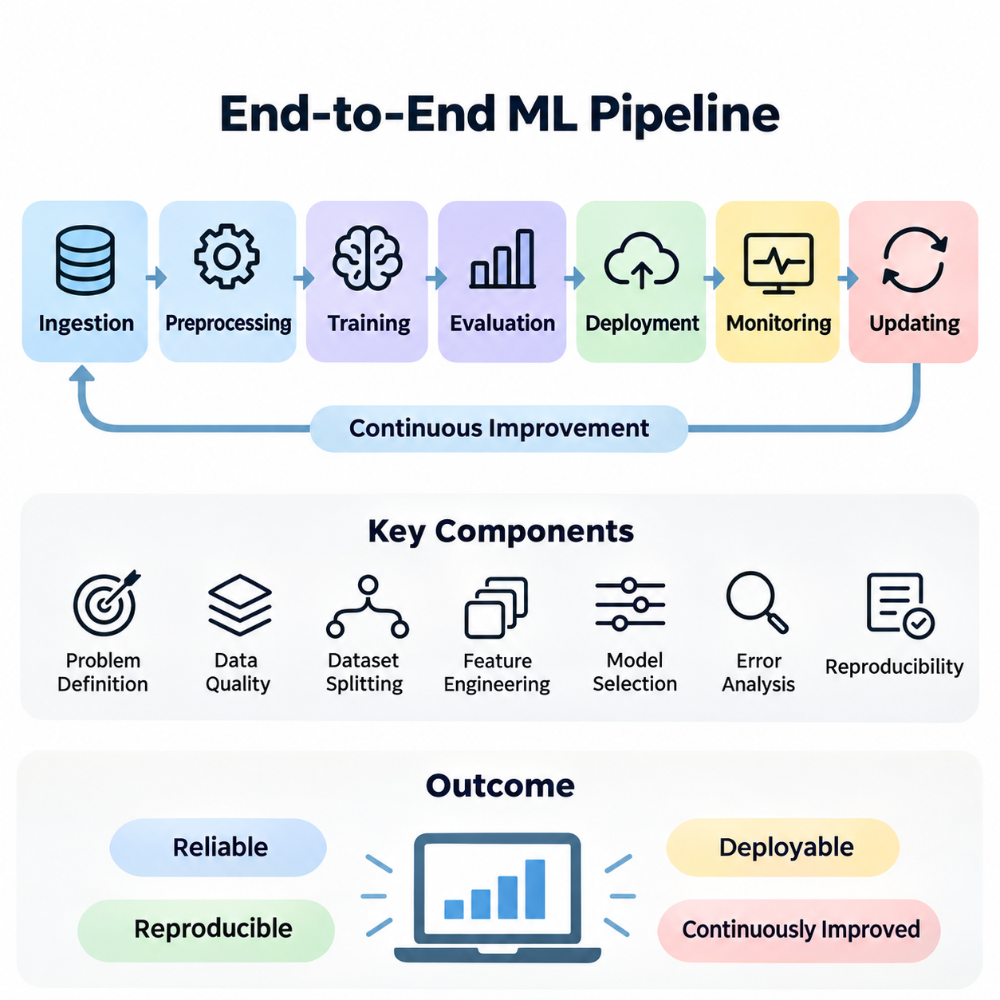
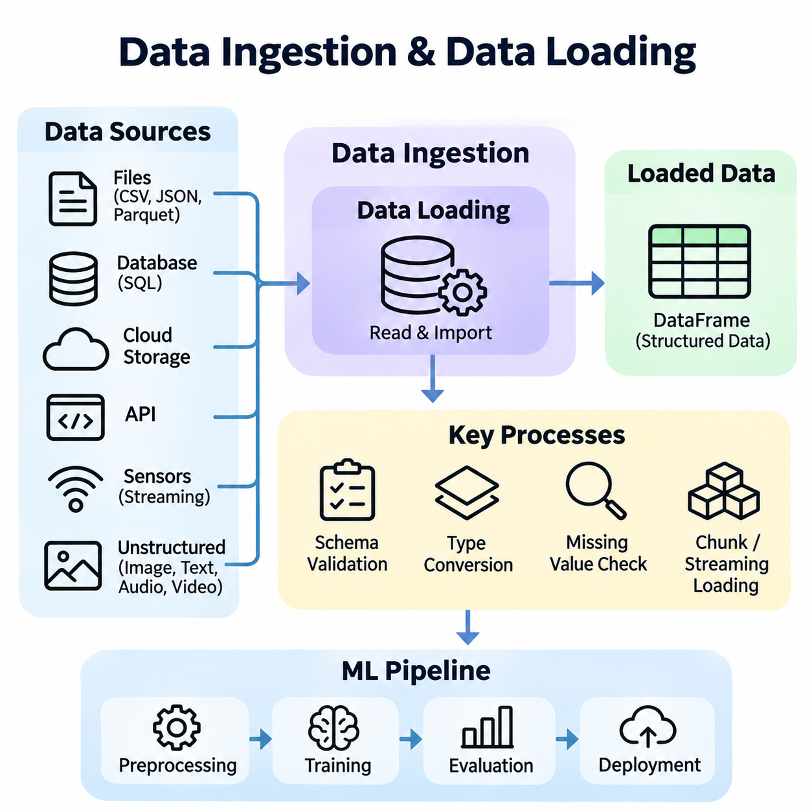
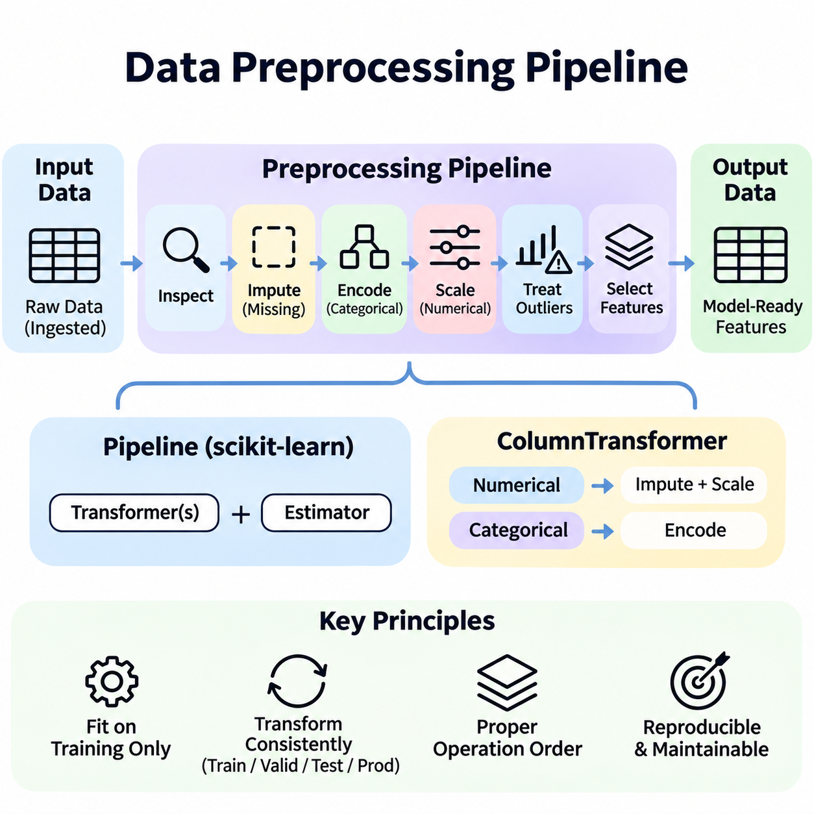
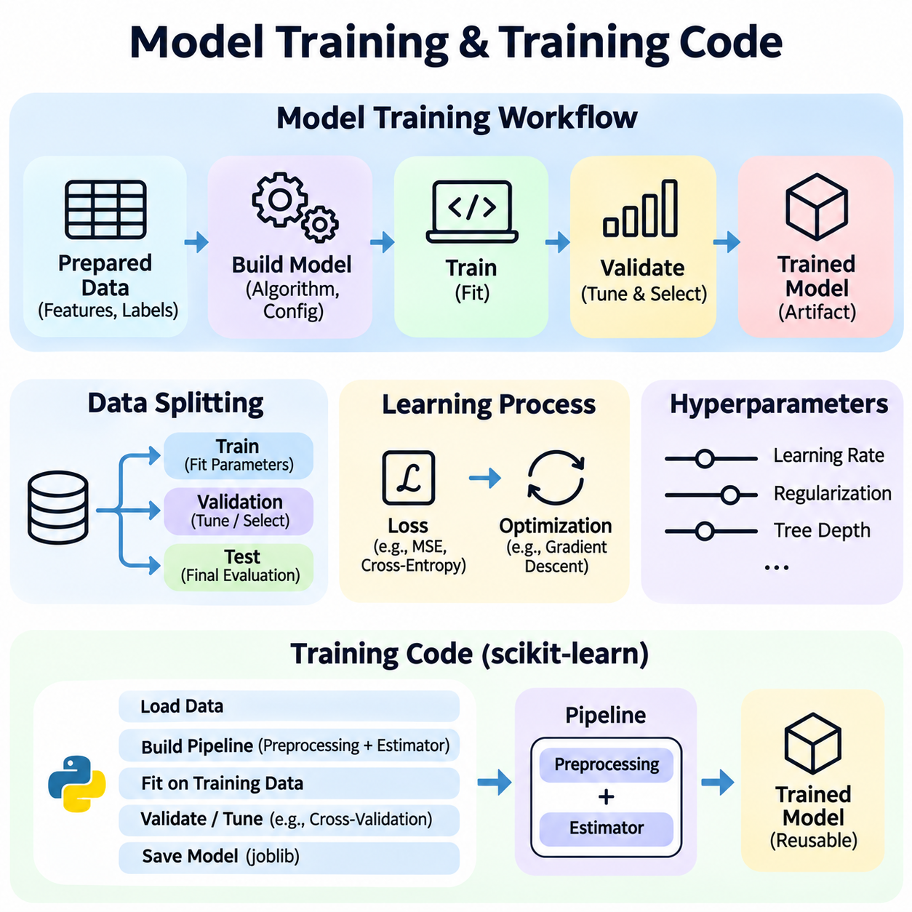
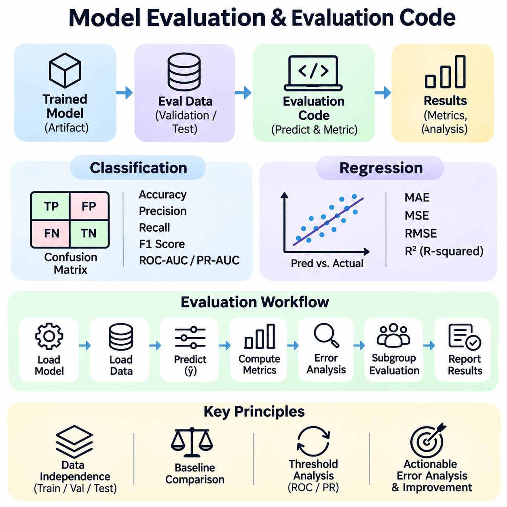
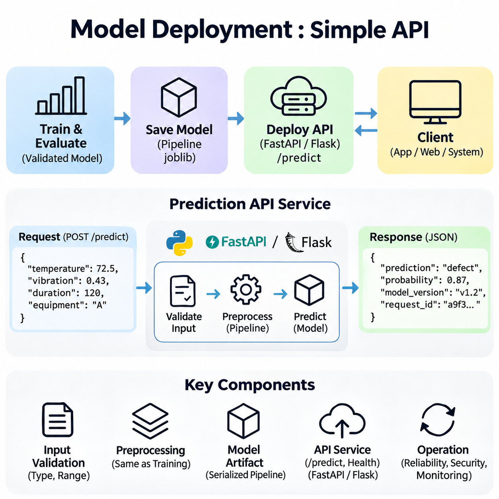
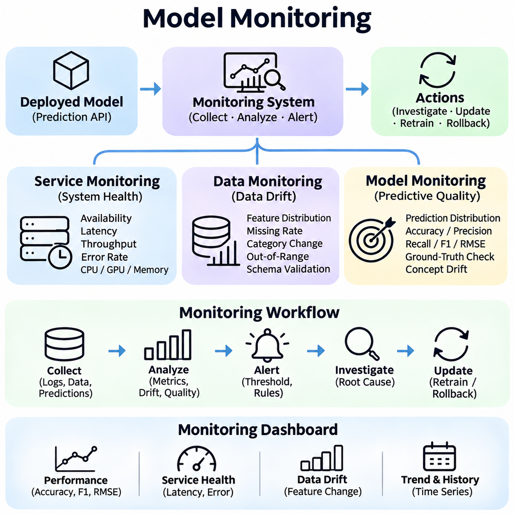
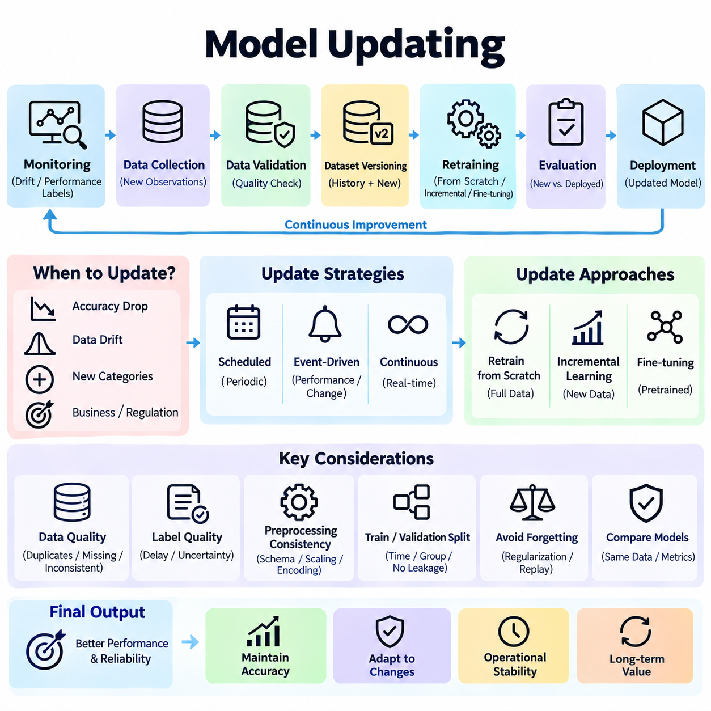
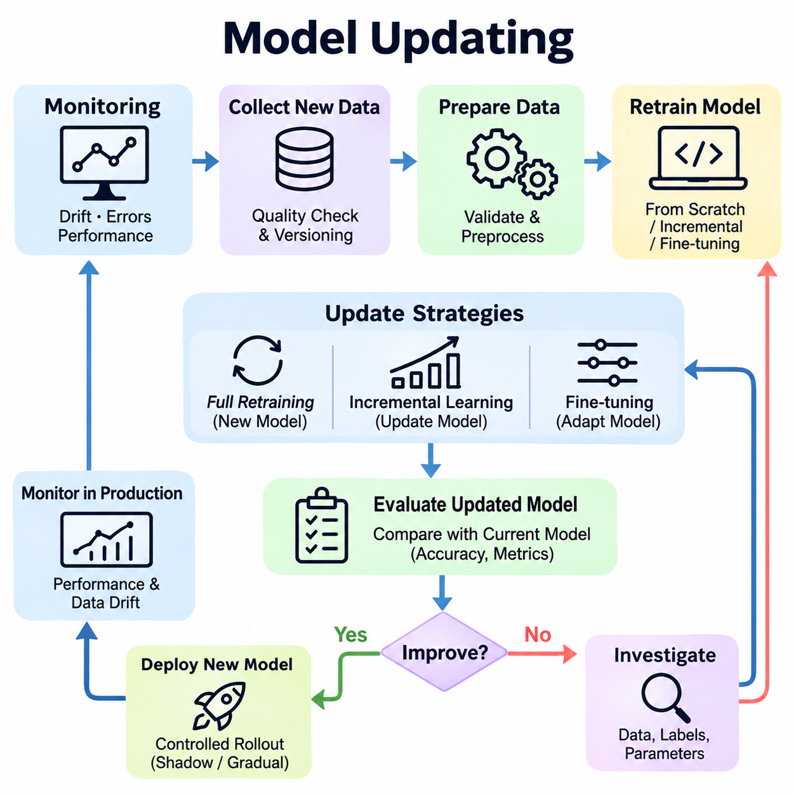
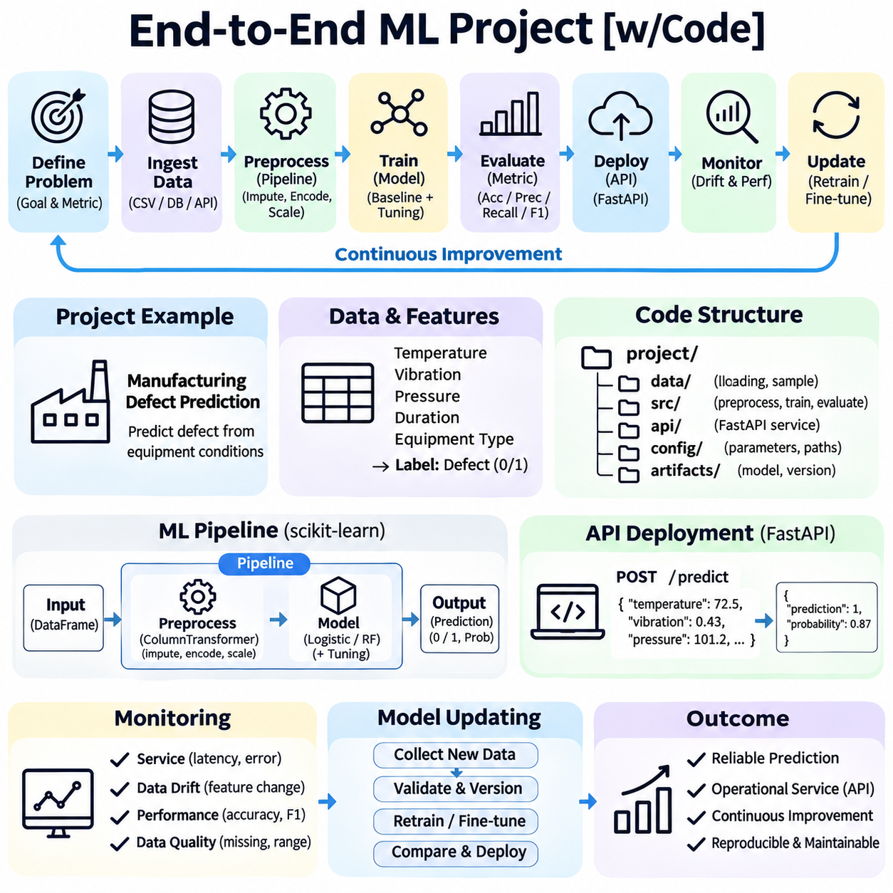

**Volume 07. Machine Learning Fundamentals**

# 06. End to End ML Workflow

## 06.00 ML Pipeline Overview

{width="7.268055555555556in" height="7.268055555555556in"}

An end-to-end machine learning pipeline is a structured workflow that transforms raw data into a deployed predictive system. It connects data ingestion, preprocessing, model training, evaluation, deployment, monitoring, and updating. Rather than treating model development as an isolated experiment, the pipeline organizes these activities into a coordinated process that supports reliability, reproducibility, and continuous improvement.

The primary purpose of an ML pipeline is to ensure that every stage produces outputs that can be consistently consumed by the next stage. Raw observations must become validated datasets, datasets must become suitable model inputs, and trained models must become usable prediction services. Each transformation introduces assumptions, dependencies, and potential errors that must be controlled throughout the system lifecycle.

A machine learning workflow begins with a clearly defined problem and measurable objectives. Developers identify the prediction target, expected inputs, operational constraints, and acceptable performance levels. For example, a manufacturing system may predict defective products from sensor measurements, while a financial application may estimate transaction risk. These requirements determine how the subsequent pipeline stages should operate.

Data ingestion is the process of acquiring information from sources such as databases, files, sensors, application interfaces, and streaming platforms. The ingestion component must handle different formats, collection frequencies, and data volumes. Reliable ingestion also requires schema validation, source identification, timestamp management, and mechanisms for detecting incomplete or corrupted records before downstream processing begins.

After ingestion, raw data typically requires preprocessing to become suitable for machine learning algorithms. Common operations include handling missing values, correcting inconsistent records, encoding categorical variables, scaling numerical features, and removing invalid observations. These transformations should be defined systematically so that training and inference apply compatible processing rules.

Data quality directly influences the reliability of the entire pipeline. Missing measurements, duplicated samples, incorrect labels, and inconsistent feature definitions can produce misleading patterns during training. A well-designed workflow therefore includes explicit quality checks and validation criteria. Detecting data problems early is generally more efficient than attempting to compensate for them through increasingly complex models.

Dataset partitioning establishes the separation between model development and independent performance assessment. Training data supports parameter estimation, validation data supports model selection and tuning, and test data provides a final evaluation. Splitting strategies must reflect the application, particularly when observations contain temporal relationships, repeated entities, or dependencies that could introduce data leakage.

Feature engineering converts available information into representations that learning algorithms can use effectively. Numerical transformations, categorical encoding, aggregation, and domain-specific feature construction may improve predictive performance. Feature selection can also reduce unnecessary complexity. Importantly, feature transformations learned from data must be fitted only on permitted training partitions to preserve evaluation integrity.

Model training uses prepared examples to estimate parameters that minimize a selected objective function. Depending on the problem, the algorithm may perform classification, regression, clustering, or another learning task. Training procedures can involve iterative optimization, regularization, and repeated experiments. The resulting model represents learned relationships rather than a complete production-ready application.

Model selection determines which candidate offers the most appropriate balance of predictive accuracy, complexity, interpretability, and computational requirements. A simple linear model may be preferable when transparency and efficiency are essential, while more expressive models may capture complicated relationships. Validation results guide these decisions without exposing the final test dataset to repeated optimization.

Hyperparameter tuning improves model behavior by adjusting configuration choices such as learning rates, regularization strengths, tree depths, or network dimensions. Grid search, random search, and Bayesian optimization provide different approaches to exploring candidate configurations. Effective tuning requires controlled validation procedures and experiment records so that improvements can be distinguished from random variation.

Model evaluation determines whether a trained system satisfies its intended objectives. Classification applications may use precision, recall, F1 score, or ROC-AUC, while regression applications may use mean absolute error or mean squared error. Metric selection must reflect the consequences of different mistakes. A model with strong aggregate performance may still fail on important minority classes or unusual operating conditions.

Error analysis extends evaluation by examining where and why predictions fail. Developers may investigate incorrect predictions across data sources, operating conditions, demographic groups, or feature ranges. This analysis helps distinguish data-quality problems from modeling limitations. The findings can motivate better labels, additional training examples, revised features, or changes to the selected learning algorithm.

Reproducibility is an essential property of a reliable ML pipeline. Repeated experiments should produce consistent or explainably different results when their inputs and configurations are controlled. Dataset versions, preprocessing definitions, model parameters, random seeds, software dependencies, and evaluation procedures should therefore be recorded. Reproducibility supports debugging, collaboration, auditing, and reliable model updates.

Pipeline automation reduces repetitive manual work and improves consistency between experiments. Automated workflows can execute ingestion, validation, preprocessing, training, and evaluation in a predefined order. Each stage can expose explicit inputs, outputs, and completion conditions. This modular organization makes failures easier to isolate and allows individual components to be improved without rebuilding the entire system.

Model deployment converts an evaluated model into a component accessible to real applications. Deployment may involve a web API, batch prediction service, embedded device, or local inference application. The deployment package must include the trained model and compatible preprocessing logic. Operational requirements such as prediction latency, memory consumption, throughput, and availability influence the deployment architecture.

The distinction between training and inference is particularly important in production systems. Training typically uses historical datasets and may consume substantial computational resources, whereas inference processes new observations under operational constraints. Both environments must maintain compatible feature definitions and transformations. Differences between their processing logic can cause training-serving skew and reduce prediction reliability.

Deployment validation confirms that the integrated application behaves correctly beyond offline model evaluation. Tests may examine input schemas, prediction consistency, response times, error handling, and resource consumption. Integration testing also verifies that data preprocessing and model inference operate together correctly. A successful training experiment does not automatically guarantee that the deployed system will function reliably.

Monitoring begins when the model enters operational use. Production systems should observe service availability, prediction latency, resource utilization, input quality, and prediction distributions. When trustworthy labels become available, monitoring can also measure predictive performance. These observations reveal whether the deployed model continues to satisfy its original requirements under changing real-world conditions.

Data drift occurs when the statistical properties of incoming observations differ from those encountered during development. Concept drift occurs when relationships between inputs and prediction targets change. Both can affect model reliability, although drift does not always imply performance degradation. Monitoring systems should distinguish meaningful distribution changes from ordinary variation and investigate their operational consequences.

Model updating addresses performance degradation, new requirements, or changes in available data. Updates may involve retraining with recent observations, modifying preprocessing rules, selecting alternative algorithms, or revising feature definitions. Every candidate update should undergo appropriate validation before release. Maintaining previous model versions allows controlled comparison and supports rollback when unexpected behavior occurs.

A feedback loop connects production observations to future model development. Prediction errors, newly labeled examples, user feedback, and monitoring results can reveal weaknesses that were not visible during initial training. These findings inform subsequent data collection and experimentation. The pipeline therefore becomes an iterative learning process rather than a sequence that permanently ends after deployment.

Pipeline reliability also depends on clear interfaces between components. Each stage should specify expected input formats, output schemas, validation requirements, and failure conditions. For example, a preprocessing component should not silently accept unexpected feature columns or incompatible data types. Explicit interface contracts reduce hidden dependencies and make the workflow easier to test, maintain, and extend.

Security and governance considerations apply throughout the workflow. Data access controls, sensitive-information handling, model artifact integrity, and operational logging help protect the system. Organizations may also require documentation of dataset origins, model limitations, and deployment decisions. These controls should be integrated into the pipeline rather than introduced only after a model reaches production.

A practical end-to-end project demonstrates how individual components operate as one system. A product-quality prediction application might ingest sensor records, validate measurements, preprocess features, train a classifier, evaluate detection performance, expose predictions through an API, and monitor incoming data. Each stage contributes to the final outcome, and weaknesses in one component can affect the entire application.

The central principle of end-to-end machine learning is that successful predictive systems require more than accurate algorithms. Data quality, reproducible experiments, appropriate evaluation, dependable deployment, and continuous monitoring are equally important. By treating the pipeline as an integrated lifecycle, developers can build machine learning applications that remain maintainable, measurable, and adaptable as real-world requirements evolve.

## 06.01 Data Ingestion

{width="7.268055555555556in" height="7.268055555555556in"}

Data ingestion is the process of acquiring information from external sources and making it available for machine learning workflows. Data loading is a fundamental operation within this process, responsible for reading datasets into memory or processing environments. Reliable ingestion ensures that information is accessible, correctly interpreted, and suitable for subsequent preprocessing, training, and evaluation stages.

Machine learning applications obtain data from diverse sources, including local files, relational databases, cloud storage, application programming interfaces, and physical sensors. Each source provides different formats, access methods, and update frequencies. A robust data loading component must accommodate these differences while presenting information through consistent structures that downstream algorithms can process efficiently.

Structured data is commonly stored in formats such as CSV, JSON, Parquet, and database tables. CSV files represent tabular information using delimited records, while JSON supports nested objects and flexible attributes. Parquet provides column-oriented storage with compression and efficient analytical access. Selecting an appropriate format depends on dataset size, schema complexity, interoperability, and expected processing operations.

Unstructured and semi-structured data require specialized loading procedures. Images may be stored as JPEG or PNG files, text may originate from documents or logs, and sensor measurements may arrive as timestamped messages. Audio and video introduce additional decoding requirements. The loading process must preserve essential information such as dimensions, encoding, timestamps, and metadata needed for later processing.

Python provides widely used tools for implementing data loading operations. The pandas library supports reading CSV, JSON, and Parquet datasets into DataFrame objects, while NumPy provides efficient array representations. Database connectors enable SQL queries, and specialized libraries handle images, audio, and tensors. These tools simplify data access but still require careful validation of loaded content.

A basic tabular loading workflow begins by identifying the source location and selecting an appropriate reader. For example, pandas.read_csv can load a CSV file into a DataFrame, automatically interpreting columns and inferring data types. Developers should inspect the resulting dimensions, column names, sample records, and inferred types because automatic interpretation may not always match the intended schema.

File paths and storage locations should be managed through configuration rather than embedded directly throughout application code. Relative paths support portable projects, while absolute paths identify specific locations within an environment. Environment variables and configuration files can define dataset roots. Consistent path management improves reproducibility when workflows move between development machines, servers, and cloud infrastructure.

Schema validation verifies that loaded data follows the expected structural definition. A schema may specify required columns, data types, allowable categories, and numerical constraints. Unexpected changes, such as a missing feature or a numeric field becoming textual, can disrupt model training. Validating schemas immediately after loading helps prevent corrupted or incompatible data from propagating through the pipeline.

Data type management is particularly important when reading information from heterogeneous sources. Numeric values may be interpreted as strings, dates may use inconsistent formats, and categorical identifiers may lose leading zeros. Explicit type conversion reduces ambiguity and prevents incorrect calculations. Timestamp fields should also preserve timezone information when temporal relationships are relevant to the application.

Missing values may appear during loading because of incomplete records, unavailable measurements, or inconsistent file representations. Libraries commonly represent missing information using special values such as NaN or null. The ingestion stage should identify and report missing entries without automatically assuming how they should be corrected. Decisions about imputation, exclusion, or special encoding generally belong to subsequent preprocessing stages.

Large datasets introduce memory and performance constraints that make full in-memory loading impractical. Chunk-based loading processes records in manageable portions rather than reading an entire file at once. Streaming approaches handle continuously arriving observations, while memory mapping can support efficient access to selected data regions. These strategies reduce memory pressure and enable processing beyond available system RAM.

Batch loading and streaming ingestion address different operational requirements. Batch loading retrieves bounded datasets at scheduled intervals or during training preparation. Streaming ingestion continuously processes incoming events from applications, sensors, or message brokers. The appropriate approach depends on data arrival patterns, latency requirements, storage capacity, and whether the application needs immediate or periodic updates.

Database ingestion commonly uses queries to retrieve relevant observations from structured storage systems. SQL queries can filter records, select columns, and perform aggregations before transferring data into the machine learning environment. Query efficiency matters because unnecessarily large transfers increase processing time and resource consumption. Database connections should also be managed securely and released after use.

Application programming interfaces provide another mechanism for obtaining external datasets. API-based ingestion may require authentication, pagination, request parameters, and response parsing. Network interruptions, rate limits, and temporary service failures must be considered. Reliable implementations use controlled retries, timeouts, and validation of returned records to prevent incomplete downloads from silently entering the training pipeline.

Data ingestion should preserve provenance information describing where observations originated and how they were collected. Source identifiers, collection timestamps, dataset versions, and processing records support traceability. Provenance becomes particularly valuable when multiple sources are combined or when unexpected model behavior requires investigation. Without this information, reproducing earlier experiments may become difficult.

Data integrity checks help confirm that loaded information has not been unintentionally altered or truncated. File sizes, record counts, checksums, and expected value ranges provide useful validation signals. For distributed datasets, integrity verification may also examine missing partitions or duplicate files. These checks establish confidence that the data entering preprocessing corresponds to the intended dataset.

Duplicate records can arise from repeated downloads, overlapping database queries, or message delivery retries. Such duplicates may distort training distributions or create misleading evaluation results. Ingestion systems should detect potentially repeated observations using stable identifiers or defined comparison rules. Whether duplicates should be removed depends on their meaning and the requirements of the learning problem.

Combining multiple datasets requires attention to identifiers, schemas, units, and temporal alignment. Two sources may describe the same entity using different naming conventions or measurement units. Joining records without verifying relationships can introduce incorrect associations. A reliable ingestion workflow therefore documents source compatibility and performs controlled integration before producing a unified dataset.

Data loading should maintain a clear distinction between raw information and transformed features. The ingestion stage primarily retrieves, decodes, and validates observations, while preprocessing performs operations such as normalization, encoding, and feature construction. Separating these responsibilities improves modularity and makes errors easier to locate. It also allows raw datasets to be reused with alternative preprocessing strategies.

Error handling is essential because external data sources are not always available or consistent. Loading operations may fail because of missing files, permission restrictions, malformed records, incompatible encodings, or interrupted connections. Robust implementations distinguish recoverable failures from critical errors. Informative logs and explicit failure conditions prevent incomplete datasets from being mistaken for successful ingestion results.

Reproducible ingestion requires recording the source dataset, loading configuration, software environment, and execution conditions. Dataset snapshots or immutable versions can prevent later source changes from altering previous experiments. Deterministic ordering may also matter when downstream operations depend on record sequences. These practices allow developers to reconstruct the exact data inputs used during model development.

Security considerations apply whenever ingestion accesses external systems or sensitive information. Credentials should be protected through secure configuration mechanisms rather than stored directly in source code. Access permissions should follow the principle of least privilege, and data transfers may require encryption. Sensitive records must be handled according to applicable privacy requirements and organizational policies.

An effective ingestion component should expose a consistent interface regardless of the underlying storage technology. For example, a training workflow may receive a validated DataFrame or dataset object whether its records originated from CSV files or database queries. This abstraction reduces coupling between data sources and learning algorithms. It also simplifies testing and future migration to alternative storage systems.

Consider a manufacturing quality prediction application that collects measurements from production equipment. Historical sensor records may be stored in CSV files, while recent observations arrive through a database or streaming service. The ingestion component loads these records, validates measurement fields, checks timestamps, and preserves equipment identifiers. The resulting dataset becomes the foundation for feature preparation and predictive modeling.

Data loading is therefore more than a simple file-reading operation. It establishes the reliability, consistency, and traceability of information entering the machine learning lifecycle. By combining appropriate loading tools, schema validation, integrity checks, scalable processing, and reproducible configurations, developers create a dependable foundation for preprocessing, model training, evaluation, deployment, and continuous improvement.

## 06.02 Data Preprocessing

{width="7.268055555555556in" height="7.268055555555556in"}

Data preprocessing is the process of transforming raw observations into consistent, reliable, and model-ready representations. It connects data ingestion with model training by correcting data quality problems and preparing features for learning algorithms. A preprocessing pipeline organizes these transformations into a reproducible sequence, ensuring that identical rules can be applied during training, validation, testing, and production inference.

A preprocessing pipeline consists of connected operations that transform an input dataset into a structured output. Typical operations include missing-value handling, categorical encoding, numerical scaling, outlier treatment, and feature selection. Each operation performs a defined transformation, and its output becomes the input of the next operation. This modular structure improves consistency, maintainability, and experimental reproducibility.

The first responsibility of preprocessing is to inspect the characteristics of incoming data. Developers examine feature types, missing-value distributions, numerical ranges, categorical frequencies, and unexpected records. This initial assessment identifies transformations required by the selected learning algorithm. It also reveals potential data quality problems that could otherwise produce misleading patterns during training.

Missing-value handling addresses incomplete observations caused by sensor failures, unavailable information, or inconsistent collection procedures. Numerical features may be filled using training-set means or medians, while categorical features may use the most frequent category or an explicit missing indicator. The appropriate strategy depends on the meaning of missingness and the assumptions of the learning problem.

Categorical encoding converts symbolic values into numerical representations that machine learning algorithms can process. One-hot encoding creates binary indicators for categories, while ordinal encoding assigns numerical identifiers. Ordinal values should not imply meaningful ordering unless such relationships exist. Encoding rules must also define how previously unseen categories are handled during validation and production inference.

Numerical scaling adjusts feature magnitudes to improve compatibility with algorithms sensitive to measurement scales. Standardization transforms values using a mean and standard deviation, while min-max scaling maps values into a specified range. Scaling is especially relevant for distance-based methods and regularized optimization. Tree-based algorithms generally require less scaling because their splits depend primarily on feature ordering.

Outlier treatment addresses observations that differ substantially from typical data patterns. Extreme values may represent measurement errors, rare but valid events, or important anomalies. Possible treatments include clipping, robust scaling, transformation, and exclusion when justified. Removing unusual observations without understanding their origin can eliminate valuable information and reduce the model\'s ability to handle rare operating conditions.

Feature transformation can improve the representation of complex relationships within data. Logarithmic transformations may reduce positive skew, polynomial features can express nonlinear interactions, and aggregation can summarize repeated observations. Domain-specific transformations may incorporate physical units, temporal patterns, or operational knowledge. Every transformation should preserve the intended meaning of the underlying information.

Feature selection reduces the number of inputs by removing irrelevant, redundant, or unstable variables. Statistical filtering, model-based importance measures, and recursive selection are common approaches. Reducing unnecessary features may improve computational efficiency and generalization. However, feature selection must be performed within the training procedure rather than using information from independent evaluation datasets.

The order of preprocessing operations can influence the resulting feature representation. For example, missing values often need to be handled before scaling, while categorical encoding may expand a single input column into multiple numerical features. Some transformations can operate independently, whereas others require specific preceding steps. Pipeline design should make these dependencies explicit and test their compatibility.

A critical principle is that preprocessing parameters must be learned exclusively from the appropriate training data. Means, standard deviations, category vocabularies, and selected features are examples of fitted preprocessing state. Applying statistics calculated from validation or test data introduces data leakage. Such leakage can produce artificially optimistic evaluation results that do not reflect performance on unseen observations.

The distinction between fitting and transforming is central to reusable preprocessing pipelines. Fitting estimates transformation parameters from training observations, while transforming applies those parameters to a dataset. During validation and testing, the pipeline should transform data using previously fitted parameters without recalculating them. Production inference must follow the same principle to maintain consistency.

Scikit-learn provides the Pipeline abstraction for combining preprocessing operations and estimators into a unified workflow. Each intermediate component typically implements fit and transform methods, while the final estimator performs learning or prediction. A pipeline can therefore be trained and evaluated as a single object. This design reduces manual processing errors and supports reproducible experimentation.

ColumnTransformer extends pipeline construction by applying different transformations to selected feature groups. Numerical columns may receive imputation and standardization, while categorical columns receive imputation and one-hot encoding. Their transformed outputs are combined into a single feature representation. This approach is particularly useful for tabular datasets containing heterogeneous feature types.

For example, a manufacturing dataset may contain temperature, vibration, equipment type, and operating duration. A preprocessing pipeline could replace missing numerical measurements with medians, standardize continuous variables, and encode equipment categories. The resulting feature matrix becomes suitable for a classification model predicting product defects. The same transformations must be applied to future production measurements.

Pipeline integration simplifies model comparison because different estimators can share a consistent preprocessing procedure. Logistic regression, support vector machines, and ensemble models can be evaluated using compatible feature definitions. However, preprocessing requirements may differ across algorithms. A well-designed experiment therefore allows appropriate transformations to vary while preserving fair evaluation conditions.

Cross-validation requires special attention because preprocessing must be fitted separately within each training fold. If scaling, imputation, or feature selection is performed before splitting the complete dataset into folds, information may leak across evaluation boundaries. Encapsulating transformations inside a pipeline allows cross-validation tools to refit preprocessing correctly for each fold.

Hyperparameter optimization can include preprocessing choices alongside model parameters. Developers may compare scaling methods, imputation strategies, feature selection thresholds, and estimator configurations. Grid search and randomized search can evaluate these combinations through validation procedures. Treating preprocessing as part of the model configuration encourages systematic experimentation rather than arbitrary manual adjustments.

Preprocessing pipelines should also validate input schemas before applying transformations. Required feature names, expected data types, allowable ranges, and categorical values should be checked. Unexpected changes may indicate upstream ingestion problems or modifications to the production environment. Explicit validation prevents incompatible inputs from silently producing unreliable predictions.

Reproducibility requires preserving both the fitted preprocessing components and their configuration. A trained model depends on the transformations used to construct its feature representation. Saving only the estimator without its associated preprocessing state can make predictions inconsistent or impossible. Versioned pipeline artifacts should therefore include transformation parameters, feature ordering, and relevant software dependencies.

Efficiency becomes important when preprocessing large datasets or serving predictions under latency constraints. Vectorized operations, sparse representations, batch processing, and caching can reduce computational overhead. Expensive transformations may be performed during dataset preparation when appropriate. Production pipelines should balance transformation complexity against memory usage, throughput, and response-time requirements.

Monitoring preprocessing behavior helps identify changes in incoming data. Increasing missing-value rates, unseen categories, abnormal numerical ranges, or schema modifications may indicate data drift or upstream failures. Monitoring should distinguish legitimate environmental changes from corrupted observations. These signals can trigger investigation, data collection improvements, or controlled pipeline updates.

Error handling is necessary because preprocessing assumptions may fail when encountering unexpected inputs. A categorical encoder may receive unknown values, a numerical transformer may encounter invalid strings, or a required feature may be absent. Robust pipelines define explicit responses such as controlled fallback behavior, validation errors, or rejection of incompatible records rather than silently generating incorrect features.

A complete preprocessing pipeline establishes a dependable interface between raw datasets and learning algorithms. It transforms heterogeneous observations into consistent feature representations while controlling data leakage and preserving fitted parameters. By integrating validation, modular transformations, reproducibility, and operational monitoring, preprocessing becomes a reusable component supporting reliable training, evaluation, deployment, and model updating.

## 06.03 Model Training

{width="7.268055555555556in" height="7.268055555555556in"}

Model training is the process of learning patterns from prepared data by adjusting model parameters to minimize a defined loss function. It transforms a selected algorithm into a fitted predictive model capable of processing previously unseen observations. Within an end-to-end machine learning workflow, training code connects preprocessed datasets, optimization procedures, validation strategies, and reproducible model artifacts.

A training workflow begins with clearly defined inputs and outputs. Inputs typically include feature matrices, target labels, model configurations, and training parameters. The output is a fitted estimator together with information describing its training conditions. Well-structured training code separates data preparation, model construction, parameter estimation, evaluation, and artifact storage into identifiable responsibilities.

Training data must be separated from validation and test datasets before model fitting begins. The training partition supplies observations used to estimate model parameters, while validation data supports model selection and hyperparameter tuning. Test data remains isolated until final evaluation. Maintaining these boundaries prevents information leakage and produces more trustworthy estimates of performance on unseen examples.

The training process depends on the learning problem and selected algorithm. Classification models learn to assign categories, regression models estimate continuous values, and clustering algorithms identify patterns without predefined labels. Each algorithm introduces assumptions about relationships within the data. Training code should make the problem type explicit and ensure that the selected estimator matches the target representation.

Scikit-learn provides a convenient interface for conventional machine learning training. Estimators generally expose a fit method that receives feature data and, for supervised learning, target labels. After fitting, prediction methods generate outputs for new observations. This consistent interface allows developers to compare algorithms while maintaining similar training procedures and reducing unnecessary implementation complexity.

A basic training implementation loads prepared data, constructs an estimator, and calls its fitting procedure. For example, logistic regression can learn a classification boundary, while random forests combine multiple decision trees. The training code should specify important configuration parameters rather than relying entirely on defaults. Explicit configurations improve reproducibility and make experimental results easier to interpret.

Training parameters and hyperparameters serve different purposes. Model parameters, such as regression coefficients or neural network weights, are estimated from training observations. Hyperparameters, including regularization strength, maximum tree depth, and learning rate, are selected before or during training configuration. Understanding this distinction helps developers organize optimization procedures and avoid confusing learned values with design choices.

Loss functions quantify disagreement between model predictions and desired outcomes. Mean squared error is commonly used for regression, while cross-entropy supports many classification tasks. The optimization procedure attempts to reduce the selected loss by updating model parameters. The choice of objective influences what the model learns, so it should reflect the prediction problem and the relative importance of different errors.

Gradient-based training updates model parameters using derivatives of the loss function. Gradient descent and its variants iteratively move parameters toward configurations with lower loss. Learning rate determines the size of parameter updates, while batch size controls how many observations contribute to each update. Poor settings can cause unstable optimization, slow convergence, or inadequate learning.

Training neural networks typically involves repeated passes through the dataset, known as epochs. During each epoch, batches of examples are processed, predictions are generated, losses are calculated, and gradients are propagated backward. An optimizer updates model weights based on these gradients. Training code must coordinate these operations while monitoring numerical stability and computational resource usage.

Conventional machine learning estimators often encapsulate their optimization procedures within a single fitting call. Neural network frameworks such as PyTorch provide greater control over training loops, gradient computation, and optimizer updates. The appropriate abstraction depends on the complexity of the model and experimental requirements. Simpler interfaces reduce development effort, while explicit loops enable specialized training behavior.

Reproducibility requires controlling random operations that influence training outcomes. Random seeds affect data shuffling, parameter initialization, sampling, and some algorithmic decisions. Recording seeds, software versions, dataset versions, and model configurations helps reproduce experiments. However, exact numerical reproducibility may still depend on hardware, parallel execution, and nondeterministic computational operations.

Training code should integrate preprocessing without introducing data leakage. Scaling parameters, imputation statistics, and feature selection rules must be fitted using the training partition only. A combined preprocessing and estimator pipeline ensures consistent transformations during fitting and prediction. This design also simplifies cross-validation because each training fold receives independently fitted preprocessing operations.

Validation provides feedback about model behavior beyond the training examples. Training performance alone cannot establish generalization because a model may memorize observations or learn irrelevant patterns. Validation metrics reveal whether improvements in training loss correspond to better predictions on held-out data. Monitoring both training and validation results helps identify overfitting, underfitting, and unstable optimization.

Early stopping can prevent unnecessary training when validation performance stops improving. During iterative optimization, the system periodically evaluates a validation metric and tracks the best observed result. Training may terminate after a predefined period without meaningful improvement. The final model should restore or preserve the selected checkpoint when required, rather than automatically using the last parameter state.

Hyperparameter tuning systematically compares alternative training configurations. Grid search evaluates predefined combinations, while randomized search samples from specified distributions. More advanced optimization methods adapt future trials using previous results. Each candidate must be assessed through an appropriate validation procedure. The final test dataset should not guide repeated tuning decisions because doing so compromises independent evaluation.

Cross-validation estimates model stability across multiple training and validation partitions. In each fold, the estimator and any fitted preprocessing components are trained using only the corresponding training subset. Validation results are then aggregated to summarize performance variability. Cross-validation is especially useful when available labeled data is limited, although it increases computational cost.

Class imbalance can complicate training when some target categories appear much less frequently than others. A model may achieve high overall accuracy while performing poorly on important minority classes. Training strategies include class weighting, controlled resampling, and suitable loss functions. Resampling must occur only within the training data or individual cross-validation folds to avoid contaminating evaluation results.

Regularization controls model complexity and can improve generalization. L1 and L2 penalties discourage excessively large parameter values, while tree constraints limit the complexity of decision structures. Neural networks may use dropout, weight decay, or other regularization methods. Training code should expose these settings explicitly so their effects can be examined through controlled experiments.

Computational efficiency becomes important when datasets or models grow. Batch processing, parallel execution, hardware acceleration, and appropriate data representations can reduce training time. Memory usage must be considered when loading feature matrices or intermediate tensors. Efficient implementations balance computational throughput with numerical stability, reproducibility, and the need for reliable experimental comparisons.

Experiment tracking records the conditions and outcomes of individual training runs. Useful records include dataset identifiers, preprocessing versions, hyperparameters, random seeds, training duration, and validation metrics. Structured logs make it easier to compare models and identify regressions. Tracking also supports collaboration by allowing different developers to understand how a particular model artifact was produced.

Model checkpointing preserves intermediate or final training states. A checkpoint may contain model parameters, optimizer state, training progress, and configuration information. Checkpoints enable recovery after interrupted training and support selection of the best validated model. Saved artifacts should be versioned and associated with the exact preprocessing configuration required to reproduce predictions.

Error handling is essential for dependable training automation. Invalid labels, incompatible feature dimensions, numerical overflow, insufficient memory, and unavailable hardware can interrupt execution. Training code should validate assumptions before expensive computation and report failures clearly. Controlled recovery procedures may resume interrupted runs, but they must not silently alter experimental conditions or compromise result integrity.

A practical training module should expose a consistent interface for receiving prepared datasets and producing trained model artifacts. Configuration-driven design allows algorithms and hyperparameters to change without rewriting the complete workflow. Automated checks can verify input dimensions, label compatibility, and successful artifact creation. This modular approach supports repeated experimentation and integration with downstream evaluation and deployment stages.

Model training is therefore both an optimization process and a software engineering responsibility. Reliable training code combines appropriate algorithms, controlled data boundaries, reproducible configurations, validation procedures, experiment tracking, and artifact management. When these elements are integrated systematically, the resulting models become easier to evaluate, compare, deploy, monitor, and update throughout the machine learning lifecycle.

## 06.04 Model Evaluation

{width="7.268055555555556in" height="7.268055555555556in"}

Model evaluation is the process of measuring how effectively a trained machine learning model performs on data that was not used to fit its parameters. It determines whether the model satisfies predictive objectives and can generalize beyond training observations. Within an end-to-end workflow, evaluation code connects model artifacts, independent datasets, performance metrics, and deployment decisions.

A reliable evaluation workflow begins with a clear definition of the prediction task and its success criteria. Classification, regression, and other learning problems require different evaluation methods. The selected metrics should reflect operational objectives rather than mathematical convenience alone. Evaluation code must therefore establish what constitutes a correct prediction and which errors have the greatest practical consequences.

Dataset independence is fundamental to trustworthy evaluation. Training data estimates model parameters, validation data supports development decisions, and test data provides a final assessment. Repeatedly modifying a model based on test results compromises this independence. Evaluation implementations should preserve dataset boundaries and prevent information from test observations from influencing training or preprocessing.

Evaluation code typically loads a trained model, retrieves an appropriate dataset, generates predictions, and compares them with reference targets. The procedure should reuse the exact preprocessing transformations associated with the trained model. Differences in feature ordering, scaling, or categorical encoding can invalidate comparisons. A unified model pipeline reduces these risks and improves evaluation consistency.

Classification evaluation examines how accurately a model assigns observations to discrete categories. Accuracy measures the proportion of correct predictions, but it may be misleading when classes are imbalanced. Precision measures the reliability of positive predictions, while recall measures the proportion of actual positives detected. These metrics reveal different error patterns and should be interpreted together.

The F1 score combines precision and recall through their harmonic mean. It is useful when both false positives and false negatives matter, although it does not incorporate true negatives directly. In multiclass classification, macro averaging treats classes equally, while weighted averaging accounts for their support. Evaluation code should specify the averaging method to avoid ambiguous performance reports.

A confusion matrix summarizes relationships between predicted and actual classes. In binary classification, it identifies true positives, true negatives, false positives, and false negatives. These counts reveal which mistakes dominate model behavior. For multiclass problems, the matrix extends across all categories. Examining individual entries often provides more actionable information than a single aggregate score.

Threshold-dependent evaluation is important when classifiers produce probabilities or continuous decision scores. A classification threshold determines how scores become discrete predictions. Changing this threshold alters the balance between precision and recall. Precision-recall curves and receiver operating characteristic curves illustrate performance across thresholds, supporting decisions based on application-specific error costs.

ROC-AUC summarizes ranking performance across classification thresholds, while average precision summarizes the precision-recall relationship. These measures evaluate different aspects of classifier behavior and should not be treated as interchangeable. Precision-recall analysis is often especially informative for rare positive classes. Evaluation code should use probability estimates or decision scores rather than hard class labels when calculating ranking metrics.

Regression evaluation measures differences between predicted numerical values and reference measurements. Mean absolute error summarizes average absolute deviations, while mean squared error emphasizes larger mistakes through squaring. Root mean squared error expresses error in the target variable\'s original units. The appropriate metric depends on whether typical deviations or occasional large errors are more consequential.

The coefficient of determination, commonly called R-squared, compares regression errors with a baseline based on the target mean. Higher values generally indicate better explanatory performance on the evaluated dataset, but negative values are possible. R-squared does not establish causality or guarantee useful predictions. It should be interpreted alongside absolute error measures and the operational meaning of the target.

Baseline comparisons establish whether a trained model provides meaningful improvement over simple alternatives. Classification baselines may predict the majority class, while regression baselines may predict a constant mean or median. A sophisticated model that fails to outperform an appropriate baseline may offer little practical value. Evaluation code should calculate baseline metrics using the same data partitions and evaluation rules.

Error analysis investigates where predictions fail rather than reporting only average performance. Developers can examine incorrect classifications, large regression residuals, and performance across feature ranges or operating conditions. Repeated failures may indicate inadequate training coverage, incorrect labels, or unsuitable model assumptions. Such analysis guides future improvements without treating test observations as unrestricted tuning data.

Subgroup evaluation measures performance across meaningful subsets of the dataset. These may represent equipment types, environmental conditions, geographic regions, or other relevant categories. Strong overall metrics can conceal poor performance in smaller groups. Reporting subgroup sample sizes is important because estimates from limited observations may be unstable. Evaluation should also consider whether subgroup analysis introduces privacy or fairness concerns.

Cross-validation provides repeated estimates of model performance using different training and validation partitions. Each fold trains the model independently and evaluates it on held-out observations. Aggregating results reveals variability across partitions. Cross-validation is useful for model selection and uncertainty assessment, but final test evaluation should remain separate from repeated development decisions.

Confidence intervals and repeated experiments help characterize uncertainty in evaluation results. Bootstrap resampling can estimate variability in selected metrics, provided the sampling procedure respects relevant dependencies. Random-seed variation may reveal training instability. Small differences between models should not automatically be interpreted as meaningful improvements without considering uncertainty, dataset size, and practical significance.

Probability calibration evaluates whether predicted probabilities correspond to observed event frequencies. A well-calibrated classifier assigning approximately 0.8 probability to comparable events should observe positive outcomes near 80 percent of the time. Calibration curves and proper scoring rules, such as the Brier score, help assess this property. Strong classification accuracy does not necessarily imply reliable probability estimates.

Evaluation code should also measure operational characteristics beyond predictive quality. Inference latency, throughput, memory consumption, and computational requirements affect deployment feasibility. A highly accurate model may be unsuitable when predictions must meet strict response-time constraints. Measuring performance under representative workloads helps determine whether the model satisfies both statistical and engineering requirements.

Robustness evaluation examines model behavior under realistic variation in input conditions. Missing features, measurement noise, distribution shifts, and unusual operating scenarios may expose weaknesses absent from standard test datasets. Controlled stress tests can identify sensitivity to these changes. However, synthetic perturbations should reflect plausible conditions rather than being interpreted automatically as evidence of real-world reliability.

Reproducible evaluation requires consistent datasets, metric definitions, preprocessing configurations, and software versions. Random seeds and sampling procedures should be recorded when they influence results. Structured evaluation reports can preserve model identifiers, dataset versions, prediction summaries, and metric values. These records support comparisons between model releases and investigations of unexpected performance changes.

Scikit-learn provides evaluation utilities such as accuracy_score, precision_score, recall_score, f1_score, confusion_matrix, and mean_squared_error. These functions simplify metric computation but require correct inputs and configuration. Developers must verify class labels, averaging conventions, score types, and handling of undefined metrics. Automated checks help prevent technically valid calculations from producing misleading conclusions.

An evaluation module should expose a consistent interface that accepts a fitted model, an evaluation dataset, and metric configurations. It can return structured results for reporting, experiment tracking, and deployment gates. Clear separation between prediction generation and metric computation improves testing. This modular architecture also allows new metrics to be introduced without rewriting the entire machine learning workflow.

Deployment decisions should use predefined acceptance criteria rather than selecting whichever metric appears most favorable. A model may need to exceed baseline performance, satisfy minimum recall, and remain within latency or memory limits. Failure to meet a critical requirement should trigger investigation or further development. Evaluation results provide evidence for decisions but cannot eliminate uncertainty about future operating conditions.

Model evaluation is therefore both a statistical assessment and a quality-control mechanism within the machine learning lifecycle. Reliable evaluation code combines independent datasets, suitable metrics, error analysis, uncertainty assessment, operational testing, and reproducible reporting. By treating evaluation as a systematic process, developers can make informed deployment decisions and establish measurable foundations for future model monitoring and improvement.

## 06.05 Model Deployment

{width="7.268055555555556in" height="7.268055555555556in"}

Model deployment is the process of making a trained machine learning model available for practical use outside the training environment. It transforms a validated model artifact into an accessible prediction service that applications can invoke. Within an end-to-end workflow, deployment connects model training and evaluation with operational requirements such as reliability, response time, security, and maintainability.

A simple application programming interface, or API, provides a practical mechanism for exposing machine learning predictions. An API defines how external clients submit input data and receive model outputs. Instead of embedding the model directly into every application, a centralized prediction service processes requests through a consistent interface. This separation simplifies integration and model maintenance.

A typical prediction API follows a request-response architecture. A client sends an HTTP request containing feature values, and the server validates the input before invoking the trained model. The resulting prediction is converted into a structured response, commonly using JSON. This interaction allows web applications, desktop software, and other services to access machine learning functionality without implementing the underlying algorithm.

REST-style APIs commonly expose prediction functionality through endpoints such as /predict. A POST request is appropriate when the client submits structured feature data for processing. The request body may contain numerical measurements, categorical attributes, or other model inputs. The endpoint returns predictions, confidence estimates when supported, and relevant metadata describing the model or response.

Python provides several frameworks for implementing prediction services. FastAPI supports typed request validation, asynchronous web interfaces, and automatic API documentation. Flask offers a lightweight approach to defining HTTP routes and handling requests. Either framework can expose a trained scikit-learn model through a simple service. The framework choice depends on application complexity, deployment constraints, and integration requirements.

A deployment workflow begins by saving the trained model and its associated preprocessing components. Serialization tools such as joblib can preserve compatible scikit-learn pipelines for later loading. The saved artifact must contain the transformations required to reproduce the expected feature representation. Loading a model without its fitted preprocessing state can produce incorrect predictions or incompatible input dimensions.

The API application should load the model artifact during service initialization rather than reloading it for every prediction request. Repeated loading increases latency and wastes computational resources. Initialization should verify that the artifact exists, is compatible with the runtime environment, and can perform a basic prediction. Startup failures should be reported clearly rather than allowing a partially functional service to accept requests.

Input validation is essential because external clients may submit incomplete or incorrectly formatted data. A prediction endpoint should define required fields, expected data types, allowable ranges, and accepted categorical values. Validation prevents malformed requests from reaching the model. Clear error responses help clients identify missing features, invalid measurements, or incompatible input structures before inference begins.

Schema definitions establish a stable contract between the API and its clients. For example, a manufacturing prediction service may require temperature, vibration, operating duration, and equipment type. Each field should have an explicit meaning and expected representation. Maintaining consistent feature names and ordering prevents mismatches between incoming requests and the model\'s training configuration.

Preprocessing consistency is a central requirement of reliable deployment. Numerical scaling, missing-value imputation, and categorical encoding must follow the transformations fitted during training. Recalculating preprocessing statistics from individual requests introduces inconsistencies. A serialized pipeline containing both preprocessing and the estimator allows the service to apply the correct transformations automatically.

Prediction execution generally involves converting validated request data into the representation expected by the trained pipeline. For tabular models, this may involve constructing a DataFrame with the required feature names. The service then calls the model\'s prediction method and converts the result into a JSON-compatible value. This process should remain deterministic for identical inputs when the model and runtime are deterministic.

Some classification models can provide probability estimates through methods such as predict_proba. These outputs may support threshold selection or downstream decision-making. However, predicted probabilities should not automatically be interpreted as calibrated confidence. The API should distinguish class predictions, probability estimates, and decision scores, while documenting their meaning and limitations.

Response design affects the usability of a prediction service. A response may contain the predicted class, numerical output, model version, and request identifier. Consistent field names simplify client integration and automated testing. The API should avoid exposing unnecessary internal details or sensitive information. Responses should remain compact enough to support efficient communication under expected workloads.

Error handling must distinguish invalid client requests from server-side failures. Missing fields or unsupported values should produce informative validation errors, while unavailable model artifacts or unexpected inference failures require appropriate server error responses. Internal exception details should be logged securely rather than exposed to clients. Predictable failure behavior improves operational reliability and troubleshooting.

A simple API should provide a health-check endpoint that reports whether the service is running. More comprehensive readiness checks can confirm that the model artifact is loaded and essential dependencies are available. These checks support deployment automation and service monitoring. Health status should reflect actual service readiness rather than merely confirming that the web server process exists.

API testing should cover both functional correctness and interface behavior. Developers can submit valid examples, missing fields, incorrect data types, and boundary values to verify expected responses. Integration tests should confirm that API predictions match direct predictions from the saved pipeline. Such tests help detect serialization problems, preprocessing mismatches, and unexpected changes in response formatting.

Performance evaluation measures whether the deployed service satisfies operational constraints. Inference latency describes the time required to produce a prediction, while throughput measures the number of requests processed over time. Memory consumption and CPU or GPU utilization affect infrastructure requirements. Performance tests should use representative request sizes and concurrency levels rather than relying only on isolated examples.

Batch prediction can improve efficiency when clients need results for multiple observations. Instead of sending individual requests for every record, a batch endpoint accepts a collection of feature objects and returns corresponding predictions. Batch size should be constrained to protect memory and response time. The API must preserve the association between each input record and its output.

Security is necessary even for a simple prediction service. Authentication and authorization can restrict access to approved clients, while HTTPS protects data during transmission. Input size limits and request rate controls help reduce misuse and resource exhaustion. Secrets should be stored through secure configuration mechanisms rather than embedded in source code. Access logs must avoid unnecessary exposure of sensitive inputs.

Deployment environments may differ from development machines in operating systems, package versions, and available hardware. Dependency management is therefore important for reliable model loading and inference. Virtual environments and container technologies can package application requirements consistently. Versioned configurations help reproduce the runtime and reduce compatibility failures during deployment.

Containerization provides a convenient way to package the API application, model artifacts, and software dependencies. A container image can be tested locally before deployment to a server or cloud platform. Containers improve portability but do not automatically guarantee security or reproducibility. Image versions, dependency updates, resource limits, and runtime permissions still require explicit management.

Logging and monitoring provide visibility into production behavior. Useful measurements include request counts, response latency, validation failures, inference errors, and resource utilization. Model-related monitoring may also track input distributions and prediction frequencies. Sensitive data should be excluded or protected according to policy. These records help identify operational failures and emerging model performance risks.

Model versioning allows developers to distinguish deployed artifacts and manage controlled updates. A service may expose a model version in response metadata or operational logs. New versions should undergo compatibility testing before replacing existing models. Rollback procedures allow an earlier validated artifact to be restored if deployment introduces unexpected failures. Stable API contracts reduce disruption to client applications.

A practical example is a manufacturing defect prediction service built using FastAPI and a saved scikit-learn pipeline. A client submits equipment measurements through a POST request to /predict. The service validates the fields, applies the fitted preprocessing transformations, and returns a predicted defect category. A separate health endpoint supports service checks, while logs record operational errors and response times.

A simple prediction API demonstrates how machine learning models become usable software components. Successful deployment requires more than exposing a prediction method through HTTP. It combines artifact management, input validation, preprocessing consistency, error handling, security, testing, and monitoring. These practices establish a dependable foundation for integrating machine learning into real applications and supporting future model updates.

## 06.06 Monitoring

{width="7.268055555555556in" height="7.268055555555556in"}

Model monitoring is the continuous process of observing a deployed machine learning system to determine whether it remains reliable, accurate, and operationally effective. Unlike evaluation performed before deployment, monitoring examines behavior under real operating conditions. It connects prediction services with operational feedback, enabling teams to detect failures, changing data patterns, and declining model performance.

A monitoring system should distinguish between service health and predictive quality. Service health concerns availability, response latency, error rates, and resource utilization. Predictive quality concerns whether model outputs remain appropriate for incoming observations. A prediction API may operate without technical errors while producing increasingly inaccurate results. Both dimensions therefore require independent monitoring mechanisms.

Operational monitoring begins with collecting measurable signals from the deployed prediction service. Request counts, response times, failure rates, CPU utilization, GPU utilization, and memory consumption provide information about system behavior. These measurements help identify overloaded infrastructure, unstable dependencies, and unexpected traffic patterns. Monitoring should establish normal operating ranges before defining alert conditions.

Latency monitoring measures the time required to process prediction requests. Average latency provides a general summary, while percentile measurements reveal slower responses experienced by portions of the workload. Throughput monitoring measures the number of predictions completed within a given interval. Together, these metrics indicate whether the deployed system satisfies performance requirements under changing traffic conditions.

Error monitoring identifies failures occurring during input validation, preprocessing, model inference, and response generation. Different failure categories should be recorded separately because they require different corrective actions. Invalid client requests may indicate integration problems, while inference exceptions may indicate software defects or incompatible data. Structured error logs simplify diagnosis and reduce recovery time.

Data monitoring examines whether incoming observations resemble the data used during model development. Changes in feature distributions, missing-value frequencies, categorical values, and numerical ranges may affect prediction reliability. These changes are commonly described as data drift. Monitoring code can compare recent production observations with reference datasets using appropriate statistical summaries and distance measures.

Data drift does not necessarily imply that model predictions have become inaccurate. Some distribution changes have little influence on the learned relationship between inputs and outputs. Other changes may move observations into regions poorly represented during training. Drift indicators should therefore trigger investigation rather than automatically establish model failure. Their significance depends on feature importance and application context.

Concept drift occurs when the relationship between input features and target outcomes changes over time. A model trained under earlier conditions may become less accurate even when input distributions appear relatively stable. Changes in customer behavior, manufacturing processes, environmental conditions, or equipment characteristics can produce this effect. Detecting concept drift generally requires new labeled outcomes or suitable indirect evidence.

Prediction monitoring tracks the distribution and frequency of model outputs. Unexpected increases in a particular predicted class or substantial changes in numerical predictions may indicate altered operating conditions. Prediction distributions should be interpreted alongside input characteristics and service context. Changes may reflect legitimate real-world events rather than model defects, making investigation essential.

Ground-truth monitoring becomes possible when actual outcomes are eventually observed. Predictions can then be matched with verified labels or measurements to calculate production accuracy, precision, recall, or regression errors. Some applications receive outcomes immediately, while others experience delays of days or months. Monitoring systems must preserve prediction identifiers and timestamps to support reliable matching.

Delayed labels create challenges because recent predictions may not yet have corresponding outcomes. Calculating performance only from available labels can introduce bias when outcomes arrive at different rates. Monitoring should distinguish unlabeled predictions from verified results and report label coverage. Evaluation windows must account for outcome delays to avoid presenting incomplete observations as representative performance estimates.

Data quality monitoring checks whether incoming records satisfy expected structural and semantic requirements. Schema violations, unexpected null values, duplicate records, invalid units, and out-of-range measurements can degrade predictions. Automated validation can reject malformed inputs or flag suspicious observations. Monitoring these failures also helps identify upstream sensor, database, or application integration problems.

Monitoring thresholds define conditions that require attention. Static thresholds can detect clear violations of service requirements, while adaptive thresholds may accommodate predictable variations in workload. Alert rules should consider measurement variability and operational consequences. Excessively sensitive thresholds create alert fatigue, whereas insensitive thresholds allow important problems to remain undetected.

Monitoring dashboards provide a consolidated view of system health, data behavior, and model performance. Time-series displays help operators identify gradual degradation, sudden anomalies, and recurring patterns. Metrics should be grouped according to their operational meaning rather than displayed without context. Effective dashboards connect observed changes with model versions, deployment events, and relevant infrastructure conditions.

Structured logging supports monitoring by preserving information about prediction requests and system events. Useful fields include timestamps, request identifiers, model versions, processing duration, and error categories. Input features and prediction outputs may be recorded when necessary and permitted. Logging policies should minimize sensitive information, enforce retention limits, and provide appropriate access controls.

Monitoring must account for the possibility that different user groups or operating conditions experience different model performance. Aggregate metrics may conceal failures affecting specific equipment types, environments, or application segments. Subgroup monitoring can reveal these differences when sufficient observations are available. Results should be interpreted carefully because small samples can produce unstable estimates.

Model confidence monitoring examines changes in probability estimates or decision scores. A growing frequency of uncertain predictions may indicate that incoming observations differ from familiar training examples. However, high confidence does not guarantee correctness, especially when probabilities are poorly calibrated. Confidence trends should complement data quality, drift, and observed performance measurements.

Monitoring infrastructure should be designed to avoid interfering with prediction execution. Excessive synchronous logging or expensive statistical calculations can increase inference latency. Asynchronous collection, sampling, aggregation, and scheduled analysis can reduce overhead. Monitoring pipelines should also handle temporary failures without causing the prediction service to stop unnecessarily.

A practical monitoring implementation may use Python logging, structured metrics, and periodic analysis scripts. A FastAPI prediction service can record request duration, validation failures, and model identifiers. Separate processes can examine feature distributions and compare recent observations with training references. This separation keeps real-time inference responsive while supporting more computationally demanding analysis.

Monitoring records should support reproducibility and incident investigation. Each observation should be associated with the relevant model version, preprocessing configuration, and deployment environment when feasible. Version-aware records allow engineers to determine whether performance changes followed a model update or an external operational event. Reliable timestamps and consistent metric definitions are essential for meaningful comparisons.

When monitoring detects a problem, the response should depend on its severity and cause. Infrastructure failures may require restarting services or increasing resources, while data quality failures may require repairing upstream pipelines. Confirmed model degradation may justify additional evaluation or retraining. Automated responses should be limited to actions with well-understood consequences and appropriate safeguards.

Monitoring also provides evidence for deciding when a model should be updated. Persistent drift, declining predictive performance, and changing operational requirements can indicate that the existing model no longer satisfies expectations. However, retraining should not be triggered solely by isolated anomalies. Teams should examine data quality, label reliability, and the likely causes of observed changes before initiating updates.

A manufacturing prediction system illustrates the importance of integrated monitoring. Sensor readings may gradually change as equipment ages, while new operating procedures may alter defect patterns. Monitoring can track input distributions, prediction frequencies, inference latency, and confirmed defect outcomes. Combining these signals helps distinguish sensor failures, process changes, and genuine model degradation.

Model monitoring completes the operational feedback loop of an end-to-end machine learning workflow. It transforms production observations into evidence for maintenance, evaluation, and future model improvement. Reliable monitoring combines service metrics, data quality checks, drift detection, prediction analysis, outcome tracking, and controlled alerting. These capabilities help maintain trustworthy machine learning systems as real-world conditions evolve.

## 06.07 Model Updating

{width="7.268055555555556in" height="7.268055555555556in"}

{width="7.268055555555556in" height="7.268055555555556in"}

Model updating is the process of modifying or replacing a deployed machine learning model to maintain predictive performance as data, operating conditions, and application requirements change. Unlike initial training, updating begins with an existing model and evidence collected during production. It connects monitoring, data collection, retraining, evaluation, and deployment into a controlled improvement cycle.

A model may require updating when prediction accuracy declines, input distributions shift, or new categories appear in operational data. Changes in business objectives, sensor configurations, and regulatory requirements may also justify revisions. However, not every detected anomaly requires retraining. Updating decisions should distinguish temporary disturbances from persistent changes that materially affect model usefulness.

Monitoring provides the primary evidence for initiating model updates. Data drift indicators, prediction distributions, error rates, and newly available ground-truth labels reveal changes in model behavior. These signals should be examined together because distribution shifts do not always imply reduced accuracy. A reliable updating process uses predefined investigation criteria rather than reacting automatically to every alert.

Model updates can follow scheduled, event-driven, or continuous strategies. Scheduled updates retrain models at regular intervals, while event-driven updates respond to confirmed performance degradation or significant environmental changes. Continuous learning incorporates new observations more frequently. The appropriate strategy depends on data availability, operational risk, computational resources, and the stability of the application.

Data collection is a critical component of updating because newly observed examples may represent conditions absent from the original training dataset. Production records can provide additional feature values, operating contexts, and verified outcomes. However, collected data must undergo quality checks before training. Incorrect labels, duplicated records, inconsistent units, and incomplete observations can reduce the effectiveness of an updated model.

Dataset versioning ensures that every model update can be associated with the exact observations used during training. A new dataset version may combine historical records with recently collected examples. The composition should reflect current operating conditions without unnecessarily discarding useful historical patterns. Maintaining dataset identifiers, collection periods, and transformation rules supports reproducibility and auditing.

Retraining from scratch constructs a new model using an updated dataset and a defined training configuration. This approach can incorporate substantial changes in the data distribution and avoid dependence on earlier parameter states. However, complete retraining may require significant computation. It is often appropriate when model architectures, feature representations, or optimization requirements have changed substantially.

Incremental learning updates an existing model using newly available observations without repeating the entire training process. Algorithms supporting partial fitting or online optimization can adjust parameters as data arrives. Incremental learning reduces computational overhead in suitable applications. Nevertheless, it requires careful control because repeated updates may amplify noise, introduce bias, or weaken previously learned relationships.

Fine-tuning provides another updating strategy, particularly for neural networks and pretrained models. Instead of initializing all parameters randomly, training continues from an existing parameter configuration. Selected layers may remain frozen while others adapt to new examples. Fine-tuning can reduce training costs and preserve useful representations, but inappropriate settings may cause overfitting or catastrophic forgetting.

Catastrophic forgetting occurs when a model loses previously learned capabilities while adapting to new data. This problem is especially relevant to sequential and continual learning systems. Combining historical and recent examples, applying regularization, or using rehearsal strategies can reduce forgetting. Updating procedures should evaluate both new operating conditions and previously supported scenarios.

Preprocessing must remain consistent throughout the updating workflow. New data should be validated against the expected feature schema before model training begins. If scaling statistics, categorical encoders, or feature selection rules are refitted, they must be saved with the updated model. Changes in preprocessing can alter model behavior even when the learning algorithm remains unchanged.

Label quality is particularly important when production outcomes are collected automatically or through human annotation. Delayed feedback, inconsistent labeling standards, and uncertain observations may introduce errors. Quality assurance procedures should verify representative samples and identify ambiguous cases. An updated model trained on unreliable labels may perform worse despite having access to a larger dataset.

Training and validation partitions must be designed to reflect the intended deployment environment. Random splitting may be inappropriate when observations are time-dependent or grouped by equipment, users, or operating sessions. Temporal validation evaluates performance on later observations and can better approximate future conditions. Proper separation prevents leakage and produces more meaningful estimates of updated model performance.

An updated model should be evaluated against the currently deployed model before replacement. Both models should use comparable datasets, metrics, and preprocessing assumptions. The candidate should demonstrate meaningful improvements without unacceptable regressions in critical scenarios. Evaluation must include previously important operating conditions so that improvements on recent data do not conceal losses elsewhere.

Regression testing verifies that an update does not unintentionally damage established functionality. Tests may examine prediction consistency, feature compatibility, API response formats, and behavior on representative historical examples. Statistical performance regression should be distinguished from software regression. Both forms of testing are necessary because a model can improve predictive metrics while breaking integration requirements.

Model selection should account for operational constraints as well as statistical accuracy. A new model may achieve better predictive performance but require substantially more memory or inference time. Deployment decisions should consider latency, throughput, hardware compatibility, and maintenance costs. Predefined acceptance criteria help prevent subjective promotion decisions based on isolated improvements.

Model registries provide a structured mechanism for managing candidate, approved, and deployed model versions. Each version can be associated with training datasets, configurations, evaluation results, and artifact locations. This traceability supports reproducibility and controlled promotion. Registry metadata should identify which model is active and which earlier versions remain available for recovery.

Automated updating pipelines can coordinate data validation, preprocessing, training, evaluation, and artifact registration. Continuous integration and continuous delivery practices can test software and model compatibility before deployment. However, automated retraining should not imply automatic production replacement. High-risk applications may require human review and explicit approval before a new model becomes active.

Safe deployment strategies reduce the consequences of unexpected model behavior. Shadow deployment evaluates a candidate using production inputs without allowing its predictions to control operational decisions. Canary deployment directs a limited portion of traffic to the new version. These strategies provide additional evidence under realistic conditions before broader adoption, provided privacy and operational constraints are respected.

Rollback mechanisms allow a previous validated model to be restored when an update causes unacceptable behavior. Reliable rollback requires preserving model artifacts, preprocessing configurations, API compatibility, and deployment settings. Monitoring should identify failures quickly enough to support timely intervention. Recovery procedures should be tested before they are needed during an operational incident.

Update frequency should reflect the rate of environmental change rather than following an arbitrary schedule. Rapidly changing applications may benefit from frequent retraining, while stable industrial processes may require only occasional updates. Excessive updating increases computational costs and operational complexity. Insufficient updating can allow performance degradation to persist, making evidence-based scheduling essential.

A manufacturing defect prediction system illustrates a practical updating workflow. Monitoring may detect changes in vibration measurements after equipment maintenance or altered defect frequencies following process adjustments. Engineers collect verified production outcomes, validate the new dataset, and train a candidate model. The candidate is compared with the deployed version before controlled release and continued monitoring.

Documentation and governance help maintain accountability across model updates. Each release should record the reason for updating, dataset changes, training configuration, evaluation results, approval decisions, and deployment history. These records support debugging, auditing, and collaboration. Clear ownership ensures that performance degradation, failed updates, and unexpected operational behavior receive appropriate responses.

Model updating completes the feedback-driven lifecycle of an end-to-end machine learning system. It transforms monitoring evidence and newly collected data into carefully validated improvements. Reliable updating combines data quality management, reproducible training, comparative evaluation, version control, controlled deployment, and rollback capabilities. This disciplined approach allows machine learning systems to adapt while preserving operational stability and trustworthiness.

## 06.08 End to End Project [w/Code]

{width="7.268055555555556in" height="7.268055555555556in"}

An end-to-end machine learning project integrates data ingestion, preprocessing, training, evaluation, deployment, monitoring, and model updating into a complete operational workflow. Rather than treating these activities as isolated experiments, the project connects them through reproducible interfaces and measurable objectives. Its purpose is to demonstrate how raw observations become reliable predictions within a maintainable software system.

A practical example is a manufacturing defect prediction system that estimates whether equipment operating conditions indicate a potential product defect. The dataset may contain temperature, vibration, pressure, operating duration, and equipment category. Historical inspection outcomes provide target labels for supervised learning. This example illustrates the complete workflow while remaining simple enough for implementation using standard Python tools.

Project development begins by defining the prediction problem and its operational purpose. The model may classify observations as normal or defective, allowing operators to prioritize inspection. Success criteria should include predictive performance, acceptable inference latency, and manageable false alarms. Clearly defined requirements guide dataset preparation, algorithm selection, evaluation, and deployment decisions.

The project should organize source code into separate components for data loading, preprocessing, training, evaluation, and serving. Configuration files define dataset locations, feature names, model parameters, and artifact paths. This modular organization prevents experimental logic from becoming tightly coupled. It also allows individual components to be tested, modified, and reused without rebuilding the entire application.

Data ingestion retrieves observations from structured files, databases, or operational systems. A simple implementation may use pandas to load a CSV dataset into a DataFrame. The ingestion component should verify required columns, expected data types, and basic record integrity. Dataset identifiers and collection timestamps should be preserved so that training results can be traced to their original sources.

Exploratory analysis examines the dataset before modeling begins. Developers inspect class distributions, missing values, numerical ranges, categorical frequencies, and potential anomalies. Correlations may reveal useful relationships, although they do not establish causality. Understanding these characteristics helps determine suitable preprocessing transformations and identifies data quality problems requiring correction.

Dataset splitting separates observations into training, validation, and test partitions. Training data supports parameter estimation, validation data supports model selection, and test data remains reserved for final assessment. If records are grouped by equipment or collected sequentially, group-aware or temporal splitting may be necessary. Proper partitioning reduces leakage and produces more realistic performance estimates.

Preprocessing converts raw measurements into representations suitable for the selected algorithm. Numerical features may require missing-value imputation and scaling, while categorical features require encoding. A scikit-learn ColumnTransformer can apply different transformations to different feature groups. Combining this transformer with an estimator inside a Pipeline ensures consistent processing during training and inference.

The initial model should provide a reproducible baseline rather than unnecessary complexity. Logistic regression offers a straightforward classification approach, while random forests can capture nonlinear relationships. Training code constructs the preprocessing pipeline, configures the estimator, and fits it using training observations. Random seeds and important hyperparameters should be recorded to support repeatable experiments.

Validation compares candidate models using metrics aligned with the project\'s objectives. Accuracy provides a general classification summary, while precision, recall, and F1 score reveal different error tradeoffs. A confusion matrix identifies false alarms and missed defects. When missing a defect is particularly costly, recall may receive greater emphasis, provided the resulting false-positive rate remains operationally acceptable.

Hyperparameter tuning explores alternative model configurations without using the final test dataset. Cross-validation can estimate performance variability across training partitions. Grid search or randomized search may compare regularization settings, tree depth, or ensemble size. The selected configuration should balance predictive quality with computational cost and operational simplicity.

After model selection, the final evaluation uses previously unseen test observations. The evaluation component loads the selected pipeline, generates predictions, and calculates predefined metrics. Results should be compared with a simple baseline and documented alongside dataset versions. Test performance provides evidence for deployment readiness, but it cannot guarantee identical behavior under future operating conditions.

Model serialization preserves the fitted preprocessing transformations and estimator as a reusable artifact. Python tools such as joblib can save compatible scikit-learn pipelines for later loading. The artifact should be associated with its model version, software dependencies, and evaluation results. Loading serialized objects must be restricted to trusted sources because unsafe artifacts may execute malicious code.

A simple deployment implementation can expose the saved pipeline through a FastAPI service. The application loads the model during startup and defines a prediction endpoint such as /predict. Clients submit equipment measurements in structured JSON requests. The service validates incoming fields, constructs the expected feature representation, performs inference, and returns a consistent response.

Input validation protects the prediction service from malformed observations. Required fields, numerical ranges, categorical values, and missing-data policies should be defined explicitly. Invalid requests should return informative errors rather than reaching the estimator. The service should also provide a health endpoint and record model identifiers, allowing operational tools to verify readiness and identify the deployed version.

Integration testing verifies that the complete workflow behaves consistently across components. A known input record should produce equivalent predictions when processed directly through the saved pipeline or submitted through the API. Tests should also cover missing fields, unexpected categories, invalid measurements, and response formatting. These checks detect interface mismatches that individual component tests may overlook.

Deployment performance testing examines response latency, throughput, and memory usage under representative workloads. A model that performs well statistically may still be unsuitable for time-sensitive inspection processes. Batch prediction can improve efficiency when multiple observations arrive together. Resource measurements help determine whether the service can operate reliably on the intended computing infrastructure.

Monitoring begins once the prediction service receives operational traffic. Request counts, inference latency, validation failures, and resource utilization describe service health. Input feature distributions and prediction frequencies reveal changes in production behavior. When verified defect outcomes become available, the system can calculate updated performance metrics and identify emerging degradation.

Data drift may occur when sensor readings change because of equipment aging, maintenance, or altered operating procedures. Concept drift may occur when relationships between operating conditions and defects change. Monitoring should distinguish these possibilities from temporary anomalies and sensor failures. Drift alerts provide evidence for investigation but should not automatically trigger model replacement.

Model updating incorporates newly collected and verified observations into a controlled training cycle. A candidate model may be retrained from scratch or incrementally updated when supported by the algorithm. The new model must be evaluated against the deployed version using comparable metrics and representative datasets. Updates should preserve performance on previously supported operating conditions.

Controlled deployment reduces risks associated with replacing a working model. A candidate may first operate in shadow mode, generating predictions without influencing inspection decisions. Limited rollout can then expose the model to a small portion of production traffic. Monitoring compares behavior before broader deployment, while rollback procedures preserve the ability to restore an earlier validated version.

Reproducibility requires recording the complete experimental and operational context. Dataset versions, preprocessing configurations, random seeds, model parameters, software dependencies, evaluation results, and deployment identifiers should remain traceable. Structured logs and versioned artifacts support debugging and collaboration. Automated tests can verify that changes to one component do not unexpectedly affect the remaining workflow.

Project completion should include functional software, a validated model artifact, an accessible prediction API, evaluation records, and basic monitoring capabilities. Documentation should explain how to prepare data, execute training, reproduce evaluation, start the service, and interpret predictions. Clear instructions make the project usable by other developers and establish a foundation for future extensions.

An end-to-end machine learning project demonstrates that successful predictive systems depend on more than model accuracy. Data integrity, preprocessing consistency, reproducible training, independent evaluation, dependable deployment, and continuous monitoring must operate together. Integrating these responsibilities creates a complete machine learning lifecycle that transforms experimental models into maintainable, adaptable, and trustworthy applications.
