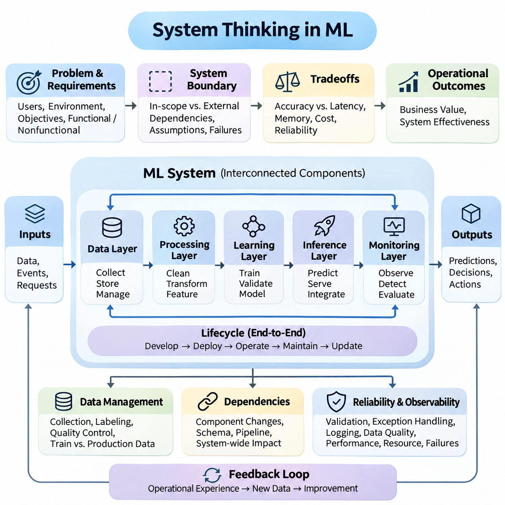
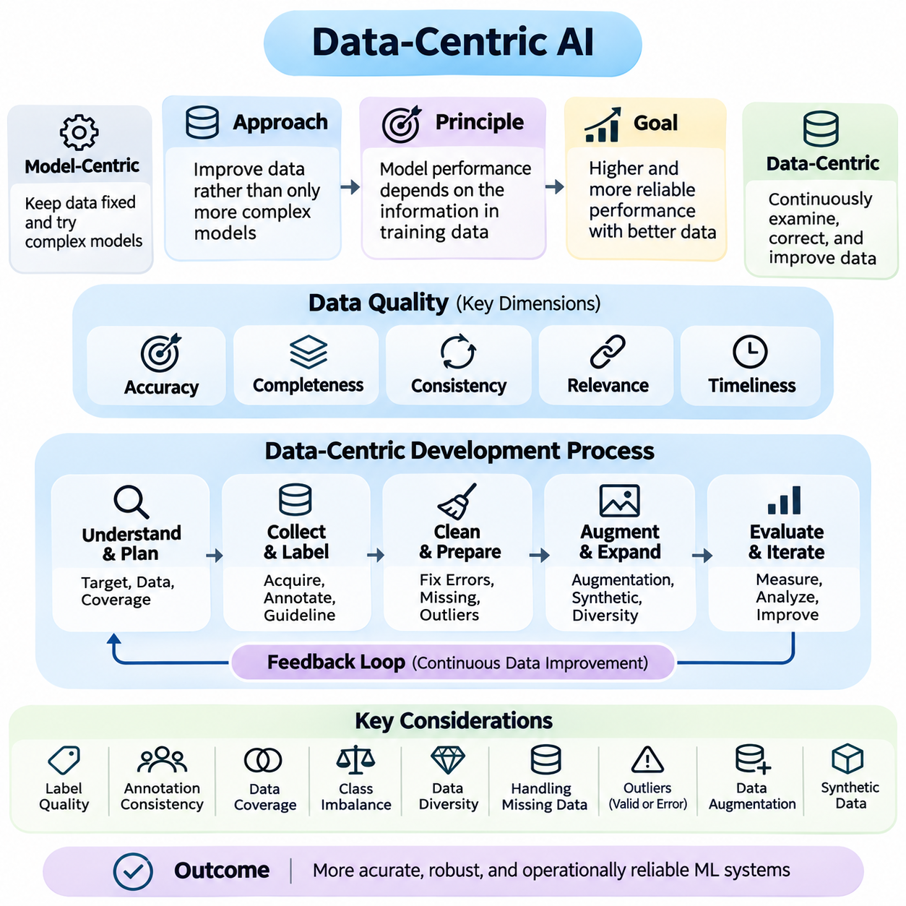
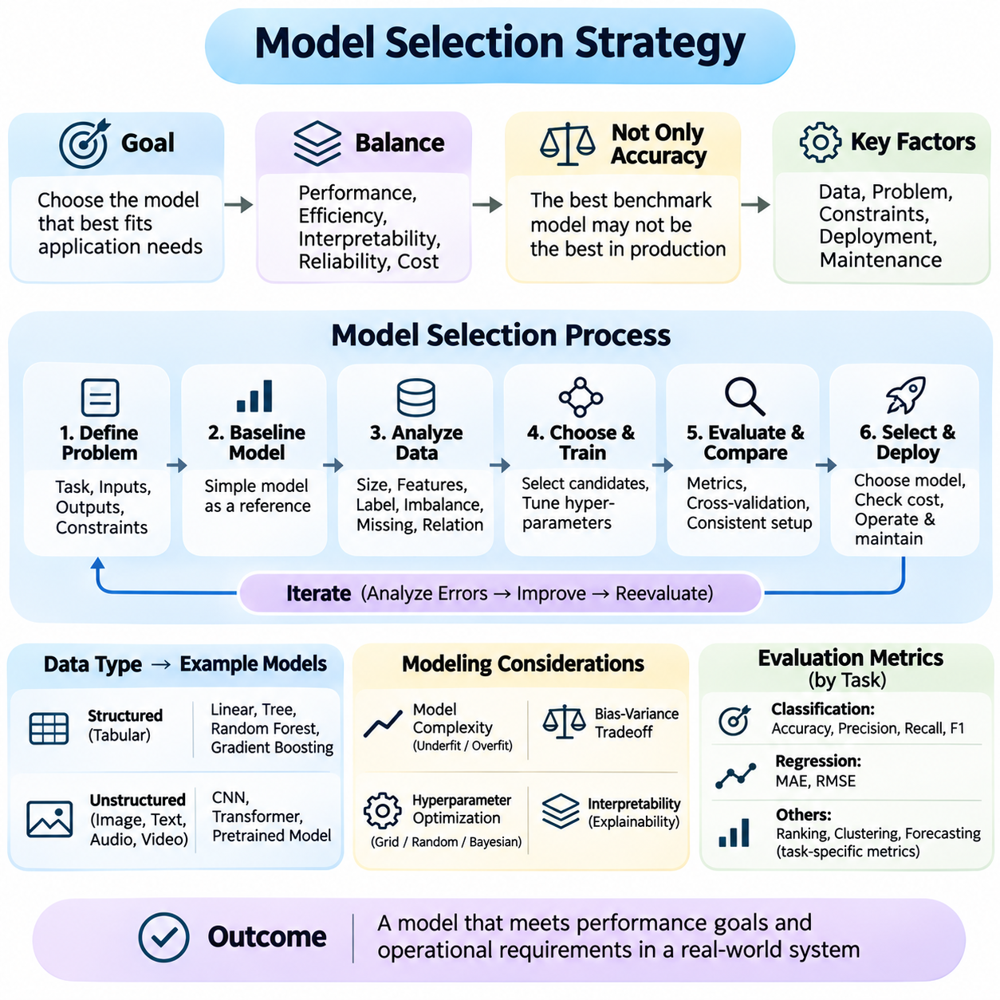
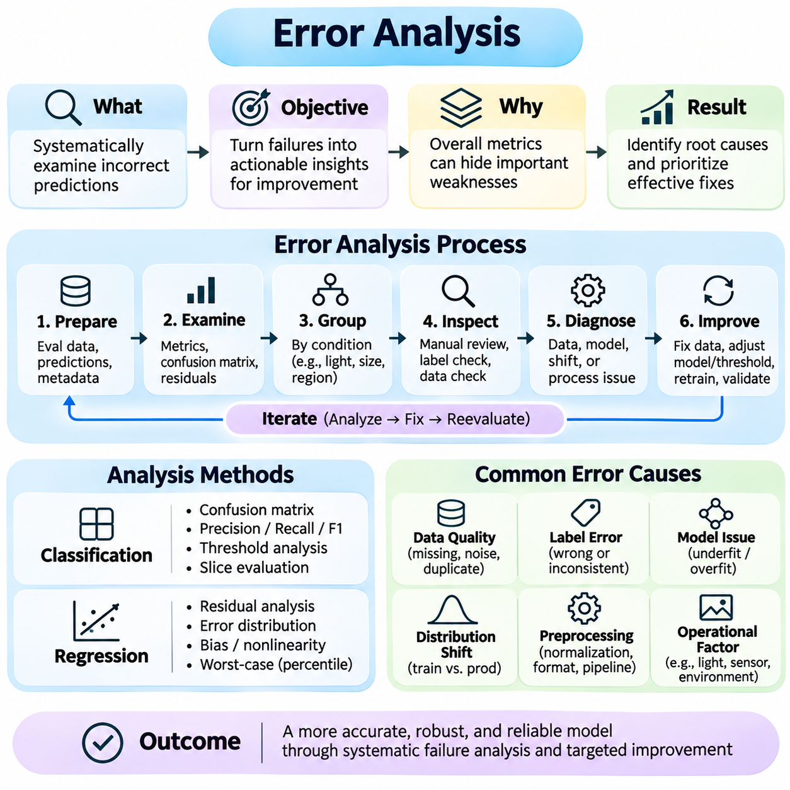
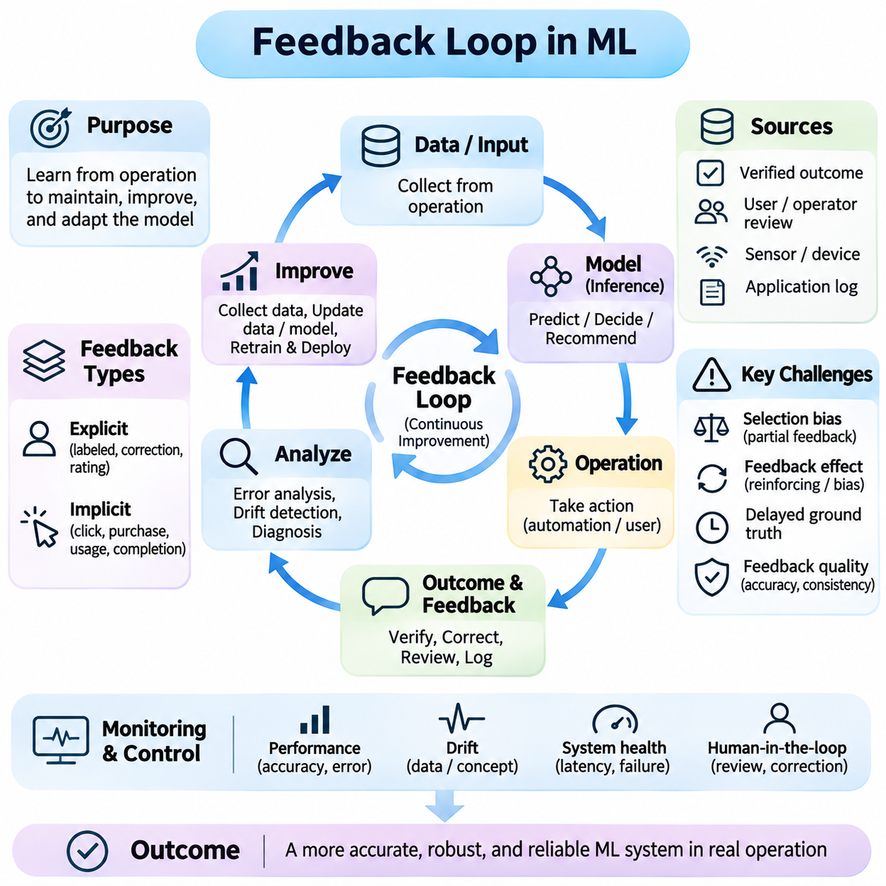
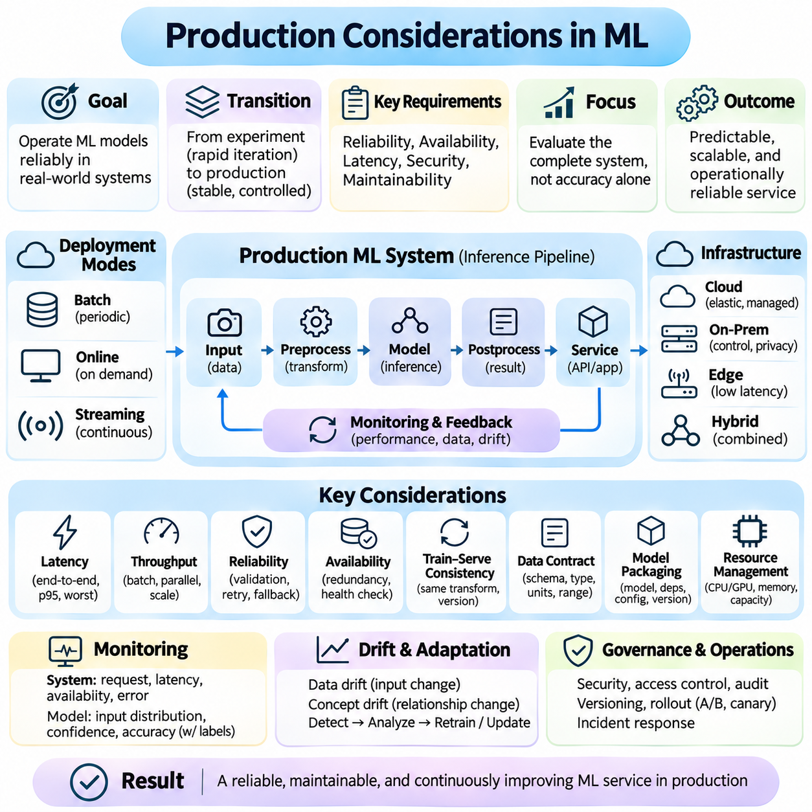
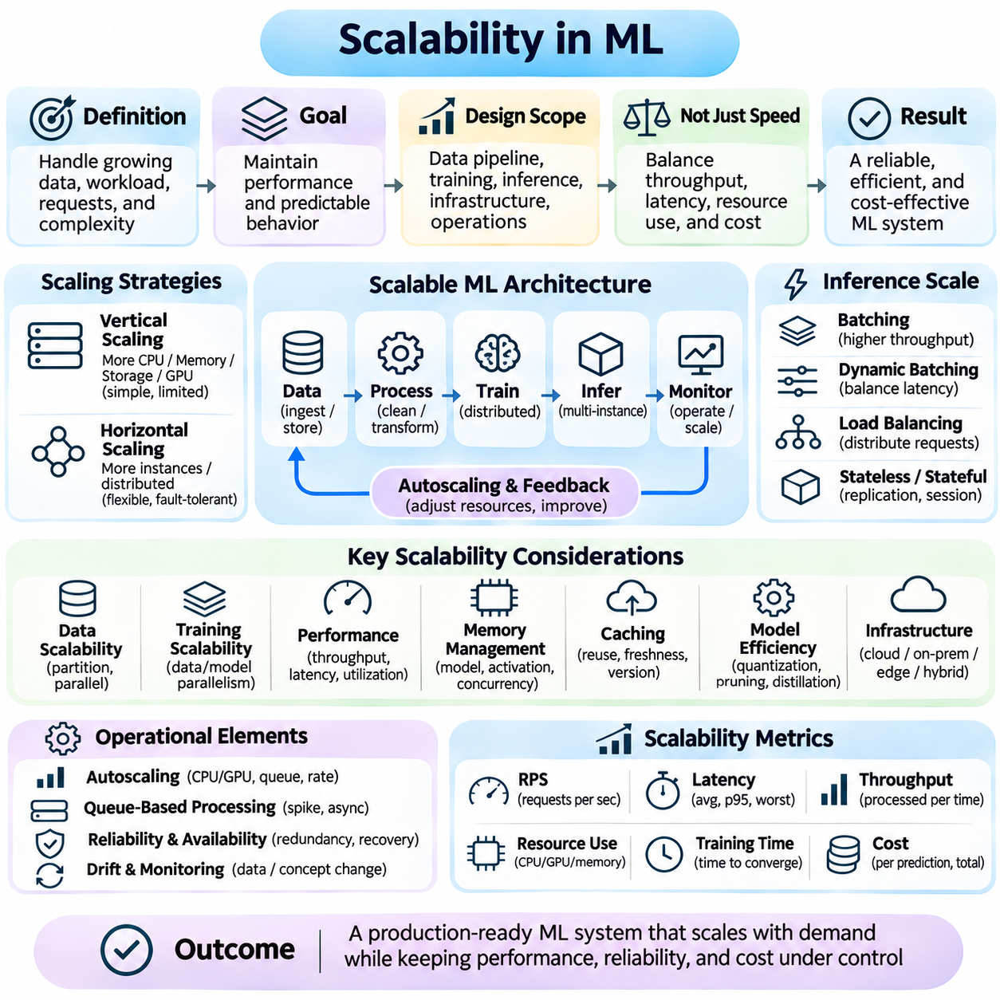
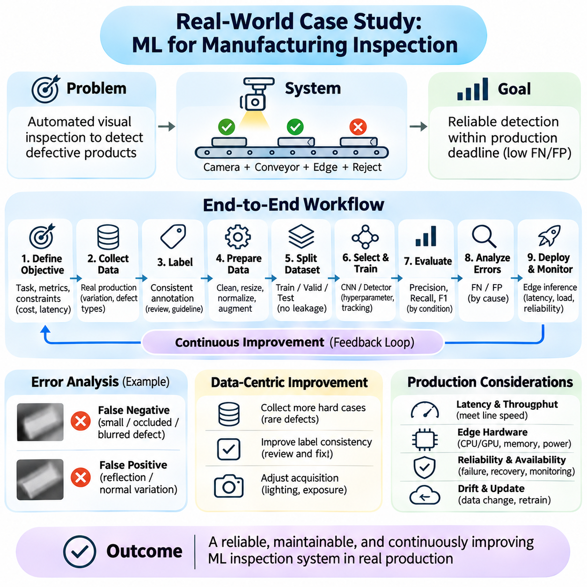

**Volume 07. Machine Learning Fundamentals**

# 07. Practical ML System Design

## 07.00 System Thinking

{width="7.268055555555556in" height="7.268055555555556in"}

System thinking in machine learning involves understanding an ML solution as an interconnected collection of components rather than an isolated predictive model. A successful system must coordinate data acquisition, preprocessing, training, evaluation, deployment, monitoring, and maintenance. Each component influences the others, so improving model accuracy alone does not necessarily improve the overall system.

The central principle of system thinking is to begin with the problem that the system must solve. Before selecting algorithms or collecting datasets, engineers should identify the intended users, operational environment, expected outputs, and measurable objectives. A clearly defined problem establishes the foundation for selecting appropriate data, designing evaluation procedures, and determining whether machine learning is necessary.

A machine learning system operates within a larger environment that provides inputs and receives outputs. These interactions establish the system boundary, which distinguishes components controlled by developers from external factors. Understanding this boundary helps engineers identify dependencies, assumptions, and potential failure conditions that may affect the reliability of predictions and downstream decisions.

System requirements should include both functional and nonfunctional characteristics. Functional requirements describe what the system must accomplish, such as classifying images or predicting equipment failures. Nonfunctional requirements describe performance constraints, including response latency, throughput, availability, memory consumption, security, and maintainability. Both categories influence architectural decisions.

A practical ML architecture typically contains several connected layers. The data layer collects and stores information, the processing layer transforms raw observations into usable features, and the learning layer produces predictive models. An inference layer delivers predictions to applications, while monitoring mechanisms evaluate operational behavior. These layers must exchange information through consistent interfaces.

Data should be treated as a continuously managed system resource rather than a static input to training. Collection methods, storage formats, labeling procedures, and quality controls influence the information available to learning algorithms. Errors introduced during acquisition may propagate through preprocessing and training, producing unreliable predictions even when the model architecture is technically correct.

The relationship between training data and production data is particularly important. A model learns statistical patterns from historical observations, but deployment exposes it to new operating conditions. Differences in sensor characteristics, user behavior, environmental conditions, or data collection procedures can reduce predictive performance. System design must therefore account for changes between development and deployment.

System thinking also requires recognizing dependencies between components. A modification to feature normalization may require retraining the model and updating the inference pipeline. Changing a data schema may affect validation procedures, stored datasets, and application interfaces. Engineers should evaluate such changes across the entire system instead of assuming that individual components can evolve independently.

Machine learning performance must be connected to operational outcomes. Accuracy, precision, recall, and prediction error measure aspects of model behavior, but they do not directly describe business value or system effectiveness. A fraud detection model, for example, must balance detection performance against investigation costs, false alarms, processing delays, and the consequences of missed fraudulent transactions.

Tradeoffs are unavoidable in practical system design. Increasing model complexity may improve predictive accuracy while raising inference latency, memory requirements, and operational costs. A smaller model may provide slightly lower accuracy but support faster execution and more reliable deployment on constrained hardware. The appropriate choice depends on system objectives rather than benchmark performance alone.

System thinking encourages engineers to consider the complete lifecycle of an ML solution. Initial development includes problem formulation, data preparation, experimentation, and validation. Production introduces additional requirements involving deployment, monitoring, incident response, and model updates. A design that performs well during experimentation may still fail if it cannot be operated and maintained effectively.

Reliability must be evaluated across the complete prediction pathway. Even a highly accurate model cannot produce useful results when upstream data pipelines fail or downstream applications interpret outputs incorrectly. Robust systems include input validation, exception handling, logging, fallback behavior, and mechanisms for detecting unexpected conditions. Reliability emerges from coordinated component behavior.

Observability provides the information needed to understand system behavior during operation. Engineers should monitor data quality, prediction distributions, model performance when ground truth becomes available, latency, resource utilization, and failure rates. Monitoring infrastructure helps distinguish problems caused by data changes from those caused by software defects, hardware limitations, or model degradation.

Feedback loops connect operational experience to system improvement. Predictions influence decisions, and those decisions may generate new observations that become future training data. This creates dependencies between model behavior and subsequent data collection. Engineers must examine whether feedback introduces selection bias, reinforces existing errors, or changes the distribution of observations available for learning.

Human interaction is another important component of ML system design. Users may review predictions, correct errors, provide labels, or override automated decisions. These interactions can improve reliability when responsibilities and interfaces are clearly defined. However, inconsistent feedback or unclear decision authority can introduce new problems, making human participation an explicit architectural consideration.

System decomposition helps manage complexity by separating responsibilities into understandable modules. Data ingestion, feature transformation, training, inference, and monitoring can be developed and tested independently when their interfaces are well defined. Modular architecture improves maintainability and allows individual components to evolve, although excessive fragmentation may introduce unnecessary communication and coordination overhead.

Reproducibility connects scientific experimentation with engineering reliability. A model should be associated with its training dataset, preprocessing configuration, algorithm parameters, software dependencies, and evaluation results. Version control and experiment tracking allow engineers to investigate performance differences and reconstruct earlier system states. These practices support debugging, auditing, and controlled deployment.

Security and privacy considerations must be incorporated throughout the architecture. Data pipelines may process confidential information, while deployed prediction services may expose interfaces to external applications. Appropriate access controls, data protection mechanisms, and input validation reduce operational risks. Security cannot be achieved solely by protecting the trained model because vulnerabilities may exist elsewhere in the system.

Scalability describes the ability of a system to handle increasing workloads without unacceptable degradation. Growth may involve larger datasets, additional users, more frequent predictions, or expanded model training requirements. Engineers should identify likely bottlenecks in storage, computation, networking, and data processing. Scalability decisions should reflect expected demand and realistic operational constraints.

Cost is a system-level consideration because training, inference, storage, networking, and maintenance consume different resources. A model that is inexpensive to train may become costly when serving millions of predictions. Conversely, expensive initial training may be justified when the resulting model supports efficient repeated inference. Total lifecycle cost provides a more meaningful basis for comparison.

System thinking also requires identifying uncertainty and managing risk. Data availability, label quality, deployment conditions, and future workload characteristics may not be fully known during development. Engineers can reduce uncertainty through prototypes, baseline models, controlled experiments, and staged deployment. Early validation of critical assumptions prevents expensive architectural commitments based on incomplete evidence.

A useful design approach begins with a simple baseline that establishes measurable performance. The baseline may use a rule-based method, a statistical model, or a conventional machine learning algorithm. Its purpose is to reveal the difficulty of the problem and provide a reference for evaluating improvements. Additional complexity should be introduced only when experiments demonstrate meaningful benefits.

Consider a manufacturing inspection system that identifies defective products using camera images. Its performance depends not only on the classification model but also on lighting, camera positioning, image acquisition timing, labeling consistency, and communication with production equipment. A change in illumination may reduce accuracy, while delayed inference may prevent defective items from being removed correctly.

In this manufacturing example, system thinking leads engineers to evaluate the complete inspection process. They must define acceptable defect detection rates, false rejection costs, processing deadlines, and procedures for handling uncertain predictions. Monitoring should identify changes in image quality and prediction behavior. The resulting system is evaluated by its contribution to reliable inspection rather than classification accuracy alone.

Effective system design requires collaboration among data scientists, software engineers, domain specialists, and operational teams. Each group contributes knowledge about different constraints and failure modes. Shared objectives, documented interfaces, and clear responsibilities help align technical decisions. Without coordination, locally optimized components may produce a system that performs poorly when integrated.

Ultimately, system thinking transforms machine learning from an isolated model-building activity into the engineering of a dependable decision-making capability. The goal is not simply to produce accurate predictions under experimental conditions but to deliver consistent value within real operational constraints. Successful ML systems balance data quality, predictive performance, reliability, cost, adaptability, and long-term maintainability.

## 07.01 Data Centric AI

{width="7.268055555555556in" height="7.268055555555556in"}

Data-centric AI is an approach to machine learning that emphasizes improving the quality, consistency, and relevance of data rather than relying primarily on increasingly complex models. Traditional model-centric development often keeps the dataset fixed while experimenting with algorithms. Data-centric development instead treats the dataset as an evolving engineering asset that can be systematically examined, corrected, and improved.

The central principle of data-centric AI is that model performance depends heavily on the information contained in training data. Even sophisticated algorithms cannot reliably learn patterns that are missing, incorrectly labeled, or poorly represented. Improving data quality can therefore produce substantial performance gains without changing the underlying model architecture, particularly when errors originate from the dataset.

Data-centric development begins with understanding the relationship between the target problem and the available observations. Engineers must determine whether collected samples represent the conditions in which the model will operate. A dataset may contain thousands of examples but still be inadequate if important operating conditions, rare events, or difficult cases are absent from the training distribution.

Data quality includes several interconnected dimensions, such as accuracy, completeness, consistency, relevance, and timeliness. Accuracy concerns whether observations and labels correctly describe reality. Completeness addresses missing information, while consistency requires compatible formats and definitions. Relevance ensures that collected examples support the intended prediction task, and timeliness reflects their usefulness under current conditions.

Label quality is particularly important in supervised learning because labels define the target behavior that the model attempts to reproduce. Incorrect or ambiguous labels introduce conflicting learning signals and may establish an upper limit on achievable performance. Engineers should therefore develop clear annotation guidelines, review difficult examples, and investigate disagreements among annotators before increasing model complexity.

Annotation consistency is often more important than simply increasing the number of labeled samples. When different annotators interpret categories differently, the resulting dataset may contain systematic contradictions. Standardized definitions, representative examples, and quality assurance procedures help reduce these inconsistencies. Agreement measurements can identify ambiguous categories that require clearer labeling policies.

Data coverage describes how well a dataset represents the range of situations expected during deployment. A computer vision dataset, for example, should account for variations in lighting, camera angle, object size, background, and environmental conditions. If training examples cover only ideal conditions, the resulting model may perform well during validation but fail when exposed to realistic operational variability.

Class imbalance is another important consideration because some categories naturally occur less frequently than others. A manufacturing dataset may contain many normal products but relatively few defective examples. Without appropriate treatment, a classifier may favor the majority class and overlook important failures. Data-centric strategies include targeted collection, careful resampling, and evaluation that reflects the consequences of minority-class errors.

Data diversity improves the likelihood that a model will learn generalizable patterns rather than memorizing narrow characteristics of its training environment. Diversity may involve different devices, locations, populations, operating conditions, or temporal periods. However, diversity should remain relevant to the intended application because collecting unrelated examples can increase cost without meaningfully improving predictive performance.

Dataset cleaning is a systematic process for identifying and correcting problems that interfere with learning. Common issues include duplicate records, corrupted files, inconsistent units, invalid values, and incorrect annotations. Cleaning decisions should be documented because removing or modifying observations changes the training distribution. Excessive cleaning may also eliminate legitimate rare cases that are important for robust prediction.

Missing data requires particular attention because its meaning depends on how observations were collected. Missing values may result from random technical failures, operational procedures, or underlying characteristics of the observed process. Simple imputation can be appropriate in some situations, but inappropriate replacement may introduce artificial patterns. Engineers should investigate missingness mechanisms before selecting a treatment strategy.

Outliers should not automatically be considered errors. An unusual observation may indicate sensor malfunction, incorrect recording, or a genuinely rare event. Removing all unusual samples can make a dataset appear cleaner while reducing the model\'s ability to recognize important anomalies. Data-centric analysis distinguishes invalid measurements from valid but infrequent conditions using domain knowledge and statistical evidence.

Data augmentation expands the effective variety of training examples through controlled transformations. In computer vision, transformations may include rotation, cropping, brightness adjustment, and geometric variation. Effective augmentation preserves the intended label while introducing realistic changes. Transformations that violate physical constraints or alter the target category can create misleading examples and reduce model reliability.

Synthetic data provides another method for increasing coverage when real observations are expensive, rare, or difficult to collect. Simulations and generative techniques can produce controlled variations of operating conditions and failure scenarios. However, synthetic examples may contain unrealistic patterns or omit important physical effects. Their usefulness must be validated against representative real-world data rather than assumed from visual similarity.

Data-centric AI also emphasizes systematic error analysis. Instead of responding to poor performance by immediately replacing the model, engineers examine which examples produce incorrect predictions and why. Errors can be grouped by environmental condition, category, data source, or annotation quality. These patterns help identify whether additional samples, corrected labels, or improved preprocessing would address the underlying problem.

Targeted data collection focuses resources on examples that are most likely to improve system performance. If a model consistently fails under low illumination, collecting more images under ideal lighting may provide little benefit. Acquiring representative low-light examples can directly address the weakness. This approach makes dataset expansion more efficient by connecting collection priorities to observed failure patterns.

Active learning extends targeted collection by allowing the model to help identify informative examples. A learning system may prioritize samples associated with high uncertainty, disagreement, or insufficient representation. Human annotators then review selected observations, and the resulting labels support subsequent training. Active learning can reduce annotation effort, although uncertainty estimates and sampling strategies require careful validation.

Data versioning is essential because datasets change as errors are corrected and new observations are introduced. Each training experiment should be associated with a specific dataset version, preprocessing configuration, and annotation policy. Without these records, engineers may struggle to explain performance differences or reproduce earlier results. Versioned datasets support traceability, controlled experimentation, and reliable model updates.

Data leakage represents a serious risk when information unavailable during real-world prediction enters the training or evaluation process. Leakage may arise from duplicate samples, future information, preprocessing performed across inappropriate dataset boundaries, or features that indirectly reveal target labels. Data-centric design requires split strategies that reflect deployment conditions and prevent misleading estimates of generalization.

Evaluation datasets should be managed with the same discipline as training datasets. A test set must represent meaningful operating conditions while remaining independent of model selection and tuning decisions. Repeatedly modifying a model based on test results can compromise this independence. Carefully maintained validation and test collections provide a more trustworthy basis for determining whether data improvements produce genuine progress.

Data-centric development benefits from separating data problems from model problems. When both training and validation performance are poor, insufficient features, noisy labels, or limited model capacity may be responsible. When training performance is strong but deployment performance deteriorates, distribution differences or missing operating conditions become important suspects. Structured diagnosis prevents unnecessary algorithm changes.

Consider a conveyor-based inspection system that classifies products using images captured by an industrial camera. Early experiments may reveal that the model performs well on stationary objects but poorly when products move rapidly. A data-centric investigation could identify motion blur, inconsistent exposure, or insufficient moving-object examples. Improving acquisition conditions and dataset coverage may resolve the issue more effectively than selecting a larger neural network.

Continuous data monitoring becomes necessary after deployment because real-world distributions rarely remain perfectly stable. New product designs, changing sensor conditions, seasonal variation, and altered user behavior may introduce patterns absent from historical datasets. Monitoring feature distributions, prediction characteristics, and verified outcomes helps identify when the dataset no longer adequately represents the operating environment.

Feedback from production can support continuous dataset improvement when it is collected and validated carefully. Human corrections, confirmed failures, and difficult operational examples may become valuable training samples. However, feedback mechanisms can introduce selection bias when only certain predictions receive review. Engineers must understand how examples are selected before treating collected feedback as representative ground truth.

Data-centric AI requires organizational processes that assign responsibility for data quality throughout the machine learning lifecycle. Data engineers, domain experts, annotators, and model developers must share definitions and quality standards. Documentation should describe collection procedures, labeling rules, known limitations, and permitted uses. Effective governance transforms data improvement from an occasional cleanup activity into a repeatable engineering practice.

Ultimately, data-centric AI recognizes that reliable machine learning emerges from the interaction between data, models, and operational environments. Better algorithms remain valuable, but they cannot compensate for every weakness in the information used for learning. By systematically improving data quality, coverage, labeling, and lifecycle management, engineers can develop systems that generalize more effectively and remain dependable under changing real-world conditions.

## 07.02 Model Selection Strategy

{width="7.268055555555556in" height="7.268055555555556in"}

Model selection is the process of identifying a machine learning model that best satisfies the objectives and constraints of a particular application. The most accurate model on a benchmark is not necessarily the most appropriate choice for a production system. Practical selection requires balancing predictive performance, computational efficiency, interpretability, reliability, deployment requirements, and long-term maintenance costs.

An effective model selection strategy begins with clearly defining the learning problem. Classification, regression, ranking, clustering, and forecasting tasks require different modeling assumptions and evaluation procedures. Engineers should identify the expected inputs, target outputs, available training data, and operational constraints before choosing an algorithm. This prevents unnecessary experimentation with unsuitable model families.

A simple baseline model provides an essential reference for evaluating more sophisticated approaches. Linear regression, logistic regression, decision trees, or rule-based methods can establish initial performance levels. Baselines help determine whether additional complexity produces meaningful improvements. If a simple model already satisfies operational requirements, a more complicated architecture may introduce unnecessary engineering costs.

The characteristics of the dataset strongly influence model selection. Important factors include sample size, feature dimensionality, label quality, class imbalance, missing values, and the presence of nonlinear relationships. Some algorithms perform well with limited structured data, while others require large collections of representative examples. Understanding these characteristics helps narrow the range of appropriate candidates.

Structured tabular data often provides a useful starting point for classical machine learning algorithms. Linear models offer efficiency and interpretability, while decision trees and ensemble methods can capture nonlinear interactions. Random forests and gradient boosting frequently provide strong performance on heterogeneous tabular features. Their suitability should nevertheless be established through validation rather than assumed from general reputation.

Unstructured data introduces different modeling requirements. Images, audio, natural language, and video contain spatial or sequential relationships that may benefit from specialized neural architectures. Convolutional networks, transformers, and pretrained representation models can capture complex patterns. However, their computational requirements and dependence on suitable training data must be considered alongside potential accuracy improvements.

Model complexity should be selected according to the difficulty of the problem and the available evidence. Models with insufficient capacity may underfit, failing to capture important relationships. Excessively flexible models may overfit, learning accidental patterns from training examples. Validation performance, learning curves, and error analysis help determine whether additional capacity is justified.

The bias-variance tradeoff provides a conceptual framework for understanding model behavior. High-bias models may produce systematic errors because their assumptions are too restrictive. High-variance models may respond excessively to fluctuations in training data. Effective model selection seeks an appropriate balance, although modern regularization, ensemble methods, and large-scale training can make the relationship more complex.

Evaluation metrics must reflect the consequences of prediction errors. Accuracy may be appropriate for balanced classification, but precision, recall, and F1 score can be more informative when class frequencies differ. Regression tasks may require mean absolute error or root mean squared error. The selected metric should represent the application\'s actual priorities rather than merely produce favorable benchmark results.

Model comparison requires consistent experimental conditions. Candidate algorithms should be evaluated using compatible data partitions, preprocessing procedures, and metric definitions. Hyperparameter tuning must remain separate from final test evaluation to prevent optimistic estimates. Repeated experiments with controlled random seeds can help reveal performance variability and improve confidence in comparative results.

Cross-validation provides a systematic approach for estimating performance when available data is limited. By training and validating models across multiple partitions, engineers can examine how sensitive results are to particular samples. However, ordinary random cross-validation may be inappropriate for temporal, grouped, or spatially dependent observations. The validation strategy must reflect the intended deployment scenario.

Hyperparameter optimization influences model selection because different configurations of the same algorithm can produce substantially different results. Grid search, random search, and Bayesian optimization explore alternative settings under defined computational budgets. Fair comparison requires reasonable tuning effort for each candidate. Excessive optimization against one validation set can itself cause overfitting.

Interpretability is an important consideration when predictions must be explained to users, operators, or regulators. Linear models and shallow decision trees often provide relatively transparent relationships between inputs and outputs. More complex models may require additional explanation methods. Engineers should determine whether interpretability is a mandatory requirement, an operational preference, or a secondary objective.

Computational efficiency affects both training and inference. A model may achieve excellent validation performance but require excessive memory, processing time, or specialized hardware. Training cost matters when frequent updates are expected, while inference cost becomes critical under high request volumes. Practical selection therefore considers resource consumption across the complete model lifecycle.

Latency constraints can eliminate otherwise promising models. Real-time applications such as industrial inspection, robotics, and interactive services must produce predictions within defined deadlines. Average inference latency alone may be insufficient because occasional slow predictions can disrupt operations. Engineers should measure latency distributions under representative workloads and include preprocessing and communication overhead.

Deployment environments introduce additional constraints. Cloud infrastructure may provide substantial computational resources, while edge devices often have limited memory, power, and processing capacity. Model size, supported operators, runtime compatibility, and hardware acceleration influence deployment feasibility. A smaller model with predictable execution may be preferable when reliable operation matters more than marginal accuracy gains.

Robustness describes the ability of a model to maintain acceptable behavior under realistic variations in input conditions. Noise, missing features, sensor changes, and distribution shifts may expose weaknesses not visible in standard validation results. Candidate models should therefore be tested against representative disturbances and difficult examples. Robustness evaluation complements conventional predictive metrics.

Calibration and uncertainty estimation can also influence model choice. Two classifiers with similar accuracy may produce confidence scores with very different reliability. When predictions support risk-sensitive decisions, well-calibrated probabilities can improve threshold selection and human review procedures. Engineers should evaluate whether the model\'s reported confidence corresponds to observed correctness under relevant conditions.

Data availability and labeling cost may favor transfer learning over training a model from scratch. Pretrained models provide representations learned from larger datasets and can often be adapted to specific tasks. Fine-tuning may reduce development time and data requirements, although performance depends on similarity between source and target domains. Licensing, model size, and deployment compatibility remain important considerations.

Ensemble methods combine multiple predictors to improve stability or accuracy. Bagging can reduce variance, while boosting constructs models that progressively address prediction errors. Combining different model families may provide complementary strengths. Nevertheless, ensembles increase computational and maintenance complexity, so their benefits should be measured against operational costs.

Error analysis helps distinguish models that have similar aggregate scores but different failure patterns. One classifier may perform better on common examples, while another handles rare but important conditions more reliably. Examining confusion matrices, subgroup performance, and representative failures reveals these differences. Selection should prioritize errors according to their practical consequences.

Model selection should also account for future maintenance. Some algorithms require frequent retraining, extensive feature engineering, or specialized operational expertise. Others may support simpler updates and more stable deployment workflows. Documentation, reproducibility, monitoring compatibility, and available engineering skills influence the total cost of maintaining a model over time.

A practical selection process progressively narrows the candidate set. Engineers begin with simple baselines, evaluate a limited number of suitable model families, and tune promising configurations. Final candidates undergo broader testing for accuracy, robustness, latency, resource consumption, and operational compatibility. This staged approach reduces wasted experimentation while preserving evidence-based decisions.

Consider an industrial image classification system operating on an edge computer. A large vision transformer may achieve slightly higher validation accuracy than a compact convolutional network but exceed available memory or latency limits. The smaller network may therefore deliver greater operational value. Model selection should evaluate the complete inspection workflow rather than isolated inference benchmarks.

Ultimately, model selection is a multi-objective engineering decision rather than a competition to maximize a single metric. The preferred model must provide sufficient predictive quality while satisfying practical requirements for efficiency, reliability, interpretability, and maintainability. A disciplined strategy uses representative validation, controlled comparisons, and system-level evaluation to identify the model that delivers the greatest sustainable value.

## 07.03 Error Analysis [w/Code]

{width="7.268055555555556in" height="7.268055555555556in"}

Error analysis is the systematic examination of incorrect predictions to understand why a machine learning model fails and how its performance can be improved. Aggregate evaluation metrics indicate the overall quality of a model but often conceal important weaknesses. By investigating individual failures and recurring patterns, engineers can identify whether problems originate from data quality, model limitations, evaluation procedures, or deployment conditions.

The primary objective of error analysis is to transform prediction failures into actionable engineering insights. Rather than immediately increasing model complexity, developers examine the circumstances surrounding incorrect outputs. This process connects quantitative evaluation with qualitative investigation and helps prioritize improvements according to their expected impact on system performance.

Effective error analysis begins with a clearly defined evaluation dataset and consistent prediction records. Each record should contain the input sample, expected target, model prediction, and relevant metadata. Confidence scores, timestamps, data sources, and environmental conditions may provide additional context. These records enable engineers to reproduce failures and compare results across model versions.

Classification errors can be examined using a confusion matrix, which summarizes relationships between predicted and actual classes. True positives, false positives, true negatives, and false negatives provide the foundation for several evaluation metrics. However, the importance of each error depends on the application. Missing a dangerous defect may be considerably more costly than incorrectly rejecting a normal product.

Precision and recall reveal different aspects of classification failures. Precision measures how frequently positive predictions are correct, while recall measures how many actual positive cases are detected. Increasing sensitivity may improve recall while generating additional false positives. Error analysis helps determine whether the current decision threshold reflects operational priorities and acceptable failure costs.

Regression models require a different analytical approach because their errors are continuous rather than categorical. Residuals represent differences between observed targets and predicted values. Plotting or examining residuals against predictions, features, and time can reveal systematic bias, nonlinear relationships, or changing error variance. Large residuals may indicate unusual observations or missing explanatory variables.

Error distributions provide more information than average performance alone. Two models with similar mean absolute error may exhibit substantially different worst-case behavior. Engineers should examine percentiles, extreme failures, and the frequency of errors beyond operational tolerances. Tail behavior becomes particularly important when occasional large mistakes can disrupt equipment, services, or downstream decisions.

A useful error analysis process groups failures into meaningful categories. Categories may describe lighting conditions, object sizes, sensor types, geographic regions, customer segments, or operational states. Grouping allows engineers to identify concentrated weaknesses that aggregate metrics conceal. Categories should reflect plausible failure mechanisms rather than arbitrary divisions that produce misleading conclusions.

Slice-based evaluation measures model performance within selected subsets of the data. A vision model may achieve high overall accuracy but perform poorly on small objects or low-light images. Comparing performance across slices reveals whether the model generalizes consistently. Engineers must also consider sample counts and uncertainty because apparent differences based on very small groups may be unreliable.

Manual inspection remains valuable even when automated metrics are available. Reviewing representative failures can reveal mislabeled samples, corrupted inputs, ambiguous categories, or unexpected visual patterns. Domain experts may recognize causes that statistical summaries cannot explain. A structured review process should document observations and distinguish verified problems from preliminary hypotheses.

Label errors can make correct model predictions appear incorrect during evaluation. When a prediction disagrees with its reference label, engineers should not automatically assume the model is wrong. Annotation guidelines, source records, and independent reviews may reveal inconsistencies in the ground truth. Correcting confirmed label problems improves both evaluation reliability and subsequent training quality.

Data quality problems frequently emerge as recurring failure patterns. Missing values, inconsistent normalization, sensor noise, duplicate records, and inappropriate preprocessing can all degrade predictions. Engineers should trace suspicious examples through the complete data pipeline to determine where information was altered or lost. Fixing upstream defects may improve performance more effectively than changing the model.

Model-related errors arise when the learning algorithm cannot adequately represent the underlying relationships or generalize from available examples. Underfitting may produce broad systematic mistakes, while overfitting may cause strong training performance but poor validation results. Learning curves and comparisons between training and evaluation errors help distinguish these situations.

Distribution shift occurs when the statistical characteristics of operational data differ from those encountered during training. Changes in illumination, equipment, user behavior, or environmental conditions may create new failure patterns. Error analysis should compare development and production conditions to identify these differences. Retraining is not always sufficient unless the updated dataset represents the changed environment.

Confidence analysis examines whether incorrect predictions are associated with appropriate uncertainty. High-confidence mistakes can be particularly problematic because downstream systems may treat them as reliable. Engineers can compare confidence distributions for correct and incorrect predictions and evaluate probability calibration. These investigations support safer thresholds, rejection policies, and human review mechanisms.

Error prioritization should reflect both frequency and consequence. A common low-impact mistake may deserve less attention than a rare failure with serious operational consequences. Engineers can estimate the expected value of improvements by considering occurrence rates, failure costs, and potential remedies. This prevents optimization efforts from focusing exclusively on the largest numerical error category.

Root cause analysis distinguishes observable symptoms from underlying mechanisms. A model may fail on dark images because the training dataset lacks low-light examples, because exposure settings are inconsistent, or because preprocessing removes important details. Each explanation suggests a different intervention. Controlled experiments are needed to determine which hypothesis is supported by evidence.

Error analysis naturally connects to data-centric improvement. If failures cluster around poorly represented conditions, targeted data collection may be appropriate. If errors result from inconsistent annotations, label correction may provide greater value. When failures reveal missing predictive information, feature engineering or additional sensors may be necessary. Model changes should follow the identified cause.

Controlled experimentation helps verify whether a proposed correction addresses the intended weakness. Engineers should modify one major factor at a time when practical and compare results against a stable baseline. Improvements should be measured on relevant error categories and overall validation performance. A change that fixes one failure mode may introduce new errors elsewhere.

Error analysis must avoid excessive adaptation to a fixed evaluation set. Repeatedly examining test examples and modifying the model based on their outcomes can create indirect overfitting. Development investigations should primarily use training and validation data, while an independent test set supports final assessment. This separation preserves the credibility of reported generalization performance.

Consider an automated conveyor inspection system that identifies defective products from camera images. Error analysis may reveal that false negatives increase when objects overlap or move rapidly. Inspection of failed samples could identify motion blur, incomplete object visibility, or insufficient examples of overlapping products. Each finding suggests specific changes to image acquisition, data collection, or model design.

A practical implementation can store predictions and reference labels in a structured table, then calculate metrics using Python and machine learning libraries. Pandas can organize records by failure category, while scikit-learn can compute confusion matrices and classification reports. Visualization tools can reveal residual patterns and subgroup differences. Reproducible scripts make repeated analysis more consistent and efficient.

Error analysis should continue after deployment because new operating conditions may introduce failures absent from development datasets. Production logs, verified outcomes, operator corrections, and incident reports provide useful evidence. Monitoring should track error rates when ground truth becomes available and detect changes in prediction distributions. Feedback from these observations supports controlled system updates.

Documentation makes error analysis cumulative rather than repetitive. Engineers should record failure categories, representative examples, suspected causes, experimental interventions, and measured outcomes. Versioned reports allow teams to compare recurring weaknesses across model releases. Clear records also help distinguish unresolved limitations from problems that have already been corrected.

Ultimately, error analysis transforms model evaluation into a continuous process of diagnosis and improvement. Its value lies not simply in counting mistakes but in understanding their causes, consequences, and possible remedies. By combining quantitative metrics, qualitative inspection, controlled experiments, and operational feedback, engineers can develop machine learning systems that become progressively more reliable and effective.

## 07.04 Feedback Loop

{width="7.268055555555556in" height="7.268055555555556in"}

A feedback loop in machine learning is a systematic process that connects model predictions, operational outcomes, and subsequent improvements. Unlike a static model that remains unchanged after deployment, a feedback-driven system learns from observed performance and changing conditions. Its purpose is to maintain reliability, identify weaknesses, and support controlled adaptation throughout the machine learning lifecycle.

The basic feedback loop begins when a deployed model receives input data and generates predictions. These predictions may influence decisions, trigger automated actions, or provide recommendations to users. Subsequent observations reveal whether the predictions were useful or correct. When reliable outcome information becomes available, it can be compared with earlier predictions to identify errors and improvement opportunities.

Feedback can originate from several sources, including verified outcomes, user corrections, operator reviews, sensor measurements, and application logs. Each source provides different information about system behavior. Directly observed outcomes may offer stronger evidence than subjective ratings, while expert reviews can explain difficult cases. Engineers must assess the reliability and relevance of each feedback source.

A distinction must be made between explicit and implicit feedback. Explicit feedback occurs when users deliberately provide labels, corrections, or evaluations. Implicit feedback is inferred from actions such as clicks, purchases, equipment responses, or task completion. Although implicit signals are easier to collect at scale, they may reflect factors unrelated to prediction quality and require careful interpretation.

Feedback collection should be designed as part of the production architecture rather than added after problems appear. Prediction identifiers, model versions, timestamps, input characteristics, and decision outcomes should be recorded consistently. These records allow later observations to be associated with the predictions that influenced them. Traceability is essential when outcomes become available only after substantial delays.

Ground truth availability determines how directly feedback can support model evaluation. In some applications, correct outcomes are observed immediately, while others require human verification or extended observation. A defect detection system may receive inspection confirmation within minutes, whereas a credit risk model may require months. Monitoring procedures must accommodate these different feedback delays.

Feedback quality is as important as feedback quantity. Incorrect corrections, ambiguous outcomes, duplicate records, and inconsistent review standards can introduce additional noise into training data. Engineers should validate collected feedback before incorporating it into datasets. Quality assurance may include independent review, consistency checks, confidence assessment, and documented procedures for resolving disagreements.

Selection bias is a major challenge because feedback is rarely collected uniformly across all predictions. Users may report only extreme failures, and operators may review only low-confidence cases. Consequently, collected feedback may not represent the complete operational distribution. Engineers should document selection mechanisms and preserve representative evaluation samples to avoid misleading performance estimates.

A deployed model can influence the data that becomes available for future learning. Recommendation systems affect which items users encounter, while automated inspection systems determine which products receive additional examination. These decisions create feedback effects that alter subsequent observations. Without appropriate safeguards, the system may reinforce existing preferences, errors, or blind spots.

Feedback loops can be understood through the distinction between reinforcing and corrective behavior. Reinforcing loops amplify existing patterns, potentially increasing popularity concentration or systematic bias. Corrective loops use observed errors to adjust system behavior toward desired objectives. Effective machine learning engineering seeks useful corrective feedback while controlling unintended reinforcing effects.

Monitoring provides the operational foundation for a feedback loop. Engineers should observe prediction distributions, input quality, confidence scores, latency, failure rates, and verified model performance when labels are available. Sudden changes may indicate software defects, sensor problems, or distribution shifts. Monitoring alone does not improve the model, but it identifies when investigation and intervention are necessary.

Drift detection helps determine whether operational conditions have changed since training. Data drift refers to changes in input distributions, while concept drift concerns changes in the relationship between inputs and target outcomes. These changes do not always produce immediate performance degradation. Engineers should combine statistical indicators with outcome-based evaluation before deciding whether retraining is necessary.

Error analysis converts feedback into specific improvement actions. Engineers can group failures by operating condition, data source, prediction category, or severity. Repeated errors under particular circumstances may indicate missing training examples, labeling inconsistencies, or model limitations. The resulting diagnosis determines whether improvements should target data collection, preprocessing, model architecture, or decision thresholds.

Human-in-the-loop systems incorporate human judgment into selected stages of prediction and improvement. Operators may review uncertain outputs, correct classifications, or approve high-impact decisions. These interventions can improve safety and generate valuable labels. However, review procedures must define responsibilities, escalation rules, and quality standards to prevent inconsistent decisions from becoming new training errors.

Active learning provides a structured mechanism for selecting observations that deserve human labeling. Instead of requesting labels for every operational sample, the system prioritizes examples associated with uncertainty, disagreement, or insufficient coverage. The resulting annotations can improve training efficiency. Selection strategies must nevertheless preserve diversity and avoid concentrating exclusively on unusual examples.

Retraining transforms validated feedback into an updated model. New observations may be combined with historical datasets to improve coverage and accommodate changing conditions. However, automatic retraining after every new sample can introduce instability and unnecessary computational expense. Retraining schedules should reflect data volume, observed degradation, operational risk, and the cost of model updates.

A feedback-driven training pipeline should preserve dataset versions, preprocessing configurations, model parameters, and evaluation results. Each updated model must be traceable to the evidence used during development. Reproducibility allows engineers to determine whether performance changes originate from new data, revised labels, altered features, or algorithm modifications. Version control also supports rollback when updates fail.

Model updates should undergo independent validation before production deployment. Engineers must verify that improvements on newly collected examples do not reduce performance on established operating conditions. Regression testing, subgroup evaluation, robustness checks, and resource measurements provide complementary evidence. A successful update should improve the intended weaknesses without introducing unacceptable new risks.

Controlled deployment reduces the consequences of uncertain model updates. Shadow testing allows a candidate model to generate predictions without controlling operational decisions. Canary deployment exposes a limited portion of traffic to the updated model, while controlled experiments compare alternatives. These approaches provide operational evidence before broader adoption and support rollback when unexpected failures occur.

Feedback loops require explicit intervention criteria. Engineers should define which changes in accuracy, error rates, drift indicators, or operational outcomes justify investigation. Not every fluctuation requires retraining because random variation can produce temporary changes. Thresholds should reflect statistical uncertainty, application risk, and the practical costs of intervention rather than arbitrary numerical targets.

Consider a conveyor inspection system that identifies defective products using camera images. The deployed classifier predicts whether each product is acceptable, while selected items undergo additional verification. Confirmed classification errors become feedback records associated with image conditions and model versions. Repeated failures involving motion blur or overlapping objects can guide targeted data collection and acquisition improvements.

In this inspection example, verified feedback may support a revised training dataset containing more representative difficult cases. Engineers retrain candidate models and evaluate defect detection, false rejection rates, and inference latency. The updated model is deployed only after satisfying operational requirements. Continued monitoring then determines whether the changes remain effective under production conditions.

A practical implementation may use Python pipelines to associate prediction logs with verified outcomes and calculate performance over time. Structured tables can store identifiers, labels, confidence scores, and review status. Scheduled analysis can identify recurring errors and emerging distribution changes. Automated reports support investigation, while human approval gates control consequential updates.

Privacy, security, and governance must be considered when feedback contains operational or personal information. Collection should be limited to necessary data, with appropriate access controls and retention policies. Feedback records may also contain sensitive corrections or human judgments. Documented responsibilities and audit trails help ensure that continuous learning remains accountable and compliant with applicable requirements.

Ultimately, a feedback loop transforms machine learning from a one-time training activity into a managed process of observation, evaluation, and improvement. Its effectiveness depends on trustworthy outcomes, representative feedback, disciplined experimentation, and controlled deployment. A well-designed loop allows an ML system to adapt to changing conditions while preserving reliability, traceability, and long-term operational value.

## 07.05 Production Considerations

{width="7.268055555555556in" height="7.268055555555556in"}

Production considerations in machine learning concern the engineering requirements needed to operate predictive models reliably outside experimental environments. A model that performs well during development may encounter unexpected workloads, changing data distributions, infrastructure failures, and operational constraints after deployment. Production readiness therefore requires evaluating the complete system rather than predictive accuracy alone.

The transition from experimentation to production introduces requirements for reliability, availability, latency, security, and maintainability. Development environments typically prioritize rapid iteration, while production environments require predictable behavior and controlled changes. Engineers must define measurable service objectives and establish procedures for detecting failures, recovering operations, and maintaining acceptable performance.

Deployment architecture determines how applications access model predictions. Batch inference processes collections of observations periodically, while online inference responds to individual requests as they arrive. Streaming inference continuously processes incoming events. The appropriate architecture depends on response deadlines, data arrival patterns, computational resources, and the consequences of delayed predictions.

Inference latency is a critical consideration for interactive applications and real-time systems. Total response time includes data acquisition, preprocessing, model execution, communication, and postprocessing. Measuring only neural network execution time can underestimate actual delays. Engineers should evaluate average latency, high-percentile latency, and worst-case behavior under representative production workloads.

Throughput describes the number of predictions a system can process within a given period. Increasing throughput may require batching, parallel execution, hardware acceleration, or multiple inference instances. However, larger batches can increase waiting time for individual requests. Production design must balance throughput and latency according to application requirements rather than optimizing either metric independently.

Reliability requires anticipating failures throughout the prediction pipeline. Missing inputs, corrupted files, unavailable services, exhausted memory, and network interruptions can prevent successful inference. Robust systems use input validation, exception handling, timeouts, retries, and fallback mechanisms. Recovery procedures should prevent isolated component failures from causing unnecessary disruption to the entire application.

Availability measures whether a prediction service remains accessible when required. High-availability architectures may use redundant instances, load balancing, health checks, and automated recovery. However, additional infrastructure increases cost and operational complexity. Availability targets should reflect the consequences of service interruptions, particularly when machine learning supports safety-critical or time-sensitive operations.

Training-serving consistency is essential because differences between development preprocessing and production inference can introduce systematic prediction errors. Feature normalization, categorical encoding, missing-value handling, and input ordering must remain compatible. Shared transformation code, versioned feature definitions, and automated consistency tests help prevent training-serving skew.

Data contracts define the expected structure and meaning of information exchanged between system components. These contracts may specify feature names, data types, units, permissible ranges, and missing-value conventions. Schema validation detects incompatible inputs before they reach the model. Clear contracts reduce integration errors and support coordinated updates across data pipelines, inference services, and applications.

Model packaging should preserve everything required for reproducible inference. A deployment artifact may contain model weights, architecture definitions, preprocessing parameters, runtime dependencies, and configuration metadata. Containerization can improve environment consistency, although hardware drivers and accelerator compatibility still require validation. Each artifact should have an identifiable version and documented requirements.

Infrastructure selection depends on workload characteristics and operational constraints. Cloud platforms offer elastic resources and managed services, while on-premise infrastructure provides direct control over hardware and data. Edge deployment supports local inference when connectivity, privacy, or latency requirements discourage remote processing. Hybrid architectures may distribute training, monitoring, and inference across multiple environments.

Resource management becomes especially important when models share computational infrastructure. CPU utilization, GPU memory, storage bandwidth, and network capacity can limit performance. Concurrent workloads may introduce unpredictable delays or resource contention. Engineers should profile resource consumption under realistic conditions and establish capacity limits, scheduling policies, and safeguards against overload.

Production monitoring must cover both software infrastructure and machine learning behavior. Operational metrics include request rates, latency, memory usage, service availability, and error counts. Model-oriented metrics include input distributions, confidence scores, prediction frequencies, and verified accuracy when ground truth becomes available. Combining these signals helps distinguish infrastructure failures from model degradation.

Data drift and concept drift can reduce predictive reliability after deployment. Data drift occurs when input characteristics change, while concept drift involves changes in the relationship between inputs and target outcomes. Statistical monitoring can identify suspicious distribution changes, but not every detected shift requires retraining. Engineers should examine operational impact and verified prediction outcomes before initiating updates.

Observability requires sufficient information to investigate unexpected behavior. Structured logs, metrics, traces, and model identifiers help reconstruct the path from input acquisition to final decision. Logging should capture useful diagnostic information without unnecessarily exposing sensitive data. Correlating records across components allows engineers to locate bottlenecks, reproduce failures, and understand system interactions.

Model versioning supports controlled releases and reproducibility. Every deployed model should be associated with its training dataset, preprocessing configuration, evaluation results, and software dependencies. A model registry can track candidate, approved, and production versions. Version records help engineers compare releases, investigate incidents, and restore previously validated models when necessary.

Continuous integration and continuous deployment practices can automate testing and release procedures. Automated checks may verify software functionality, data schemas, model compatibility, performance thresholds, and inference behavior. However, passing technical tests does not guarantee operational safety. High-impact applications may require human approval before promoting a candidate model into production.

Deployment strategies should reduce the risk of introducing new models. Shadow deployment evaluates predictions without influencing operational decisions, while canary deployment exposes a limited portion of requests to a new version. Blue-green deployment maintains separate environments for controlled switching. Each approach supports observation and rollback, although implementation details depend on system architecture.

Security must protect the entire machine learning pipeline rather than only the trained model. Threats include unauthorized access, malicious inputs, exposed credentials, compromised dependencies, and manipulation of training data. Authentication, authorization, encryption, dependency scanning, and audit logging reduce these risks. Security controls should be integrated into development and operational workflows.

Privacy and data governance influence how production systems collect, store, and process information. Engineers should establish data retention policies, access restrictions, and procedures for handling sensitive records. Monitoring and feedback collection must respect these requirements. Regulatory obligations may also affect model explainability, documentation, human oversight, and the ability to investigate automated decisions.

Cost management requires examining the complete operational lifecycle. Inference expenses may depend on request volume, accelerator utilization, memory allocation, and service availability targets. Storage, networking, monitoring, and retraining introduce additional costs. Engineers should compare alternatives using total operational expenditure and expected value rather than model execution cost alone.

Consider a manufacturing inspection system that uses an edge computer to classify products on a conveyor. Production requirements include camera synchronization, predictable inference latency, stable lighting, and reliable communication with rejection equipment. Even an accurate classifier becomes ineffective if predictions arrive after products pass the rejection point. The entire processing chain must satisfy operational deadlines.

In this manufacturing example, production monitoring should track image acquisition failures, processing delays, prediction confidence, and confirmed inspection errors. Operators need procedures for handling uncertain classifications and equipment interruptions. Model updates should be validated against representative operating conditions before deployment. Safe fallback behavior may be necessary when the prediction service becomes unavailable.

Production readiness also depends on organizational responsibilities. Data scientists, software engineers, infrastructure specialists, security teams, and operational personnel must coordinate changes and incident responses. Documentation should define system interfaces, deployment procedures, monitoring thresholds, and recovery responsibilities. Clear ownership prevents critical maintenance tasks from being overlooked.

Ultimately, production considerations transform a trained model into a dependable operational capability. Successful deployment requires balancing predictive quality with reliability, performance, security, scalability, cost, and maintainability. By designing for realistic workloads, monitoring system behavior, and controlling changes throughout the lifecycle, engineers can deliver machine learning systems that remain effective beyond initial experimentation.

## 07.06 Scalability

{width="7.268055555555556in" height="7.268055555555556in"}

Scalability in machine learning refers to a system\'s ability to accommodate increasing data volumes, computational workloads, user requests, and operational complexity without unacceptable performance degradation. A scalable system maintains predictable behavior as demand grows. Achieving scalability requires coordinated design across data pipelines, model training, inference services, infrastructure, and operational management.

Scalability differs from raw computational performance. A system may process individual requests quickly but fail when thousands arrive simultaneously. Conversely, a system optimized for high throughput may introduce excessive latency for individual users. Engineers must define scalability objectives using measurable indicators such as requests per second, training duration, resource utilization, response latency, and operational cost.

Vertical scaling increases the computational capacity of an existing machine by adding processors, memory, storage, or accelerators. This approach can simplify software architecture because workloads remain within a single environment. However, hardware limits, cost increases, and potential single points of failure restrict its effectiveness. Vertical scaling is often appropriate before distributed complexity becomes necessary.

Horizontal scaling increases capacity by distributing workloads across multiple machines or service instances. Inference requests can be routed to replicated model servers, while training jobs may use distributed computing resources. Horizontal scaling improves flexibility and can support fault tolerance, but introduces coordination, communication, and consistency challenges that must be addressed through system design.

Data scalability concerns the ability to ingest, store, transform, and retrieve growing datasets efficiently. Increasing data volume can overwhelm preprocessing pipelines even when sufficient storage is available. Partitioning, parallel processing, incremental updates, and efficient file formats help manage these workloads. Data architecture should support reproducibility while avoiding unnecessary duplication and repeated computation.

Training scalability determines how effectively model development can use additional computational resources. Data parallelism distributes training examples across workers that maintain model replicas, while model parallelism divides model components across devices. Distributed training can reduce execution time, but synchronization and communication overhead may limit improvements. Scaling efficiency must be measured rather than assumed.

The relationship between training speed and hardware quantity is rarely perfectly linear. Adding accelerators increases theoretical computational capacity, but data loading, gradient synchronization, memory transfers, and network bandwidth can become bottlenecks. Engineers should measure throughput, device utilization, and communication overhead to determine whether additional resources produce worthwhile improvements.

Inference scalability addresses increasing prediction demand after deployment. Multiple model instances can process requests concurrently, while load balancers distribute traffic according to capacity and health. Stateless inference services are generally easier to replicate because individual requests do not depend on persistent local state. Stateful applications require additional coordination and careful management of session information.

Batching can improve inference throughput by processing multiple inputs together. GPUs often benefit from larger batches because parallel operations use computational resources more efficiently. However, waiting for a batch to accumulate can increase response latency. Dynamic batching attempts to balance these competing objectives by adjusting batch formation according to incoming traffic and latency constraints.

Autoscaling adjusts computational resources in response to changing workloads. Scaling policies may use CPU utilization, GPU utilization, queue length, request rates, or observed latency as signals. Effective autoscaling must consider startup delays and temporary traffic spikes. Poorly configured policies can cause repeated scaling fluctuations, unnecessary expense, or insufficient capacity during sudden demand increases.

Queue-based architectures help separate incoming requests from computationally expensive processing. A queue absorbs temporary workload spikes and allows workers to process tasks at a sustainable rate. This design is useful for asynchronous inference, batch processing, and background analysis. However, queue growth must be monitored because excessive waiting time can violate operational deadlines.

Caching reduces repeated computation when identical or sufficiently reusable requests occur. Cached predictions, precomputed features, and reusable intermediate representations can improve response time and reduce infrastructure costs. Nevertheless, caching introduces challenges involving invalidation, freshness, privacy, and model version compatibility. Engineers must ensure that reused results remain appropriate for current operating conditions.

Model efficiency directly influences scalability. Smaller architectures, quantization, pruning, and knowledge distillation can reduce memory consumption and inference cost. These techniques may allow more model instances to operate on the same hardware. However, optimization can affect accuracy, calibration, and robustness. Engineers should evaluate efficiency improvements against application-specific quality requirements.

Memory management becomes increasingly important as model size and concurrency increase. Model parameters, intermediate activations, input buffers, and runtime overhead all consume memory. Insufficient capacity can cause failures or force expensive transfers between memory tiers. Profiling peak usage and controlling concurrent execution help establish safe operating limits across CPUs, GPUs, and edge devices.

Storage and networking can become major scalability constraints. Distributed systems exchange model artifacts, training data, gradients, predictions, and monitoring information. Slow storage access or limited network bandwidth may leave expensive accelerators underutilized. Efficient data placement, compression, local caching, and appropriate network architecture can reduce these bottlenecks.

Scalability also requires reliable orchestration of computational workloads. Scheduling systems allocate resources, restart failed tasks, and coordinate service replicas. Container orchestration platforms can automate deployment and capacity adjustments, although they introduce operational complexity. Clear resource requests, health checks, and workload isolation help prevent competing applications from disrupting one another.

Multi-tenant systems serve multiple users, teams, or applications using shared infrastructure. Resource contention can cause unpredictable latency when one workload consumes excessive capacity. Quotas, priorities, admission control, and workload isolation help maintain fairness and service reliability. Engineers should distinguish between maximizing total utilization and guaranteeing acceptable performance for individual workloads.

Edge and cloud architectures introduce different scalability considerations. Cloud infrastructure can expand centrally managed capacity, while edge systems distribute inference across many physical devices. Scaling edge deployments requires device provisioning, remote updates, hardware compatibility, and connectivity management. Hybrid designs may perform latency-sensitive inference locally while centralizing training and fleet monitoring.

Cost scalability evaluates whether operational expenditure grows sustainably with demand. Increasing throughput should not automatically require proportional increases in infrastructure spending. Engineers can examine cost per prediction, accelerator utilization, storage expenses, and network traffic. Capacity planning should account for peak demand, expected growth, and the economic tradeoffs between reserved and elastic resources.

Performance testing provides evidence about scalability limits. Load testing measures behavior under expected demand, while stress testing explores conditions beyond normal capacity. Soak testing examines stability during prolonged operation. These evaluations should record latency distributions, throughput, resource consumption, error rates, and recovery behavior rather than relying exclusively on average performance.

Capacity planning translates expected business growth into technical resource requirements. Historical traffic, anticipated adoption, data growth, and seasonal variation help estimate future demand. Engineers should identify bottlenecks before they become operational failures. Capacity forecasts must be revisited because changes in model architecture, hardware efficiency, and user behavior can invalidate earlier assumptions.

Consider a manufacturing inspection system that processes camera images from multiple conveyor lines. A single edge computer may initially support one camera and one inference pipeline. As additional lines are introduced, the architecture must accommodate more image streams, synchronized processing, and independent operational deadlines. Scaling may involve additional edge devices, shared GPU servers, or distributed inference services.

In this manufacturing example, scalability cannot be measured only by total images processed per second. Each inspection result must arrive before the corresponding product reaches its rejection mechanism. Engineers must evaluate per-camera latency, simultaneous processing, network interruptions, and recovery behavior. Adding hardware is beneficial only when the expanded system continues to satisfy these timing and reliability requirements.

Scalability should be treated as a continuous engineering discipline rather than a final infrastructure upgrade. Monitoring, benchmarking, capacity forecasting, and controlled architectural changes reveal how system behavior evolves with demand. A well-designed machine learning platform expands computational capability while preserving prediction quality, operational reliability, manageable complexity, and sustainable cost.

## 07.07 Real World Case Study [w/Code]

{width="7.268055555555556in" height="7.268055555555556in"}

A real-world machine learning case study demonstrates how data preparation, model selection, evaluation, deployment, and continuous improvement interact within an operational system. Consider an automated visual inspection application used to identify defective products on a manufacturing conveyor. The objective is not merely to achieve high classification accuracy but to deliver reliable decisions within strict production deadlines.

The inspection system consists of an industrial camera, conveyor equipment, an edge computing device, and a mechanism for separating defective products. As items move through the inspection area, the camera captures images that are processed by a machine learning model. The system must determine whether each product satisfies quality requirements before it reaches the rejection point.

Problem formulation begins by translating manufacturing requirements into measurable machine learning objectives. The model may classify products as acceptable or defective, or identify specific defect categories. False negatives allow defective products to pass inspection, while false positives reject acceptable products. Engineers must establish acceptable error rates, response deadlines, and operational costs before selecting algorithms.

Data collection should represent the conditions encountered during normal production. Images must include variations in product appearance, position, orientation, illumination, conveyor speed, and background. Defective examples should cover relevant defect types and severity levels. Collection procedures must also document camera settings, acquisition timestamps, production batches, and environmental conditions.

Labeling establishes the reference information required for supervised learning. Qualified inspectors may assign product categories, defect labels, or bounding boxes around damaged regions. Annotation guidelines should define ambiguous cases and consistent decision criteria. Independent reviews can identify labeling disagreements, while versioned datasets preserve the relationship between images and their verified annotations.

Data preparation includes image validation, duplicate detection, resizing, normalization, and appropriate augmentation. Blurred or corrupted images require explicit handling rather than automatic removal in every case. Augmentation may simulate realistic changes in brightness, orientation, or position. However, transformations must preserve defect characteristics and avoid creating misleading training examples.

Dataset partitioning must prevent information leakage between training, validation, and test sets. Random image splitting may be insufficient when multiple images originate from the same product or production batch. Group-based splitting can reduce overly optimistic evaluation results. A separate test set should represent realistic operating conditions and remain independent of model development decisions.

Model selection balances predictive quality with computational and operational constraints. A lightweight convolutional neural network may provide efficient classification, while an object detector may be necessary to localize defects. More complex architectures can improve recognition under difficult conditions but increase inference cost. Candidate models should be compared using consistent datasets and hardware.

Training experiments should use reproducible configurations, fixed evaluation procedures, and documented hyperparameters. Learning rates, batch sizes, augmentation policies, and regularization methods influence convergence and generalization. Validation performance guides model development, while training curves reveal instability or overfitting. Experiment tracking enables engineers to compare improvements without losing earlier results.

Evaluation must reflect the consequences of manufacturing errors. Precision, recall, F1 score, and confusion matrices reveal different aspects of classification performance. Defect recall may receive greater emphasis when missed defects create significant quality risks. Engineers should also examine performance across defect categories, product types, lighting conditions, and conveyor speeds.

Error analysis investigates the circumstances surrounding incorrect predictions. False negatives may occur when defects are small, partially hidden, or affected by motion blur. False positives may result from reflections, harmless surface variations, or inconsistent labels. Grouping failures by cause helps determine whether improvements require additional training data, revised preprocessing, or architectural changes.

A data-centric improvement strategy prioritizes correcting identified weaknesses in the dataset. Engineers may collect additional examples of rare defects, improve annotation consistency, or adjust camera exposure settings. These interventions should be evaluated independently whenever practical. Increasing model complexity is not necessarily the most effective response when the underlying problem originates from data quality.

Deployment introduces constraints that are not fully represented by offline evaluation. The complete inference pipeline includes image acquisition, preprocessing, model execution, postprocessing, and communication with factory equipment. Every stage contributes to end-to-end latency. A highly accurate model may still be unsuitable if its prediction arrives after the corresponding product reaches the rejection mechanism.

The edge computing device must provide sufficient processing capacity for the required inspection rate. Engineers should measure inference latency, memory usage, throughput, and hardware utilization under representative workloads. CPU and GPU execution may offer different performance and cost characteristics. Hardware selection should consider thermal limits, power consumption, reliability, and future expansion requirements.

System integration requires reliable communication between cameras, inference software, conveyor controllers, and rejection equipment. Each captured image must be associated with the correct physical product. Timestamps, encoder measurements, or tracking identifiers can support synchronization. Incorrect association between predictions and products may cause operational failures even when the model itself is accurate.

Production monitoring should track both model behavior and infrastructure health. Relevant signals include image acquisition failures, prediction confidence, inference latency, rejected product counts, and verified inspection errors. Monitoring can reveal changes caused by camera movement, lighting degradation, equipment wear, or new product variants. Alerts should distinguish temporary fluctuations from conditions requiring intervention.

A feedback loop connects inspection outcomes with subsequent model improvements. Operators may review uncertain predictions or verify selected rejected products. Confirmed outcomes can be stored alongside images, model versions, and operating conditions. These records support error analysis and targeted data collection. Feedback quality must be checked before observations are incorporated into future training datasets.

Model updates should follow controlled validation and release procedures. New training data may improve recognition of previously difficult defects, but updated models must also preserve performance on established product categories. Regression testing and representative operational evaluation help detect unintended degradation. Shadow deployment or limited production trials can provide additional evidence before full replacement.

Scalability becomes important when the inspection system expands to multiple conveyor lines. Additional cameras increase image throughput, computational demand, storage requirements, and monitoring complexity. Some installations may use independent edge devices, while others share centralized GPU resources. Architecture decisions must preserve per-line response deadlines and prevent resource contention from disrupting inspections.

Cost analysis should consider more than model training expenses. Cameras, lighting equipment, edge computers, networking, maintenance, data annotation, and operational downtime contribute to total system cost. The economic value of inspection depends on reducing defective shipments, unnecessary rejection, and manual labor. Engineers should compare expected benefits with implementation and lifecycle expenses.

Security and governance are necessary because production systems interact with operational equipment and potentially sensitive manufacturing information. Access controls should protect model configurations, production logs, and deployment interfaces. Software updates require verification, and recovery procedures should address equipment or inference failures. Human oversight remains important when automated decisions affect production quality.

A practical Python implementation may use OpenCV for image acquisition and preprocessing, PyTorch for model training and inference, and scikit-learn for evaluation metrics. Structured records can associate image identifiers with labels, predictions, confidence scores, and timestamps. Modular software components simplify testing and replacement. Reproducible configurations support consistent experiments and controlled deployment.

The completed system should be evaluated using operational acceptance criteria rather than benchmark accuracy alone. Engineers must verify defect detection quality, response deadlines, sustained throughput, recovery behavior, and maintenance procedures. Acceptance testing should include representative production conditions and foreseeable failure scenarios. Results should be documented to support deployment approval and future improvements.

Ultimately, this case study illustrates that successful machine learning engineering requires coordination between algorithms, data, hardware, software, and operational processes. Reliable performance emerges from careful problem definition, representative evaluation, systematic error analysis, and controlled feedback. A production-ready solution must continue delivering measurable value as manufacturing conditions and system requirements evolve.
