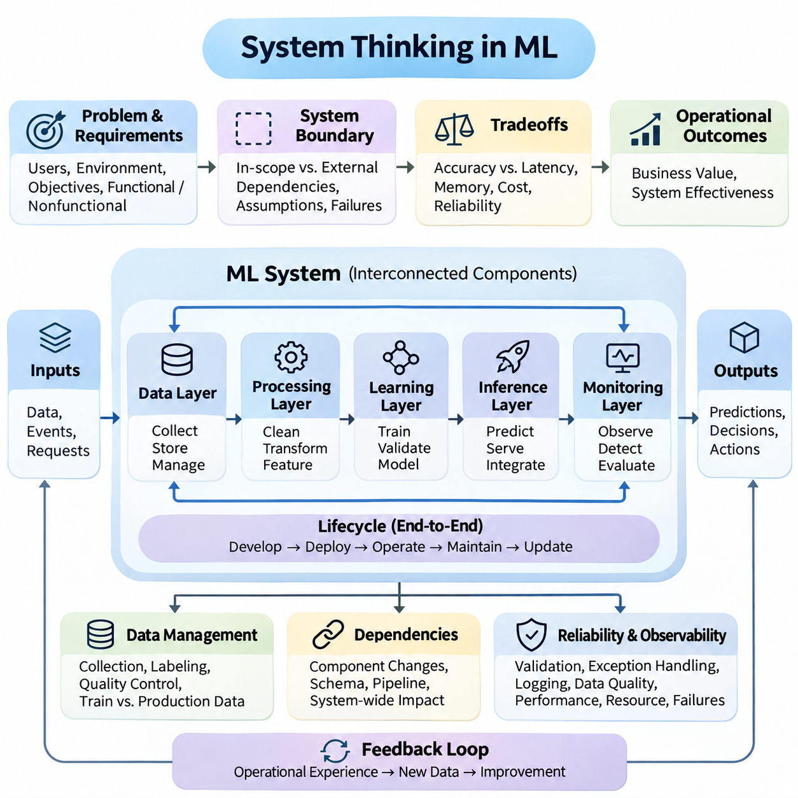
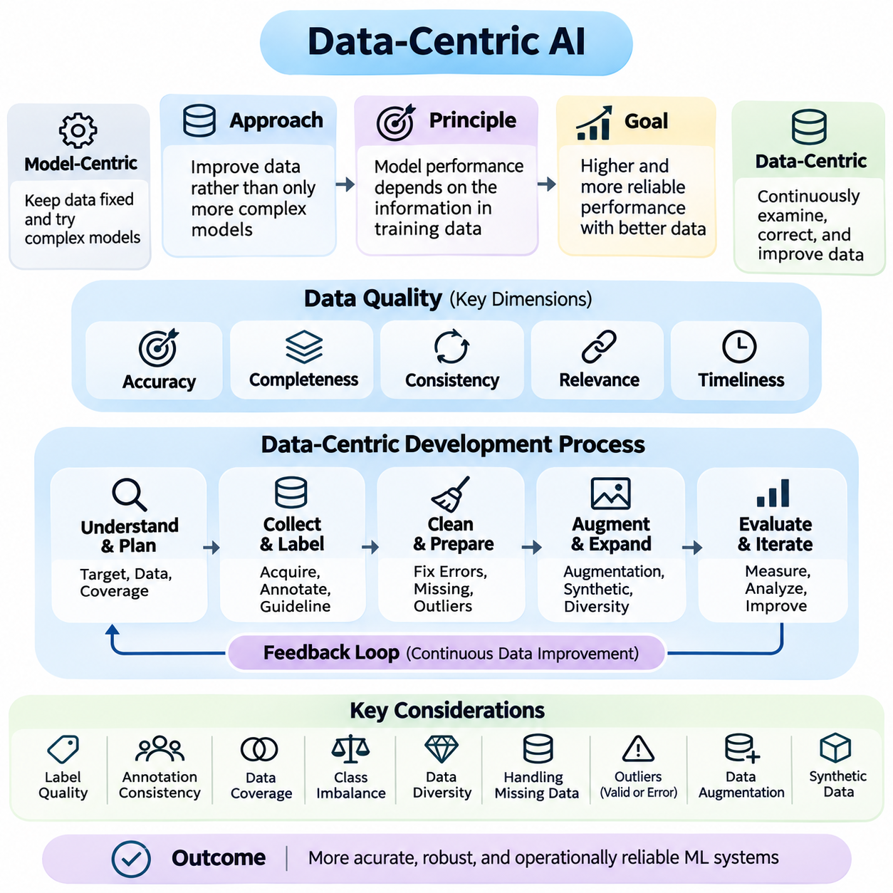
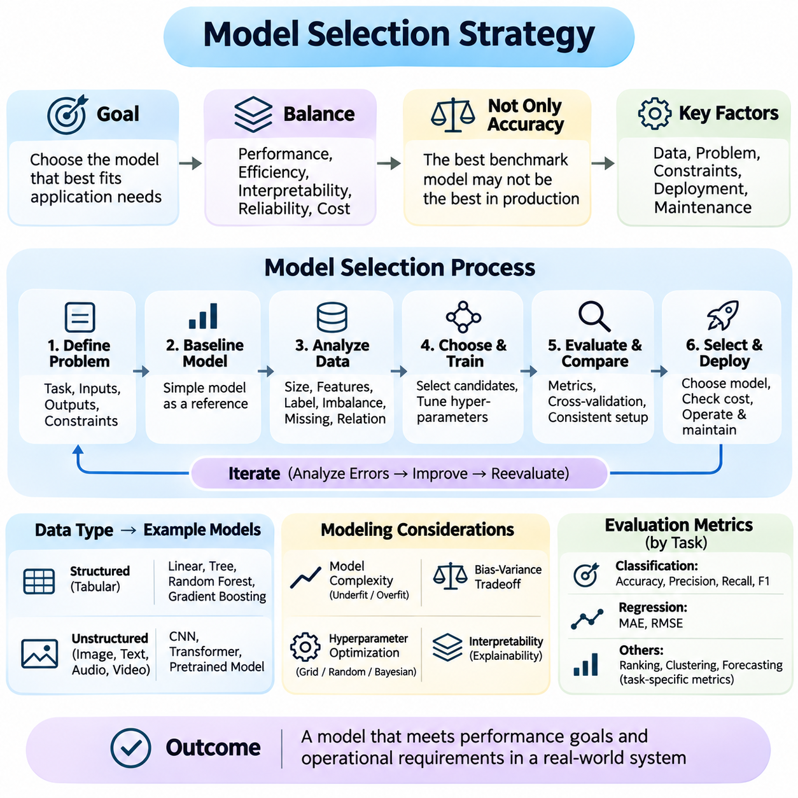
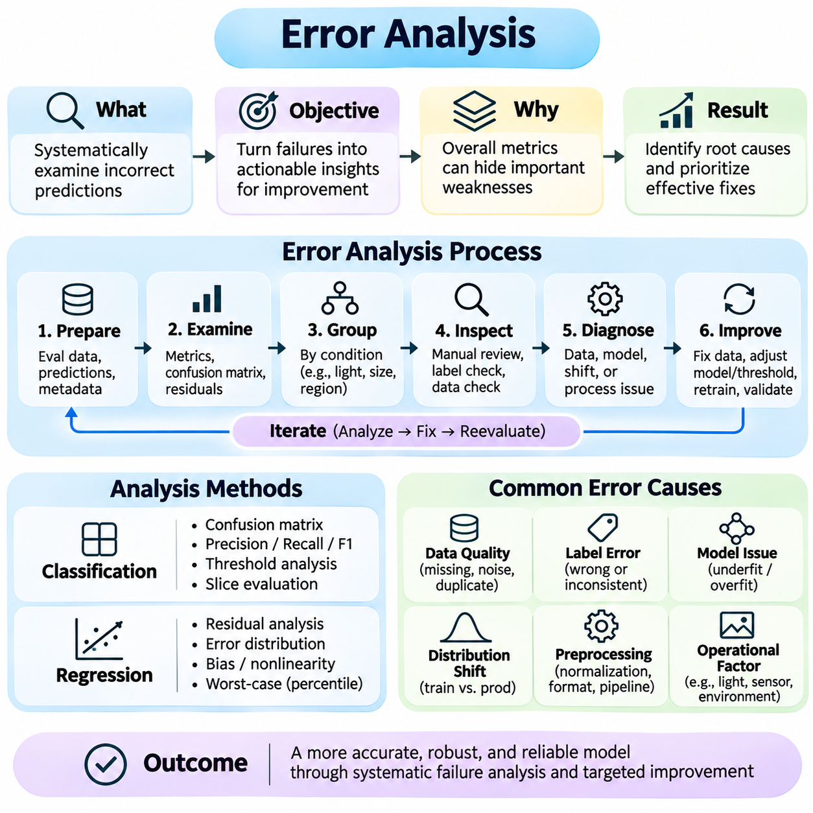
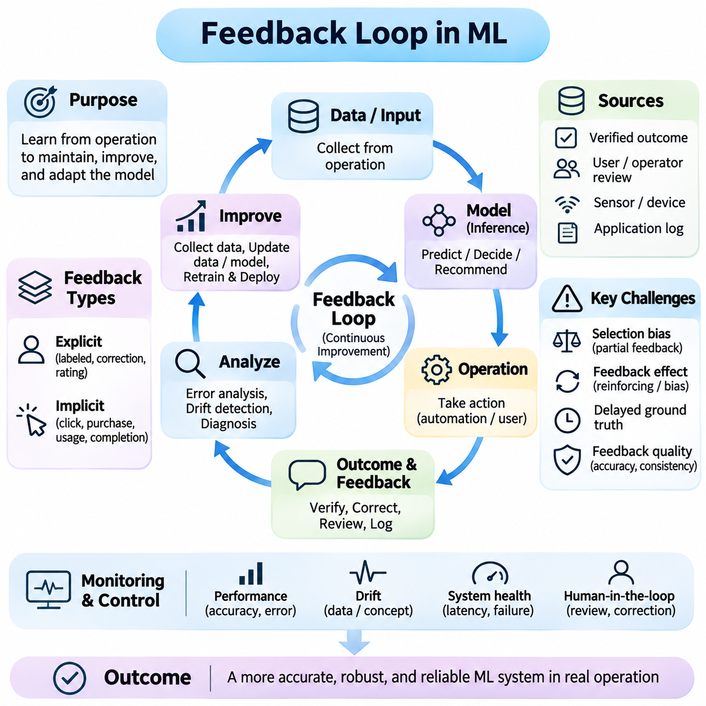
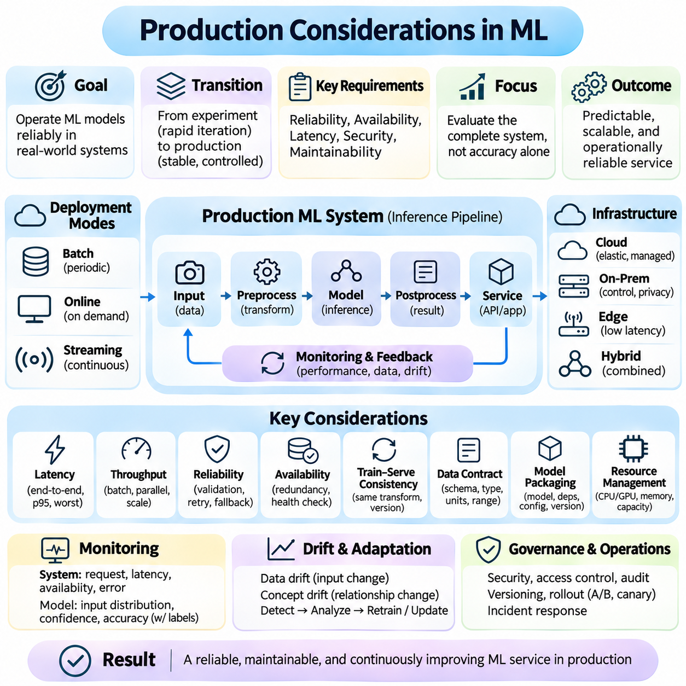
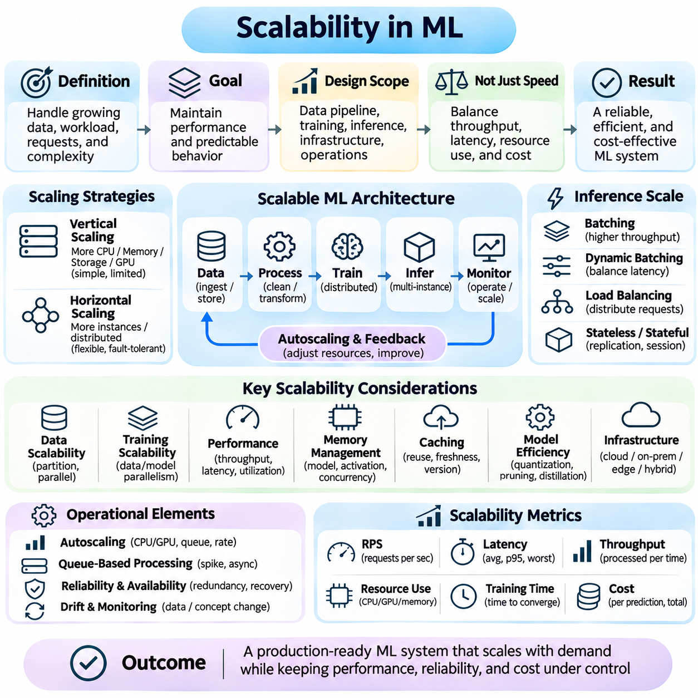
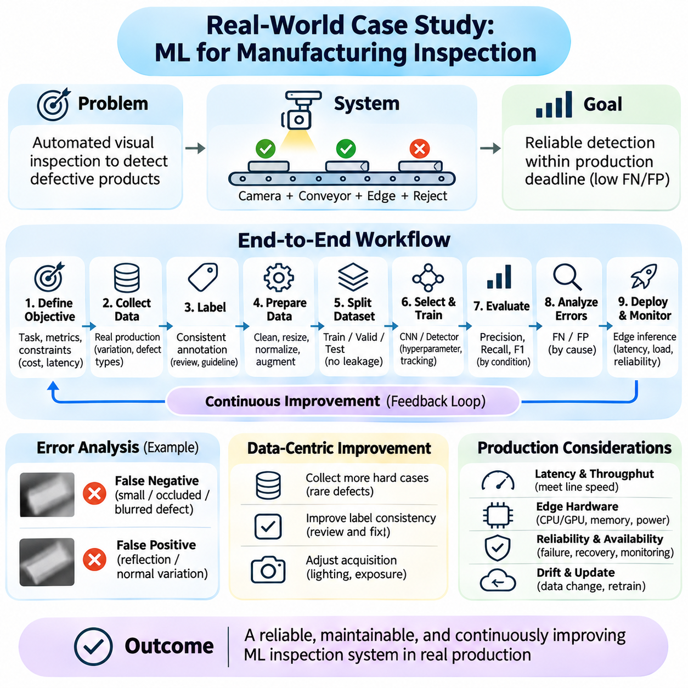

# 07. Practical ML System Design

## 07.00 System Thinking

{width="7.268055555555556in" height="7.268055555555556in"}

머신러닝(Machine Learning, ML)에서 시스템 사고(System Thinking)는 머신러닝 솔루션(ML Solution)을 독립적인 예측 모델(Predictive Model)이 아니라 상호 연결된 구성 요소(Component)의 집합으로 이해하는 접근 방식이다. 성공적인 시스템은 데이터 수집(Data Acquisition), 전처리(Preprocessing), 학습(Training), 평가(Evaluation), 배포(Deployment), 모니터링(Monitoring), 유지보수(Maintenance)를 유기적으로 조정해야 한다. 각 구성 요소는 서로 영향을 미치므로 모델 정확도(Model Accuracy)를 개선하는 것만으로 전체 시스템의 성능이 반드시 향상되는 것은 아니다.

시스템 사고(System Thinking)의 핵심 원칙은 시스템이 해결해야 하는 문제(Problem)에서 출발하는 것이다. 알고리즘(Algorithm)을 선택하거나 데이터셋(Dataset)을 수집하기 전에 엔지니어는 목표 사용자(Target User), 운영 환경(Operational Environment), 예상 출력(Expected Output), 측정 가능한 목표(Measurable Objective)를 식별해야 한다. 명확하게 정의된 문제는 적절한 데이터를 선택하고 평가 절차(Evaluation Procedure)를 설계하며 머신러닝이 실제로 필요한지 판단하는 기초가 된다.

머신러닝 시스템(ML System)은 입력(Input)을 제공하고 출력(Output)을 수신하는 더 큰 환경(Environment) 안에서 작동한다. 이러한 상호작용은 개발자가 제어할 수 있는 구성 요소와 외부 요인(External Factor)을 구분하는 시스템 경계(System Boundary)를 형성한다. 시스템 경계를 이해하면 예측 결과와 후속 의사결정(Downstream Decision)의 신뢰성에 영향을 미칠 수 있는 의존성(Dependency), 가정(Assumption), 잠재적 실패 조건(Failure Condition)을 식별할 수 있다.

시스템 요구사항(System Requirements)에는 기능적 요구사항(Functional Requirements)과 비기능적 요구사항(Nonfunctional Requirements)이 모두 포함되어야 한다. 기능적 요구사항은 이미지 분류(Image Classification)나 장비 고장 예측(Equipment Failure Prediction)처럼 시스템이 수행해야 하는 작업을 정의한다. 비기능적 요구사항은 응답 지연시간(Response Latency), 처리량(Throughput), 가용성(Availability), 메모리 사용량(Memory Consumption), 보안(Security), 유지보수성(Maintainability) 등의 성능 제약을 설명한다. 두 요구사항 모두 아키텍처(Architecture) 설계에 영향을 미친다.

실용적인 머신러닝 아키텍처(ML Architecture)는 일반적으로 여러 개의 연결된 계층(Layer)으로 구성된다. 데이터 계층(Data Layer)은 정보를 수집하고 저장하며, 처리 계층(Processing Layer)은 원시 관측값(Raw Observation)을 사용 가능한 특징(Feature)으로 변환한다. 학습 계층(Learning Layer)은 예측 모델을 생성하고, 추론 계층(Inference Layer)은 예측 결과를 애플리케이션(Application)에 제공한다. 모니터링 메커니즘(Monitoring Mechanism)은 운영 상태를 평가하며, 이러한 계층들은 일관된 인터페이스(Interface)를 통해 정보를 교환해야 한다.

데이터(Data)는 학습에 사용되는 정적인 입력이 아니라 지속적으로 관리해야 하는 시스템 자원(System Resource)으로 취급해야 한다. 수집 방법(Collection Method), 저장 형식(Storage Format), 라벨링 절차(Labeling Procedure), 품질 관리(Quality Control)는 학습 알고리즘이 활용할 수 있는 정보에 영향을 미친다. 데이터 획득 과정에서 발생한 오류(Error)는 전처리와 학습 단계로 전파되어 모델 아키텍처가 기술적으로 올바르더라도 신뢰할 수 없는 예측 결과를 생성할 수 있다.

학습 데이터(Training Data)와 운영 데이터(Production Data)의 관계는 특히 중요하다. 모델은 과거 관측값(Historical Observation)에서 통계적 패턴(Statistical Pattern)을 학습하지만, 배포 이후에는 새로운 운영 조건(Operating Condition)에 노출된다. 센서 특성(Sensor Characteristics), 사용자 행동(User Behavior), 환경 조건(Environmental Conditions), 데이터 수집 절차의 차이는 예측 성능(Predictive Performance)을 저하시킬 수 있다. 따라서 시스템 설계에서는 개발 환경과 실제 운영 환경 사이의 변화를 고려해야 한다.

시스템 사고(System Thinking)는 구성 요소 사이의 의존성(Dependency)을 인식하는 것도 요구한다. 특징 정규화(Feature Normalization)를 변경하면 모델 재학습(Model Retraining)과 추론 파이프라인(Inference Pipeline)의 수정이 필요할 수 있다. 데이터 스키마(Data Schema)를 변경하면 검증 절차(Validation Procedure), 저장된 데이터셋, 애플리케이션 인터페이스에도 영향을 미칠 수 있다. 엔지니어는 개별 구성 요소가 독립적으로 발전할 수 있다고 가정하기보다 변경 사항이 전체 시스템에 미치는 영향을 평가해야 한다.

머신러닝 성능(ML Performance)은 실제 운영 성과(Operational Outcome)와 연결되어야 한다. 정확도(Accuracy), 정밀도(Precision), 재현율(Recall), 예측 오차(Prediction Error)는 모델 동작의 특정 측면을 측정하지만, 비즈니스 가치(Business Value)나 시스템 효과성(System Effectiveness)을 직접 설명하지는 않는다. 예를 들어 사기 탐지 모델(Fraud Detection Model)은 탐지 성능뿐 아니라 조사 비용(Investigation Cost), 오탐(False Alarm), 처리 지연(Processing Delay), 사기 거래를 놓쳤을 때의 결과까지 균형 있게 고려해야 한다.

실제 시스템 설계에서는 상충관계(Tradeoff)를 피할 수 없다. 모델 복잡도(Model Complexity)를 높이면 예측 정확도가 향상될 수 있지만 추론 지연시간(Inference Latency), 메모리 요구량(Memory Requirement), 운영 비용(Operational Cost)도 증가할 수 있다. 반대로 작은 모델(Smaller Model)은 정확도가 다소 낮더라도 제한된 하드웨어(Constrained Hardware)에서 더 빠르고 안정적으로 실행될 수 있다. 적절한 선택은 벤치마크 성능(Benchmark Performance)만이 아니라 시스템 목표(System Objective)에 따라 결정된다.

시스템 사고(System Thinking)는 머신러닝 솔루션의 전체 생명주기(Lifecycle)를 고려하도록 한다. 초기 개발(Initial Development)에는 문제 정의(Problem Formulation), 데이터 준비(Data Preparation), 실험(Experimentation), 검증(Validation)이 포함된다. 실제 운영 단계(Production Stage)에서는 배포, 모니터링, 사고 대응(Incident Response), 모델 업데이트(Model Update)와 관련된 추가 요구사항이 발생한다. 실험 단계에서 우수한 성능을 보인 설계라도 효과적으로 운영하고 유지보수할 수 없다면 실패할 수 있다.

신뢰성(Reliability)은 전체 예측 경로(Prediction Pathway)를 대상으로 평가해야 한다. 정확도가 매우 높은 모델이라도 상위 데이터 파이프라인(Upstream Data Pipeline)이 실패하거나 하위 애플리케이션(Downstream Application)이 출력을 잘못 해석하면 유용한 결과를 제공할 수 없다. 견고한 시스템(Robust System)에는 입력 검증(Input Validation), 예외 처리(Exception Handling), 로깅(Logging), 대체 동작(Fallback Behavior), 예상하지 못한 조건을 탐지하는 메커니즘이 포함된다. 신뢰성은 구성 요소들의 조정된 동작에서 형성된다.

관측 가능성(Observability)은 운영 중 시스템 동작을 이해하는 데 필요한 정보를 제공한다. 엔지니어는 데이터 품질(Data Quality), 예측 분포(Prediction Distribution), 정답 데이터(Ground Truth)를 확보할 수 있을 때의 모델 성능, 지연시간(Latency), 자원 사용률(Resource Utilization), 실패율(Failure Rate)을 모니터링해야 한다. 모니터링 인프라(Monitoring Infrastructure)는 데이터 변화로 발생한 문제와 소프트웨어 결함(Software Defect), 하드웨어 제약(Hardware Limitation), 모델 성능 저하(Model Degradation)로 발생한 문제를 구분하는 데 도움을 준다.

피드백 루프(Feedback Loop)는 운영 경험(Operational Experience)을 시스템 개선(System Improvement)과 연결한다. 예측 결과는 의사결정(Decision)에 영향을 미치고, 이러한 의사결정은 향후 학습 데이터가 되는 새로운 관측값을 생성할 수 있다. 이 과정에서 모델 동작(Model Behavior)과 후속 데이터 수집(Subsequent Data Collection) 사이에 의존성이 형성된다. 엔지니어는 피드백이 선택 편향(Selection Bias)을 유발하거나 기존 오류를 강화하거나 학습에 사용할 수 있는 관측값의 분포를 변화시키는지 검토해야 한다.

인간과의 상호작용(Human Interaction)도 머신러닝 시스템 설계의 중요한 구성 요소이다. 사용자는 예측 결과를 검토하고 오류를 수정하며 라벨(Label)을 제공하거나 자동화된 의사결정(Automated Decision)을 재정의할 수 있다. 책임과 인터페이스가 명확하게 정의되면 이러한 상호작용은 신뢰성을 향상시킬 수 있다. 그러나 일관되지 않은 피드백이나 불명확한 의사결정 권한(Decision Authority)은 새로운 문제를 유발할 수 있으므로 인간의 참여를 명시적인 아키텍처 설계 요소로 고려해야 한다.

시스템 분해(System Decomposition)는 책임을 이해하기 쉬운 모듈(Module)로 분리하여 복잡도(Complexity)를 관리하는 데 도움을 준다. 데이터 수집(Data Ingestion), 특징 변환(Feature Transformation), 학습, 추론, 모니터링은 인터페이스가 명확하게 정의되어 있다면 독립적으로 개발하고 테스트할 수 있다. 모듈형 아키텍처(Modular Architecture)는 유지보수성을 높이고 개별 구성 요소의 발전을 지원하지만, 지나친 분할은 불필요한 통신 및 조정 오버헤드(Communication and Coordination Overhead)를 발생시킬 수 있다.

재현성(Reproducibility)은 과학적 실험(Scientific Experimentation)과 공학적 신뢰성(Engineering Reliability)을 연결한다. 모델에는 학습 데이터셋, 전처리 설정(Preprocessing Configuration), 알고리즘 매개변수(Algorithm Parameter), 소프트웨어 의존성(Software Dependency), 평가 결과(Evaluation Result)가 연결되어 있어야 한다. 버전 관리(Version Control)와 실험 추적(Experiment Tracking)을 통해 엔지니어는 성능 차이를 조사하고 이전 시스템 상태를 재구성할 수 있다. 이러한 관행은 디버깅(Debugging), 감사(Auditing), 통제된 배포(Controlled Deployment)를 지원한다.

보안(Security)과 개인정보 보호(Privacy)는 아키텍처 전반에 통합되어야 한다. 데이터 파이프라인(Data Pipeline)은 기밀 정보(Confidential Information)를 처리할 수 있으며, 배포된 예측 서비스(Prediction Service)는 외부 애플리케이션에 인터페이스를 제공할 수 있다. 적절한 접근 제어(Access Control), 데이터 보호 메커니즘(Data Protection Mechanism), 입력 검증은 운영 위험(Operational Risk)을 줄인다. 취약점(Vulnerability)은 시스템의 다른 부분에도 존재할 수 있으므로 학습된 모델만 보호하는 것으로는 충분한 보안을 확보할 수 없다.

확장성(Scalability)은 작업 부하(Workload)가 증가하더라도 허용할 수 없는 수준의 성능 저하 없이 이를 처리할 수 있는 시스템 능력을 의미한다. 시스템의 성장은 데이터셋 확대, 사용자 증가, 예측 요청 빈도 증가, 모델 학습 요구량 확대 등의 형태로 나타날 수 있다. 엔지니어는 저장장치(Storage), 연산(Computation), 네트워크(Networking), 데이터 처리(Data Processing)에서 발생할 수 있는 병목현상(Bottleneck)을 식별해야 한다. 확장성에 관한 결정은 예상 수요(Expected Demand)와 현실적인 운영 제약을 반영해야 한다.

비용(Cost)은 학습, 추론, 저장, 네트워킹, 유지보수가 서로 다른 자원을 소비하기 때문에 시스템 수준에서 고려해야 하는 요소이다. 학습 비용(Training Cost)이 낮은 모델도 수백만 건의 예측을 제공하는 과정에서는 높은 운영 비용을 발생시킬 수 있다. 반대로 초기 학습 비용이 높더라도 반복적인 추론을 효율적으로 지원한다면 정당화될 수 있다. 전체 생명주기 비용(Total Lifecycle Cost)은 서로 다른 시스템 설계를 비교하는 데 더욱 의미 있는 기준을 제공한다.

시스템 사고(System Thinking)는 불확실성(Uncertainty)을 식별하고 위험(Risk)을 관리하는 것도 요구한다. 데이터 가용성(Data Availability), 라벨 품질(Label Quality), 배포 조건(Deployment Condition), 미래 작업 부하(Future Workload)의 특성은 개발 단계에서 완전히 알려지지 않을 수 있다. 엔지니어는 프로토타입(Prototype), 기준 모델(Baseline Model), 통제된 실험(Controlled Experiment), 단계적 배포(Staged Deployment)를 통해 불확실성을 줄일 수 있다. 핵심 가정을 조기에 검증하면 불완전한 근거에 기반한 고비용 아키텍처 결정을 예방할 수 있다.

유용한 설계 접근법(Design Approach)은 측정 가능한 성능을 확립하는 단순한 기준 모델(Baseline Model)에서 시작한다. 기준 모델은 규칙 기반 방법(Rule-Based Method), 통계 모델(Statistical Model), 전통적인 머신러닝 알고리즘(Conventional Machine Learning Algorithm)을 사용할 수 있다. 목적은 문제의 난이도를 파악하고 개선 효과를 평가할 비교 기준(Reference)을 제공하는 것이다. 추가적인 복잡도는 실험을 통해 의미 있는 이점이 입증될 때 도입해야 한다.

카메라 이미지(Camera Image)를 사용하여 불량 제품(Defective Product)을 식별하는 제조 검사 시스템(Manufacturing Inspection System)을 생각해 볼 수 있다. 이 시스템의 성능은 분류 모델(Classification Model)뿐 아니라 조명(Lighting), 카메라 위치(Camera Positioning), 이미지 획득 시점(Image Acquisition Timing), 라벨링 일관성(Labeling Consistency), 생산 설비(Production Equipment)와의 통신에 의존한다. 조명이 바뀌면 정확도가 떨어질 수 있고, 추론이 지연되면 불량 제품을 적절한 시점에 제거하지 못할 수 있다.

이 제조 사례에서 시스템 사고(System Thinking)는 엔지니어가 전체 검사 프로세스(Inspection Process)를 평가하도록 한다. 허용 가능한 불량 탐지율(Defect Detection Rate), 정상 제품의 잘못된 배제에 따른 비용(False Rejection Cost), 처리 마감시간(Processing Deadline), 불확실한 예측(Uncertain Prediction)의 처리 절차를 정의해야 한다. 모니터링은 이미지 품질과 예측 동작의 변화를 식별해야 한다. 최종 시스템은 분류 정확도만이 아니라 신뢰할 수 있는 검사에 얼마나 기여하는지를 기준으로 평가된다.

효과적인 시스템 설계(System Design)에는 데이터 과학자(Data Scientist), 소프트웨어 엔지니어(Software Engineer), 도메인 전문가(Domain Specialist), 운영팀(Operational Team) 사이의 협업(Collaboration)이 필요하다. 각 집단은 서로 다른 제약과 실패 유형(Failure Mode)에 관한 전문 지식을 제공한다. 공동 목표(Shared Objective), 문서화된 인터페이스(Documented Interface), 명확한 책임(Clear Responsibility)은 기술적 의사결정을 일치시키는 데 도움을 준다. 협업이 부족하면 개별적으로 최적화된 구성 요소들이 통합 이후에는 성능이 낮은 시스템을 형성할 수 있다.

궁극적으로 시스템 사고(System Thinking)는 머신러닝을 독립적인 모델 개발(Model Building) 활동에서 신뢰할 수 있는 의사결정 역량(Decision-Making Capability)을 구현하는 공학적 활동으로 전환한다. 목표는 실험 조건에서 정확한 예측을 생성하는 데 그치지 않고 실제 운영 제약(Operational Constraint) 안에서 일관된 가치(Consistent Value)를 제공하는 것이다. 성공적인 머신러닝 시스템은 데이터 품질(Data Quality), 예측 성능(Predictive Performance), 신뢰성(Reliability), 비용(Cost), 적응성(Adaptability), 장기 유지보수성(Long-Term Maintainability) 사이의 균형을 달성해야 한다.

## 07.01 Data Centric AI

{width="7.268055555555556in" height="7.268055555555556in"}

데이터 중심 인공지능(Data-Centric AI)은 점점 더 복잡한 모델(Model)에 주로 의존하기보다 데이터의 품질(Quality), 일관성(Consistency), 관련성(Relevance)을 개선하는 데 중점을 두는 머신러닝(Machine Learning) 접근 방식이다. 전통적인 모델 중심 개발(Model-Centric Development)은 데이터셋(Dataset)을 고정한 상태에서 다양한 알고리즘(Algorithm)을 실험하는 경우가 많다. 반면 데이터 중심 개발(Data-Centric Development)은 데이터셋을 체계적으로 검사하고 수정하며 개선할 수 있는 지속적으로 발전하는 공학적 자산(Engineering Asset)으로 취급한다.

데이터 중심 인공지능(Data-Centric AI)의 핵심 원칙은 모델 성능(Model Performance)이 학습 데이터(Training Data)에 포함된 정보에 크게 의존한다는 것이다. 정교한 알고리즘이라도 누락되거나 잘못 라벨링되거나 충분히 표현되지 않은 패턴(Pattern)을 안정적으로 학습할 수는 없다. 따라서 특히 오류가 데이터셋에서 발생하는 경우에는 기본 모델 아키텍처(Model Architecture)를 변경하지 않고 데이터 품질(Data Quality)을 개선하는 것만으로도 상당한 성능 향상을 얻을 수 있다.

데이터 중심 개발(Data-Centric Development)은 목표 문제(Target Problem)와 사용 가능한 관측값(Observation) 사이의 관계를 이해하는 것에서 시작한다. 엔지니어는 수집된 샘플(Sample)이 모델이 실제로 작동할 조건을 대표하는지 판단해야 한다. 데이터셋에 수천 개의 사례가 포함되어 있더라도 중요한 운영 조건(Operating Condition), 희귀 사건(Rare Event), 어려운 사례(Difficult Case)가 학습 분포(Training Distribution)에 포함되지 않았다면 충분하지 않을 수 있다.

데이터 품질(Data Quality)은 정확성(Accuracy), 완전성(Completeness), 일관성(Consistency), 관련성(Relevance), 적시성(Timeliness)과 같이 상호 연결된 여러 차원을 포함한다. 정확성은 관측값과 라벨(Label)이 현실을 올바르게 설명하는지를 의미한다. 완전성은 누락된 정보를 다루며, 일관성은 호환 가능한 형식과 정의를 요구한다. 관련성은 수집된 사례가 목표 예측 작업(Prediction Task)을 지원하는지를 나타내고, 적시성은 현재 조건에서 데이터가 얼마나 유용한지를 반영한다.

라벨 품질(Label Quality)은 지도학습(Supervised Learning)에서 특히 중요하다. 라벨은 모델이 재현하려는 목표 동작(Target Behavior)을 정의하기 때문이다. 잘못되거나 모호한 라벨은 서로 충돌하는 학습 신호(Learning Signal)를 발생시키고 달성 가능한 성능의 상한을 형성할 수 있다. 따라서 엔지니어는 모델 복잡도(Model Complexity)를 높이기 전에 명확한 어노테이션 지침(Annotation Guidelines)을 수립하고 어려운 사례를 검토하며 어노테이터(Annotator) 사이의 의견 불일치를 조사해야 한다.

어노테이션 일관성(Annotation Consistency)은 단순히 라벨이 지정된 샘플(Labeled Sample)의 수를 늘리는 것보다 더 중요할 수 있다. 서로 다른 어노테이터가 범주(Category)를 다르게 해석하면 데이터셋에 체계적인 모순(Systematic Contradiction)이 포함될 수 있다. 표준화된 정의(Standardized Definition), 대표 사례(Representative Example), 품질 보증 절차(Quality Assurance Procedure)는 이러한 불일치를 줄이는 데 도움을 준다. 일치도 측정(Agreement Measurement)은 더 명확한 라벨링 정책(Labeling Policy)이 필요한 모호한 범주를 식별할 수 있다.

데이터 포괄성(Data Coverage)은 데이터셋이 배포(Deployment) 중 예상되는 다양한 상황을 얼마나 잘 대표하는지를 설명한다. 예를 들어 컴퓨터 비전 데이터셋(Computer Vision Dataset)은 조명(Lighting), 카메라 각도(Camera Angle), 객체 크기(Object Size), 배경(Background), 환경 조건(Environmental Condition)의 변화를 고려해야 한다. 학습 사례가 이상적인 조건만 포함한다면 검증(Validation)에서는 좋은 성능을 보이더라도 실제 운영 환경의 다양한 변화에 노출되었을 때 실패할 수 있다.

클래스 불균형(Class Imbalance)은 일부 범주가 다른 범주보다 자연적으로 적게 발생하기 때문에 중요한 고려사항이다. 제조 데이터셋(Manufacturing Dataset)에는 정상 제품(Normal Product)이 많이 포함되지만 불량 사례(Defective Example)는 상대적으로 적을 수 있다. 적절하게 처리하지 않으면 분류기(Classifier)가 다수 클래스(Majority Class)를 선호하고 중요한 결함을 놓칠 수 있다. 데이터 중심 전략(Data-Centric Strategy)에는 목표 지향적 데이터 수집(Targeted Collection), 신중한 재표본추출(Resampling), 소수 클래스 오류(Minority-Class Error)의 결과를 반영하는 평가가 포함된다.

데이터 다양성(Data Diversity)은 모델이 학습 환경의 제한적인 특성을 암기하는 대신 일반화 가능한 패턴(Generalizable Pattern)을 학습할 가능성을 높인다. 다양성에는 서로 다른 장치(Device), 위치(Location), 모집단(Population), 운영 조건, 시간적 구간(Temporal Period)이 포함될 수 있다. 그러나 다양성은 목표 애플리케이션(Target Application)과 관련성을 유지해야 한다. 관련 없는 사례를 수집하면 예측 성능(Predictive Performance)을 의미 있게 개선하지 못하면서 비용만 증가할 수 있기 때문이다.

데이터 정제(Data Cleaning)는 학습을 방해하는 문제를 식별하고 수정하는 체계적인 과정이다. 일반적인 문제에는 중복 레코드(Duplicate Record), 손상된 파일(Corrupted File), 일관되지 않은 단위(Inconsistent Unit), 유효하지 않은 값(Invalid Value), 잘못된 어노테이션(Incorrect Annotation)이 포함된다. 관측값을 제거하거나 수정하면 학습 분포(Training Distribution)가 달라지므로 정제 결정은 문서화해야 한다. 지나친 정제는 견고한 예측(Robust Prediction)에 중요한 실제 희귀 사례까지 제거할 수 있다.

결측 데이터(Missing Data)는 관측값이 수집된 방식에 따라 의미가 달라지므로 특별한 주의가 필요하다. 결측값(Missing Value)은 무작위 기술적 장애(Random Technical Failure), 운영 절차(Operational Procedure), 관측 대상 프로세스의 근본적인 특성에서 발생할 수 있다. 일부 상황에서는 단순 대치(Simple Imputation)가 적절하지만 부적절한 값 대체는 인위적인 패턴(Artificial Pattern)을 만들 수 있다. 엔지니어는 처리 전략(Treatment Strategy)을 선택하기 전에 결측 메커니즘(Missingness Mechanism)을 조사해야 한다.

이상치(Outlier)를 자동으로 오류(Error)로 간주해서는 안 된다. 비정상적인 관측값(Unusual Observation)은 센서 오작동(Sensor Malfunction), 잘못된 기록(Incorrect Recording), 실제로 발생한 희귀 사건(Rare Event)을 나타낼 수 있다. 모든 특이 샘플을 제거하면 데이터셋이 더 깨끗해 보일 수 있지만 중요한 이상 현상(Anomaly)을 인식하는 모델의 능력이 저하될 수 있다. 데이터 중심 분석(Data-Centric Analysis)은 도메인 지식(Domain Knowledge)과 통계적 근거(Statistical Evidence)를 활용하여 유효하지 않은 측정값과 유효하지만 드물게 발생하는 조건을 구분한다.

데이터 증강(Data Augmentation)은 통제된 변환(Controlled Transformation)을 통해 학습 사례의 실질적인 다양성을 확대한다. 컴퓨터 비전(Computer Vision)에서는 회전(Rotation), 자르기(Cropping), 밝기 조정(Brightness Adjustment), 기하학적 변형(Geometric Variation) 등이 사용될 수 있다. 효과적인 데이터 증강은 현실적인 변화를 도입하면서 의도된 라벨을 유지한다. 물리적 제약(Physical Constraint)을 위반하거나 목표 범주(Target Category)를 변경하는 변환은 잘못된 학습 사례를 생성하여 모델 신뢰성(Model Reliability)을 저하시킬 수 있다.

합성 데이터(Synthetic Data)는 실제 관측값을 수집하는 데 비용이 많이 들거나 드물게 발생하거나 수집 자체가 어려운 경우 데이터 포괄성(Data Coverage)을 확대하는 또 다른 방법이다. 시뮬레이션(Simulation)과 생성 기법(Generative Technique)은 운영 조건과 실패 시나리오(Failure Scenario)의 통제된 변형을 생성할 수 있다. 그러나 합성 사례에는 비현실적인 패턴(Unrealistic Pattern)이 포함되거나 중요한 물리적 효과(Physical Effect)가 누락될 수 있다. 따라서 시각적 유사성(Visual Similarity)만으로 유용성을 가정하지 말고 대표적인 실제 데이터(Real-World Data)를 기준으로 검증해야 한다.

데이터 중심 인공지능(Data-Centric AI)은 체계적인 오류 분석(Error Analysis)도 강조한다. 성능이 낮다고 즉시 모델을 교체하기보다 엔지니어는 어떤 사례에서 잘못된 예측(Incorrect Prediction)이 발생하고 그 원인이 무엇인지 조사한다. 오류는 환경 조건(Environmental Condition), 범주(Category), 데이터 출처(Data Source), 어노테이션 품질(Annotation Quality)에 따라 그룹화할 수 있다. 이러한 패턴은 추가 샘플, 수정된 라벨, 개선된 전처리(Preprocessing) 중 어떤 방법이 근본적인 문제를 해결할 수 있는지 식별하는 데 도움을 준다.

목표 지향적 데이터 수집(Targeted Data Collection)은 시스템 성능(System Performance)을 개선할 가능성이 높은 사례에 자원을 집중한다. 모델이 낮은 조도(Low Illumination)에서 반복적으로 실패한다면 이상적인 조명 조건에서 이미지를 더 수집하는 것은 큰 도움이 되지 않을 수 있다. 대표적인 저조도 사례(Low-Light Example)를 확보하면 해당 약점을 직접 해결할 수 있다. 이 접근법은 데이터 수집 우선순위(Collection Priority)를 관측된 실패 패턴(Failure Pattern)과 연결하여 데이터셋 확장(Dataset Expansion)의 효율성을 높인다.

능동학습(Active Learning)은 모델이 유익한 사례(Informative Example)를 식별하도록 지원함으로써 목표 지향적 데이터 수집을 확장한다. 학습 시스템(Learning System)은 높은 불확실성(Uncertainty), 예측 불일치(Disagreement), 불충분한 대표성(Insufficient Representation)을 가진 샘플에 우선순위를 부여할 수 있다. 이후 인간 어노테이터(Human Annotator)가 선택된 관측값을 검토하고, 생성된 라벨은 후속 학습(Subsequent Training)에 사용된다. 능동학습은 어노테이션 작업량(Annotation Effort)을 줄일 수 있지만 불확실성 추정(Uncertainty Estimation)과 샘플링 전략(Sampling Strategy)에 대한 신중한 검증이 필요하다.

데이터 버전 관리(Data Versioning)는 오류가 수정되고 새로운 관측값이 추가되면서 데이터셋이 변화하기 때문에 필수적이다. 각 학습 실험(Training Experiment)은 특정 데이터셋 버전(Dataset Version), 전처리 설정(Preprocessing Configuration), 어노테이션 정책(Annotation Policy)과 연결되어야 한다. 이러한 기록이 없다면 엔지니어는 성능 차이를 설명하거나 이전 결과를 재현하기 어려울 수 있다. 버전이 관리되는 데이터셋은 추적 가능성(Traceability), 통제된 실험(Controlled Experiment), 신뢰할 수 있는 모델 업데이트(Model Update)를 지원한다.

데이터 누수(Data Leakage)는 실제 예측 시점에 사용할 수 없는 정보가 학습 또는 평가 과정에 유입될 때 발생하는 심각한 위험이다. 데이터 누수는 중복 샘플(Duplicate Sample), 미래 정보(Future Information), 부적절한 데이터셋 경계를 넘어 수행된 전처리, 목표 라벨(Target Label)을 간접적으로 드러내는 특징(Feature)에서 발생할 수 있다. 데이터 중심 설계(Data-Centric Design)는 배포 조건을 반영하고 일반화 성능(Generalization Performance)에 대한 잘못된 추정을 방지하는 데이터 분할 전략(Data Splitting Strategy)을 요구한다.

평가 데이터셋(Evaluation Dataset)은 학습 데이터셋과 동일한 수준의 엄격함으로 관리해야 한다. 테스트 세트(Test Set)는 의미 있는 운영 조건을 대표하면서 모델 선택(Model Selection)과 튜닝(Tuning) 결정으로부터 독립성을 유지해야 한다. 테스트 결과를 반복적으로 참고하여 모델을 수정하면 이러한 독립성이 훼손될 수 있다. 신중하게 관리되는 검증 데이터셋(Validation Dataset)과 테스트 데이터셋은 데이터 개선이 실제 성능 향상으로 이어지는지 판단하는 데 더욱 신뢰할 수 있는 기준을 제공한다.

데이터 중심 개발(Data-Centric Development)은 데이터 문제(Data Problem)와 모델 문제(Model Problem)를 구분하는 데 도움을 준다. 학습 성능과 검증 성능이 모두 낮다면 불충분한 특징(Insufficient Feature), 잡음이 있는 라벨(Noisy Label), 제한된 모델 용량(Model Capacity)이 원인일 수 있다. 학습 성능은 높지만 배포 성능(Deployment Performance)이 저하된다면 분포 차이(Distribution Difference)나 누락된 운영 조건이 중요한 원인 후보가 된다. 구조화된 진단(Structured Diagnosis)은 불필요한 알고리즘 변경을 방지한다.

산업용 카메라(Industrial Camera)로 촬영한 이미지를 사용하여 제품을 분류하는 컨베이어 기반 검사 시스템(Conveyor-Based Inspection System)을 생각해 볼 수 있다. 초기 실험에서 모델은 정지된 객체(Stationary Object)를 잘 분류하지만 빠르게 이동하는 제품에서는 성능이 낮을 수 있다. 데이터 중심 조사(Data-Centric Investigation)를 통해 모션 블러(Motion Blur), 일관되지 않은 노출(Inconsistent Exposure), 이동 객체 사례(Moving-Object Example)의 부족을 식별할 수 있다. 영상 획득 조건(Image Acquisition Condition)과 데이터 포괄성을 개선하는 것이 더 큰 신경망(Neural Network)을 선택하는 것보다 효과적일 수 있다.

실제 운영 환경의 데이터 분포(Data Distribution)는 완벽하게 일정하게 유지되는 경우가 드물기 때문에 배포 이후에는 지속적인 데이터 모니터링(Continuous Data Monitoring)이 필요하다. 새로운 제품 설계(Product Design), 변화하는 센서 조건(Sensor Condition), 계절적 변화(Seasonal Variation), 변경된 사용자 행동(User Behavior)은 과거 데이터셋에 없던 패턴을 도입할 수 있다. 특징 분포(Feature Distribution), 예측 특성(Prediction Characteristics), 검증된 결과(Verified Outcome)를 모니터링하면 데이터셋이 더 이상 운영 환경을 충분히 대표하지 못하는 시점을 식별하는 데 도움이 된다.

운영 환경의 피드백(Production Feedback)은 신중하게 수집하고 검증한다면 지속적인 데이터셋 개선(Continuous Dataset Improvement)을 지원할 수 있다. 인간의 수정(Human Correction), 확인된 실패(Confirmed Failure), 어려운 운영 사례(Difficult Operational Example)는 가치 있는 학습 샘플(Training Sample)이 될 수 있다. 그러나 특정 예측 결과만 검토되는 경우 피드백 메커니즘(Feedback Mechanism)은 선택 편향(Selection Bias)을 유발할 수 있다. 엔지니어는 수집된 피드백을 대표적인 정답 데이터(Ground Truth)로 취급하기 전에 사례가 선택되는 방식을 이해해야 한다.

데이터 중심 인공지능(Data-Centric AI)은 머신러닝 생명주기(Machine Learning Lifecycle) 전반에서 데이터 품질에 대한 책임을 부여하는 조직적 프로세스(Organizational Process)를 요구한다. 데이터 엔지니어(Data Engineer), 도메인 전문가(Domain Expert), 어노테이터(Annotator), 모델 개발자(Model Developer)는 공통된 정의와 품질 기준(Quality Standard)을 공유해야 한다. 문서화(Documentation)에는 수집 절차(Collection Procedure), 라벨링 규칙(Labeling Rule), 알려진 한계(Known Limitation), 허용된 사용 범위(Permitted Use)가 설명되어야 한다. 효과적인 거버넌스(Governance)는 데이터 개선을 일회성 정리 작업이 아니라 반복 가능한 공학적 실천(Repeatable Engineering Practice)으로 전환한다.

궁극적으로 데이터 중심 인공지능(Data-Centric AI)은 신뢰할 수 있는 머신러닝(Reliable Machine Learning)이 데이터(Data), 모델(Model), 운영 환경(Operational Environment) 사이의 상호작용에서 형성된다는 사실을 인식한다. 더 나은 알고리즘은 여전히 중요하지만 학습에 사용되는 정보의 모든 약점을 보완할 수는 없다. 데이터 품질(Data Quality), 포괄성(Coverage), 라벨링(Labeling), 생명주기 관리(Lifecycle Management)를 체계적으로 개선함으로써 엔지니어는 일반화 성능(Generalization Performance)이 더욱 우수하고 변화하는 실제 환경에서도 안정적으로 작동하는 시스템을 개발할 수 있다.

## 07.02 Model Selection Strategy

{width="7.268055555555556in" height="7.268055555555556in"}

모델 선택(Model Selection)은 특정 애플리케이션(Application)의 목표와 제약 조건을 가장 잘 충족하는 머신러닝 모델(Machine Learning Model)을 식별하는 과정이다. 벤치마크(Benchmark)에서 가장 높은 정확도를 달성한 모델이 반드시 실제 운영 시스템(Production System)에 가장 적합한 것은 아니다. 실용적인 모델 선택에는 예측 성능(Predictive Performance), 계산 효율성(Computational Efficiency), 해석 가능성(Interpretability), 신뢰성(Reliability), 배포 요구사항(Deployment Requirements), 장기 유지보수 비용(Long-Term Maintenance Cost) 사이의 균형이 필요하다.

효과적인 모델 선택 전략(Model Selection Strategy)은 학습 문제(Learning Problem)를 명확하게 정의하는 것에서 시작한다. 분류(Classification), 회귀(Regression), 순위화(Ranking), 군집화(Clustering), 예측(Forecasting) 작업은 서로 다른 모델링 가정(Modeling Assumption)과 평가 절차(Evaluation Procedure)를 요구한다. 엔지니어는 알고리즘(Algorithm)을 선택하기 전에 예상 입력(Expected Input), 목표 출력(Target Output), 사용 가능한 학습 데이터(Training Data), 운영 제약(Operational Constraint)을 식별해야 한다. 이를 통해 적합하지 않은 모델 계열(Model Family)에 대한 불필요한 실험을 방지할 수 있다.

단순한 기준 모델(Baseline Model)은 더 정교한 접근 방식을 평가하기 위한 필수적인 비교 기준(Reference)을 제공한다. 선형 회귀(Linear Regression), 로지스틱 회귀(Logistic Regression), 의사결정나무(Decision Tree), 규칙 기반 방법(Rule-Based Method)을 사용하여 초기 성능 수준(Initial Performance Level)을 설정할 수 있다. 기준 모델은 추가적인 복잡도가 의미 있는 성능 개선을 제공하는지 판단하는 데 도움을 준다. 단순한 모델이 이미 운영 요구사항을 충족한다면 더 복잡한 아키텍처(Architecture)는 불필요한 엔지니어링 비용(Engineering Cost)을 발생시킬 수 있다.

데이터셋(Dataset)의 특성은 모델 선택에 큰 영향을 미친다. 중요한 요소에는 샘플 크기(Sample Size), 특징 차원(Feature Dimensionality), 라벨 품질(Label Quality), 클래스 불균형(Class Imbalance), 결측값(Missing Value), 비선형 관계(Nonlinear Relationship)의 존재 여부가 포함된다. 일부 알고리즘은 제한된 정형 데이터(Structured Data)에서도 좋은 성능을 보이지만, 다른 알고리즘은 대규모의 대표적인 학습 사례(Representative Example)를 요구한다. 이러한 특성을 이해하면 적절한 후보 모델(Candidate Model)의 범위를 좁힐 수 있다.

정형 테이블 데이터(Structured Tabular Data)는 전통적인 머신러닝 알고리즘(Classical Machine Learning Algorithm)을 적용하기에 유용한 출발점이 되는 경우가 많다. 선형 모델(Linear Model)은 효율성과 해석 가능성을 제공하며, 의사결정나무와 앙상블 방법(Ensemble Method)은 비선형 상호작용(Nonlinear Interaction)을 포착할 수 있다. 랜덤 포레스트(Random Forest)와 그래디언트 부스팅(Gradient Boosting)은 다양한 특성을 가진 테이블 특징(Tabular Feature)에서 우수한 성능을 보이는 경우가 많다. 그러나 일반적인 평판만으로 적합성을 가정하지 말고 검증(Validation)을 통해 확인해야 한다.

비정형 데이터(Unstructured Data)는 서로 다른 모델링 요구사항(Modeling Requirements)을 발생시킨다. 이미지(Image), 오디오(Audio), 자연어(Natural Language), 비디오(Video)는 공간적 관계(Spatial Relationship)나 순차적 관계(Sequential Relationship)를 포함하므로 특화된 신경망 아키텍처(Neural Architecture)의 이점을 얻을 수 있다. 합성곱 신경망(Convolutional Neural Network), 트랜스포머(Transformer), 사전학습된 표현 모델(Pretrained Representation Model)은 복잡한 패턴을 포착할 수 있다. 그러나 잠재적인 정확도 향상과 함께 계산 요구량(Computational Requirement) 및 적절한 학습 데이터에 대한 의존성도 고려해야 한다.

모델 복잡도(Model Complexity)는 문제의 난이도(Problem Difficulty)와 사용 가능한 근거(Evidence)에 따라 선택해야 한다. 용량(Capacity)이 부족한 모델은 중요한 관계를 포착하지 못하는 과소적합(Underfitting)을 보일 수 있다. 반대로 지나치게 유연한 모델은 학습 사례에 포함된 우연한 패턴을 학습하는 과적합(Overfitting)을 일으킬 수 있다. 검증 성능(Validation Performance), 학습 곡선(Learning Curve), 오류 분석(Error Analysis)은 추가적인 모델 용량이 정당화되는지 판단하는 데 도움을 준다.

편향-분산 상충관계(Bias-Variance Tradeoff)는 모델 동작(Model Behavior)을 이해하기 위한 개념적 틀(Conceptual Framework)을 제공한다. 높은 편향(High Bias)을 가진 모델은 가정이 지나치게 제한적이기 때문에 체계적인 오류(Systematic Error)를 발생시킬 수 있다. 높은 분산(High Variance)을 가진 모델은 학습 데이터의 변동(Fluctuation)에 과도하게 반응할 수 있다. 효과적인 모델 선택은 적절한 균형을 추구하지만, 현대적인 정규화(Regularization), 앙상블 방법, 대규모 학습(Large-Scale Training)은 이러한 관계를 더욱 복잡하게 만들 수 있다.

평가 지표(Evaluation Metric)는 예측 오류(Prediction Error)가 초래하는 결과를 반영해야 한다. 정확도(Accuracy)는 균형 잡힌 분류(Balanced Classification)에 적절할 수 있지만, 클래스 빈도(Class Frequency)가 서로 다를 때는 정밀도(Precision), 재현율(Recall), F1 점수(F1 Score)가 더 유용할 수 있다. 회귀 작업(Regression Task)에서는 평균절대오차(Mean Absolute Error)나 평균제곱근오차(Root Mean Squared Error)가 필요할 수 있다. 선택한 지표는 유리한 벤치마크 결과를 만드는 것보다 애플리케이션의 실제 우선순위를 나타내야 한다.

모델 비교(Model Comparison)에는 일관된 실험 조건(Experimental Condition)이 필요하다. 후보 알고리즘(Candidate Algorithm)은 호환 가능한 데이터 분할(Data Partition), 전처리 절차(Preprocessing Procedure), 평가 지표 정의(Metric Definition)를 사용하여 평가해야 한다. 낙관적인 성능 추정(Optimistic Estimate)을 방지하기 위해 하이퍼파라미터 튜닝(Hyperparameter Tuning)은 최종 테스트 평가(Final Test Evaluation)와 분리해야 한다. 통제된 난수 시드(Random Seed)를 사용한 반복 실험(Repeated Experiment)은 성능 변동성(Performance Variability)을 파악하고 비교 결과에 대한 신뢰도를 높이는 데 도움을 준다.

교차 검증(Cross-Validation)은 사용 가능한 데이터가 제한적일 때 성능을 추정하는 체계적인 접근 방식이다. 여러 데이터 분할에서 모델을 학습하고 검증함으로써 엔지니어는 결과가 특정 샘플에 얼마나 민감한지 조사할 수 있다. 그러나 일반적인 무작위 교차 검증(Random Cross-Validation)은 시간적 의존성(Temporal Dependency), 그룹 의존성(Group Dependency), 공간적 의존성(Spatial Dependency)을 가진 관측값에는 적절하지 않을 수 있다. 검증 전략(Validation Strategy)은 실제 배포 시나리오(Deployment Scenario)를 반영해야 한다.

하이퍼파라미터 최적화(Hyperparameter Optimization)는 동일한 알고리즘이라도 설정(Configuration)에 따라 상당히 다른 결과를 생성할 수 있기 때문에 모델 선택에 영향을 미친다. 그리드 탐색(Grid Search), 무작위 탐색(Random Search), 베이지안 최적화(Bayesian Optimization)는 정의된 계산 예산(Computational Budget) 안에서 다양한 설정을 탐색한다. 공정한 비교(Fair Comparison)를 위해서는 각 후보 모델에 합리적인 수준의 튜닝 노력을 제공해야 한다. 하나의 검증 세트(Validation Set)에 지나치게 최적화하는 행위 자체도 과적합을 유발할 수 있다.

해석 가능성(Interpretability)은 예측 결과를 사용자(User), 운영자(Operator), 규제기관(Regulator)에 설명해야 하는 경우 중요한 고려사항이다. 선형 모델(Linear Model)과 얕은 의사결정나무(Shallow Decision Tree)는 일반적으로 입력과 출력 사이의 관계를 비교적 투명하게 보여준다. 더 복잡한 모델은 추가적인 설명 방법(Explanation Method)이 필요할 수 있다. 엔지니어는 해석 가능성이 필수 요구사항(Mandatory Requirement)인지, 운영상의 선호사항(Operational Preference)인지, 부차적인 목표(Secondary Objective)인지 판단해야 한다.

계산 효율성(Computational Efficiency)은 학습(Training)과 추론(Inference) 모두에 영향을 미친다. 모델이 우수한 검증 성능을 달성하더라도 과도한 메모리(Memory), 처리 시간(Processing Time), 특수 하드웨어(Specialized Hardware)를 요구할 수 있다. 빈번한 업데이트(Frequent Update)가 예상된다면 학습 비용(Training Cost)이 중요하며, 요청량(Request Volume)이 많은 환경에서는 추론 비용(Inference Cost)이 핵심 요소가 된다. 따라서 실용적인 모델 선택은 전체 모델 생명주기(Model Lifecycle)에 걸친 자원 소비(Resource Consumption)를 고려한다.

지연시간 제약(Latency Constraint)은 다른 측면에서 유망한 모델을 후보에서 제외할 수 있다. 산업 검사(Industrial Inspection), 로보틱스(Robotics), 대화형 서비스(Interactive Service)와 같은 실시간 애플리케이션(Real-Time Application)은 정의된 마감시간(Deadline) 안에 예측 결과를 생성해야 한다. 간헐적으로 발생하는 느린 예측이 운영을 방해할 수 있으므로 평균 추론 지연시간(Average Inference Latency)만으로는 충분하지 않을 수 있다. 엔지니어는 대표적인 작업 부하(Representative Workload)에서 지연시간 분포(Latency Distribution)를 측정하고 전처리 및 통신 오버헤드(Communication Overhead)를 포함해야 한다.

배포 환경(Deployment Environment)은 추가적인 제약을 발생시킨다. 클라우드 인프라(Cloud Infrastructure)는 상당한 계산 자원(Computational Resource)을 제공할 수 있지만, 엣지 장치(Edge Device)는 일반적으로 메모리, 전력(Power), 처리 용량(Processing Capacity)에 제약이 있다. 모델 크기(Model Size), 지원 연산자(Supported Operator), 런타임 호환성(Runtime Compatibility), 하드웨어 가속(Hardware Acceleration)은 배포 가능성(Deployment Feasibility)에 영향을 미친다. 작은 모델의 예측 가능한 실행(Predictable Execution)은 미세한 정확도 향상보다 안정적인 운영이 중요할 때 더 적합할 수 있다.

견고성(Robustness)은 현실적인 입력 조건(Input Condition)의 변화에도 모델이 허용 가능한 동작을 유지하는 능력을 의미한다. 잡음(Noise), 누락된 특징(Missing Feature), 센서 변화(Sensor Change), 분포 이동(Distribution Shift)은 표준 검증 결과(Standard Validation Result)에서 드러나지 않는 약점을 노출할 수 있다. 따라서 후보 모델은 대표적인 교란(Representative Disturbance)과 어려운 사례(Difficult Example)를 대상으로 테스트해야 한다. 견고성 평가(Robustness Evaluation)는 전통적인 예측 지표(Predictive Metric)를 보완한다.

확률 보정(Calibration)과 불확실성 추정(Uncertainty Estimation)도 모델 선택에 영향을 미칠 수 있다. 비슷한 정확도를 가진 두 분류기(Classifier)라도 신뢰도 점수(Confidence Score)의 신뢰성은 크게 다를 수 있다. 예측이 위험에 민감한 의사결정(Risk-Sensitive Decision)을 지원하는 경우, 적절하게 보정된 확률(Well-Calibrated Probability)은 임계값 선택(Threshold Selection)과 인간 검토 절차(Human Review Procedure)를 개선할 수 있다. 엔지니어는 모델이 보고하는 신뢰도가 관련 조건에서 관측된 정답률(Observed Correctness)과 일치하는지 평가해야 한다.

데이터 가용성(Data Availability)과 라벨링 비용(Labeling Cost)은 모델을 처음부터 학습하는 방식(Training from Scratch)보다 전이학습(Transfer Learning)을 선호하게 만들 수 있다. 사전학습 모델(Pretrained Model)은 더 큰 데이터셋에서 학습한 표현(Representation)을 제공하며 특정 작업에 맞게 조정할 수 있는 경우가 많다. 미세조정(Fine-Tuning)은 개발 시간(Development Time)과 데이터 요구량(Data Requirement)을 줄일 수 있지만, 성능은 원본 도메인(Source Domain)과 목표 도메인(Target Domain)의 유사성에 영향을 받는다. 라이선스(Licensing), 모델 크기, 배포 호환성(Deployment Compatibility)도 중요한 고려사항이다.

앙상블 방법(Ensemble Method)은 여러 예측기(Predictor)를 결합하여 안정성(Stability)이나 정확도를 개선한다. 배깅(Bagging)은 분산(Variance)을 줄일 수 있으며, 부스팅(Boosting)은 예측 오류를 점진적으로 해결하는 모델을 구성한다. 서로 다른 모델 계열(Model Family)을 결합하면 상호 보완적인 강점(Complementary Strength)을 얻을 수 있다. 그러나 앙상블은 계산 복잡도(Computational Complexity)와 유지보수 복잡도(Maintenance Complexity)를 증가시키므로 운영 비용(Operational Cost)과 비교하여 이점을 측정해야 한다.

오류 분석(Error Analysis)은 종합 점수(Aggregate Score)는 비슷하지만 실패 패턴(Failure Pattern)이 서로 다른 모델을 구분하는 데 도움을 준다. 하나의 분류기는 일반적인 사례(Common Example)에서 더 좋은 성능을 보이는 반면, 다른 분류기는 드물지만 중요한 조건을 더 안정적으로 처리할 수 있다. 혼동행렬(Confusion Matrix), 하위 집단 성능(Subgroup Performance), 대표적인 실패 사례(Representative Failure)를 조사하면 이러한 차이를 파악할 수 있다. 모델 선택에서는 오류가 실제로 초래하는 결과에 따라 우선순위를 정해야 한다.

모델 선택(Model Selection)은 향후 유지보수(Future Maintenance)도 고려해야 한다. 일부 알고리즘은 빈번한 재학습(Retraining), 광범위한 특징 공학(Feature Engineering), 전문적인 운영 지식(Operational Expertise)을 요구한다. 반면 다른 알고리즘은 더 단순한 업데이트와 안정적인 배포 워크플로(Deployment Workflow)를 지원할 수 있다. 문서화(Documentation), 재현성(Reproducibility), 모니터링 호환성(Monitoring Compatibility), 사용 가능한 엔지니어링 역량(Engineering Skill)은 장기적인 모델 유지보수의 총비용(Total Cost)에 영향을 미친다.

실용적인 모델 선택 프로세스(Model Selection Process)는 후보 집합(Candidate Set)을 점진적으로 좁혀 나간다. 엔지니어는 단순한 기준 모델(Baseline Model)에서 시작하여 적합한 소수의 모델 계열을 평가하고 유망한 설정(Configuration)을 튜닝한다. 최종 후보(Final Candidate)는 정확도(Accuracy), 견고성(Robustness), 지연시간(Latency), 자원 소비(Resource Consumption), 운영 호환성(Operational Compatibility)에 대한 폭넓은 테스트를 거친다. 이러한 단계적 접근 방식(Staged Approach)은 근거 기반 의사결정(Evidence-Based Decision)을 유지하면서 불필요한 실험을 줄인다.

엣지 컴퓨터(Edge Computer)에서 작동하는 산업용 이미지 분류 시스템(Industrial Image Classification System)을 생각해 볼 수 있다. 대규모 비전 트랜스포머(Vision Transformer)는 경량 합성곱 신경망(Compact Convolutional Network)보다 검증 정확도(Validation Accuracy)가 약간 높을 수 있지만, 사용 가능한 메모리나 지연시간 제한(Latency Limit)을 초과할 수 있다. 따라서 더 작은 신경망이 더 큰 운영 가치(Operational Value)를 제공할 수 있다. 모델 선택은 독립적인 추론 벤치마크(Inference Benchmark)가 아니라 전체 검사 워크플로(Inspection Workflow)를 평가해야 한다.

궁극적으로 모델 선택(Model Selection)은 단일 지표(Single Metric)를 최대화하기 위한 경쟁이 아니라 다목적 공학적 의사결정(Multi-Objective Engineering Decision)이다. 선호되는 모델(Preferred Model)은 효율성(Efficiency), 신뢰성(Reliability), 해석 가능성(Interpretability), 유지보수성(Maintainability)에 대한 실질적인 요구사항을 충족하면서 충분한 예측 품질(Predictive Quality)을 제공해야 한다. 체계적인 선택 전략(Disciplined Selection Strategy)은 대표적인 검증(Representative Validation), 통제된 비교(Controlled Comparison), 시스템 수준 평가(System-Level Evaluation)를 활용하여 가장 큰 지속 가능한 가치(Sustainable Value)를 제공하는 모델을 식별한다.

## 07.03 Error Analysis [w/Code]

{width="7.268055555555556in" height="7.268055555555556in"}

오류 분석(Error Analysis)은 머신러닝 모델(Machine Learning Model)이 실패하는 원인과 성능을 개선할 수 있는 방법을 이해하기 위해 잘못된 예측(Incorrect Prediction)을 체계적으로 조사하는 과정이다. 종합 평가 지표(Aggregate Evaluation Metric)는 모델의 전반적인 품질을 나타내지만 중요한 약점을 감추는 경우가 많다. 개별 실패 사례(Individual Failure)와 반복적으로 나타나는 패턴(Recurring Pattern)을 조사함으로써 엔지니어는 문제가 데이터 품질(Data Quality), 모델의 한계(Model Limitation), 평가 절차(Evaluation Procedure), 배포 조건(Deployment Condition) 중 어디에서 발생하는지 식별할 수 있다.

오류 분석(Error Analysis)의 주요 목적은 예측 실패(Prediction Failure)를 실행 가능한 공학적 통찰(Actionable Engineering Insight)로 전환하는 것이다. 개발자는 모델 복잡도(Model Complexity)를 즉시 높이기보다 잘못된 출력(Incorrect Output)이 발생한 주변 조건을 조사한다. 이러한 과정은 정량적 평가(Quantitative Evaluation)와 정성적 조사(Qualitative Investigation)를 연결하며, 시스템 성능(System Performance)에 미칠 것으로 예상되는 영향에 따라 개선 작업의 우선순위를 정하는 데 도움을 준다.

효과적인 오류 분석(Error Analysis)은 명확하게 정의된 평가 데이터셋(Evaluation Dataset)과 일관된 예측 기록(Prediction Record)에서 시작한다. 각 기록에는 입력 샘플(Input Sample), 예상 목표값(Expected Target), 모델 예측값(Model Prediction), 관련 메타데이터(Metadata)가 포함되어야 한다. 신뢰도 점수(Confidence Score), 타임스탬프(Timestamp), 데이터 출처(Data Source), 환경 조건(Environmental Condition)은 추가적인 맥락을 제공할 수 있다. 이러한 기록을 통해 엔지니어는 실패를 재현하고 모델 버전(Model Version) 사이의 결과를 비교할 수 있다.

분류 오류(Classification Error)는 예측 클래스(Predicted Class)와 실제 클래스(Actual Class) 사이의 관계를 요약하는 혼동행렬(Confusion Matrix)을 사용하여 분석할 수 있다. 참양성(True Positive), 거짓양성(False Positive), 참음성(True Negative), 거짓음성(False Negative)은 여러 평가 지표(Evaluation Metric)의 기초가 된다. 그러나 각 오류의 중요성은 애플리케이션(Application)에 따라 달라진다. 위험한 결함(Dangerous Defect)을 놓치는 것은 정상 제품(Normal Product)을 잘못 배제하는 것보다 훨씬 큰 비용을 발생시킬 수 있다.

정밀도(Precision)와 재현율(Recall)은 분류 실패(Classification Failure)의 서로 다른 측면을 보여준다. 정밀도는 양성 예측(Positive Prediction)이 얼마나 자주 올바른지를 측정하며, 재현율은 실제 양성 사례(Actual Positive Case) 중 얼마나 많은 사례를 탐지하는지를 측정한다. 민감도(Sensitivity)를 높이면 재현율이 향상될 수 있지만 거짓양성(False Positive)이 추가로 발생할 수 있다. 오류 분석은 현재 의사결정 임계값(Decision Threshold)이 운영 우선순위(Operational Priority)와 허용 가능한 실패 비용(Failure Cost)을 반영하는지 판단하는 데 도움을 준다.

회귀 모델(Regression Model)은 오류가 범주형(Categorical)이 아니라 연속형(Continuous)이므로 다른 분석 접근 방식이 필요하다. 잔차(Residual)는 관측된 목표값(Observed Target)과 예측값(Predicted Value) 사이의 차이를 나타낸다. 잔차를 예측값, 특징(Feature), 시간(Time)에 따라 시각화하거나 조사하면 체계적 편향(Systematic Bias), 비선형 관계(Nonlinear Relationship), 변화하는 오차 분산(Error Variance)을 발견할 수 있다. 큰 잔차는 특이한 관측값(Unusual Observation)이나 누락된 설명 변수(Explanatory Variable)를 나타낼 수 있다.

오류 분포(Error Distribution)는 평균 성능(Average Performance)만으로는 알 수 없는 추가적인 정보를 제공한다. 평균절대오차(Mean Absolute Error)가 비슷한 두 모델이라도 최악의 상황에서 나타나는 동작(Worst-Case Behavior)은 크게 다를 수 있다. 엔지니어는 백분위수(Percentile), 극단적인 실패(Extreme Failure), 운영 허용오차(Operational Tolerance)를 초과하는 오류의 발생 빈도를 조사해야 한다. 간헐적으로 발생하는 큰 오류가 장비, 서비스 또는 후속 의사결정(Downstream Decision)을 방해할 수 있는 경우 꼬리 영역의 동작(Tail Behavior)이 특히 중요해진다.

유용한 오류 분석 프로세스(Error Analysis Process)는 실패 사례를 의미 있는 범주(Category)로 그룹화한다. 이러한 범주는 조명 조건(Lighting Condition), 객체 크기(Object Size), 센서 유형(Sensor Type), 지리적 지역(Geographic Region), 고객 집단(Customer Segment), 운영 상태(Operational State)를 설명할 수 있다. 그룹화를 통해 엔지니어는 종합 지표(Aggregate Metric)에 가려진 집중적인 약점을 식별할 수 있다. 범주는 오해를 유발하는 임의의 구분이 아니라 실제로 가능한 실패 메커니즘(Failure Mechanism)을 반영해야 한다.

슬라이스 기반 평가(Slice-Based Evaluation)는 선택된 데이터 부분집합(Data Subset) 안에서 모델 성능을 측정한다. 비전 모델(Vision Model)은 전체 정확도(Overall Accuracy)가 높더라도 작은 객체(Small Object)나 저조도 이미지(Low-Light Image)에서 성능이 낮을 수 있다. 슬라이스(Slice)별 성능을 비교하면 모델이 일관되게 일반화(Generalization)되는지 확인할 수 있다. 그러나 매우 작은 집단에서 나타나는 차이는 신뢰하기 어려울 수 있으므로 엔지니어는 샘플 수(Sample Count)와 불확실성(Uncertainty)도 고려해야 한다.

자동화된 평가 지표(Automated Metric)를 사용할 수 있더라도 수동 검사(Manual Inspection)는 여전히 중요하다. 대표적인 실패 사례(Representative Failure)를 검토하면 잘못 라벨링된 샘플(Mislabeled Sample), 손상된 입력(Corrupted Input), 모호한 범주(Ambiguous Category), 예상하지 못한 시각적 패턴(Visual Pattern)을 발견할 수 있다. 도메인 전문가(Domain Expert)는 통계적 요약(Statistical Summary)만으로 설명할 수 없는 원인을 인식할 수 있다. 구조화된 검토 절차(Structured Review Process)는 관측 결과를 문서화하고 확인된 문제(Verified Problem)와 예비 가설(Preliminary Hypothesis)을 구분해야 한다.

라벨 오류(Label Error)는 실제로 올바른 모델 예측(Correct Model Prediction)을 평가 과정에서 잘못된 것으로 보이게 만들 수 있다. 예측값이 기준 라벨(Reference Label)과 일치하지 않는다고 해서 엔지니어가 모델이 틀렸다고 자동으로 가정해서는 안 된다. 어노테이션 지침(Annotation Guidelines), 원본 기록(Source Record), 독립적인 검토(Independent Review)를 통해 정답 데이터(Ground Truth)의 불일치를 발견할 수 있다. 확인된 라벨 문제를 수정하면 평가 신뢰성(Evaluation Reliability)과 후속 학습 품질(Subsequent Training Quality)이 모두 개선된다.

데이터 품질 문제(Data Quality Problem)는 반복적인 실패 패턴(Failure Pattern)으로 나타나는 경우가 많다. 결측값(Missing Value), 일관되지 않은 정규화(Inconsistent Normalization), 센서 잡음(Sensor Noise), 중복 레코드(Duplicate Record), 부적절한 전처리(Inappropriate Preprocessing)는 모두 예측 성능을 저하시킬 수 있다. 엔지니어는 의심스러운 사례를 전체 데이터 파이프라인(Data Pipeline)에 걸쳐 추적하여 정보가 어디에서 변경되거나 손실되었는지 확인해야 한다. 상위 단계의 결함(Upstream Defect)을 수정하는 것이 모델을 변경하는 것보다 더 효과적으로 성능을 개선할 수 있다.

모델 관련 오류(Model-Related Error)는 학습 알고리즘(Learning Algorithm)이 근본적인 관계(Underlying Relationship)를 충분히 표현하지 못하거나 사용 가능한 사례로부터 일반화하지 못할 때 발생한다. 과소적합(Underfitting)은 광범위하고 체계적인 오류(Systematic Error)를 발생시킬 수 있으며, 과적합(Overfitting)은 높은 학습 성능(Training Performance)에도 불구하고 낮은 검증 성능(Validation Performance)을 초래할 수 있다. 학습 곡선(Learning Curve)과 학습 오류(Training Error) 및 평가 오류(Evaluation Error)의 비교는 이러한 상황을 구분하는 데 도움을 준다.

분포 이동(Distribution Shift)은 운영 데이터(Operational Data)의 통계적 특성(Statistical Characteristic)이 학습 중에 접한 데이터와 달라질 때 발생한다. 조명(Illumination), 장비(Equipment), 사용자 행동(User Behavior), 환경 조건(Environmental Condition)의 변화는 새로운 실패 패턴을 만들 수 있다. 오류 분석은 이러한 차이를 식별하기 위해 개발 조건(Development Condition)과 실제 운영 조건(Production Condition)을 비교해야 한다. 업데이트된 데이터셋(Updated Dataset)이 변화된 환경을 대표하지 못한다면 재학습(Retraining)만으로는 충분하지 않을 수 있다.

신뢰도 분석(Confidence Analysis)은 잘못된 예측이 적절한 불확실성(Uncertainty)을 동반하는지 조사한다. 높은 신뢰도를 가진 오류(High-Confidence Error)는 후속 시스템(Downstream System)이 해당 예측을 신뢰할 수 있는 결과로 취급할 수 있기 때문에 특히 문제가 될 수 있다. 엔지니어는 올바른 예측과 잘못된 예측의 신뢰도 분포(Confidence Distribution)를 비교하고 확률 보정(Probability Calibration)을 평가할 수 있다. 이러한 조사는 더 안전한 임계값(Threshold), 예측 거부 정책(Rejection Policy), 인간 검토 메커니즘(Human Review Mechanism)을 설계하는 데 도움을 준다.

오류 우선순위 결정(Error Prioritization)은 발생 빈도(Frequency)와 결과의 심각성(Consequence)을 모두 반영해야 한다. 자주 발생하지만 영향이 작은 오류(Common Low-Impact Error)는 드물게 발생하더라도 심각한 운영 결과를 초래하는 실패(Rare High-Impact Failure)보다 우선순위가 낮을 수 있다. 엔지니어는 발생률(Occurrence Rate), 실패 비용(Failure Cost), 가능한 해결책(Potential Remedy)을 고려하여 개선의 기대 가치(Expected Value)를 추정할 수 있다. 이를 통해 최적화 작업(Optimization Effort)이 단순히 수치적으로 가장 큰 오류 범주에만 집중되는 것을 방지할 수 있다.

근본 원인 분석(Root Cause Analysis)은 관측 가능한 증상(Observable Symptom)과 그 아래에 존재하는 메커니즘(Underlying Mechanism)을 구분한다. 모델이 어두운 이미지(Dark Image)에서 실패하는 원인은 학습 데이터셋에 저조도 사례(Low-Light Example)가 부족하거나, 노출 설정(Exposure Setting)이 일관되지 않거나, 전처리(Preprocessing)가 중요한 세부 정보를 제거하기 때문일 수 있다. 각각의 설명은 서로 다른 개입 방법(Intervention)을 제시한다. 어떤 가설(Hypothesis)이 근거에 의해 뒷받침되는지 판단하려면 통제된 실험(Controlled Experiment)이 필요하다.

오류 분석(Error Analysis)은 자연스럽게 데이터 중심 개선(Data-Centric Improvement)과 연결된다. 실패가 충분히 표현되지 않은 조건(Underrepresented Condition)에 집중된다면 목표 지향적 데이터 수집(Targeted Data Collection)이 적절할 수 있다. 오류가 일관되지 않은 어노테이션(Inconsistent Annotation)에서 발생한다면 라벨 수정(Label Correction)이 더 큰 가치를 제공할 수 있다. 실패 사례에서 예측에 필요한 정보(Predictive Information)가 누락된 것으로 확인된다면 특징 공학(Feature Engineering)이나 추가 센서(Additional Sensor)가 필요할 수 있다. 모델 변경(Model Change)은 식별된 원인에 근거하여 이루어져야 한다.

통제된 실험(Controlled Experiment)은 제안된 수정 방법(Proposed Correction)이 의도한 약점을 해결하는지 검증하는 데 도움을 준다. 엔지니어는 가능하다면 한 번에 하나의 주요 요인(Major Factor)만 변경하고 안정적인 기준 모델(Stable Baseline)과 결과를 비교해야 한다. 개선 효과는 관련 오류 범주(Error Category)와 전체 검증 성능(Overall Validation Performance)을 기준으로 측정해야 한다. 하나의 실패 유형(Failure Mode)을 해결하는 변경이 다른 부분에서 새로운 오류를 발생시킬 수도 있다.

오류 분석(Error Analysis)은 고정된 평가 세트(Evaluation Set)에 지나치게 적응하는 것을 피해야 한다. 테스트 사례(Test Example)를 반복적으로 조사하고 그 결과에 따라 모델을 수정하면 간접적인 과적합(Indirect Overfitting)이 발생할 수 있다. 개발 단계의 조사는 주로 학습 데이터(Training Data)와 검증 데이터(Validation Data)를 사용해야 하며, 독립적인 테스트 세트(Independent Test Set)는 최종 평가(Final Assessment)를 지원해야 한다. 이러한 분리는 보고된 일반화 성능(Generalization Performance)의 신뢰성을 유지한다.

카메라 이미지(Camera Image)에서 불량 제품(Defective Product)을 식별하는 자동화된 컨베이어 검사 시스템(Automated Conveyor Inspection System)을 생각해 볼 수 있다. 오류 분석 결과 객체가 겹치거나 빠르게 이동할 때 거짓음성(False Negative)이 증가하는 것으로 나타날 수 있다. 실패 샘플(Failed Sample)을 조사하면 모션 블러(Motion Blur), 불완전한 객체 가시성(Incomplete Object Visibility), 겹쳐진 제품(Overlapping Product)에 대한 학습 사례 부족을 발견할 수 있다. 각각의 발견은 이미지 획득(Image Acquisition), 데이터 수집(Data Collection), 모델 설계(Model Design)에 대한 구체적인 변경 방향을 제시한다.

실용적인 구현(Practical Implementation)에서는 예측값(Prediction)과 기준 라벨(Reference Label)을 구조화된 테이블(Structured Table)에 저장한 다음 파이썬(Python)과 머신러닝 라이브러리(Machine Learning Library)를 사용하여 평가 지표를 계산할 수 있다. 판다스(Pandas)는 실패 범주(Failure Category)에 따라 기록을 구성할 수 있으며, 사이킷런(Scikit-Learn)은 혼동행렬(Confusion Matrix)과 분류 보고서(Classification Report)를 계산할 수 있다. 시각화 도구(Visualization Tool)는 잔차 패턴(Residual Pattern)과 하위 집단 차이(Subgroup Difference)를 보여줄 수 있다. 재현 가능한 스크립트(Reproducible Script)는 반복 분석을 더욱 일관되고 효율적으로 만든다.

개발 데이터셋(Development Dataset)에 없던 새로운 운영 조건(Operating Condition)이 실패를 유발할 수 있으므로 오류 분석(Error Analysis)은 배포(Deployment) 이후에도 계속되어야 한다. 운영 로그(Production Log), 검증된 결과(Verified Outcome), 운영자 수정(Operator Correction), 사고 보고서(Incident Report)는 유용한 근거를 제공한다. 모니터링(Monitoring)은 정답 데이터(Ground Truth)를 확보할 수 있을 때 오류율(Error Rate)을 추적하고 예측 분포(Prediction Distribution)의 변화를 탐지해야 한다. 이러한 관측에서 얻은 피드백(Feedback)은 통제된 시스템 업데이트(Controlled System Update)를 지원한다.

문서화(Documentation)는 오류 분석(Error Analysis)을 반복적인 작업이 아니라 누적적으로 발전하는 과정으로 만든다. 엔지니어는 실패 범주(Failure Category), 대표 사례(Representative Example), 추정 원인(Suspected Cause), 실험적 개입(Experimental Intervention), 측정된 결과(Measured Outcome)를 기록해야 한다. 버전이 관리되는 보고서(Versioned Report)를 통해 팀은 모델 릴리스(Model Release) 사이에서 반복되는 약점을 비교할 수 있다. 명확한 기록은 아직 해결되지 않은 한계(Unresolved Limitation)와 이미 수정된 문제(Corrected Problem)를 구분하는 데도 도움을 준다.

궁극적으로 오류 분석(Error Analysis)은 모델 평가(Model Evaluation)를 지속적인 진단(Diagnosis)과 개선(Improvement)의 과정으로 전환한다. 오류 분석의 가치는 단순히 실수의 수를 계산하는 것이 아니라 그 원인(Cause), 결과(Consequence), 가능한 해결책(Possible Remedy)을 이해하는 데 있다. 정량적 지표(Quantitative Metric), 정성적 검사(Qualitative Inspection), 통제된 실험(Controlled Experiment), 운영 피드백(Operational Feedback)을 결합함으로써 엔지니어는 점진적으로 더욱 신뢰할 수 있고 효과적인 머신러닝 시스템(Machine Learning System)을 개발할 수 있다.

## 07.04 Feedback Loop

{width="7.268055555555556in" height="7.268055555555556in"}

머신러닝(Machine Learning)에서 피드백 루프(Feedback Loop)는 모델 예측(Model Prediction), 운영 결과(Operational Outcome), 후속 개선(Subsequent Improvement)을 연결하는 체계적인 과정이다. 배포(Deployment) 이후에도 변경되지 않는 정적 모델(Static Model)과 달리, 피드백 기반 시스템(Feedback-Driven System)은 관측된 성능과 변화하는 조건으로부터 학습한다. 그 목적은 머신러닝 생명주기(Machine Learning Lifecycle) 전반에서 신뢰성(Reliability)을 유지하고, 약점을 식별하며, 통제된 적응(Controlled Adaptation)을 지원하는 것이다.

기본적인 피드백 루프(Feedback Loop)는 배포된 모델(Deployed Model)이 입력 데이터(Input Data)를 수신하고 예측 결과(Prediction)를 생성하면서 시작된다. 이러한 예측은 의사결정(Decision)에 영향을 미치거나 자동화된 동작(Automated Action)을 실행하거나 사용자에게 추천(Recommendation)을 제공할 수 있다. 이후의 관측값(Subsequent Observation)은 예측이 유용하거나 올바른 것이었는지를 보여준다. 신뢰할 수 있는 결과 정보(Outcome Information)가 확보되면 이를 이전 예측과 비교하여 오류(Error)와 개선 기회(Improvement Opportunity)를 식별할 수 있다.

피드백(Feedback)은 검증된 결과(Verified Outcome), 사용자 수정(User Correction), 운영자 검토(Operator Review), 센서 측정값(Sensor Measurement), 애플리케이션 로그(Application Log) 등 다양한 출처에서 발생할 수 있다. 각 출처는 시스템 동작(System Behavior)에 관한 서로 다른 정보를 제공한다. 직접 관측된 결과는 주관적인 평가(Subjective Rating)보다 강한 근거를 제공할 수 있으며, 전문가 검토(Expert Review)는 어려운 사례를 설명하는 데 도움이 된다. 엔지니어는 각 피드백 출처(Feedback Source)의 신뢰성과 관련성을 평가해야 한다.

명시적 피드백(Explicit Feedback)과 암묵적 피드백(Implicit Feedback)은 구분해야 한다. 명시적 피드백은 사용자가 의도적으로 라벨(Label), 수정 사항(Correction), 평가(Evaluation)를 제공할 때 발생한다. 암묵적 피드백은 클릭(Click), 구매(Purchase), 장비 반응(Equipment Response), 작업 완료(Task Completion)와 같은 행동에서 추론된다. 암묵적 신호(Implicit Signal)는 대규모로 수집하기 쉽지만 예측 품질(Prediction Quality)과 무관한 요인을 반영할 수 있으므로 신중하게 해석해야 한다.

피드백 수집(Feedback Collection)은 문제가 발생한 이후 추가하는 기능이 아니라 운영 아키텍처(Production Architecture)의 일부로 설계해야 한다. 예측 식별자(Prediction Identifier), 모델 버전(Model Version), 타임스탬프(Timestamp), 입력 특성(Input Characteristic), 의사결정 결과(Decision Outcome)를 일관되게 기록해야 한다. 이러한 기록을 통해 이후의 관측값을 해당 결과에 영향을 미친 예측과 연결할 수 있다. 결과가 상당한 시간이 지난 후에야 확인되는 경우에는 추적 가능성(Traceability)이 필수적이다.

정답 데이터 가용성(Ground Truth Availability)은 피드백이 모델 평가(Model Evaluation)를 얼마나 직접적으로 지원할 수 있는지를 결정한다. 일부 애플리케이션에서는 올바른 결과를 즉시 관측할 수 있지만, 다른 애플리케이션에서는 인간의 검증(Human Verification)이나 장기간의 관측(Extended Observation)이 필요하다. 결함 탐지 시스템(Defect Detection System)은 몇 분 안에 검사 확인(Inspection Confirmation)을 받을 수 있지만, 신용 위험 모델(Credit Risk Model)은 수개월이 필요할 수 있다. 모니터링 절차(Monitoring Procedure)는 이러한 피드백 지연(Feedback Delay)의 차이를 수용해야 한다.

피드백 품질(Feedback Quality)은 피드백 수량(Feedback Quantity)만큼 중요하다. 잘못된 수정(Incorrect Correction), 모호한 결과(Ambiguous Outcome), 중복 기록(Duplicate Record), 일관되지 않은 검토 기준(Inconsistent Review Standard)은 학습 데이터(Training Data)에 추가적인 잡음(Noise)을 유입시킬 수 있다. 엔지니어는 수집된 피드백을 데이터셋(Dataset)에 통합하기 전에 검증해야 한다. 품질 보증(Quality Assurance)에는 독립적인 검토(Independent Review), 일관성 검사(Consistency Check), 신뢰도 평가(Confidence Assessment), 의견 불일치 해결 절차(Disagreement Resolution Procedure)의 문서화가 포함될 수 있다.

선택 편향(Selection Bias)은 피드백이 모든 예측에 걸쳐 균등하게 수집되는 경우가 드물기 때문에 중요한 과제이다. 사용자는 극단적인 실패(Extreme Failure)만 보고할 수 있으며, 운영자는 신뢰도가 낮은 사례(Low-Confidence Case)만 검토할 수 있다. 따라서 수집된 피드백이 전체 운영 분포(Operational Distribution)를 대표하지 못할 수 있다. 엔지니어는 잘못된 성능 추정(Performance Estimate)을 방지하기 위해 선택 메커니즘(Selection Mechanism)을 문서화하고 대표적인 평가 샘플(Representative Evaluation Sample)을 유지해야 한다.

배포된 모델(Deployed Model)은 향후 학습(Future Learning)에 사용할 수 있는 데이터에 영향을 미칠 수 있다. 추천 시스템(Recommendation System)은 사용자가 접하는 항목에 영향을 미치며, 자동 검사 시스템(Automated Inspection System)은 어떤 제품이 추가 검사를 받는지 결정한다. 이러한 의사결정은 후속 관측값(Subsequent Observation)을 변화시키는 피드백 효과(Feedback Effect)를 생성한다. 적절한 보호 장치(Safeguard)가 없다면 시스템은 기존 선호도(Preference), 오류(Error), 사각지대(Blind Spot)를 강화할 수 있다.

피드백 루프(Feedback Loop)는 강화적 동작(Reinforcing Behavior)과 교정적 동작(Corrective Behavior)의 차이를 통해 이해할 수 있다. 강화 루프(Reinforcing Loop)는 기존 패턴을 증폭시켜 인기 집중(Popularity Concentration)이나 체계적 편향(Systematic Bias)을 증가시킬 수 있다. 교정 루프(Corrective Loop)는 관측된 오류를 활용하여 시스템 동작을 원하는 목표(Desired Objective)에 가깝게 조정한다. 효과적인 머신러닝 엔지니어링(Machine Learning Engineering)은 의도하지 않은 강화 효과(Reinforcing Effect)를 통제하면서 유용한 교정 피드백(Corrective Feedback)을 추구한다.

모니터링(Monitoring)은 피드백 루프(Feedback Loop)의 운영 기반(Operational Foundation)을 제공한다. 엔지니어는 예측 분포(Prediction Distribution), 입력 품질(Input Quality), 신뢰도 점수(Confidence Score), 지연시간(Latency), 실패율(Failure Rate), 라벨을 사용할 수 있을 때 검증된 모델 성능(Verified Model Performance)을 관측해야 한다. 갑작스러운 변화는 소프트웨어 결함(Software Defect), 센서 문제(Sensor Problem), 분포 이동(Distribution Shift)을 나타낼 수 있다. 모니터링 자체가 모델을 개선하지는 않지만 조사와 개입(Intervention)이 필요한 시점을 식별한다.

드리프트 탐지(Drift Detection)는 학습 이후 운영 조건(Operational Condition)이 변화했는지 판단하는 데 도움을 준다. 데이터 드리프트(Data Drift)는 입력 분포(Input Distribution)의 변화를 의미하며, 개념 드리프트(Concept Drift)는 입력과 목표 결과(Target Outcome) 사이의 관계 변화를 의미한다. 이러한 변화가 항상 즉각적인 성능 저하(Performance Degradation)를 일으키는 것은 아니다. 엔지니어는 재학습(Retraining)의 필요성을 결정하기 전에 통계적 지표(Statistical Indicator)와 결과 기반 평가(Outcome-Based Evaluation)를 결합해야 한다.

오류 분석(Error Analysis)은 피드백을 구체적인 개선 조치(Improvement Action)로 전환한다. 엔지니어는 운영 조건(Operating Condition), 데이터 출처(Data Source), 예측 범주(Prediction Category), 심각도(Severity)에 따라 실패 사례를 그룹화할 수 있다. 특정 상황에서 반복되는 오류는 학습 사례(Training Example)의 부족, 라벨링 불일치(Labeling Inconsistency), 모델의 한계(Model Limitation)를 나타낼 수 있다. 이러한 진단(Diagnosis) 결과에 따라 데이터 수집(Data Collection), 전처리(Preprocessing), 모델 아키텍처(Model Architecture), 의사결정 임계값(Decision Threshold) 중 어느 부분을 개선할지 결정한다.

인간 참여형 시스템(Human-in-the-Loop System)은 예측과 개선의 특정 단계에 인간의 판단(Human Judgment)을 통합한다. 운영자는 불확실한 출력(Uncertain Output)을 검토하고 분류 결과(Classification Result)를 수정하거나 영향력이 큰 의사결정(High-Impact Decision)을 승인할 수 있다. 이러한 개입은 안전성(Safety)을 향상시키고 가치 있는 라벨을 생성할 수 있다. 그러나 일관되지 않은 의사결정이 새로운 학습 오류(Training Error)로 이어지지 않도록 검토 절차에서 책임(Responsibility), 상위 보고 규칙(Escalation Rule), 품질 기준(Quality Standard)을 정의해야 한다.

능동학습(Active Learning)은 인간의 라벨링(Human Labeling)이 필요한 관측값을 선택하는 구조화된 메커니즘(Structured Mechanism)을 제공한다. 모든 운영 샘플(Operational Sample)에 라벨을 요청하는 대신 시스템은 불확실성(Uncertainty), 의견 불일치(Disagreement), 불충분한 포괄성(Insufficient Coverage)과 관련된 사례에 우선순위를 부여한다. 그 결과 생성된 어노테이션(Annotation)은 학습 효율성(Training Efficiency)을 개선할 수 있다. 그러나 선택 전략(Selection Strategy)은 다양성(Diversity)을 유지해야 하며 특이한 사례(Unusual Example)에만 지나치게 집중하지 않아야 한다.

재학습(Retraining)은 검증된 피드백(Validated Feedback)을 업데이트된 모델(Updated Model)로 전환한다. 새로운 관측값은 과거 데이터셋(Historical Dataset)과 결합하여 데이터 포괄성(Data Coverage)을 개선하고 변화하는 조건에 적응하도록 할 수 있다. 그러나 새로운 샘플이 발생할 때마다 자동 재학습(Automatic Retraining)을 수행하면 불안정성(Instability)과 불필요한 계산 비용(Computational Expense)이 발생할 수 있다. 재학습 일정(Retraining Schedule)은 데이터 양(Data Volume), 관측된 성능 저하(Observed Degradation), 운영 위험(Operational Risk), 모델 업데이트 비용(Model Update Cost)을 반영해야 한다.

피드백 기반 학습 파이프라인(Feedback-Driven Training Pipeline)은 데이터셋 버전(Dataset Version), 전처리 설정(Preprocessing Configuration), 모델 매개변수(Model Parameter), 평가 결과(Evaluation Result)를 보존해야 한다. 업데이트된 각 모델은 개발에 사용된 근거(Evidence)까지 추적할 수 있어야 한다. 재현성(Reproducibility)을 확보하면 엔지니어는 성능 변화가 새로운 데이터, 수정된 라벨, 변경된 특징(Feature), 알고리즘 수정(Algorithm Modification) 중 어디에서 발생했는지 판단할 수 있다. 버전 관리(Version Control)는 업데이트 실패 시 이전 상태로 되돌리는 롤백(Rollback)도 지원한다.

모델 업데이트(Model Update)는 실제 운영 배포(Production Deployment) 전에 독립적인 검증(Independent Validation)을 거쳐야 한다. 엔지니어는 새롭게 수집된 사례에서의 개선이 기존 운영 조건(Established Operating Condition)의 성능을 저하시키지 않는지 확인해야 한다. 회귀 테스트(Regression Testing), 하위 집단 평가(Subgroup Evaluation), 견고성 검사(Robustness Check), 자원 측정(Resource Measurement)은 상호 보완적인 근거를 제공한다. 성공적인 업데이트는 허용할 수 없는 새로운 위험(New Risk)을 발생시키지 않으면서 목표로 한 약점을 개선해야 한다.

통제된 배포(Controlled Deployment)는 불확실한 모델 업데이트(Model Update)의 영향을 줄인다. 섀도 테스트(Shadow Testing)는 후보 모델(Candidate Model)이 운영 의사결정(Operational Decision)을 제어하지 않으면서 예측을 생성하도록 한다. 카나리 배포(Canary Deployment)는 제한된 트래픽(Traffic)에 업데이트된 모델을 노출하며, 통제된 실험(Controlled Experiment)은 대안을 비교한다. 이러한 접근 방식은 더 넓은 범위로 적용하기 전에 운영 근거(Operational Evidence)를 제공하고 예상하지 못한 실패가 발생하면 롤백(Rollback)을 지원한다.

피드백 루프(Feedback Loop)에는 명시적인 개입 기준(Intervention Criteria)이 필요하다. 엔지니어는 정확도(Accuracy), 오류율(Error Rate), 드리프트 지표(Drift Indicator), 운영 결과(Operational Outcome)가 어느 정도 변화했을 때 조사를 시작할지 정의해야 한다. 무작위 변동(Random Variation)으로 일시적인 변화가 발생할 수 있으므로 모든 변동이 재학습(Retraining)을 요구하는 것은 아니다. 임계값(Threshold)은 임의의 수치 목표(Arbitrary Numerical Target)가 아니라 통계적 불확실성(Statistical Uncertainty), 애플리케이션 위험(Application Risk), 실제 개입 비용(Intervention Cost)을 반영해야 한다.

카메라 이미지(Camera Image)를 사용하여 불량 제품(Defective Product)을 식별하는 컨베이어 검사 시스템(Conveyor Inspection System)을 생각해 볼 수 있다. 배포된 분류기(Deployed Classifier)는 각 제품의 적합 여부를 예측하며, 선택된 제품은 추가 검증(Additional Verification)을 거친다. 확인된 분류 오류(Classification Error)는 이미지 조건(Image Condition)과 모델 버전(Model Version)에 연결된 피드백 기록(Feedback Record)이 된다. 모션 블러(Motion Blur)나 객체 겹침(Overlapping Object)과 관련된 반복적인 실패는 목표 지향적 데이터 수집(Targeted Data Collection)과 영상 획득 개선(Acquisition Improvement)의 방향을 제시할 수 있다.

이 검사 사례에서 검증된 피드백(Verified Feedback)은 더 많은 대표적인 어려운 사례(Representative Difficult Case)를 포함하는 수정된 학습 데이터셋(Revised Training Dataset)을 지원할 수 있다. 엔지니어는 후보 모델(Candidate Model)을 재학습하고 결함 탐지(Defect Detection), 정상 제품의 잘못된 배제율(False Rejection Rate), 추론 지연시간(Inference Latency)을 평가한다. 업데이트된 모델은 운영 요구사항(Operational Requirement)을 충족한 이후에만 배포된다. 이후 지속적인 모니터링(Continuous Monitoring)을 통해 변경 사항이 실제 운영 조건에서도 효과를 유지하는지 판단한다.

실용적인 구현(Practical Implementation)에서는 파이썬 파이프라인(Python Pipeline)을 사용하여 예측 로그(Prediction Log)와 검증된 결과(Verified Outcome)를 연결하고 시간에 따른 성능(Performance Over Time)을 계산할 수 있다. 구조화된 테이블(Structured Table)에는 식별자(Identifier), 라벨(Label), 신뢰도 점수(Confidence Score), 검토 상태(Review Status)를 저장할 수 있다. 정기 분석(Scheduled Analysis)은 반복적인 오류(Recurring Error)와 새롭게 나타나는 분포 변화(Distribution Change)를 식별할 수 있다. 자동화된 보고서(Automated Report)는 조사를 지원하며, 인간 승인 게이트(Human Approval Gate)는 중요한 업데이트를 통제한다.

피드백에 운영 정보(Operational Information)나 개인정보(Personal Information)가 포함된 경우 개인정보 보호(Privacy), 보안(Security), 거버넌스(Governance)를 고려해야 한다. 데이터 수집은 필요한 정보로 제한해야 하며 적절한 접근 제어(Access Control)와 보존 정책(Retention Policy)을 적용해야 한다. 피드백 기록(Feedback Record)에는 민감한 수정 사항(Sensitive Correction)이나 인간의 판단(Human Judgment)이 포함될 수도 있다. 문서화된 책임(Documented Responsibility)과 감사 추적(Audit Trail)은 지속적 학습(Continuous Learning)이 책임성(Accountability)을 유지하고 적용 가능한 요구사항(Applicable Requirement)을 준수하도록 돕는다.

궁극적으로 피드백 루프(Feedback Loop)는 머신러닝(Machine Learning)을 일회성 학습 활동(One-Time Training Activity)에서 관측(Observation), 평가(Evaluation), 개선(Improvement)을 체계적으로 관리하는 과정으로 전환한다. 피드백 루프의 효과성(Effectiveness)은 신뢰할 수 있는 결과(Trustworthy Outcome), 대표성 있는 피드백(Representative Feedback), 체계적인 실험(Disciplined Experimentation), 통제된 배포(Controlled Deployment)에 달려 있다. 잘 설계된 피드백 루프는 머신러닝 시스템(ML System)이 신뢰성(Reliability), 추적 가능성(Traceability), 장기적인 운영 가치(Long-Term Operational Value)를 유지하면서 변화하는 조건에 적응하도록 한다.

## 07.05 Production Considerations

{width="7.268055555555556in" height="7.268055555555556in"}

머신러닝(Machine Learning)에서 운영 환경 고려사항(Production Considerations)은 실험 환경(Experimental Environment) 외부에서 예측 모델(Predictive Model)을 안정적으로 운영하기 위해 필요한 공학적 요구사항(Engineering Requirement)을 의미한다. 개발 과정에서 우수한 성능을 보인 모델도 배포(Deployment) 이후에는 예상하지 못한 작업 부하(Workload), 변화하는 데이터 분포(Data Distribution), 인프라 장애(Infrastructure Failure), 운영 제약(Operational Constraint)에 직면할 수 있다. 따라서 운영 준비 상태(Production Readiness)를 평가할 때는 예측 정확도(Predictive Accuracy)뿐 아니라 전체 시스템(Complete System)을 평가해야 한다.

실험 단계(Experimentation)에서 운영 단계(Production)로 전환하면 신뢰성(Reliability), 가용성(Availability), 지연시간(Latency), 보안(Security), 유지보수성(Maintainability)에 대한 요구사항이 추가된다. 개발 환경(Development Environment)은 일반적으로 빠른 반복 개선(Rapid Iteration)을 우선시하지만, 운영 환경(Production Environment)은 예측 가능한 동작(Predictable Behavior)과 통제된 변경(Controlled Change)을 요구한다. 엔지니어는 측정 가능한 서비스 목표(Service Objective)를 정의하고 장애 탐지(Failure Detection), 운영 복구(Operational Recovery), 허용 가능한 성능 유지(Performance Maintenance)를 위한 절차를 수립해야 한다.

배포 아키텍처(Deployment Architecture)는 애플리케이션(Application)이 모델 예측(Model Prediction)에 접근하는 방식을 결정한다. 배치 추론(Batch Inference)은 관측값(Observation)의 집합을 주기적으로 처리하며, 온라인 추론(Online Inference)은 개별 요청(Request)이 도착할 때마다 응답한다. 스트리밍 추론(Streaming Inference)은 지속적으로 유입되는 이벤트(Event)를 처리한다. 적절한 아키텍처는 응답 마감시간(Response Deadline), 데이터 도착 패턴(Data Arrival Pattern), 계산 자원(Computational Resource), 예측 지연(Delayed Prediction)에 따른 영향을 고려하여 선택해야 한다.

추론 지연시간(Inference Latency)은 상호작용형 애플리케이션(Interactive Application)과 실시간 시스템(Real-Time System)에서 중요한 고려사항이다. 전체 응답시간(Total Response Time)에는 데이터 획득(Data Acquisition), 전처리(Preprocessing), 모델 실행(Model Execution), 통신(Communication), 후처리(Postprocessing)가 포함된다. 신경망(Neural Network)의 실행시간만 측정하면 실제 지연을 과소평가할 수 있다. 엔지니어는 대표적인 운영 작업 부하(Representative Production Workload)에서 평균 지연시간(Average Latency), 상위 백분위 지연시간(High-Percentile Latency), 최악의 경우 동작(Worst-Case Behavior)을 평가해야 한다.

처리량(Throughput)은 일정한 시간 동안 시스템이 처리할 수 있는 예측의 수를 나타낸다. 처리량을 높이려면 배치 처리(Batching), 병렬 실행(Parallel Execution), 하드웨어 가속(Hardware Acceleration), 다중 추론 인스턴스(Multiple Inference Instance)가 필요할 수 있다. 그러나 배치 크기(Batch Size)가 증가하면 개별 요청의 대기시간(Waiting Time)이 길어질 수 있다. 운영 시스템 설계(Production System Design)는 어느 하나의 지표만 독립적으로 최적화하기보다 애플리케이션 요구사항(Application Requirement)에 따라 처리량과 지연시간의 균형을 맞춰야 한다.

신뢰성(Reliability)을 확보하려면 예측 파이프라인(Prediction Pipeline) 전반에서 발생할 수 있는 장애를 예상해야 한다. 누락된 입력(Missing Input), 손상된 파일(Corrupted File), 사용할 수 없는 서비스(Unavailable Service), 메모리 고갈(Exhausted Memory), 네트워크 중단(Network Interruption)은 정상적인 추론을 방해할 수 있다. 견고한 시스템(Robust System)은 입력 검증(Input Validation), 예외 처리(Exception Handling), 시간 초과 처리(Timeout), 재시도(Retry), 대체 동작 메커니즘(Fallback Mechanism)을 사용한다. 복구 절차(Recovery Procedure)는 개별 구성요소(Component)의 장애가 전체 애플리케이션에 불필요한 중단을 일으키지 않도록 해야 한다.

가용성(Availability)은 필요한 시점에 예측 서비스(Prediction Service)에 접근할 수 있는지를 측정한다. 고가용성 아키텍처(High-Availability Architecture)는 중복 인스턴스(Redundant Instance), 부하 분산(Load Balancing), 상태 검사(Health Check), 자동 복구(Automated Recovery)를 사용할 수 있다. 그러나 추가적인 인프라(Infrastructure)는 비용(Cost)과 운영 복잡도(Operational Complexity)를 증가시킨다. 가용성 목표(Availability Target)는 서비스 중단(Service Interruption)의 영향을 반영해야 하며, 특히 머신러닝이 안전 필수 운영(Safety-Critical Operation)이나 시간에 민감한 운영(Time-Sensitive Operation)을 지원하는 경우 더욱 중요하다.

학습과 서빙의 일관성(Training-Serving Consistency)은 개발 단계의 전처리(Development Preprocessing)와 운영 추론(Production Inference) 사이의 차이가 체계적인 예측 오류(Systematic Prediction Error)를 유발할 수 있기 때문에 필수적이다. 특징 정규화(Feature Normalization), 범주형 인코딩(Categorical Encoding), 결측값 처리(Missing-Value Handling), 입력 순서(Input Ordering)는 서로 호환되어야 한다. 공유 변환 코드(Shared Transformation Code), 버전이 관리되는 특징 정의(Versioned Feature Definition), 자동화된 일관성 테스트(Automated Consistency Test)는 학습-서빙 불일치(Training-Serving Skew)를 방지하는 데 도움을 준다.

데이터 계약(Data Contract)은 시스템 구성요소(System Component) 사이에서 교환되는 정보의 예상 구조(Expected Structure)와 의미(Meaning)를 정의한다. 이러한 계약에는 특징 이름(Feature Name), 데이터 유형(Data Type), 단위(Unit), 허용 범위(Permissible Range), 결측값 규칙(Missing-Value Convention)이 명시될 수 있다. 스키마 검증(Schema Validation)은 호환되지 않는 입력(Incompatible Input)이 모델에 전달되기 전에 이를 탐지한다. 명확한 계약은 통합 오류(Integration Error)를 줄이고 데이터 파이프라인(Data Pipeline), 추론 서비스(Inference Service), 애플리케이션(Application) 전반의 조정된 업데이트(Coordinated Update)를 지원한다.

모델 패키징(Model Packaging)은 재현 가능한 추론(Reproducible Inference)에 필요한 모든 요소를 보존해야 한다. 배포 산출물(Deployment Artifact)에는 모델 가중치(Model Weight), 아키텍처 정의(Architecture Definition), 전처리 매개변수(Preprocessing Parameter), 실행 환경 의존성(Runtime Dependency), 구성 메타데이터(Configuration Metadata)가 포함될 수 있다. 컨테이너화(Containerization)는 환경 일관성(Environment Consistency)을 개선할 수 있지만, 하드웨어 드라이버(Hardware Driver)와 가속기 호환성(Accelerator Compatibility)은 여전히 검증해야 한다. 각 산출물에는 식별 가능한 버전(Identifiable Version)과 문서화된 요구사항(Documented Requirement)이 있어야 한다.

인프라 선택(Infrastructure Selection)은 작업 부하 특성(Workload Characteristic)과 운영 제약(Operational Constraint)에 따라 달라진다. 클라우드 플랫폼(Cloud Platform)은 탄력적인 자원(Elastic Resource)과 관리형 서비스(Managed Service)를 제공하며, 온프레미스 인프라(On-Premise Infrastructure)는 하드웨어(Hardware)와 데이터(Data)에 대한 직접적인 제어를 제공한다. 엣지 배포(Edge Deployment)는 연결성(Connectivity), 개인정보 보호(Privacy), 지연시간(Latency) 요구사항으로 인해 원격 처리가 적절하지 않은 경우 로컬 추론(Local Inference)을 지원한다. 하이브리드 아키텍처(Hybrid Architecture)는 학습(Training), 모니터링(Monitoring), 추론(Inference)을 여러 환경에 분산할 수 있다.

자원 관리(Resource Management)는 여러 모델이 계산 인프라(Computational Infrastructure)를 공유할 때 특히 중요해진다. CPU 사용률(CPU Utilization), GPU 메모리(GPU Memory), 저장장치 대역폭(Storage Bandwidth), 네트워크 용량(Network Capacity)은 성능을 제한할 수 있다. 동시 작업 부하(Concurrent Workload)는 예측하기 어려운 지연이나 자원 경합(Resource Contention)을 발생시킬 수 있다. 엔지니어는 현실적인 조건에서 자원 소비(Resource Consumption)를 프로파일링(Profiling)하고 용량 제한(Capacity Limit), 스케줄링 정책(Scheduling Policy), 과부하 방지 장치(Overload Safeguard)를 수립해야 한다.

운영 모니터링(Production Monitoring)은 소프트웨어 인프라(Software Infrastructure)와 머신러닝 동작(Machine Learning Behavior)을 모두 다뤄야 한다. 운영 지표(Operational Metric)에는 요청률(Request Rate), 지연시간(Latency), 메모리 사용량(Memory Usage), 서비스 가용성(Service Availability), 오류 건수(Error Count)가 포함된다. 모델 관련 지표(Model-Oriented Metric)에는 입력 분포(Input Distribution), 신뢰도 점수(Confidence Score), 예측 빈도(Prediction Frequency), 정답 데이터(Ground Truth)를 확보할 수 있을 때 검증된 정확도(Verified Accuracy)가 포함된다. 이러한 신호를 결합하면 인프라 장애(Infrastructure Failure)와 모델 성능 저하(Model Degradation)를 구분하는 데 도움이 된다.

데이터 드리프트(Data Drift)와 개념 드리프트(Concept Drift)는 배포 이후 예측 신뢰성(Predictive Reliability)을 저하시킬 수 있다. 데이터 드리프트는 입력 특성(Input Characteristic)이 변화할 때 발생하며, 개념 드리프트는 입력과 목표 결과(Target Outcome) 사이의 관계가 변화하는 것을 의미한다. 통계적 모니터링(Statistical Monitoring)은 의심스러운 분포 변화(Distribution Change)를 식별할 수 있지만, 탐지된 모든 변화가 재학습(Retraining)을 요구하는 것은 아니다. 엔지니어는 업데이트를 시작하기 전에 운영 영향(Operational Impact)과 검증된 예측 결과(Verified Prediction Outcome)를 조사해야 한다.

관측 가능성(Observability)은 예상하지 못한 동작(Unexpected Behavior)을 조사하기에 충분한 정보를 확보하는 것을 의미한다. 구조화된 로그(Structured Log), 지표(Metric), 추적 정보(Trace), 모델 식별자(Model Identifier)는 입력 획득(Input Acquisition)부터 최종 의사결정(Final Decision)까지의 경로를 재구성하는 데 도움을 준다. 로깅(Logging)은 민감한 데이터(Sensitive Data)를 불필요하게 노출하지 않으면서 유용한 진단 정보(Diagnostic Information)를 기록해야 한다. 구성요소 간 기록을 연결하면 엔지니어는 병목현상(Bottleneck)을 찾아내고 장애를 재현하며 시스템 상호작용(System Interaction)을 이해할 수 있다.

모델 버전 관리(Model Versioning)는 통제된 릴리스(Controlled Release)와 재현성(Reproducibility)을 지원한다. 배포된 모든 모델은 학습 데이터셋(Training Dataset), 전처리 구성(Preprocessing Configuration), 평가 결과(Evaluation Result), 소프트웨어 의존성(Software Dependency)과 연결되어야 한다. 모델 레지스트리(Model Registry)는 후보 버전(Candidate Version), 승인된 버전(Approved Version), 운영 버전(Production Version)을 추적할 수 있다. 버전 기록(Version Record)은 엔지니어가 릴리스를 비교하고 사고를 조사하며 필요할 때 이전에 검증된 모델(Previously Validated Model)을 복원하도록 돕는다.

지속적 통합(Continuous Integration)과 지속적 배포(Continuous Deployment)는 테스트 및 릴리스 절차(Test and Release Procedure)를 자동화할 수 있다. 자동화된 검사(Automated Check)는 소프트웨어 기능(Software Functionality), 데이터 스키마(Data Schema), 모델 호환성(Model Compatibility), 성능 임계값(Performance Threshold), 추론 동작(Inference Behavior)을 검증할 수 있다. 그러나 기술적 테스트(Technical Test)를 통과했다고 해서 운영 안전성(Operational Safety)이 보장되는 것은 아니다. 영향력이 큰 애플리케이션(High-Impact Application)은 후보 모델을 운영 환경으로 승격하기 전에 인간 승인(Human Approval)을 요구할 수 있다.

배포 전략(Deployment Strategy)은 새로운 모델 도입에 따른 위험을 줄여야 한다. 섀도 배포(Shadow Deployment)는 운영 의사결정(Operational Decision)에 영향을 주지 않으면서 예측을 평가하며, 카나리 배포(Canary Deployment)는 제한된 요청에 새로운 버전을 노출한다. 블루-그린 배포(Blue-Green Deployment)는 통제된 전환(Controlled Switching)을 위해 별도의 환경을 유지한다. 각 접근 방식은 관측(Observation)과 롤백(Rollback)을 지원하지만, 구체적인 구현 방식은 시스템 아키텍처(System Architecture)에 따라 달라진다.

보안(Security)은 학습된 모델(Trained Model)뿐 아니라 전체 머신러닝 파이프라인(Machine Learning Pipeline)을 보호해야 한다. 위협(Threat)에는 무단 접근(Unauthorized Access), 악의적인 입력(Malicious Input), 노출된 인증정보(Exposed Credential), 손상된 의존성(Compromised Dependency), 학습 데이터 조작(Training Data Manipulation)이 포함된다. 인증(Authentication), 인가(Authorization), 암호화(Encryption), 의존성 검사(Dependency Scanning), 감사 로깅(Audit Logging)은 이러한 위험을 줄인다. 보안 통제(Security Control)는 개발 및 운영 워크플로(Development and Operational Workflow)에 통합되어야 한다.

개인정보 보호(Privacy)와 데이터 거버넌스(Data Governance)는 운영 시스템(Production System)이 정보를 수집, 저장, 처리하는 방식에 영향을 미친다. 엔지니어는 데이터 보존 정책(Data Retention Policy), 접근 제한(Access Restriction), 민감한 기록 처리 절차(Sensitive Record Handling Procedure)를 수립해야 한다. 모니터링(Monitoring)과 피드백 수집(Feedback Collection)도 이러한 요구사항을 준수해야 한다. 규제 의무(Regulatory Obligation)는 모델 설명 가능성(Model Explainability), 문서화(Documentation), 인간 감독(Human Oversight), 자동화된 의사결정(Automated Decision)을 조사할 수 있는 능력에도 영향을 미칠 수 있다.

비용 관리(Cost Management)는 전체 운영 생명주기(Operational Lifecycle)를 검토해야 한다. 추론 비용(Inference Expense)은 요청량(Request Volume), 가속기 활용률(Accelerator Utilization), 메모리 할당(Memory Allocation), 서비스 가용성 목표(Service Availability Target)에 따라 달라질 수 있다. 저장장치(Storage), 네트워킹(Networking), 모니터링(Monitoring), 재학습(Retraining)도 추가 비용을 발생시킨다. 엔지니어는 모델 실행 비용(Model Execution Cost)만이 아니라 총운영비용(Total Operational Expenditure)과 기대 가치(Expected Value)를 기준으로 대안을 비교해야 한다.

엣지 컴퓨터(Edge Computer)를 사용하여 컨베이어(Conveyor) 위의 제품을 분류하는 제조 검사 시스템(Manufacturing Inspection System)을 생각해 볼 수 있다. 운영 요구사항(Production Requirement)에는 카메라 동기화(Camera Synchronization), 예측 가능한 추론 지연시간(Predictable Inference Latency), 안정적인 조명(Stable Lighting), 불량품 배출 장비(Rejection Equipment)와의 신뢰할 수 있는 통신(Reliable Communication)이 포함된다. 정확도가 높은 분류기(Classifier)라도 제품이 배출 지점(Rejection Point)을 통과한 후 예측 결과가 도착하면 효과적으로 작동할 수 없다. 전체 처리 과정(Processing Chain)은 운영 마감시간(Operational Deadline)을 충족해야 한다.

이 제조 사례에서 운영 모니터링(Production Monitoring)은 이미지 획득 실패(Image Acquisition Failure), 처리 지연(Processing Delay), 예측 신뢰도(Prediction Confidence), 확인된 검사 오류(Confirmed Inspection Error)를 추적해야 한다. 운영자(Operator)는 불확실한 분류(Uncertain Classification)와 장비 중단(Equipment Interruption)을 처리하기 위한 절차가 필요하다. 모델 업데이트(Model Update)는 배포 전에 대표적인 운영 조건(Representative Operating Condition)을 기준으로 검증해야 한다. 예측 서비스(Prediction Service)를 사용할 수 없게 되는 경우 안전한 대체 동작(Safe Fallback Behavior)이 필요할 수 있다.

운영 준비 상태(Production Readiness)는 조직적 책임(Organizational Responsibility)에도 달려 있다. 데이터 과학자(Data Scientist), 소프트웨어 엔지니어(Software Engineer), 인프라 전문가(Infrastructure Specialist), 보안 팀(Security Team), 운영 담당자(Operational Personnel)는 변경 사항과 사고 대응(Incident Response)을 조율해야 한다. 문서화(Documentation)는 시스템 인터페이스(System Interface), 배포 절차(Deployment Procedure), 모니터링 임계값(Monitoring Threshold), 복구 책임(Recovery Responsibility)을 정의해야 한다. 명확한 담당 체계(Clear Ownership)는 중요한 유지보수 작업(Maintenance Task)이 누락되는 것을 방지한다.

궁극적으로 운영 환경 고려사항(Production Considerations)은 학습된 모델(Trained Model)을 신뢰할 수 있는 운영 역량(Dependable Operational Capability)으로 전환한다. 성공적인 배포(Successful Deployment)를 위해서는 예측 품질(Predictive Quality)과 신뢰성(Reliability), 성능(Performance), 보안(Security), 확장성(Scalability), 비용(Cost), 유지보수성(Maintainability) 사이의 균형이 필요하다. 현실적인 작업 부하(Realistic Workload)를 고려하여 설계하고 시스템 동작(System Behavior)을 모니터링하며 생명주기(Lifecycle) 전반에서 변경을 통제함으로써 엔지니어는 초기 실험(Initial Experimentation) 이후에도 효과적으로 작동하는 머신러닝 시스템(Machine Learning System)을 제공할 수 있다.

## 07.06 Scalability

{width="7.268055555555556in" height="7.268055555555556in"}

머신러닝(Machine Learning)에서 확장성(Scalability)은 데이터 양(Data Volume), 계산 작업 부하(Computational Workload), 사용자 요청(User Request), 운영 복잡도(Operational Complexity)가 증가하더라도 허용할 수 없는 성능 저하(Performance Degradation) 없이 이를 처리할 수 있는 시스템의 능력을 의미한다. 확장 가능한 시스템(Scalable System)은 수요(Demand)가 증가해도 예측 가능한 동작(Predictable Behavior)을 유지한다. 확장성을 확보하려면 데이터 파이프라인(Data Pipeline), 모델 학습(Model Training), 추론 서비스(Inference Service), 인프라(Infrastructure), 운영 관리(Operational Management) 전반에 걸친 조정된 설계가 필요하다.

확장성(Scalability)은 단순한 계산 성능(Raw Computational Performance)과 다르다. 시스템이 개별 요청(Individual Request)을 빠르게 처리하더라도 수천 개의 요청이 동시에 도착하면 정상적으로 작동하지 못할 수 있다. 반대로 높은 처리량(High Throughput)에 최적화된 시스템은 개별 사용자에게 과도한 지연시간(Excessive Latency)을 발생시킬 수 있다. 엔지니어는 초당 요청 수(Requests Per Second), 학습 소요시간(Training Duration), 자원 활용률(Resource Utilization), 응답 지연시간(Response Latency), 운영 비용(Operational Cost)과 같은 측정 가능한 지표를 사용하여 확장성 목표(Scalability Objective)를 정의해야 한다.

수직 확장(Vertical Scaling)은 프로세서(Processor), 메모리(Memory), 저장장치(Storage), 가속기(Accelerator)를 추가하여 기존 컴퓨터의 계산 용량(Computational Capacity)을 증가시키는 방식이다. 이 접근 방식은 작업 부하(Workload)가 단일 환경(Single Environment) 안에 유지되므로 소프트웨어 아키텍처(Software Architecture)를 단순화할 수 있다. 그러나 하드웨어 한계(Hardware Limit), 비용 증가(Cost Increase), 잠재적인 단일 장애점(Single Point of Failure)은 효과를 제한한다. 수직 확장은 분산 시스템의 복잡성(Distributed Complexity)이 필요해지기 전에 적절한 선택이 되는 경우가 많다.

수평 확장(Horizontal Scaling)은 여러 컴퓨터 또는 서비스 인스턴스(Service Instance)에 작업 부하를 분산하여 처리 용량을 증가시키는 방식이다. 추론 요청(Inference Request)은 복제된 모델 서버(Replicated Model Server)로 전달할 수 있으며, 학습 작업(Training Job)은 분산 컴퓨팅 자원(Distributed Computing Resource)을 사용할 수 있다. 수평 확장은 유연성(Flexibility)을 높이고 장애 허용성(Fault Tolerance)을 지원할 수 있지만, 시스템 설계(System Design)를 통해 해결해야 하는 조정(Coordination), 통신(Communication), 일관성(Consistency) 문제가 추가된다.

데이터 확장성(Data Scalability)은 증가하는 데이터셋(Dataset)을 효율적으로 수집, 저장, 변환, 검색할 수 있는 능력과 관련된다. 저장 용량(Storage Capacity)이 충분하더라도 데이터 양이 증가하면 전처리 파이프라인(Preprocessing Pipeline)이 처리 한계에 도달할 수 있다. 파티셔닝(Partitioning), 병렬 처리(Parallel Processing), 증분 업데이트(Incremental Update), 효율적인 파일 형식(Efficient File Format)은 이러한 작업 부하를 관리하는 데 도움을 준다. 데이터 아키텍처(Data Architecture)는 불필요한 중복(Duplication)과 반복 계산(Repeated Computation)을 피하면서 재현성(Reproducibility)을 지원해야 한다.

학습 확장성(Training Scalability)은 모델 개발(Model Development)이 추가적인 계산 자원(Computational Resource)을 얼마나 효과적으로 활용할 수 있는지를 결정한다. 데이터 병렬화(Data Parallelism)는 모델 복제본(Model Replica)을 유지하는 여러 작업자(Worker)에 학습 사례(Training Example)를 분산하며, 모델 병렬화(Model Parallelism)는 모델 구성요소(Model Component)를 여러 장치(Device)에 나누어 배치한다. 분산 학습(Distributed Training)은 실행시간(Execution Time)을 줄일 수 있지만, 동기화(Synchronization)와 통신 오버헤드(Communication Overhead)가 개선 효과를 제한할 수 있다. 확장 효율성(Scaling Efficiency)은 가정하는 것이 아니라 실제로 측정해야 한다.

학습 속도(Training Speed)와 하드웨어 수량(Hardware Quantity) 사이의 관계가 완벽하게 선형적(Linear)인 경우는 드물다. 가속기(Accelerator)를 추가하면 이론적인 계산 용량(Theoretical Computational Capacity)은 증가하지만, 데이터 로딩(Data Loading), 그래디언트 동기화(Gradient Synchronization), 메모리 전송(Memory Transfer), 네트워크 대역폭(Network Bandwidth)이 병목현상(Bottleneck)을 일으킬 수 있다. 엔지니어는 추가 자원이 충분한 개선 효과를 제공하는지 판단하기 위해 처리량(Throughput), 장치 활용률(Device Utilization), 통신 오버헤드(Communication Overhead)를 측정해야 한다.

추론 확장성(Inference Scalability)은 배포(Deployment) 이후 증가하는 예측 수요(Prediction Demand)를 처리하는 능력과 관련된다. 여러 모델 인스턴스(Model Instance)가 요청을 동시에 처리할 수 있으며, 부하 분산기(Load Balancer)는 처리 용량(Capacity)과 상태(Health)에 따라 트래픽(Traffic)을 분배한다. 무상태 추론 서비스(Stateless Inference Service)는 개별 요청이 지속적인 로컬 상태(Persistent Local State)에 의존하지 않기 때문에 일반적으로 복제하기 쉽다. 상태 유지형 애플리케이션(Stateful Application)은 추가적인 조정과 세션 정보(Session Information)의 신중한 관리가 필요하다.

배치 처리(Batching)는 여러 입력을 함께 처리하여 추론 처리량(Inference Throughput)을 개선할 수 있다. GPU는 병렬 연산(Parallel Operation)이 계산 자원을 더욱 효율적으로 사용하므로 일반적으로 큰 배치(Batch)에서 이점을 얻는다. 그러나 배치가 충분히 모일 때까지 기다리면 응답 지연시간(Response Latency)이 증가할 수 있다. 동적 배치 처리(Dynamic Batching)는 유입되는 트래픽(Incoming Traffic)과 지연시간 제약(Latency Constraint)에 따라 배치 구성을 조정하여 이러한 상충 관계(Trade-Off)의 균형을 맞추려는 방식이다.

자동 확장(Autoscaling)은 변화하는 작업 부하(Workload)에 대응하여 계산 자원(Computational Resource)을 조정한다. 확장 정책(Scaling Policy)은 CPU 사용률(CPU Utilization), GPU 사용률(GPU Utilization), 대기열 길이(Queue Length), 요청률(Request Rate), 관측된 지연시간(Observed Latency)을 신호로 사용할 수 있다. 효과적인 자동 확장은 시작 지연(Startup Delay)과 일시적인 트래픽 급증(Temporary Traffic Spike)을 고려해야 한다. 잘못 구성된 정책은 반복적인 확장 변동(Scaling Fluctuation), 불필요한 비용(Unnecessary Expense), 갑작스러운 수요 증가 시 용량 부족(Insufficient Capacity)을 초래할 수 있다.

대기열 기반 아키텍처(Queue-Based Architecture)는 유입되는 요청(Incoming Request)과 계산 비용이 큰 처리 작업(Computationally Expensive Processing)을 분리하는 데 도움을 준다. 대기열(Queue)은 일시적인 작업 부하 급증(Workload Spike)을 흡수하고 작업자(Worker)가 지속 가능한 처리 속도(Sustainable Processing Rate)로 작업을 수행하도록 한다. 이러한 설계는 비동기 추론(Asynchronous Inference), 배치 처리(Batch Processing), 백그라운드 분석(Background Analysis)에 유용하다. 그러나 과도한 대기시간(Waiting Time)이 운영 마감시간(Operational Deadline)을 위반할 수 있으므로 대기열 증가(Queue Growth)를 모니터링해야 한다.

캐싱(Caching)은 동일하거나 충분히 재사용할 수 있는 요청이 발생할 때 반복 계산(Repeated Computation)을 줄인다. 캐시된 예측(Cached Prediction), 사전 계산된 특징(Precomputed Feature), 재사용 가능한 중간 표현(Reusable Intermediate Representation)은 응답시간(Response Time)을 개선하고 인프라 비용(Infrastructure Cost)을 줄일 수 있다. 그러나 캐싱은 무효화(Invalidation), 최신성(Freshness), 개인정보 보호(Privacy), 모델 버전 호환성(Model Version Compatibility)과 관련된 문제를 추가한다. 엔지니어는 재사용된 결과가 현재 운영 조건(Current Operating Condition)에도 적절한지 확인해야 한다.

모델 효율성(Model Efficiency)은 확장성(Scalability)에 직접적인 영향을 미친다. 더 작은 아키텍처(Smaller Architecture), 양자화(Quantization), 가지치기(Pruning), 지식 증류(Knowledge Distillation)는 메모리 소비(Memory Consumption)와 추론 비용(Inference Cost)을 줄일 수 있다. 이러한 기법은 동일한 하드웨어에서 더 많은 모델 인스턴스(Model Instance)를 운영할 수 있도록 한다. 그러나 최적화(Optimization)는 정확도(Accuracy), 확률 보정(Calibration), 견고성(Robustness)에 영향을 줄 수 있다. 엔지니어는 애플리케이션별 품질 요구사항(Application-Specific Quality Requirement)을 기준으로 효율성 개선을 평가해야 한다.

모델 크기(Model Size)와 동시 실행(Concurrency)이 증가할수록 메모리 관리(Memory Management)는 더욱 중요해진다. 모델 매개변수(Model Parameter), 중간 활성화값(Intermediate Activation), 입력 버퍼(Input Buffer), 실행 환경 오버헤드(Runtime Overhead)는 모두 메모리를 소비한다. 용량이 부족하면 장애가 발생하거나 메모리 계층(Memory Tier) 사이에서 비용이 큰 데이터 전송(Data Transfer)이 필요해질 수 있다. 최대 메모리 사용량(Peak Memory Usage)을 프로파일링하고 동시 실행을 제어하면 CPU, GPU, 엣지 장치(Edge Device) 전반에서 안전한 운영 한계(Safe Operating Limit)를 설정하는 데 도움이 된다.

저장장치(Storage)와 네트워킹(Networking)은 주요 확장성 제약(Scalability Constraint)이 될 수 있다. 분산 시스템(Distributed System)은 모델 산출물(Model Artifact), 학습 데이터(Training Data), 그래디언트(Gradient), 예측 결과(Prediction), 모니터링 정보(Monitoring Information)를 교환한다. 느린 저장장치 접근(Slow Storage Access)이나 제한된 네트워크 대역폭(Limited Network Bandwidth)은 고가의 가속기(Accelerator)가 충분히 활용되지 못하게 할 수 있다. 효율적인 데이터 배치(Data Placement), 압축(Compression), 로컬 캐싱(Local Caching), 적절한 네트워크 아키텍처(Network Architecture)는 이러한 병목현상을 줄일 수 있다.

확장성(Scalability)을 확보하려면 계산 작업 부하(Computational Workload)를 안정적으로 오케스트레이션(Orchestration)하는 능력도 필요하다. 스케줄링 시스템(Scheduling System)은 자원을 할당하고 실패한 작업을 다시 시작하며 서비스 복제본(Service Replica)을 조정한다. 컨테이너 오케스트레이션 플랫폼(Container Orchestration Platform)은 배포와 용량 조정(Capacity Adjustment)을 자동화할 수 있지만 운영 복잡도(Operational Complexity)를 증가시킨다. 명확한 자원 요청(Resource Request), 상태 검사(Health Check), 작업 부하 격리(Workload Isolation)는 경쟁하는 애플리케이션이 서로의 동작을 방해하지 않도록 돕는다.

다중 테넌트 시스템(Multi-Tenant System)은 공유 인프라(Shared Infrastructure)를 사용하여 여러 사용자, 팀 또는 애플리케이션에 서비스를 제공한다. 하나의 작업 부하가 과도한 용량을 소비하면 자원 경합(Resource Contention)으로 인해 예측하기 어려운 지연시간(Unpredictable Latency)이 발생할 수 있다. 할당량(Quota), 우선순위(Priority), 진입 제어(Admission Control), 작업 부하 격리(Workload Isolation)는 공정성(Fairness)과 서비스 신뢰성(Service Reliability)을 유지하는 데 도움을 준다. 엔지니어는 전체 활용률(Total Utilization)을 극대화하는 것과 개별 작업 부하에 허용 가능한 성능(Acceptable Performance)을 보장하는 것을 구분해야 한다.

엣지 및 클라우드 아키텍처(Edge and Cloud Architecture)는 서로 다른 확장성 고려사항(Scalability Consideration)을 제공한다. 클라우드 인프라(Cloud Infrastructure)는 중앙에서 관리되는 용량(Centrally Managed Capacity)을 확장할 수 있지만, 엣지 시스템(Edge System)은 여러 물리적 장치(Physical Device)에 추론을 분산한다. 엣지 배포(Edge Deployment)를 확장하려면 장치 프로비저닝(Device Provisioning), 원격 업데이트(Remote Update), 하드웨어 호환성(Hardware Compatibility), 연결성 관리(Connectivity Management)가 필요하다. 하이브리드 설계(Hybrid Design)는 지연시간에 민감한 추론(Latency-Sensitive Inference)을 로컬에서 수행하면서 학습(Training)과 장치군 모니터링(Fleet Monitoring)을 중앙화할 수 있다.

비용 확장성(Cost Scalability)은 수요 증가에 따라 운영 지출(Operational Expenditure)이 지속 가능한 수준으로 증가하는지를 평가한다. 처리량(Throughput)이 증가한다고 해서 반드시 인프라 지출(Infrastructure Spending)이 같은 비율로 증가해야 하는 것은 아니다. 엔지니어는 예측당 비용(Cost Per Prediction), 가속기 활용률(Accelerator Utilization), 저장 비용(Storage Expense), 네트워크 트래픽(Network Traffic)을 조사할 수 있다. 용량 계획(Capacity Planning)은 최대 수요(Peak Demand), 예상 성장(Expected Growth), 예약 자원(Reserved Resource)과 탄력적 자원(Elastic Resource) 사이의 경제적 상충 관계(Economic Trade-Off)를 고려해야 한다.

성능 테스트(Performance Testing)는 확장성 한계(Scalability Limit)에 관한 근거를 제공한다. 부하 테스트(Load Testing)는 예상 수요(Expected Demand)에서의 동작을 측정하며, 스트레스 테스트(Stress Testing)는 정상 용량(Normal Capacity)을 초과하는 조건을 조사한다. 지속 부하 테스트(Soak Testing)는 장시간 운영(Prolonged Operation) 중 안정성(Stability)을 평가한다. 이러한 평가는 평균 성능(Average Performance)에만 의존하지 않고 지연시간 분포(Latency Distribution), 처리량(Throughput), 자원 소비(Resource Consumption), 오류율(Error Rate), 복구 동작(Recovery Behavior)을 기록해야 한다.

용량 계획(Capacity Planning)은 예상되는 비즈니스 성장(Business Growth)을 기술적 자원 요구사항(Technical Resource Requirement)으로 변환한다. 과거 트래픽(Historical Traffic), 예상 도입 규모(Anticipated Adoption), 데이터 증가(Data Growth), 계절적 변동(Seasonal Variation)은 미래 수요(Future Demand)를 추정하는 데 도움을 준다. 엔지니어는 병목현상(Bottleneck)이 운영 장애(Operational Failure)로 발전하기 전에 이를 식별해야 한다. 모델 아키텍처(Model Architecture), 하드웨어 효율성(Hardware Efficiency), 사용자 행동(User Behavior)의 변화가 이전 가정을 무효화할 수 있으므로 용량 예측(Capacity Forecast)을 정기적으로 재검토해야 한다.

여러 컨베이어 라인(Conveyor Line)의 카메라 이미지(Camera Image)를 처리하는 제조 검사 시스템(Manufacturing Inspection System)을 생각해 볼 수 있다. 초기에는 하나의 엣지 컴퓨터(Edge Computer)가 카메라 한 대와 추론 파이프라인(Inference Pipeline) 하나를 지원할 수 있다. 추가 라인이 도입되면 아키텍처(Architecture)는 더 많은 이미지 스트림(Image Stream), 동기화된 처리(Synchronized Processing), 독립적인 운영 마감시간(Independent Operational Deadline)을 처리해야 한다. 확장 방법에는 추가 엣지 장치(Additional Edge Device), 공유 GPU 서버(Shared GPU Server), 분산 추론 서비스(Distributed Inference Service)가 포함될 수 있다.

이 제조 사례에서 확장성(Scalability)은 초당 처리하는 전체 이미지 수(Total Images Per Second)만으로 측정할 수 없다. 각 검사 결과(Inspection Result)는 해당 제품이 불량품 배출 장치(Rejection Mechanism)에 도달하기 전에 전달되어야 한다. 엔지니어는 카메라별 지연시간(Per-Camera Latency), 동시 처리(Simultaneous Processing), 네트워크 중단(Network Interruption), 복구 동작(Recovery Behavior)을 평가해야 한다. 하드웨어 추가(Adding Hardware)는 확장된 시스템이 이러한 시간 및 신뢰성 요구사항(Timing and Reliability Requirement)을 계속 충족할 때에만 유익하다.

확장성(Scalability)은 최종적인 인프라 업그레이드(Final Infrastructure Upgrade)가 아니라 지속적인 공학적 활동(Continuous Engineering Discipline)으로 다뤄야 한다. 모니터링(Monitoring), 벤치마킹(Benchmarking), 용량 예측(Capacity Forecasting), 통제된 아키텍처 변경(Controlled Architectural Change)은 수요에 따라 시스템 동작(System Behavior)이 어떻게 변화하는지를 보여준다. 잘 설계된 머신러닝 플랫폼(Machine Learning Platform)은 예측 품질(Prediction Quality), 운영 신뢰성(Operational Reliability), 관리 가능한 복잡도(Manageable Complexity), 지속 가능한 비용(Sustainable Cost)을 유지하면서 계산 능력(Computational Capability)을 확장한다.

## 07.07 Real World Case Study [w/Code]

{width="7.268055555555556in" height="7.268055555555556in"}

실제 머신러닝 사례 연구(Real-World Machine Learning Case Study)는 데이터 준비(Data Preparation), 모델 선택(Model Selection), 평가(Evaluation), 배포(Deployment), 지속적 개선(Continuous Improvement)이 운영 시스템(Operational System) 안에서 어떻게 상호작용하는지를 보여준다. 제조 컨베이어(Manufacturing Conveyor)에서 불량 제품(Defective Product)을 식별하는 자동 시각 검사 애플리케이션(Automated Visual Inspection Application)을 생각해 볼 수 있다. 목표는 단순히 높은 분류 정확도(Classification Accuracy)를 달성하는 것이 아니라 엄격한 생산 마감시간(Production Deadline) 내에 신뢰할 수 있는 의사결정(Reliable Decision)을 제공하는 것이다.

검사 시스템(Inspection System)은 산업용 카메라(Industrial Camera), 컨베이어 장비(Conveyor Equipment), 엣지 컴퓨팅 장치(Edge Computing Device), 불량 제품을 분리하는 장치(Rejection Mechanism)로 구성된다. 제품이 검사 구역(Inspection Area)을 통과하면 카메라가 이미지를 획득하고 머신러닝 모델(Machine Learning Model)이 이를 처리한다. 시스템은 각 제품이 불량품 배출 지점(Rejection Point)에 도달하기 전에 품질 요구사항(Quality Requirement)을 충족하는지 판단해야 한다.

문제 정의(Problem Formulation)는 제조 요구사항(Manufacturing Requirement)을 측정 가능한 머신러닝 목표(Machine Learning Objective)로 변환하는 과정에서 시작된다. 모델은 제품을 정상(Acceptable) 또는 불량(Defective)으로 분류하거나 특정 결함 범주(Defect Category)를 식별할 수 있다. 거짓음성(False Negative)은 불량 제품이 검사를 통과하도록 만들며, 거짓양성(False Positive)은 정상 제품을 잘못 배제한다. 엔지니어는 알고리즘(Algorithm)을 선택하기 전에 허용 가능한 오류율(Error Rate), 응답 마감시간(Response Deadline), 운영 비용(Operational Cost)을 설정해야 한다.

데이터 수집(Data Collection)은 정상적인 생산 과정(Normal Production)에서 발생하는 조건을 대표해야 한다. 이미지에는 제품 외관(Product Appearance), 위치(Position), 방향(Orientation), 조명(Illumination), 컨베이어 속도(Conveyor Speed), 배경(Background)의 다양한 변화가 포함되어야 한다. 불량 사례(Defective Example)는 관련 결함 유형(Defect Type)과 심각도 수준(Severity Level)을 포괄해야 한다. 데이터 수집 절차(Collection Procedure)에서는 카메라 설정(Camera Setting), 이미지 획득 타임스탬프(Acquisition Timestamp), 생산 배치(Production Batch), 환경 조건(Environmental Condition)도 문서화해야 한다.

라벨링(Labeling)은 지도학습(Supervised Learning)에 필요한 기준 정보(Reference Information)를 설정한다. 자격을 갖춘 검사자(Qualified Inspector)는 제품 범주(Product Category), 결함 라벨(Defect Label), 손상 영역(Damaged Region)을 둘러싼 경계 상자(Bounding Box)를 지정할 수 있다. 어노테이션 지침(Annotation Guideline)은 모호한 사례(Ambiguous Case)와 일관된 판단 기준(Consistent Decision Criterion)을 정의해야 한다. 독립적인 검토(Independent Review)는 라벨링 불일치(Labeling Disagreement)를 식별할 수 있으며, 버전이 관리되는 데이터셋(Versioned Dataset)은 이미지와 검증된 어노테이션(Verified Annotation) 사이의 관계를 보존한다.

데이터 준비(Data Preparation)에는 이미지 검증(Image Validation), 중복 탐지(Duplicate Detection), 크기 조정(Resizing), 정규화(Normalization), 적절한 데이터 증강(Data Augmentation)이 포함된다. 흐릿하거나 손상된 이미지(Blurred or Corrupted Image)는 모든 경우에 자동으로 제거하기보다 명시적인 처리 기준에 따라 다뤄야 한다. 데이터 증강은 밝기(Brightness), 방향(Orientation), 위치(Position)의 현실적인 변화를 모사할 수 있다. 그러나 변환(Transformation)은 결함 특성(Defect Characteristic)을 보존해야 하며, 오해를 유발하는 학습 사례(Misleading Training Example)를 생성하지 않아야 한다.

데이터셋 분할(Dataset Partitioning)은 학습 세트(Training Set), 검증 세트(Validation Set), 테스트 세트(Test Set) 사이의 정보 누출(Information Leakage)을 방지해야 한다. 동일한 제품이나 생산 배치(Production Batch)에서 여러 이미지가 생성되는 경우 무작위 이미지 분할(Random Image Splitting)만으로는 충분하지 않을 수 있다. 그룹 기반 분할(Group-Based Splitting)은 지나치게 낙관적인 평가 결과(Overly Optimistic Evaluation Result)를 줄일 수 있다. 별도의 테스트 세트(Test Set)는 현실적인 운영 조건(Realistic Operating Condition)을 대표해야 하며 모델 개발 결정(Model Development Decision)으로부터 독립적으로 유지되어야 한다.

모델 선택(Model Selection)은 예측 품질(Predictive Quality)과 계산 및 운영 제약(Computational and Operational Constraint) 사이의 균형을 고려한다. 경량 합성곱 신경망(Lightweight Convolutional Neural Network)은 효율적인 분류(Classification)를 제공할 수 있으며, 결함 위치를 찾아야 하는 경우 객체 탐지기(Object Detector)가 필요할 수 있다. 더 복잡한 아키텍처(Complex Architecture)는 어려운 조건에서 인식 성능(Recognition Performance)을 개선할 수 있지만 추론 비용(Inference Cost)을 증가시킨다. 후보 모델(Candidate Model)은 일관된 데이터셋과 하드웨어(Hardware)를 사용하여 비교해야 한다.

학습 실험(Training Experiment)은 재현 가능한 구성(Reproducible Configuration), 고정된 평가 절차(Fixed Evaluation Procedure), 문서화된 하이퍼파라미터(Hyperparameter)를 사용해야 한다. 학습률(Learning Rate), 배치 크기(Batch Size), 데이터 증강 정책(Augmentation Policy), 정규화 기법(Regularization Method)은 수렴(Convergence)과 일반화(Generalization)에 영향을 미친다. 검증 성능(Validation Performance)은 모델 개발 방향을 결정하는 데 사용되며, 학습 곡선(Training Curve)은 불안정성(Instability)이나 과적합(Overfitting)을 보여준다. 실험 추적(Experiment Tracking)은 엔지니어가 이전 결과를 잃지 않고 개선 효과를 비교할 수 있도록 한다.

평가(Evaluation)는 제조 오류(Manufacturing Error)가 초래하는 결과를 반영해야 한다. 정밀도(Precision), 재현율(Recall), F1 점수(F1 Score), 혼동행렬(Confusion Matrix)은 분류 성능(Classification Performance)의 서로 다른 측면을 보여준다. 놓친 결함(Missed Defect)이 심각한 품질 위험(Quality Risk)을 초래하는 경우 결함 재현율(Defect Recall)에 더 높은 중요도를 부여할 수 있다. 엔지니어는 결함 범주(Defect Category), 제품 유형(Product Type), 조명 조건(Lighting Condition), 컨베이어 속도(Conveyor Speed)에 따른 성능도 조사해야 한다.

오류 분석(Error Analysis)은 잘못된 예측(Incorrect Prediction)이 발생한 주변 조건을 조사한다. 거짓음성(False Negative)은 결함이 작거나 부분적으로 가려져 있거나 모션 블러(Motion Blur)의 영향을 받을 때 발생할 수 있다. 거짓양성(False Positive)은 반사(Reflection), 무해한 표면 변화(Harmless Surface Variation), 일관되지 않은 라벨(Inconsistent Label) 때문에 발생할 수 있다. 실패 사례를 원인(Cause)에 따라 그룹화하면 추가 학습 데이터(Additional Training Data), 수정된 전처리(Revised Preprocessing), 아키텍처 변경(Architectural Change) 중 어떤 개선이 필요한지 판단하는 데 도움이 된다.

데이터 중심 개선 전략(Data-Centric Improvement Strategy)은 데이터셋(Dataset)에서 식별된 약점을 수정하는 데 우선순위를 둔다. 엔지니어는 드문 결함(Rare Defect)의 추가 사례를 수집하거나 어노테이션 일관성(Annotation Consistency)을 개선하거나 카메라 노출 설정(Camera Exposure Setting)을 조정할 수 있다. 이러한 개입(Intervention)은 가능하다면 독립적으로 평가해야 한다. 근본적인 문제가 데이터 품질(Data Quality)에서 발생한다면 모델 복잡도(Model Complexity)를 높이는 것이 반드시 가장 효과적인 대응 방법은 아니다.

배포(Deployment)는 오프라인 평가(Offline Evaluation)에 완전히 반영되지 않는 제약을 추가한다. 전체 추론 파이프라인(Complete Inference Pipeline)에는 이미지 획득(Image Acquisition), 전처리(Preprocessing), 모델 실행(Model Execution), 후처리(Postprocessing), 공장 장비(Factory Equipment)와의 통신(Communication)이 포함된다. 각 단계는 종단 간 지연시간(End-to-End Latency)에 영향을 미친다. 정확도가 매우 높은 모델이라도 해당 제품이 불량품 배출 장치(Rejection Mechanism)에 도달한 이후에 예측 결과가 전달된다면 적합하지 않을 수 있다.

엣지 컴퓨팅 장치(Edge Computing Device)는 요구되는 검사 속도(Inspection Rate)를 처리할 수 있는 충분한 계산 용량(Processing Capacity)을 제공해야 한다. 엔지니어는 대표적인 작업 부하(Representative Workload)에서 추론 지연시간(Inference Latency), 메모리 사용량(Memory Usage), 처리량(Throughput), 하드웨어 활용률(Hardware Utilization)을 측정해야 한다. CPU 실행(CPU Execution)과 GPU 실행(GPU Execution)은 서로 다른 성능 및 비용 특성(Performance and Cost Characteristic)을 제공할 수 있다. 하드웨어 선택(Hardware Selection)은 열적 한계(Thermal Limit), 전력 소비(Power Consumption), 신뢰성(Reliability), 향후 확장 요구사항(Future Expansion Requirement)을 고려해야 한다.

시스템 통합(System Integration)은 카메라(Camera), 추론 소프트웨어(Inference Software), 컨베이어 제어기(Conveyor Controller), 불량품 배출 장비(Rejection Equipment) 사이의 신뢰할 수 있는 통신(Reliable Communication)을 요구한다. 획득된 각 이미지(Captured Image)는 올바른 물리적 제품(Physical Product)과 연결되어야 한다. 타임스탬프(Timestamp), 엔코더 측정값(Encoder Measurement), 추적 식별자(Tracking Identifier)는 동기화(Synchronization)를 지원할 수 있다. 예측 결과와 제품 사이의 연결이 잘못되면 모델 자체가 정확하더라도 운영 장애(Operational Failure)가 발생할 수 있다.

운영 모니터링(Production Monitoring)은 모델 동작(Model Behavior)과 인프라 상태(Infrastructure Health)를 모두 추적해야 한다. 관련 신호(Relevant Signal)에는 이미지 획득 실패(Image Acquisition Failure), 예측 신뢰도(Prediction Confidence), 추론 지연시간(Inference Latency), 불량 판정 제품 수(Rejected Product Count), 검증된 검사 오류(Verified Inspection Error)가 포함된다. 모니터링은 카메라 이동(Camera Movement), 조명 성능 저하(Lighting Degradation), 장비 마모(Equipment Wear), 새로운 제품 변형(New Product Variant)으로 인한 변화를 발견할 수 있다. 경고(Alert)는 일시적인 변동(Temporary Fluctuation)과 개입이 필요한 조건(Condition Requiring Intervention)을 구분해야 한다.

피드백 루프(Feedback Loop)는 검사 결과(Inspection Outcome)를 후속 모델 개선(Subsequent Model Improvement)과 연결한다. 운영자(Operator)는 불확실한 예측(Uncertain Prediction)을 검토하거나 선택된 불량 판정 제품(Rejected Product)을 검증할 수 있다. 확인된 결과(Confirmed Outcome)는 이미지(Image), 모델 버전(Model Version), 운영 조건(Operating Condition)과 함께 저장할 수 있다. 이러한 기록은 오류 분석(Error Analysis)과 목표 지향적 데이터 수집(Targeted Data Collection)을 지원한다. 관측값을 향후 학습 데이터셋(Future Training Dataset)에 포함하기 전에 피드백 품질(Feedback Quality)을 확인해야 한다.

모델 업데이트(Model Update)는 통제된 검증 및 릴리스 절차(Controlled Validation and Release Procedure)를 따라야 한다. 새로운 학습 데이터(New Training Data)는 이전에 인식하기 어려웠던 결함(Difficult Defect)에 대한 인식 성능을 개선할 수 있지만, 업데이트된 모델은 기존 제품 범주(Established Product Category)에 대한 성능도 유지해야 한다. 회귀 테스트(Regression Testing)와 대표적인 운영 평가(Representative Operational Evaluation)는 의도하지 않은 성능 저하(Unintended Degradation)를 탐지하는 데 도움을 준다. 섀도 배포(Shadow Deployment)나 제한적인 운영 시험(Limited Production Trial)은 전체 교체(Full Replacement) 전에 추가적인 근거를 제공할 수 있다.

검사 시스템(Inspection System)이 여러 컨베이어 라인(Conveyor Line)으로 확장되면 확장성(Scalability)이 중요해진다. 추가 카메라(Additional Camera)는 이미지 처리량(Image Throughput), 계산 수요(Computational Demand), 저장 요구사항(Storage Requirement), 모니터링 복잡도(Monitoring Complexity)를 증가시킨다. 일부 설치 환경에서는 독립적인 엣지 장치(Independent Edge Device)를 사용하고, 다른 환경에서는 중앙 집중식 GPU 자원(Centralized GPU Resource)을 공유할 수 있다. 아키텍처 결정(Architecture Decision)은 각 라인의 응답 마감시간(Per-Line Response Deadline)을 유지하고 자원 경합(Resource Contention)이 검사를 방해하지 않도록 해야 한다.

비용 분석(Cost Analysis)은 모델 학습 비용(Model Training Expense) 이상의 요소를 고려해야 한다. 카메라(Camera), 조명 장비(Lighting Equipment), 엣지 컴퓨터(Edge Computer), 네트워킹(Networking), 유지보수(Maintenance), 데이터 어노테이션(Data Annotation), 운영 중단시간(Operational Downtime)은 전체 시스템 비용(Total System Cost)에 영향을 미친다. 검사의 경제적 가치(Economic Value)는 불량품 출하(Defective Shipment), 불필요한 불량 판정(Unnecessary Rejection), 수작업 노동(Manual Labor)을 줄이는 효과에 달려 있다. 엔지니어는 예상 편익(Expected Benefit)을 구현 비용(Implementation Cost) 및 생명주기 비용(Lifecycle Expense)과 비교해야 한다.

운영 시스템(Production System)은 실제 장비(Operational Equipment) 및 잠재적으로 민감한 제조 정보(Sensitive Manufacturing Information)와 상호작용하므로 보안(Security)과 거버넌스(Governance)가 필요하다. 접근 제어(Access Control)는 모델 구성(Model Configuration), 생산 로그(Production Log), 배포 인터페이스(Deployment Interface)를 보호해야 한다. 소프트웨어 업데이트(Software Update)는 검증이 필요하며, 복구 절차(Recovery Procedure)는 장비 장애(Equipment Failure)나 추론 실패(Inference Failure)에 대응해야 한다. 자동화된 의사결정(Automated Decision)이 생산 품질(Production Quality)에 영향을 미치는 경우 인간 감독(Human Oversight)은 여전히 중요하다.

실용적인 파이썬 구현(Practical Python Implementation)에서는 이미지 획득(Image Acquisition)과 전처리(Preprocessing)에 OpenCV를 사용하고, 모델 학습(Model Training)과 추론(Inference)에 파이토치(PyTorch)를 사용하며, 평가 지표(Evaluation Metric) 계산에 사이킷런(Scikit-Learn)을 사용할 수 있다. 구조화된 기록(Structured Record)은 이미지 식별자(Image Identifier)를 라벨(Label), 예측값(Prediction), 신뢰도 점수(Confidence Score), 타임스탬프(Timestamp)와 연결할 수 있다. 모듈형 소프트웨어 구성요소(Modular Software Component)는 테스트와 교체를 단순화한다. 재현 가능한 구성(Reproducible Configuration)은 일관된 실험(Consistent Experiment)과 통제된 배포(Controlled Deployment)를 지원한다.

완성된 시스템(Completed System)은 벤치마크 정확도(Benchmark Accuracy)만이 아니라 운영 승인 기준(Operational Acceptance Criteria)을 사용하여 평가해야 한다. 엔지니어는 결함 탐지 품질(Defect Detection Quality), 응답 마감시간(Response Deadline), 지속 처리량(Sustained Throughput), 복구 동작(Recovery Behavior), 유지보수 절차(Maintenance Procedure)를 검증해야 한다. 승인 테스트(Acceptance Testing)에는 대표적인 생산 조건(Representative Production Condition)과 예측 가능한 실패 시나리오(Foreseeable Failure Scenario)가 포함되어야 한다. 결과는 배포 승인(Deployment Approval)과 향후 개선(Future Improvement)을 지원할 수 있도록 문서화해야 한다.

궁극적으로 이 사례 연구(Case Study)는 성공적인 머신러닝 엔지니어링(Machine Learning Engineering)이 알고리즘(Algorithm), 데이터(Data), 하드웨어(Hardware), 소프트웨어(Software), 운영 프로세스(Operational Process) 사이의 조정을 필요로 한다는 점을 보여준다. 신뢰할 수 있는 성능(Reliable Performance)은 신중한 문제 정의(Problem Definition), 대표성 있는 평가(Representative Evaluation), 체계적인 오류 분석(Systematic Error Analysis), 통제된 피드백(Controlled Feedback)에서 비롯된다. 운영 준비가 완료된 솔루션(Production-Ready Solution)은 제조 조건(Manufacturing Condition)과 시스템 요구사항(System Requirement)이 변화하더라도 지속적으로 측정 가능한 가치(Measurable Value)를 제공해야 한다.
