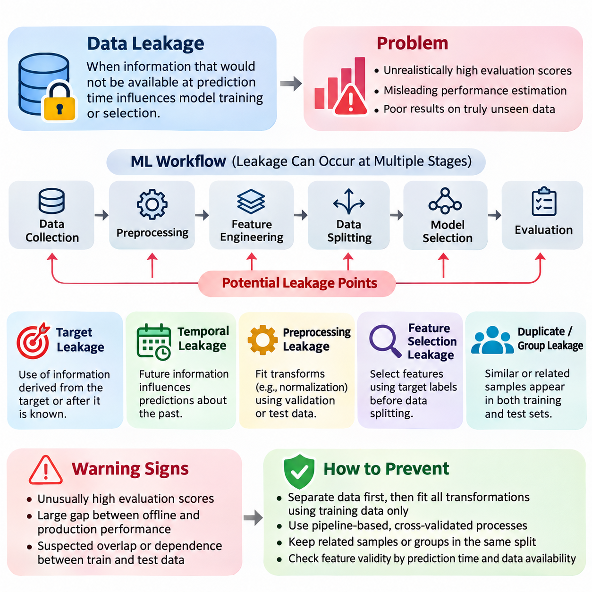
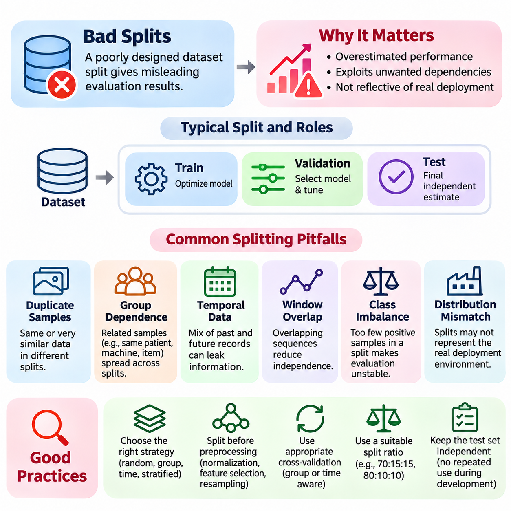
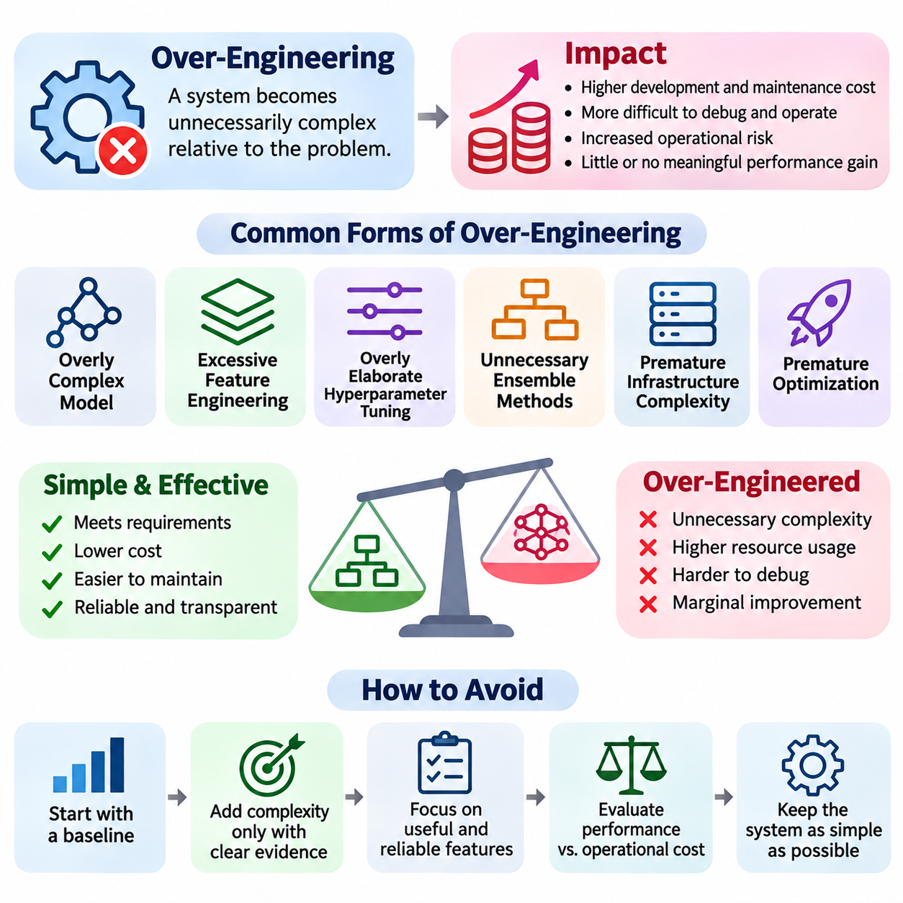
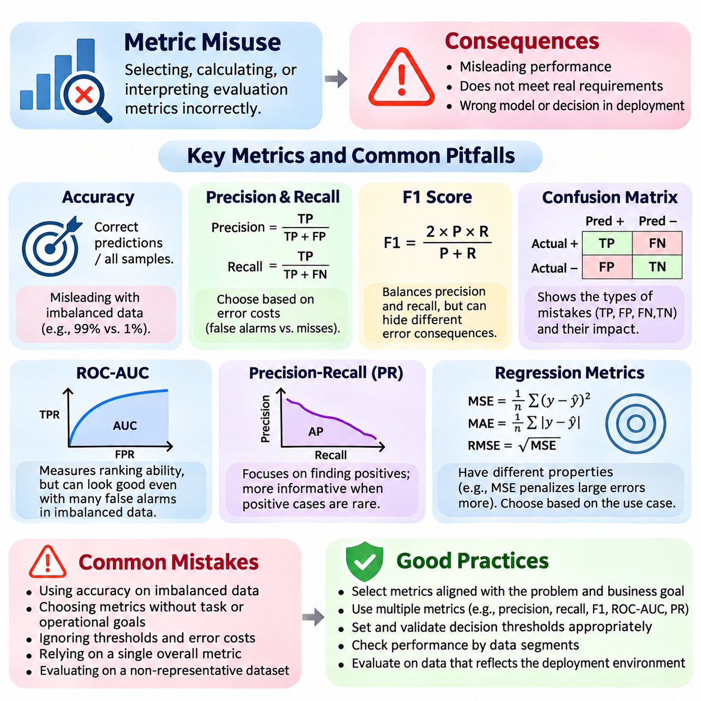
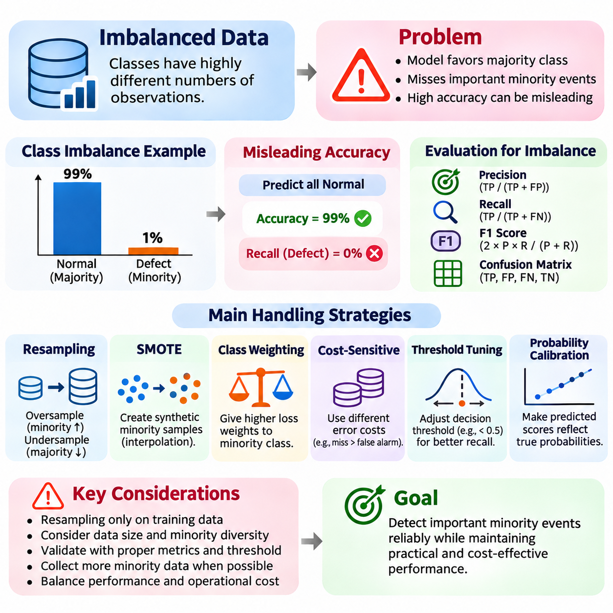
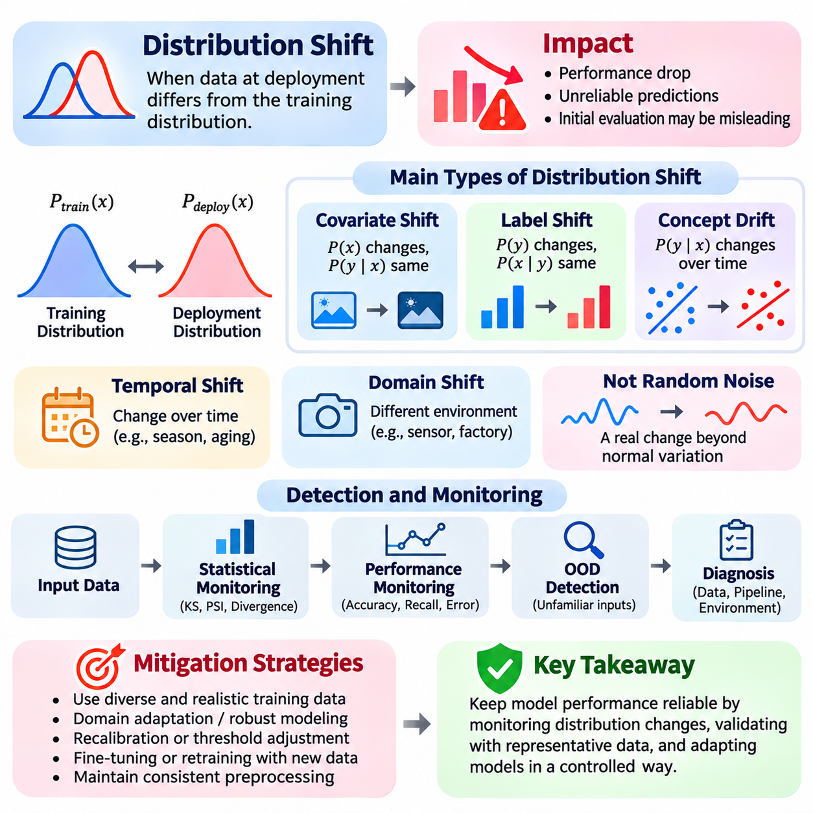
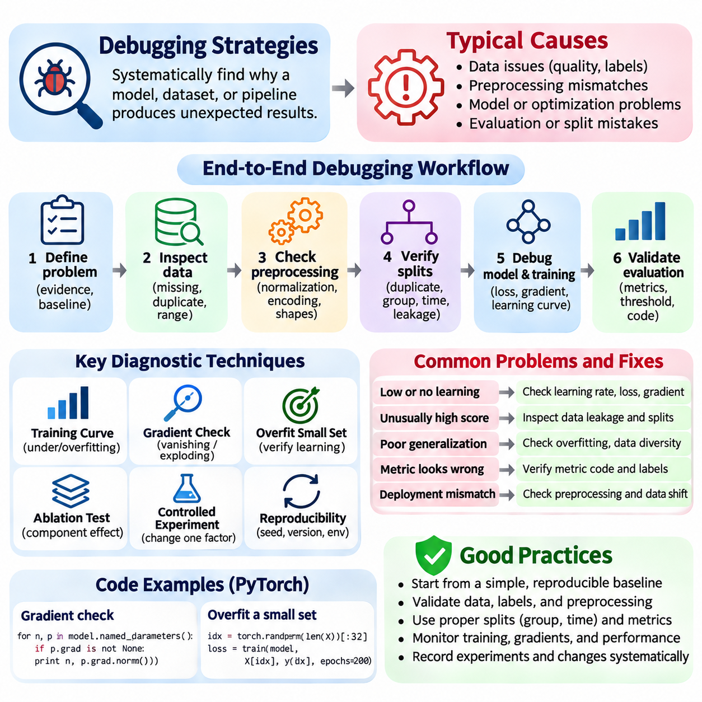

**Volume 07. Machine Learning Fundamentals**


# 08. Common ML Pitfalls

## 08.00 Data Leakage

{width="7.268055555555556in" height="7.268055555555556in"}

Data leakage is one of the most dangerous pitfalls in machine learning because it creates an unrealistic impression of model performance. It occurs when information that would not legitimately be available during prediction influences model training or selection. A model affected by leakage may achieve excellent validation or test scores while performing poorly on genuinely unseen data, making the evaluation results misleading.

The fundamental problem with data leakage is that machine learning models are expected to discover patterns that generalize beyond their training examples. When hidden information from evaluation data or future events enters the learning process, the model can exploit shortcuts instead of learning meaningful relationships. These shortcuts may be statistically powerful during experimentation but unavailable in real deployment environments.

Data leakage can occur at several stages of the machine learning workflow, including data collection, preprocessing, feature engineering, dataset splitting, model selection, and evaluation. It is not limited to directly exposing test labels. Even seemingly harmless operations, such as computing normalization statistics from an entire dataset before splitting it, can introduce information that should remain isolated from training.

Target leakage occurs when a feature contains information derived from the prediction target or from events occurring after the target becomes known. For example, a model predicting whether a customer will cancel a subscription should not use a cancellation confirmation timestamp. Although this feature may correlate almost perfectly with the target, it would not be available when the prediction must actually be made.

Temporal leakage occurs when information from the future influences predictions about the past. This problem is particularly important in financial forecasting, predictive maintenance, healthcare, and time-series analysis. A model predicting equipment failure tomorrow must rely only on measurements available before the prediction time. Using later maintenance records or future sensor observations produces artificially optimistic results.

Preprocessing leakage occurs when transformations are fitted using information from validation or test datasets. Common examples include calculating normalization parameters, estimating missing values, performing feature selection, or fitting dimensionality reduction methods before separating the data. These operations can transfer statistical characteristics of evaluation samples into training, even when their labels remain hidden.

Consider a dataset containing numerical features that require standardization. If the mean and standard deviation are calculated using all available observations, the training transformation indirectly incorporates information from the test distribution. A safer procedure is to estimate these parameters using training data alone and then apply the resulting transformation unchanged to validation and test samples.

Feature selection can produce especially serious leakage when target labels influence the selection process. Suppose thousands of candidate features are ranked according to their correlation with the target before the dataset is divided. The selected features may reflect accidental relationships involving test labels. Subsequent evaluation then measures performance on data that already influenced feature selection, rather than on independent observations.

Data leakage can also arise through duplicated or closely related samples. When nearly identical images, repeated measurements, or records from the same individual appear in both training and test sets, the model may recognize familiar patterns instead of demonstrating genuine generalization. This issue is particularly common in medical imaging, industrial inspection, video analysis, and datasets collected through repeated observations.

Group-related leakage occurs when observations sharing a common source are divided without considering their dependencies. For example, multiple medical records from one patient or multiple images of the same manufactured component may contain highly similar characteristics. If the objective is to generalize to new patients or components, all observations belonging to one group should remain within the same dataset partition.

Cross-validation does not automatically prevent leakage. If preprocessing, feature selection, or resampling is performed before cross-validation, information from held-out folds may influence the training procedure. Each fold must independently fit every learned transformation using only its training portion. Pipeline-based implementations help enforce this separation and reduce the likelihood of accidental information sharing.

Data augmentation introduces another potential leakage pathway. When augmented versions of an original image are distributed across training and evaluation sets, the model may encounter nearly identical visual content during both phases. The correct approach is generally to separate original samples or their source groups before generating training augmentations, ensuring that evaluation examples remain independent of the training process.

Leakage may also emerge from external data sources and engineered features. A database field might be updated after an event, a customer status variable might reflect a later business decision, or an aggregated statistic might incorporate future observations. Therefore, feature validity must be evaluated according to the exact prediction time, data availability, and operational workflow rather than statistical correlation alone.

An unusually high evaluation score can be an important warning sign of leakage, particularly when the task is inherently difficult. Large differences between offline evaluation and production performance may indicate that the model learned relationships unavailable during deployment. However, leakage cannot always be detected through performance metrics alone, because some forms produce only subtle improvements that remain difficult to recognize.

A systematic leakage investigation begins by tracing the origin, timestamp, and transformation history of every feature. Engineers should determine whether each input would genuinely exist when a prediction is requested. They should also inspect dataset relationships, preprocessing boundaries, target-derived variables, and evaluation procedures. This examination connects statistical validation with the actual information flow of the deployed system.

Preventing leakage requires treating dataset isolation as a fundamental design constraint rather than a final evaluation adjustment. Training, validation, and test partitions should be established according to the intended generalization scenario. Learned preprocessing transformations must be fitted only on authorized training observations, while hyperparameter tuning should use validation information without exposing the final test set.

In production-oriented machine learning, data leakage prevention is closely connected to reproducibility, feature governance, and reliable deployment. Versioned datasets, documented feature definitions, timestamp-aware data retrieval, and consistent training-serving pipelines make information boundaries easier to verify. Automated tests can further detect overlapping identifiers, invalid timestamps, unexpected target correlations, and unauthorized feature dependencies.

The essential lesson is that strong machine learning performance must come from legitimate predictive information rather than accidental access to hidden answers. Data leakage undermines the credibility of experiments, distorts model comparisons, and can lead to costly deployment failures. Reliable systems therefore evaluate not only how accurately a model predicts, but also whether every piece of information used to achieve that accuracy would be available under real operating conditions.

데이터 누출(Data Leakage)은 모델 성능(Model Performance)에 대한 비현실적인 평가를 만들어 내기 때문에 머신러닝(Machine Learning)에서 가장 위험한 함정 중 하나이다. 데이터 누출은 예측(Prediction) 시점에 정상적으로 사용할 수 없는 정보가 모델 학습(Model Training)이나 모델 선택(Model Selection)에 영향을 미칠 때 발생한다. 데이터 누출의 영향을 받은 모델은 검증 데이터(Validation Data)나 테스트 데이터(Test Data)에서 매우 높은 점수를 얻더라도 실제로 처음 접하는 데이터에서는 성능이 크게 저하될 수 있으며, 결과적으로 평가 결과(Evaluation Results)의 신뢰성을 떨어뜨린다.

데이터 누출의 근본적인 문제는 머신러닝 모델이 학습 예제(Training Examples)를 넘어 일반화(Generalization)할 수 있는 패턴(Pattern)을 발견해야 한다는 점과 관련된다. 평가 데이터(Evaluation Data)나 미래 사건(Future Events)의 숨겨진 정보가 학습 과정에 유입되면 모델은 의미 있는 관계를 학습하는 대신 지름길(Shortcut)을 활용할 수 있다. 이러한 지름길은 실험 환경에서는 통계적으로 강력하게 작용하지만 실제 배포 환경(Deployment Environment)에서는 사용할 수 없는 경우가 많다.

데이터 누출은 데이터 수집(Data Collection), 전처리(Preprocessing), 특징 공학(Feature Engineering), 데이터셋 분할(Dataset Splitting), 모델 선택(Model Selection), 평가(Evaluation) 등 머신러닝 작업 흐름(ML Workflow)의 여러 단계에서 발생할 수 있다. 데이터 누출은 테스트 레이블(Test Labels)을 직접 노출하는 상황에만 국한되지 않는다. 데이터셋을 분할하기 전에 전체 데이터의 정규화 통계량(Normalization Statistics)을 계산하는 것처럼 겉보기에는 문제가 없어 보이는 작업도 학습 과정에서 분리되어야 할 정보를 유입시킬 수 있다.

타깃 누출(Target Leakage)은 특징(Feature)에 예측 대상(Target)으로부터 파생된 정보나 예측 대상이 확정된 이후 발생한 사건의 정보가 포함될 때 발생한다. 예를 들어 고객의 구독 취소(Subscription Cancellation) 여부를 예측하는 모델은 구독 취소 확인 시각(Cancellation Confirmation Timestamp)을 사용해서는 안 된다. 이 특징은 타깃과 거의 완벽한 상관관계(Correlation)를 보일 수 있지만 실제 예측이 필요한 시점에는 사용할 수 없는 정보이기 때문이다.

시간적 누출(Temporal Leakage)은 미래의 정보가 과거 시점에 대한 예측에 영향을 미칠 때 발생한다. 이 문제는 금융 예측(Financial Forecasting), 예지 보전(Predictive Maintenance), 의료(Healthcare), 시계열 분석(Time-Series Analysis)에서 특히 중요하다. 내일 발생할 장비 고장(Equipment Failure)을 예측하는 모델은 예측 시점 이전에 확보된 측정값만 사용해야 한다. 이후의 유지보수 기록(Maintenance Records)이나 미래 센서 관측값(Future Sensor Observations)을 사용하면 실제보다 지나치게 낙관적인 결과가 생성된다.

전처리 누출(Preprocessing Leakage)은 검증 데이터나 테스트 데이터의 정보를 이용하여 데이터 변환(Transformation)을 학습할 때 발생한다. 대표적인 사례로는 데이터 분할 이전에 정규화 매개변수(Normalization Parameters)를 계산하거나, 결측값(Missing Values)을 추정하거나, 특징 선택(Feature Selection) 또는 차원 축소(Dimensionality Reduction)를 수행하는 경우가 있다. 이러한 작업은 레이블이 공개되지 않더라도 평가 샘플(Evaluation Samples)의 통계적 특성을 학습 과정에 전달할 수 있다.

표준화(Standardization)가 필요한 수치형 특징(Numerical Features)을 포함한 데이터셋을 생각해 볼 수 있다. 전체 관측값(Observations)을 이용하여 평균(Mean)과 표준편차(Standard Deviation)를 계산하면 학습 데이터의 변환 과정에 테스트 분포(Test Distribution)의 정보가 간접적으로 포함된다. 더 안전한 방법은 학습 데이터(Training Data)만 사용하여 이러한 매개변수를 추정한 다음, 계산된 변환을 변경하지 않고 검증 데이터와 테스트 데이터에 동일하게 적용하는 것이다.

특징 선택(Feature Selection)은 타깃 레이블(Target Labels)이 선택 과정에 영향을 미칠 때 특히 심각한 데이터 누출을 발생시킬 수 있다. 예를 들어 데이터셋을 분할하기 전에 수천 개의 후보 특징(Candidate Features)을 타깃과의 상관관계에 따라 순위화하면 선택된 특징에 테스트 레이블과의 우연한 관계가 반영될 수 있다. 이후의 평가는 독립적인 관측값에 대한 성능이 아니라 이미 특징 선택에 영향을 준 데이터에 대한 성능을 측정하게 된다.

데이터 누출은 중복 샘플(Duplicated Samples)이나 서로 밀접하게 관련된 샘플을 통해서도 발생할 수 있다. 거의 동일한 이미지, 반복 측정값(Repeated Measurements), 동일한 개인의 기록이 학습 데이터와 테스트 데이터에 동시에 포함되면 모델은 진정한 일반화 능력을 보여 주는 대신 익숙한 패턴을 인식할 수 있다. 이러한 문제는 의료 영상(Medical Imaging), 산업 검사(Industrial Inspection), 비디오 분석(Video Analysis), 반복 관측으로 수집된 데이터셋에서 특히 자주 발생한다.

그룹 관련 누출(Group-Related Leakage)은 공통된 출처를 가진 관측값의 종속성(Dependency)을 고려하지 않고 데이터를 분할할 때 발생한다. 예를 들어 동일한 환자의 여러 의료 기록이나 동일한 제조 부품의 여러 이미지는 매우 유사한 특성을 포함할 수 있다. 새로운 환자나 부품에 대한 일반화가 목표라면 동일한 그룹에 속하는 모든 관측값을 하나의 데이터셋 분할 영역(Dataset Partition)에 유지해야 한다.

교차 검증(Cross-Validation)이 데이터 누출을 자동으로 방지하는 것은 아니다. 교차 검증 이전에 전처리, 특징 선택 또는 재표본추출(Resampling)을 수행하면 검증용으로 제외된 폴드(Held-Out Folds)의 정보가 학습 과정에 영향을 미칠 수 있다. 각 폴드(Fold)는 해당 학습 부분만 사용하여 모든 학습 기반 변환(Learned Transformation)을 독립적으로 적합(Fit)해야 한다. 파이프라인 기반 구현(Pipeline-Based Implementation)은 이러한 분리를 강제하고 우발적인 정보 공유 가능성을 줄이는 데 도움이 된다.

데이터 증강(Data Augmentation)은 또 다른 데이터 누출 경로를 만들 수 있다. 원본 이미지(Original Image)의 증강된 버전(Augmented Versions)이 학습 데이터와 평가 데이터에 나누어 포함되면 모델은 두 단계에서 거의 동일한 시각적 내용을 접하게 된다. 일반적으로 올바른 접근법은 학습 데이터 증강을 수행하기 전에 원본 샘플이나 출처 그룹(Source Groups)을 먼저 분리하여 평가 예제(Evaluation Examples)가 학습 과정으로부터 독립적으로 유지되도록 하는 것이다.

데이터 누출은 외부 데이터 소스(External Data Sources)와 가공된 특징(Engineered Features)을 통해서도 발생할 수 있다. 데이터베이스 필드(Database Field)가 사건 발생 이후 갱신되거나, 고객 상태 변수(Customer Status Variable)가 이후의 비즈니스 의사결정을 반영하거나, 집계 통계량(Aggregated Statistics)에 미래 관측값이 포함될 수 있다. 따라서 특징의 유효성(Feature Validity)은 통계적 상관관계만이 아니라 정확한 예측 시점, 데이터 가용성(Data Availability), 운영 작업 흐름(Operational Workflow)을 기준으로 평가해야 한다.

비정상적으로 높은 평가 점수(Evaluation Score)는 특히 본질적으로 어려운 문제에서 데이터 누출을 의심할 수 있는 중요한 경고 신호(Warning Sign)가 된다. 오프라인 평가(Offline Evaluation)와 운영 환경 성능(Production Performance) 사이의 큰 차이는 모델이 배포 시점에 사용할 수 없는 관계를 학습했음을 나타낼 수 있다. 그러나 일부 데이터 누출은 알아차리기 어려운 미세한 성능 향상만 발생시키므로 성능 지표(Performance Metrics)만으로 모든 누출을 탐지할 수 있는 것은 아니다.

체계적인 데이터 누출 조사(Data Leakage Investigation)는 모든 특징의 출처(Origin), 타임스탬프(Timestamp), 변환 이력(Transformation History)을 추적하는 것에서 시작한다. 엔지니어는 각 입력값이 실제 예측 요청 시점에 존재할 수 있는 정보인지 판단해야 한다. 또한 데이터셋 간 관계, 전처리 경계(Preprocessing Boundaries), 타깃 파생 변수(Target-Derived Variables), 평가 절차(Evaluation Procedures)를 점검해야 한다. 이러한 검토는 통계적 검증(Statistical Validation)을 배포 시스템의 실제 정보 흐름(Information Flow)과 연결한다.

데이터 누출을 방지하려면 데이터셋 격리(Dataset Isolation)를 최종 평가 단계의 보정 작업이 아니라 기본적인 설계 제약조건(Design Constraint)으로 취급해야 한다. 학습, 검증, 테스트 분할은 목표로 하는 일반화 시나리오(Generalization Scenario)에 따라 설정해야 한다. 학습이 필요한 전처리 변환은 허용된 학습 관측값만 사용하여 적합해야 하며, 하이퍼파라미터 튜닝(Hyperparameter Tuning)은 최종 테스트 세트(Final Test Set)를 노출하지 않고 검증 정보를 활용해야 한다.

운영 중심 머신러닝(Production-Oriented Machine Learning)에서 데이터 누출 방지는 재현성(Reproducibility), 특징 거버넌스(Feature Governance), 안정적인 배포(Reliable Deployment)와 밀접하게 연결된다. 버전 관리된 데이터셋(Versioned Datasets), 문서화된 특징 정의(Feature Definitions), 타임스탬프를 고려한 데이터 검색(Timestamp-Aware Data Retrieval), 일관된 학습 및 서빙 파이프라인(Training-Serving Pipelines)은 정보 경계를 더 쉽게 검증할 수 있도록 한다. 자동화 테스트(Automated Tests)는 중복 식별자(Overlapping Identifiers), 잘못된 타임스탬프, 예상하지 못한 타깃 상관관계, 허용되지 않은 특징 의존성을 추가로 탐지할 수 있다.

핵심 교훈은 우수한 머신러닝 성능이 숨겨진 정답에 대한 우발적인 접근이 아니라 정당하게 사용할 수 있는 예측 정보(Legitimate Predictive Information)에서 비롯되어야 한다는 것이다. 데이터 누출은 실험의 신뢰성(Credibility)을 훼손하고 모델 비교(Model Comparison)를 왜곡하며 비용이 큰 배포 실패(Deployment Failures)를 초래할 수 있다. 따라서 신뢰할 수 있는 시스템은 모델의 예측 정확도(Prediction Accuracy)뿐 아니라 그 정확도를 달성하는 데 사용된 모든 정보가 실제 운영 조건(Real Operating Conditions)에서 이용 가능한지도 평가해야 한다.

## 08.01 Bad Splits

{width="7.268055555555556in" height="7.268055555555556in"}

Dataset splitting is a fundamental step in machine learning because it determines how reliably model performance can be estimated. A poorly designed split may produce misleading evaluation results even when the learning algorithm and preprocessing procedures are correct. The purpose of splitting is not simply to divide observations into separate files, but to create a realistic distinction between information available during training and data encountered during deployment.

A typical machine learning workflow separates observations into training, validation, and test datasets. Training data supports parameter optimization, validation data guides model selection and hyperparameter tuning, and test data provides a final independent performance estimate. These roles must remain clearly separated. When samples are assigned incorrectly, the evaluation process may reward memorization, exploit hidden dependencies, or fail to represent real operating conditions.

Random splitting is widely used because it is simple and often effective when observations are approximately independent and identically distributed. However, random assignment is not universally appropriate. Real datasets frequently contain temporal relationships, repeated measurements, shared identities, geographic dependencies, or systematic collection patterns. Ignoring these structures can cause the resulting evaluation to overestimate how well a model generalizes to unfamiliar situations.

One common mistake is allowing duplicate or nearly identical samples to appear in different dataset partitions. For example, an image classification dataset may contain multiple resized versions of the same photograph. If one version enters training and another enters testing, the model may recognize familiar visual structures rather than classify genuinely unseen content. The resulting accuracy measures sample similarity more than meaningful predictive capability.

Group-dependent observations require special attention because samples sharing a common origin are rarely independent. Medical records from the same patient, images captured from the same manufacturing component, and measurements collected from the same machine may contain persistent characteristics. When the intended task involves new groups, splitting must preserve group boundaries so that all observations associated with one entity remain within a single partition.

Temporal datasets introduce additional splitting requirements because observations are ordered through time. Randomly distributing historical and future records can allow models to learn patterns from periods that occur after the evaluation interval. For forecasting applications, training should generally use earlier observations while validation and testing represent later periods. This chronological separation better reflects the information constraints encountered during real predictions.

Time-series splitting must also account for overlapping observation windows and delayed target availability. Two sequences extracted from neighboring timestamps may share most of their underlying measurements. If these sequences appear in different partitions, evaluation independence becomes questionable. Depending on the prediction horizon and data construction process, a temporal gap or embargo between training and evaluation intervals may be necessary to prevent information overlap.

Class imbalance creates another challenge when splitting classification datasets. If positive examples are rare, an unrestricted random split may place too few positive samples in validation or testing. Performance estimates then become unstable or uninformative. Stratified splitting can preserve approximate class proportions across partitions, although it must not override more important grouping, temporal, or deployment-related constraints.

An inappropriate split ratio can also reduce evaluation reliability. Extremely small training partitions may prevent models from learning meaningful patterns, while very small test partitions produce uncertain performance estimates. Although ratios such as 70:15:15 or 80:10:10 are common starting points, no universal proportion is optimal. Dataset size, class frequency, model complexity, and the required precision of evaluation should determine the final allocation.

Distribution mismatch between partitions deserves careful interpretation. Some differences arise accidentally through biased sampling, while others represent realistic deployment conditions. A model trained on data from one factory may eventually operate in another factory with different equipment and lighting. If cross-factory generalization is the objective, evaluation should deliberately include unseen factories rather than randomly mixing observations from every facility.

Cross-validation provides a more comprehensive performance estimate by repeatedly changing which observations are used for training and validation. Nevertheless, ordinary K-fold cross-validation assumes that the chosen partitioning strategy is appropriate for the underlying data. Grouped datasets require group-aware folds, while chronological datasets require time-aware validation. Repeated evaluation cannot correct a fundamentally invalid partitioning assumption.

Dataset splitting should occur before operations that learn statistical properties or create dependent samples. Normalization, imputation, feature selection, and resampling must be fitted within the appropriate training partition. Similarly, synthetic samples produced through oversampling techniques should not be generated across training and evaluation boundaries. Otherwise, apparently independent partitions may share information introduced by preprocessing.

A subtle mistake occurs when the test dataset is repeatedly consulted during model development. Even without directly training on test samples, developers may adjust architectures, features, thresholds, or hyperparameters after observing test performance. Over time, these decisions indirectly adapt the model to the test set. The test partition therefore loses its independence and no longer provides an unbiased estimate of the complete development procedure.

Reproducibility is another important consideration in dataset splitting. Random seeds, partition identifiers, sampling rules, and dataset versions should be recorded so that experiments can be repeated consistently. However, using a fixed random seed does not guarantee a valid split. Reproducibility ensures that the same partition can be reconstructed, whereas methodological correctness requires that the partition reflects the intended evaluation scenario.

A practical split validation process should examine sample overlap, group membership, timestamp boundaries, class distributions, and important metadata characteristics. Engineers should also verify that every evaluation sample satisfies the assumptions of the intended deployment scenario. Unexpected similarities between partitions, suspiciously high performance, or large differences between offline and production results can indicate that the splitting strategy requires investigation.

In industrial machine learning, partition design often determines whether laboratory results translate into operational reliability. Predictive maintenance models should be evaluated on appropriate future periods or unseen equipment, depending on their intended use. Computer vision systems may require separation by production batch, camera, or facility. Robotics datasets may require evaluation on unfamiliar environments, trajectories, or physical configurations to measure meaningful generalization.

The central principle is that dataset splitting must represent the prediction problem rather than merely satisfy a numerical allocation rule. A valid split creates an honest boundary between learning and evaluation while preserving the dependencies and constraints of the application. Careful partition design strengthens model comparison, exposes generalization weaknesses, and provides a trustworthy foundation for machine learning systems operating beyond controlled experiments.

데이터셋 분할(Dataset Splitting)은 모델 성능(Model Performance)을 얼마나 신뢰성 있게 추정할 수 있는지를 결정하기 때문에 머신러닝(Machine Learning)의 기본적인 단계이다. 잘못 설계된 데이터 분할(Bad Split)은 학습 알고리즘(Learning Algorithm)과 전처리 절차(Preprocessing Procedures)가 올바르더라도 오해를 유발하는 평가 결과(Evaluation Results)를 만들어 낼 수 있다. 데이터 분할의 목적은 단순히 관측값(Observations)을 별도의 파일로 나누는 것이 아니라, 학습 과정에서 사용할 수 있는 정보와 실제 배포(Deployment) 과정에서 접하게 되는 데이터 사이에 현실적인 구분을 설정하는 것이다.

일반적인 머신러닝 작업 흐름(ML Workflow)은 관측값을 학습 데이터셋(Training Dataset), 검증 데이터셋(Validation Dataset), 테스트 데이터셋(Test Dataset)으로 분리한다. 학습 데이터는 매개변수 최적화(Parameter Optimization)를 지원하고, 검증 데이터는 모델 선택(Model Selection)과 하이퍼파라미터 튜닝(Hyperparameter Tuning)을 안내하며, 테스트 데이터는 최종적인 독립 성능 추정(Independent Performance Estimation)에 사용된다. 이러한 역할은 명확하게 분리되어야 한다. 샘플이 잘못 배정되면 평가 과정에서 암기(Memorization)가 유리하게 작용하거나 숨겨진 의존성(Hidden Dependencies)을 활용하게 되며, 실제 운영 조건(Real Operating Conditions)을 제대로 반영하지 못할 수 있다.

무작위 분할(Random Splitting)은 간단하고 관측값이 대체로 독립적이고 동일한 분포(Independent and Identically Distributed, IID)를 따를 때 효과적인 경우가 많기 때문에 널리 사용된다. 그러나 무작위 배정(Random Assignment)이 모든 상황에 적합한 것은 아니다. 실제 데이터셋에는 시간적 관계(Temporal Relationships), 반복 측정(Repeated Measurements), 공유된 식별 정보(Shared Identities), 지리적 의존성(Geographic Dependencies), 체계적인 수집 패턴(Systematic Collection Patterns)이 자주 존재한다. 이러한 구조를 무시하면 익숙하지 않은 상황에 대한 모델의 일반화 성능(Generalization Performance)을 과대평가할 수 있다.

흔히 발생하는 실수 중 하나는 중복 샘플(Duplicate Samples)이나 거의 동일한 샘플(Nearly Identical Samples)이 서로 다른 데이터셋 분할 영역(Dataset Partitions)에 포함되도록 허용하는 것이다. 예를 들어 이미지 분류 데이터셋(Image Classification Dataset)에 동일한 사진의 크기만 변경된 여러 버전이 포함될 수 있다. 하나의 버전이 학습 데이터에 들어가고 다른 버전이 테스트 데이터에 들어가면 모델은 실제로 처음 보는 내용을 분류하는 대신 익숙한 시각적 구조(Visual Structures)를 인식할 수 있다. 이때 측정된 정확도(Accuracy)는 의미 있는 예측 능력(Predictive Capability)보다 샘플 간 유사성(Sample Similarity)을 더 많이 반영한다.

그룹 의존적 관측값(Group-Dependent Observations)은 공통된 출처를 공유하는 샘플이 독립적이지 않은 경우가 많기 때문에 특별한 주의가 필요하다. 동일한 환자의 의료 기록(Medical Records), 동일한 제조 부품에서 촬영한 이미지, 동일한 기계에서 수집한 측정값에는 지속적으로 유지되는 특성(Persistent Characteristics)이 포함될 수 있다. 새로운 그룹(New Groups)에 대한 예측이 목표라면 그룹 경계(Group Boundaries)를 유지하는 방식으로 데이터를 분할하여 하나의 개체(Entity)에 속하는 모든 관측값이 동일한 분할 영역에 포함되도록 해야 한다.

시간적 데이터셋(Temporal Datasets)은 관측값이 시간 순서(Time Order)에 따라 정렬되어 있기 때문에 추가적인 분할 조건이 필요하다. 과거 기록(Historical Records)과 미래 기록(Future Records)을 무작위로 배분하면 모델이 평가 구간(Evaluation Interval) 이후에 발생한 시기의 패턴을 학습할 수 있다. 예측 응용 분야(Forecasting Applications)에서는 일반적으로 이전 관측값을 학습에 사용하고 이후 기간을 검증과 테스트에 사용해야 한다. 이러한 시간순 분리(Chronological Separation)는 실제 예측 과정에서 발생하는 정보 제약조건(Information Constraints)을 더 정확하게 반영한다.

시계열 분할(Time-Series Splitting)은 관측 구간의 중첩(Overlapping Observation Windows)과 지연된 타깃 정보의 가용성(Delayed Target Availability)도 고려해야 한다. 인접한 타임스탬프(Timestamps)에서 추출한 두 시퀀스(Sequences)는 기초 측정값의 대부분을 공유할 수 있다. 이러한 시퀀스가 서로 다른 분할 영역에 포함되면 평가 독립성(Evaluation Independence)에 문제가 발생할 수 있다. 예측 범위(Prediction Horizon)와 데이터 구성 과정(Data Construction Process)에 따라 정보 중첩을 방지하기 위해 학습 구간과 평가 구간 사이에 시간적 간격(Temporal Gap)이나 엠바고(Embargo)를 설정해야 할 수 있다.

클래스 불균형(Class Imbalance)은 분류 데이터셋(Classification Datasets)을 분할할 때 또 다른 문제를 발생시킨다. 양성 예제(Positive Examples)가 드문 경우 제한 없는 무작위 분할(Unrestricted Random Split)은 검증 데이터나 테스트 데이터에 양성 샘플을 지나치게 적게 배정할 수 있다. 이 경우 성능 추정(Performance Estimation)이 불안정해지거나 유용한 정보를 제공하지 못한다. 계층화 분할(Stratified Splitting)은 분할 영역 사이의 클래스 비율(Class Proportions)을 대략적으로 유지할 수 있지만, 더 중요한 그룹 구조, 시간적 제약조건, 배포 관련 제약조건을 무시해서는 안 된다.

부적절한 분할 비율(Split Ratio) 역시 평가 신뢰성(Evaluation Reliability)을 저하시킬 수 있다. 학습 데이터의 비율이 지나치게 작으면 모델이 의미 있는 패턴을 학습하지 못할 수 있으며, 테스트 데이터의 비율이 지나치게 작으면 성능 추정의 불확실성(Uncertainty)이 커진다. 70:15:15 또는 80:10:10과 같은 비율은 일반적인 출발점이지만 모든 상황에 최적인 보편적 비율(Universal Proportion)은 존재하지 않는다. 최종 분할 비율은 데이터셋 크기(Dataset Size), 클래스 빈도(Class Frequency), 모델 복잡도(Model Complexity), 평가에 필요한 정밀도(Evaluation Precision)에 따라 결정해야 한다.

분할 영역 사이의 분포 불일치(Distribution Mismatch)는 신중하게 해석해야 한다. 일부 차이는 편향된 샘플링(Biased Sampling)으로 인해 우연히 발생하지만, 다른 차이는 실제 배포 조건을 현실적으로 반영한다. 한 공장의 데이터로 학습한 모델이 장비와 조명 조건이 다른 공장에서 운영될 수 있다. 공장 간 일반화(Cross-Factory Generalization)가 목표라면 모든 시설의 관측값을 무작위로 혼합하기보다 학습 과정에서 사용하지 않은 공장(Unseen Factories)을 평가에 의도적으로 포함해야 한다.

교차 검증(Cross-Validation)은 학습과 검증에 사용되는 관측값을 반복적으로 변경하여 보다 포괄적인 성능 추정(Performance Estimate)을 제공한다. 그러나 일반적인 K-겹 교차 검증(K-Fold Cross-Validation)은 선택한 분할 전략(Partitioning Strategy)이 기초 데이터의 특성에 적합하다는 가정에 의존한다. 그룹 구조가 있는 데이터셋에는 그룹 인식 폴드(Group-Aware Folds)가 필요하며, 시간순 데이터셋에는 시간 인식 검증(Time-Aware Validation)이 필요하다. 평가를 반복하더라도 근본적으로 잘못된 분할 가정(Partitioning Assumption)을 바로잡을 수는 없다.

데이터셋 분할은 통계적 특성(Statistical Properties)을 학습하거나 종속적인 샘플(Dependent Samples)을 생성하는 작업보다 먼저 수행해야 한다. 정규화(Normalization), 결측값 대체(Imputation), 특징 선택(Feature Selection), 재표본추출(Resampling)은 적절한 학습 분할 영역(Training Partition) 내부에서만 적합(Fit)해야 한다. 마찬가지로 오버샘플링 기법(Oversampling Techniques)으로 생성한 합성 샘플(Synthetic Samples)이 학습과 평가의 경계를 넘어 생성되어서는 안 된다. 그렇지 않으면 겉으로는 독립적인 분할 영역이 전처리 과정에서 유입된 정보를 공유할 수 있다.

미묘하지만 중요한 실수는 모델 개발(Model Development) 과정에서 테스트 데이터셋을 반복적으로 확인하는 것이다. 테스트 샘플을 직접 학습에 사용하지 않더라도 개발자가 테스트 성능(Test Performance)을 확인한 후 모델 구조(Architecture), 특징, 임계값(Thresholds), 하이퍼파라미터(Hyperparameters)를 조정할 수 있다. 이러한 결정이 누적되면 모델은 테스트 세트(Test Set)에 간접적으로 적응하게 된다. 따라서 테스트 분할 영역은 독립성을 잃고 전체 개발 절차(Development Procedure)에 대한 편향되지 않은 성능 추정(Unbiased Performance Estimate)을 더 이상 제공하지 못한다.

재현성(Reproducibility) 역시 데이터셋 분할에서 중요한 고려사항이다. 실험을 일관되게 반복할 수 있도록 난수 시드(Random Seeds), 분할 식별자(Partition Identifiers), 샘플링 규칙(Sampling Rules), 데이터셋 버전(Dataset Versions)을 기록해야 한다. 그러나 고정된 난수 시드(Fixed Random Seed)를 사용한다고 해서 유효한 분할(Valid Split)이 보장되는 것은 아니다. 재현성은 동일한 분할을 다시 구성할 수 있도록 하는 것이며, 방법론적 정확성(Methodological Correctness)은 해당 분할이 의도한 평가 시나리오(Evaluation Scenario)를 반영하도록 요구한다.

실용적인 분할 검증 과정(Split Validation Process)에서는 샘플 중첩(Sample Overlap), 그룹 소속(Group Membership), 타임스탬프 경계(Timestamp Boundaries), 클래스 분포(Class Distributions), 중요한 메타데이터 특성(Metadata Characteristics)을 조사해야 한다. 엔지니어는 모든 평가 샘플이 의도한 배포 시나리오의 가정을 충족하는지도 확인해야 한다. 분할 영역 사이의 예상하지 못한 유사성, 비정상적으로 높은 성능, 오프라인 평가(Offline Evaluation)와 운영 환경 결과(Production Results) 사이의 큰 차이는 분할 전략을 추가로 조사해야 한다는 신호가 될 수 있다.

산업용 머신러닝(Industrial Machine Learning)에서는 분할 설계(Partition Design)가 실험실 결과(Laboratory Results)를 실제 운영 신뢰성(Operational Reliability)으로 연결할 수 있는지를 결정하는 경우가 많다. 예지 보전 모델(Predictive Maintenance Models)은 의도한 사용 목적에 따라 적절한 미래 기간이나 학습에 사용하지 않은 장비(Unseen Equipment)를 대상으로 평가해야 한다. 컴퓨터 비전 시스템(Computer Vision Systems)은 생산 배치(Production Batch), 카메라(Camera), 시설(Facility)을 기준으로 데이터를 분리해야 할 수 있다. 로보틱스 데이터셋(Robotics Datasets)은 의미 있는 일반화 능력을 측정하기 위해 익숙하지 않은 환경(Environments), 궤적(Trajectories), 물리적 구성(Physical Configurations)을 대상으로 평가해야 할 수 있다.

핵심 원칙은 데이터셋 분할이 단순히 수치적인 배분 규칙(Numerical Allocation Rule)을 충족하는 것이 아니라 실제 예측 문제(Prediction Problem)를 반영해야 한다는 것이다. 유효한 분할(Valid Split)은 응용 분야(Application)의 의존성과 제약조건을 유지하면서 학습과 평가 사이에 정직한 경계(Honest Boundary)를 형성한다. 신중한 분할 설계는 모델 비교(Model Comparison)의 신뢰성을 높이고 일반화의 약점(Generalization Weaknesses)을 드러내며, 통제된 실험 환경을 넘어 실제로 운영되는 머신러닝 시스템을 위한 신뢰할 수 있는 기반(Trustworthy Foundation)을 제공한다.

## 08.02 Over Engineering

{width="7.268055555555556in" height="7.268055555555556in"}

Over-engineering is a common machine learning pitfall that occurs when a system becomes unnecessarily complex relative to the problem it must solve. Engineers may introduce sophisticated algorithms, elaborate feature pipelines, or extensive infrastructure before establishing whether simpler approaches are sufficient. Although complexity can improve performance in certain situations, excessive complexity often increases development cost, maintenance difficulty, and operational risk without delivering meaningful benefits.

Machine learning projects frequently begin with the assumption that advanced models will outperform traditional methods. However, a complex neural network is not automatically superior to linear regression, decision trees, or gradient boosting. For structured datasets with limited observations, simpler algorithms may achieve comparable or better results. Model selection should therefore depend on empirical evidence, data characteristics, and operational requirements rather than architectural sophistication.

A major cause of over-engineering is the absence of a reliable baseline model. Without a baseline, developers cannot determine whether additional complexity produces measurable improvements. A simple model establishes an initial reference for accuracy, training time, inference latency, and resource consumption. More advanced methods should be introduced only when experiments demonstrate that the baseline fails to satisfy important performance or functional requirements.

Excessive feature engineering is another common manifestation of unnecessary complexity. Developers may create hundreds of derived variables, complex interactions, and specialized transformations without verifying their predictive value. These features increase preprocessing costs and make debugging more difficult. They may also introduce redundancy, instability, or data leakage. Effective feature engineering prioritizes interpretable, reliable, and measurable improvements.

Hyperparameter tuning can also become unnecessarily elaborate. Large search spaces, repeated optimization experiments, and sophisticated tuning frameworks may consume substantial computational resources while producing marginal gains. When improvements fall within normal evaluation variability, the additional optimization effort may have little practical value. A disciplined tuning strategy focuses on influential parameters, meaningful search ranges, and clearly defined stopping criteria.

Over-engineering frequently appears in model architecture design. A deep network with many layers, attention mechanisms, or specialized components may be introduced for a task that requires only modest representational capacity. Such architectures increase memory requirements, training instability, and inference cost. Model capacity should be selected according to dataset complexity, available training examples, generalization requirements, and deployment constraints.

Ensemble methods illustrate the tradeoff between predictive performance and system complexity. Combining multiple models can improve robustness and accuracy, but each additional component introduces computational overhead and maintenance responsibilities. A large ensemble may require several inference passes, additional memory, and complicated deployment procedures. Its benefits should be evaluated against simpler alternatives using both predictive and operational metrics.

Infrastructure over-engineering occurs when distributed computing, elaborate orchestration systems, or complex deployment architectures are introduced before they are necessary. A small experimental workload may operate effectively on a single machine, while a distributed platform adds networking, synchronization, monitoring, and failure-management challenges. Infrastructure should evolve in response to demonstrated workload requirements rather than anticipated complexity alone.

Premature optimization is closely related to over-engineering. Engineers may spend significant effort accelerating data loading, rewriting components, or optimizing inference kernels before identifying actual performance bottlenecks. These changes can increase implementation complexity without improving overall system behavior. Profiling and measurement should precede optimization so that engineering effort targets limitations that materially affect performance.

Over-engineering also increases the difficulty of debugging and error analysis. When a system contains many preprocessing stages, interacting models, and conditional execution paths, identifying the source of incorrect predictions becomes challenging. A simpler architecture provides clearer relationships between inputs, transformations, and outputs. This transparency supports faster diagnosis, more reliable testing, and easier verification of model behavior.

Operational reliability can decline as unnecessary components accumulate. Every additional dependency, service, configuration parameter, or processing stage creates another potential failure point. Complex systems require more extensive integration testing, monitoring, and maintenance. Even when individual components operate correctly, interactions between them may introduce unexpected behavior. Reducing unnecessary complexity can therefore improve system stability and long-term maintainability.

Interpretability is another important consideration. Highly complex models and feature pipelines may make it difficult for engineers and stakeholders to understand why predictions occur. This limitation becomes particularly important in healthcare, finance, manufacturing, and other applications requiring traceability. Although complex models are sometimes necessary, their additional predictive value should justify the resulting challenges in explanation, auditing, and operational oversight.

A practical way to control over-engineering is to adopt an incremental development strategy. Begin with a clearly defined problem, establish simple evaluation metrics, and implement a minimal working baseline. Introduce additional features, model components, or infrastructure only when a specific limitation has been identified. Each modification should be tested independently so that its contribution to performance, reliability, or efficiency can be measured.

Ablation studies provide a systematic method for determining whether individual components are necessary. By removing or simplifying features, architectural modules, or processing stages, engineers can observe how system performance changes. Components that contribute little measurable value may be eliminated. This process helps distinguish essential complexity from unnecessary engineering effort and supports more efficient model design.

The relationship between complexity and performance should be evaluated using multiple criteria rather than predictive accuracy alone. Training cost, inference latency, memory usage, energy consumption, development time, and maintenance burden may all influence the preferred solution. A model offering a minor accuracy improvement may be less desirable if it requires substantially more resources or creates unacceptable operational constraints.

In industrial machine learning, simplicity can provide significant practical advantages. A manufacturing inspection model running on an edge device may benefit more from predictable latency and stable execution than from a marginal improvement in benchmark accuracy. Similarly, a predictive maintenance system may prioritize reliability, interpretability, and straightforward integration with existing equipment. The optimal design depends on the complete operating environment.

The central lesson is that engineering complexity should be justified by demonstrated value. Sophisticated algorithms and infrastructure are useful when they address genuine limitations, but complexity introduced without evidence can weaken the entire machine learning system. Effective development emphasizes measurable improvements, clear design decisions, and maintainable implementations. The best solution is not necessarily the most advanced one, but the simplest system that reliably satisfies the required objectives.

과도한 엔지니어링(Over-Engineering)은 시스템이 해결해야 하는 문제에 비해 불필요하게 복잡해질 때 발생하는 머신러닝(Machine Learning)의 일반적인 함정이다. 엔지니어는 더 단순한 접근법으로 충분한지 확인하기 전에 정교한 알고리즘(Sophisticated Algorithms), 복잡한 특징 파이프라인(Feature Pipelines), 대규모 인프라(Infrastructure)를 도입할 수 있다. 복잡성이 특정 상황에서는 성능을 향상시킬 수 있지만, 지나친 복잡성은 의미 있는 이점을 제공하지 못하면서 개발 비용(Development Cost), 유지보수 난이도(Maintenance Difficulty), 운영 위험(Operational Risk)을 증가시키는 경우가 많다.

머신러닝 프로젝트(Machine Learning Projects)는 고급 모델(Advanced Models)이 전통적인 방법(Traditional Methods)보다 우수한 성능을 보일 것이라는 가정에서 시작하는 경우가 많다. 그러나 복잡한 신경망(Neural Network)이 선형 회귀(Linear Regression), 의사결정나무(Decision Trees), 그래디언트 부스팅(Gradient Boosting)보다 자동으로 우수해지는 것은 아니다. 관측값이 제한된 정형 데이터셋(Structured Datasets)에서는 단순한 알고리즘이 비슷하거나 더 좋은 결과를 달성할 수 있다. 따라서 모델 선택(Model Selection)은 아키텍처의 정교함(Architectural Sophistication)이 아니라 실험적 증거(Empirical Evidence), 데이터 특성(Data Characteristics), 운영 요구사항(Operational Requirements)에 따라 결정해야 한다.

과도한 엔지니어링의 주요 원인 중 하나는 신뢰할 수 있는 기준 모델(Baseline Model)이 없다는 것이다. 기준 모델이 없으면 개발자는 추가적인 복잡성이 측정 가능한 개선(Measurable Improvements)을 만들어 내는지 판단할 수 없다. 단순한 모델은 정확도(Accuracy), 학습 시간(Training Time), 추론 지연시간(Inference Latency), 자원 소비(Resource Consumption)에 대한 초기 기준을 제공한다. 더 고급의 방법은 실험을 통해 기준 모델이 중요한 성능 요구사항(Performance Requirements)이나 기능 요구사항(Functional Requirements)을 충족하지 못한다는 사실이 확인된 경우에 도입해야 한다.

과도한 특징 공학(Excessive Feature Engineering)은 불필요한 복잡성이 나타나는 또 다른 일반적인 형태이다. 개발자는 예측 가치(Predictive Value)를 검증하지 않은 상태에서 수백 개의 파생 변수(Derived Variables), 복잡한 상호작용(Complex Interactions), 특수한 변환(Specialized Transformations)을 생성할 수 있다. 이러한 특징은 전처리 비용(Preprocessing Costs)을 증가시키고 디버깅(Debugging)을 어렵게 만든다. 또한 중복성(Redundancy), 불안정성(Instability), 데이터 누출(Data Leakage)을 유발할 수 있다. 효과적인 특징 공학은 해석 가능하고 신뢰할 수 있으며 측정 가능한 개선을 우선시한다.

하이퍼파라미터 튜닝(Hyperparameter Tuning) 역시 불필요하게 복잡해질 수 있다. 광범위한 탐색 공간(Large Search Spaces), 반복적인 최적화 실험(Optimization Experiments), 정교한 튜닝 프레임워크(Tuning Frameworks)는 미미한 성능 향상만 제공하면서 상당한 컴퓨팅 자원(Computational Resources)을 소비할 수 있다. 개선 폭이 일반적인 평가 변동성(Evaluation Variability) 범위 안에 있다면 추가적인 최적화 노력은 실질적인 가치가 거의 없을 수 있다. 체계적인 튜닝 전략(Tuning Strategy)은 영향력이 큰 매개변수(Influential Parameters), 의미 있는 탐색 범위(Search Ranges), 명확하게 정의된 중단 기준(Stopping Criteria)에 집중한다.

과도한 엔지니어링은 모델 아키텍처 설계(Model Architecture Design)에서 자주 나타난다. 표현 용량(Representational Capacity)이 크지 않아도 되는 작업에 여러 계층(Layers), 어텐션 메커니즘(Attention Mechanisms), 특수 구성요소(Specialized Components)를 포함한 심층 신경망(Deep Network)을 도입할 수 있다. 이러한 아키텍처는 메모리 요구량(Memory Requirements), 학습 불안정성(Training Instability), 추론 비용(Inference Cost)을 증가시킨다. 모델 용량(Model Capacity)은 데이터셋 복잡도(Dataset Complexity), 사용 가능한 학습 예제(Training Examples), 일반화 요구사항(Generalization Requirements), 배포 제약조건(Deployment Constraints)에 따라 선택해야 한다.

앙상블 기법(Ensemble Methods)은 예측 성능(Predictive Performance)과 시스템 복잡성(System Complexity) 사이의 절충 관계(Tradeoff)를 보여 준다. 여러 모델을 결합하면 강건성(Robustness)과 정확도를 향상시킬 수 있지만, 추가되는 각 구성요소는 계산 오버헤드(Computational Overhead)와 유지보수 책임(Maintenance Responsibilities)을 발생시킨다. 대규모 앙상블(Large Ensemble)은 여러 번의 추론 수행(Inference Passes), 추가 메모리, 복잡한 배포 절차(Deployment Procedures)를 요구할 수 있다. 따라서 예측 지표(Predictive Metrics)와 운영 지표(Operational Metrics)를 모두 사용하여 단순한 대안과 비교해야 한다.

인프라의 과도한 엔지니어링(Infrastructure Over-Engineering)은 분산 컴퓨팅(Distributed Computing), 복잡한 오케스트레이션 시스템(Orchestration Systems), 정교한 배포 아키텍처(Deployment Architectures)를 실제 필요성이 확인되기 전에 도입할 때 발생한다. 소규모 실험 작업 부하(Experimental Workload)는 단일 컴퓨터(Single Machine)에서도 효과적으로 처리할 수 있지만, 분산 플랫폼(Distributed Platform)은 네트워킹(Networking), 동기화(Synchronization), 모니터링(Monitoring), 장애 관리(Failure Management) 문제를 추가한다. 인프라는 예상되는 복잡성만을 기준으로 구축하기보다 검증된 작업 부하 요구사항(Workload Requirements)에 따라 발전시켜야 한다.

성급한 최적화(Premature Optimization)는 과도한 엔지니어링과 밀접하게 관련된다. 엔지니어는 실제 성능 병목현상(Performance Bottlenecks)을 식별하기 전에 데이터 로딩(Data Loading)을 가속하거나 구성요소를 다시 작성하거나 추론 커널(Inference Kernels)을 최적화하는 데 많은 노력을 투입할 수 있다. 이러한 변경은 전체 시스템 동작(System Behavior)을 개선하지 못하면서 구현 복잡성(Implementation Complexity)만 증가시킬 수 있다. 따라서 최적화 이전에 프로파일링(Profiling)과 측정(Measurement)을 수행하여 엔지니어링 노력이 성능에 실질적인 영향을 미치는 제약요소를 해결하도록 해야 한다.

과도한 엔지니어링은 디버깅(Debugging)과 오류 분석(Error Analysis)의 난이도도 증가시킨다. 시스템에 여러 전처리 단계(Preprocessing Stages), 상호작용하는 모델(Interacting Models), 조건부 실행 경로(Conditional Execution Paths)가 포함되면 잘못된 예측의 원인을 식별하기 어려워진다. 단순한 아키텍처(Simple Architecture)는 입력(Inputs), 변환(Transformations), 출력(Outputs) 사이의 관계를 더 명확하게 보여 준다. 이러한 투명성(Transparency)은 빠른 문제 진단(Diagnosis), 신뢰할 수 있는 테스트(Testing), 모델 동작(Model Behavior)의 용이한 검증(Verification)을 지원한다.

불필요한 구성요소가 누적되면 운영 신뢰성(Operational Reliability)이 저하될 수 있다. 추가되는 모든 의존성(Dependency), 서비스(Service), 설정 매개변수(Configuration Parameter), 처리 단계(Processing Stage)는 새로운 잠재적 장애 지점(Potential Failure Point)을 만든다. 복잡한 시스템은 더 광범위한 통합 테스트(Integration Testing), 모니터링, 유지보수를 요구한다. 개별 구성요소가 올바르게 작동하더라도 구성요소 사이의 상호작용으로 예상하지 못한 동작이 발생할 수 있다. 따라서 불필요한 복잡성을 줄이면 시스템 안정성(System Stability)과 장기 유지보수성(Long-Term Maintainability)을 향상시킬 수 있다.

해석 가능성(Interpretability) 역시 중요한 고려사항이다. 매우 복잡한 모델과 특징 파이프라인은 엔지니어와 이해관계자(Stakeholders)가 특정 예측이 발생한 이유를 이해하기 어렵게 만들 수 있다. 이러한 한계는 추적 가능성(Traceability)이 필요한 의료(Healthcare), 금융(Finance), 제조(Manufacturing) 등의 응용 분야에서 특히 중요하다. 복잡한 모델이 필요한 경우도 있지만, 추가적인 예측 가치가 설명(Explanation), 감사(Auditing), 운영 감독(Operational Oversight)의 어려움을 정당화할 수 있어야 한다.

과도한 엔지니어링을 제어하는 실용적인 방법은 점진적 개발 전략(Incremental Development Strategy)을 채택하는 것이다. 명확하게 정의된 문제(Well-Defined Problem)에서 시작하여 단순한 평가 지표(Evaluation Metrics)를 설정하고 최소한의 동작 가능한 기준 모델(Minimal Working Baseline)을 구현해야 한다. 특정한 한계가 확인된 경우에만 추가 특징, 모델 구성요소 또는 인프라를 도입해야 한다. 각 변경 사항은 성능, 신뢰성 또는 효율성(Efficiency)에 대한 기여도를 측정할 수 있도록 독립적으로 테스트해야 한다.

절제 연구(Ablation Studies)는 개별 구성요소의 필요성을 판단하기 위한 체계적인 방법을 제공한다. 특징, 아키텍처 모듈(Architectural Modules), 처리 단계(Processing Stages)를 제거하거나 단순화하여 시스템 성능이 어떻게 변하는지 관찰할 수 있다. 측정 가능한 기여도가 거의 없는 구성요소는 제거할 수 있다. 이러한 과정은 필수적인 복잡성(Essential Complexity)과 불필요한 엔지니어링 노력(Unnecessary Engineering Effort)을 구분하고 더 효율적인 모델 설계(Model Design)를 지원한다.

복잡성과 성능 사이의 관계는 예측 정확도(Predictive Accuracy)만이 아니라 여러 기준(Multiple Criteria)을 사용하여 평가해야 한다. 학습 비용(Training Cost), 추론 지연시간(Inference Latency), 메모리 사용량(Memory Usage), 에너지 소비(Energy Consumption), 개발 시간(Development Time), 유지보수 부담(Maintenance Burden)은 모두 선호되는 해결책에 영향을 미칠 수 있다. 정확도가 조금 향상된 모델이라도 훨씬 많은 자원을 요구하거나 수용하기 어려운 운영 제약조건(Operational Constraints)을 발생시킨다면 바람직하지 않을 수 있다.

산업용 머신러닝(Industrial Machine Learning)에서 단순성(Simplicity)은 상당한 실용적 이점(Practical Advantages)을 제공할 수 있다. 엣지 장치(Edge Device)에서 실행되는 제조 검사 모델(Manufacturing Inspection Model)은 벤치마크 정확도(Benchmark Accuracy)의 미세한 향상보다 예측 가능한 지연시간(Predictable Latency)과 안정적인 실행(Stable Execution)에서 더 큰 이점을 얻을 수 있다. 마찬가지로 예지 보전 시스템(Predictive Maintenance System)은 신뢰성(Reliability), 해석 가능성, 기존 장비와의 간단한 통합(Straightforward Integration)을 우선시할 수 있다. 최적의 설계(Optimal Design)는 전체 운영 환경(Operating Environment)에 따라 달라진다.

핵심 교훈은 엔지니어링 복잡성(Engineering Complexity)이 입증된 가치(Demonstrated Value)에 의해 정당화되어야 한다는 것이다. 정교한 알고리즘과 인프라는 실제 한계를 해결할 때 유용하지만, 근거 없이 도입된 복잡성은 머신러닝 시스템 전체를 약화시킬 수 있다. 효과적인 개발(Effective Development)은 측정 가능한 개선(Measurable Improvements), 명확한 설계 결정(Design Decisions), 유지보수 가능한 구현(Maintainable Implementations)을 강조한다. 가장 좋은 해결책은 반드시 가장 발전된 기술을 적용한 시스템이 아니라 요구되는 목표(Required Objectives)를 신뢰성 있게 충족하는 가장 단순한 시스템이다.

## 08.03 Metric Misuse

{width="7.268055555555556in" height="7.268055555555556in"}

Metric misuse is a common machine learning pitfall that occurs when evaluation metrics are selected, calculated, or interpreted incorrectly. A model may appear successful according to one numerical score while failing to satisfy the actual requirements of its application. Evaluation metrics are simplified representations of model behavior, not complete descriptions of system quality. Reliable evaluation therefore requires understanding what each metric measures and which limitations it introduces.

A fundamental mistake is choosing metrics without considering the underlying prediction problem. Classification, regression, ranking, forecasting, and anomaly detection require different evaluation approaches. Even within the same task category, operational priorities may differ significantly. A metric suitable for a balanced image classification benchmark may be inappropriate for medical screening, industrial defect detection, or financial fraud identification.

Accuracy is one of the most frequently misused classification metrics. It measures the proportion of correct predictions among all evaluated samples, but it can become misleading when classes are highly imbalanced. Consider a dataset containing 99 percent normal observations and 1 percent abnormal observations. A model predicting every sample as normal achieves 99 percent accuracy while completely failing to detect the abnormal cases that may be most important.

Precision and recall provide complementary perspectives on classification performance. Precision measures the proportion of predicted positive cases that are actually positive, while recall measures the proportion of actual positive cases successfully detected. High precision is valuable when false alarms are expensive, whereas high recall is important when missing positive cases creates serious consequences. Neither metric should be optimized without considering the application\'s error costs.

The F1 score combines precision and recall through their harmonic mean, providing a useful summary when both dimensions matter. However, F1 does not include true negatives directly and may conceal differences in error consequences. Two models with similar F1 scores can produce different operational outcomes. Furthermore, maximizing F1 does not necessarily minimize financial loss, safety risk, or other application-specific costs associated with incorrect predictions.

Confusion matrices provide essential context that single numerical metrics often omit. By separating true positives, false positives, true negatives, and false negatives, they reveal the types of mistakes a classifier makes. A model with acceptable overall accuracy may still generate an excessive number of false negatives in safety-critical applications. Examining the confusion matrix helps connect statistical performance with the practical consequences of prediction errors.

Threshold selection introduces another opportunity for metric misuse. Many classification models produce probabilities or continuous scores that must be converted into discrete decisions. Changing the decision threshold alters precision, recall, and false-positive rates without changing the underlying model. Thresholds should therefore be selected using validation data and application-specific requirements rather than adjusted repeatedly to maximize performance on the final test dataset.

ROC-AUC summarizes a classifier\'s ability to rank positive observations above negative observations across decision thresholds. Although useful for comparing discrimination performance, it does not directly describe performance at a particular operating threshold. In highly imbalanced problems, ROC-AUC may appear favorable even when the number of false alarms is operationally unacceptable. Precision-recall analysis can provide additional insight when positive cases are rare.

Precision-recall curves emphasize the relationship between correctly identifying positive observations and limiting false-positive predictions. Average precision summarizes aspects of this relationship, but its interpretation depends on class prevalence and evaluation conditions. Comparing precision-recall results across datasets with different positive-class frequencies can therefore be misleading. Evaluation should account for the expected prevalence and operating conditions of the deployment environment.

Regression metrics can also be misused when their mathematical properties are ignored. Mean squared error emphasizes large prediction errors because deviations are squared, while mean absolute error assigns linear penalties to absolute deviations. Root mean squared error expresses error in the original target units but remains sensitive to large deviations. The appropriate choice depends on whether large errors deserve disproportionate penalties and how predictions will be used.

Percentage-based regression metrics require additional caution. Mean absolute percentage error becomes undefined when actual target values are zero and can behave poorly when values approach zero. Metrics that normalize errors may also create misleading comparisons when target scales or distributions differ. Engineers should examine target characteristics and business consequences before selecting an error measure solely because it is widely reported.

A single aggregate metric can hide substantial performance differences across population segments. A model may perform well overall while producing poor predictions for particular locations, equipment types, demographic groups, or environmental conditions. Segment-level evaluation helps identify these weaknesses. Reporting only the average result can conceal systematic failures that become important when the model is deployed across diverse operating environments.

Metric misuse also occurs when evaluation datasets do not represent the intended deployment population. Even a correctly calculated metric can provide misleading conclusions when the underlying samples are biased, outdated, or unrepresentative. For example, an industrial vision model evaluated only under controlled lighting may achieve excellent accuracy but struggle with changing illumination. Metric validity depends on both the calculation and the relevance of the evaluation data.

Statistical uncertainty is frequently overlooked when comparing models. Small differences in accuracy, F1 score, or regression error may result from sampling variation rather than genuine improvements. Confidence intervals, repeated evaluation, and appropriate statistical comparisons can help determine whether observed differences are meaningful. Model selection should avoid treating every numerical improvement as evidence of superior generalization.

Repeatedly optimizing against the same evaluation benchmark can also create metric overfitting. Developers may adjust architectures, features, or hyperparameters until a particular score improves, gradually adapting the development process to benchmark-specific characteristics. This practice can reduce generalization to genuinely unseen data. Independent testing and carefully controlled evaluation procedures are necessary to preserve the credibility of reported results.

Operational machine learning systems often require several metrics rather than one universal score. Predictive quality must be considered alongside inference latency, throughput, memory consumption, calibration, robustness, and reliability. A model with slightly better predictive accuracy may be unsuitable if it violates real-time constraints or produces poorly calibrated confidence estimates. Evaluation should reflect the complete requirements of the deployed system.

The central lesson is that evaluation metrics must be aligned with the real objective of the machine learning application. Numerical scores are valuable only when their assumptions, limitations, and operational implications are understood. Reliable model assessment combines appropriate metrics, representative datasets, error analysis, and uncertainty estimation. The goal is not to maximize an impressive benchmark number, but to establish whether a model delivers dependable performance under realistic conditions.

평가 지표 오용(Metric Misuse)은 평가 지표(Evaluation Metrics)를 잘못 선택하거나 계산하거나 해석할 때 발생하는 머신러닝(Machine Learning)의 일반적인 함정이다. 모델은 하나의 수치적 점수(Numerical Score)에서는 성공적으로 보이지만 실제 응용 분야(Application)의 요구사항을 충족하지 못할 수 있다. 평가 지표는 모델 동작(Model Behavior)을 단순화하여 표현한 것이며, 시스템 품질(System Quality)을 완전하게 설명하는 수단은 아니다. 따라서 신뢰할 수 있는 평가(Reliable Evaluation)를 위해서는 각 지표가 무엇을 측정하고 어떤 한계를 가지는지 이해해야 한다.

근본적인 실수 중 하나는 기초적인 예측 문제(Prediction Problem)를 고려하지 않고 평가 지표를 선택하는 것이다. 분류(Classification), 회귀(Regression), 순위화(Ranking), 예측(Forecasting), 이상 탐지(Anomaly Detection)는 서로 다른 평가 접근법(Evaluation Approaches)을 요구한다. 동일한 작업 범주(Task Category)에서도 운영 우선순위(Operational Priorities)는 크게 달라질 수 있다. 균형 잡힌 이미지 분류 벤치마크(Image Classification Benchmark)에 적합한 지표가 의료 선별검사(Medical Screening), 산업 결함 탐지(Industrial Defect Detection), 금융 사기 탐지(Financial Fraud Detection)에는 부적절할 수 있다.

정확도(Accuracy)는 가장 자주 오용되는 분류 지표(Classification Metrics) 중 하나이다. 정확도는 전체 평가 샘플(Evaluated Samples) 중 올바르게 예측한 비율을 측정하지만, 클래스 불균형(Class Imbalance)이 심한 경우 오해를 유발할 수 있다. 정상 관측값(Normal Observations)이 99%이고 비정상 관측값(Abnormal Observations)이 1%인 데이터셋을 생각해 볼 수 있다. 모든 샘플을 정상으로 예측하는 모델은 99%의 정확도를 달성하지만, 가장 중요할 수 있는 비정상 사례(Abnormal Cases)를 전혀 탐지하지 못한다.

정밀도(Precision)와 재현율(Recall)은 분류 성능(Classification Performance)을 서로 보완하는 관점에서 설명한다. 정밀도는 양성(Positive)으로 예측한 사례 중 실제 양성인 비율을 측정하며, 재현율은 실제 양성 사례 중 성공적으로 탐지한 비율을 측정한다. 높은 정밀도는 오경보(False Alarms)의 비용이 클 때 중요하며, 높은 재현율은 양성 사례를 놓치는 것이 심각한 결과를 초래할 때 중요하다. 두 지표 모두 응용 분야의 오류 비용(Error Costs)을 고려하지 않고 독립적으로 최적화해서는 안 된다.

F1 점수(F1 Score)는 정밀도와 재현율을 조화 평균(Harmonic Mean)으로 결합하여 두 측면이 모두 중요한 경우 유용한 요약 지표(Summary Metric)를 제공한다. 그러나 F1 점수는 진음성(True Negatives)을 직접 포함하지 않으며 오류의 결과(Error Consequences)에 존재하는 차이를 감출 수 있다. F1 점수가 비슷한 두 모델이라도 서로 다른 운영 결과(Operational Outcomes)를 만들어 낼 수 있다. 또한 F1 점수를 최대화한다고 해서 잘못된 예측과 관련된 재정적 손실(Financial Loss), 안전 위험(Safety Risk), 기타 응용 분야별 비용(Application-Specific Costs)이 반드시 최소화되는 것은 아니다.

혼동 행렬(Confusion Matrix)은 단일 수치 지표가 생략하는 중요한 맥락을 제공한다. 진양성(True Positives), 위양성(False Positives), 진음성(True Negatives), 위음성(False Negatives)을 구분함으로써 분류기(Classifier)가 어떤 유형의 실수를 하는지 보여 준다. 전체 정확도가 허용 가능한 모델이라도 안전 필수 응용 분야(Safety-Critical Applications)에서는 지나치게 많은 위음성을 발생시킬 수 있다. 혼동 행렬을 분석하면 통계적 성능(Statistical Performance)을 예측 오류(Prediction Errors)의 실제 결과와 연결할 수 있다.

임계값 선택(Threshold Selection)은 평가 지표를 오용할 수 있는 또 다른 상황을 만든다. 많은 분류 모델(Classification Models)은 확률(Probabilities)이나 연속 점수(Continuous Scores)를 출력하며, 이를 이산적 의사결정(Discrete Decisions)으로 변환해야 한다. 결정 임계값(Decision Threshold)을 변경하면 기본 모델(Underlying Model)을 변경하지 않고도 정밀도, 재현율, 위양성률(False-Positive Rate)이 달라진다. 따라서 임계값은 최종 테스트 데이터셋(Final Test Dataset)의 성능을 반복적으로 최대화하는 방식이 아니라 검증 데이터(Validation Data)와 응용 분야별 요구사항을 기준으로 선택해야 한다.

ROC-AUC는 여러 결정 임계값에 걸쳐 양성 관측값(Positive Observations)을 음성 관측값(Negative Observations)보다 높은 순위로 배치하는 분류기의 능력을 요약한다. 판별 성능(Discrimination Performance)을 비교하는 데 유용하지만, 특정 운영 임계값(Operating Threshold)에서의 성능을 직접 설명하지는 않는다. 클래스 불균형이 심한 문제에서는 오경보의 수가 운영상 허용할 수 없는 수준이더라도 ROC-AUC가 양호하게 나타날 수 있다. 양성 사례가 드문 경우 정밀도-재현율 분석(Precision-Recall Analysis)은 추가적인 통찰을 제공할 수 있다.

정밀도-재현율 곡선(Precision-Recall Curve)은 양성 관측값을 올바르게 식별하는 능력과 위양성 예측(False-Positive Predictions)을 제한하는 능력 사이의 관계를 강조한다. 평균 정밀도(Average Precision)는 이러한 관계의 일부 특성을 요약하지만, 그 해석은 클래스 유병률(Class Prevalence)과 평가 조건(Evaluation Conditions)에 따라 달라진다. 따라서 양성 클래스 빈도(Positive-Class Frequency)가 서로 다른 데이터셋 사이에서 정밀도-재현율 결과를 직접 비교하면 오해를 유발할 수 있다. 평가에서는 배포 환경(Deployment Environment)의 예상 유병률과 운영 조건을 고려해야 한다.

회귀 지표(Regression Metrics) 역시 수학적 특성(Mathematical Properties)을 무시하면 잘못 사용될 수 있다. 평균 제곱 오차(Mean Squared Error, MSE)는 편차(Deviations)를 제곱하기 때문에 큰 예측 오류(Prediction Errors)에 더 높은 비중을 부여하는 반면, 평균 절대 오차(Mean Absolute Error, MAE)는 절대 편차(Absolute Deviations)에 선형적인 벌점(Linear Penalties)을 부여한다. 평균 제곱근 오차(Root Mean Squared Error, RMSE)는 원래 타깃 단위(Target Units)로 오차를 표현하지만 큰 편차에 여전히 민감하다. 적절한 지표는 큰 오류에 불균형적으로 높은 벌점을 부여해야 하는지와 예측 결과가 어떻게 사용되는지에 따라 달라진다.

백분율 기반 회귀 지표(Percentage-Based Regression Metrics)는 추가적인 주의가 필요하다. 평균 절대 백분율 오차(Mean Absolute Percentage Error, MAPE)는 실제 타깃 값(Actual Target Values)이 0일 때 정의되지 않으며, 값이 0에 가까워질 때 불안정하게 동작할 수 있다. 오차를 정규화하는 지표(Normalized Error Metrics) 역시 타깃의 척도(Target Scales)나 분포(Distributions)가 다르면 잘못된 비교 결과를 만들어 낼 수 있다. 엔지니어는 널리 사용된다는 이유만으로 오차 지표(Error Metric)를 선택하기보다 타깃 특성(Target Characteristics)과 비즈니스 영향(Business Consequences)을 검토해야 한다.

단일 집계 지표(Aggregate Metric)는 모집단의 세부 집단(Population Segments) 사이에 존재하는 상당한 성능 차이를 감출 수 있다. 모델은 전체적으로 우수한 성능을 보이면서도 특정 지역(Locations), 장비 유형(Equipment Types), 인구통계학적 집단(Demographic Groups), 환경 조건(Environmental Conditions)에서는 부정확한 예측을 생성할 수 있다. 세그먼트별 평가(Segment-Level Evaluation)는 이러한 약점을 식별하는 데 도움이 된다. 평균 결과(Average Result)만 보고하면 다양한 운영 환경에 모델을 배포할 때 중요해지는 체계적인 실패(Systematic Failures)를 놓칠 수 있다.

평가 데이터셋(Evaluation Dataset)이 의도한 배포 모집단(Deployment Population)을 대표하지 못하는 경우에도 평가 지표 오용이 발생한다. 지표를 올바르게 계산하더라도 기초 샘플(Underlying Samples)이 편향되어 있거나 오래되었거나 대표성이 부족하면 잘못된 결론을 도출할 수 있다. 예를 들어 통제된 조명(Controlled Lighting) 조건에서만 평가한 산업용 비전 모델(Industrial Vision Model)은 높은 정확도를 달성하더라도 조명 변화(Changing Illumination)에 어려움을 겪을 수 있다. 지표의 타당성(Metric Validity)은 계산 방식뿐 아니라 평가 데이터의 관련성(Relevance)에도 의존한다.

모델을 비교할 때 통계적 불확실성(Statistical Uncertainty)은 자주 간과된다. 정확도, F1 점수, 회귀 오차(Regression Error)의 작은 차이는 실제 개선(Genuine Improvements)이 아니라 표본 변동(Sampling Variation)으로 인해 발생할 수 있다. 신뢰구간(Confidence Intervals), 반복 평가(Repeated Evaluation), 적절한 통계적 비교(Statistical Comparisons)는 관찰된 차이가 의미 있는지 판단하는 데 도움이 된다. 모델 선택 과정에서는 모든 수치적 개선을 우수한 일반화 성능(Superior Generalization)의 증거로 간주하지 않아야 한다.

동일한 평가 벤치마크(Evaluation Benchmark)를 대상으로 반복적으로 최적화하면 지표 과적합(Metric Overfitting)이 발생할 수도 있다. 개발자는 특정 점수(Score)가 향상될 때까지 아키텍처(Architectures), 특징(Features), 하이퍼파라미터(Hyperparameters)를 조정하면서 개발 과정(Development Process)을 벤치마크 고유의 특성(Benchmark-Specific Characteristics)에 점진적으로 적응시킬 수 있다. 이러한 관행은 실제로 처음 접하는 데이터(Unseen Data)에 대한 일반화 성능(Generalization Performance)을 저하시킬 수 있다. 보고된 결과(Reported Results)의 신뢰성을 유지하려면 독립적인 테스트(Independent Testing)와 엄격하게 관리되는 평가 절차(Controlled Evaluation Procedures)가 필요하다.

운영 중인 머신러닝 시스템(Operational Machine Learning Systems)은 하나의 보편적인 점수(Universal Score)보다 여러 평가 지표를 필요로 하는 경우가 많다. 예측 품질(Predictive Quality)은 추론 지연시간(Inference Latency), 처리량(Throughput), 메모리 소비(Memory Consumption), 보정(Calibration), 강건성(Robustness), 신뢰성(Reliability)과 함께 고려해야 한다. 예측 정확도가 조금 더 높은 모델이라도 실시간 제약조건(Real-Time Constraints)을 위반하거나 신뢰도 추정치(Confidence Estimates)의 보정 상태가 좋지 않다면 적합하지 않을 수 있다. 평가는 배포된 시스템(Deployed System)의 전체 요구사항을 반영해야 한다.

핵심 교훈은 평가 지표(Evaluation Metrics)가 머신러닝 응용 분야의 실제 목표(Real Objective)와 일치해야 한다는 것이다. 수치적 점수(Numerical Scores)는 그 가정(Assumptions), 한계(Limitations), 운영상 의미(Operational Implications)를 이해할 때에만 가치가 있다. 신뢰할 수 있는 모델 평가(Reliable Model Assessment)는 적절한 지표(Appropriate Metrics), 대표성 있는 데이터셋(Representative Datasets), 오류 분석(Error Analysis), 불확실성 추정(Uncertainty Estimation)을 결합한다. 목표는 인상적인 벤치마크 수치(Benchmark Number)를 최대화하는 것이 아니라 모델이 현실적인 조건(Realistic Conditions)에서 신뢰할 수 있는 성능(Dependable Performance)을 제공하는지 확인하는 것이다.

## 08.04 Imbalanced Data

{width="7.268055555555556in" height="7.268055555555556in"}

Imbalanced data is a common machine learning challenge that occurs when different classes contain substantially different numbers of observations. One class may dominate the dataset while another represents only a small fraction of available examples. This situation frequently appears in fraud detection, medical diagnosis, manufacturing inspection, and equipment failure prediction. Without appropriate handling, models may favor majority classes and overlook important minority events.

Class imbalance becomes particularly problematic when the minority class represents the primary objective of the application. In industrial defect detection, defective products may account for less than one percent of production samples. A classifier that always predicts normal operation can achieve extremely high accuracy while detecting no defects. This illustrates why overall accuracy alone is insufficient for evaluating models trained on highly imbalanced datasets.

The severity of imbalance cannot be determined solely by comparing class frequencies. Dataset size, minority-class diversity, feature separability, and the consequences of prediction errors also matter. A dataset containing thousands of minority examples may support effective learning despite a large imbalance ratio. Conversely, a moderately imbalanced dataset with very few minority observations may provide insufficient information for reliable generalization.

Imbalanced learning often creates a tendency toward majority-class predictions because standard optimization objectives emphasize aggregate performance across observations. When majority samples dominate the training loss, improvements on frequent cases may outweigh errors on rare cases. However, the actual effect depends on the algorithm, feature distribution, and loss function. Understanding these interactions is essential before selecting a corrective strategy.

Evaluation metrics must reflect the objectives of imbalanced classification. Precision measures how many predicted positive cases are correct, while recall measures how many actual positive cases are successfully identified. The F1 score combines these measures, but it does not represent every operational consequence. Confusion matrices, precision-recall curves, and class-specific performance provide additional information that aggregate accuracy may conceal.

Resampling is a widely used approach for modifying class representation during training. Random oversampling increases minority-class frequency by duplicating selected observations, while random undersampling reduces the number of majority-class examples. Oversampling preserves available majority information but may encourage memorization of repeated minority samples. Undersampling reduces computational cost but can discard useful patterns from the original dataset.

Synthetic Minority Over-sampling Technique, commonly known as SMOTE, generates artificial minority samples through interpolation between neighboring minority observations. This can improve learning when the minority class is insufficiently represented. However, synthetic examples may be unrealistic when features are categorical, strongly constrained, or distributed across disconnected regions. SMOTE should therefore be evaluated carefully rather than treated as a universal solution.

Resampling must be performed only within the training data to prevent information leakage. Applying oversampling or synthetic sample generation before dividing the dataset can place highly related observations into both training and evaluation partitions. This produces misleading performance estimates. During cross-validation, resampling should occur independently inside each training fold, while validation and test partitions should preserve their intended evaluation distributions.

Class weighting offers an alternative to changing the number of training samples. Weighted loss functions assign greater penalties to errors involving underrepresented classes, encouraging the model to pay more attention to minority observations. Many classification algorithms support class weights directly. Nevertheless, excessive weighting can increase false positives, reduce probability calibration, or destabilize optimization, making validation essential.

Cost-sensitive learning extends class weighting by considering the actual consequences of different prediction errors. Missing a dangerous equipment failure may be much more expensive than generating an unnecessary maintenance inspection. A cost-sensitive model can incorporate these asymmetric penalties into training or decision-making. The appropriate cost structure should reflect operational priorities rather than simply assigning weights inversely proportional to class frequencies.

Decision threshold adjustment is another important strategy for imbalanced classification. A classifier may produce useful probability estimates while performing poorly under a default threshold of 0.5. Lowering the threshold can increase minority-class recall, although it typically increases false positives. Threshold selection should use validation data and explicitly consider the tradeoff between missed events, false alarms, and available intervention resources.

Probability calibration deserves particular attention when models are trained using altered class distributions or weighted objectives. Predicted scores may no longer correspond accurately to event probabilities under real deployment conditions. Calibration methods can improve probability interpretation when applied with suitable representative validation data. Reliable probabilities are especially important when predictions support risk estimation, resource allocation, or automated decisions.

Data collection strategies can sometimes provide greater benefits than algorithmic adjustments. Acquiring additional minority-class examples may improve representation of rare operating conditions, unusual failure patterns, or difficult boundary cases. Targeted labeling, active learning, and carefully designed sampling can help identify informative observations. However, collecting more examples is valuable only when the resulting data accurately represents the events the model must recognize.

Extreme class imbalance introduces additional difficulties because positive examples may be exceptionally rare or unavailable. In these situations, anomaly detection, one-class classification, or semi-supervised approaches may be more appropriate than conventional supervised classification. Such methods learn normal behavior or exploit limited labeled information to identify unusual observations. Their suitability depends on whether abnormal events can be distinguished reliably from normal variation.

Distribution changes can make imbalance problems more difficult after deployment. The frequency of fraud, equipment faults, or manufacturing defects may change over time, altering the relationship between precision, recall, and operational workload. A model evaluated under one class distribution may behave differently when deployed under another. Monitoring class prevalence, prediction rates, and confirmed outcomes helps identify when thresholds or models require reassessment.

Industrial machine learning systems must consider the operational impact of minority-class predictions. A defect detector that generates excessive false alarms may interrupt production, while a system with insufficient recall may allow defective products to pass inspection. The appropriate balance depends on inspection costs, safety requirements, production throughput, and downstream verification procedures. Model evaluation should therefore include realistic operational scenarios.

The central lesson is that imbalanced data requires coordinated decisions about sampling, model training, evaluation metrics, and deployment thresholds. No single technique guarantees better performance, and correcting class frequencies does not automatically solve the underlying prediction problem. Reliable systems combine representative data, carefully validated learning strategies, and application-specific error analysis to detect important minority events without creating unacceptable operational consequences.

불균형 데이터(Imbalanced Data)는 서로 다른 클래스(Class)에 포함된 관측값(Observations)의 수가 상당히 다를 때 발생하는 일반적인 머신러닝(Machine Learning) 문제이다. 하나의 클래스가 데이터셋(Dataset)의 대부분을 차지하는 반면, 다른 클래스는 전체 예제(Examples)의 극히 일부만을 차지할 수 있다. 이러한 상황은 사기 탐지(Fraud Detection), 의료 진단(Medical Diagnosis), 제조 검사(Manufacturing Inspection), 장비 고장 예측(Equipment Failure Prediction)에서 자주 나타난다. 적절하게 처리하지 않으면 모델은 다수 클래스(Majority Class)를 선호하고 중요한 소수 클래스(Minority Class)의 사건을 놓칠 수 있다.

클래스 불균형(Class Imbalance)은 소수 클래스가 응용 분야(Application)의 핵심 목표를 나타낼 때 특히 문제가 된다. 산업 결함 탐지(Industrial Defect Detection)에서는 불량 제품(Defective Products)이 전체 생산 샘플(Production Samples)의 1% 미만일 수 있다. 항상 정상 작동(Normal Operation)을 예측하는 분류기(Classifier)는 매우 높은 정확도(Accuracy)를 달성하면서도 결함을 전혀 탐지하지 못할 수 있다. 이는 불균형이 심한 데이터셋에서 학습한 모델을 평가할 때 전체 정확도(Overall Accuracy)만으로는 충분하지 않다는 사실을 보여 준다.

불균형의 심각성(Severity of Imbalance)은 클래스 빈도(Class Frequencies)를 비교하는 것만으로 판단할 수 없다. 데이터셋 크기(Dataset Size), 소수 클래스의 다양성(Minority-Class Diversity), 특징 분리 가능성(Feature Separability), 예측 오류(Prediction Errors)의 결과도 중요하다. 수천 개의 소수 클래스 예제를 포함한 데이터셋은 불균형 비율(Imbalance Ratio)이 높더라도 효과적인 학습을 지원할 수 있다. 반대로 소수 클래스 관측값이 매우 적은 중간 수준의 불균형 데이터셋은 신뢰할 수 있는 일반화(Generalization)에 필요한 정보를 충분히 제공하지 못할 수 있다.

불균형 학습(Imbalanced Learning)은 표준 최적화 목적함수(Standard Optimization Objectives)가 관측값 전체의 집계 성능(Aggregate Performance)을 강조하기 때문에 다수 클래스 예측(Majority-Class Predictions)으로 치우치는 경향을 만들 수 있다. 다수 클래스 샘플이 학습 손실(Training Loss)을 지배하면 빈번한 사례에서의 개선이 드문 사례에서의 오류보다 더 큰 영향을 미칠 수 있다. 그러나 실제 영향은 알고리즘(Algorithm), 특징 분포(Feature Distribution), 손실 함수(Loss Function)에 따라 달라진다. 이러한 상호작용을 이해하는 것은 보정 전략(Corrective Strategy)을 선택하기 전에 필수적이다.

평가 지표(Evaluation Metrics)는 불균형 분류(Imbalanced Classification)의 목표를 반영해야 한다. 정밀도(Precision)는 양성(Positive)으로 예측한 사례 중 실제로 올바른 사례의 비율을 측정하며, 재현율(Recall)은 실제 양성 사례 중 성공적으로 식별한 비율을 측정한다. F1 점수(F1 Score)는 두 지표를 결합하지만 모든 운영상 결과(Operational Consequences)를 나타내지는 않는다. 혼동 행렬(Confusion Matrices), 정밀도-재현율 곡선(Precision-Recall Curves), 클래스별 성능(Class-Specific Performance)은 집계 정확도(Aggregate Accuracy)가 감출 수 있는 추가적인 정보를 제공한다.

재표본추출(Resampling)은 학습 과정에서 클래스의 표현 비율(Class Representation)을 변경하는 데 널리 사용되는 접근법이다. 무작위 오버샘플링(Random Oversampling)은 선택된 관측값을 복제하여 소수 클래스의 빈도를 증가시키고, 무작위 언더샘플링(Random Undersampling)은 다수 클래스 예제의 수를 감소시킨다. 오버샘플링은 사용 가능한 다수 클래스 정보를 보존하지만 반복된 소수 클래스 샘플을 암기(Memorization)하도록 유도할 수 있다. 언더샘플링은 계산 비용(Computational Cost)을 줄이지만 원본 데이터셋의 유용한 패턴을 제거할 수 있다.

합성 소수 클래스 오버샘플링 기법(Synthetic Minority Over-sampling Technique, SMOTE)은 인접한 소수 클래스 관측값 사이의 보간(Interpolation)을 통해 인공적인 소수 클래스 샘플(Synthetic Minority Samples)을 생성한다. 이는 소수 클래스의 표현이 충분하지 않을 때 학습을 개선할 수 있다. 그러나 특징(Features)이 범주형(Categorical)이거나 강한 제약조건(Constraints)을 가지거나 서로 분리된 영역(Disconnected Regions)에 분포하는 경우 합성 예제가 비현실적일 수 있다. 따라서 SMOTE를 보편적인 해결책(Universal Solution)으로 간주하기보다 신중하게 평가해야 한다.

재표본추출은 정보 누출(Information Leakage)을 방지하기 위해 학습 데이터(Training Data) 내부에서만 수행해야 한다. 데이터셋을 분할하기 전에 오버샘플링이나 합성 샘플 생성(Synthetic Sample Generation)을 적용하면 밀접하게 관련된 관측값이 학습 분할 영역(Training Partition)과 평가 분할 영역(Evaluation Partition)에 동시에 포함될 수 있다. 이는 오해를 유발하는 성능 추정(Performance Estimates)을 만들어 낸다. 교차 검증(Cross-Validation)에서는 각 학습 폴드(Training Fold) 내부에서 독립적으로 재표본추출을 수행해야 하며, 검증 및 테스트 분할 영역은 의도한 평가 분포(Evaluation Distributions)를 유지해야 한다.

클래스 가중치(Class Weighting)는 학습 샘플의 수를 변경하는 대신 사용할 수 있는 대안이다. 가중 손실 함수(Weighted Loss Functions)는 적게 표현된 클래스(Underrepresented Classes)와 관련된 오류에 더 큰 벌점(Penalties)을 부여하여 모델이 소수 클래스 관측값에 더 많은 주의를 기울이도록 유도한다. 많은 분류 알고리즘(Classification Algorithms)은 클래스 가중치를 직접 지원한다. 그러나 지나친 가중치 부여(Excessive Weighting)는 위양성(False Positives)을 증가시키거나 확률 보정(Probability Calibration)을 저하시키거나 최적화(Optimization)를 불안정하게 만들 수 있으므로 검증(Validation)이 필수적이다.

비용 민감 학습(Cost-Sensitive Learning)은 서로 다른 예측 오류의 실제 결과를 고려함으로써 클래스 가중치 적용을 확장한다. 위험한 장비 고장(Dangerous Equipment Failure)을 놓치는 것은 불필요한 유지보수 검사(Maintenance Inspection)를 수행하는 것보다 훨씬 큰 비용을 발생시킬 수 있다. 비용 민감 모델(Cost-Sensitive Model)은 이러한 비대칭적 벌점(Asymmetric Penalties)을 학습이나 의사결정(Decision-Making)에 반영할 수 있다. 적절한 비용 구조(Cost Structure)는 단순히 클래스 빈도의 역수(Inverse Class Frequencies)에 비례하여 가중치를 부여하기보다 운영 우선순위(Operational Priorities)를 반영해야 한다.

결정 임계값 조정(Decision Threshold Adjustment)은 불균형 분류에서 또 다른 중요한 전략이다. 분류기는 유용한 확률 추정치(Probability Estimates)를 생성하더라도 기본 임계값(Default Threshold)인 0.5에서는 낮은 성능을 보일 수 있다. 임계값을 낮추면 소수 클래스 재현율(Minority-Class Recall)이 증가할 수 있지만, 일반적으로 위양성도 증가한다. 임계값 선택(Threshold Selection)은 검증 데이터(Validation Data)를 사용해야 하며, 놓친 사건(Missed Events), 오경보(False Alarms), 사용 가능한 개입 자원(Intervention Resources) 사이의 절충 관계(Tradeoff)를 명시적으로 고려해야 한다.

확률 보정(Probability Calibration)은 변경된 클래스 분포(Altered Class Distributions)나 가중 목적함수(Weighted Objectives)를 사용하여 모델을 학습할 때 특히 주의해야 한다. 예측 점수(Predicted Scores)는 실제 배포 조건(Deployment Conditions)에서 사건 발생 확률(Event Probabilities)과 더 이상 정확하게 일치하지 않을 수 있다. 적절하고 대표성 있는 검증 데이터(Representative Validation Data)를 사용하면 보정 방법(Calibration Methods)을 통해 확률 해석(Probability Interpretation)을 개선할 수 있다. 신뢰할 수 있는 확률은 예측이 위험 추정(Risk Estimation), 자원 배분(Resource Allocation), 자동화된 의사결정(Automated Decisions)을 지원할 때 특히 중요하다.

데이터 수집 전략(Data Collection Strategies)은 알고리즘 조정(Algorithmic Adjustments)보다 더 큰 이점을 제공할 수도 있다. 추가적인 소수 클래스 예제(Minority-Class Examples)를 확보하면 드문 운영 조건(Rare Operating Conditions), 비정상적인 고장 패턴(Unusual Failure Patterns), 어려운 경계 사례(Difficult Boundary Cases)의 표현을 개선할 수 있다. 표적 레이블링(Targeted Labeling), 능동 학습(Active Learning), 신중하게 설계된 샘플링(Sampling)은 정보량이 많은 관측값(Informative Observations)을 식별하는 데 도움이 된다. 그러나 추가 예제 수집은 생성된 데이터가 모델이 인식해야 하는 사건을 정확하게 대표할 때에만 가치가 있다.

극심한 클래스 불균형(Extreme Class Imbalance)은 양성 예제(Positive Examples)가 매우 드물거나 전혀 존재하지 않을 수 있기 때문에 추가적인 어려움을 발생시킨다. 이러한 상황에서는 기존의 지도 분류(Conventional Supervised Classification)보다 이상 탐지(Anomaly Detection), 단일 클래스 분류(One-Class Classification), 준지도 학습(Semi-Supervised Learning) 접근법이 더 적합할 수 있다. 이러한 방법은 정상 동작(Normal Behavior)을 학습하거나 제한된 레이블 정보(Labeled Information)를 활용하여 비정상 관측값(Unusual Observations)을 식별한다. 적합성은 비정상 사건(Abnormal Events)을 정상적인 변동(Normal Variation)과 신뢰성 있게 구분할 수 있는지에 따라 달라진다.

분포 변화(Distribution Changes)는 배포 이후 불균형 문제를 더욱 어렵게 만들 수 있다. 사기(Fraud), 장비 결함(Equipment Faults), 제조 불량(Manufacturing Defects)의 발생 빈도는 시간에 따라 달라질 수 있으며, 이에 따라 정밀도, 재현율, 운영 작업 부하(Operational Workload) 사이의 관계도 변화한다. 하나의 클래스 분포(Class Distribution)에서 평가한 모델은 다른 분포의 운영 환경에서 다르게 동작할 수 있다. 클래스 발생 비율(Class Prevalence), 예측 비율(Prediction Rates), 확인된 결과(Confirmed Outcomes)를 모니터링하면 임계값이나 모델을 재평가해야 하는 시점을 식별하는 데 도움이 된다.

산업용 머신러닝 시스템(Industrial Machine Learning Systems)은 소수 클래스 예측(Minority-Class Predictions)이 운영에 미치는 영향(Operational Impact)을 고려해야 한다. 과도한 오경보를 생성하는 결함 탐지기(Defect Detector)는 생산을 중단시킬 수 있으며, 재현율이 부족한 시스템은 불량 제품이 검사를 통과하도록 허용할 수 있다. 적절한 균형은 검사 비용(Inspection Costs), 안전 요구사항(Safety Requirements), 생산 처리량(Production Throughput), 후속 검증 절차(Downstream Verification Procedures)에 따라 달라진다. 따라서 모델 평가(Model Evaluation)에는 현실적인 운영 시나리오(Operational Scenarios)가 포함되어야 한다.

핵심 교훈은 불균형 데이터(Imbalanced Data)를 처리하려면 샘플링(Sampling), 모델 학습(Model Training), 평가 지표(Evaluation Metrics), 배포 임계값(Deployment Thresholds)에 대한 조정된 의사결정(Coordinated Decisions)이 필요하다는 것이다. 어떤 단일 기법도 더 나은 성능을 보장하지 않으며, 클래스 빈도를 조정한다고 해서 근본적인 예측 문제(Prediction Problem)가 자동으로 해결되는 것은 아니다. 신뢰할 수 있는 시스템은 대표성 있는 데이터(Representative Data), 신중하게 검증된 학습 전략(Validated Learning Strategies), 응용 분야별 오류 분석(Application-Specific Error Analysis)을 결합하여 허용할 수 없는 운영상 결과(Operational Consequences)를 발생시키지 않으면서 중요한 소수 클래스 사건을 탐지한다.

## 08.05 Distribution Shift

{width="7.268055555555556in" height="7.268055555555556in"}

Distribution shift occurs when the statistical properties of data encountered during deployment differ from those observed during model training. Machine learning models generally assume that future observations resemble the data used to develop them. When this assumption becomes invalid, predictive performance may deteriorate even if the original evaluation results were excellent. Understanding distribution shift is essential for building reliable systems that operate beyond controlled training environments.

The training distribution represents the statistical patterns from which a model learns relationships between inputs and targets. The deployment distribution describes the observations encountered during actual operation. Differences may arise from changing environments, user behavior, equipment, data collection procedures, or underlying processes. These changes can affect input features, target frequencies, or the relationships connecting inputs to expected outputs.

Covariate shift occurs when the distribution of input features changes while the conditional relationship between targets and inputs remains stable. For example, an image classifier trained under bright laboratory lighting may receive images captured under dim industrial conditions. Although the underlying object categories remain unchanged, their visual appearance differs. The model may struggle because important input patterns were insufficiently represented during training.

Label shift describes situations where the frequency of target classes changes while the distribution of input features within each class remains approximately stable. A manufacturing inspection system may encounter a higher proportion of defective products after equipment degradation. Even if the appearance of each defect category remains similar, changing class proportions can affect prediction reliability and decision thresholds. Label shift requires careful estimation because true labels may not be immediately available.

Concept drift occurs when the relationship between input features and target outcomes changes over time. A predictive maintenance model may learn that certain vibration patterns indicate equipment failure, but those relationships can change after machinery upgrades or maintenance procedures. Unlike pure covariate shift, concept drift affects the predictive mapping itself. Updating feature distributions alone may therefore be insufficient to restore model performance.

Temporal distribution shift is especially important in systems that operate continuously. Seasonal variations, economic changes, evolving customer preferences, and equipment aging can gradually modify data characteristics. Some changes occur slowly, while others appear suddenly after operational disruptions. Models evaluated only on randomly selected historical observations may fail to capture these effects, making chronological evaluation essential for time-dependent applications.

Domain shift arises when a model is transferred between environments with different data characteristics. A computer vision system trained using images from one camera may perform poorly when deployed with another sensor, resolution, or lens configuration. Similarly, a robot trained in simulation may encounter different textures, lighting, friction, and physical dynamics in reality. Domain adaptation techniques attempt to reduce these differences and improve transfer performance.

Distribution shift should not be confused with ordinary random variation. Small statistical differences between samples are expected even when observations originate from the same underlying process. A meaningful shift involves changes that exceed normal sampling variability or affect model behavior. Detecting such changes requires suitable reference distributions, adequate sample sizes, and careful interpretation of statistical evidence rather than reacting to every fluctuation.

Statistical monitoring provides a practical approach to detecting changes in input distributions. Engineers may compare feature means, variances, category frequencies, or complete distribution shapes across training and production datasets. Techniques such as the Kolmogorov-Smirnov test, population stability index, and divergence measures can identify potential differences. However, a statistically significant shift does not necessarily imply that predictive performance has deteriorated.

Performance monitoring complements statistical drift detection by examining prediction quality whenever reliable ground-truth labels become available. Accuracy, precision, recall, regression error, and calibration can reveal changes in model effectiveness. In many applications, labels arrive after substantial delays, making immediate performance measurement difficult. Monitoring prediction distributions, uncertainty, and operational outcomes can provide supplementary signals during these intervals.

Out-of-distribution detection attempts to identify observations that differ substantially from the model\'s training experience. Such observations may involve unfamiliar objects, unusual sensor measurements, or operating conditions outside validated limits. Detection methods may use predictive confidence, feature-space distances, density estimates, or specialized uncertainty models. Nevertheless, confidence scores alone are not always reliable indicators of whether an input is unfamiliar.

Data preprocessing pipelines can contribute to distribution shift when collection or transformation procedures change. Sensor calibration updates, altered normalization rules, missing-value patterns, and software revisions may modify the data presented to a model. These changes can resemble environmental drift even when the underlying process remains stable. Maintaining consistent preprocessing versions and monitoring data quality are therefore essential for accurate diagnosis.

Several strategies can reduce vulnerability to distribution shift before deployment. Diverse training datasets, realistic data augmentation, robust feature selection, and evaluation across multiple environments can improve generalization. Domain randomization is particularly useful in robotics and simulation-based learning because it exposes models to variations in visual appearance and physical parameters. However, artificial diversity cannot guarantee robustness against every future condition.

When significant distribution shift is detected, corrective actions depend on its underlying cause. Recalibration may address changes in predicted probabilities, while threshold adjustment may improve decisions under altered class frequencies. Fine-tuning or retraining with representative recent data can help when predictive relationships have changed. More substantial shifts may require new features, revised model architectures, or modifications to the data collection process.

Continuous retraining should not be treated as an automatic solution to every detected change. New data may contain labeling errors, temporary anomalies, or unrepresentative operating conditions. Updating a model without appropriate validation can introduce instability or degrade previously reliable behavior. A controlled update process should include data quality checks, comparison against the existing model, independent evaluation, and rollback mechanisms.

Industrial machine learning provides many examples of distribution shift. Manufacturing cameras experience changing illumination and component appearance, while predictive maintenance sensors encounter equipment wear and calibration changes. Autonomous robots face unfamiliar terrain, weather, and physical obstacles. These environments require monitoring strategies that connect statistical changes with operational safety, model reliability, and the practical consequences of incorrect predictions.

The central lesson is that machine learning performance depends on the continued relevance of training data to real operating conditions. Distribution shift is not necessarily evidence of poor initial model design, but it exposes the limitations of static evaluation. Reliable systems combine representative validation, drift monitoring, performance assessment, and controlled adaptation. The objective is to maintain dependable predictions as environments, data sources, and underlying processes evolve.

분포 변화(Distribution Shift)는 모델 배포(Deployment) 과정에서 접하는 데이터의 통계적 특성(Statistical Properties)이 모델 학습(Model Training) 중 관찰한 특성과 달라질 때 발생한다. 머신러닝 모델(Machine Learning Models)은 일반적으로 미래 관측값(Future Observations)이 모델 개발에 사용된 데이터와 유사하다고 가정한다. 이러한 가정이 더 이상 유효하지 않으면 초기 평가 결과(Evaluation Results)가 우수하더라도 예측 성능(Predictive Performance)이 저하될 수 있다. 분포 변화를 이해하는 것은 통제된 학습 환경(Training Environments)을 벗어나 운영되는 신뢰할 수 있는 시스템을 구축하는 데 필수적이다.

학습 분포(Training Distribution)는 모델이 입력(Inputs)과 타깃(Targets) 사이의 관계를 학습하는 데 사용하는 통계적 패턴(Statistical Patterns)을 나타낸다. 배포 분포(Deployment Distribution)는 실제 운영(Actual Operation) 중 접하는 관측값을 설명한다. 이러한 차이는 환경 변화(Changing Environments), 사용자 행동(User Behavior), 장비(Equipment), 데이터 수집 절차(Data Collection Procedures), 기초 프로세스(Underlying Processes)의 변화로 인해 발생할 수 있다. 이러한 변화는 입력 특징(Input Features), 타깃 빈도(Target Frequencies), 입력과 예상 출력(Expected Outputs)을 연결하는 관계에 영향을 미칠 수 있다.

공변량 변화(Covariate Shift)는 입력 특징의 분포가 변하지만 입력에 대한 타깃의 조건부 관계(Conditional Relationship)가 안정적으로 유지될 때 발생한다. 예를 들어 밝은 실험실 조명(Laboratory Lighting)에서 학습한 이미지 분류기(Image Classifier)가 어두운 산업 환경(Industrial Conditions)에서 촬영한 이미지를 입력받을 수 있다. 기본적인 객체 범주(Object Categories)는 변하지 않더라도 시각적 외형(Visual Appearance)은 달라진다. 학습 과정에서 중요한 입력 패턴(Input Patterns)이 충분히 표현되지 않았다면 모델은 이러한 변화에 대응하는 데 어려움을 겪을 수 있다.

레이블 변화(Label Shift)는 각 클래스 내부의 입력 특징 분포(Input Feature Distribution)가 대체로 안정적으로 유지되는 반면 타깃 클래스(Target Classes)의 발생 빈도가 변하는 상황을 설명한다. 제조 검사 시스템(Manufacturing Inspection System)은 장비 성능 저하(Equipment Degradation) 이후 불량 제품(Defective Products)의 비율이 증가하는 상황을 경험할 수 있다. 각 결함 범주(Defect Category)의 외형이 유사하게 유지되더라도 클래스 비율(Class Proportions)의 변화는 예측 신뢰성(Prediction Reliability)과 결정 임계값(Decision Thresholds)에 영향을 미칠 수 있다. 실제 레이블(True Labels)을 즉시 확보하지 못할 수 있으므로 레이블 변화는 신중하게 추정해야 한다.

개념 드리프트(Concept Drift)는 입력 특징(Input Features)과 타깃 결과(Target Outcomes) 사이의 관계가 시간에 따라 변할 때 발생한다. 예지 보전 모델(Predictive Maintenance Model)은 특정 진동 패턴(Vibration Patterns)이 장비 고장(Equipment Failure)을 나타낸다고 학습할 수 있지만, 기계 업그레이드(Machinery Upgrades)나 유지보수 절차(Maintenance Procedures)의 변경 이후 이러한 관계가 달라질 수 있다. 순수한 공변량 변화와 달리 개념 드리프트는 예측 매핑(Predictive Mapping) 자체에 영향을 미친다. 따라서 특징 분포를 조정하는 것만으로는 모델 성능을 회복하기에 충분하지 않을 수 있다.

시간적 분포 변화(Temporal Distribution Shift)는 지속적으로 운영되는 시스템에서 특히 중요하다. 계절적 변동(Seasonal Variations), 경제적 변화(Economic Changes), 진화하는 고객 선호(Evolving Customer Preferences), 장비 노후화(Equipment Aging)는 데이터 특성(Data Characteristics)을 점진적으로 변화시킬 수 있다. 일부 변화는 천천히 발생하지만 다른 변화는 운영 장애(Operational Disruptions) 이후 갑자기 나타난다. 무작위로 선택한 과거 관측값(Historical Observations)만으로 평가한 모델은 이러한 영향을 포착하지 못할 수 있으므로 시간 의존적 응용 분야(Time-Dependent Applications)에서는 시간순 평가(Chronological Evaluation)가 필수적이다.

도메인 변화(Domain Shift)는 서로 다른 데이터 특성을 가진 환경 사이에서 모델을 이전할 때 발생한다. 하나의 카메라(Camera)에서 수집한 이미지로 학습한 컴퓨터 비전 시스템(Computer Vision System)은 다른 센서(Sensor), 해상도(Resolution), 렌즈 구성(Lens Configuration)으로 배포할 경우 성능이 저하될 수 있다. 마찬가지로 시뮬레이션(Simulation)에서 학습한 로봇은 현실 환경에서 서로 다른 질감(Textures), 조명(Lighting), 마찰(Friction), 물리적 동역학(Physical Dynamics)을 경험할 수 있다. 도메인 적응 기법(Domain Adaptation Techniques)은 이러한 차이를 줄이고 전이 성능(Transfer Performance)을 향상시키는 것을 목표로 한다.

분포 변화를 일반적인 무작위 변동(Random Variation)과 혼동해서는 안 된다. 관측값이 동일한 기초 프로세스(Underlying Process)에서 생성되더라도 샘플 사이에는 작은 통계적 차이(Statistical Differences)가 발생할 수 있다. 의미 있는 분포 변화(Meaningful Shift)는 정상적인 표본 변동성(Sampling Variability)을 초과하거나 모델 동작(Model Behavior)에 영향을 미치는 변화를 의미한다. 이러한 변화를 탐지하려면 모든 변동에 반응하기보다 적절한 기준 분포(Reference Distributions), 충분한 표본 크기(Sample Sizes), 통계적 증거(Statistical Evidence)에 대한 신중한 해석이 필요하다.

통계적 모니터링(Statistical Monitoring)은 입력 분포(Input Distributions)의 변화를 탐지하기 위한 실용적인 접근법을 제공한다. 엔지니어는 학습 데이터셋(Training Datasets)과 운영 데이터셋(Production Datasets) 사이에서 특징 평균(Feature Means), 분산(Variances), 범주 빈도(Category Frequencies), 전체 분포 형태(Distribution Shapes)를 비교할 수 있다. 콜모고로프-스미르노프 검정(Kolmogorov-Smirnov Test), 모집단 안정성 지수(Population Stability Index), 발산 척도(Divergence Measures)와 같은 기법은 잠재적인 차이를 식별할 수 있다. 그러나 통계적으로 유의미한 변화(Statistically Significant Shift)가 반드시 예측 성능 저하를 의미하는 것은 아니다.

성능 모니터링(Performance Monitoring)은 신뢰할 수 있는 실제 정답 레이블(Ground-Truth Labels)을 확보할 수 있을 때 예측 품질(Prediction Quality)을 검사함으로써 통계적 드리프트 탐지(Statistical Drift Detection)를 보완한다. 정확도(Accuracy), 정밀도(Precision), 재현율(Recall), 회귀 오차(Regression Error), 보정(Calibration)은 모델 효과성(Model Effectiveness)의 변화를 보여 줄 수 있다. 많은 응용 분야에서는 레이블이 상당한 지연 이후에 제공되므로 즉각적인 성능 측정이 어렵다. 이러한 기간에는 예측 분포(Prediction Distributions), 불확실성(Uncertainty), 운영 결과(Operational Outcomes)를 모니터링하여 보조적인 신호를 확보할 수 있다.

분포 외 탐지(Out-of-Distribution Detection)는 모델의 학습 경험(Training Experience)과 상당히 다른 관측값을 식별하는 것을 목표로 한다. 이러한 관측값에는 익숙하지 않은 객체(Unfamiliar Objects), 비정상적인 센서 측정값(Unusual Sensor Measurements), 검증된 한계(Validated Limits)를 벗어난 운영 조건(Operating Conditions)이 포함될 수 있다. 탐지 방법은 예측 신뢰도(Predictive Confidence), 특징 공간 거리(Feature-Space Distances), 밀도 추정(Density Estimates), 특수한 불확실성 모델(Uncertainty Models)을 사용할 수 있다. 그러나 신뢰도 점수(Confidence Scores)만으로 입력이 익숙하지 않은지를 항상 신뢰성 있게 판단할 수 있는 것은 아니다.

데이터 수집이나 변환 절차(Transformation Procedures)가 변경되면 데이터 전처리 파이프라인(Data Preprocessing Pipelines)도 분포 변화에 영향을 미칠 수 있다. 센서 보정 업데이트(Sensor Calibration Updates), 변경된 정규화 규칙(Normalization Rules), 결측값 패턴(Missing-Value Patterns), 소프트웨어 개정(Software Revisions)은 모델에 제공되는 데이터를 변화시킬 수 있다. 기초 프로세스가 안정적으로 유지되더라도 이러한 변화는 환경적 드리프트(Environmental Drift)와 유사하게 나타날 수 있다. 따라서 정확한 원인 진단(Accurate Diagnosis)을 위해서는 일관된 전처리 버전(Preprocessing Versions)을 유지하고 데이터 품질(Data Quality)을 모니터링하는 것이 필수적이다.

배포 이전에 분포 변화에 대한 취약성(Vulnerability)을 줄일 수 있는 여러 전략이 존재한다. 다양한 학습 데이터셋(Diverse Training Datasets), 현실적인 데이터 증강(Realistic Data Augmentation), 강건한 특징 선택(Robust Feature Selection), 여러 환경에 걸친 평가(Evaluation Across Multiple Environments)는 일반화(Generalization)를 향상시킬 수 있다. 도메인 무작위화(Domain Randomization)는 모델을 시각적 외형(Visual Appearance)과 물리적 매개변수(Physical Parameters)의 다양한 변화에 노출하기 때문에 로보틱스(Robotics)와 시뮬레이션 기반 학습(Simulation-Based Learning)에서 특히 유용하다. 그러나 인위적인 다양성(Artificial Diversity)이 모든 미래 조건에 대한 강건성(Robustness)을 보장하지는 않는다.

중대한 분포 변화(Significant Distribution Shift)가 탐지되면 근본적인 원인(Underlying Cause)에 따라 시정 조치(Corrective Actions)가 달라진다. 재보정(Recalibration)은 예측 확률(Predicted Probabilities)의 변화를 해결할 수 있으며, 임계값 조정(Threshold Adjustment)은 변경된 클래스 빈도(Class Frequencies)에서 의사결정을 개선할 수 있다. 대표성 있는 최신 데이터(Representative Recent Data)를 사용한 미세 조정(Fine-Tuning)이나 재학습(Retraining)은 예측 관계(Predictive Relationships)가 변한 경우 도움이 될 수 있다. 더 큰 변화에는 새로운 특징(New Features), 수정된 모델 아키텍처(Model Architectures), 데이터 수집 과정(Data Collection Process)의 변경이 필요할 수 있다.

지속적인 재학습(Continuous Retraining)을 탐지된 모든 변화에 대한 자동적인 해결책으로 간주해서는 안 된다. 새로운 데이터에는 레이블 오류(Labeling Errors), 일시적인 이상 현상(Temporary Anomalies), 대표성이 부족한 운영 조건(Unrepresentative Operating Conditions)이 포함될 수 있다. 적절한 검증(Validation) 없이 모델을 업데이트하면 불안정성(Instability)이 발생하거나 이전에 신뢰할 수 있었던 동작이 저하될 수 있다. 통제된 업데이트 과정(Controlled Update Process)에는 데이터 품질 검사(Data Quality Checks), 기존 모델(Existing Model)과의 비교, 독립적인 평가(Independent Evaluation), 롤백 메커니즘(Rollback Mechanisms)이 포함되어야 한다.

산업용 머신러닝(Industrial Machine Learning)은 분포 변화의 다양한 사례를 제공한다. 제조용 카메라(Manufacturing Cameras)는 조명 변화(Changing Illumination)와 부품 외형(Component Appearance)의 변화를 경험하며, 예지 보전 센서(Predictive Maintenance Sensors)는 장비 마모(Equipment Wear)와 보정 변화(Calibration Changes)를 겪는다. 자율 로봇(Autonomous Robots)은 익숙하지 않은 지형(Unfamiliar Terrain), 날씨(Weather), 물리적 장애물(Physical Obstacles)에 직면한다. 이러한 환경에서는 통계적 변화(Statistical Changes)를 운영 안전성(Operational Safety), 모델 신뢰성(Model Reliability), 잘못된 예측의 실제 결과(Practical Consequences)와 연결하는 모니터링 전략(Monitoring Strategies)이 필요하다.

핵심 교훈은 머신러닝 성능(Machine Learning Performance)이 실제 운영 조건(Real Operating Conditions)에 대한 학습 데이터(Training Data)의 지속적인 관련성(Continued Relevance)에 의존한다는 것이다. 분포 변화가 반드시 초기 모델 설계(Initial Model Design)의 결함을 의미하는 것은 아니지만, 정적인 평가(Static Evaluation)의 한계를 드러낸다. 신뢰할 수 있는 시스템은 대표성 있는 검증(Representative Validation), 드리프트 모니터링(Drift Monitoring), 성능 평가(Performance Assessment), 통제된 적응(Controlled Adaptation)을 결합한다. 목표는 환경(Environments), 데이터 소스(Data Sources), 기초 프로세스(Underlying Processes)가 변화하더라도 신뢰할 수 있는 예측(Dependable Predictions)을 유지하는 것이다.

## 08.06 Debugging Strategies [w/Code]

{width="7.268055555555556in" height="7.268055555555556in"}

Debugging machine learning systems is the systematic process of identifying why a model, dataset, or training pipeline produces unexpected results. Unlike conventional software, machine learning systems can execute without errors while generating inaccurate predictions. Problems may originate from data quality, preprocessing, model architecture, optimization, or evaluation procedures. Effective debugging therefore requires examining the entire workflow rather than focusing exclusively on model code.

A reliable debugging strategy begins with defining the observed failure precisely. Statements such as poor accuracy or unstable training are insufficient without supporting evidence. Engineers should record the affected dataset, evaluation metric, training configuration, and expected behavior. Comparing actual results against a reproducible baseline helps determine whether the problem involves implementation errors, inadequate learning, or unrealistic performance expectations.

Data inspection is often the most productive starting point because models cannot reliably learn from incorrect or inconsistent information. Missing values, mislabeled examples, duplicated records, corrupted files, and unexpected feature ranges can all reduce performance. Engineers should inspect representative samples and calculate basic statistics before training. Automated validation checks can identify anomalies that might otherwise remain hidden inside large datasets.

Label verification deserves particular attention in supervised learning. Incorrect class assignments, inconsistent annotation standards, and mismatched input-target pairs can create confusing training signals. Visualizing examples together with their labels often reveals errors that numerical summaries overlook. For regression tasks, examining target distributions and extreme values can identify unit inconsistencies, incorrect measurements, or data preparation mistakes.

Preprocessing pipelines should be tested independently from the learning algorithm. Normalization, categorical encoding, resizing, tokenization, and missing-value handling must produce consistent outputs during training and inference. A transformation applied differently across datasets can create unexpected distribution changes. Engineers should verify tensor shapes, data types, numerical ranges, and feature ordering at every important processing boundary.

Dataset splitting is another critical debugging target because invalid partitions can produce misleading evaluation results. Duplicate samples, shared identities, temporal overlap, and preprocessing leakage may allow information to cross training and testing boundaries. Engineers should inspect sample identifiers, group membership, and timestamp relationships. A suspiciously high validation score may indicate leakage rather than exceptional model performance.

A useful diagnostic technique is to overfit a very small training subset deliberately. A sufficiently expressive model should often achieve extremely low training error on a handful of clean examples. If it cannot, the problem may involve incorrect labels, unsuitable loss functions, broken gradient propagation, or implementation mistakes. This experiment isolates basic learning functionality before computational resources are spent on full-scale training.

Training curves provide valuable information about optimization behavior. Loss values that remain nearly constant may indicate ineffective learning rates, frozen parameters, or disconnected computational graphs. Rapidly increasing losses can suggest numerical instability or excessively large updates. Comparing training and validation curves also helps distinguish underfitting, overfitting, and problems caused by differences between dataset partitions.

Gradient inspection is especially useful when debugging neural networks. Vanishing gradients can prevent early layers from learning effectively, while exploding gradients may produce unstable parameter updates. Engineers can monitor gradient norms, parameter changes, and the presence of nonfinite values. Gradient clipping, suitable initialization, normalization, and learning-rate adjustments may address these symptoms, but the underlying cause should be identified before applying corrections.

Loss function verification is essential because an incorrect objective can prevent meaningful learning even when the model executes successfully. Classification tasks require appropriate relationships between logits, probabilities, labels, and loss calculations. Regression tasks must use compatible target scales and output representations. Engineers should test loss functions with simple synthetic examples to confirm that correct predictions receive lower penalties than incorrect predictions.

Evaluation code requires the same level of scrutiny as training code. Incorrect averaging, inappropriate thresholds, reversed class labels, and inconsistent metric definitions can produce misleading conclusions. Engineers should verify metrics using small examples with known expected results. Prediction outputs must also be aligned with the correct targets, especially when data loaders shuffle samples or distributed evaluation combines results from multiple processes.

Controlled experiments help isolate the source of failures by changing one important factor at a time. Adjusting the optimizer, batch size, model architecture, and preprocessing simultaneously makes it difficult to determine which modification caused an improvement. A disciplined experiment records the hypothesis, configuration, observed results, and interpretation. This approach transforms debugging from random trial and error into evidence-based investigation.

Reproducibility supports debugging by making unexpected behavior easier to investigate. Random seeds, dataset versions, software dependencies, hardware configurations, and training parameters should be recorded. Deterministic execution can reduce variability, although some operations remain nondeterministic across devices or implementations. Experiment tracking and version control help engineers distinguish genuine fixes from differences caused by changing experimental conditions.

Error analysis should examine individual prediction failures rather than relying exclusively on aggregate metrics. Misclassified images, large regression residuals, and incorrect anomaly alerts may reveal recurring patterns associated with particular classes, environments, or input characteristics. Grouping failures by meaningful attributes can expose weaknesses hidden by average performance. These findings often suggest targeted data improvements or specific model changes.

Ablation testing provides another practical debugging method by removing individual features, processing stages, or architectural components. If eliminating a component improves performance, that component may be unnecessary, incorrectly implemented, or poorly integrated. If performance deteriorates substantially, the component likely contributes useful information. Ablation results should be interpreted using consistent evaluation conditions and sufficient experimental evidence.

Deployment debugging extends beyond offline model evaluation because production systems introduce additional failure sources. Differences in preprocessing, numerical precision, hardware acceleration, input timing, and sensor calibration can alter predictions. Engineers should compare representative inputs and intermediate outputs between development and deployment environments. Monitoring latency, memory consumption, prediction distributions, and operational failures helps identify problems that laboratory testing may miss.

The central principle of machine learning debugging is to replace assumptions with measurable evidence. Effective investigation begins with simple checks, establishes reproducible baselines, isolates individual components, and gradually examines more complex interactions. Data validation, small-subset experiments, gradient analysis, metric verification, and deployment monitoring form a practical debugging foundation. A systematic process reduces wasted computation and improves the reliability of machine learning systems.

머신러닝 시스템 디버깅(Debugging Machine Learning Systems)은 모델(Model), 데이터셋(Dataset), 학습 파이프라인(Training Pipeline)이 예상하지 못한 결과를 생성하는 원인을 체계적으로 식별하는 과정이다. 기존 소프트웨어(Conventional Software)와 달리 머신러닝 시스템은 오류 없이 실행되면서도 부정확한 예측(Inaccurate Predictions)을 생성할 수 있다. 문제는 데이터 품질(Data Quality), 전처리(Preprocessing), 모델 아키텍처(Model Architecture), 최적화(Optimization), 평가 절차(Evaluation Procedures)에서 발생할 수 있다. 따라서 효과적인 디버깅(Effective Debugging)을 위해서는 모델 코드(Model Code)에만 집중하기보다 전체 작업 흐름(Workflow)을 검토해야 한다.

신뢰할 수 있는 디버깅 전략(Debugging Strategy)은 관찰된 실패(Observed Failure)를 정확하게 정의하는 것에서 시작한다. 낮은 정확도(Poor Accuracy)나 불안정한 학습(Unstable Training)과 같은 표현은 뒷받침하는 증거(Supporting Evidence)가 없으면 충분하지 않다. 엔지니어는 영향을 받는 데이터셋, 평가 지표(Evaluation Metric), 학습 설정(Training Configuration), 예상 동작(Expected Behavior)을 기록해야 한다. 실제 결과(Actual Results)를 재현 가능한 기준 모델(Reproducible Baseline)과 비교하면 문제가 구현 오류(Implementation Errors), 불충분한 학습(Inadequate Learning), 비현실적인 성능 기대(Unrealistic Performance Expectations) 중 어디에서 발생하는지 판단하는 데 도움이 된다.

데이터 검사(Data Inspection)는 모델이 부정확하거나 일관성이 없는 정보에서 신뢰성 있게 학습할 수 없기 때문에 가장 생산적인 출발점이 되는 경우가 많다. 결측값(Missing Values), 잘못된 레이블(Mislabeled Examples), 중복 레코드(Duplicated Records), 손상된 파일(Corrupted Files), 예상하지 못한 특징 범위(Feature Ranges)는 모두 성능을 저하시킬 수 있다. 엔지니어는 학습 전에 대표 샘플(Representative Samples)을 검사하고 기본 통계량(Basic Statistics)을 계산해야 한다. 자동화된 검증 검사(Automated Validation Checks)는 대규모 데이터셋 내부에 숨겨져 있을 수 있는 이상 현상(Anomalies)을 식별할 수 있다.

레이블 검증(Label Verification)은 지도 학습(Supervised Learning)에서 특별한 주의가 필요하다. 잘못된 클래스 배정(Incorrect Class Assignments), 일관되지 않은 어노테이션 기준(Annotation Standards), 일치하지 않는 입력-타깃 쌍(Input-Target Pairs)은 혼란스러운 학습 신호(Training Signals)를 생성할 수 있다. 예제를 해당 레이블과 함께 시각화(Visualization)하면 수치적 요약(Numerical Summaries)에서 놓치기 쉬운 오류를 발견할 수 있다. 회귀 작업(Regression Tasks)에서는 타깃 분포(Target Distributions)와 극단값(Extreme Values)을 검사하여 단위 불일치(Unit Inconsistencies), 잘못된 측정값(Incorrect Measurements), 데이터 준비 오류(Data Preparation Mistakes)를 식별할 수 있다.

전처리 파이프라인(Preprocessing Pipelines)은 학습 알고리즘(Learning Algorithm)과 독립적으로 테스트해야 한다. 정규화(Normalization), 범주형 인코딩(Categorical Encoding), 크기 조정(Resizing), 토큰화(Tokenization), 결측값 처리(Missing-Value Handling)는 학습(Training)과 추론(Inference) 과정에서 일관된 출력을 생성해야 한다. 데이터셋마다 변환(Transformation)이 다르게 적용되면 예상하지 못한 분포 변화(Distribution Changes)가 발생할 수 있다. 엔지니어는 중요한 처리 경계(Processing Boundaries)마다 텐서 형태(Tensor Shapes), 데이터 유형(Data Types), 수치 범위(Numerical Ranges), 특징 순서(Feature Ordering)를 확인해야 한다.

데이터셋 분할(Dataset Splitting)은 잘못된 분할 영역(Invalid Partitions)이 오해를 유발하는 평가 결과(Evaluation Results)를 생성할 수 있기 때문에 또 다른 중요한 디버깅 대상(Debugging Target)이다. 중복 샘플(Duplicate Samples), 공유된 식별 정보(Shared Identities), 시간적 중첩(Temporal Overlap), 전처리 누출(Preprocessing Leakage)은 정보가 학습과 테스트의 경계를 넘어 이동하도록 만들 수 있다. 엔지니어는 샘플 식별자(Sample Identifiers), 그룹 소속(Group Membership), 타임스탬프 관계(Timestamp Relationships)를 검사해야 한다. 의심스러울 정도로 높은 검증 점수(Validation Score)는 뛰어난 모델 성능이 아니라 데이터 누출(Data Leakage)을 나타낼 수 있다.

유용한 진단 기법(Diagnostic Technique) 중 하나는 매우 작은 학습 데이터 부분집합(Training Subset)에 의도적으로 과적합(Overfitting)시키는 것이다. 충분한 표현 능력(Expressive Capacity)을 가진 모델은 소수의 깨끗한 예제(Clean Examples)에 대해 매우 낮은 학습 오차(Training Error)를 달성할 수 있어야 하는 경우가 많다. 그렇지 못하다면 잘못된 레이블(Incorrect Labels), 부적절한 손실 함수(Unsuitable Loss Functions), 손상된 기울기 전파(Broken Gradient Propagation), 구현 실수(Implementation Mistakes)가 원인일 수 있다. 이 실험은 전체 규모의 학습(Full-Scale Training)에 계산 자원(Computational Resources)을 투입하기 전에 기본적인 학습 기능(Basic Learning Functionality)을 분리하여 확인한다.

학습 곡선(Training Curves)은 최적화 동작(Optimization Behavior)에 대한 유용한 정보를 제공한다. 손실값(Loss Values)이 거의 일정하게 유지되면 비효율적인 학습률(Learning Rates), 동결된 매개변수(Frozen Parameters), 연결이 끊어진 계산 그래프(Disconnected Computational Graphs)를 의심할 수 있다. 손실이 빠르게 증가하면 수치적 불안정성(Numerical Instability)이나 지나치게 큰 매개변수 갱신(Parameter Updates)을 나타낼 수 있다. 학습 곡선과 검증 곡선(Validation Curves)을 비교하면 과소적합(Underfitting), 과적합(Overfitting), 데이터셋 분할 영역 사이의 차이로 발생하는 문제를 구분하는 데 도움이 된다.

기울기 검사(Gradient Inspection)는 신경망(Neural Networks)을 디버깅할 때 특히 유용하다. 기울기 소실(Vanishing Gradients)은 초기 계층(Early Layers)이 효과적으로 학습하는 것을 방해할 수 있으며, 기울기 폭발(Exploding Gradients)은 불안정한 매개변수 갱신(Parameter Updates)을 발생시킬 수 있다. 엔지니어는 기울기 노름(Gradient Norms), 매개변수 변화(Parameter Changes), 유한하지 않은 값(Nonfinite Values)의 존재 여부를 모니터링할 수 있다. 기울기 클리핑(Gradient Clipping), 적절한 초기화(Initialization), 정규화(Normalization), 학습률 조정(Learning-Rate Adjustments)은 이러한 증상을 해결할 수 있지만, 수정 사항을 적용하기 전에 근본 원인(Underlying Cause)을 식별해야 한다.

손실 함수 검증(Loss Function Verification)은 모델이 성공적으로 실행되더라도 잘못된 목적함수(Objective)가 의미 있는 학습을 방해할 수 있기 때문에 필수적이다. 분류 작업(Classification Tasks)에서는 로짓(Logits), 확률(Probabilities), 레이블(Labels), 손실 계산(Loss Calculations) 사이의 적절한 관계가 필요하다. 회귀 작업(Regression Tasks)에서는 호환 가능한 타깃 척도(Target Scales)와 출력 표현(Output Representations)을 사용해야 한다. 엔지니어는 간단한 합성 예제(Synthetic Examples)를 사용하여 올바른 예측(Correct Predictions)이 잘못된 예측(Incorrect Predictions)보다 낮은 벌점(Penalties)을 받는지 확인해야 한다.

평가 코드(Evaluation Code)는 학습 코드(Training Code)와 동일한 수준으로 면밀하게 검토해야 한다. 잘못된 평균 계산(Incorrect Averaging), 부적절한 임계값(Inappropriate Thresholds), 뒤바뀐 클래스 레이블(Reversed Class Labels), 일관되지 않은 지표 정의(Inconsistent Metric Definitions)는 오해를 유발하는 결론을 만들어 낼 수 있다. 엔지니어는 예상 결과(Expected Results)를 알고 있는 작은 예제를 사용하여 평가 지표(Metrics)를 검증해야 한다. 특히 데이터 로더(Data Loaders)가 샘플을 섞거나 분산 평가(Distributed Evaluation)가 여러 프로세스(Processes)의 결과를 결합하는 경우 예측 출력(Prediction Outputs)이 올바른 타깃(Targets)과 일치하는지도 확인해야 한다.

통제된 실험(Controlled Experiments)은 한 번에 하나의 중요한 요인(Factor)만 변경함으로써 실패 원인(Failure Sources)을 분리하는 데 도움이 된다. 옵티마이저(Optimizer), 배치 크기(Batch Size), 모델 아키텍처(Model Architecture), 전처리(Preprocessing)를 동시에 변경하면 어떤 수정이 개선을 발생시켰는지 판단하기 어렵다. 체계적인 실험(Disciplined Experiment)에서는 가설(Hypothesis), 설정(Configuration), 관찰 결과(Observed Results), 해석(Interpretation)을 기록한다. 이러한 접근법은 디버깅을 무작위 시행착오(Random Trial and Error)에서 증거 기반 조사(Evidence-Based Investigation)로 전환한다.

재현성(Reproducibility)은 예상하지 못한 동작을 더 쉽게 조사할 수 있도록 하여 디버깅을 지원한다. 난수 시드(Random Seeds), 데이터셋 버전(Dataset Versions), 소프트웨어 의존성(Software Dependencies), 하드웨어 구성(Hardware Configurations), 학습 매개변수(Training Parameters)를 기록해야 한다. 결정론적 실행(Deterministic Execution)은 변동성(Variability)을 줄일 수 있지만, 일부 연산(Operations)은 장치나 구현 방식에 따라 여전히 비결정적(Non-Deterministic)일 수 있다. 실험 추적(Experiment Tracking)과 버전 관리(Version Control)는 엔지니어가 실제 수정 효과(Genuine Fixes)와 실험 조건(Experimental Conditions)의 변화로 발생한 차이를 구분하는 데 도움이 된다.

오류 분석(Error Analysis)은 집계 지표(Aggregate Metrics)에만 의존하기보다 개별 예측 실패(Individual Prediction Failures)를 조사해야 한다. 잘못 분류된 이미지(Misclassified Images), 큰 회귀 잔차(Large Regression Residuals), 부정확한 이상 경보(Incorrect Anomaly Alerts)는 특정 클래스(Classes), 환경(Environments), 입력 특성(Input Characteristics)과 관련된 반복적인 패턴을 드러낼 수 있다. 의미 있는 속성(Attributes)에 따라 실패 사례를 그룹화하면 평균 성능(Average Performance)에 숨겨진 약점을 발견할 수 있다. 이러한 결과는 표적 데이터 개선(Targeted Data Improvements)이나 구체적인 모델 변경(Model Changes)의 방향을 제시하는 경우가 많다.

절제 테스트(Ablation Testing)는 개별 특징(Features), 처리 단계(Processing Stages), 아키텍처 구성요소(Architectural Components)를 제거하는 또 다른 실용적인 디버깅 방법이다. 특정 구성요소를 제거했을 때 성능이 향상된다면 해당 구성요소가 불필요하거나 잘못 구현되었거나 시스템에 적절하게 통합되지 않았을 수 있다. 반대로 성능이 크게 저하된다면 해당 구성요소가 유용한 정보를 제공할 가능성이 높다. 절제 결과(Ablation Results)는 일관된 평가 조건(Evaluation Conditions)과 충분한 실험적 증거(Experimental Evidence)를 바탕으로 해석해야 한다.

배포 환경 디버깅(Deployment Debugging)은 운영 시스템(Production Systems)이 추가적인 장애 원인(Failure Sources)을 도입하기 때문에 오프라인 모델 평가(Offline Model Evaluation)를 넘어 확장된다. 전처리(Preprocessing), 수치 정밀도(Numerical Precision), 하드웨어 가속(Hardware Acceleration), 입력 타이밍(Input Timing), 센서 보정(Sensor Calibration)의 차이는 예측을 변화시킬 수 있다. 엔지니어는 개발 환경(Development Environment)과 배포 환경(Deployment Environment) 사이에서 대표 입력(Representative Inputs)과 중간 출력(Intermediate Outputs)을 비교해야 한다. 지연시간(Latency), 메모리 소비(Memory Consumption), 예측 분포(Prediction Distributions), 운영 장애(Operational Failures)를 모니터링하면 실험실 테스트(Laboratory Testing)에서 놓칠 수 있는 문제를 식별하는 데 도움이 된다.

머신러닝 디버깅(Machine Learning Debugging)의 핵심 원칙은 가정(Assumptions)을 측정 가능한 증거(Measurable Evidence)로 대체하는 것이다. 효과적인 조사(Effective Investigation)는 간단한 검사(Simple Checks)에서 시작하여 재현 가능한 기준 모델(Reproducible Baselines)을 설정하고 개별 구성요소(Individual Components)를 분리한 다음 점진적으로 더 복잡한 상호작용(Complex Interactions)을 검토한다. 데이터 검증(Data Validation), 소규모 부분집합 실험(Small-Subset Experiments), 기울기 분석(Gradient Analysis), 지표 검증(Metric Verification), 배포 모니터링(Deployment Monitoring)은 실용적인 디버깅 기반(Practical Debugging Foundation)을 형성한다. 체계적인 과정(Systematic Process)은 불필요한 계산 자원 낭비(Wasted Computation)를 줄이고 머신러닝 시스템의 신뢰성(Reliability)을 향상시킨다.
