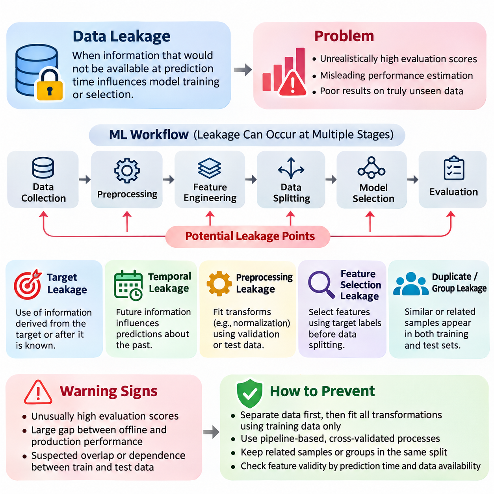
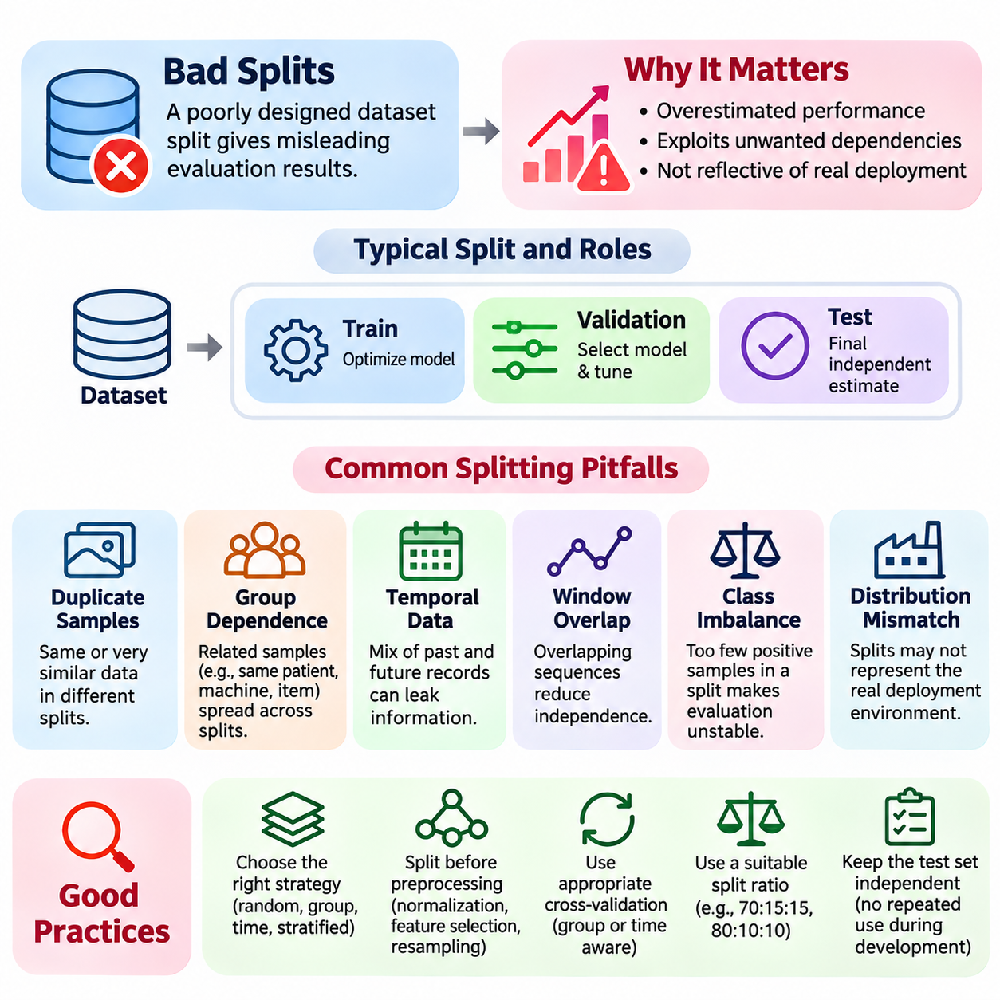
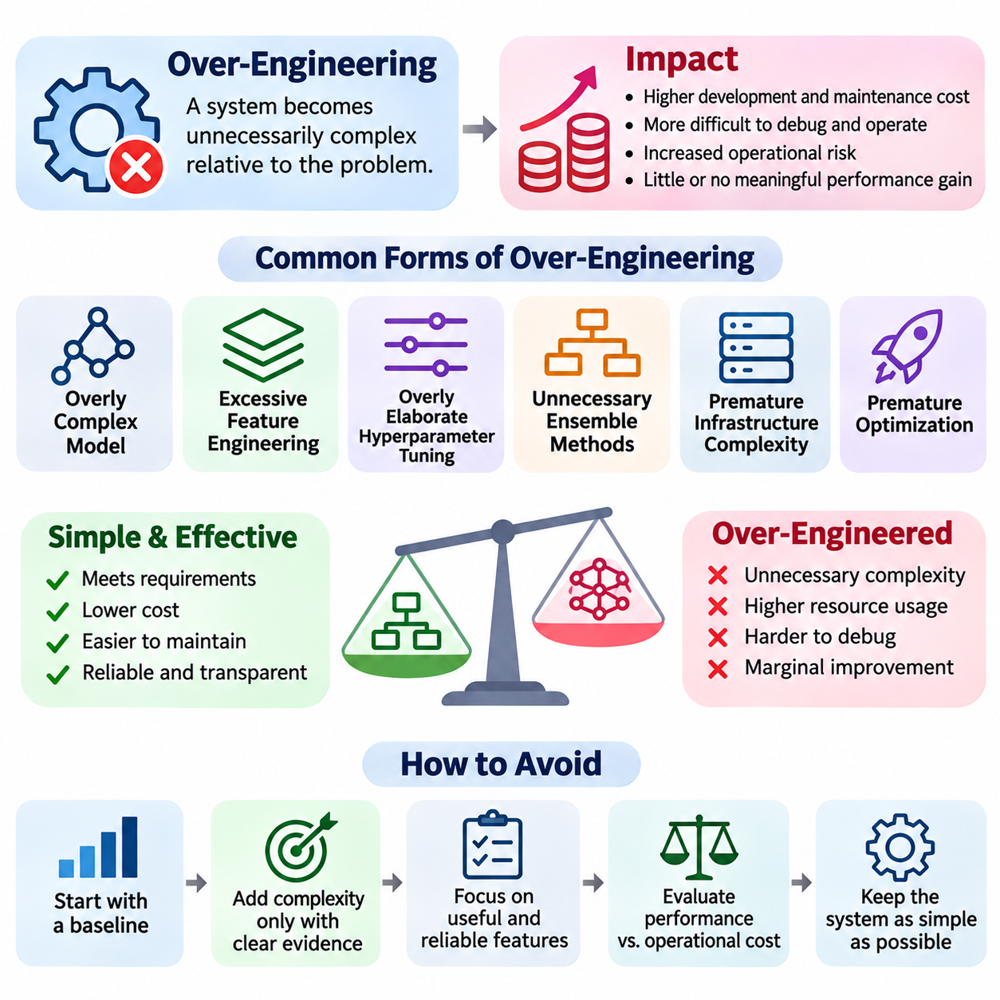
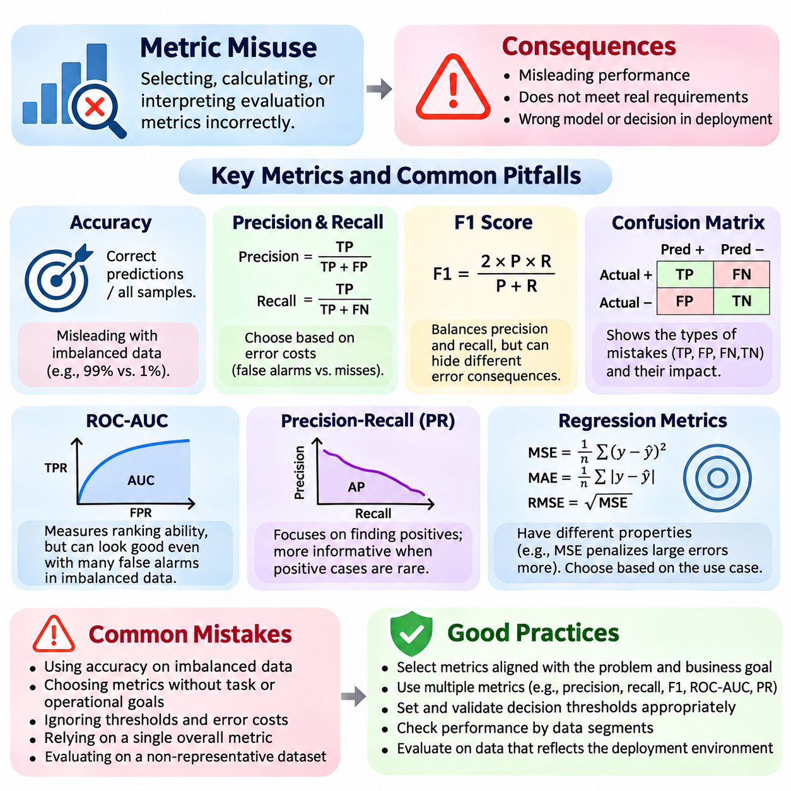
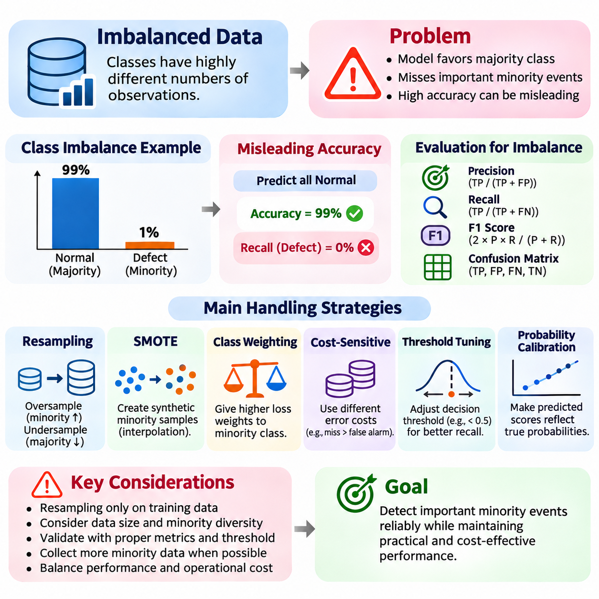
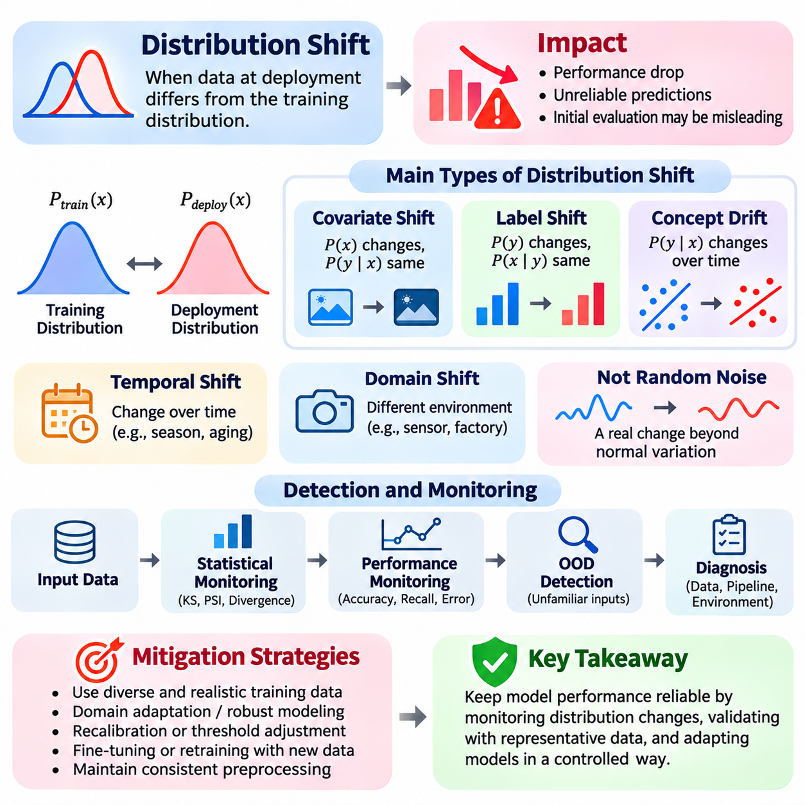
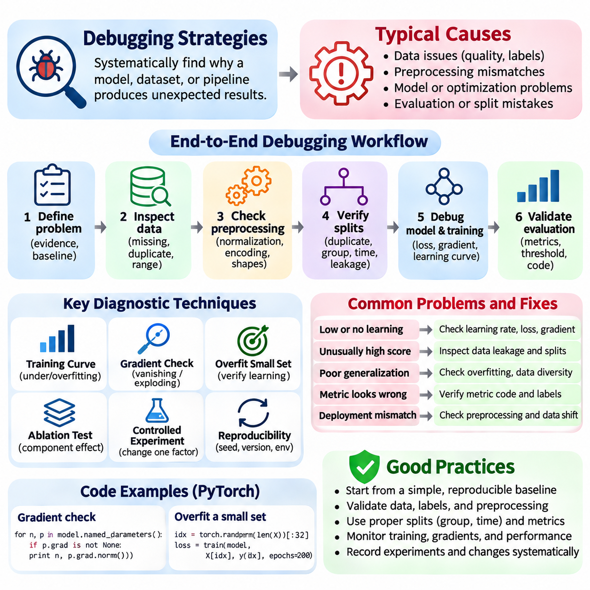

**Volume 07. Machine Learning Fundamentals**

# 08. Common ML Pitfalls

## 08.00 Data Leakage

{width="7.268055555555556in" height="7.268055555555556in"}

Data leakage is one of the most dangerous pitfalls in machine learning because it creates an unrealistic impression of model performance. It occurs when information that would not legitimately be available during prediction influences model training or selection. A model affected by leakage may achieve excellent validation or test scores while performing poorly on genuinely unseen data, making the evaluation results misleading.

The fundamental problem with data leakage is that machine learning models are expected to discover patterns that generalize beyond their training examples. When hidden information from evaluation data or future events enters the learning process, the model can exploit shortcuts instead of learning meaningful relationships. These shortcuts may be statistically powerful during experimentation but unavailable in real deployment environments.

Data leakage can occur at several stages of the machine learning workflow, including data collection, preprocessing, feature engineering, dataset splitting, model selection, and evaluation. It is not limited to directly exposing test labels. Even seemingly harmless operations, such as computing normalization statistics from an entire dataset before splitting it, can introduce information that should remain isolated from training.

Target leakage occurs when a feature contains information derived from the prediction target or from events occurring after the target becomes known. For example, a model predicting whether a customer will cancel a subscription should not use a cancellation confirmation timestamp. Although this feature may correlate almost perfectly with the target, it would not be available when the prediction must actually be made.

Temporal leakage occurs when information from the future influences predictions about the past. This problem is particularly important in financial forecasting, predictive maintenance, healthcare, and time-series analysis. A model predicting equipment failure tomorrow must rely only on measurements available before the prediction time. Using later maintenance records or future sensor observations produces artificially optimistic results.

Preprocessing leakage occurs when transformations are fitted using information from validation or test datasets. Common examples include calculating normalization parameters, estimating missing values, performing feature selection, or fitting dimensionality reduction methods before separating the data. These operations can transfer statistical characteristics of evaluation samples into training, even when their labels remain hidden.

Consider a dataset containing numerical features that require standardization. If the mean and standard deviation are calculated using all available observations, the training transformation indirectly incorporates information from the test distribution. A safer procedure is to estimate these parameters using training data alone and then apply the resulting transformation unchanged to validation and test samples.

Feature selection can produce especially serious leakage when target labels influence the selection process. Suppose thousands of candidate features are ranked according to their correlation with the target before the dataset is divided. The selected features may reflect accidental relationships involving test labels. Subsequent evaluation then measures performance on data that already influenced feature selection, rather than on independent observations.

Data leakage can also arise through duplicated or closely related samples. When nearly identical images, repeated measurements, or records from the same individual appear in both training and test sets, the model may recognize familiar patterns instead of demonstrating genuine generalization. This issue is particularly common in medical imaging, industrial inspection, video analysis, and datasets collected through repeated observations.

Group-related leakage occurs when observations sharing a common source are divided without considering their dependencies. For example, multiple medical records from one patient or multiple images of the same manufactured component may contain highly similar characteristics. If the objective is to generalize to new patients or components, all observations belonging to one group should remain within the same dataset partition.

Cross-validation does not automatically prevent leakage. If preprocessing, feature selection, or resampling is performed before cross-validation, information from held-out folds may influence the training procedure. Each fold must independently fit every learned transformation using only its training portion. Pipeline-based implementations help enforce this separation and reduce the likelihood of accidental information sharing.

Data augmentation introduces another potential leakage pathway. When augmented versions of an original image are distributed across training and evaluation sets, the model may encounter nearly identical visual content during both phases. The correct approach is generally to separate original samples or their source groups before generating training augmentations, ensuring that evaluation examples remain independent of the training process.

Leakage may also emerge from external data sources and engineered features. A database field might be updated after an event, a customer status variable might reflect a later business decision, or an aggregated statistic might incorporate future observations. Therefore, feature validity must be evaluated according to the exact prediction time, data availability, and operational workflow rather than statistical correlation alone.

An unusually high evaluation score can be an important warning sign of leakage, particularly when the task is inherently difficult. Large differences between offline evaluation and production performance may indicate that the model learned relationships unavailable during deployment. However, leakage cannot always be detected through performance metrics alone, because some forms produce only subtle improvements that remain difficult to recognize.

A systematic leakage investigation begins by tracing the origin, timestamp, and transformation history of every feature. Engineers should determine whether each input would genuinely exist when a prediction is requested. They should also inspect dataset relationships, preprocessing boundaries, target-derived variables, and evaluation procedures. This examination connects statistical validation with the actual information flow of the deployed system.

Preventing leakage requires treating dataset isolation as a fundamental design constraint rather than a final evaluation adjustment. Training, validation, and test partitions should be established according to the intended generalization scenario. Learned preprocessing transformations must be fitted only on authorized training observations, while hyperparameter tuning should use validation information without exposing the final test set.

In production-oriented machine learning, data leakage prevention is closely connected to reproducibility, feature governance, and reliable deployment. Versioned datasets, documented feature definitions, timestamp-aware data retrieval, and consistent training-serving pipelines make information boundaries easier to verify. Automated tests can further detect overlapping identifiers, invalid timestamps, unexpected target correlations, and unauthorized feature dependencies.

The essential lesson is that strong machine learning performance must come from legitimate predictive information rather than accidental access to hidden answers. Data leakage undermines the credibility of experiments, distorts model comparisons, and can lead to costly deployment failures. Reliable systems therefore evaluate not only how accurately a model predicts, but also whether every piece of information used to achieve that accuracy would be available under real operating conditions.

## 08.01 Bad Splits

{width="7.268055555555556in" height="7.268055555555556in"}

Dataset splitting is a fundamental step in machine learning because it determines how reliably model performance can be estimated. A poorly designed split may produce misleading evaluation results even when the learning algorithm and preprocessing procedures are correct. The purpose of splitting is not simply to divide observations into separate files, but to create a realistic distinction between information available during training and data encountered during deployment.

A typical machine learning workflow separates observations into training, validation, and test datasets. Training data supports parameter optimization, validation data guides model selection and hyperparameter tuning, and test data provides a final independent performance estimate. These roles must remain clearly separated. When samples are assigned incorrectly, the evaluation process may reward memorization, exploit hidden dependencies, or fail to represent real operating conditions.

Random splitting is widely used because it is simple and often effective when observations are approximately independent and identically distributed. However, random assignment is not universally appropriate. Real datasets frequently contain temporal relationships, repeated measurements, shared identities, geographic dependencies, or systematic collection patterns. Ignoring these structures can cause the resulting evaluation to overestimate how well a model generalizes to unfamiliar situations.

One common mistake is allowing duplicate or nearly identical samples to appear in different dataset partitions. For example, an image classification dataset may contain multiple resized versions of the same photograph. If one version enters training and another enters testing, the model may recognize familiar visual structures rather than classify genuinely unseen content. The resulting accuracy measures sample similarity more than meaningful predictive capability.

Group-dependent observations require special attention because samples sharing a common origin are rarely independent. Medical records from the same patient, images captured from the same manufacturing component, and measurements collected from the same machine may contain persistent characteristics. When the intended task involves new groups, splitting must preserve group boundaries so that all observations associated with one entity remain within a single partition.

Temporal datasets introduce additional splitting requirements because observations are ordered through time. Randomly distributing historical and future records can allow models to learn patterns from periods that occur after the evaluation interval. For forecasting applications, training should generally use earlier observations while validation and testing represent later periods. This chronological separation better reflects the information constraints encountered during real predictions.

Time-series splitting must also account for overlapping observation windows and delayed target availability. Two sequences extracted from neighboring timestamps may share most of their underlying measurements. If these sequences appear in different partitions, evaluation independence becomes questionable. Depending on the prediction horizon and data construction process, a temporal gap or embargo between training and evaluation intervals may be necessary to prevent information overlap.

Class imbalance creates another challenge when splitting classification datasets. If positive examples are rare, an unrestricted random split may place too few positive samples in validation or testing. Performance estimates then become unstable or uninformative. Stratified splitting can preserve approximate class proportions across partitions, although it must not override more important grouping, temporal, or deployment-related constraints.

An inappropriate split ratio can also reduce evaluation reliability. Extremely small training partitions may prevent models from learning meaningful patterns, while very small test partitions produce uncertain performance estimates. Although ratios such as 70:15:15 or 80:10:10 are common starting points, no universal proportion is optimal. Dataset size, class frequency, model complexity, and the required precision of evaluation should determine the final allocation.

Distribution mismatch between partitions deserves careful interpretation. Some differences arise accidentally through biased sampling, while others represent realistic deployment conditions. A model trained on data from one factory may eventually operate in another factory with different equipment and lighting. If cross-factory generalization is the objective, evaluation should deliberately include unseen factories rather than randomly mixing observations from every facility.

Cross-validation provides a more comprehensive performance estimate by repeatedly changing which observations are used for training and validation. Nevertheless, ordinary K-fold cross-validation assumes that the chosen partitioning strategy is appropriate for the underlying data. Grouped datasets require group-aware folds, while chronological datasets require time-aware validation. Repeated evaluation cannot correct a fundamentally invalid partitioning assumption.

Dataset splitting should occur before operations that learn statistical properties or create dependent samples. Normalization, imputation, feature selection, and resampling must be fitted within the appropriate training partition. Similarly, synthetic samples produced through oversampling techniques should not be generated across training and evaluation boundaries. Otherwise, apparently independent partitions may share information introduced by preprocessing.

A subtle mistake occurs when the test dataset is repeatedly consulted during model development. Even without directly training on test samples, developers may adjust architectures, features, thresholds, or hyperparameters after observing test performance. Over time, these decisions indirectly adapt the model to the test set. The test partition therefore loses its independence and no longer provides an unbiased estimate of the complete development procedure.

Reproducibility is another important consideration in dataset splitting. Random seeds, partition identifiers, sampling rules, and dataset versions should be recorded so that experiments can be repeated consistently. However, using a fixed random seed does not guarantee a valid split. Reproducibility ensures that the same partition can be reconstructed, whereas methodological correctness requires that the partition reflects the intended evaluation scenario.

A practical split validation process should examine sample overlap, group membership, timestamp boundaries, class distributions, and important metadata characteristics. Engineers should also verify that every evaluation sample satisfies the assumptions of the intended deployment scenario. Unexpected similarities between partitions, suspiciously high performance, or large differences between offline and production results can indicate that the splitting strategy requires investigation.

In industrial machine learning, partition design often determines whether laboratory results translate into operational reliability. Predictive maintenance models should be evaluated on appropriate future periods or unseen equipment, depending on their intended use. Computer vision systems may require separation by production batch, camera, or facility. Robotics datasets may require evaluation on unfamiliar environments, trajectories, or physical configurations to measure meaningful generalization.

The central principle is that dataset splitting must represent the prediction problem rather than merely satisfy a numerical allocation rule. A valid split creates an honest boundary between learning and evaluation while preserving the dependencies and constraints of the application. Careful partition design strengthens model comparison, exposes generalization weaknesses, and provides a trustworthy foundation for machine learning systems operating beyond controlled experiments.

## 08.02 Over Engineering

{width="7.268055555555556in" height="7.268055555555556in"}

Over-engineering is a common machine learning pitfall that occurs when a system becomes unnecessarily complex relative to the problem it must solve. Engineers may introduce sophisticated algorithms, elaborate feature pipelines, or extensive infrastructure before establishing whether simpler approaches are sufficient. Although complexity can improve performance in certain situations, excessive complexity often increases development cost, maintenance difficulty, and operational risk without delivering meaningful benefits.

Machine learning projects frequently begin with the assumption that advanced models will outperform traditional methods. However, a complex neural network is not automatically superior to linear regression, decision trees, or gradient boosting. For structured datasets with limited observations, simpler algorithms may achieve comparable or better results. Model selection should therefore depend on empirical evidence, data characteristics, and operational requirements rather than architectural sophistication.

A major cause of over-engineering is the absence of a reliable baseline model. Without a baseline, developers cannot determine whether additional complexity produces measurable improvements. A simple model establishes an initial reference for accuracy, training time, inference latency, and resource consumption. More advanced methods should be introduced only when experiments demonstrate that the baseline fails to satisfy important performance or functional requirements.

Excessive feature engineering is another common manifestation of unnecessary complexity. Developers may create hundreds of derived variables, complex interactions, and specialized transformations without verifying their predictive value. These features increase preprocessing costs and make debugging more difficult. They may also introduce redundancy, instability, or data leakage. Effective feature engineering prioritizes interpretable, reliable, and measurable improvements.

Hyperparameter tuning can also become unnecessarily elaborate. Large search spaces, repeated optimization experiments, and sophisticated tuning frameworks may consume substantial computational resources while producing marginal gains. When improvements fall within normal evaluation variability, the additional optimization effort may have little practical value. A disciplined tuning strategy focuses on influential parameters, meaningful search ranges, and clearly defined stopping criteria.

Over-engineering frequently appears in model architecture design. A deep network with many layers, attention mechanisms, or specialized components may be introduced for a task that requires only modest representational capacity. Such architectures increase memory requirements, training instability, and inference cost. Model capacity should be selected according to dataset complexity, available training examples, generalization requirements, and deployment constraints.

Ensemble methods illustrate the tradeoff between predictive performance and system complexity. Combining multiple models can improve robustness and accuracy, but each additional component introduces computational overhead and maintenance responsibilities. A large ensemble may require several inference passes, additional memory, and complicated deployment procedures. Its benefits should be evaluated against simpler alternatives using both predictive and operational metrics.

Infrastructure over-engineering occurs when distributed computing, elaborate orchestration systems, or complex deployment architectures are introduced before they are necessary. A small experimental workload may operate effectively on a single machine, while a distributed platform adds networking, synchronization, monitoring, and failure-management challenges. Infrastructure should evolve in response to demonstrated workload requirements rather than anticipated complexity alone.

Premature optimization is closely related to over-engineering. Engineers may spend significant effort accelerating data loading, rewriting components, or optimizing inference kernels before identifying actual performance bottlenecks. These changes can increase implementation complexity without improving overall system behavior. Profiling and measurement should precede optimization so that engineering effort targets limitations that materially affect performance.

Over-engineering also increases the difficulty of debugging and error analysis. When a system contains many preprocessing stages, interacting models, and conditional execution paths, identifying the source of incorrect predictions becomes challenging. A simpler architecture provides clearer relationships between inputs, transformations, and outputs. This transparency supports faster diagnosis, more reliable testing, and easier verification of model behavior.

Operational reliability can decline as unnecessary components accumulate. Every additional dependency, service, configuration parameter, or processing stage creates another potential failure point. Complex systems require more extensive integration testing, monitoring, and maintenance. Even when individual components operate correctly, interactions between them may introduce unexpected behavior. Reducing unnecessary complexity can therefore improve system stability and long-term maintainability.

Interpretability is another important consideration. Highly complex models and feature pipelines may make it difficult for engineers and stakeholders to understand why predictions occur. This limitation becomes particularly important in healthcare, finance, manufacturing, and other applications requiring traceability. Although complex models are sometimes necessary, their additional predictive value should justify the resulting challenges in explanation, auditing, and operational oversight.

A practical way to control over-engineering is to adopt an incremental development strategy. Begin with a clearly defined problem, establish simple evaluation metrics, and implement a minimal working baseline. Introduce additional features, model components, or infrastructure only when a specific limitation has been identified. Each modification should be tested independently so that its contribution to performance, reliability, or efficiency can be measured.

Ablation studies provide a systematic method for determining whether individual components are necessary. By removing or simplifying features, architectural modules, or processing stages, engineers can observe how system performance changes. Components that contribute little measurable value may be eliminated. This process helps distinguish essential complexity from unnecessary engineering effort and supports more efficient model design.

The relationship between complexity and performance should be evaluated using multiple criteria rather than predictive accuracy alone. Training cost, inference latency, memory usage, energy consumption, development time, and maintenance burden may all influence the preferred solution. A model offering a minor accuracy improvement may be less desirable if it requires substantially more resources or creates unacceptable operational constraints.

In industrial machine learning, simplicity can provide significant practical advantages. A manufacturing inspection model running on an edge device may benefit more from predictable latency and stable execution than from a marginal improvement in benchmark accuracy. Similarly, a predictive maintenance system may prioritize reliability, interpretability, and straightforward integration with existing equipment. The optimal design depends on the complete operating environment.

The central lesson is that engineering complexity should be justified by demonstrated value. Sophisticated algorithms and infrastructure are useful when they address genuine limitations, but complexity introduced without evidence can weaken the entire machine learning system. Effective development emphasizes measurable improvements, clear design decisions, and maintainable implementations. The best solution is not necessarily the most advanced one, but the simplest system that reliably satisfies the required objectives.

## 08.03 Metric Misuse

{width="7.268055555555556in" height="7.268055555555556in"}

Metric misuse is a common machine learning pitfall that occurs when evaluation metrics are selected, calculated, or interpreted incorrectly. A model may appear successful according to one numerical score while failing to satisfy the actual requirements of its application. Evaluation metrics are simplified representations of model behavior, not complete descriptions of system quality. Reliable evaluation therefore requires understanding what each metric measures and which limitations it introduces.

A fundamental mistake is choosing metrics without considering the underlying prediction problem. Classification, regression, ranking, forecasting, and anomaly detection require different evaluation approaches. Even within the same task category, operational priorities may differ significantly. A metric suitable for a balanced image classification benchmark may be inappropriate for medical screening, industrial defect detection, or financial fraud identification.

Accuracy is one of the most frequently misused classification metrics. It measures the proportion of correct predictions among all evaluated samples, but it can become misleading when classes are highly imbalanced. Consider a dataset containing 99 percent normal observations and 1 percent abnormal observations. A model predicting every sample as normal achieves 99 percent accuracy while completely failing to detect the abnormal cases that may be most important.

Precision and recall provide complementary perspectives on classification performance. Precision measures the proportion of predicted positive cases that are actually positive, while recall measures the proportion of actual positive cases successfully detected. High precision is valuable when false alarms are expensive, whereas high recall is important when missing positive cases creates serious consequences. Neither metric should be optimized without considering the application\'s error costs.

The F1 score combines precision and recall through their harmonic mean, providing a useful summary when both dimensions matter. However, F1 does not include true negatives directly and may conceal differences in error consequences. Two models with similar F1 scores can produce different operational outcomes. Furthermore, maximizing F1 does not necessarily minimize financial loss, safety risk, or other application-specific costs associated with incorrect predictions.

Confusion matrices provide essential context that single numerical metrics often omit. By separating true positives, false positives, true negatives, and false negatives, they reveal the types of mistakes a classifier makes. A model with acceptable overall accuracy may still generate an excessive number of false negatives in safety-critical applications. Examining the confusion matrix helps connect statistical performance with the practical consequences of prediction errors.

Threshold selection introduces another opportunity for metric misuse. Many classification models produce probabilities or continuous scores that must be converted into discrete decisions. Changing the decision threshold alters precision, recall, and false-positive rates without changing the underlying model. Thresholds should therefore be selected using validation data and application-specific requirements rather than adjusted repeatedly to maximize performance on the final test dataset.

ROC-AUC summarizes a classifier\'s ability to rank positive observations above negative observations across decision thresholds. Although useful for comparing discrimination performance, it does not directly describe performance at a particular operating threshold. In highly imbalanced problems, ROC-AUC may appear favorable even when the number of false alarms is operationally unacceptable. Precision-recall analysis can provide additional insight when positive cases are rare.

Precision-recall curves emphasize the relationship between correctly identifying positive observations and limiting false-positive predictions. Average precision summarizes aspects of this relationship, but its interpretation depends on class prevalence and evaluation conditions. Comparing precision-recall results across datasets with different positive-class frequencies can therefore be misleading. Evaluation should account for the expected prevalence and operating conditions of the deployment environment.

Regression metrics can also be misused when their mathematical properties are ignored. Mean squared error emphasizes large prediction errors because deviations are squared, while mean absolute error assigns linear penalties to absolute deviations. Root mean squared error expresses error in the original target units but remains sensitive to large deviations. The appropriate choice depends on whether large errors deserve disproportionate penalties and how predictions will be used.

Percentage-based regression metrics require additional caution. Mean absolute percentage error becomes undefined when actual target values are zero and can behave poorly when values approach zero. Metrics that normalize errors may also create misleading comparisons when target scales or distributions differ. Engineers should examine target characteristics and business consequences before selecting an error measure solely because it is widely reported.

A single aggregate metric can hide substantial performance differences across population segments. A model may perform well overall while producing poor predictions for particular locations, equipment types, demographic groups, or environmental conditions. Segment-level evaluation helps identify these weaknesses. Reporting only the average result can conceal systematic failures that become important when the model is deployed across diverse operating environments.

Metric misuse also occurs when evaluation datasets do not represent the intended deployment population. Even a correctly calculated metric can provide misleading conclusions when the underlying samples are biased, outdated, or unrepresentative. For example, an industrial vision model evaluated only under controlled lighting may achieve excellent accuracy but struggle with changing illumination. Metric validity depends on both the calculation and the relevance of the evaluation data.

Statistical uncertainty is frequently overlooked when comparing models. Small differences in accuracy, F1 score, or regression error may result from sampling variation rather than genuine improvements. Confidence intervals, repeated evaluation, and appropriate statistical comparisons can help determine whether observed differences are meaningful. Model selection should avoid treating every numerical improvement as evidence of superior generalization.

Repeatedly optimizing against the same evaluation benchmark can also create metric overfitting. Developers may adjust architectures, features, or hyperparameters until a particular score improves, gradually adapting the development process to benchmark-specific characteristics. This practice can reduce generalization to genuinely unseen data. Independent testing and carefully controlled evaluation procedures are necessary to preserve the credibility of reported results.

Operational machine learning systems often require several metrics rather than one universal score. Predictive quality must be considered alongside inference latency, throughput, memory consumption, calibration, robustness, and reliability. A model with slightly better predictive accuracy may be unsuitable if it violates real-time constraints or produces poorly calibrated confidence estimates. Evaluation should reflect the complete requirements of the deployed system.

The central lesson is that evaluation metrics must be aligned with the real objective of the machine learning application. Numerical scores are valuable only when their assumptions, limitations, and operational implications are understood. Reliable model assessment combines appropriate metrics, representative datasets, error analysis, and uncertainty estimation. The goal is not to maximize an impressive benchmark number, but to establish whether a model delivers dependable performance under realistic conditions.

## 08.04 Imbalanced Data

{width="7.268055555555556in" height="7.268055555555556in"}

Imbalanced data is a common machine learning challenge that occurs when different classes contain substantially different numbers of observations. One class may dominate the dataset while another represents only a small fraction of available examples. This situation frequently appears in fraud detection, medical diagnosis, manufacturing inspection, and equipment failure prediction. Without appropriate handling, models may favor majority classes and overlook important minority events.

Class imbalance becomes particularly problematic when the minority class represents the primary objective of the application. In industrial defect detection, defective products may account for less than one percent of production samples. A classifier that always predicts normal operation can achieve extremely high accuracy while detecting no defects. This illustrates why overall accuracy alone is insufficient for evaluating models trained on highly imbalanced datasets.

The severity of imbalance cannot be determined solely by comparing class frequencies. Dataset size, minority-class diversity, feature separability, and the consequences of prediction errors also matter. A dataset containing thousands of minority examples may support effective learning despite a large imbalance ratio. Conversely, a moderately imbalanced dataset with very few minority observations may provide insufficient information for reliable generalization.

Imbalanced learning often creates a tendency toward majority-class predictions because standard optimization objectives emphasize aggregate performance across observations. When majority samples dominate the training loss, improvements on frequent cases may outweigh errors on rare cases. However, the actual effect depends on the algorithm, feature distribution, and loss function. Understanding these interactions is essential before selecting a corrective strategy.

Evaluation metrics must reflect the objectives of imbalanced classification. Precision measures how many predicted positive cases are correct, while recall measures how many actual positive cases are successfully identified. The F1 score combines these measures, but it does not represent every operational consequence. Confusion matrices, precision-recall curves, and class-specific performance provide additional information that aggregate accuracy may conceal.

Resampling is a widely used approach for modifying class representation during training. Random oversampling increases minority-class frequency by duplicating selected observations, while random undersampling reduces the number of majority-class examples. Oversampling preserves available majority information but may encourage memorization of repeated minority samples. Undersampling reduces computational cost but can discard useful patterns from the original dataset.

Synthetic Minority Over-sampling Technique, commonly known as SMOTE, generates artificial minority samples through interpolation between neighboring minority observations. This can improve learning when the minority class is insufficiently represented. However, synthetic examples may be unrealistic when features are categorical, strongly constrained, or distributed across disconnected regions. SMOTE should therefore be evaluated carefully rather than treated as a universal solution.

Resampling must be performed only within the training data to prevent information leakage. Applying oversampling or synthetic sample generation before dividing the dataset can place highly related observations into both training and evaluation partitions. This produces misleading performance estimates. During cross-validation, resampling should occur independently inside each training fold, while validation and test partitions should preserve their intended evaluation distributions.

Class weighting offers an alternative to changing the number of training samples. Weighted loss functions assign greater penalties to errors involving underrepresented classes, encouraging the model to pay more attention to minority observations. Many classification algorithms support class weights directly. Nevertheless, excessive weighting can increase false positives, reduce probability calibration, or destabilize optimization, making validation essential.

Cost-sensitive learning extends class weighting by considering the actual consequences of different prediction errors. Missing a dangerous equipment failure may be much more expensive than generating an unnecessary maintenance inspection. A cost-sensitive model can incorporate these asymmetric penalties into training or decision-making. The appropriate cost structure should reflect operational priorities rather than simply assigning weights inversely proportional to class frequencies.

Decision threshold adjustment is another important strategy for imbalanced classification. A classifier may produce useful probability estimates while performing poorly under a default threshold of 0.5. Lowering the threshold can increase minority-class recall, although it typically increases false positives. Threshold selection should use validation data and explicitly consider the tradeoff between missed events, false alarms, and available intervention resources.

Probability calibration deserves particular attention when models are trained using altered class distributions or weighted objectives. Predicted scores may no longer correspond accurately to event probabilities under real deployment conditions. Calibration methods can improve probability interpretation when applied with suitable representative validation data. Reliable probabilities are especially important when predictions support risk estimation, resource allocation, or automated decisions.

Data collection strategies can sometimes provide greater benefits than algorithmic adjustments. Acquiring additional minority-class examples may improve representation of rare operating conditions, unusual failure patterns, or difficult boundary cases. Targeted labeling, active learning, and carefully designed sampling can help identify informative observations. However, collecting more examples is valuable only when the resulting data accurately represents the events the model must recognize.

Extreme class imbalance introduces additional difficulties because positive examples may be exceptionally rare or unavailable. In these situations, anomaly detection, one-class classification, or semi-supervised approaches may be more appropriate than conventional supervised classification. Such methods learn normal behavior or exploit limited labeled information to identify unusual observations. Their suitability depends on whether abnormal events can be distinguished reliably from normal variation.

Distribution changes can make imbalance problems more difficult after deployment. The frequency of fraud, equipment faults, or manufacturing defects may change over time, altering the relationship between precision, recall, and operational workload. A model evaluated under one class distribution may behave differently when deployed under another. Monitoring class prevalence, prediction rates, and confirmed outcomes helps identify when thresholds or models require reassessment.

Industrial machine learning systems must consider the operational impact of minority-class predictions. A defect detector that generates excessive false alarms may interrupt production, while a system with insufficient recall may allow defective products to pass inspection. The appropriate balance depends on inspection costs, safety requirements, production throughput, and downstream verification procedures. Model evaluation should therefore include realistic operational scenarios.

The central lesson is that imbalanced data requires coordinated decisions about sampling, model training, evaluation metrics, and deployment thresholds. No single technique guarantees better performance, and correcting class frequencies does not automatically solve the underlying prediction problem. Reliable systems combine representative data, carefully validated learning strategies, and application-specific error analysis to detect important minority events without creating unacceptable operational consequences.

## 08.05 Distribution Shift

{width="7.268055555555556in" height="7.268055555555556in"}

Distribution shift occurs when the statistical properties of data encountered during deployment differ from those observed during model training. Machine learning models generally assume that future observations resemble the data used to develop them. When this assumption becomes invalid, predictive performance may deteriorate even if the original evaluation results were excellent. Understanding distribution shift is essential for building reliable systems that operate beyond controlled training environments.

The training distribution represents the statistical patterns from which a model learns relationships between inputs and targets. The deployment distribution describes the observations encountered during actual operation. Differences may arise from changing environments, user behavior, equipment, data collection procedures, or underlying processes. These changes can affect input features, target frequencies, or the relationships connecting inputs to expected outputs.

Covariate shift occurs when the distribution of input features changes while the conditional relationship between targets and inputs remains stable. For example, an image classifier trained under bright laboratory lighting may receive images captured under dim industrial conditions. Although the underlying object categories remain unchanged, their visual appearance differs. The model may struggle because important input patterns were insufficiently represented during training.

Label shift describes situations where the frequency of target classes changes while the distribution of input features within each class remains approximately stable. A manufacturing inspection system may encounter a higher proportion of defective products after equipment degradation. Even if the appearance of each defect category remains similar, changing class proportions can affect prediction reliability and decision thresholds. Label shift requires careful estimation because true labels may not be immediately available.

Concept drift occurs when the relationship between input features and target outcomes changes over time. A predictive maintenance model may learn that certain vibration patterns indicate equipment failure, but those relationships can change after machinery upgrades or maintenance procedures. Unlike pure covariate shift, concept drift affects the predictive mapping itself. Updating feature distributions alone may therefore be insufficient to restore model performance.

Temporal distribution shift is especially important in systems that operate continuously. Seasonal variations, economic changes, evolving customer preferences, and equipment aging can gradually modify data characteristics. Some changes occur slowly, while others appear suddenly after operational disruptions. Models evaluated only on randomly selected historical observations may fail to capture these effects, making chronological evaluation essential for time-dependent applications.

Domain shift arises when a model is transferred between environments with different data characteristics. A computer vision system trained using images from one camera may perform poorly when deployed with another sensor, resolution, or lens configuration. Similarly, a robot trained in simulation may encounter different textures, lighting, friction, and physical dynamics in reality. Domain adaptation techniques attempt to reduce these differences and improve transfer performance.

Distribution shift should not be confused with ordinary random variation. Small statistical differences between samples are expected even when observations originate from the same underlying process. A meaningful shift involves changes that exceed normal sampling variability or affect model behavior. Detecting such changes requires suitable reference distributions, adequate sample sizes, and careful interpretation of statistical evidence rather than reacting to every fluctuation.

Statistical monitoring provides a practical approach to detecting changes in input distributions. Engineers may compare feature means, variances, category frequencies, or complete distribution shapes across training and production datasets. Techniques such as the Kolmogorov-Smirnov test, population stability index, and divergence measures can identify potential differences. However, a statistically significant shift does not necessarily imply that predictive performance has deteriorated.

Performance monitoring complements statistical drift detection by examining prediction quality whenever reliable ground-truth labels become available. Accuracy, precision, recall, regression error, and calibration can reveal changes in model effectiveness. In many applications, labels arrive after substantial delays, making immediate performance measurement difficult. Monitoring prediction distributions, uncertainty, and operational outcomes can provide supplementary signals during these intervals.

Out-of-distribution detection attempts to identify observations that differ substantially from the model\'s training experience. Such observations may involve unfamiliar objects, unusual sensor measurements, or operating conditions outside validated limits. Detection methods may use predictive confidence, feature-space distances, density estimates, or specialized uncertainty models. Nevertheless, confidence scores alone are not always reliable indicators of whether an input is unfamiliar.

Data preprocessing pipelines can contribute to distribution shift when collection or transformation procedures change. Sensor calibration updates, altered normalization rules, missing-value patterns, and software revisions may modify the data presented to a model. These changes can resemble environmental drift even when the underlying process remains stable. Maintaining consistent preprocessing versions and monitoring data quality are therefore essential for accurate diagnosis.

Several strategies can reduce vulnerability to distribution shift before deployment. Diverse training datasets, realistic data augmentation, robust feature selection, and evaluation across multiple environments can improve generalization. Domain randomization is particularly useful in robotics and simulation-based learning because it exposes models to variations in visual appearance and physical parameters. However, artificial diversity cannot guarantee robustness against every future condition.

When significant distribution shift is detected, corrective actions depend on its underlying cause. Recalibration may address changes in predicted probabilities, while threshold adjustment may improve decisions under altered class frequencies. Fine-tuning or retraining with representative recent data can help when predictive relationships have changed. More substantial shifts may require new features, revised model architectures, or modifications to the data collection process.

Continuous retraining should not be treated as an automatic solution to every detected change. New data may contain labeling errors, temporary anomalies, or unrepresentative operating conditions. Updating a model without appropriate validation can introduce instability or degrade previously reliable behavior. A controlled update process should include data quality checks, comparison against the existing model, independent evaluation, and rollback mechanisms.

Industrial machine learning provides many examples of distribution shift. Manufacturing cameras experience changing illumination and component appearance, while predictive maintenance sensors encounter equipment wear and calibration changes. Autonomous robots face unfamiliar terrain, weather, and physical obstacles. These environments require monitoring strategies that connect statistical changes with operational safety, model reliability, and the practical consequences of incorrect predictions.

The central lesson is that machine learning performance depends on the continued relevance of training data to real operating conditions. Distribution shift is not necessarily evidence of poor initial model design, but it exposes the limitations of static evaluation. Reliable systems combine representative validation, drift monitoring, performance assessment, and controlled adaptation. The objective is to maintain dependable predictions as environments, data sources, and underlying processes evolve.

## 08.06 Debugging Strategies [w/Code]

{width="7.268055555555556in" height="7.268055555555556in"}

Debugging machine learning systems is the systematic process of identifying why a model, dataset, or training pipeline produces unexpected results. Unlike conventional software, machine learning systems can execute without errors while generating inaccurate predictions. Problems may originate from data quality, preprocessing, model architecture, optimization, or evaluation procedures. Effective debugging therefore requires examining the entire workflow rather than focusing exclusively on model code.

A reliable debugging strategy begins with defining the observed failure precisely. Statements such as poor accuracy or unstable training are insufficient without supporting evidence. Engineers should record the affected dataset, evaluation metric, training configuration, and expected behavior. Comparing actual results against a reproducible baseline helps determine whether the problem involves implementation errors, inadequate learning, or unrealistic performance expectations.

Data inspection is often the most productive starting point because models cannot reliably learn from incorrect or inconsistent information. Missing values, mislabeled examples, duplicated records, corrupted files, and unexpected feature ranges can all reduce performance. Engineers should inspect representative samples and calculate basic statistics before training. Automated validation checks can identify anomalies that might otherwise remain hidden inside large datasets.

Label verification deserves particular attention in supervised learning. Incorrect class assignments, inconsistent annotation standards, and mismatched input-target pairs can create confusing training signals. Visualizing examples together with their labels often reveals errors that numerical summaries overlook. For regression tasks, examining target distributions and extreme values can identify unit inconsistencies, incorrect measurements, or data preparation mistakes.

Preprocessing pipelines should be tested independently from the learning algorithm. Normalization, categorical encoding, resizing, tokenization, and missing-value handling must produce consistent outputs during training and inference. A transformation applied differently across datasets can create unexpected distribution changes. Engineers should verify tensor shapes, data types, numerical ranges, and feature ordering at every important processing boundary.

Dataset splitting is another critical debugging target because invalid partitions can produce misleading evaluation results. Duplicate samples, shared identities, temporal overlap, and preprocessing leakage may allow information to cross training and testing boundaries. Engineers should inspect sample identifiers, group membership, and timestamp relationships. A suspiciously high validation score may indicate leakage rather than exceptional model performance.

A useful diagnostic technique is to overfit a very small training subset deliberately. A sufficiently expressive model should often achieve extremely low training error on a handful of clean examples. If it cannot, the problem may involve incorrect labels, unsuitable loss functions, broken gradient propagation, or implementation mistakes. This experiment isolates basic learning functionality before computational resources are spent on full-scale training.

Training curves provide valuable information about optimization behavior. Loss values that remain nearly constant may indicate ineffective learning rates, frozen parameters, or disconnected computational graphs. Rapidly increasing losses can suggest numerical instability or excessively large updates. Comparing training and validation curves also helps distinguish underfitting, overfitting, and problems caused by differences between dataset partitions.

Gradient inspection is especially useful when debugging neural networks. Vanishing gradients can prevent early layers from learning effectively, while exploding gradients may produce unstable parameter updates. Engineers can monitor gradient norms, parameter changes, and the presence of nonfinite values. Gradient clipping, suitable initialization, normalization, and learning-rate adjustments may address these symptoms, but the underlying cause should be identified before applying corrections.

Loss function verification is essential because an incorrect objective can prevent meaningful learning even when the model executes successfully. Classification tasks require appropriate relationships between logits, probabilities, labels, and loss calculations. Regression tasks must use compatible target scales and output representations. Engineers should test loss functions with simple synthetic examples to confirm that correct predictions receive lower penalties than incorrect predictions.

Evaluation code requires the same level of scrutiny as training code. Incorrect averaging, inappropriate thresholds, reversed class labels, and inconsistent metric definitions can produce misleading conclusions. Engineers should verify metrics using small examples with known expected results. Prediction outputs must also be aligned with the correct targets, especially when data loaders shuffle samples or distributed evaluation combines results from multiple processes.

Controlled experiments help isolate the source of failures by changing one important factor at a time. Adjusting the optimizer, batch size, model architecture, and preprocessing simultaneously makes it difficult to determine which modification caused an improvement. A disciplined experiment records the hypothesis, configuration, observed results, and interpretation. This approach transforms debugging from random trial and error into evidence-based investigation.

Reproducibility supports debugging by making unexpected behavior easier to investigate. Random seeds, dataset versions, software dependencies, hardware configurations, and training parameters should be recorded. Deterministic execution can reduce variability, although some operations remain nondeterministic across devices or implementations. Experiment tracking and version control help engineers distinguish genuine fixes from differences caused by changing experimental conditions.

Error analysis should examine individual prediction failures rather than relying exclusively on aggregate metrics. Misclassified images, large regression residuals, and incorrect anomaly alerts may reveal recurring patterns associated with particular classes, environments, or input characteristics. Grouping failures by meaningful attributes can expose weaknesses hidden by average performance. These findings often suggest targeted data improvements or specific model changes.

Ablation testing provides another practical debugging method by removing individual features, processing stages, or architectural components. If eliminating a component improves performance, that component may be unnecessary, incorrectly implemented, or poorly integrated. If performance deteriorates substantially, the component likely contributes useful information. Ablation results should be interpreted using consistent evaluation conditions and sufficient experimental evidence.

Deployment debugging extends beyond offline model evaluation because production systems introduce additional failure sources. Differences in preprocessing, numerical precision, hardware acceleration, input timing, and sensor calibration can alter predictions. Engineers should compare representative inputs and intermediate outputs between development and deployment environments. Monitoring latency, memory consumption, prediction distributions, and operational failures helps identify problems that laboratory testing may miss.

The central principle of machine learning debugging is to replace assumptions with measurable evidence. Effective investigation begins with simple checks, establishes reproducible baselines, isolates individual components, and gradually examines more complex interactions. Data validation, small-subset experiments, gradient analysis, metric verification, and deployment monitoring form a practical debugging foundation. A systematic process reduces wasted computation and improves the reliability of machine learning systems.
