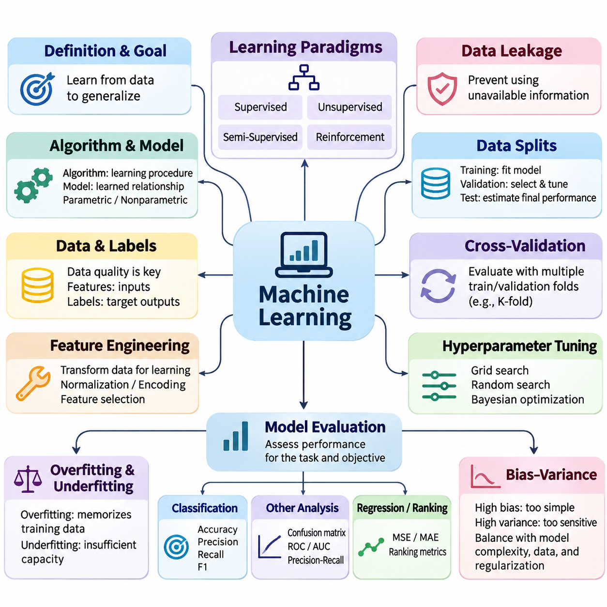
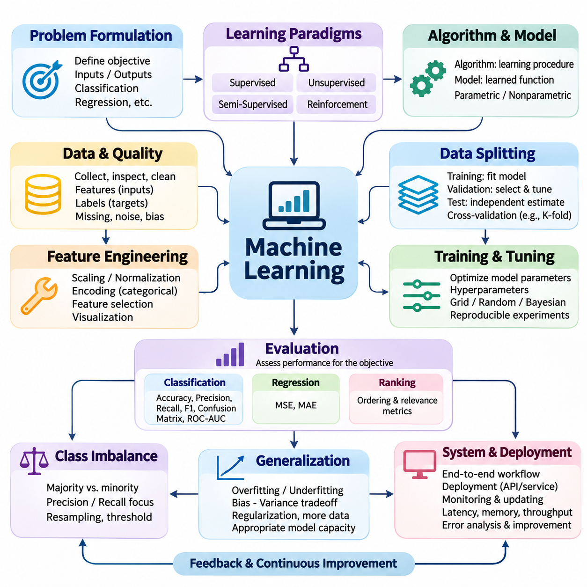
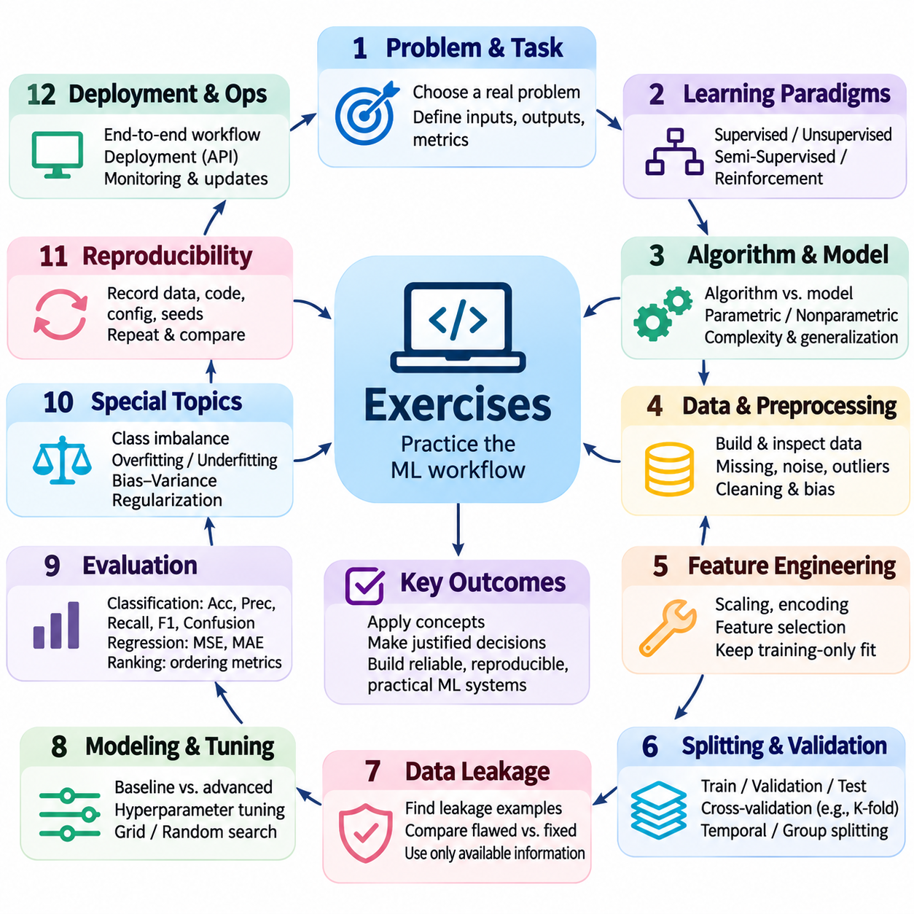
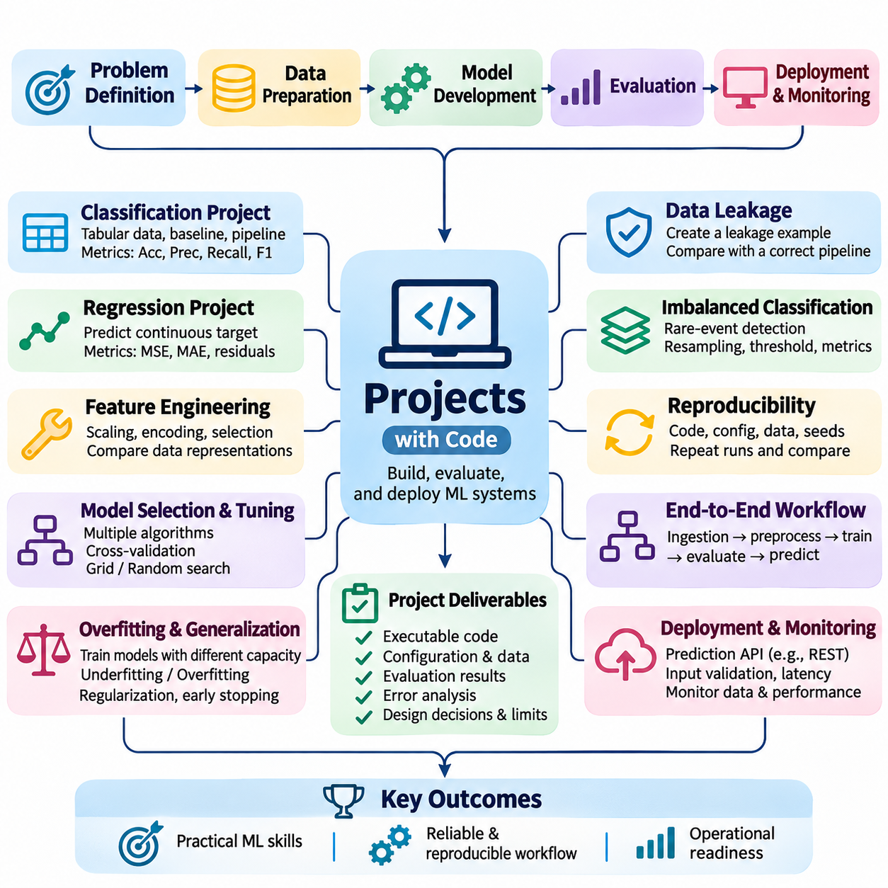

**Volume 07. Machine Learning Fundamentals**


# 09. Summary and Exercises

## 09.00 Key Takeaways

{width="7.268055555555556in" height="7.268055555555556in"}

Machine learning is the process of developing computational systems that improve their performance by learning patterns from data rather than relying entirely on explicitly programmed rules. Its fundamental objective is to generalize knowledge from observed examples to previously unseen situations. Successful machine learning requires a clear problem definition, suitable data, appropriate algorithms, reliable evaluation, and continuous improvement.

The major learning paradigms include supervised learning, unsupervised learning, semi-supervised learning, and reinforcement learning. Supervised learning uses labeled examples to predict outputs, while unsupervised learning discovers structures without predefined labels. Semi-supervised learning combines labeled and unlabeled data, whereas reinforcement learning develops decision-making policies through interaction and feedback.

A machine learning algorithm defines the procedure used to learn from data, while a model represents the learned relationships produced by that procedure. Parametric models typically use a fixed number of parameters for a given architecture, whereas nonparametric approaches can increase their effective complexity as data grows. Understanding this distinction helps practitioners select methods that match available data and computational resources.

Data quality is one of the strongest determinants of machine learning performance. Features describe measurable properties of observations, while labels represent the target outcomes in supervised learning. Poorly defined labels, inconsistent measurements, missing values, and irrelevant features can limit predictive accuracy. Reliable systems therefore require systematic data collection, inspection, cleaning, and validation.

Feature engineering transforms raw information into representations that learning algorithms can use effectively. Numerical features may require normalization or scaling, while categorical features often require encoding. Feature selection can reduce redundancy, computational cost, and unnecessary complexity. These transformations should preserve meaningful information and be designed according to the characteristics of the problem and model.

Data leakage occurs when information unavailable during actual prediction influences model training or evaluation. Leakage can arise from preprocessing before data splitting, target-derived features, duplicated observations, or inappropriate temporal relationships. Preventing leakage requires careful separation of datasets and fitting learned preprocessing transformations exclusively on permitted training data.

Training, validation, and test datasets serve different purposes within the learning process. Training data determines model parameters, validation data supports model selection and hyperparameter tuning, and test data estimates performance on unseen examples. A trustworthy evaluation process preserves the independence of the test set and avoids repeatedly adapting development decisions to its results.

Cross-validation improves performance estimation by evaluating a model across multiple training and validation partitions. K-fold cross-validation is particularly useful when available data is limited, although ordinary random folds may be inappropriate for temporal, grouped, or dependent observations. The splitting strategy must reflect how the system will encounter new data during actual deployment.

Hyperparameters control aspects of learning that are not directly estimated as ordinary model parameters. Grid search evaluates predefined combinations, random search samples candidate configurations, and Bayesian optimization uses previous observations to guide subsequent trials. Effective tuning balances predictive improvement against computational cost while maintaining consistent validation procedures.

Model evaluation must reflect the actual objective and consequences of prediction errors. Classification accuracy measures overall correctness but can be misleading when classes are imbalanced. Precision emphasizes the reliability of positive predictions, recall measures the detection of actual positives, and the F1 score combines precision and recall through their harmonic mean.

A confusion matrix reveals the distribution of correct and incorrect classification outcomes, helping identify systematic prediction failures. ROC curves and AUC summarize discrimination across classification thresholds, although their interpretation depends on the application. For imbalanced problems, precision-recall analysis may provide additional insight into performance on the positive class.

Regression models require evaluation measures suited to continuous numerical predictions. Mean squared error emphasizes larger errors through squaring, while mean absolute error expresses average error magnitude in the target\'s original units. Ranking tasks require metrics that assess the ordering and relevance of results. Metric selection should always consider business objectives, operational constraints, and error costs.

Overfitting occurs when a model learns training-specific patterns that do not generalize reliably to unseen observations. Underfitting occurs when a model lacks sufficient capacity, suitable features, or effective training to capture important relationships. Comparing training and validation performance helps diagnose these conditions, although learning curves and additional experiments provide stronger evidence.

The bias-variance perspective explains important sources of prediction error. High bias is commonly associated with overly restrictive assumptions, while high variance reflects sensitivity to changes in training data. Increasing model complexity can reduce certain forms of bias but may increase variance. Effective generalization requires balancing model capacity, data quantity, regularization, and training quality.

Regularization helps control model complexity and discourage solutions that depend excessively on training-specific details. Common strategies include parameter penalties, early stopping, and appropriate restrictions on model flexibility. Additional representative data can also improve generalization. The most effective intervention depends on whether observed limitations arise from data quality, insufficient capacity, or excessive complexity.

An end-to-end machine learning workflow connects problem formulation, data ingestion, preprocessing, model training, evaluation, deployment, monitoring, and updating. Each stage depends on the correctness of earlier decisions. A model with excellent validation results may still fail operationally when preprocessing differs between training and inference or when production inputs violate expected assumptions.

Machine learning pipelines improve consistency by organizing preprocessing and prediction into repeatable computational procedures. They help ensure that transformations are applied consistently across training, validation, testing, and inference. Well-designed pipelines also simplify experimentation, reduce implementation errors, and support reproducibility when configurations, datasets, dependencies, and random seeds are documented.

Deployment transforms an experimental model into a component that serves predictions within a larger software system. Production requirements may include response latency, throughput, memory consumption, availability, security, and compatibility with existing infrastructure. A practical deployment design must evaluate these constraints alongside predictive quality rather than assuming that the most accurate model is automatically preferable.

Monitoring is necessary because deployed models operate in environments that may change over time. Input distributions, relationships between features and targets, and user behavior can evolve, reducing prediction reliability. Monitoring should track data quality, system performance, prediction characteristics, and outcome-based metrics when labels become available. Detected changes should trigger investigation before corrective action.

Model updating should follow a controlled process rather than automatically replacing an existing model whenever new data appears. Retraining requires suitable data, reproducible experiments, consistent evaluation, and comparison against the deployed baseline. Version management and rollback procedures reduce operational risk. Continuous improvement depends on demonstrating measurable benefits without introducing unacceptable regressions.

Practical machine learning system design requires thinking beyond isolated algorithms. Data pipelines, models, application interfaces, infrastructure, monitoring, and human decision processes form an interconnected system. Improvements in one component may produce limited benefits if another component remains the primary bottleneck. System-level analysis helps identify changes that provide the greatest practical value.

Data-centric AI emphasizes improving the quality, consistency, coverage, and relevance of training data. Correcting mislabeled examples, addressing underrepresented conditions, and improving collection procedures can sometimes outperform increasing model complexity. Error analysis helps determine whether failures originate from ambiguous labels, insufficient examples, distribution differences, or limitations in the model itself.

Model selection should begin with a simple, reproducible baseline that establishes measurable reference performance. More complex approaches should be introduced when experiments demonstrate meaningful improvements. Selection criteria may include predictive accuracy, interpretability, training cost, inference efficiency, maintainability, and deployment constraints. Complexity is justified only when its benefits outweigh its additional operational burden.

Common machine learning pitfalls include inappropriate dataset splitting, excessive feature engineering, metric misuse, class imbalance, and distribution shift. These problems can produce misleading experimental conclusions even when implementation code runs correctly. Effective debugging examines data samples, intermediate transformations, prediction distributions, evaluation procedures, and model behavior before attempting increasingly sophisticated algorithms.

Reproducibility is essential for scientific reliability and practical engineering. Experiments should record dataset versions, preprocessing configurations, model definitions, hyperparameters, random seeds, software dependencies, and evaluation results. Repeating an experiment under controlled conditions helps distinguish genuine improvements from random variation. Clear documentation also supports collaboration, auditing, maintenance, and future model development.

The central lesson of machine learning fundamentals is that successful learning systems emerge from disciplined integration rather than algorithm selection alone. Reliable results require representative data, valid experimental design, appropriate metrics, controlled model complexity, and operational feedback. These principles provide the foundation for advanced supervised learning, unsupervised learning, reinforcement learning, and increasingly complex AI systems.

머신러닝(Machine Learning)은 명시적으로 프로그래밍된 규칙에만 의존하지 않고 데이터(Data)에서 패턴(Pattern)을 학습하여 성능을 향상시키는 컴퓨팅 시스템(Computational System)을 개발하는 과정이다. 머신러닝의 근본적인 목표는 관찰된 사례에서 얻은 지식을 이전에 경험하지 못한 상황으로 일반화(Generalization)하는 것이다. 성공적인 머신러닝을 위해서는 명확한 문제 정의(Problem Definition), 적절한 데이터, 적합한 알고리즘(Algorithm), 신뢰할 수 있는 평가(Evaluation), 지속적인 개선(Continuous Improvement)이 필요하다.

주요 학습 패러다임(Learning Paradigm)에는 지도학습(Supervised Learning), 비지도학습(Unsupervised Learning), 준지도학습(Semi-Supervised Learning), 강화학습(Reinforcement Learning)이 포함된다. 지도학습은 레이블이 지정된 데이터(Labeled Data)를 사용하여 출력을 예측하며, 비지도학습은 사전에 정의된 레이블 없이 데이터의 구조를 발견한다. 준지도학습은 레이블이 있는 데이터와 없는 데이터를 결합하고, 강화학습은 환경과의 상호작용(Interaction) 및 피드백(Feedback)을 통해 의사결정 정책(Decision-Making Policy)을 학습한다.

머신러닝 알고리즘(Machine Learning Algorithm)은 데이터로부터 학습하는 절차를 정의하며, 모델(Model)은 해당 절차를 통해 학습된 관계를 표현한다. 매개변수 모델(Parametric Model)은 일반적으로 주어진 아키텍처(Architecture)에 대해 고정된 수의 매개변수(Parameter)를 사용하지만, 비매개변수 접근법(Nonparametric Approach)은 데이터가 증가함에 따라 유효 복잡도(Effective Complexity)가 증가할 수 있다. 이러한 차이를 이해하면 사용 가능한 데이터와 컴퓨팅 자원(Computational Resource)에 적합한 방법을 선택하는 데 도움이 된다.

데이터 품질(Data Quality)은 머신러닝 성능을 결정하는 가장 중요한 요소 중 하나이다. 특징(Feature)은 관측값(Observation)의 측정 가능한 속성을 설명하며, 레이블(Label)은 지도학습에서 목표 결과(Target Outcome)를 나타낸다. 잘못 정의된 레이블, 일관되지 않은 측정값, 결측값(Missing Value), 관련성이 낮은 특징은 예측 정확도(Predictive Accuracy)를 제한할 수 있다. 따라서 신뢰할 수 있는 시스템을 구축하려면 체계적인 데이터 수집(Data Collection), 검사(Inspection), 정제(Cleaning), 검증(Validation)이 필요하다.

특징 공학(Feature Engineering)은 원시 정보(Raw Information)를 학습 알고리즘이 효과적으로 활용할 수 있는 표현(Representation)으로 변환한다. 수치형 특징(Numerical Feature)은 정규화(Normalization) 또는 스케일링(Scaling)이 필요할 수 있으며, 범주형 특징(Categorical Feature)은 인코딩(Encoding)이 필요한 경우가 많다. 특징 선택(Feature Selection)은 중복성(Redundancy), 계산 비용(Computational Cost), 불필요한 복잡도를 줄일 수 있다. 이러한 변환은 의미 있는 정보를 보존하면서 문제와 모델의 특성에 맞게 설계되어야 한다.

데이터 누출(Data Leakage)은 실제 예측 시점에 사용할 수 없는 정보가 모델 학습이나 평가에 영향을 미칠 때 발생한다. 데이터 분할(Data Splitting) 이전의 전처리(Preprocessing), 목표값에서 파생된 특징(Target-Derived Feature), 중복된 관측값, 부적절한 시간적 관계(Temporal Relationship) 등이 데이터 누출을 유발할 수 있다. 이를 방지하려면 데이터셋(Dataset)을 신중하게 분리하고, 학습이 필요한 전처리 변환은 허용된 학습 데이터(Training Data)에만 적합(Fitting)시켜야 한다.

학습 데이터(Training Data), 검증 데이터(Validation Data), 테스트 데이터(Test Data)는 학습 과정에서 서로 다른 목적을 수행한다. 학습 데이터는 모델 매개변수를 결정하고, 검증 데이터는 모델 선택(Model Selection)과 하이퍼파라미터 튜닝(Hyperparameter Tuning)을 지원하며, 테스트 데이터는 관찰되지 않은 사례에 대한 성능을 추정한다. 신뢰할 수 있는 평가 과정에서는 테스트 세트(Test Set)의 독립성을 유지하고, 테스트 결과에 맞추어 개발 결정을 반복적으로 수정하는 행위를 피해야 한다.

교차 검증(Cross-Validation)은 여러 학습 및 검증 분할에서 모델을 평가함으로써 성능 추정의 신뢰성을 높인다. K-겹 교차 검증(K-Fold Cross-Validation)은 사용 가능한 데이터가 제한적일 때 특히 유용하지만, 일반적인 무작위 분할(Random Split)은 시계열 데이터(Temporal Data), 그룹 데이터(Grouped Data), 종속적인 관측값에 적합하지 않을 수 있다. 데이터 분할 전략(Splitting Strategy)은 실제 배포 환경에서 시스템이 새로운 데이터를 접하는 방식을 반영해야 한다.

하이퍼파라미터(Hyperparameter)는 일반적인 모델 매개변수처럼 직접 추정되지 않는 학습의 여러 측면을 제어한다. 격자 탐색(Grid Search)은 사전에 정의된 조합을 평가하고, 무작위 탐색(Random Search)은 후보 설정을 표본 추출하며, 베이지안 최적화(Bayesian Optimization)는 이전 관측 결과를 활용하여 다음 탐색을 안내한다. 효과적인 튜닝(Tuning)은 일관된 검증 절차를 유지하면서 예측 성능 향상과 계산 비용 사이의 균형을 고려해야 한다.

모델 평가(Model Evaluation)는 실제 목표와 예측 오류(Prediction Error)의 결과를 반영해야 한다. 분류 정확도(Classification Accuracy)는 전체 예측의 정답 비율을 측정하지만, 클래스 불균형(Class Imbalance)이 존재하면 오해를 유발할 수 있다. 정밀도(Precision)는 양성 예측(Positive Prediction)의 신뢰성을 강조하고, 재현율(Recall)은 실제 양성 사례를 탐지하는 능력을 측정하며, F1 점수(F1 Score)는 정밀도와 재현율을 조화평균(Harmonic Mean)으로 결합한다.

혼동 행렬(Confusion Matrix)은 올바른 분류와 잘못된 분류 결과의 분포를 보여주며, 체계적인 예측 실패를 식별하는 데 도움이 된다. ROC 곡선(ROC Curve)과 곡선 아래 면적(AUC)은 여러 분류 임계값(Classification Threshold)에 걸친 판별 성능(Discrimination Performance)을 요약하지만, 해석은 적용 분야에 따라 달라진다. 불균형 문제에서는 정밀도-재현율 분석(Precision-Recall Analysis)이 양성 클래스(Positive Class)의 성능을 이해하는 데 추가적인 통찰을 제공할 수 있다.

회귀 모델(Regression Model)은 연속적인 수치 예측(Continuous Numerical Prediction)에 적합한 평가 지표(Evaluation Metric)가 필요하다. 평균제곱오차(Mean Squared Error, MSE)는 오차를 제곱하여 큰 오류에 더 높은 비중을 부여하며, 평균절대오차(Mean Absolute Error, MAE)는 목표값의 원래 단위로 평균 오차 크기를 표현한다. 순위화 작업(Ranking Task)에는 결과의 순서와 관련성을 평가하는 지표가 필요하다. 지표 선택에서는 비즈니스 목표(Business Objective), 운영 제약(Operational Constraint), 오류 비용(Error Cost)을 항상 고려해야 한다.

과적합(Overfitting)은 모델이 학습 데이터에 특화된 패턴을 학습하여 새로운 관측값에 안정적으로 일반화하지 못할 때 발생한다. 과소적합(Underfitting)은 모델의 표현 능력(Model Capacity), 적절한 특징 또는 효과적인 학습이 부족하여 중요한 관계를 포착하지 못할 때 발생한다. 학습 성능과 검증 성능을 비교하면 이러한 상태를 진단하는 데 도움이 되지만, 학습 곡선(Learning Curve)과 추가 실험은 더욱 강력한 근거를 제공한다.

편향-분산 관점(Bias-Variance Perspective)은 예측 오류의 중요한 원인을 설명한다. 높은 편향(High Bias)은 일반적으로 지나치게 제한적인 가정과 관련되며, 높은 분산(High Variance)은 학습 데이터 변화에 대한 민감성을 나타낸다. 모델 복잡도(Model Complexity)를 높이면 특정 형태의 편향은 감소할 수 있지만 분산은 증가할 수 있다. 효과적인 일반화를 위해서는 모델 용량(Model Capacity), 데이터 양(Data Quantity), 정규화(Regularization), 학습 품질(Training Quality)의 균형이 필요하다.

정규화(Regularization)는 모델 복잡도를 제어하고 학습 데이터에 특화된 세부 사항에 지나치게 의존하는 해법을 억제한다. 일반적인 전략에는 매개변수 페널티(Parameter Penalty), 조기 종료(Early Stopping), 모델 유연성(Model Flexibility)에 대한 적절한 제한이 포함된다. 대표성 있는 데이터를 추가하는 것도 일반화 성능을 향상시킬 수 있다. 가장 효과적인 개선 방법은 관찰된 한계가 데이터 품질, 불충분한 모델 용량 또는 과도한 복잡도 중 어디에서 발생하는지에 따라 달라진다.

종단 간 머신러닝 워크플로(End-to-End Machine Learning Workflow)는 문제 정의, 데이터 수집 및 입력(Data Ingestion), 전처리, 모델 학습, 평가, 배포(Deployment), 모니터링(Monitoring), 업데이트(Updating)를 연결한다. 각 단계는 이전 단계에서 이루어진 결정의 정확성에 의존한다. 검증 성능이 우수한 모델이라도 학습과 추론(Inference) 과정의 전처리가 다르거나 운영 환경의 입력값이 예상된 가정을 위반하면 실제 환경에서 실패할 수 있다.

머신러닝 파이프라인(Machine Learning Pipeline)은 전처리와 예측을 반복 가능한 계산 절차로 구성하여 일관성을 향상시킨다. 이를 통해 학습, 검증, 테스트, 추론 과정에서 변환이 일관되게 적용되도록 지원한다. 잘 설계된 파이프라인은 실험(Experimentation)을 단순화하고 구현 오류(Implementation Error)를 줄이며, 설정(Configuration), 데이터셋, 의존성(Dependency), 난수 시드(Random Seed)를 문서화할 때 재현성(Reproducibility)을 지원한다.

배포(Deployment)는 실험용 모델을 더 큰 소프트웨어 시스템(Software System) 안에서 예측 서비스를 제공하는 구성요소로 전환하는 과정이다. 운영 요구사항(Production Requirement)에는 응답 지연시간(Response Latency), 처리량(Throughput), 메모리 사용량(Memory Consumption), 가용성(Availability), 보안(Security), 기존 인프라(Infrastructure)와의 호환성이 포함될 수 있다. 실용적인 배포 설계는 가장 정확한 모델이 반드시 최선이라고 가정하지 않고 예측 품질과 함께 이러한 제약을 평가해야 한다.

모니터링(Monitoring)은 배포된 모델이 시간이 지남에 따라 변화할 수 있는 환경에서 작동하기 때문에 필요하다. 입력 분포(Input Distribution), 특징과 목표값 사이의 관계, 사용자 행동(User Behavior)이 변화하면 예측 신뢰성(Prediction Reliability)이 감소할 수 있다. 모니터링은 데이터 품질, 시스템 성능, 예측 특성, 그리고 레이블을 확보할 수 있는 경우 결과 기반 지표(Outcome-Based Metric)를 추적해야 한다. 변화가 탐지되면 수정 조치에 앞서 원인을 조사해야 한다.

모델 업데이트(Model Updating)는 새로운 데이터가 나타날 때마다 기존 모델을 자동으로 교체하는 방식이 아니라 통제된 절차를 따라야 한다. 재학습(Retraining)에는 적절한 데이터, 재현 가능한 실험, 일관된 평가, 배포된 기준 모델(Baseline Model)과의 비교가 필요하다. 버전 관리(Version Management)와 롤백 절차(Rollback Procedure)는 운영 위험(Operational Risk)을 줄인다. 지속적인 개선은 허용할 수 없는 성능 저하(Regression)를 유발하지 않으면서 측정 가능한 이점을 입증하는 데 달려 있다.

실용적인 머신러닝 시스템 설계(Practical Machine Learning System Design)는 개별 알고리즘을 넘어서는 사고를 요구한다. 데이터 파이프라인(Data Pipeline), 모델, 애플리케이션 인터페이스(Application Interface), 인프라, 모니터링, 인간의 의사결정 과정(Human Decision Process)은 서로 연결된 시스템을 형성한다. 다른 구성요소가 주요 병목 현상(Bottleneck)으로 남아 있다면 특정 구성요소의 개선 효과는 제한적일 수 있다. 시스템 수준 분석(System-Level Analysis)은 가장 큰 실질적 가치를 제공하는 개선 사항을 식별하는 데 도움이 된다.

데이터 중심 인공지능(Data-Centric AI)은 학습 데이터의 품질, 일관성(Consistency), 포괄 범위(Coverage), 관련성(Relevance)을 개선하는 데 중점을 둔다. 잘못된 레이블을 수정하고, 충분히 표현되지 않은 조건을 보완하며, 데이터 수집 절차를 개선하는 것이 모델 복잡도를 높이는 것보다 더 나은 결과를 제공할 수 있다. 오류 분석(Error Analysis)은 실패가 모호한 레이블, 부족한 사례, 분포 차이(Distribution Difference), 모델 자체의 한계 중 어디에서 비롯되는지 판단하는 데 도움이 된다.

모델 선택(Model Selection)은 측정 가능한 기준 성능(Reference Performance)을 확립하는 단순하고 재현 가능한 기준 모델(Baseline Model)에서 시작해야 한다. 더 복잡한 접근법은 실험을 통해 의미 있는 개선이 입증될 때 도입해야 한다. 선택 기준에는 예측 정확도, 해석 가능성(Interpretability), 학습 비용(Training Cost), 추론 효율성(Inference Efficiency), 유지보수성(Maintainability), 배포 제약(Deployment Constraint)이 포함될 수 있다. 복잡성은 추가적인 운영 부담보다 이점이 클 때 정당화된다.

일반적인 머신러닝 함정(Common Machine Learning Pitfall)에는 부적절한 데이터 분할, 과도한 특징 공학(Over-Engineering), 평가 지표 오용(Metric Misuse), 클래스 불균형, 분포 이동(Distribution Shift)이 포함된다. 이러한 문제는 구현 코드가 정상적으로 실행되더라도 잘못된 실험 결론을 만들어낼 수 있다. 효과적인 디버깅(Debugging)은 더 복잡한 알고리즘을 시도하기 전에 데이터 샘플(Data Sample), 중간 변환(Intermediate Transformation), 예측 분포(Prediction Distribution), 평가 절차, 모델 동작(Model Behavior)을 점검한다.

재현성(Reproducibility)은 과학적 신뢰성(Scientific Reliability)과 실용적인 엔지니어링(Practical Engineering)에 필수적이다. 실험에서는 데이터셋 버전(Dataset Version), 전처리 설정, 모델 정의(Model Definition), 하이퍼파라미터, 난수 시드, 소프트웨어 의존성(Software Dependency), 평가 결과를 기록해야 한다. 통제된 조건에서 실험을 반복하면 실제 개선과 무작위 변동(Random Variation)을 구별하는 데 도움이 된다. 명확한 문서화(Documentation)는 협업(Collaboration), 감사(Auditing), 유지보수(Maintenance), 향후 모델 개발도 지원한다.

머신러닝 기초(Machine Learning Fundamentals)의 핵심 교훈은 성공적인 학습 시스템이 알고리즘 선택만이 아니라 체계적인 통합(Disciplined Integration)을 통해 구현된다는 것이다. 신뢰할 수 있는 결과를 얻으려면 대표성 있는 데이터(Representative Data), 타당한 실험 설계(Valid Experimental Design), 적절한 평가 지표, 통제된 모델 복잡도, 운영 피드백(Operational Feedback)이 필요하다. 이러한 원칙은 고급 지도학습, 비지도학습, 강화학습, 더욱 복잡한 인공지능 시스템(AI System)을 이해하고 개발하기 위한 기반을 제공한다.

## 09.01 Concept Map

{width="7.268055555555556in" height="7.268055555555556in"}

A machine learning concept map organizes the fundamental principles of learning systems into a connected framework. At its center is the objective of learning useful patterns from data and applying them to unseen observations. Problem formulation, data preparation, model training, evaluation, and deployment form the major components. Their relationships explain how individual technical decisions influence the reliability of the complete system.

Problem formulation establishes the starting point of the machine learning process. A practical objective must be translated into a measurable learning task with clearly defined inputs, outputs, and success criteria. Classification predicts categories, regression estimates continuous values, and other learning tasks discover structures or optimize decisions. The selected objective determines subsequent choices concerning data, algorithms, and evaluation.

Learning paradigms provide the first major conceptual branch. Supervised learning uses labeled observations to estimate relationships between inputs and targets. Unsupervised learning identifies patterns without predefined target labels. Semi-supervised learning combines labeled and unlabeled examples, while reinforcement learning learns policies through interaction with an environment. Each paradigm establishes different requirements for data and feedback.

The relationship between algorithms and models forms another essential connection. An algorithm specifies the procedure for extracting information from training data, whereas a model represents the learned function or structure. Parametric approaches use a fixed parameterization for a given architecture, while nonparametric methods may adapt their effective complexity as observations increase. These distinctions influence flexibility, computational requirements, and generalization.

Data occupies a central position because every learning stage depends on its quality and relevance. Raw observations must be collected, inspected, cleaned, and transformed into usable representations. Features describe the information available for prediction, while labels define expected outputs in supervised tasks. Missing values, measurement noise, inconsistent annotations, and sampling bias can propagate through the entire learning workflow.

Feature engineering connects raw data to model representation. Numerical variables may require scaling, categorical variables may require encoding, and irrelevant attributes may be removed through feature selection. Visualization supports understanding distributions, relationships, and unusual observations. Effective preprocessing preserves predictive information while preventing unintended dependencies between training data and evaluation data.

Data splitting connects preparation to trustworthy experimentation. Training data supports parameter estimation, validation data guides model selection, and test data provides an independent estimate of generalization. Cross-validation extends this process by evaluating models across multiple partitions. The splitting strategy must respect temporal order, group membership, and other dependencies whenever random partitioning would create unrealistic evaluation conditions.

The training process connects model structure, optimization, and observed examples. A learning algorithm adjusts model parameters to reduce an objective or loss function. Hyperparameters influence model capacity, optimization behavior, and regularization. Grid search, random search, and Bayesian optimization provide different strategies for exploring configurations. Reliable experiments require consistent preprocessing, controlled comparisons, and reproducible execution.

Evaluation metrics connect numerical predictions to practical objectives. Classification performance can be described through accuracy, precision, recall, F1 score, confusion matrices, and ROC-AUC. Regression performance can be measured using mean squared error and mean absolute error. Ranking applications require measures of ordering quality. Metric selection must reflect the consequences of errors rather than relying on a single universal score.

Class imbalance creates an important connection between data distribution and evaluation. A model can achieve high accuracy by favoring the majority class while performing poorly on rare but important outcomes. Precision and recall reveal different aspects of this behavior. Resampling, threshold adjustment, and suitable evaluation measures can address specific difficulties, although each intervention requires validation against the intended application.

Generalization links training performance to behavior on unseen data. Overfitting occurs when a model captures training-specific details that do not transfer reliably, while underfitting occurs when important relationships remain unlearned. The bias-variance perspective explains how model flexibility influences these problems. Regularization, improved data, appropriate capacity, and careful validation help establish a practical balance.

The end-to-end workflow connects experimentation with operational implementation. Data ingestion supplies observations, preprocessing creates consistent representations, training produces a model, and evaluation determines whether performance satisfies requirements. Deployment exposes predictions through an application or service. Monitoring and model updating complete the lifecycle by connecting operational observations to future improvements.

Practical system design introduces relationships beyond predictive performance. Model accuracy must be considered alongside latency, memory consumption, throughput, scalability, maintainability, and infrastructure constraints. Data-centric improvements may provide greater value than increasing algorithmic complexity. Error analysis identifies weaknesses, while feedback loops help determine whether improvements should target data, models, evaluation procedures, or operational components.

Common machine learning pitfalls can be understood as failures in the connections between stages. Data leakage compromises the boundary between training and evaluation. Poor splitting produces unrealistic performance estimates, while metric misuse creates misleading conclusions. Excessive engineering increases complexity without demonstrated benefits. Distribution shift weakens assumptions established during development and may reduce deployed model reliability.

Debugging and reproducibility provide supporting connections across the entire framework. Examining data samples, intermediate transformations, learning curves, and prediction errors helps identify the origin of failures. Recording dataset versions, configurations, random seeds, and experimental results supports repeatable comparisons. These practices transform machine learning from isolated experimentation into a disciplined engineering process.

The complete concept map represents machine learning as an iterative system rather than a strictly linear sequence. Evaluation findings can motivate changes to features, model capacity, or data collection. Deployment monitoring can reveal new failure conditions that require further investigation and retraining. Every feedback cycle should preserve valid experimental boundaries while producing measurable improvements in system behavior.

Understanding these relationships provides a foundation for advanced machine learning. Supervised learning develops specialized prediction methods, unsupervised learning explores hidden data structure, and reinforcement learning extends learning toward sequential decision-making. More sophisticated architectures and deployment systems build upon the same principles of data quality, generalization, evaluation, reproducibility, and continuous improvement.

머신러닝 개념도(Machine Learning Concept Map)는 학습 시스템(Learning System)의 기본 원리를 상호 연결된 프레임워크(Framework)로 구성한다. 그 중심에는 데이터(Data)에서 유용한 패턴(Pattern)을 학습하고 이를 관찰되지 않은 새로운 데이터에 적용하는 목표가 있다. 문제 정의(Problem Formulation), 데이터 준비(Data Preparation), 모델 학습(Model Training), 평가(Evaluation), 배포(Deployment)가 주요 구성요소를 형성한다. 이들 사이의 관계는 개별 기술적 결정이 전체 시스템의 신뢰성(Reliability)에 어떤 영향을 미치는지 설명한다.

문제 정의(Problem Formulation)는 머신러닝 과정의 출발점을 설정한다. 실질적인 목표는 입력(Input), 출력(Output), 성공 기준(Success Criteria)이 명확하게 정의된 측정 가능한 학습 과제(Learning Task)로 변환되어야 한다. 분류(Classification)는 범주를 예측하고, 회귀(Regression)는 연속적인 값을 추정하며, 다른 학습 과제는 구조를 발견하거나 의사결정(Decision-Making)을 최적화한다. 선택한 목표는 이후 데이터, 알고리즘(Algorithm), 평가 방법에 관한 결정을 좌우한다.

학습 패러다임(Learning Paradigm)은 첫 번째 주요 개념적 분기(Conceptual Branch)를 제공한다. 지도학습(Supervised Learning)은 레이블이 지정된 관측값(Labeled Observation)을 사용하여 입력과 목표값(Target) 사이의 관계를 추정한다. 비지도학습(Unsupervised Learning)은 사전에 정의된 목표 레이블(Target Label) 없이 패턴을 식별한다. 준지도학습(Semi-Supervised Learning)은 레이블이 있는 데이터와 없는 데이터를 결합하며, 강화학습(Reinforcement Learning)은 환경(Environment)과의 상호작용을 통해 정책(Policy)을 학습한다. 각 패러다임은 데이터와 피드백(Feedback)에 대해 서로 다른 요구사항을 설정한다.

알고리즘(Algorithm)과 모델(Model)의 관계는 또 다른 핵심적인 연결을 형성한다. 알고리즘은 학습 데이터(Training Data)에서 정보를 추출하는 절차를 지정하는 반면, 모델은 학습된 함수(Function) 또는 구조(Structure)를 나타낸다. 매개변수적 접근법(Parametric Approach)은 주어진 아키텍처(Architecture)에 대해 고정된 매개변수화(Parameterization)를 사용하지만, 비매개변수적 방법(Nonparametric Method)은 관측값이 증가함에 따라 유효 복잡도(Effective Complexity)를 조정할 수 있다. 이러한 차이는 유연성(Flexibility), 계산 요구사항(Computational Requirement), 일반화(Generalization)에 영향을 미친다.

데이터(Data)는 모든 학습 단계가 데이터의 품질(Quality)과 관련성(Relevance)에 의존하기 때문에 중심적인 위치를 차지한다. 원시 관측값(Raw Observation)은 수집, 검사, 정제(Cleaning), 변환(Transformation)을 거쳐 사용 가능한 표현(Representation)으로 만들어져야 한다. 특징(Feature)은 예측에 사용할 수 있는 정보를 설명하며, 레이블(Label)은 지도학습 과제에서 기대되는 출력을 정의한다. 결측값(Missing Value), 측정 잡음(Measurement Noise), 일관되지 않은 주석(Inconsistent Annotation), 표본 편향(Sampling Bias)은 전체 학습 워크플로(Workflow)에 영향을 미칠 수 있다.

특징 공학(Feature Engineering)은 원시 데이터(Raw Data)와 모델 표현(Model Representation)을 연결한다. 수치형 변수(Numerical Variable)는 스케일링(Scaling)이 필요할 수 있고, 범주형 변수(Categorical Variable)는 인코딩(Encoding)이 필요할 수 있으며, 관련성이 낮은 속성은 특징 선택(Feature Selection)을 통해 제거할 수 있다. 시각화(Visualization)는 분포(Distribution), 관계(Relationship), 비정상적인 관측값을 이해하는 데 도움이 된다. 효과적인 전처리(Preprocessing)는 예측에 유용한 정보를 보존하면서 학습 데이터와 평가 데이터 사이에 의도하지 않은 의존성이 발생하지 않도록 한다.

데이터 분할(Data Splitting)은 데이터 준비와 신뢰할 수 있는 실험(Experimentation)을 연결한다. 학습 데이터(Training Data)는 매개변수 추정(Parameter Estimation)을 지원하고, 검증 데이터(Validation Data)는 모델 선택(Model Selection)을 안내하며, 테스트 데이터(Test Data)는 일반화 성능(Generalization Performance)에 대한 독립적인 추정치를 제공한다. 교차 검증(Cross-Validation)은 여러 분할에서 모델을 평가함으로써 이 과정을 확장한다. 무작위 분할(Random Partitioning)이 비현실적인 평가 조건을 만들 수 있는 경우, 분할 전략(Splitting Strategy)은 시간적 순서(Temporal Order), 그룹 소속(Group Membership), 기타 의존성을 고려해야 한다.

학습 과정(Training Process)은 모델 구조(Model Structure), 최적화(Optimization), 관측된 사례를 연결한다. 학습 알고리즘(Learning Algorithm)은 목적함수(Objective Function) 또는 손실함수(Loss Function)를 최소화하도록 모델 매개변수(Model Parameter)를 조정한다. 하이퍼파라미터(Hyperparameter)는 모델 용량(Model Capacity), 최적화 동작(Optimization Behavior), 정규화(Regularization)에 영향을 미친다. 격자 탐색(Grid Search), 무작위 탐색(Random Search), 베이지안 최적화(Bayesian Optimization)는 설정 조합을 탐색하는 서로 다른 전략을 제공한다. 신뢰할 수 있는 실험을 위해서는 일관된 전처리, 통제된 비교(Controlled Comparison), 재현 가능한 실행(Reproducible Execution)이 필요하다.

평가 지표(Evaluation Metric)는 수치적 예측(Numerical Prediction)을 실질적인 목표와 연결한다. 분류 성능(Classification Performance)은 정확도(Accuracy), 정밀도(Precision), 재현율(Recall), F1 점수(F1 Score), 혼동 행렬(Confusion Matrix), ROC 곡선 아래 면적(ROC-AUC)을 통해 설명할 수 있다. 회귀 성능(Regression Performance)은 평균제곱오차(Mean Squared Error)와 평균절대오차(Mean Absolute Error)를 사용하여 측정할 수 있다. 순위화 응용(Ranking Application)에는 결과의 순서 품질(Ordering Quality)을 측정하는 지표가 필요하다. 지표 선택은 단일한 보편적 점수에 의존하기보다 오류의 결과를 반영해야 한다.

클래스 불균형(Class Imbalance)은 데이터 분포(Data Distribution)와 평가(Evaluation) 사이에 중요한 연결 관계를 형성한다. 모델은 다수 클래스(Majority Class)를 우선적으로 예측하여 높은 정확도(Accuracy)를 달성하면서도 드물지만 중요한 결과에 대해서는 낮은 성능을 보일 수 있다. 정밀도(Precision)와 재현율(Recall)은 이러한 동작의 서로 다른 측면을 보여준다. 재표본추출(Resampling), 임계값 조정(Threshold Adjustment), 적절한 평가 지표는 특정 문제를 해결하는 데 도움이 될 수 있지만, 각 개입 방법은 의도된 응용 환경에서 검증되어야 한다.

일반화(Generalization)는 학습 성능(Training Performance)을 관찰되지 않은 데이터에서의 동작과 연결한다. 과적합(Overfitting)은 모델이 안정적으로 전이되지 않는 학습 데이터 특유의 세부 사항을 포착할 때 발생하며, 과소적합(Underfitting)은 중요한 관계를 충분히 학습하지 못할 때 발생한다. 편향-분산 관점(Bias-Variance Perspective)은 모델의 유연성이 이러한 문제에 어떤 영향을 미치는지 설명한다. 정규화(Regularization), 데이터 개선(Data Improvement), 적절한 모델 용량(Model Capacity), 신중한 검증(Validation)은 실질적인 균형을 확립하는 데 도움이 된다.

종단 간 워크플로(End-to-End Workflow)는 실험(Experimentation)을 운영 구현(Operational Implementation)과 연결한다. 데이터 수집 및 입력(Data Ingestion)은 관측값을 제공하고, 전처리(Preprocessing)는 일관된 표현을 생성하며, 학습(Training)은 모델을 생성하고, 평가(Evaluation)는 성능이 요구사항을 충족하는지 판단한다. 배포(Deployment)는 애플리케이션(Application) 또는 서비스(Service)를 통해 예측 기능을 제공한다. 모니터링(Monitoring)과 모델 업데이트(Model Updating)는 운영 관측 결과를 향후 개선 과정과 연결하여 수명주기(Lifecycle)를 완성한다.

실용적인 시스템 설계(Practical System Design)는 예측 성능(Predictive Performance)을 넘어서는 관계를 도입한다. 모델 정확도(Model Accuracy)는 지연시간(Latency), 메모리 사용량(Memory Consumption), 처리량(Throughput), 확장성(Scalability), 유지보수성(Maintainability), 인프라 제약(Infrastructure Constraint)과 함께 고려되어야 한다. 데이터 중심 개선(Data-Centric Improvement)은 알고리즘 복잡도(Algorithmic Complexity)를 높이는 것보다 더 큰 가치를 제공할 수 있다. 오류 분석(Error Analysis)은 취약점을 식별하며, 피드백 루프(Feedback Loop)는 개선 대상을 데이터, 모델, 평가 절차 또는 운영 구성요소 중 어디로 설정해야 하는지 결정하는 데 도움이 된다.

일반적인 머신러닝 함정(Common Machine Learning Pitfall)은 단계 사이의 연결이 실패한 결과로 이해할 수 있다. 데이터 누출(Data Leakage)은 학습과 평가 사이의 경계를 손상시킨다. 부적절한 데이터 분할(Poor Splitting)은 비현실적인 성능 추정치를 만들고, 평가 지표 오용(Metric Misuse)은 잘못된 결론을 유발한다. 과도한 엔지니어링(Excessive Engineering)은 입증된 이점 없이 복잡도만 증가시킨다. 분포 이동(Distribution Shift)은 개발 과정에서 확립된 가정을 약화시키고 배포된 모델의 신뢰성(Model Reliability)을 감소시킬 수 있다.

디버깅(Debugging)과 재현성(Reproducibility)은 전체 프레임워크(Framework)에 걸쳐 지원 관계를 제공한다. 데이터 샘플(Data Sample), 중간 변환(Intermediate Transformation), 학습 곡선(Learning Curve), 예측 오류(Prediction Error)를 검사하면 실패의 원인을 식별하는 데 도움이 된다. 데이터셋 버전(Dataset Version), 설정(Configuration), 난수 시드(Random Seed), 실험 결과(Experimental Result)를 기록하면 반복 가능한 비교를 지원한다. 이러한 실천 방법은 머신러닝을 개별적인 실험에서 체계적인 엔지니어링 프로세스(Disciplined Engineering Process)로 발전시킨다.

완전한 개념도(Complete Concept Map)는 머신러닝을 엄격한 선형 순서(Linear Sequence)가 아니라 반복적인 시스템(Iterative System)으로 표현한다. 평가 결과(Evaluation Finding)는 특징(Feature), 모델 용량(Model Capacity), 데이터 수집(Data Collection)의 변경을 유도할 수 있다. 배포 모니터링(Deployment Monitoring)은 추가 조사와 재학습(Retraining)이 필요한 새로운 실패 조건(Failure Condition)을 발견할 수 있다. 모든 피드백 주기(Feedback Cycle)는 타당한 실험적 경계(Experimental Boundary)를 유지하면서 시스템 동작(System Behavior)의 측정 가능한 개선을 만들어야 한다.

이러한 관계를 이해하면 고급 머신러닝(Advanced Machine Learning)을 학습하기 위한 기반이 마련된다. 지도학습(Supervised Learning)은 전문화된 예측 방법(Prediction Method)을 발전시키고, 비지도학습(Unsupervised Learning)은 데이터의 숨겨진 구조(Hidden Data Structure)를 탐색하며, 강화학습(Reinforcement Learning)은 학습을 순차적 의사결정(Sequential Decision-Making)으로 확장한다. 더욱 정교한 아키텍처(Architecture)와 배포 시스템(Deployment System)은 데이터 품질(Data Quality), 일반화(Generalization), 평가(Evaluation), 재현성(Reproducibility), 지속적인 개선(Continuous Improvement)이라는 동일한 원칙을 기반으로 구축된다.

## 09.02 Exercises

{width="7.268055555555556in" height="7.268055555555556in"}

The exercises in machine learning fundamentals are designed to transform conceptual understanding into practical problem-solving skills. Each exercise should require learners to explain assumptions, justify methodological choices, and interpret experimental outcomes. The objective is not simply to obtain correct predictions but to demonstrate a disciplined understanding of data preparation, model development, evaluation, and operational reliability.

Begin by selecting a real-world problem and expressing it as a machine learning task. Identify the intended users, available inputs, expected outputs, and measurable success criteria. Determine whether classification, regression, clustering, or sequential decision-making provides the most appropriate formulation. Explain why machine learning is suitable and identify situations where a rule-based solution might be sufficient.

Compare supervised, unsupervised, semi-supervised, and reinforcement learning through practical scenarios. Consider a labeled product classification dataset, an unlabeled customer dataset, a partially annotated image collection, and an interactive robotic environment. For each scenario, explain the available supervision, expected learning objective, required feedback, and principal limitations of the selected learning paradigm.

Investigate the distinction between a learning algorithm and a trained model. Select two algorithms with different assumptions and describe how their training procedures produce predictive functions. Compare parametric and nonparametric approaches in terms of flexibility, computational requirements, and sensitivity to training data. Explain why model complexity alone cannot determine expected generalization performance.

Construct a small dataset containing numerical and categorical features, missing observations, inconsistent labels, and potential outliers. Examine the dataset and document the problems that could affect training. Propose appropriate cleaning procedures while distinguishing genuine anomalies from valid rare observations. Explain how incorrect preprocessing decisions could remove useful information or introduce systematic bias.

Design a feature engineering experiment using a dataset with variables measured on different scales. Compare model behavior before and after numerical scaling and categorical encoding. Investigate whether feature selection improves interpretability, computational efficiency, or predictive performance. Ensure that preprocessing parameters are learned only from training data and applied consistently to validation and test observations.

Create training, validation, and test partitions for a supervised learning problem. Explain the purpose of each partition and demonstrate why test data must remain independent of model selection. Repeat the experiment using cross-validation and compare the stability of performance estimates. Discuss how temporal ordering, repeated observations, or group membership could require alternative splitting strategies.

Develop an example of data leakage and explain why it produces misleading evaluation results. Consider a preprocessing transformation fitted on the complete dataset or a feature containing information derived from the prediction target. Compare the flawed procedure with a corrected pipeline. Identify which information would actually be available when the model generates predictions in a production environment.

Train a simple baseline model and compare it with a more flexible alternative. Record training and validation performance, computational requirements, and important configuration settings. Investigate whether additional complexity produces a meaningful improvement. Explain how baseline comparisons help distinguish genuine progress from unnecessary engineering and support more reliable model selection.

Perform hyperparameter tuning using grid search or random search on a selected model. Define the search space, evaluation metric, and validation procedure before beginning experimentation. Compare the selected configuration against the original baseline and examine whether improvements remain consistent across validation partitions. Discuss the computational tradeoffs associated with more extensive optimization.

Evaluate a classification model using accuracy, precision, recall, F1 score, and a confusion matrix. Construct a scenario in which false positives and false negatives have different consequences. Explain which metric should receive greater emphasis and why. Investigate how changing the decision threshold affects precision and recall without necessarily changing the model\'s underlying probability estimates.

Create an imbalanced classification problem in which one class occurs much less frequently than another. Train a baseline classifier and examine why overall accuracy may conceal poor minority-class detection. Compare suitable metrics and investigate a resampling strategy applied only within the training process. Explain how class distribution, threshold selection, and operational error costs influence evaluation.

Evaluate a regression model using mean squared error and mean absolute error. Introduce several unusually large prediction errors and examine how the two metrics respond. Explain why squared error places greater emphasis on large deviations and why absolute error may be easier to interpret in original measurement units. Relate metric selection to the practical consequences of prediction mistakes.

Investigate overfitting and underfitting by training models with different levels of complexity. Compare training and validation errors and describe the patterns associated with insufficient capacity and excessive flexibility. Apply a regularization strategy or adjust model capacity to improve generalization. Explain how the bias-variance perspective supports interpretation without providing a complete diagnosis of every failure.

Design a reproducible experiment that records dataset versions, preprocessing procedures, model configurations, hyperparameters, and random seeds. Repeat training under controlled conditions and compare the resulting measurements. Identify sources of variation that may remain despite fixed seeds. Explain why reproducibility is essential for scientific comparison, collaborative development, and reliable maintenance.

Construct an end-to-end machine learning workflow connecting data ingestion, preprocessing, training, evaluation, and prediction serving. Describe the responsibilities of each component and identify the information exchanged between stages. Explain how inconsistent transformations or undocumented dependencies can create deployment failures even when experimental performance appears satisfactory.

Develop a deployment plan for a model operating under specified latency, memory, and throughput constraints. Compare two candidate models with different predictive performance and computational requirements. Determine which candidate better satisfies the complete application requirements. Explain why the highest validation score does not automatically identify the most appropriate production model.

Design a monitoring strategy for a deployed prediction service. Identify indicators of input data quality, distribution shift, inference latency, and prediction behavior. Explain how delayed or unavailable ground-truth labels affect performance monitoring. Propose an investigation process that distinguishes infrastructure failures, changing data distributions, and genuine deterioration in predictive quality.

Conduct an error analysis by examining incorrectly predicted observations from a validation dataset. Group failures according to relevant features, input conditions, or target categories. Determine whether the observed patterns suggest insufficient training coverage, inconsistent labels, unsuitable features, or limited model capacity. Propose a targeted improvement and describe how its effectiveness should be measured.

Examine a machine learning system affected by distribution shift between development and deployment. Compare the original training distribution with a hypothetical operational dataset containing new conditions. Identify which assumptions may no longer hold and explain how this affects evaluation reliability. Propose data collection, monitoring, and controlled retraining procedures to restore performance.

Conclude by designing an integrated experiment that combines problem formulation, data preparation, baseline modeling, hyperparameter tuning, evaluation, and error analysis. Document the reasoning behind each methodological decision and identify potential sources of leakage or bias. Assess the resulting system using both predictive metrics and practical constraints, then propose a justified improvement plan.

The final reflection should explain how the exercises connect individual machine learning concepts into a coherent engineering discipline. Learners should demonstrate that trustworthy performance depends on representative data, valid evaluation, appropriate complexity, reproducible experiments, and operational feedback. The ultimate objective is to develop the ability to design, diagnose, and improve machine learning systems systematically.

머신러닝 기초(Machine Learning Fundamentals)의 연습문제(Exercises)는 개념적 이해(Conceptual Understanding)를 실질적인 문제 해결 능력(Problem-Solving Skills)으로 전환하도록 설계되었다. 각 연습문제는 학습자가 가정(Assumption)을 설명하고, 방법론적 선택(Methodological Choice)의 근거를 제시하며, 실험 결과(Experimental Outcome)를 해석하도록 요구해야 한다. 목표는 단순히 정확한 예측을 얻는 것이 아니라 데이터 준비(Data Preparation), 모델 개발(Model Development), 평가(Evaluation), 운영 신뢰성(Operational Reliability)에 대한 체계적인 이해를 입증하는 것이다.

실제 문제(Real-World Problem)를 선택하고 이를 머신러닝 과제(Machine Learning Task)로 표현하는 것부터 시작한다. 의도된 사용자(Intended User), 사용 가능한 입력(Input), 예상 출력(Output), 측정 가능한 성공 기준(Success Criteria)을 식별한다. 분류(Classification), 회귀(Regression), 군집화(Clustering), 순차적 의사결정(Sequential Decision-Making) 중 어떤 방법이 가장 적절한 문제 정의(Problem Formulation)를 제공하는지 판단한다. 머신러닝이 적합한 이유를 설명하고, 규칙 기반 솔루션(Rule-Based Solution)만으로 충분할 수 있는 상황도 식별한다.

실제 시나리오(Practical Scenario)를 통해 지도학습(Supervised Learning), 비지도학습(Unsupervised Learning), 준지도학습(Semi-Supervised Learning), 강화학습(Reinforcement Learning)을 비교한다. 레이블이 지정된 제품 분류 데이터셋(Labeled Product Classification Dataset), 레이블이 없는 고객 데이터셋(Unlabeled Customer Dataset), 일부만 주석이 지정된 이미지 모음(Partially Annotated Image Collection), 상호작용이 가능한 로봇 환경(Interactive Robotic Environment)을 고려한다. 각 시나리오에서 사용 가능한 지도 정보(Supervision), 예상 학습 목표(Learning Objective), 필요한 피드백(Feedback), 선택한 학습 패러다임(Learning Paradigm)의 주요 한계를 설명한다.

학습 알고리즘(Learning Algorithm)과 학습된 모델(Trained Model)의 차이를 조사한다. 서로 다른 가정(Assumption)을 가진 두 알고리즘을 선택하고, 각각의 학습 절차(Training Procedure)가 예측 함수(Predictive Function)를 생성하는 방식을 설명한다. 매개변수적 접근법(Parametric Approach)과 비매개변수적 접근법(Nonparametric Approach)을 유연성(Flexibility), 계산 요구사항(Computational Requirement), 학습 데이터에 대한 민감도(Sensitivity) 측면에서 비교한다. 모델 복잡도(Model Complexity)만으로 예상 일반화 성능(Generalization Performance)을 결정할 수 없는 이유를 설명한다.

수치형 특징(Numerical Feature), 범주형 특징(Categorical Feature), 결측 관측값(Missing Observation), 일관되지 않은 레이블(Inconsistent Label), 잠재적인 이상치(Potential Outlier)를 포함하는 소규모 데이터셋(Dataset)을 구성한다. 데이터셋을 검사하고 학습에 영향을 미칠 수 있는 문제를 문서화한다. 실제 이상 현상(Genuine Anomaly)과 유효하지만 드문 관측값(Valid Rare Observation)을 구분하면서 적절한 데이터 정제 절차(Data Cleaning Procedure)를 제안한다. 잘못된 전처리 결정(Preprocessing Decision)이 유용한 정보를 제거하거나 체계적인 편향(Systematic Bias)을 유발하는 방식을 설명한다.

서로 다른 척도(Scale)로 측정된 변수를 포함하는 데이터셋을 사용하여 특징 공학 실험(Feature Engineering Experiment)을 설계한다. 수치형 스케일링(Numerical Scaling)과 범주형 인코딩(Categorical Encoding)을 적용하기 전후의 모델 동작(Model Behavior)을 비교한다. 특징 선택(Feature Selection)이 해석 가능성(Interpretability), 계산 효율성(Computational Efficiency), 예측 성능(Predictive Performance)을 개선하는지 조사한다. 전처리 매개변수(Preprocessing Parameter)는 학습 데이터(Training Data)에서만 학습하고 검증 및 테스트 관측값에 일관되게 적용되도록 한다.

지도학습 문제(Supervised Learning Problem)를 위한 학습, 검증, 테스트 분할(Training, Validation, and Test Partition)을 생성한다. 각 분할의 목적을 설명하고 테스트 데이터(Test Data)가 모델 선택(Model Selection)으로부터 독립적으로 유지되어야 하는 이유를 입증한다. 교차 검증(Cross-Validation)을 사용하여 실험을 반복하고 성능 추정치(Performance Estimate)의 안정성을 비교한다. 시간적 순서(Temporal Ordering), 반복 관측값(Repeated Observation), 그룹 소속(Group Membership)이 대체 데이터 분할 전략(Alternative Splitting Strategy)을 요구할 수 있는 이유를 논의한다.

데이터 누출(Data Leakage)의 사례를 구성하고 이것이 잘못된 평가 결과(Misleading Evaluation Result)를 생성하는 이유를 설명한다. 전체 데이터셋에 적합된 전처리 변환(Preprocessing Transformation)이나 예측 목표값(Prediction Target)에서 파생된 정보를 포함하는 특징을 고려한다. 결함이 있는 절차(Flawed Procedure)와 수정된 파이프라인(Corrected Pipeline)을 비교한다. 운영 환경(Production Environment)에서 모델이 예측을 생성하는 시점에 실제로 사용할 수 있는 정보가 무엇인지 식별한다.

단순한 기준 모델(Baseline Model)을 학습하고 더 유연한 대안 모델(Alternative Model)과 비교한다. 학습 및 검증 성능(Training and Validation Performance), 계산 요구사항(Computational Requirement), 중요한 설정값(Configuration Setting)을 기록한다. 복잡도를 추가하는 것이 의미 있는 개선을 만들어내는지 조사한다. 기준 모델 비교(Baseline Comparison)가 실제 발전(Genuine Progress)과 불필요한 엔지니어링(Unnecessary Engineering)을 구별하고 더욱 신뢰할 수 있는 모델 선택(Model Selection)을 지원하는 방식을 설명한다.

선택한 모델에 대해 격자 탐색(Grid Search) 또는 무작위 탐색(Random Search)을 사용하여 하이퍼파라미터 튜닝(Hyperparameter Tuning)을 수행한다. 실험을 시작하기 전에 탐색 공간(Search Space), 평가 지표(Evaluation Metric), 검증 절차(Validation Procedure)를 정의한다. 선택된 설정(Selected Configuration)을 기존 기준 모델(Original Baseline)과 비교하고 개선 효과가 여러 검증 분할(Validation Partition)에서 일관되게 유지되는지 확인한다. 더욱 광범위한 최적화(Optimization)에 수반되는 계산 비용과 성능 사이의 절충 관계(Computational Tradeoff)를 논의한다.

정확도(Accuracy), 정밀도(Precision), 재현율(Recall), F1 점수(F1 Score), 혼동 행렬(Confusion Matrix)을 사용하여 분류 모델(Classification Model)을 평가한다. 거짓 양성(False Positive)과 거짓 음성(False Negative)이 서로 다른 결과를 초래하는 시나리오를 구성한다. 어떤 평가 지표에 더 높은 중요도를 부여해야 하는지 설명하고 그 이유를 제시한다. 모델의 기본 확률 추정값(Probability Estimate)을 반드시 변경하지 않더라도 결정 임계값(Decision Threshold)을 조정하면 정밀도와 재현율이 어떻게 달라지는지 조사한다.

특정 클래스(Class)가 다른 클래스보다 훨씬 적게 발생하는 불균형 분류 문제(Imbalanced Classification Problem)를 생성한다. 기준 분류기(Baseline Classifier)를 학습하고 전체 정확도(Overall Accuracy)가 소수 클래스 탐지 성능(Minority-Class Detection Performance)의 부족을 감출 수 있는 이유를 조사한다. 적절한 평가 지표를 비교하고 학습 과정에만 적용되는 재표본추출 전략(Resampling Strategy)을 조사한다. 클래스 분포(Class Distribution), 임계값 선택(Threshold Selection), 운영 오류 비용(Operational Error Cost)이 평가에 미치는 영향을 설명한다.

평균제곱오차(Mean Squared Error, MSE)와 평균절대오차(Mean Absolute Error, MAE)를 사용하여 회귀 모델(Regression Model)을 평가한다. 비정상적으로 큰 예측 오류(Prediction Error)를 여러 개 추가하고 두 평가 지표가 어떻게 반응하는지 조사한다. 제곱오차(Squared Error)가 큰 편차(Deviation)에 더 높은 가중치를 부여하는 이유와 절대오차(Absolute Error)가 원래 측정 단위(Measurement Unit)에서 더 쉽게 해석될 수 있는 이유를 설명한다. 평가 지표 선택을 예측 실수의 실제 결과(Practical Consequence)와 연결한다.

서로 다른 복잡도 수준(Complexity Level)을 가진 모델을 학습하여 과적합(Overfitting)과 과소적합(Underfitting)을 조사한다. 학습 오류(Training Error)와 검증 오류(Validation Error)를 비교하고 불충분한 모델 용량(Insufficient Capacity) 및 과도한 유연성(Excessive Flexibility)과 관련된 패턴을 설명한다. 정규화 전략(Regularization Strategy)을 적용하거나 모델 용량(Model Capacity)을 조정하여 일반화(Generalization)를 개선한다. 편향-분산 관점(Bias-Variance Perspective)이 모든 실패에 대한 완전한 진단을 제공하지는 않지만 결과 해석을 지원하는 방식을 설명한다.

데이터셋 버전(Dataset Version), 전처리 절차(Preprocessing Procedure), 모델 설정(Model Configuration), 하이퍼파라미터(Hyperparameter), 난수 시드(Random Seed)를 기록하는 재현 가능한 실험(Reproducible Experiment)을 설계한다. 통제된 조건(Controlled Condition)에서 학습을 반복하고 결과 측정값(Resulting Measurement)을 비교한다. 난수 시드를 고정하더라도 남아 있을 수 있는 변동 원인(Source of Variation)을 식별한다. 재현성(Reproducibility)이 과학적 비교(Scientific Comparison), 협업 개발(Collaborative Development), 신뢰할 수 있는 유지보수(Reliable Maintenance)에 필수적인 이유를 설명한다.

데이터 수집 및 입력(Data Ingestion), 전처리(Preprocessing), 학습(Training), 평가(Evaluation), 예측 서비스(Prediction Serving)를 연결하는 종단 간 머신러닝 워크플로(End-to-End Machine Learning Workflow)를 구성한다. 각 구성요소(Component)의 책임을 설명하고 단계 사이에서 교환되는 정보를 식별한다. 일관되지 않은 변환(Inconsistent Transformation)이나 문서화되지 않은 의존성(Undocumented Dependency)이 실험 성능(Experimental Performance)이 만족스럽게 나타나더라도 배포 실패(Deployment Failure)를 유발할 수 있는 이유를 설명한다.

지연시간(Latency), 메모리(Memory), 처리량(Throughput)에 대한 지정된 제약조건(Constraint) 아래에서 작동하는 모델의 배포 계획(Deployment Plan)을 수립한다. 예측 성능(Predictive Performance)과 계산 요구사항(Computational Requirement)이 서로 다른 두 후보 모델(Candidate Model)을 비교한다. 어떤 후보가 전체 애플리케이션 요구사항(Application Requirement)을 더 잘 충족하는지 판단한다. 가장 높은 검증 점수(Validation Score)가 자동으로 가장 적합한 운영 모델(Production Model)을 의미하지 않는 이유를 설명한다.

배포된 예측 서비스(Deployed Prediction Service)를 위한 모니터링 전략(Monitoring Strategy)을 설계한다. 입력 데이터 품질(Input Data Quality), 분포 이동(Distribution Shift), 추론 지연시간(Inference Latency), 예측 동작(Prediction Behavior)의 지표를 식별한다. 실제 정답 레이블(Ground-Truth Label)이 지연되거나 제공되지 않는 상황이 성능 모니터링(Performance Monitoring)에 미치는 영향을 설명한다. 인프라 장애(Infrastructure Failure), 데이터 분포 변화(Changing Data Distribution), 실제 예측 품질 저하(Predictive Quality Deterioration)를 구별하는 조사 절차(Investigation Process)를 제안한다.

검증 데이터셋(Validation Dataset)에서 잘못 예측된 관측값을 검사하여 오류 분석(Error Analysis)을 수행한다. 관련 특징(Feature), 입력 조건(Input Condition), 목표 범주(Target Category)에 따라 실패 사례를 그룹화한다. 관찰된 패턴이 불충분한 학습 데이터 범위(Insufficient Training Coverage), 일관되지 않은 레이블(Inconsistent Label), 부적절한 특징(Unsuitable Feature), 제한된 모델 용량(Limited Model Capacity) 중 무엇을 시사하는지 판단한다. 목표가 명확한 개선 방안(Targeted Improvement)을 제안하고 그 효과를 측정하는 방법을 설명한다.

개발 환경(Development Environment)과 배포 환경(Deployment Environment) 사이에서 분포 이동(Distribution Shift)이 발생한 머신러닝 시스템을 조사한다. 기존 학습 분포(Training Distribution)를 새로운 조건이 포함된 가상의 운영 데이터셋(Hypothetical Operational Dataset)과 비교한다. 더 이상 성립하지 않을 수 있는 가정(Assumption)을 식별하고 이것이 평가 신뢰성(Evaluation Reliability)에 미치는 영향을 설명한다. 성능을 회복하기 위한 데이터 수집(Data Collection), 모니터링(Monitoring), 통제된 재학습(Controlled Retraining) 절차를 제안한다.

마지막으로 문제 정의(Problem Formulation), 데이터 준비(Data Preparation), 기준 모델링(Baseline Modeling), 하이퍼파라미터 튜닝(Hyperparameter Tuning), 평가(Evaluation), 오류 분석(Error Analysis)을 결합하는 통합 실험(Integrated Experiment)을 설계한다. 각 방법론적 결정(Methodological Decision)의 근거를 문서화하고 잠재적인 데이터 누출(Data Leakage) 또는 편향(Bias)의 원인을 식별한다. 예측 지표(Predictive Metric)와 실질적인 제약조건(Practical Constraint)을 모두 사용하여 결과 시스템을 평가한 다음, 타당한 근거를 갖춘 개선 계획(Improvement Plan)을 제안한다.

최종 성찰(Final Reflection)에서는 연습문제가 개별 머신러닝 개념(Machine Learning Concept)을 일관된 엔지니어링 체계(Coherent Engineering Discipline)로 연결하는 방식을 설명해야 한다. 학습자는 신뢰할 수 있는 성능(Trustworthy Performance)이 대표성 있는 데이터(Representative Data), 타당한 평가(Valid Evaluation), 적절한 복잡도(Appropriate Complexity), 재현 가능한 실험(Reproducible Experiment), 운영 피드백(Operational Feedback)에 달려 있음을 입증해야 한다. 궁극적인 목표는 머신러닝 시스템을 체계적으로 설계(Design), 진단(Diagnose), 개선(Improve)할 수 있는 능력을 개발하는 것이다.

## 09.03 Projects [w/Code]

{width="7.268055555555556in" height="7.268055555555556in"}

The projects in machine learning fundamentals integrate theoretical knowledge with practical engineering through complete, reproducible implementations. Each project should demonstrate problem formulation, data preparation, model development, evaluation, and interpretation. The emphasis is on constructing reliable workflows rather than achieving the highest possible benchmark score. Learners should document assumptions, experimental decisions, limitations, and measurable outcomes.

A foundational classification project can begin with a publicly available tabular dataset containing numerical and categorical attributes. The objective is to predict a defined target category using supervised learning. Learners should inspect feature distributions, identify missing values, examine class balance, and establish a simple baseline. The project should produce a reproducible training pipeline and an independent evaluation report.

Data preprocessing should be implemented as a consistent sequence of transformations. Numerical features may require imputation and scaling, while categorical attributes may require encoding. Preprocessing parameters must be estimated from training data without accessing validation or test information. A practical implementation using Python and scikit-learn can combine transformations and estimators into a single pipeline.

Model development should begin with an interpretable baseline such as logistic regression or a shallow decision tree. More flexible alternatives can then be evaluated under identical data partitions and metrics. Learners should compare predictive performance, training time, inference requirements, and model complexity. The objective is to determine whether additional sophistication provides a measurable improvement.

A classification evaluation project should examine accuracy, precision, recall, F1 score, and confusion matrices. Learners should investigate how prediction thresholds influence error distributions and determine which mistakes are most costly in the intended application. When classes are imbalanced, evaluation should emphasize minority-class behavior rather than overall accuracy alone. Results should be interpreted in operational terms.

A regression project can use structured observations to estimate a continuous target such as energy consumption, equipment temperature, or product demand. Learners should establish a baseline prediction method, train a regression model, and compare mean absolute error with mean squared error. Residual analysis should identify systematic patterns, unusual predictions, and conditions where the model performs poorly.

Feature engineering experiments should investigate how data representation affects predictive quality. Learners can compare raw numerical variables, scaled features, encoded categories, and selected feature subsets. Each configuration should use the same validation strategy to ensure fair comparison. Results should demonstrate whether improvements originate from better information representation rather than increased model complexity.

A model selection project should compare multiple candidate algorithms using cross-validation. Hyperparameters can be explored through grid search or randomized search while keeping the final test dataset isolated. Learners should record the selected configurations, validation scores, computational costs, and observed variability. The final model should be justified through consistent evidence rather than a single favorable result.

An overfitting investigation should train models with progressively increasing capacity. Training and validation errors should be recorded to identify underfitting, appropriate fitting, and overfitting behavior. Regularization or early stopping can then be introduced where supported by the selected algorithm. Learners should explain how model flexibility, training data quantity, and validation evidence influence generalization.

A data leakage demonstration should intentionally construct an invalid experimental workflow and compare it with a corrected implementation. Possible examples include fitting a scaler before dataset splitting or including information derived from the target. Learners should measure the difference in reported performance and explain why the flawed result cannot be trusted. The corrected pipeline should enforce strict separation of training and evaluation information.

An imbalanced classification project can simulate rare-event detection using a dataset with unequal class frequencies. Learners should establish a baseline, evaluate precision and recall, and investigate threshold adjustment or training-only resampling. The project should compare alternative approaches under identical evaluation conditions. Particular attention should be given to the practical consequences of missed events and false alarms.

A reproducibility project should organize code, configuration files, dataset references, and experiment outputs into a consistent repository structure. Random seeds, software versions, preprocessing settings, and model parameters should be recorded. Repeated runs should be compared to identify expected variability. The project should demonstrate that another practitioner can reproduce the principal experimental results using documented instructions.

An end-to-end machine learning project should connect data ingestion, preprocessing, model training, evaluation, and inference within one executable workflow. Learners can implement separate modules for each responsibility while maintaining consistent data interfaces. The completed system should accept new observations and return predictions using the same transformations established during training.

A simple deployment project can expose a trained model through a lightweight prediction API. The application should validate input structure, load the saved preprocessing pipeline and model, and return a clearly defined response. Learners should test normal inputs, missing fields, invalid values, and unexpected categories. The project should also measure basic inference latency and identify operational limitations.

A monitoring project should simulate changes in incoming data after deployment. Learners can compare feature distributions, prediction frequencies, and inference performance across successive batches. When labeled outcomes are available, predictive metrics should also be evaluated. The project should distinguish data drift from confirmed performance degradation and define conditions that justify investigation or retraining.

An error analysis project should examine incorrectly predicted observations and organize them into meaningful failure categories. Learners should investigate whether errors correlate with particular features, rare conditions, or ambiguous labels. Based on the findings, they should propose a targeted intervention involving data collection, preprocessing, or model selection. The improvement must be evaluated against the original baseline.

A practical system design project should compare models under constrained computational resources. Learners should evaluate prediction quality alongside memory consumption, inference latency, throughput, and maintenance requirements. A smaller model may be preferable when operational efficiency outweighs a modest accuracy difference. The final recommendation should explain the relationship between technical performance and application requirements.

An integrated capstone project should combine the preceding concepts into a complete machine learning system. The workflow should include problem definition, dataset preparation, leakage prevention, baseline modeling, cross-validation, hyperparameter tuning, independent testing, deployment, and monitoring. Each stage should produce documented artifacts that support verification and future maintenance.

Project assessment should consider correctness, experimental validity, reproducibility, interpretability, and operational readiness. A strong submission should contain executable code, configuration information, evaluation results, error analysis, and a clear explanation of design decisions. Limitations should be documented explicitly, including dataset assumptions, potential distribution shifts, and conditions under which predictions may become unreliable.

The final project review should connect technical results with the broader principles of machine learning engineering. Learners should explain how data quality, model complexity, evaluation methodology, and deployment constraints interact. They should also identify opportunities for improvement through additional data, better validation, targeted debugging, or controlled model updating. These projects establish a practical foundation for more advanced learning systems.

머신러닝 기초(Machine Learning Fundamentals)의 프로젝트(Projects)는 완전하고 재현 가능한 구현(Reproducible Implementation)을 통해 이론적 지식(Theoretical Knowledge)과 실용적인 엔지니어링(Practical Engineering)을 통합한다. 각 프로젝트는 문제 정의(Problem Formulation), 데이터 준비(Data Preparation), 모델 개발(Model Development), 평가(Evaluation), 결과 해석(Interpretation)을 보여주어야 한다. 가장 높은 벤치마크 점수(Benchmark Score)를 달성하는 것보다 신뢰할 수 있는 워크플로(Workflow)를 구축하는 데 중점을 둔다. 학습자는 가정(Assumption), 실험적 결정(Experimental Decision), 한계(Limitation), 측정 가능한 결과(Measurable Outcome)를 문서화해야 한다.

기초 분류 프로젝트(Foundational Classification Project)는 수치형 속성(Numerical Attribute)과 범주형 속성(Categorical Attribute)을 포함하는 공개 테이블형 데이터셋(Publicly Available Tabular Dataset)에서 시작할 수 있다. 목표는 지도학습(Supervised Learning)을 사용하여 정의된 목표 범주(Target Category)를 예측하는 것이다. 학습자는 특징 분포(Feature Distribution)를 검사하고, 결측값(Missing Value)을 식별하며, 클래스 균형(Class Balance)을 분석하고, 단순한 기준 모델(Baseline Model)을 설정해야 한다. 프로젝트는 재현 가능한 학습 파이프라인(Training Pipeline)과 독립적인 평가 보고서(Evaluation Report)를 산출해야 한다.

데이터 전처리(Data Preprocessing)는 일관된 변환(Transformation) 순서로 구현되어야 한다. 수치형 특징(Numerical Feature)은 결측값 대체(Imputation)와 스케일링(Scaling)이 필요할 수 있으며, 범주형 속성(Categorical Attribute)은 인코딩(Encoding)이 필요할 수 있다. 전처리 매개변수(Preprocessing Parameter)는 검증 데이터(Validation Data)나 테스트 데이터(Test Data)에 접근하지 않고 학습 데이터(Training Data)에서 추정해야 한다. Python과 scikit-learn을 사용하는 실용적인 구현에서는 변환기(Transformer)와 추정기(Estimator)를 단일 파이프라인(Pipeline)으로 결합할 수 있다.

모델 개발(Model Development)은 로지스틱 회귀(Logistic Regression) 또는 얕은 결정 트리(Shallow Decision Tree)와 같이 해석 가능한 기준 모델(Interpretable Baseline Model)에서 시작해야 한다. 이후 동일한 데이터 분할(Data Partition)과 평가 지표(Evaluation Metric)를 적용하여 더욱 유연한 대안 모델(Alternative Model)을 평가할 수 있다. 학습자는 예측 성능(Predictive Performance), 학습 시간(Training Time), 추론 요구사항(Inference Requirement), 모델 복잡도(Model Complexity)를 비교해야 한다. 목표는 추가적인 정교함이 측정 가능한 개선을 제공하는지 판단하는 것이다.

분류 평가 프로젝트(Classification Evaluation Project)는 정확도(Accuracy), 정밀도(Precision), 재현율(Recall), F1 점수(F1 Score), 혼동 행렬(Confusion Matrix)을 검토해야 한다. 학습자는 예측 임계값(Prediction Threshold)이 오류 분포(Error Distribution)에 미치는 영향을 조사하고, 의도된 응용 환경에서 어떤 실수가 가장 큰 비용을 초래하는지 판단해야 한다. 클래스가 불균형한 경우에는 전체 정확도(Overall Accuracy)만이 아니라 소수 클래스 동작(Minority-Class Behavior)에 중점을 두어 평가해야 한다. 결과는 운영적 관점(Operational Perspective)에서 해석되어야 한다.

회귀 프로젝트(Regression Project)는 구조화된 관측값(Structured Observation)을 사용하여 에너지 소비량(Energy Consumption), 장비 온도(Equipment Temperature), 제품 수요(Product Demand)와 같은 연속적인 목표값(Continuous Target)을 추정할 수 있다. 학습자는 기준 예측 방법(Baseline Prediction Method)을 설정하고, 회귀 모델(Regression Model)을 학습하며, 평균절대오차(Mean Absolute Error)와 평균제곱오차(Mean Squared Error)를 비교해야 한다. 잔차 분석(Residual Analysis)은 체계적인 패턴(Systematic Pattern), 비정상적인 예측(Unusual Prediction), 모델 성능이 저하되는 조건을 식별해야 한다.

특징 공학 실험(Feature Engineering Experiment)은 데이터 표현(Data Representation)이 예측 품질(Predictive Quality)에 미치는 영향을 조사해야 한다. 학습자는 원시 수치형 변수(Raw Numerical Variable), 스케일링된 특징(Scaled Feature), 인코딩된 범주(Encoded Category), 선택된 특징 부분집합(Selected Feature Subset)을 비교할 수 있다. 공정한 비교(Fair Comparison)를 보장하기 위해 각 설정(Configuration)에 동일한 검증 전략(Validation Strategy)을 적용해야 한다. 결과는 성능 개선이 모델 복잡도 증가가 아니라 더 나은 정보 표현(Information Representation)에서 비롯되는지 보여주어야 한다.

모델 선택 프로젝트(Model Selection Project)는 교차 검증(Cross-Validation)을 사용하여 여러 후보 알고리즘(Candidate Algorithm)을 비교해야 한다. 최종 테스트 데이터셋(Final Test Dataset)을 독립적으로 유지하면서 격자 탐색(Grid Search) 또는 무작위 탐색(Randomized Search)을 통해 하이퍼파라미터(Hyperparameter)를 탐색할 수 있다. 학습자는 선택된 설정(Selected Configuration), 검증 점수(Validation Score), 계산 비용(Computational Cost), 관찰된 변동성(Observed Variability)을 기록해야 한다. 최종 모델(Final Model)은 단일한 유리한 결과가 아니라 일관된 근거(Consistent Evidence)를 통해 정당화되어야 한다.

과적합 조사(Overfitting Investigation)에서는 모델 용량(Model Capacity)을 점진적으로 증가시키면서 여러 모델을 학습해야 한다. 학습 오류(Training Error)와 검증 오류(Validation Error)를 기록하여 과소적합(Underfitting), 적절한 적합(Appropriate Fitting), 과적합(Overfitting)의 동작을 식별해야 한다. 선택한 알고리즘에서 지원하는 경우 정규화(Regularization) 또는 조기 종료(Early Stopping)를 도입할 수 있다. 학습자는 모델 유연성(Model Flexibility), 학습 데이터 양(Training Data Quantity), 검증 근거(Validation Evidence)가 일반화(Generalization)에 미치는 영향을 설명해야 한다.

데이터 누출 시연(Data Leakage Demonstration)은 의도적으로 잘못된 실험 워크플로(Invalid Experimental Workflow)를 구성하고 수정된 구현(Corrected Implementation)과 비교해야 한다. 가능한 사례로는 데이터셋 분할(Dataset Splitting) 이전에 스케일러(Scaler)를 적합시키거나 목표값(Target)에서 파생된 정보를 포함하는 경우가 있다. 학습자는 보고된 성능(Reported Performance)의 차이를 측정하고 잘못된 결과를 신뢰할 수 없는 이유를 설명해야 한다. 수정된 파이프라인(Corrected Pipeline)은 학습 정보(Training Information)와 평가 정보(Evaluation Information)를 엄격하게 분리해야 한다.

불균형 분류 프로젝트(Imbalanced Classification Project)는 클래스 빈도(Class Frequency)가 서로 다른 데이터셋을 사용하여 희귀 사건 탐지(Rare-Event Detection)를 모의실험할 수 있다. 학습자는 기준 모델(Baseline Model)을 설정하고, 정밀도(Precision)와 재현율(Recall)을 평가하며, 임계값 조정(Threshold Adjustment) 또는 학습 단계에서만 수행하는 재표본추출(Training-Only Resampling)을 조사해야 한다. 프로젝트는 동일한 평가 조건(Evaluation Condition)에서 대안적 접근법(Alternative Approach)을 비교해야 한다. 특히 사건 누락(Missed Event)과 잘못된 경보(False Alarm)의 실질적인 결과에 주의를 기울여야 한다.

재현성 프로젝트(Reproducibility Project)는 코드(Code), 설정 파일(Configuration File), 데이터셋 참조(Dataset Reference), 실험 출력(Experiment Output)을 일관된 저장소 구조(Repository Structure)로 구성해야 한다. 난수 시드(Random Seed), 소프트웨어 버전(Software Version), 전처리 설정(Preprocessing Setting), 모델 매개변수(Model Parameter)를 기록해야 한다. 반복 실행(Repeated Run)을 비교하여 예상되는 변동성(Expected Variability)을 식별해야 한다. 프로젝트는 다른 실무자(Practitioner)가 문서화된 지침(Documented Instruction)을 사용하여 주요 실험 결과(Experimental Result)를 재현할 수 있음을 보여주어야 한다.

종단 간 머신러닝 프로젝트(End-to-End Machine Learning Project)는 데이터 수집 및 입력(Data Ingestion), 전처리(Preprocessing), 모델 학습(Model Training), 평가(Evaluation), 추론(Inference)을 하나의 실행 가능한 워크플로(Executable Workflow)로 연결해야 한다. 학습자는 일관된 데이터 인터페이스(Data Interface)를 유지하면서 각 책임에 해당하는 별도의 모듈(Module)을 구현할 수 있다. 완성된 시스템은 새로운 관측값(New Observation)을 입력받고 학습 과정에서 설정된 것과 동일한 변환(Transformation)을 사용하여 예측값(Prediction)을 반환해야 한다.

간단한 배포 프로젝트(Simple Deployment Project)는 경량 예측 API(Lightweight Prediction API)를 통해 학습된 모델(Trained Model)을 제공할 수 있다. 애플리케이션(Application)은 입력 구조(Input Structure)를 검증하고, 저장된 전처리 파이프라인(Preprocessing Pipeline)과 모델(Model)을 불러오며, 명확하게 정의된 응답(Response)을 반환해야 한다. 학습자는 정상 입력(Normal Input), 누락된 필드(Missing Field), 잘못된 값(Invalid Value), 예상하지 못한 범주(Unexpected Category)를 테스트해야 한다. 프로젝트는 기본적인 추론 지연시간(Inference Latency)을 측정하고 운영상의 한계(Operational Limitation)를 식별해야 한다.

모니터링 프로젝트(Monitoring Project)는 배포 이후 유입되는 데이터(Incoming Data)의 변화를 모의실험해야 한다. 학습자는 연속적인 배치(Successive Batch)에 걸쳐 특징 분포(Feature Distribution), 예측 빈도(Prediction Frequency), 추론 성능(Inference Performance)을 비교할 수 있다. 레이블이 지정된 결과(Labeled Outcome)를 사용할 수 있는 경우 예측 지표(Predictive Metric)도 평가해야 한다. 프로젝트는 데이터 드리프트(Data Drift)와 확인된 성능 저하(Confirmed Performance Degradation)를 구별하고 조사(Investigation) 또는 재학습(Retraining)이 필요한 조건을 정의해야 한다.

오류 분석 프로젝트(Error Analysis Project)는 잘못 예측된 관측값(Incorrectly Predicted Observation)을 검사하고 의미 있는 실패 범주(Failure Category)로 분류해야 한다. 학습자는 오류가 특정 특징(Feature), 드문 조건(Rare Condition), 모호한 레이블(Ambiguous Label)과 상관관계(Correlation)를 가지는지 조사해야 한다. 분석 결과를 바탕으로 데이터 수집(Data Collection), 전처리(Preprocessing), 모델 선택(Model Selection)과 관련된 목표 지향적 개입(Targeted Intervention)을 제안해야 한다. 개선 효과는 기존 기준 모델(Original Baseline)과 비교하여 평가되어야 한다.

실용적인 시스템 설계 프로젝트(Practical System Design Project)는 제한된 계산 자원(Constrained Computational Resource)에서 여러 모델을 비교해야 한다. 학습자는 예측 품질(Prediction Quality)과 함께 메모리 사용량(Memory Consumption), 추론 지연시간(Inference Latency), 처리량(Throughput), 유지보수 요구사항(Maintenance Requirement)을 평가해야 한다. 운영 효율성(Operational Efficiency)이 작은 정확도 차이보다 중요한 경우 더 작은 모델(Smaller Model)이 적합할 수 있다. 최종 권고안(Final Recommendation)은 기술적 성능(Technical Performance)과 응용 요구사항(Application Requirement) 사이의 관계를 설명해야 한다.

통합 최종 프로젝트(Integrated Capstone Project)는 앞서 다룬 개념들을 결합하여 완전한 머신러닝 시스템(Machine Learning System)을 구축해야 한다. 워크플로(Workflow)에는 문제 정의(Problem Definition), 데이터셋 준비(Dataset Preparation), 데이터 누출 방지(Leakage Prevention), 기준 모델링(Baseline Modeling), 교차 검증(Cross-Validation), 하이퍼파라미터 튜닝(Hyperparameter Tuning), 독립적인 테스트(Independent Testing), 배포(Deployment), 모니터링(Monitoring)이 포함되어야 한다. 각 단계는 검증(Verification)과 향후 유지보수(Future Maintenance)를 지원하는 문서화된 산출물(Documented Artifact)을 생성해야 한다.

프로젝트 평가(Project Assessment)는 정확성(Correctness), 실험 타당성(Experimental Validity), 재현성(Reproducibility), 해석 가능성(Interpretability), 운영 준비도(Operational Readiness)를 고려해야 한다. 우수한 제출물(Strong Submission)에는 실행 가능한 코드(Executable Code), 설정 정보(Configuration Information), 평가 결과(Evaluation Result), 오류 분석(Error Analysis), 설계 결정(Design Decision)에 대한 명확한 설명이 포함되어야 한다. 데이터셋 가정(Dataset Assumption), 잠재적인 분포 이동(Potential Distribution Shift), 예측의 신뢰성이 저하될 수 있는 조건을 포함하여 한계(Limitation)를 명시적으로 문서화해야 한다.

최종 프로젝트 검토(Final Project Review)는 기술적 결과(Technical Result)를 머신러닝 엔지니어링(Machine Learning Engineering)의 광범위한 원칙과 연결해야 한다. 학습자는 데이터 품질(Data Quality), 모델 복잡도(Model Complexity), 평가 방법론(Evaluation Methodology), 배포 제약조건(Deployment Constraint)이 어떻게 상호작용하는지 설명해야 한다. 또한 추가 데이터(Additional Data), 개선된 검증(Better Validation), 목표 지향적 디버깅(Targeted Debugging), 통제된 모델 업데이트(Controlled Model Updating)를 통한 개선 기회를 식별해야 한다. 이러한 프로젝트는 더욱 발전된 학습 시스템(Advanced Learning System)을 위한 실용적인 기반(Practical Foundation)을 확립한다.
