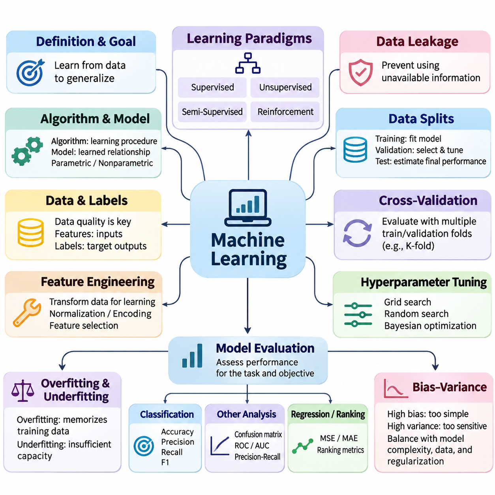
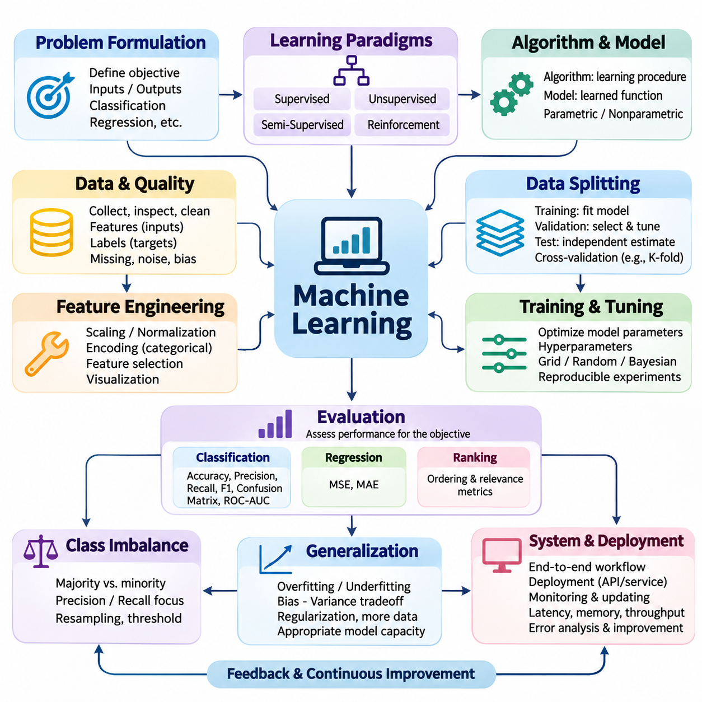
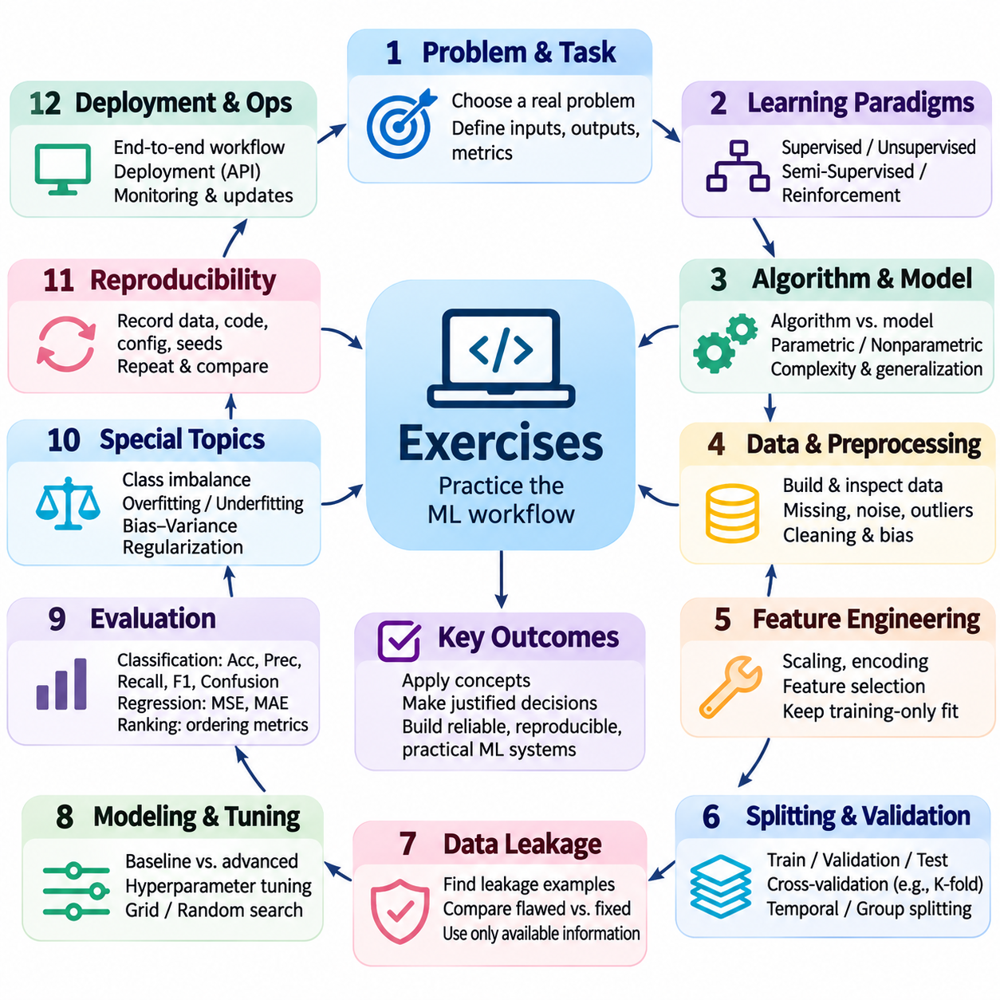
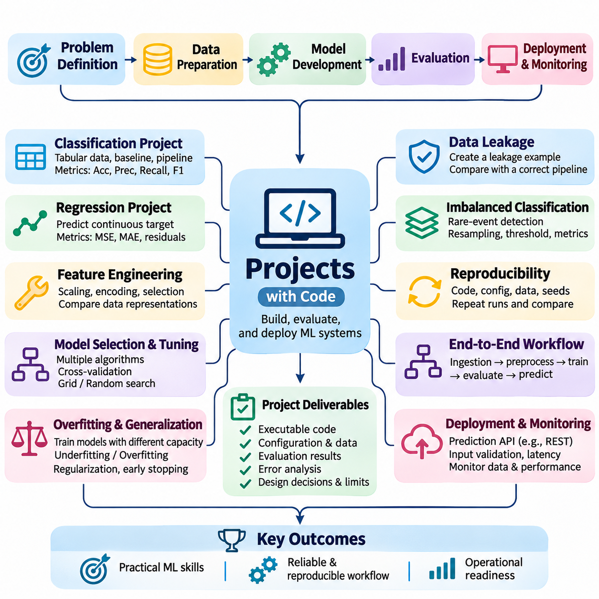

**Volume 07. Machine Learning Fundamentals**

# 09. Summary and Exercises

## 09.00 Key Takeaways

{width="7.268055555555556in" height="7.268055555555556in"}

Machine learning is the process of developing computational systems that improve their performance by learning patterns from data rather than relying entirely on explicitly programmed rules. Its fundamental objective is to generalize knowledge from observed examples to previously unseen situations. Successful machine learning requires a clear problem definition, suitable data, appropriate algorithms, reliable evaluation, and continuous improvement.

The major learning paradigms include supervised learning, unsupervised learning, semi-supervised learning, and reinforcement learning. Supervised learning uses labeled examples to predict outputs, while unsupervised learning discovers structures without predefined labels. Semi-supervised learning combines labeled and unlabeled data, whereas reinforcement learning develops decision-making policies through interaction and feedback.

A machine learning algorithm defines the procedure used to learn from data, while a model represents the learned relationships produced by that procedure. Parametric models typically use a fixed number of parameters for a given architecture, whereas nonparametric approaches can increase their effective complexity as data grows. Understanding this distinction helps practitioners select methods that match available data and computational resources.

Data quality is one of the strongest determinants of machine learning performance. Features describe measurable properties of observations, while labels represent the target outcomes in supervised learning. Poorly defined labels, inconsistent measurements, missing values, and irrelevant features can limit predictive accuracy. Reliable systems therefore require systematic data collection, inspection, cleaning, and validation.

Feature engineering transforms raw information into representations that learning algorithms can use effectively. Numerical features may require normalization or scaling, while categorical features often require encoding. Feature selection can reduce redundancy, computational cost, and unnecessary complexity. These transformations should preserve meaningful information and be designed according to the characteristics of the problem and model.

Data leakage occurs when information unavailable during actual prediction influences model training or evaluation. Leakage can arise from preprocessing before data splitting, target-derived features, duplicated observations, or inappropriate temporal relationships. Preventing leakage requires careful separation of datasets and fitting learned preprocessing transformations exclusively on permitted training data.

Training, validation, and test datasets serve different purposes within the learning process. Training data determines model parameters, validation data supports model selection and hyperparameter tuning, and test data estimates performance on unseen examples. A trustworthy evaluation process preserves the independence of the test set and avoids repeatedly adapting development decisions to its results.

Cross-validation improves performance estimation by evaluating a model across multiple training and validation partitions. K-fold cross-validation is particularly useful when available data is limited, although ordinary random folds may be inappropriate for temporal, grouped, or dependent observations. The splitting strategy must reflect how the system will encounter new data during actual deployment.

Hyperparameters control aspects of learning that are not directly estimated as ordinary model parameters. Grid search evaluates predefined combinations, random search samples candidate configurations, and Bayesian optimization uses previous observations to guide subsequent trials. Effective tuning balances predictive improvement against computational cost while maintaining consistent validation procedures.

Model evaluation must reflect the actual objective and consequences of prediction errors. Classification accuracy measures overall correctness but can be misleading when classes are imbalanced. Precision emphasizes the reliability of positive predictions, recall measures the detection of actual positives, and the F1 score combines precision and recall through their harmonic mean.

A confusion matrix reveals the distribution of correct and incorrect classification outcomes, helping identify systematic prediction failures. ROC curves and AUC summarize discrimination across classification thresholds, although their interpretation depends on the application. For imbalanced problems, precision-recall analysis may provide additional insight into performance on the positive class.

Regression models require evaluation measures suited to continuous numerical predictions. Mean squared error emphasizes larger errors through squaring, while mean absolute error expresses average error magnitude in the target\'s original units. Ranking tasks require metrics that assess the ordering and relevance of results. Metric selection should always consider business objectives, operational constraints, and error costs.

Overfitting occurs when a model learns training-specific patterns that do not generalize reliably to unseen observations. Underfitting occurs when a model lacks sufficient capacity, suitable features, or effective training to capture important relationships. Comparing training and validation performance helps diagnose these conditions, although learning curves and additional experiments provide stronger evidence.

The bias-variance perspective explains important sources of prediction error. High bias is commonly associated with overly restrictive assumptions, while high variance reflects sensitivity to changes in training data. Increasing model complexity can reduce certain forms of bias but may increase variance. Effective generalization requires balancing model capacity, data quantity, regularization, and training quality.

Regularization helps control model complexity and discourage solutions that depend excessively on training-specific details. Common strategies include parameter penalties, early stopping, and appropriate restrictions on model flexibility. Additional representative data can also improve generalization. The most effective intervention depends on whether observed limitations arise from data quality, insufficient capacity, or excessive complexity.

An end-to-end machine learning workflow connects problem formulation, data ingestion, preprocessing, model training, evaluation, deployment, monitoring, and updating. Each stage depends on the correctness of earlier decisions. A model with excellent validation results may still fail operationally when preprocessing differs between training and inference or when production inputs violate expected assumptions.

Machine learning pipelines improve consistency by organizing preprocessing and prediction into repeatable computational procedures. They help ensure that transformations are applied consistently across training, validation, testing, and inference. Well-designed pipelines also simplify experimentation, reduce implementation errors, and support reproducibility when configurations, datasets, dependencies, and random seeds are documented.

Deployment transforms an experimental model into a component that serves predictions within a larger software system. Production requirements may include response latency, throughput, memory consumption, availability, security, and compatibility with existing infrastructure. A practical deployment design must evaluate these constraints alongside predictive quality rather than assuming that the most accurate model is automatically preferable.

Monitoring is necessary because deployed models operate in environments that may change over time. Input distributions, relationships between features and targets, and user behavior can evolve, reducing prediction reliability. Monitoring should track data quality, system performance, prediction characteristics, and outcome-based metrics when labels become available. Detected changes should trigger investigation before corrective action.

Model updating should follow a controlled process rather than automatically replacing an existing model whenever new data appears. Retraining requires suitable data, reproducible experiments, consistent evaluation, and comparison against the deployed baseline. Version management and rollback procedures reduce operational risk. Continuous improvement depends on demonstrating measurable benefits without introducing unacceptable regressions.

Practical machine learning system design requires thinking beyond isolated algorithms. Data pipelines, models, application interfaces, infrastructure, monitoring, and human decision processes form an interconnected system. Improvements in one component may produce limited benefits if another component remains the primary bottleneck. System-level analysis helps identify changes that provide the greatest practical value.

Data-centric AI emphasizes improving the quality, consistency, coverage, and relevance of training data. Correcting mislabeled examples, addressing underrepresented conditions, and improving collection procedures can sometimes outperform increasing model complexity. Error analysis helps determine whether failures originate from ambiguous labels, insufficient examples, distribution differences, or limitations in the model itself.

Model selection should begin with a simple, reproducible baseline that establishes measurable reference performance. More complex approaches should be introduced when experiments demonstrate meaningful improvements. Selection criteria may include predictive accuracy, interpretability, training cost, inference efficiency, maintainability, and deployment constraints. Complexity is justified only when its benefits outweigh its additional operational burden.

Common machine learning pitfalls include inappropriate dataset splitting, excessive feature engineering, metric misuse, class imbalance, and distribution shift. These problems can produce misleading experimental conclusions even when implementation code runs correctly. Effective debugging examines data samples, intermediate transformations, prediction distributions, evaluation procedures, and model behavior before attempting increasingly sophisticated algorithms.

Reproducibility is essential for scientific reliability and practical engineering. Experiments should record dataset versions, preprocessing configurations, model definitions, hyperparameters, random seeds, software dependencies, and evaluation results. Repeating an experiment under controlled conditions helps distinguish genuine improvements from random variation. Clear documentation also supports collaboration, auditing, maintenance, and future model development.

The central lesson of machine learning fundamentals is that successful learning systems emerge from disciplined integration rather than algorithm selection alone. Reliable results require representative data, valid experimental design, appropriate metrics, controlled model complexity, and operational feedback. These principles provide the foundation for advanced supervised learning, unsupervised learning, reinforcement learning, and increasingly complex AI systems.

## 09.01 Concept Map

{width="7.268055555555556in" height="7.268055555555556in"}

A machine learning concept map organizes the fundamental principles of learning systems into a connected framework. At its center is the objective of learning useful patterns from data and applying them to unseen observations. Problem formulation, data preparation, model training, evaluation, and deployment form the major components. Their relationships explain how individual technical decisions influence the reliability of the complete system.

Problem formulation establishes the starting point of the machine learning process. A practical objective must be translated into a measurable learning task with clearly defined inputs, outputs, and success criteria. Classification predicts categories, regression estimates continuous values, and other learning tasks discover structures or optimize decisions. The selected objective determines subsequent choices concerning data, algorithms, and evaluation.

Learning paradigms provide the first major conceptual branch. Supervised learning uses labeled observations to estimate relationships between inputs and targets. Unsupervised learning identifies patterns without predefined target labels. Semi-supervised learning combines labeled and unlabeled examples, while reinforcement learning learns policies through interaction with an environment. Each paradigm establishes different requirements for data and feedback.

The relationship between algorithms and models forms another essential connection. An algorithm specifies the procedure for extracting information from training data, whereas a model represents the learned function or structure. Parametric approaches use a fixed parameterization for a given architecture, while nonparametric methods may adapt their effective complexity as observations increase. These distinctions influence flexibility, computational requirements, and generalization.

Data occupies a central position because every learning stage depends on its quality and relevance. Raw observations must be collected, inspected, cleaned, and transformed into usable representations. Features describe the information available for prediction, while labels define expected outputs in supervised tasks. Missing values, measurement noise, inconsistent annotations, and sampling bias can propagate through the entire learning workflow.

Feature engineering connects raw data to model representation. Numerical variables may require scaling, categorical variables may require encoding, and irrelevant attributes may be removed through feature selection. Visualization supports understanding distributions, relationships, and unusual observations. Effective preprocessing preserves predictive information while preventing unintended dependencies between training data and evaluation data.

Data splitting connects preparation to trustworthy experimentation. Training data supports parameter estimation, validation data guides model selection, and test data provides an independent estimate of generalization. Cross-validation extends this process by evaluating models across multiple partitions. The splitting strategy must respect temporal order, group membership, and other dependencies whenever random partitioning would create unrealistic evaluation conditions.

The training process connects model structure, optimization, and observed examples. A learning algorithm adjusts model parameters to reduce an objective or loss function. Hyperparameters influence model capacity, optimization behavior, and regularization. Grid search, random search, and Bayesian optimization provide different strategies for exploring configurations. Reliable experiments require consistent preprocessing, controlled comparisons, and reproducible execution.

Evaluation metrics connect numerical predictions to practical objectives. Classification performance can be described through accuracy, precision, recall, F1 score, confusion matrices, and ROC-AUC. Regression performance can be measured using mean squared error and mean absolute error. Ranking applications require measures of ordering quality. Metric selection must reflect the consequences of errors rather than relying on a single universal score.

Class imbalance creates an important connection between data distribution and evaluation. A model can achieve high accuracy by favoring the majority class while performing poorly on rare but important outcomes. Precision and recall reveal different aspects of this behavior. Resampling, threshold adjustment, and suitable evaluation measures can address specific difficulties, although each intervention requires validation against the intended application.

Generalization links training performance to behavior on unseen data. Overfitting occurs when a model captures training-specific details that do not transfer reliably, while underfitting occurs when important relationships remain unlearned. The bias-variance perspective explains how model flexibility influences these problems. Regularization, improved data, appropriate capacity, and careful validation help establish a practical balance.

The end-to-end workflow connects experimentation with operational implementation. Data ingestion supplies observations, preprocessing creates consistent representations, training produces a model, and evaluation determines whether performance satisfies requirements. Deployment exposes predictions through an application or service. Monitoring and model updating complete the lifecycle by connecting operational observations to future improvements.

Practical system design introduces relationships beyond predictive performance. Model accuracy must be considered alongside latency, memory consumption, throughput, scalability, maintainability, and infrastructure constraints. Data-centric improvements may provide greater value than increasing algorithmic complexity. Error analysis identifies weaknesses, while feedback loops help determine whether improvements should target data, models, evaluation procedures, or operational components.

Common machine learning pitfalls can be understood as failures in the connections between stages. Data leakage compromises the boundary between training and evaluation. Poor splitting produces unrealistic performance estimates, while metric misuse creates misleading conclusions. Excessive engineering increases complexity without demonstrated benefits. Distribution shift weakens assumptions established during development and may reduce deployed model reliability.

Debugging and reproducibility provide supporting connections across the entire framework. Examining data samples, intermediate transformations, learning curves, and prediction errors helps identify the origin of failures. Recording dataset versions, configurations, random seeds, and experimental results supports repeatable comparisons. These practices transform machine learning from isolated experimentation into a disciplined engineering process.

The complete concept map represents machine learning as an iterative system rather than a strictly linear sequence. Evaluation findings can motivate changes to features, model capacity, or data collection. Deployment monitoring can reveal new failure conditions that require further investigation and retraining. Every feedback cycle should preserve valid experimental boundaries while producing measurable improvements in system behavior.

Understanding these relationships provides a foundation for advanced machine learning. Supervised learning develops specialized prediction methods, unsupervised learning explores hidden data structure, and reinforcement learning extends learning toward sequential decision-making. More sophisticated architectures and deployment systems build upon the same principles of data quality, generalization, evaluation, reproducibility, and continuous improvement.

## 09.02 Exercises

{width="7.268055555555556in" height="7.268055555555556in"}

The exercises in machine learning fundamentals are designed to transform conceptual understanding into practical problem-solving skills. Each exercise should require learners to explain assumptions, justify methodological choices, and interpret experimental outcomes. The objective is not simply to obtain correct predictions but to demonstrate a disciplined understanding of data preparation, model development, evaluation, and operational reliability.

Begin by selecting a real-world problem and expressing it as a machine learning task. Identify the intended users, available inputs, expected outputs, and measurable success criteria. Determine whether classification, regression, clustering, or sequential decision-making provides the most appropriate formulation. Explain why machine learning is suitable and identify situations where a rule-based solution might be sufficient.

Compare supervised, unsupervised, semi-supervised, and reinforcement learning through practical scenarios. Consider a labeled product classification dataset, an unlabeled customer dataset, a partially annotated image collection, and an interactive robotic environment. For each scenario, explain the available supervision, expected learning objective, required feedback, and principal limitations of the selected learning paradigm.

Investigate the distinction between a learning algorithm and a trained model. Select two algorithms with different assumptions and describe how their training procedures produce predictive functions. Compare parametric and nonparametric approaches in terms of flexibility, computational requirements, and sensitivity to training data. Explain why model complexity alone cannot determine expected generalization performance.

Construct a small dataset containing numerical and categorical features, missing observations, inconsistent labels, and potential outliers. Examine the dataset and document the problems that could affect training. Propose appropriate cleaning procedures while distinguishing genuine anomalies from valid rare observations. Explain how incorrect preprocessing decisions could remove useful information or introduce systematic bias.

Design a feature engineering experiment using a dataset with variables measured on different scales. Compare model behavior before and after numerical scaling and categorical encoding. Investigate whether feature selection improves interpretability, computational efficiency, or predictive performance. Ensure that preprocessing parameters are learned only from training data and applied consistently to validation and test observations.

Create training, validation, and test partitions for a supervised learning problem. Explain the purpose of each partition and demonstrate why test data must remain independent of model selection. Repeat the experiment using cross-validation and compare the stability of performance estimates. Discuss how temporal ordering, repeated observations, or group membership could require alternative splitting strategies.

Develop an example of data leakage and explain why it produces misleading evaluation results. Consider a preprocessing transformation fitted on the complete dataset or a feature containing information derived from the prediction target. Compare the flawed procedure with a corrected pipeline. Identify which information would actually be available when the model generates predictions in a production environment.

Train a simple baseline model and compare it with a more flexible alternative. Record training and validation performance, computational requirements, and important configuration settings. Investigate whether additional complexity produces a meaningful improvement. Explain how baseline comparisons help distinguish genuine progress from unnecessary engineering and support more reliable model selection.

Perform hyperparameter tuning using grid search or random search on a selected model. Define the search space, evaluation metric, and validation procedure before beginning experimentation. Compare the selected configuration against the original baseline and examine whether improvements remain consistent across validation partitions. Discuss the computational tradeoffs associated with more extensive optimization.

Evaluate a classification model using accuracy, precision, recall, F1 score, and a confusion matrix. Construct a scenario in which false positives and false negatives have different consequences. Explain which metric should receive greater emphasis and why. Investigate how changing the decision threshold affects precision and recall without necessarily changing the model\'s underlying probability estimates.

Create an imbalanced classification problem in which one class occurs much less frequently than another. Train a baseline classifier and examine why overall accuracy may conceal poor minority-class detection. Compare suitable metrics and investigate a resampling strategy applied only within the training process. Explain how class distribution, threshold selection, and operational error costs influence evaluation.

Evaluate a regression model using mean squared error and mean absolute error. Introduce several unusually large prediction errors and examine how the two metrics respond. Explain why squared error places greater emphasis on large deviations and why absolute error may be easier to interpret in original measurement units. Relate metric selection to the practical consequences of prediction mistakes.

Investigate overfitting and underfitting by training models with different levels of complexity. Compare training and validation errors and describe the patterns associated with insufficient capacity and excessive flexibility. Apply a regularization strategy or adjust model capacity to improve generalization. Explain how the bias-variance perspective supports interpretation without providing a complete diagnosis of every failure.

Design a reproducible experiment that records dataset versions, preprocessing procedures, model configurations, hyperparameters, and random seeds. Repeat training under controlled conditions and compare the resulting measurements. Identify sources of variation that may remain despite fixed seeds. Explain why reproducibility is essential for scientific comparison, collaborative development, and reliable maintenance.

Construct an end-to-end machine learning workflow connecting data ingestion, preprocessing, training, evaluation, and prediction serving. Describe the responsibilities of each component and identify the information exchanged between stages. Explain how inconsistent transformations or undocumented dependencies can create deployment failures even when experimental performance appears satisfactory.

Develop a deployment plan for a model operating under specified latency, memory, and throughput constraints. Compare two candidate models with different predictive performance and computational requirements. Determine which candidate better satisfies the complete application requirements. Explain why the highest validation score does not automatically identify the most appropriate production model.

Design a monitoring strategy for a deployed prediction service. Identify indicators of input data quality, distribution shift, inference latency, and prediction behavior. Explain how delayed or unavailable ground-truth labels affect performance monitoring. Propose an investigation process that distinguishes infrastructure failures, changing data distributions, and genuine deterioration in predictive quality.

Conduct an error analysis by examining incorrectly predicted observations from a validation dataset. Group failures according to relevant features, input conditions, or target categories. Determine whether the observed patterns suggest insufficient training coverage, inconsistent labels, unsuitable features, or limited model capacity. Propose a targeted improvement and describe how its effectiveness should be measured.

Examine a machine learning system affected by distribution shift between development and deployment. Compare the original training distribution with a hypothetical operational dataset containing new conditions. Identify which assumptions may no longer hold and explain how this affects evaluation reliability. Propose data collection, monitoring, and controlled retraining procedures to restore performance.

Conclude by designing an integrated experiment that combines problem formulation, data preparation, baseline modeling, hyperparameter tuning, evaluation, and error analysis. Document the reasoning behind each methodological decision and identify potential sources of leakage or bias. Assess the resulting system using both predictive metrics and practical constraints, then propose a justified improvement plan.

The final reflection should explain how the exercises connect individual machine learning concepts into a coherent engineering discipline. Learners should demonstrate that trustworthy performance depends on representative data, valid evaluation, appropriate complexity, reproducible experiments, and operational feedback. The ultimate objective is to develop the ability to design, diagnose, and improve machine learning systems systematically.

## 09.03 Projects [w/Code]

{width="7.268055555555556in" height="7.268055555555556in"}

The projects in machine learning fundamentals integrate theoretical knowledge with practical engineering through complete, reproducible implementations. Each project should demonstrate problem formulation, data preparation, model development, evaluation, and interpretation. The emphasis is on constructing reliable workflows rather than achieving the highest possible benchmark score. Learners should document assumptions, experimental decisions, limitations, and measurable outcomes.

A foundational classification project can begin with a publicly available tabular dataset containing numerical and categorical attributes. The objective is to predict a defined target category using supervised learning. Learners should inspect feature distributions, identify missing values, examine class balance, and establish a simple baseline. The project should produce a reproducible training pipeline and an independent evaluation report.

Data preprocessing should be implemented as a consistent sequence of transformations. Numerical features may require imputation and scaling, while categorical attributes may require encoding. Preprocessing parameters must be estimated from training data without accessing validation or test information. A practical implementation using Python and scikit-learn can combine transformations and estimators into a single pipeline.

Model development should begin with an interpretable baseline such as logistic regression or a shallow decision tree. More flexible alternatives can then be evaluated under identical data partitions and metrics. Learners should compare predictive performance, training time, inference requirements, and model complexity. The objective is to determine whether additional sophistication provides a measurable improvement.

A classification evaluation project should examine accuracy, precision, recall, F1 score, and confusion matrices. Learners should investigate how prediction thresholds influence error distributions and determine which mistakes are most costly in the intended application. When classes are imbalanced, evaluation should emphasize minority-class behavior rather than overall accuracy alone. Results should be interpreted in operational terms.

A regression project can use structured observations to estimate a continuous target such as energy consumption, equipment temperature, or product demand. Learners should establish a baseline prediction method, train a regression model, and compare mean absolute error with mean squared error. Residual analysis should identify systematic patterns, unusual predictions, and conditions where the model performs poorly.

Feature engineering experiments should investigate how data representation affects predictive quality. Learners can compare raw numerical variables, scaled features, encoded categories, and selected feature subsets. Each configuration should use the same validation strategy to ensure fair comparison. Results should demonstrate whether improvements originate from better information representation rather than increased model complexity.

A model selection project should compare multiple candidate algorithms using cross-validation. Hyperparameters can be explored through grid search or randomized search while keeping the final test dataset isolated. Learners should record the selected configurations, validation scores, computational costs, and observed variability. The final model should be justified through consistent evidence rather than a single favorable result.

An overfitting investigation should train models with progressively increasing capacity. Training and validation errors should be recorded to identify underfitting, appropriate fitting, and overfitting behavior. Regularization or early stopping can then be introduced where supported by the selected algorithm. Learners should explain how model flexibility, training data quantity, and validation evidence influence generalization.

A data leakage demonstration should intentionally construct an invalid experimental workflow and compare it with a corrected implementation. Possible examples include fitting a scaler before dataset splitting or including information derived from the target. Learners should measure the difference in reported performance and explain why the flawed result cannot be trusted. The corrected pipeline should enforce strict separation of training and evaluation information.

An imbalanced classification project can simulate rare-event detection using a dataset with unequal class frequencies. Learners should establish a baseline, evaluate precision and recall, and investigate threshold adjustment or training-only resampling. The project should compare alternative approaches under identical evaluation conditions. Particular attention should be given to the practical consequences of missed events and false alarms.

A reproducibility project should organize code, configuration files, dataset references, and experiment outputs into a consistent repository structure. Random seeds, software versions, preprocessing settings, and model parameters should be recorded. Repeated runs should be compared to identify expected variability. The project should demonstrate that another practitioner can reproduce the principal experimental results using documented instructions.

An end-to-end machine learning project should connect data ingestion, preprocessing, model training, evaluation, and inference within one executable workflow. Learners can implement separate modules for each responsibility while maintaining consistent data interfaces. The completed system should accept new observations and return predictions using the same transformations established during training.

A simple deployment project can expose a trained model through a lightweight prediction API. The application should validate input structure, load the saved preprocessing pipeline and model, and return a clearly defined response. Learners should test normal inputs, missing fields, invalid values, and unexpected categories. The project should also measure basic inference latency and identify operational limitations.

A monitoring project should simulate changes in incoming data after deployment. Learners can compare feature distributions, prediction frequencies, and inference performance across successive batches. When labeled outcomes are available, predictive metrics should also be evaluated. The project should distinguish data drift from confirmed performance degradation and define conditions that justify investigation or retraining.

An error analysis project should examine incorrectly predicted observations and organize them into meaningful failure categories. Learners should investigate whether errors correlate with particular features, rare conditions, or ambiguous labels. Based on the findings, they should propose a targeted intervention involving data collection, preprocessing, or model selection. The improvement must be evaluated against the original baseline.

A practical system design project should compare models under constrained computational resources. Learners should evaluate prediction quality alongside memory consumption, inference latency, throughput, and maintenance requirements. A smaller model may be preferable when operational efficiency outweighs a modest accuracy difference. The final recommendation should explain the relationship between technical performance and application requirements.

An integrated capstone project should combine the preceding concepts into a complete machine learning system. The workflow should include problem definition, dataset preparation, leakage prevention, baseline modeling, cross-validation, hyperparameter tuning, independent testing, deployment, and monitoring. Each stage should produce documented artifacts that support verification and future maintenance.

Project assessment should consider correctness, experimental validity, reproducibility, interpretability, and operational readiness. A strong submission should contain executable code, configuration information, evaluation results, error analysis, and a clear explanation of design decisions. Limitations should be documented explicitly, including dataset assumptions, potential distribution shifts, and conditions under which predictions may become unreliable.

The final project review should connect technical results with the broader principles of machine learning engineering. Learners should explain how data quality, model complexity, evaluation methodology, and deployment constraints interact. They should also identify opportunities for improvement through additional data, better validation, targeted debugging, or controlled model updating. These projects establish a practical foundation for more advanced learning systems.
